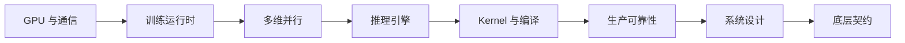

<!-- Generated by tools/sync_aiinfra_megatron_interview_posts.py. -->

## 系列说明

这套题库以 8 张 Tesla V100 PCIe 的真实实验为证据底座，共包含 **145 道核心题**和 **8 道编码/上机题**。内容从 GPU 基础、训练运行时、多维并行和推理引擎，逐步深入到 kernel、生产可靠性、系统设计和框架底层契约。

## 十级题库

| 分卷 | 题号 | 文章 | 核心范围 |
| --- | --- | --- | --- |
| Level 1 | Q01-Q12 | [GPU 与性能基础](/posts/aiinfra-interview-level-1-gpu-performance/) | GPU 瓶颈、显存、Roofline、拓扑、collective、精度与 benchmark |
| Level 2 | Q13-Q26 | [DDP、FSDP 与训练运行时](/posts/aiinfra-interview-level-2-training-runtime/) | 梯度同步、bucket overlap、ZeRO/FSDP、checkpoint 与数值诊断 |
| Level 3 | Q27-Q40 | [TP、SP、CP、PP 与 EP](/posts/aiinfra-interview-level-3-model-parallel/) | Tensor、Sequence、Context、Pipeline、Expert Parallel 及组合选型 |
| Level 4 | Q41-Q54 | [推理引擎与在线服务](/posts/aiinfra-interview-level-4-inference-serving/) | KV Cache、PagedAttention、调度、SLO、P/D 分离、投机解码与量化 |
| Level 5 | Q55-Q64 | [Kernel、编译与性能工程](/posts/aiinfra-interview-level-5-kernel-compiler/) | Profiling、算术强度、FlashAttention、Triton、occupancy 与图编译 |
| Level 6 | Q65-Q74 | [集群、可靠性与 RL Infra](/posts/aiinfra-interview-level-6-production-reliability/) | 可观测性、hang/straggler/OOM、恢复、数据、放置、过载与 RL 系统 |
| Level 7 | Q75-Q84 | [项目答辩与高压追问](/posts/aiinfra-interview-level-7-project-defense/) | 实验数字、证据边界、反直觉结果和项目价值的现场防守 |
| Level 8 | Q85-Q90 | [系统设计](/posts/aiinfra-interview-level-8-system-design/) | 70B/MoE 训练、在线推理、百万上下文、checkpoint 与自动并行搜索 |
| Level 9 | Q91-Q115 | [工程实现与实验深挖](/posts/aiinfra-interview-level-9-engineering-deep-dive/) | DDP/NCCL/MoE/checkpoint/Triton/vLLM 实验的实现与归因细节 |
| Level 10 | Q116-Q145 | [运行时与底层契约](/posts/aiinfra-interview-level-10-runtime-contracts/) | Process group、stream、FSDP 状态机、KV 抢占和 kernel 资源证据 |

## 配套内容

- [编码题、岗位选题、六周训练计划与评分表](/posts/aiinfra-interview-practical-guide/)
- [Megatron M001-M140 专家题库](/posts/megatron-interview-series/)
- [vLLM / SGLang 源码面试题系列](/posts/vllm-sglang-interview-series/)
- [NCCL 面试题与评分指南](/posts/nccl-interview-guide/)
- [V100 实验报告](/assets/files/v100-aiinfra-interview/EXPERIMENT_REPORT.md)
- [工程深挖补充报告](/assets/files/v100-aiinfra-interview/ENGINEERING_DEEP_DIVE_REPORT.md)
- [题库与实验来源清单](/assets/files/v100-aiinfra-interview/SOURCE_MANIFEST.md)

## 1. 这份题库怎么用

### 1.1 对应的岗位方向

当前基模组的 AI Infra 岗位通常不是一个单一工种，可以拆成五类能力画像：

1. **训练系统与性能**：分布式并行、通信、显存、MFU、数据与 checkpoint 路径、稳定性。
2. **推理引擎与服务**：KV cache、调度、并行部署、量化、吞吐/时延/SLO、资源隔离。
3. **GPU 内核与编译器**：CUDA/Triton、算子融合、访存、occupancy、图编译、CUDA Graph。
4. **集群与可靠性**：多机网络、拓扑放置、故障检测、容错恢复、可观测性、容量与成本。
5. **后训练与 RL Infra**：训练/推理协同、异步 rollout、权重同步、数据新鲜度和集群调度。

这种划分和公开岗位要求一致。例如 OpenAI 的 Training Performance Engineer 明确覆盖计算、通信、存储、GPU kernel、collective、sharding、MFU 与 checkpoint；其 RL Training Infra 和 Platform Systems 岗位还强调训练/推理编排、故障处理与可观测性。Anthropic 的公开岗位列表也分别设置 GPU Performance、Inference Systems、Pretraining Scaling、ML Networking 与 RL Systems 等方向。参考文档见文末。

### 1.2 本项目已经能证明什么

| 能力 | 本机实验论据 | 面试中应如何表达 |
|---|---|---|
| 拓扑与通信 | PIX/PHB/SYS 配对，AllReduce/AllGather/ReduceScatter/SendRecv，8 卡 collective | 不只报带宽；解释链路、算法字节量、慢链路和并发竞争 |
| 实验设计 | warmup、重复、控制变量、correctness、原始日志、归一化结果、自动校验 | 区分观测、推断和未验证假设 |
| 数据并行 | DDP 强/弱扩展、实际 reducer bucket、gradient accumulation、CUDA 区间 overlap | 从计算/通信比、bucket 发起时机和 exposed communication 解释扩展效率 |
| 参数分片 | FSDP `SHARD_GRAD_OP`/`FULL_SHARD`，root/block wrap，prefetch/limiter trace | 从 unit 状态机解释显存、AllGather/ReduceScatter、overlap 和吞吐 |
| 模型并行 | Megatron TP/SP/PP、长序列、重计算；显式 `TP2 x PP2 x DP2` process group | 用切分维度、rank mapping 和 communicator 契约推导，不背结论 |
| MoE 数据路径 | variable-split All-to-All、热点 expert、dispatch/combine 回环校验 | 区分网络传输、peer wait、路由偏斜与 expert GEMM |
| 推理服务 | continuous batching、compile、TP/DP、prefix 驱逐、Poisson SLO、KV preemption | 分开准入、抢占、容量、吞吐、TTFT、TPOT、工作集和 goodput |
| Kernel | Triton RMSNorm、FP32 oracle、shape/warps sweep、cubin resources | 解释融合、launch floor、register、理论 occupancy 与硬件 counter 边界 |
| 可靠性 | 原子 manifest、checksum、RNG/data cursor、bitwise resume、rank/collective failure | 区分语义恢复、逐 bit 回放、故障检测和进程清理 |
| 兼容性诊断 | SM70 wheel、attention backend 回退、custom all-reduce 禁用 | 能沿硬件架构、二进制、kernel backend 和运行日志定位 |

### 1.3 当前证据不能证明什么

面试时主动说明边界比夸大项目更专业。本项目尚未实测：

- 多机 InfiniBand/RoCE、GPUDirect RDMA、交换网络拥塞和跨机容错；
- 真实框架 MoE expert parallel、top-k router、capacity/drop、grouped GEMM 与 expert load balancing；
- context parallel 和超长上下文 attention 通信；
- FSDP2/DTensor、异步 distributed checkpoint 和跨 world-size reshard；
- Triton backward、autotune 和 Nsight Compute 级硬件 counter；
- 真实 70B/百亿级训练的端到端 MFU、数据管道和长时间稳定性；
- 大规模 RL rollout、权重同步与训练/推理解耦。

这些内容仍然会出现在后半部分，因为它们决定候选人能否从“做过单机实验”上升到“能设计生产系统”。回答时要明确哪些是实测，哪些是根据机制推导。

### 1.4 统一评分标准

每题按 0-4 分评价：

| 分数 | 表现 |
|---:|---|
| 0 | 不知道概念，或核心方向错误 |
| 1 | 能给定义，但不能解释机制或边界 |
| 2 | 能画数据流、给关键公式，结论基本正确 |
| 3 | 能讨论 trade-off、瓶颈和应观测指标，并连接实测经验 |
| 4 | 能处理反例、故障和规模变化，提出可验证实验或生产设计 |

推荐每个回答使用同一骨架：

1. 先澄清硬件、模型、精度、batch、序列长度和 SLO。
2. 画出 tensor/请求的数据流，写出显存、FLOPs 或通信字节量。
3. 找关键路径，判断 compute-bound、memory-bound、communication-bound 还是 queueing-bound。
4. 给出指标、profiler 事件、对照组和预期现象。
5. 最后讲例外、失败模式，以及本项目证据是否足够。

### 1.5 推荐模拟面试轮次

| 轮次 | 时长 | 题目范围 | 通过标准 |
|---|---:|---|---|
| 项目深挖 | 60 分钟 | Q75-Q84、Q91-Q115 中抽 8-10 题 | 能从原始证据解释实现、计量、失败和局限 |
| 运行时底层 | 60 分钟 | Q116-Q145 中抽 8-10 题 | 能落到 communicator、stream、分片/调度状态机和 profiler 证据 |
| 分布式训练 | 60 分钟 | Q13-Q40 | 能从切分方式推导通信和显存 |
| 推理系统 | 60 分钟 | Q41-Q54、Q87 | 能建立排队、KV 和调度模型 |
| 性能/内核 | 60 分钟 | Q01-Q12、Q55-Q64 | 会用 profiler/roofline 缩小问题 |
| 系统设计 | 60 分钟 | Q65-Q74、Q85-Q90 | 先定约束，再做容量、可靠性和观测设计 |
| 编码实践 | 60-90 分钟 | C01-C08 | 正确性、复杂度、测试和可观测性完整 |

---
