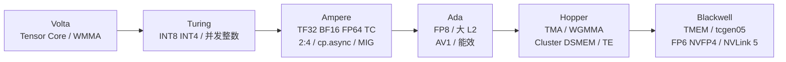
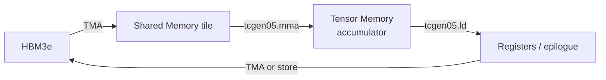

> 本文面向训练、推理和 Kernel 工程。它不只罗列峰值参数，而是回答三件事：每代硬件要解决什么瓶颈，数据怎样穿过 HBM、Shared Memory、寄存器和 Tensor Core，以及这些变化何时能转化成端到端收益。规格以 2026-07-21 能查到的 NVIDIA、CUDA 和 OEM 官方资料为准。

## 先建立正确的比较方法

谈“某代 GPU 支持什么”时，必须区分三个层次：

1. **架构能力**：指令集和 SM 能不能做，例如 Hopper 支持 TMA、WGMMA，Blackwell 支持 `tcgen05` 和 Tensor Memory。
2. **芯片启用量**：同一颗芯片会屏蔽不同数量的 SM、Tensor Core 或显存控制器。例如 H100 SXM 与 H100 PCIe 都是 Hopper，但分别是 132 和 114 个 SM。
3. **板卡/系统能力**：显存容量、功耗、NVLink、MIG 和散热形态由具体 SKU 决定。例如 RTX 5090 也叫 Blackwell，却不能等同于数据中心 B200。

因此，**架构名相同不代表软件可见能力、峰值和部署方式相同**。本文的“版本”指 NVIDIA 参考产品中的容量、PCIe/SXM/NVL 和区域型号；各板卡厂商的 OC、风冷、水冷外观版本不重复列举。

## 一张图看完七年的主线



这条演进线不是“每代多一些 FLOPS”，而是同时优化四类瓶颈：

| 维度 | Volta/Turing | Ampere/Ada | Hopper | Blackwell |
|---|---|---|---|---|
| 数值格式 | FP16；随后加入 INT8/INT4 | TF32、BF16、FP64 TC、FP8 | FP8 Transformer Engine | FP6、NVFP4，第二代 Transformer Engine |
| 数据搬运 | `load -> register -> shared` | `cp.async` 直达 Shared Memory | TMA 描述符驱动的多维异步搬运 | TMA 延续，TMEM 专门保存 MMA 累加器 |
| Tensor Core 发射 | WMMA/MMA，warp 粒度 | MMA，warp 粒度 | WGMMA，4 warp 的 warpgroup | `tcgen05.mma`，支持 CTA/CTA-pair 与 TMEM |
| 资源与隔离 | 无 MIG | A100 引入 MIG | 第二代 MIG、Thread Block Cluster | 更大模型吞吐、RAS、机密计算继续增强 |
| 扩展互联 | NVLink 2 | NVLink 3 | NVLink 4 | NVLink 5，B200 级别 1.8 TB/s 双向 |

## 修正版架构总览

表里的 SM 和带宽是代表 SKU，不能替代后文的版本表。

| 架构 | 代表卡 | 主要新增能力 | 代表 SM | 代表显存带宽 | 更适合的工作负载 |
|---|---|---|---:|---:|---|
| Volta | V100 16/32 GB | 第一代 Tensor Core、独立 FP32/INT32 路径、NVLink 2 | 80 | 900 GB/s；V100S 1,134 GB/s | FP16 混合精度训练、HPC |
| Turing | T4 16 GB | 第二代 Tensor Core，INT8/INT4/INT1；RT Core；低功耗媒体引擎 | **40** | 320 GB/s | 小模型推理、视频推理、边缘和云实例 |
| Ampere | A100、A800、A10 | 第三代 Tensor Core；TF32/BF16/FP64 TC；2:4 稀疏；`cp.async`；MIG | A100/A800 108；A10 72 | 600 GB/s 至 2,039 GB/s | 大模型训练、HPC、多租户推理 |
| Ada Lovelace | L4、L20、L40S、RTX 4090 | 第四代 Tensor Core、FP8、大 L2、AV1；强调推理能效 | L20 **92**；L40S 142；4090 128 | 300 至 1,008 GB/s | 单机推理、图形/视频 AI、中小模型微调 |
| Hopper | H100、H200、H800、H20 | TMA、WGMMA、FP8 Transformer Engine、Cluster/DSMEM、DPX、NVLink 4 | SXM H100/H200 132；H20 约 78 | 2.0 至 4.8 TB/s | LLM 训练、长上下文推理、多卡扩展 |
| Blackwell 数据中心 | B200/GB200、B300/GB300 | 第五代 Tensor Core、FP6/NVFP4、TMEM、`tcgen05`、RAS、NVLink 5；Ultra 增强 attention | **最高 160** | 约 7.7 至 8 TB/s | MoE、超大模型训练和高吞吐推理 |
| Blackwell RTX | RTX 5090 / D / D v2 | 第五代 Tensor Core、FP8/FP4、GDDR7、媒体引擎 | 170 | 1,344 至 1,792 GB/s | 本地推理、原型验证、消费级创作 |

原始参数表中最值得先纠正的四点是：

- T4 不是 32 SM，而是 **40 SM**。
- L20 不是 142 SM，而是 **92 SM**；142 SM 对应 L40/L40S。
- A100 的 TF32/BF16 是第三代 **Tensor Core** 的运算模式，不是普通 CUDA Core 的新增格式。
- 当前量产资料里的 B200 是 **160 SM、20,480 CUDA Core、180 GB HBM3e、约 7.7 至 8 TB/s**，不是 182 SM、5.76 TB/s。早期发布材料出现过不同显存口径，采购和建模应以实际料号为准。

### 每代 SM 周围新增了哪些专用结构

| 架构 | Tensor/数值结构 | 片上存储与搬运 | 调度/隔离 | 互联与专用引擎 |
|---|---|---|---|---|
| Volta | 第一代 Tensor Core、FP16 WMMA | 统一 L1/Shared 设计 | Independent Thread Scheduling | NVLink 2 |
| Turing | 第二代 Tensor Core、INT8/INT4；第一代 RT Core | 更高 L1/Shared 带宽 | FP/INT 并发 | NVENC/NVDEC，NVLink 仅部分高端图形 SKU，T4 无 |
| Ampere | 第三代 Tensor Core、TF32/BF16/FP64 TC、2:4 | `cp.async`、async barrier、A100 40 MB L2 | MIG、task graph acceleration | NVLink 3，A10 媒体引擎 |
| Ada | 第四代 Tensor Core、FP8；第三代 RT Core | 显著增大的 L2 | Shader Execution Reordering 面向图形 | 第八代 NVENC、AV1、OFA；本文 Ada 卡均无 NVLink |
| Hopper | 第四代 Tensor Core、FP8 TE、WGMMA、DPX | TMA、mbarrier、DSMEM | Thread Block Cluster、第二代 MIG | NVLink 4、机密计算、7 NVDEC/7 NVJPEG |
| Blackwell | 第五代 Tensor Core、`tcgen05`、FP6/NVFP4 | TMEM、TMA、NV-HBI coherent fabric | CTA-pair、MIG、RAS | NVLink 5、decompression engine；Ultra 增强 SFU attention |

这里的结构仍需落到具体芯片：例如 Ada 架构支持 NVLink 的说法不能推出 L20/L40S/4090 有 NVLink；Blackwell 数据中心和 RTX 的 Compute Capability 也不同。

## Volta：把矩阵乘变成 SM 的一级公民

### 要解决的问题

深度学习训练的大量时间花在 GEMM/卷积。Pascal 的 CUDA Core 可以计算 FP16，但缺少专门执行小矩阵乘加的硬件；仅靠降低存储精度不能充分提高矩阵吞吐。

### 输入、输出和实现

第一代 Tensor Core 接受 FP16 矩阵 tile，执行矩阵乘累加。编程模型通过 WMMA 把 A、B、C/D fragment 交给 warp：

$$D = A \times B + C$$

常见训练路径用 FP16 输入、FP32 累加和 FP32 master weights。这里“fragment 在寄存器中”不等于 Tensor Core 只能读取一条普通寄存器指令；真实流程是 global memory 到 shared/register 的软件分块，再由 warp 共同提交 fragment。

### 得到的效果与限制

- 计算密集的 FP16 GEMM 获得远高于 FP32 CUDA Core 的峰值。
- 混合精度训练开始成为通用方法，但 loss scaling、算子覆盖和数值稳定性仍由软件负责。
- 数据搬运仍需要较多显式 load/store 和地址计算；当 tile 不能复用或形状不合适时，Tensor Core 峰值没有意义。

Volta 还让 FP32 与 INT32 单元可以并发执行，使地址计算更少挤占浮点管线；V100 的 NVLink 2 则改善多卡训练通信。

## Turing：把低精度推理和媒体处理拉进数据中心

### 要解决的问题

推理通常比训练更在意每瓦吞吐、单请求成本和视频编解码。FP16 对很多已量化网络仍然过重，纯 CUDA Core 做 INT8/INT4 又无法充分利用矩阵结构。

### 输入、输出和实现

第二代 Tensor Core 增加 INT8、INT4，架构还支持更低位整数模式；整数 Tensor Core 通常输出 INT32 累加值，再由 epilogue 完成缩放、偏置和量化。T4 同时加入独立的 Turing NVENC/NVDEC 和 RT Core，且整卡只有 70 W。

### 得到的效果与限制

- 对校准良好的卷积、视觉和小模型，INT8/INT4 显著降低计算和内存流量。
- T4 的 16 GB 容量与 320 GB/s 带宽限制了今天的大语言模型；它的优势是功耗、部署密度和视频能力，而不是单卡大模型峰值。
- 量化收益取决于量化误差、kernel 覆盖、batch 和反量化开销，不能从 INT8 峰值直接推导服务 QPS。

## Ampere：格式、稀疏、搬运和隔离同时升级

### 1. TF32 与 BF16：降低迁移门槛

FP32 训练代码不改数据类型时，cuBLAS/cuDNN 可在允许 TF32 的情况下使用 Tensor Core。TF32 保留 FP32 的 8 位指数范围，但减少有效尾数；BF16 同样保留 8 位指数，适合训练动态范围。输出通常仍以 FP32 累加。

解决的问题是：**既想得到 Tensor Core 吞吐，又不想把每个训练脚本立即改成手工 FP16**。代价是精度语义改变，严格数值复现时应显式控制 TF32 开关。

### 2. 2:4 结构化稀疏：让可预测稀疏进入硬件

每连续 4 个权重保留 2 个非零值，并附带元数据。Tensor Core 跳过规定位置的零，从理论上把受支持矩阵路径的有效吞吐再提高一倍。

这不是“任意模型自动快 2 倍”：模型必须剪枝/再训练，形状、数据类型和库 kernel 必须命中稀疏路径，端到端还受非 GEMM 算子、通信和内存限制。

### 3. `cp.async`：切断 Global -> Register -> Shared 的中转

Ampere 以前，线程通常先把 global memory 数据 load 到寄存器，再 store 到 shared memory。`cp.async` 允许 global 到 shared 的异步复制：

```text
旧路径: HBM/L2 -> register -> shared -> MMA
新路径: HBM/L2 ---------> shared -> MMA
                         ^
              与上一 tile 的计算重叠
```

它减少中转寄存器和同步开销，软件用多 stage pipeline 隐藏内存延迟。但它仍由线程/warp 提交很多 copy 指令，复杂多维 tile 的地址计算仍占指令和寄存器。

### 4. MIG：从时间共享变成硬件空间隔离

A100 可被切成最多 7 个 GPU Instance，每个实例拥有隔离的计算、缓存和显存资源。输入是一张物理 GPU，输出是多个具有独立设备身份的资源分区，解决多租户推理时的故障隔离和 QoS 抖动问题。

MIG 不等于免费虚拟化：切分后的实例不能临时借用相邻实例资源，跨实例通信和调度需要平台侧设计，碎片化也可能降低整卡利用率。

## Ada Lovelace：把 FP8、媒体和能效带到推理卡

Ada 延续第四代 Tensor Core 和结构化稀疏，支持 FP8 矩阵路径，同时显著增大 L2 Cache，并升级 AV1 编解码能力。它更像一组“推理、图形、视频混合工作负载”产品，而不是 A100/H100 的训练替代品。

### 为什么大 L2 对推理重要

L2 能缓存反复访问的权重片段、激活和元数据，减少 GDDR6/GDDR6X 往返。它改善的是 locality，不会凭空扩大显存容量；大模型 decode 仍常受权重和 KV Cache 带宽约束。

### L20、L40S 和 RTX 4090 为什么不能只看 Tensor FLOPS

- L20/L40S 有 ECC GDDR6、数据中心驱动和被动散热，适合服务器连续运行。
- RTX 4090 带宽更高且价格通常更低，但无 NVLink、MIG 和用户可用的显存 ECC，不适合作为要求强隔离和可维护性的生产集群基线。
- L40S 的 142 SM 不能写到 L20 上；L20 是 92 SM，定位和功耗都不同。

## Hopper：从“线程搬数据”升级到“异步引擎搬数据”

Hopper 的关键不是只有 FP8，而是把 GEMM 主循环重构成 **producer/consumer pipeline**。

### TMA：Tensor Memory Accelerator

TMA 解决 `cp.async` 仍需要大量线程发指令、算地址的问题。CPU 侧或 GPU 侧先构造 tensor map descriptor，里面编码基址、shape、stride、tile 和边界规则；运行时一个被选中的线程就能发起 1D 到 5D 的 bulk tensor copy。

```text
输入:  tensor descriptor + tile coordinate + destination shared address
输出:  一整个 tile 被异步搬入 Shared Memory，并通过 mbarrier 通知完成
收益:  更少地址指令、更少中转寄存器、更多线程用于计算、易于多 stage 重叠
```

TMA 服务的是 global memory 与 shared/cluster shared memory 之间的搬运，不应描述成“HBM 直接送进 Tensor Core 寄存器”。

### WGMMA：让 128 个线程协作提交 Tensor Core 工作

Ampere MMA 以 32 线程 warp 为协作单元。Hopper 的 `wgmma.mma_async` 以 4 个连续 warp、共 128 线程组成 warpgroup：A 可来自寄存器或 shared memory，B 来自 shared memory，累加器保存在寄存器。

WGMMA 的设计意图是让更大的 tile 由 Tensor Core 异步执行，并配合专门 producer warp：少数 warp 负责 TMA 和 barrier，其余 warpgroup 专心计算。这样减少重复发射和同步，并增加 TMA 与 Tensor Core 的重叠窗口。

下面是结构化伪代码，不是可编译 CUDA：

```cpp
// producer warp
for (int k_tile = 0; k_tile < K; ++k_tile) {
  wait_stage_is_free(stage);
  if (elect_one_lane()) {
    tma_async_load(desc_a, coord_a(k_tile), smem_a[stage], barrier[stage]);
    tma_async_load(desc_b, coord_b(k_tile), smem_b[stage], barrier[stage]);
  }
  stage = next(stage);
}

// consumer warpgroup: 4 warps / 128 threads
for (int k_tile = 0; k_tile < K; ++k_tile) {
  mbarrier_wait(barrier[stage]);
  wgmma_fence();
  wgmma_mma_async(acc_registers, smem_a[stage], smem_b[stage]);
  wgmma_commit_group();
  wgmma_wait_group<N>();
  release_stage(stage);
}
```

### Thread Block Cluster 与 Distributed Shared Memory

Hopper 保证一个 cluster 内的 thread blocks 并发驻留在一组相邻 SM，并允许它们访问彼此的 shared memory，即 DSMEM。它解决单个 CTA shared memory 容量不够、但去 L2/HBM 共享又太慢的问题。

代价是 cluster 会增加调度约束；cluster 过大时可同时驻留的 cluster 数减少，反而影响 occupancy。它适合直方图、归约、attention 和需要 CTA 间 tile 交换的算法，不是所有 kernel 的默认答案。

### Transformer Engine

Transformer Engine 在 FP8 与较高精度之间选择和缩放张量，目标是把低精度范围管理从模型作者的手工规则变为硬件/库协作。输入是高精度张量及其统计/缩放信息，输出是适合 FP8 Tensor Core 的表示和高精度累加结果。

实际收益依赖层类型、amax/scaling 策略、通信精度和收敛验证。FP8 峰值翻倍不等于训练时间必然减半。

## Blackwell：用 TMEM 解除累加器对寄存器的挤压

### 为什么 Hopper 之后还需要新的存储层

大 tile 的 WGMMA 输出累加器驻留在线程寄存器。tile 越大，accumulator 越多，寄存器压力越高；寄存器用量会限制每个 SM 的活跃 warp/CTA，还会挤压 epilogue 和地址计算需要的空间。

Blackwell 引入 Tensor Memory（TMEM），作为 Tensor Core accumulator 的专用片上存储。它不是 HBM，也不是普通 Shared Memory，更不是 Transformer Engine 的缩写。



### `tcgen05.mma` 与 CTA-pair

Blackwell 的第五代 Tensor Core 由 `tcgen05` 指令族控制。MMA 可把结果累加进 TMEM；某些模式由一个 CTA 操作，也可由 CTA pair 协作。Kernel 可以把寄存器预算更多留给软件流水线、访存和 epilogue。

```cpp
// 示意流程：真实代码应使用 CUTLASS/CuTe 或 PTX 封装
tcgen05_alloc(tmem_accumulator);

for (int k_tile = 0; k_tile < K; ++k_tile) {
  tma_load(smem_a[stage], a_desc, a_coord(k_tile));
  tma_load(smem_b[stage], b_desc, b_coord(k_tile));
  wait_tma(stage);
  tcgen05_mma(tmem_accumulator, smem_a[stage], smem_b[stage]);
  tcgen05_commit_and_wait();
}

tcgen05_load(acc_registers, tmem_accumulator);
epilogue_and_store(acc_registers, output);
tcgen05_dealloc(tmem_accumulator);
```

它带来的性能路径是：

1. 累加器移出通用寄存器，降低 register pressure。
2. 更大的 tile 或更多 pipeline stage 变得可行。
3. occupancy、Tensor Core 利用率或 persistent kernel 的驻留能力可能提高。
4. 最终收益仍取决于 shape、TMEM 分配、同步、epilogue 和访存，不能单独承诺固定百分比。

### FP6、NVFP4 与第二代 Transformer Engine

Blackwell 将低精度进一步推到 FP6 和 FP4。NVFP4 通过更细粒度缩放保持可用动态范围，主要目标是降低权重/激活流量并提高 Tensor Core 吞吐。对 LLM 推理，权重从 BF16 的约 2 byte/parameter 降到 FP4 的约 0.5 byte/parameter，理论上可把权重容量和读取流量降到四分之一；但 scale、zero point、outlier、KV Cache 和 workspace 会让实际占用高于这个下限。

### MCM、NV-HBI、NVLink 5、RAS 与解压引擎

- B200 用两个 reticle-scale compute die 组成一颗逻辑 GPU，die 之间由高带宽 NV-HBI 连接，软件看到统一 GPU。
- NVLink 5 把单 GPU scale-up 带宽提升到 1.8 TB/s 双向，服务 TP、EP 和 GPU-GPU KV/激活交换。
- RAS Engine 增强故障诊断和可维护性；硬件解压引擎服务批量数据解压。
- NVIDIA 官方公开架构资料中没有名为 **RBEM** 的 Blackwell 模块。若资料里看到该缩写，应先核对是否把 RAS Engine、decompression engine 或其他术语写错。

### Blackwell Ultra 不是下一代架构，而是本代增强版

B300/GB300 延续双 die、TMEM、`tcgen05` 和 NVLink 5，把单 GPU 显存提高到 288 GB HBM3e，带宽保持最高约 8 TB/s，并把 dense NVFP4 峰值从 Blackwell 的 10 PFLOPS 提到 15 PFLOPS。专门的 attention-layer 路径把 SFU 指数运算吞吐提高约 2 倍，服务 test-time scaling 和长链推理。它解决的是 reasoning 阶段“单请求也会做大量生成和 attention”的新负载，而不是只追求训练 batch 的 GEMM 峰值。

Blackwell Ultra 最高仍为 160 SM/640 个第五代 Tensor Core；提升来自每个 Tensor Core 的 NVFP4 吞吐、attention 单元和 12-Hi HBM3e，不是简单增加 SM。最大 TGP 可到 1,400 W，因此系统必须同时升级液冷、电源和机房配电。

## `cp.async`、TMA、WGMMA、TMEM 到底是什么关系

| 机制 | 首次代表架构 | 解决的问题 | 输入 -> 输出 | 主要节省什么 | 不负责什么 |
|---|---|---|---|---|---|
| `cp.async` | Ampere | global 到 shared 需要寄存器中转 | global address -> shared address | 中转寄存器，计算/复制重叠 | 不自动描述复杂多维 tensor |
| TMA | Hopper | 每个线程发 copy、算多维地址成本高 | descriptor + coordinate -> shared/cluster tile | 地址指令、发射线程、寄存器 | 不执行矩阵乘，不把数据直接放进 accumulator |
| WGMMA | Hopper | warp 级 MMA tile/发射粒度有限 | shared/register A + shared B -> register accumulator | 发射与同步开销，扩大异步计算粒度 | 不替代 TMA，不保存到 TMEM |
| TMEM | Blackwell | 大 MMA accumulator 挤占寄存器 | Tensor Core result -> dedicated accumulator storage | 通用寄存器，允许更大 tile/更多 stage | 不替代 HBM、L2 或 shared memory |
| `tcgen05` | Blackwell | 控制第五代 Tensor Core 与 TMEM | descriptors/tiles -> TMEM accumulator | 新格式、CTA-pair、accumulator 管理 | 不是 CUDA 源码层的可移植 API |
| Transformer Engine | Hopper/Blackwell | FP8/FP4 动态范围和格式选择 | tensor + scale statistics -> quantized compute path | 字节数与 Tensor Core 周期 | 不是存储层，也不是 TMA/TMEM |

## 重点型号的完整版本规格表

下面的“Tensor 峰值”不横向混用厂商的 AI TOPS、稀疏峰值和 dense TFLOPS。因为不同资料默认是否开启 sparsity 不一致，选卡时应回到目标 dtype 的 **dense/sparse 两列**和实际 benchmark。

### Volta：V100 的容量、形态与 V100S

| 版本 | SM / CUDA / TC | 显存 | 带宽 | 功耗 | 互联 / 特殊结构 | 典型场景 |
|---|---:|---|---:|---:|---|---|
| V100 PCIe 16 GB | 80 / 5,120 / 640 | 16 GB HBM2 | 900 GB/s | 250 W | PCIe 3；无 NVLink bridge；CC 7.0 | 老集群训练、HPC |
| V100 PCIe 32 GB | 80 / 5,120 / 640 | 32 GB HBM2 | 900 GB/s | 250 W | 同上 | 容量更大的传统训练 |
| V100 SXM2 16 GB | 80 / 5,120 / 640 | 16 GB HBM2 | 900 GB/s | 300 W | NVLink 2，300 GB/s | 多卡训练 |
| V100 SXM2 32 GB | 80 / 5,120 / 640 | 32 GB HBM2 | 900 GB/s | 300 W | NVLink 2，300 GB/s | 多卡训练、HPC |
| V100S PCIe 32 GB | 80 / 5,120 / 640 | 32 GB HBM2 | **1,134 GB/s** | 250 W | 更高显存/核心频率；PCIe 3 | 带宽更高的 V100 替换 |

共同结构：第一代 640 个 Tensor Core、6 MB L2、FP16 Tensor Core、独立 FP32/INT32 执行能力。V100 没有 MIG。

### Turing：T4

| 版本 | SM / CUDA / TC | 显存 | 带宽 | 功耗 | 互联 / 媒体 | 典型场景 |
|---|---:|---|---:|---:|---|---|
| T4 PCIe 16 GB | **40** / 2,560 / 320 | 16 GB GDDR6，256-bit | 最高 320 GB/s | 70 W | PCIe 3；无 NVLink/MIG；1 NVENC + 2 NVDEC | INT8 推理、视频 AI、低功耗实例 |

T4 只有一个主参考容量/形态。云厂商的 vGPU 切片不是另一张物理 T4，OEM 的被动散热版本也不改变 SM 和显存规格。

### Ampere：A100、A10 与 A800

| 版本 | SM / CUDA / TC | 显存 | 带宽 | 功耗 | NVLink / MIG / 媒体 | 典型场景 |
|---|---:|---|---:|---:|---|---|
| A100 PCIe 40 GB | 108 / 6,912 / 432 | 40 GB HBM2 | 1,555 GB/s | 250 W | NVLink 3 bridge 600 GB/s；最多 7 MIG | 训练、HPC、多租户推理 |
| A100 SXM4 40 GB | 108 / 6,912 / 432 | 40 GB HBM2 | 1,555 GB/s | 400 W | NVLink 3 600 GB/s；最多 7 MIG | 8 卡 scale-up 训练 |
| A100 PCIe 80 GB | 108 / 6,912 / 432 | 80 GB HBM2e | 1,935 GB/s | 300 W | NVLink 3 bridge 600 GB/s；最多 7 MIG | 大模型推理/训练 |
| A100 PCIe 80 GB Liquid-Cooled | 与 PCIe 80 GB 同级 | 80 GB HBM2e | 1,935 GB/s | 依 OEM 液冷模块 | 官方驱动/vGPU 支持的液冷料号；最多 7 MIG | 高密度液冷服务器 |
| A100 SXM4 80 GB | 108 / 6,912 / 432 | 80 GB HBM2e | 2,039 GB/s | 400 W | NVLink 3 600 GB/s；最多 7 MIG | 训练集群主力 |
| A10 PCIe 24 GB | 72 / 9,216 / 288 | 24 GB GDDR6 ECC | 600 GB/s | 150 W | 无 NVLink/MIG；1 NVENC + 2 NVDEC，AV1 decode | 推理、图形/视频、虚拟工作站 |
| A800 Data Center PCIe 80 GB | 108 / 6,912 / 432 | 80 GB HBM2e | 1,935 GB/s | 300 W | NVLink 400 GB/s；最多 7 MIG | 中国市场训练/推理 |
| A800 Data Center PCIe 80 GB Liquid-Cooled | 与 PCIe 80 GB 同级 | 80 GB HBM2e | 1,935 GB/s | 依 OEM 液冷模块 | 官方驱动/vGPU 支持的液冷料号；最多 7 MIG | 高密度液冷服务器 |
| A800 Data Center SXM4 80 GB | 108 / 6,912 / 432 | 80 GB HBM2e | 2,039 GB/s | 500 W 级系统料号 | NVLink 400 GB/s；最多 7 MIG | 中国市场多卡训练 |
| NVIDIA A800 Active 40 GB | 108 / 6,912 / 432 | 40 GB HBM2 ECC | 1,555.2 GB/s | 240 W | 主动散热双槽；NVLink 400 GB/s；MIG | 工作站训练/推理 |

`NVIDIA A800 40GB Active` 与面向数据中心的 `A800 80GB` 是容易混淆的两个产品系列。部分 OEM 页面会把 GA100 全芯片的 8,192 CUDA Core 写进架构栏；实际 A100/A800 常见启用配置是 108 SM、6,912 CUDA Core，部署时以具体 PCI Device ID、VBIOS 和 `deviceQuery` 为准。

A100 dense 峰值约为 FP32 19.5 TFLOPS、TF32 Tensor 156 TFLOPS、BF16/FP16 Tensor 312 TFLOPS；2:4 sparsity 对支持的 Tensor 路径把标称值翻倍。A10 虽然 CUDA Core 更多，但使用 GA102 与 GDDR6，不能由 core 数推断它比 A100 更适合训练。

### Ada Lovelace：L4、L20、L40/L40S 与 RTX 4090

| 版本 | SM / CUDA / TC | 显存 | 带宽 | 功耗 | 数据中心能力 / 媒体 | 典型场景 |
|---|---:|---|---:|---:|---|---|
| L4 24 GB | 60 / 7,680 / 240 | 24 GB GDDR6 ECC，192-bit | 300 GB/s | 72 W | 无 NVLink/MIG；2 NVENC + 4 NVDEC，AV1 | 高密度推理、视频 AI |
| L20 48 GB | **92** / 11,776 / 368 | 48 GB GDDR6 ECC，384-bit | 864 GB/s | 275 W | PCIe 4；无 NVLink/MIG | 7B 至 20B 级推理、单卡微调 |
| L20 Liquid-Cooled 48 GB | 与 L20 同级 | 48 GB GDDR6 ECC | 864 GB/s | 依 OEM 液冷模块 | 官方驱动/vGPU 单列料号；无 MIG | 液冷高密度推理 |
| L40 48 GB | 142 / 18,176 / 568 | 48 GB GDDR6 ECC，384-bit | 864 GB/s | 300 W | 无 NVLink/MIG；3 NVENC + 3 NVDEC | 视觉、渲染、生成式 AI |
| L40S 48 GB | 142 / 18,176 / 568 | 48 GB GDDR6 ECC，384-bit | 864 GB/s | 350 W | 无 NVLink/MIG；3 NVENC + 3 NVDEC | 数据中心通用推理/微调 |
| RTX 4090 24 GB | 128 / 16,384 / 512 | 24 GB GDDR6X，384-bit | 1,008 GB/s | 450 W | PCIe 4；无 NVLink/MIG/ECC；2 NVENC + 1 NVDEC | 本地训练原型、推理 |
| RTX 4090 D 24 GB | 114 / 14,592 / 456 | 24 GB GDDR6X，384-bit | 1,008 GB/s | 425 W | 中国区域版；无 NVLink/MIG/ECC | 本地推理、原型 |

4090 与 4090 D 都是 Compute Capability 8.9；4090 D 不是简单降频，而是减少到 114 SM，并降低功耗/AI 峰值。消费卡的厂商 OC 版仍属于对应 4090 或 4090 D，不作为新 SKU 行。

### Hopper：H100、H200、H800 与 H20

| 版本 | SM / CUDA / TC | 显存 | 带宽 | 功耗 | NVLink / MIG | 典型场景 |
|---|---:|---|---:|---:|---|---|
| H100 PCIe 80 GB | 114 / 14,592 / 456 | 80 GB HBM2e | 2.0 TB/s | 350 W | NVLink 4 bridge 600 GB/s；最多 7 MIG | PCIe 服务器训练/推理 |
| H100 SXM5 80 GB | 132 / 16,896 / 528 | 80 GB HBM3 | 3.35 TB/s | 最高 700 W | NVLink 4 900 GB/s；最多 7 MIG | 8 卡训练、TP/EP 推理 |
| H100 SXM5 64 GB | NVIDIA 未发布完整公开规格 | 64 GB HBM2e | 未统一公开 | 依 HGX 料号 | 官方驱动/vGPU 支持；最多 7 MIG | 特定 HGX/OEM 系统 |
| H100 NVL 94 GB | 114 / 14,592 / 456 | 94 GB HBM3 | 3.9 TB/s | 350 至 400 W | 双卡桥接；单 GPU NVLink 600 GB/s；最多 7 MIG | 成对部署的大模型推理 |
| H100 SXM5 94 GB | NVIDIA 未发布完整公开规格 | 94 GB | 未统一公开 | 依 HGX 料号 | 官方驱动/vGPU 单列；最多 7 MIG | 特定 HGX/OEM 系统 |
| H200 SXM 141 GB | 132 / 16,896 / 528 | 141 GB HBM3e | 4.8 TB/s | 最高 700 W | NVLink 4 900 GB/s；7 个约 18 GB MIG | 长上下文训练/推理 |
| H200 NVL 141 GB | 114 / 14,592 / 456 | 141 GB HBM3e | 4.8 TB/s | 最高 600 W | 2-way 900 GB/s、4-way 聚合 1.8 TB/s；7 个约 16.5 GB MIG | PCIe/NVL 大显存推理 |
| H800 PCIe 80 GB | 114 / 14,592 / 456 | 80 GB HBM2e | 2.0 TB/s | 350 W | NVLink 400 GB/s；最多 7 MIG | 中国市场训练/推理 |
| H800 SXM5 80 GB | 132 / 16,896 / 528 | 80 GB HBM3 | 3.35 TB/s | 最高 700 W | NVLink 400 GB/s；最多 7 MIG | 中国市场 8 卡系统 |
| H800 NVL 94 GB | 114 / 14,592 / 456 | 94 GB HBM3 | 3.9 TB/s | 最高 400 W | NVLink 400 GB/s；最多 7 MIG | 大模型推理 |
| H20 SXM 96 GB | **约 78 / 9,984 / 312** | 96 GB HBM3 | 4.0 TB/s | 400 W 产品口径；部分整机模块 500 W | NVLink 4 900 GB/s；最多 7 MIG | 中国市场推理优先 |
| H20 SXM5 141 GB | NVIDIA 公开页未完整披露 | 141 GB；公开 vGPU 列表可见 | 未统一公开 | 依整机料号 | vGPU 支持列表存在该容量；采购前核 BOM | 大显存推理 |

H20 是全表最需要区分“官方公开”与“实机信息”的型号：96 GB 版本的约 78 SM/9,984 CUDA Core 来自实际设备/行业资料，NVIDIA 没有像 H100 那样公开完整 product brief；96 GB、4.0 TB/s、NVLink、MIG 和算力口径可由产品/OEM资料交叉核对。较新的官方 vGPU 支持列表还出现 141 GB H20，但完整带宽、SM 和 TDP 未统一公开，所以本文不拿 H200 参数替它补空。采购、性能建模和面试回答都应说明这个证据边界。

H100 的 64 GB/94 GB SXM 和 H20 141 GB 也是相同处理原则：官方驱动与 vGPU 矩阵证明这些板卡身份存在，但没有面向公开市场的完整 product brief。表中的“未统一公开”是证据结论，不是遗漏；不能把 H100 SXM 80 GB 或 H200 141 GB 的数字直接复制过去。

H800 的主要约束在 GPU-GPU 互联和部分峰值，而不是“显存全部变慢”；不同 PCIe/SXM/NVL 版本仍有 2.0/3.35/3.9 TB/s 的本地 HBM 带宽。多卡 TP/EP 对 NVLink 更敏感，单卡 decode 则常先受本地 HBM 和容量影响。

### Blackwell：B200/GB200 与 RTX 5090

| 版本 | SM / CUDA / TC | 显存 | 带宽 | 功耗 | 互联 / 特殊结构 | 典型场景 |
|---|---:|---|---:|---:|---|---|
| B200 SXM6 180 GB | **160 / 20,480 / 640** | 180 GB HBM3e | 约 7.7 至 8.0 TB/s | 1,000 W | NVLink 5 1.8 TB/s；最多 7 MIG；双 die + NV-HBI | 超大模型训练、MoE、吞吐推理 |
| GB200 Superchip | 每个 Grace 配 2 个 GB200 Blackwell GPU | **2 x 186 GB HBM3e** + 最高 480 GB LPDDR5X | 2 x 8 TB/s | 模块级功耗 | 2 GPU 通过 NVLink-C2C 与 Grace 连接；每 GPU 最多 7 MIG | NVL4/NVL72 scale-up 系统 |
| B300 SXM6 288 GB | 最高 160 / 20,480 / 640 | **288 GB HBM3e** | 最高 8 TB/s | 最高 1,400 W | Blackwell Ultra；NVLink 5 1.8 TB/s；增强 attention | reasoning、超长上下文、超大 KV Cache |
| GB300 Superchip/NVL72 | 每个 Grace 配 2 个 Blackwell Ultra GPU | 2 x 288 GB HBM3e；NVL72 约 20 TB | 每 GPU 最高 8 TB/s | 全液冷系统 | 72 GPU NVLink 域 130 TB/s；ConnectX-8 | rack-scale reasoning/training |
| RTX 5090 32 GB | **170 / 21,760 / 680** | 32 GB GDDR7，512-bit | 1,792 GB/s | 575 W | PCIe 5；无 NVLink/MIG/ECC；3 NVENC + 2 NVDEC | 本地推理、研究原型 |
| RTX 5090 D 32 GB | 170 / 21,760 / 680 | 32 GB GDDR7，512-bit | 1,792 GB/s | 575 W | 2025 原始中国区域版；AI 性能受限 | 本地推理、创作 |
| RTX 5090 D v2 24 GB | 170 / 21,760 / 680 | 24 GB GDDR7，384-bit | **1,344 GB/s** | 575 W | 当前中国区域版；2,375 AI TOPS；无 NVLink | 容量受限的本地推理 |

需要注意三个“同名不同物”的问题：

1. Blackwell 芯片级材料曾以最高 192 GB 描述该代能力；当前 B200 OEM/企业参考架构是 180 GB，GB200 是 186 GB。它们是具体 SKU，不能把 192 GB 当成另一个随处可采购的 B200 版本。
2. GB200 不是另一张 B200 板卡，而是 1 个 Grace CPU 与 2 个 186 GB Blackwell GPU 的 Superchip；NVL72 再把 36 个 Superchip 扩成 72 GPU scale-up 域。当前 GB200 和 B200 的单 GPU 显存分别是 186 GB 和 180 GB。
3. 数据中心 B200 是 Compute Capability 10.0，RTX 5090 系列是 12.0。两者都叫 Blackwell，但 shared memory 上限、指令形状、数据类型和部署能力并不相同。不能假设为 SM100 写的 `tcgen05` kernel 原样就是 SM120 的最优 kernel。

RTX 5090 D 原版与 5090 D v2 也不是同一张卡的改名：v2 把显存改成 24 GB、384-bit，带宽降到 1,344 GB/s。购买二手卡或配置推理容量时必须读取完整商品名。

## 为什么 SM 数不能直接排序性能

一个粗略的矩阵算力模型是：

$$P_{tensor} \approx N_{SM} \times TC/SM \times ops/cycle \times f_{clock} \times utilization$$

但服务性能还受到至少四个上限：

$$P_{attainable} \leq \min(P_{compute},\ BW_{HBM}\times AI,\ BW_{interconnect}\times AI_{comm},\ P_{software})$$

其中 $AI$ 是算术强度。典型规律是：

- **大 batch prefill/GEMM** 更可能 compute-bound，Tensor Core、格式和 tile 利用率更重要。
- **低 batch decode** 每生成一个 token 都要流过大量权重和 KV Cache，往往 memory-bandwidth-bound；容量和 HBM 带宽可能比 SM 数更重要。
- **Tensor Parallel/Expert Parallel** 每层引入 collective 或 all-to-all，NVLink/NVSwitch 与拓扑会成为上限。
- **视频推理** 还要看 NVDEC/NVENC，不能用 CUDA Core 推断整条 pipeline 吞吐。

这解释了为什么 H20 的 SM 明显少于某些消费卡，却凭借 96 GB HBM3、4 TB/s 和 NVLink 更适合特定大模型推理；也解释了为什么 24 GB 的 4090 即使算力很高，仍可能根本装不下目标模型和 KV Cache。

## 训练与推理选卡

### 先算容量，而不是先看 TOPS

只算权重的理论下限：

| 权重格式 | 每参数近似字节 | 7B | 70B |
|---|---:|---:|---:|
| FP32 | 4 | 28 GB | 280 GB |
| BF16/FP16 | 2 | 14 GB | 140 GB |
| FP8/INT8 | 1 | 7 GB | 70 GB |
| FP4/INT4 | 0.5 | 3.5 GB | 35 GB |

真实推理还需要量化 scale、KV Cache、activation、CUDA Graph、NCCL buffer 和 allocator 余量。训练还需要梯度、optimizer state、master weight 和 activation，不能拿“权重刚好装下”当可训练结论。

### 场景建议

| 场景 | 优先指标 | 合理候选 | 主要风险 |
|---|---|---|---|
| 低功耗 CV/视频推理 | 每瓦吞吐、NVDEC/NVENC | T4、L4、A10 | 显存容量与旧架构算子支持 |
| 7B 至 20B 单卡服务 | 容量、带宽、数据中心可靠性 | L20/L40S、4090/5090、A100 40/80 | 消费卡无 ECC/MIG/NVLink |
| 70B 量化单/双卡推理 | HBM 容量和带宽 | H20 96、H100 NVL、H200、B200 | 量化 kernel 覆盖、KV Cache 余量 |
| 长上下文高并发 | HBM 容量/带宽、KV 管理 | H200 141、B200 180 | TTFT 与 ITL 的调度权衡 |
| 多卡 BF16/FP8 训练 | Tensor Core、HBM、NVLink/NVSwitch | A100 SXM、H100/H200 SXM、B200/GB200 | 通信、供电、散热和软件版本 |
| 本地 Kernel 研发 | Compute Capability、工具链成本 | 4090、5090 | RTX 与数据中心 ISA/资源上限差异 |

## 如何在真实机器上核对型号

不要只信商品标题或云控制台简称。至少收集下面的信息：

```bash
nvidia-smi --query-gpu=index,name,uuid,pci.device_id,memory.total,power.limit,compute_cap \
  --format=csv
nvidia-smi topo -m
nvidia-smi -q
```

SM 数和每 SM 资源可用 CUDA Samples 的 `deviceQuery` 或一个调用 `cudaGetDeviceProperties` 的小程序读取。MIG 机器再检查：

```bash
nvidia-smi mig -lgip
nvidia-smi mig -lgi
```

公开“理论显存带宽”也不等于 kernel 可得带宽。应分别运行 CUDA bandwidth test、实际 GEMM/attention benchmark，并用 Nsight Compute 观察：

- DRAM throughput 是否接近平台可持续带宽；
- Tensor Pipe 是否活跃，tile 是否命中目标 Tensor Core 指令；
- register、shared memory、cluster/TMEM 是否限制 occupancy；
- 多卡场景的 P2P 是否真的走 NVLink，而不是绕 PCIe/CPU NUMA。

## 面试时应怎样回答架构演进

一个高质量回答不应背“代际 + 新名词”，而要沿数据流展开：

1. Volta 用 Tensor Core 解决矩阵计算吞吐。
2. Turing 用 INT8/INT4 和媒体引擎解决推理每瓦成本。
3. Ampere 用 TF32/BF16 降低训练迁移成本，用 2:4 提高有效吞吐，用 `cp.async` 降低搬运中转，用 MIG 做隔离。
4. Hopper 发现线程仍在为多维搬运和小粒度 MMA 付费，于是用 TMA + WGMMA + cluster/DSMEM 建立异步 producer/consumer pipeline。
5. Blackwell 发现大 MMA 的 accumulator 又挤压寄存器，于是用 TMEM + `tcgen05`，并用 FP6/NVFP4、NV-HBI、NVLink 5 继续优化单卡字节数和多卡 scale-up。
6. 最后指出端到端结果由 compute、HBM、互联、容量和软件命中率共同决定，不能拿稀疏峰值或 AI TOPS 单独做结论。

## 官方资料

### 架构与编程模型

- [NVIDIA Volta Architecture Whitepaper](https://images.nvidia.com/content/volta-architecture/pdf/volta-architecture-whitepaper.pdf)
- [NVIDIA Turing Architecture Whitepaper](https://www.nvidia.com/content/dam/en-zz/Solutions/design-visualization/technologies/turing-architecture/NVIDIA-Turing-Architecture-Whitepaper.pdf)
- [NVIDIA Ampere Architecture In-Depth](https://developer.nvidia.com/blog/nvidia-ampere-architecture-in-depth/)
- [NVIDIA Ampere Architecture Whitepaper](https://images.nvidia.com/aem-dam/en-zz/Solutions/data-center/nvidia-ampere-architecture-whitepaper.pdf)
- [NVIDIA Ada GPU Architecture Whitepaper](https://images.nvidia.com/aem-dam/Solutions/Data-Center/l4/nvidia-ada-gpu-architecture-whitepaper-v2.1.pdf)
- [NVIDIA Hopper Architecture In-Depth](https://developer.nvidia.com/blog/nvidia-hopper-architecture-in-depth/)
- [CUDA Hopper Tuning Guide](https://docs.nvidia.com/cuda/hopper-tuning-guide/)
- [CUDA Programming Guide: TMA and Asynchronous Copies](https://docs.nvidia.com/cuda/cuda-programming-guide/04-special-topics/async-copies.html)
- [CUTLASS WGMMA Programming](https://docs.nvidia.com/cutlass/latest/media/docs/pythonDSL/mma_docs/wgmma_programming.html)
- [NVIDIA Blackwell Architecture](https://www.nvidia.com/en-us/data-center/technologies/blackwell-architecture/)
- [CUDA Blackwell Tuning Guide](https://docs.nvidia.com/cuda/blackwell-tuning-guide/)
- [CUTLASS tcgen05 Programming](https://docs.nvidia.com/cutlass/latest/media/docs/pythonDSL/mma_docs/tcgen05_programming.html)
- [CUDA PTX ISA](https://docs.nvidia.com/cuda/parallel-thread-execution/)
- [CUDA Compute Capabilities](https://docs.nvidia.com/cuda/cuda-programming-guide/05-appendices/compute-capabilities.html)
- [NVIDIA MIG User Guide](https://docs.nvidia.com/datacenter/tesla/mig-user-guide/)

### 产品与 SKU

- [Tesla V100 Data Sheet](https://images.nvidia.com/content/technologies/volta/pdf/tesla-volta-v100-datasheet.pdf)
- [NVIDIA T4 Data Sheet](https://www.nvidia.com/content/dam/en-zz/Solutions/Data-Center/tesla-t4/t4-tensor-core-datasheet.pdf)
- [NVIDIA A100](https://www.nvidia.com/en-us/data-center/a100/)
- [NVIDIA A10](https://www.nvidia.com/en-us/data-center/products/a10-gpu/)
- [Lenovo NVIDIA A800 PCIe Product Guide](https://lenovopress.lenovo.com/lp1813-thinksystem-nvidia-a800-pcie-gpu)
- [NVIDIA A800 40GB Active](https://www.nvidia.com/en-us/products/workstations/a800/)
- [NVIDIA AI Enterprise vGPU Features and Board Variants](https://docs.nvidia.com/ai-enterprise/release-8/latest/infra-software/vgpu/features/uvm.html)
- [HPE NVIDIA Accelerator QuickSpecs](https://www.hpe.com/psnow/downloadDoc/NVIDIA%20Accelerators%20for%20HPE%20QuickSpecs-c04123180.pdf)
- [NVIDIA L40S](https://www.nvidia.com/en-us/data-center/l40s/)
- [NVIDIA H100](https://www.nvidia.com/en-us/data-center/h100/)
- [NVIDIA H200](https://www.nvidia.com/en-us/data-center/h200/)
- [Lenovo NVIDIA H800 PCIe Product Guide](https://lenovopress.lenovo.com/lp1814-thinksystem-nvidia-h800-pcie-gen5-gpu)
- [NVIDIA Hopper vGPU Support Matrix](https://docs.nvidia.com/ai-enterprise/release-8/latest/infra-software/vgpu/reference/hopper.html)
- [Dell H20 GPU Specifications](https://www.dell.com/support/manuals/en-us/poweredge-xe9680/xe9680_ism_pub/gpu-specifications?guid=guid-1f91b9fb-b8fd-492e-863f-45febc9355c6&lang=en-us)
- [NVIDIA Enterprise Reference Architecture: B200](https://docs.nvidia.com/enterprise-reference-architectures/hgx-ai-factory/latest/components.html)
- [Lenovo NVIDIA B200 180GB Product Guide](https://lenovopress.lenovo.com/lp2226-thinksystem-nvidia-b200-180gb-1000w-gpu)
- [NVIDIA DGX B200 User Guide](https://docs.nvidia.com/dgx/dgxb200-user-guide/introduction-to-dgxb200.html)
- [NVIDIA GB200 NVL72](https://www.nvidia.com/en-us/data-center/gb200-nvl72/)
- [NVIDIA Blackwell Ultra Architecture In-Depth](https://developer.nvidia.com/blog/inside-nvidia-blackwell-ultra-the-chip-powering-the-ai-factory-era/)
- [NVIDIA DGX B300 User Guide](https://docs.nvidia.com/dgx/dgxb300-user-guide/introduction-to-dgxb300.html)
- [NVIDIA GB300 NVL72](https://www.nvidia.com/en-us/data-center/gb300-nvl72/)
- [NVIDIA RTX Blackwell Architecture Whitepaper](https://images.nvidia.com/aem-dam/Solutions/geforce/blackwell/nvidia-rtx-blackwell-gpu-architecture.pdf)
- [GeForce RTX 5090](https://www.nvidia.com/en-gb/geforce/graphics-cards/50-series/rtx-5090/)
- [GeForce RTX 5090 D Original Launch Specifications](https://www.nvidia.cn/geforce/news/rtx-50-series-graphics-cards-gpu-laptop-announcements/)
- [GeForce RTX 5090 D v2](https://www.nvidia.cn/geforce/graphics-cards/50-series/rtx-5090-d-v2/)
- [GeForce RTX 4090](https://www.nvidia.com/en-us/geforce/graphics-cards/40-series/rtx-4090/)
- [GeForce RTX 4090 D](https://www.nvidia.cn/geforce/graphics-cards/40-series/rtx-4090-d/)

规格不是性能结论。真正做容量规划时，应把本文表格当作建立假设的起点，再用目标模型、目标 dtype、目标 batch/context 和目标通信拓扑做可复现实验。
