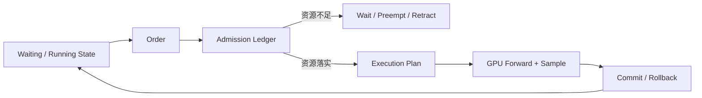

<!-- Generated from infra-codes commit 1f8930ce3f206cdaac9ec24954f5a428e8c890f8 by tools/sync_inference_scheduler_post.py. -->

> 本文固定到实际运行验证过的 vLLM 与 SGLang fork，从源码对象和状态变化解释调度。目标不是背策略名称，而是理解一轮计划如何在 token、KV、请求槽位和 SLO 约束下成立。

[vLLM 请求全流程](/posts/vllm-request-lifecycle-source-guide/) · [SGLang 请求全流程](/posts/sglang-request-lifecycle-source-guide/) · [面试题系列](/posts/vllm-sglang-interview-series/)

## 先用 30 秒理解调度

在线推理调度不是简单地“从队列取几个请求组成 batch”。它至少包含四个不同阶段：

```text
排序 Ordering
  哪些请求先尝试，解决优先级、公平性和 cache locality

准入 Admission
  检查 token、KV、request row、encoder、LoRA 等资源是否真的足够

计划 Planning
  冻结本轮每个请求计算多少 token、使用哪些物理 slot、采用什么 forward mode

提交 Commit
  GPU 返回后提交 accepted token、回滚 speculative overshoot，并释放结束请求资源
```

一个请求“排在前面”不等于“已经进入 GPU batch”。只有完成物理资源分配，它才有资格进入 `SchedulerOutput` 或 `ScheduleBatch`。



## 源码与讨论边界

- vLLM 固定到 [`d1d2f7535`](https://github.com/Cptzzzzz/vllm/commit/d1d2f7535686acdc39b034bf18ba52d07c21def5)，核心入口是 `Scheduler.schedule()` 与 `update_from_output()`。
- SGLang 固定到 [`9529c2e96`](https://github.com/Cptzzzzz/sglang/commit/9529c2e96351f3b1d5715eaa89989b20723d60b5)，核心入口是 `get_next_batch_to_run()`、`SchedulePolicy` 和 `PrefillAdder`。
- 主路径是 decoder-only generation；multimodal、LoRA、P/D、SWA/Mamba 和 speculative decoding 作为资源约束进入同一调度框架。
- 伪代码用于压缩控制流，分支细节以链接中的固定 commit 为准。

核心函数地图：

| 框架 | 调度环节 | 固定源码入口 |
| --- | --- | --- |
| vLLM | 一轮计划 | [`Scheduler.schedule()`](https://github.com/Cptzzzzz/vllm/blob/d1d2f7535686acdc39b034bf18ba52d07c21def5/vllm/v1/core/sched/scheduler.py#L421) |
| vLLM | Prefix 命中与 KV 准入 | [`get_computed_blocks()` / `allocate_slots()`](https://github.com/Cptzzzzz/vllm/blob/d1d2f7535686acdc39b034bf18ba52d07c21def5/vllm/v1/core/kv_cache_manager.py#L207) |
| vLLM | 抢占 | [`_preempt_request()`](https://github.com/Cptzzzzz/vllm/blob/d1d2f7535686acdc39b034bf18ba52d07c21def5/vllm/v1/core/sched/scheduler.py#L1186) |
| vLLM | 结果提交/回滚 | [`update_from_output()`](https://github.com/Cptzzzzz/vllm/blob/d1d2f7535686acdc39b034bf18ba52d07c21def5/vllm/v1/core/sched/scheduler.py#L1546) |
| SGLang | Batch 状态机 | [`get_next_batch_to_run()`](https://github.com/Cptzzzzz/sglang/blob/9529c2e96351f3b1d5715eaa89989b20723d60b5/python/sglang/srt/managers/scheduler.py#L2649) |
| SGLang | 候选排序 | [`SchedulePolicy.calc_priority()`](https://github.com/Cptzzzzz/sglang/blob/9529c2e96351f3b1d5715eaa89989b20723d60b5/python/sglang/srt/managers/schedule_policy.py#L184) |
| SGLang | Prefill 准入账本 | [`PrefillAdder.add_one_req()`](https://github.com/Cptzzzzz/sglang/blob/9529c2e96351f3b1d5715eaa89989b20723d60b5/python/sglang/srt/managers/schedule_policy.py#L976) |
| SGLang | Decode 更新 | [`update_running_batch()`](https://github.com/Cptzzzzz/sglang/blob/9529c2e96351f3b1d5715eaa89989b20723d60b5/python/sglang/srt/managers/scheduler.py#L3117) |
| SGLang | KV 不足时撤回 | [`retract_decode()`](https://github.com/Cptzzzzz/sglang/blob/9529c2e96351f3b1d5715eaa89989b20723d60b5/python/sglang/srt/managers/schedule_batch.py#L2591) |
| SGLang | CPU/GPU overlap | [`event_loop_overlap()`](https://github.com/Cptzzzzz/sglang/blob/9529c2e96351f3b1d5715eaa89989b20723d60b5/python/sglang/srt/managers/scheduler.py#L1542) |

## 两套调度器共同求解的问题

可以把目标写成：

```text
maximize goodput
subject to:
  per-iteration token budget
  physical KV capacity
  request/model length limits
  TTFT and ITL SLO
  priority and fairness
  rank-consistent execution plan
```

关键状态不能混淆：

| 状态 | 含义 | 混淆后的后果 |
| --- | --- | --- |
| 逻辑 token | 用户已提交的 prompt/output 真值 | 可能把 rejected draft 暴露给用户 |
| computed token | target model 已计算、可被后续位置依赖 | attention 读取未生成的 KV |
| allocated KV | 已占用的物理位置，可能包含临时或未来位置 | 泄漏或错误共享 speculative KV |
| committed KV | 已确认属于真实序列的 KV 边界 | Prefix Cache 污染 |
| in-flight plan | 已 launch 但结果尚未提交的一轮工作 | 跨轮 plan/result 错配 |

下面先逐行理解 vLLM，再理解 SGLang。

---

## Part I：vLLM 的统一 Token-Debt 调度
> 源码基线：[`d1d2f7535`](https://github.com/Cptzzzzz/vllm/commit/d1d2f7535686acdc39b034bf18ba52d07c21def5)。
> 重点源码是 [`Request`][vllm-request]、[`Scheduler.schedule()`][vllm-scheduler]、
> [`SchedulerOutput`][vllm-scheduler-output] 和 `Scheduler.update_from_output()`。

### 1. 模块要解决的问题

在线推理不是“凑满一个 batch 后一次跑完”。请求持续到达、序列长度不同、prompt 和 decode 每轮工作量
不同，并共同竞争：

- 每轮最大 token budget；
- KV blocks 和 lookahead slots；
- multimodal encoder budget；
- structured-output grammar readiness；
- LoRA/DP/PP 等执行约束；
- TTFT、ITL、公平性和吞吐目标。

Scheduler 的职责是将这些动态状态冻结成“一轮可执行且资源已经落实的计划”。它不执行模型，也不负责
HTTP 语义。

### 2. 上下游契约

| Contract | 内容 |
| --- | --- |
| Input | waiting/running `Request`；KV/encoder/grammar/connector 状态；`max_num_batched_tokens` 等预算；上一轮已提交结果 |
| Owned state | request status、waiting/running queues、token progress、KV ownership 的调度视图、preemption count |
| Output | 不可变语义的一轮 `SchedulerOutput`，包含每请求 token 数、block table 更新、spec IDs、encoder inputs、finished IDs |
| Downstream | Executor/每个 rank 的 ModelRunner 必须执行同一逻辑计划 |
| Commit input | 与该 `SchedulerOutput` 配对的 `ModelRunnerOutput`/grammar output |
| Commit output | 已更新的 `Request`、per-request `EngineCoreOutput`、释放或保留的资源 |

SchedulerOutput 中出现 request 的前提不是“排到了它”，而是所需资源已经由 KV/encoder manager 成功
分配。否则 runner 会得到一个无法落地的计划。

### 3. 核心状态：统一 token debt

[`Request`][vllm-request] 中最关键的计数不是简单的 input/output length：

| 字段 | 源码语义 | 谁推进 | 谁可能回退 |
| --- | --- | --- | --- |
| `num_tokens` | prompt + 已确定、已提交的 output token 数 | output commit | 通常不回退已提交语义 |
| `num_computed_tokens` | target model 已计算且当前状态可依赖的位置数 | Scheduler schedule 时乐观推进 | reject、preempt、失败处理 |
| `spec_token_ids` | drafter 提议但 target 尚未验证的 token | speculator/Scheduler | rejection commit |
| `num_output_placeholders` | async pipeline 中已经占位但结果未回收的位置 | async scheduling | result commit |
| `num_in_flight_tokens` | 已调度但 output 尚未应用的 token | schedule | update-from-output |

当前 V1 Scheduler 用“target 还欠多少 token 计算”统一 prefill、decode 和 speculative decode：

```text
token_debt(req)
  = num_tokens_with_spec
  + num_output_placeholders
  - num_computed_tokens
```

同一个公式对应：

- 首次 prefill：debt 约等于未命中的 prompt suffix；
- chunked prefill：一轮只偿还部分 debt；
- 普通 decode：新采样 token 尚未产生自己的 KV，通常欠一个位置；
- speculative decode：draft IDs 一起进入 target verify debt；
- async scheduling：placeholder 表示已经进入 pipeline 的逻辑位置。

这个设计避免维护彼此冲突的 `is_prefill_phase`/`is_decode_phase` 状态机。

### 4. `schedule()` 的实际实现流程

#### Step 1：建立本轮预算

Scheduler 初始化 token、encoder、KV 等预算。这里的 token budget 是本轮 runner 处理的 token 数，
不是 request 数；因此一个长 prefill request 可能占用大部分预算。

#### Step 2：先服务 running requests

对每个 running request：

1. 根据 debt、per-request limit、`max_model_len` 和剩余 budget 求 `num_new_tokens`；
2. 处理 structured output、encoder input、KV connector 和 speculative lookahead；
3. 调用 `KVCacheManager.allocate_slots()`；
4. 若资源不足，选择 victim 抢占并重试；
5. 成功后写入本轮 request -> token count 和 block changes。

running 优先的直接目的不是平均吞吐，而是避免已进入 decode 的 request 因新 prompt 不断插入而产生
严重 ITL 抖动。

#### Step 3：在允许时 admission waiting requests

若本轮没有刚发生会导致震荡的抢占，再遍历 waiting queue：

1. 跳过尚未 ready 的 grammar、remote KV、LoRA 等请求；
2. `get_computed_blocks()` 查询本地 prefix cache；
3. KV connector 查询 external matched tokens；
4. 根据 hit 后的 suffix 计算本轮 token 数；
5. 分配 cached/external/new/lookahead slots；
6. 成功才将 request 从 waiting 移到 running 并写入计划。

#### Step 4：生成 `SchedulerOutput`

[`SchedulerOutput`][vllm-scheduler-output] 是 Scheduler 与 Executor 的边界对象，主要输出：

```text
scheduled_new_reqs / resumed_reqs / running_reqs
num_scheduled_tokens: request_id -> token count
new KV blocks / KV block copies
scheduled_spec_decode_tokens
encoder inputs / structured-output flags
finished request IDs
KV connector metadata
```

构造后 Scheduler 乐观推进 `num_computed_tokens`/in-flight 状态。这样可以在 batch queue 或 async path
中继续准备下一轮，但也要求结果回来时严格 commit/rollback。

### 5. `update_from_output()`：真正的提交点

Input 是同一轮 `SchedulerOutput` 和 runner result；Output 是新的 request 真值状态与
`EngineCoreOutput`：

1. 将 batch output 按 request 拆分；
2. 减少 `num_in_flight_tokens`；
3. 获取 sampled/accepted token IDs；
4. speculative 路径计算 rejected 数并回退乐观 computed count；
5. 逐 token 更新 output、grammar、EOS/stop/length；
6. finished request 释放 KV、encoder 和其他 ownership；
7. 生成返回 API 进程的增量结果和 metrics/events。

这里必须使用与 schedule 一一配对的结果。若 batch queue 中 future 与计划错位，即使 token ID 看似合法，
也会把 KV/token progress 提交给错误 request。

### 6. Chunked prefill

#### 要解决的问题

长 prompt 一次性进入 batch 会形成很长的 prefill kernel，期间 decode 请求的下一个 token 无法及时
执行，造成 p95/p99 ITL 峰值。

#### Input -> 方法 -> Output

```text
Input:
  request debt 很大 + 本轮 token budget/threshold 有限

Method:
  num_new_tokens 截断到 chunk/budget
  本轮只分配并计算该 suffix chunk
  request 保持未完成，computed count 增长到 chunk 边界

Output:
  当前 SchedulerOutput 只含该 chunk
  下一轮仍能继续偿还剩余 prompt debt
```

#### 性能结果

- 限制单次 prefill 占用 GPU 的时间上界，通常改善并发 decode ITL/p99；
- 更容易把 prompt 与 decode token 混入同一 continuous batch；
- 长 prompt 自身需要更多 schedule/metadata/kernel 次数，TTFT 可能增加；
- chunk 太小会让 host launch 和调度开销抵消公平性收益。

### 7. Preemption

#### 要解决的问题

实际输出长度不可预测，KV 可以在请求运行后继续增长。只靠首次 admission 无法保证所有 running
request 永远有空间；在资源不足时必须恢复可执行性而不能 OOM。

#### 实现结果

当 `allocate_slots()` 返回 `None`，Scheduler 选择 victim：

1. free request KV ownership 和 encoder cache；
2. 状态设为 `PREEMPTED`；
3. computed count/spec state 回到可重建边界；
4. 放回 waiting queue；
5. 之后依赖仍存活的 prefix cache 命中，否则重新 prefill。

Preemption 提高的是可用性和高优先级 goodput，不是免费的吞吐优化。持续抢占意味着 admission、
KV 容量或 workload 配置不匹配，表现为 recompute 增加、cache pollution 和 p99 峰值。

### 8. 调度技巧与性能维度

| 方法 | 直接改变的量 | 目标指标 | 代价/退化条件 |
| --- | --- | --- | --- |
| continuous batching | 每轮动态加入/移除 request，减少 batch 空洞 | tokens/s、GPU busy、goodput | 高负载下 queue TTFT 增加 |
| running-first | decode request 获得更稳定的每轮服务 | ITL、p99 ITL | waiting TTFT/公平性 |
| token-budget batching | 按真实 token work 而非 request 数限制 batch | kernel shape、显存可预测性 | prefill/decode token 成本并不完全等价 |
| chunked prefill | 限制单轮长 prompt token 数 | decode ITL/p99 | prompt TTFT、launch 次数 |
| prefix hit before admission | admission 只为 suffix 核算计算/KV | TTFT、throughput、KV capacity | hash lookup CPU；低复用收益小 |
| optimistic progress + future | CPU 可继续准备后续工作 | GPU/CPU overlap、launch gap | rollback 和 tensor/batch 配对复杂 |
| preemption | 释放 victim blocks，恢复高优先级/可执行请求 | 可用性、priority SLO | recompute、p99、cache churn |
| priority/FCFS | waiting 顺序表达业务目标 | SLO/fairness | priority starvation 需要业务约束 |

Scheduler 不直接缩短任何 attention kernel。它通过改变 batch shape、排队时间、cache reuse 和 GPU 空洞，
间接影响 TTFT、ITL 和 throughput。

### 9. 正确性不变量

1. KV allocation 成功后 request 才能进入 `SchedulerOutput`；
2. 一份 `SchedulerOutput` 只能与自己的 runner future/result commit；
3. 乐观增加的 computed/in-flight count 在 rejection/failure 时必须回退；
4. 未验证 speculative token 不能成为共享 prefix 真值；
5. finished/aborted request 的 block、encoder 和 grammar ownership 只能释放一次；
6. 被 preempt 的 request 不能继续依赖已经 free 的 block table；
7. 每轮所有执行 rank 必须看到相同 request/token plan。

### 10. 如何验证设计是否生效

| 实验 | 固定项 | 扫描项 | 必看结果 |
| --- | --- | --- | --- |
| continuous batching | 模型、输入/输出长度分布 | concurrency | GPU gaps、tokens/s、queue TTFT、ITL |
| chunked prefill | 混合长 prompt + ongoing decode | chunk size/token budget | 长 prompt TTFT、decode p99 ITL、launch 次数 |
| admission 压力 | workload/seed | KV utilization、max sequences | preemption 次数、recomputed tokens、p99 |
| priority | 相同请求集合 | priority/arrival order | 高优先级 SLO、低优先级 starvation |
| async/batch queue | 相同 batch shapes | on/off | scheduler CPU、host gap、输出正确性 |

如果 tokens/s 上升但 p99 ITL 越过 SLO，不能称 Scheduler 优化成功；应以约束 SLO 下的最高 goodput
作为最终目标。

[vllm-request]: https://github.com/Cptzzzzz/vllm/blob/d1d2f7535686acdc39b034bf18ba52d07c21def5/vllm/v1/request.py
[vllm-scheduler]: https://github.com/Cptzzzzz/vllm/blob/d1d2f7535686acdc39b034bf18ba52d07c21def5/vllm/v1/core/sched/scheduler.py
[vllm-scheduler-output]: https://github.com/Cptzzzzz/vllm/blob/d1d2f7535686acdc39b034bf18ba52d07c21def5/vllm/v1/core/sched/output.py

---

## Part II：SGLang 的 Policy、Admission 与 Batch 状态机

> 源码基线：[`9529c2e96`](https://github.com/Cptzzzzz/sglang/commit/9529c2e96351f3b1d5715eaa89989b20723d60b5)。
> 重点源码：[`Scheduler`][sglang-scheduler]、[`Req`/`ScheduleBatch`][sglang-schedule-batch] 和
> [`SchedulePolicy`/`PrefillAdder`][sglang-schedule-policy]。

### 1. 模块要解决的问题

SGLang Scheduler 每轮要在以下冲突中生成一个可执行 batch：

- 新 prompt 希望尽快 EXTEND，降低 TTFT；
- running request 希望稳定 DECODE，降低 ITL；
- 相似 prompt 靠近执行可以提高 Radix cache locality；
- 当前 prefill 能放下，不代表后续不可预测 decode 能持续增长；
- full attention、SWA、Mamba、speculation、LoRA、grammar 和 P/D 使用不同资源；
- overlap 模式中 GPU 已运行下一轮时，CPU 还在提交上一轮结果。

它的核心 Output 是 `ScheduleBatch`/`NextBatchPlan`，不是 token。模型结果必须再由 Scheduler commit
回 `Req` 和 cache/pool 状态。

### 2. 子模块 contract

| 子模块 | Input | 核心方法 | Output | 主要目标 |
| --- | --- | --- | --- | --- |
| `SchedulePolicy` | waiting reqs、Radix cache、priority、running routing keys | prefix match + LPM/DFS/FCFS/LOF/routing 排序 | 已更新 prefix state 的候选顺序 | cache reuse、公平性、CPU 开销间权衡 |
| `PrefillAdder` | ordered reqs、free/evictable KV、running future demand、pool capacity | 多资源 admission ledger、lock 前后 double-check、chunk | 本轮可 EXTEND reqs、new chunked req、剩余预算 | 防止 over-admission/retraction，同时控制 prefill work |
| `get_new_batch_prefill()` | waiting queue、running batch、grammar/cache events | policy -> adder -> `prepare_for_extend()` | EXTEND `ScheduleBatch` 或空 plan | 新请求 TTFT、cache locality |
| `update_running_batch()` | running batch、free KV、decode budget | filter、retract、`prepare_for_decode()` | DECODE `ScheduleBatch` | 稳定 decode 并避免 KV OOM |
| `get_next_batch_to_run()` | last/running/waiting/chunked/result state | finish/merge、prefill-first、decode fallback、DP sync | `NextBatchPlan(batch_to_run, running_batch)` | 每轮冻结 request/forward mode/ownership |
| batch result processor | launched batch snapshot、`GenerationBatchResult` | commit token/KV/grammar/finish/retract | 更新 `Req`、cache/pools、`BatchTokenIDOutput` | 将乐观执行变成真实请求状态 |

### 3. `Req` 状态：逻辑 token 不等于物理 KV

[`Req`][sglang-schedule-batch] 中需要同时理解：

| 字段 | Input/来源 | 含义 | 下游用途 |
| --- | --- | --- | --- |
| `origin_input_ids` | tokenizer DTO | 原始 prompt token | prefix key、EXTEND input |
| `output_ids` | result commit | 已提交用户语义的输出 | 下一轮 DECODE、stop、output |
| `prefix_indices` | Radix match/cache | 命中 prefix 对应的 physical slots | 跳过 EXTEND prefix，写 request row |
| `req_pool_idx` | `ReqToTokenPool.alloc()` | request -> token-slot row | attention block/slot lookup |
| `kv_committed_len` | result/cache commit | 已确认有效 KV 边界 | cache insertion、next input |
| `kv_allocated_len` | extend/decode/spec allocation | 已占用物理 slots，可能含未验证位置 | capacity/free/repair |
| `last_node` | Radix match/insert | 当前受 lock 保护的 cache node | eviction safety、cache update |
| `extend_range` | PrefillAdder/chunking | 本轮真正计算的 token 区间 | `prepare_for_extend()` |
| `inflight_middle_chunks` | overlap chunk launch | 已 launch 未 commit 的中间 chunk 数 | 防止过早合并/释放 |

speculative path 中通常有 `kv_allocated_len >= kv_committed_len`。把两者合并会导致 rejected tree slots
泄漏或被错误当成真实上下文。

### 4. SchedulePolicy

#### 要解决的问题

waiting queue 顺序会同时影响公平性和 cache reuse。如果两个共享长 prefix 的请求相隔很远执行，第一个
刚生成的 KV 可能在第二个到来前被淘汰；但对整个大队列做复杂 prefix 排序也会让 Scheduler CPU 成为
热点。

#### Input

- waiting `Req` 列表及 arrival/priority/output-length hints；
- Radix tree 当前节点和每个 request 的 match；
- running batch 的 routing key 分布；
- 配置的 policy 和是否允许 cache-aware scheduling。

#### 实现方法

[`SchedulePolicy`][sglang-schedule-policy] 支持：

| Policy | 方法 | 解决的问题 | 代价/边界 |
| --- | --- | --- | --- |
| LPM | 依据 longest prefix match 排序 | 直接优先少计算的 request | 可能饿死 miss；大 queue match/sort CPU 高 |
| DFS-weight | 聚集 Radix 子树请求 | 提高一批请求的 prefix locality | 公平性/实现复杂度 |
| FCFS | arrival order | 简单、可解释、公平 | 不利用 cache locality |
| LOF | 依据预测输出长度 | 某些 workload 降低长任务阻塞 | 输出长度不可准确预知 |
| ROUTING_KEY | 与 running 常见 key 聚类 | adapter/route locality | 冷 key 等待更久 |

源码在 waiting queue 超过阈值时可从昂贵 cache-aware policy 退回 FCFS，说明调度算法自身 CPU 成本也
属于性能模型。

in-batch prefix caching 还使用模拟树识别 waiting requests 之间的共享 prefix：先安排 producer，暂时
降低 sibling 的顺序，使 sibling 后续命中刚写入的 KV。

#### Output

排序后的 candidates 以及已计算的 prefix match/last-node state，交给 PrefillAdder 做真实资源准入。
Policy 只决定“先尝试谁”，不能承诺 request 一定进入本轮。

### 5. PrefillAdder：多资源 admission ledger

#### 要解决的问题

一个 prompt suffix 当前能放下，不代表它进入 decode 后仍有 KV。若不断按“本轮能放多少”准入，running
batch 很快耗尽 KV，只能频繁 retract/recompute。

#### Input 预算

[`PrefillAdder`][sglang-schedule-policy] 同时跟踪：

```text
rem_input_tokens       本轮 max prefill token budget
rem_chunk_tokens       chunked prefill 预算
rem_total_tokens       free + evictable - future decode reservation
cur_rem_tokens         当前 lock 后真实可用空间
rem_swa_tokens         sliding-window 独立预算
rem_mamba_slots        hybrid recurrent state 预算
request row capacity   ReqToTokenPool 剩余行
```

对一个新 request，还要估算 suffix EXTEND、`max_new_tokens`/`new_token_ratio`、page alignment、spec tree、
Mamba shared gap、SWA window 和 host/hierarchical cache load-back。

#### 实现方法

1. request 根据 Radix match 初始化下一轮 input；
2. 先用当前 evictable/free 状态检查预算；
3. lock matched nodes，防止本轮执行前被 eviction；
4. lock 会把 evictable KV 变 protected，因此再次检查真实预算；
5. 完整 suffix 放不下但允许 chunk 时，选择 page/alignment-safe chunk；
6. 成功 request 进入 `can_run_list`，并扣除当前及 future reservation；
7. 资源不足时返回停止/跳过/需要处理的结果，由 Scheduler 决定队列动作。

lock 前后 double-check 是关键：只在 lock 前核算会把“原本可淘汰、现在受请求保护”的 KV 重复算成
可用空间。

#### Output

- 本轮可 EXTEND requests；
- 每个 request 的 matched prefix 与 `extend_range`；
- 可能的 `new_chunked_req`；
- 更新后的各资源余额；
- 不能准入的原因。

### 6. `get_next_batch_to_run()` 状态机

Scheduler 维护显式 batch state：

```text
waiting_queue   尚未 admission 或 retract 后等待的请求
running_batch   可以继续 decode 的请求
last_batch      上一轮计划，结果/EXTEND merge 依赖它
chunked_req     尚未完成 prompt 的独立 request
result_queue    overlap 中已 launch、待 commit 的 batch/result
```

[`get_next_batch_to_run()`][sglang-scheduler] 的主要流程：

1. 处理 timeout/abort；
2. 将上一轮已完成的最终 EXTEND request 合入 running，排除中间 chunk；
3. filter finished requests；
4. 优先尝试 `get_new_batch_prefill()`；
5. 若有 EXTEND plan 则运行；否则 `update_running_batch()` 构造 DECODE；
6. 应用 DP attention/MLP sync、ngram embedding 等 plan 修饰；
7. 返回 `NextBatchPlan`。

默认 prefill-first 改善 waiting TTFT，但会影响 decode ITL。因此真正的行为还取决于 chunk、prefill
delayer、mixed chunk、budgets 和 running batch 状态，不能只根据“prefill first”标签判断性能。

### 7. Chunked prefill

#### Input -> 方法 -> Output

```text
Input:
  suffix length > rem_chunk_tokens 或单轮 prefill 上限

Method:
  chunk size 向 page/确定性 split alignment 对齐
  只设置当前 Req.extend_range
  中间 chunk 完成后 cache_unfinished_req()
  chunked_req 在下轮优先继续

Output:
  本轮 EXTEND batch 只含当前 chunk
  最终 chunk 完成后 Req 才进入 running decode batch
```

它限制长 EXTEND 对并发 decode 的 head-of-line blocking，目标是 ITL/p99；代价是长 prompt 多次
schedule/metadata/kernel，TTFT 可能增加。

### 8. Decode allocation 与 retraction

输出长度不可预测，即使 PrefillAdder 预留 future tokens，running batch 仍可能耗尽 KV。
`update_running_batch()` 会：

1. filter finished；
2. 计算下一 decode/spec 所需 slots；
3. 尝试 allocation；
4. 不足时 retract 某些 requests，释放其私有资源并放回 waiting；
5. 为剩余 request `prepare_for_decode()`。

Retraction 解决可用性/OOM，不是正常吞吐手段。持续 retraction 表明 future reservation、KV capacity、
max running 或 workload mismatch，需要观察 retracted request 数和 recompute tokens。

### 9. 方法与性能维度

| 方法 | 直接改变的量 | 目标指标 | 代价/退化条件 |
| --- | --- | --- | --- |
| continuous batching | 每轮动态 EXTEND/DECODE/finish | tokens/s、GPU busy | queue TTFT、状态复杂度 |
| cache-aware policy | prefix hit 和执行 locality | prefill work、TTFT、throughput | Scheduler CPU、公平性 |
| future decode reservation | 减少 over-admission | retraction、p99、goodput | 过保守会降低 batch/GPU 利用率 |
| multi-resource ledger | full/SWA/Mamba/request rows分别核算 | 可用性、hybrid capacity | 维护成本和估计误差 |
| lock double-check | 防止 evictable capacity 重复计算 | correctness、避免 OOM | admission CPU |
| chunked prefill | 限制单轮 EXTEND work | decode ITL/p99 | prompt TTFT、launch 次数 |
| prefill-first + delayer | 控制 waiting TTFT 与 decode interference | goodput/SLO | 需要按 workload 调参 |
| retraction | 紧急释放 KV | 可用性 | recompute、cache churn、p99 |

### 10. 正确性不变量

1. matched Radix node lock 后必须重新核算 evictable capacity；
2. `kv_allocated_len >= kv_committed_len`，free 时不能把 protected/cache slots 释放两次；
3. 中间 prefill chunk 未完成前不能作为正常 decode request 合入 running；
4. `ScheduleBatch` 中 request 必须已获得 request row 和本轮 physical slots；
5. overlap result 必须按 launch snapshot 提交；
6. retract 后 request 不得继续引用已释放的 private slots；
7. cache-aware ordering 不能绕过 priority/grammar/LoRA/P-D readiness 等硬约束。

### 11. 如何验证

| 实验 | 变量 | 必看指标 |
| --- | --- | --- |
| Policy | FCFS/LPM/DFS，低/高共享 prefix | Scheduler CPU、hit tokens、TTFT、fairness、tokens/s |
| Future reservation | `new_token_ratio`/max running | running size、retraction、KV usage、GPU busy |
| Chunked prefill | chunk/token budget | 长 prompt TTFT、并发 decode p99 ITL、kernel/launch 数 |
| Queue size | 逐步增大 waiting | policy fallback、sort/match CPU、goodput |
| Hybrid model | full/SWA/Mamba 配置 | 各 pool/slot budget、admission/retraction、capacity |
| Priority | 不同 arrival/priority mix | 高优先级 SLO、低优先级 starvation |

优化结论必须在给定 TTFT/ITL SLO 下比较 goodput。只提高平均 tokens/s 但引入频繁 retraction 或 p99
失控，不是合格的 Scheduler 改进。

[sglang-scheduler]: https://github.com/Cptzzzzz/sglang/blob/9529c2e96351f3b1d5715eaa89989b20723d60b5/python/sglang/srt/managers/scheduler.py
[sglang-schedule-batch]: https://github.com/Cptzzzzz/sglang/blob/9529c2e96351f3b1d5715eaa89989b20723d60b5/python/sglang/srt/managers/schedule_batch.py
[sglang-schedule-policy]: https://github.com/Cptzzzzz/sglang/blob/9529c2e96351f3b1d5715eaa89989b20723d60b5/python/sglang/srt/managers/schedule_policy.py

---

## Part III：把两套设计放在同一张图里

### 1. 核心设计差异

| 维度 | vLLM | SGLang |
| --- | --- | --- |
| 核心抽象 | 每请求还欠 target model 多少 token | `EXTEND/DECODE` batch 状态机 |
| Prefill/Decode | 用 token debt 统一表达 | 用 `ForwardMode` 显式表达 |
| 排序 | FCFS/Priority request queue 为主 | FCFS、LPM、DFS-weight、LOF、Routing Key |
| Prefix 感知 | waiting admission 时查 block hash/cache | Policy 排序时结合 Radix prefix match |
| 准入实现 | `schedule()` 直接调用 KV/encoder manager | `SchedulePolicy` 排序，`PrefillAdder` 独立记账 |
| 本轮输出 | `SchedulerOutput` | `NextBatchPlan` + `ScheduleBatch` |
| KV 压力恢复 | preempt running request，回 waiting 重建 | retract decode request，释放私有 slot 后回 waiting |
| 异步状态 | token count、placeholder、future 严格配对 | batch snapshot、result queue、FutureMap、WAR barrier |
| 默认延迟倾向 | running-first 保护 Decode ITL | prefill-first 改善 waiting TTFT |
| Cache 数据结构 | hash block table + ref count | Radix Tree + request row + physical KV pool |

两者不是“谁更先进”的简单关系。vLLM 用统一 token 进度减少 phase 状态分叉；SGLang 把 prefix locality、准入账本和 batch mode 显式化，方便围绕 Radix/agent workload 做策略扩展。

### 2. 同一组请求会怎样被调度

假设当前有：

```text
A、B：正在 Decode，每个下一轮需要 1 token KV
C：8K prompt，其中 6K prefix 已缓存
D：8K prompt，没有缓存命中
本轮 token budget：2048
```

**vLLM**：先为 A、B 偿还各自的 Decode debt；只要没有发生 preemption，再扫描 waiting。C 先将 cached computed boundary 推进到约 6K，只为 suffix 核算 token/KV，剩余预算不足时形成 chunk。D 只有在剩余 token/KV 仍满足时才进入计划，否则继续 waiting。

**SGLang**：`SchedulePolicy` 若采用 LPM，会把 C 排在 D 前面；`PrefillAdder` 在锁住 C 的 Radix node 后重新计算可淘汰空间，并为 suffix、page overhead 和未来 Decode 预留资源。只要产生 EXTEND batch，默认先执行它；A、B 继续留在 `running_batch`，下一轮没有合适 Prefill 时再 Decode。mixed chunk 配置可以把部分 Decode 合入 EXTEND batch。

因此，同一 workload 下常见倾向是：vLLM 更直接保护正在运行请求的 ITL，SGLang 更积极利用新请求的 prefix locality和 TTFT；最终表现仍由 chunk、预算、priority、delayer 与 Cache 压力决定。

### 3. Preemption 与 Retraction 的共同本质

两者都是 OOM 防线，不是免费优化：

```text
资源预测失败或序列增长超出预留
  -> 选择 victim
  -> 释放 victim 的私有物理资源
  -> 将逻辑请求退回可重建状态
  -> 后续依靠 Prefix Cache 命中或重新计算
```

如果 preemption/retraction 持续发生，应检查 admission、KV 容量和 workload，而不是继续提高 batch 上限。它们通常表现为 recompute 增加、Cache churn、TTFT/ITL p99 峰值和 goodput 下降。

## Part IV：如何调参和验证

### 1. 不要从最大吞吐开始

先固定 workload：prompt/output 长度分布、prefix 复用率、到达过程、并发、模型/dtype/backend。然后定义 TTFT、ITL 和错误率 SLO，在满足 SLO 的结果中比较最高 goodput。

### 2. 建议的实验顺序

| 步骤 | vLLM 重点 | SGLang 重点 | 观测指标 |
| --- | --- | --- | --- |
| 基线 | eager、无 spec、稳定 token budget | FCFS、无 overlap、稳定 prefill budget | Scheduler CPU、GPU gap、TTFT/ITL |
| Chunk | `max_num_scheduled_tokens`、prefill threshold | chunk size、mixed chunk、delayer | 长 Prompt TTFT、Decode p99 ITL |
| Cache | Prefix Cache on/off、hit length | FCFS/LPM/DFS、Radix hit | cached tokens、Prefill GPU time、公平性 |
| 压力 | KV utilization、max sequences | future reservation、max running | preempt/retract、recompute、p99 |
| 异步 | batch queue/async scheduling | overlap on/off | plan/commit CPU、launch gap、正确性 |
| Spec | draft K、acceptance | EAGLE/NGRAM、tree width | accepted length、临时 KV、TPOT |

### 3. 调度器必须保持的共同不变量

1. 只有物理资源落实的请求才能进入本轮执行计划。
2. 每份计划只能与对应 iteration 的 GPU 结果提交。
3. 未验证 speculative token 不能进入用户输出或共享 Prefix Cache。
4. KV 的 allocation、lock/refcount、commit 和 free 必须形成单一 ownership 闭环。
5. Abort 不能假设已 launch kernel 被撤销，late result 必须能安全丢弃。
6. TP/PP/DP 各 rank 必须看到相同 request order、token count 和 accepted path。
7. 优先级和 Cache locality 不能绕过 model length、grammar、LoRA、P/D readiness 等硬约束。

## 最终记忆模型

```text
vLLM：计算每个请求还欠 target model 多少 token，
      然后在 token/KV 等预算内偿还 debt，并在结果返回后修正乐观状态。

SGLang：先按 Priority/Radix locality 排序，
        再由 PrefillAdder 做多资源准入，
        最后在 EXTEND 与 DECODE batch 状态机中选择本轮计划。
```

调度优化真正减少的不是 Transformer 理论 FLOPs，而是排队、GPU 空洞、无效 Prefill、资源碎片和重算。最终评价标准应是满足 TTFT/ITL SLO 后的 goodput，而不是单独看平均 tokens/s。

[返回 vLLM 请求全流程](/posts/vllm-request-lifecycle-source-guide/) · [返回 SGLang 请求全流程](/posts/sglang-request-lifecycle-source-guide/) · [进入面试题系列](/posts/vllm-sglang-interview-series/)
