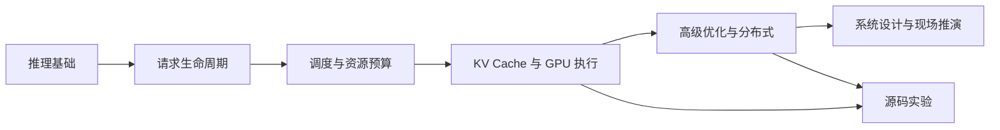

<!-- Generated from infra-codes commit 1f8930ce3f206cdaac9ec24954f5a428e8c890f8 by tools/sync_inference_interview_posts.py. -->

## 系列说明

这套材料基于 vLLM 与 SGLang 的固定源码版本和真实运行实验整理。主线题库共 **60 题**，从推理基础递进到 Staff 级系统设计；另保留 **24 道长篇综合题**和一册源码实验手册。部分主题有意重复，因为分卷题库用于系统训练，综合题解用于模拟一题多轮深挖，回答结构和考察角度不同。

## 六级题库

| 分卷 | 题号 | 文章 | 核心范围 |
| --- | --- | --- | --- |
| Level 1 | 1-10 | [推理服务基础](/posts/vllm-sglang-interview-level-1-foundations/) | Prefill/Decode、在线指标、批处理、采样、并行与基础容量分析 |
| Level 2 | 11-20 | [请求生命周期与模块契约](/posts/vllm-sglang-interview-level-2-lifecycle/) | HTTP 到 GPU 再到流式返回、IPC、状态所有权、取消与异步边界 |
| Level 3 | 21-30 | [调度、准入与资源预算](/posts/vllm-sglang-interview-level-3-scheduling/) | Continuous batching、token budget、chunked prefill、公平性与背压 |
| Level 4 | 31-40 | [KV Cache 与 GPU 执行细节](/posts/vllm-sglang-interview-level-4-kv-runner/) | Paged KV、Radix Cache、Beam Search、slot mapping、attention backend 与显存 |
| Level 5 | 41-50 | [高级优化、分布式与性能诊断](/posts/vllm-sglang-interview-level-5-advanced-distributed/) | 投机解码、CUDA Graph、TP/EP、P/D 分离、量化与 benchmark |
| Level 6 | 51-60 | [Staff 级系统设计与现场推演](/posts/vllm-sglang-interview-level-6-system-design/) | SLO、容量、故障恢复、正确性不变量、扩展点与演进路线 |

## 配套长文

- [vLLM 请求处理全流程](/posts/vllm-request-lifecycle-source-guide/)：从 HTTP、EngineCore、Scheduler、Paged KV、GPU Runner 一直跟到流式输出和释放。
- [SGLang 请求处理全流程](/posts/sglang-request-lifecycle-source-guide/)：从 Tokenizer、Scheduler、Radix Cache、EXTEND/DECODE 一直跟到 Detokenizer 和 HTTP coroutine。
- [24 道长篇综合题：完整答案与评分指南](/posts/vllm-sglang-interview-comprehensive-guide/)：适合模拟 3 到 8 分钟的完整面试回答。
- [源码深挖与实验手册](/posts/vllm-sglang-interview-source-labs/)：用 A100 实验进一步追问 Prefill、Prefix Cache、Beam Search KV、Continuous Batching、CUDA Graph、投机解码和 KV 压力。
- [实验聚合数据](/assets/files/vllm-sglang-interview/2026-07-17-a100-qwen3-0.6b.json)与[复现实验说明](/assets/files/vllm-sglang-interview/EXPERIMENTS.md)：用于检查结论的适用范围，而不是把单卡小模型数字当作框架排行榜。

## 阅读与作答方法

1. 第一遍每题限时 90 秒，按“问题、Input、方法、Output、收益、代价”组织回答。
2. 第二遍沿源码锚点画对象转换、进程边界和资源 ownership，不看答案复述完整链路。
3. 第三遍回答追问，必须给出公式、反例或可证伪实验，不能只复述框架术语。
4. 最后以固定 commit 的源码为准核对类、函数与行为；不要把新旧版本实现混在一个答案中。

本文不是概念名词清单，而是一套基于真实源码控制流的递进式题库。固定参考版本为：

- vLLM trace commit [`d1d2f7535`](https://github.com/Cptzzzzz/vllm/commit/d1d2f7535686acdc39b034bf18ba52d07c21def5)，上游基线 `3b39fd284`
- SGLang trace commit [`9529c2e96`](https://github.com/Cptzzzzz/sglang/commit/9529c2e96351f3b1d5715eaa89989b20723d60b5)，上游基线 `a3194d358`

每题包含以下部分：

- **递进追问**：用来区分“知道概念”“读过源码”和“能设计生产系统”。
- **面试官观察点**：说明本题真正考察的能力和区分候选人的维度。
- **源码锚点**：回答前应定位的类、函数或本仓库模块笔记。
- **回答思路与详细答案**：按问题、Input、方法、Output、收益和边界组织参考回答。
- **主问题得分点**：按 10 分拆解，既评价结论，也评价因果、源码和验证能力。
- **追问与答案**：给出至少一个高区分度追问、参考答案和独立的 5 分评分点。

[`VLLM_SGLANG_INTERVIEW_GUIDE.md`](/posts/vllm-sglang-interview-comprehensive-guide/) 保留了 24 道题的长篇版本；
请求、调度、KV、Runner 和投机解码更完整的 Input/Method/Output 分析见
[`vllm/modules`](https://github.com/Cptzzzzz/infra-codes/tree/1f8930ce3f206cdaac9ec24954f5a428e8c890f8/inference/vllm/modules) 与 [`sglang/modules`](https://github.com/Cptzzzzz/infra-codes/tree/1f8930ce3f206cdaac9ec24954f5a428e8c890f8/inference/sglang/modules)。

## 统一评分尺

同一道题可以问不同级别候选人。建议按下面的深度评分，而不是按记住多少类名评分：

| 分数 | 回答深度 |
| --- | --- |
| 0-2 | 只会定义术语，或把离线 Transformer forward 当作在线推理系统 |
| 3-4 | 能说出主流程和模块名，但说不清 Input/Output、状态所有者和失败路径 |
| 5-6 | 能结合源码对象讲清控制流、资源预算和关键状态更新 |
| 7-8 | 能解释正确性不变量、性能因果、适用边界，并设计可归因实验 |
| 9-10 | 能比较替代设计，量化上界，在并发、故障和分布式条件下完成方案闭环 |

## 固定源码版本

- vLLM trace commit [`d1d2f7535`](https://github.com/Cptzzzzz/vllm/commit/d1d2f7535686acdc39b034bf18ba52d07c21def5)，上游基线 `3b39fd284`
- SGLang trace commit [`9529c2e96`](https://github.com/Cptzzzzz/sglang/commit/9529c2e96351f3b1d5715eaa89989b20723d60b5)，上游基线 `a3194d358`
- 笔记来源 commit [`1f8930ce3`](https://github.com/Cptzzzzz/infra-codes/commit/1f8930ce3f206cdaac9ec24954f5a428e8c890f8)
