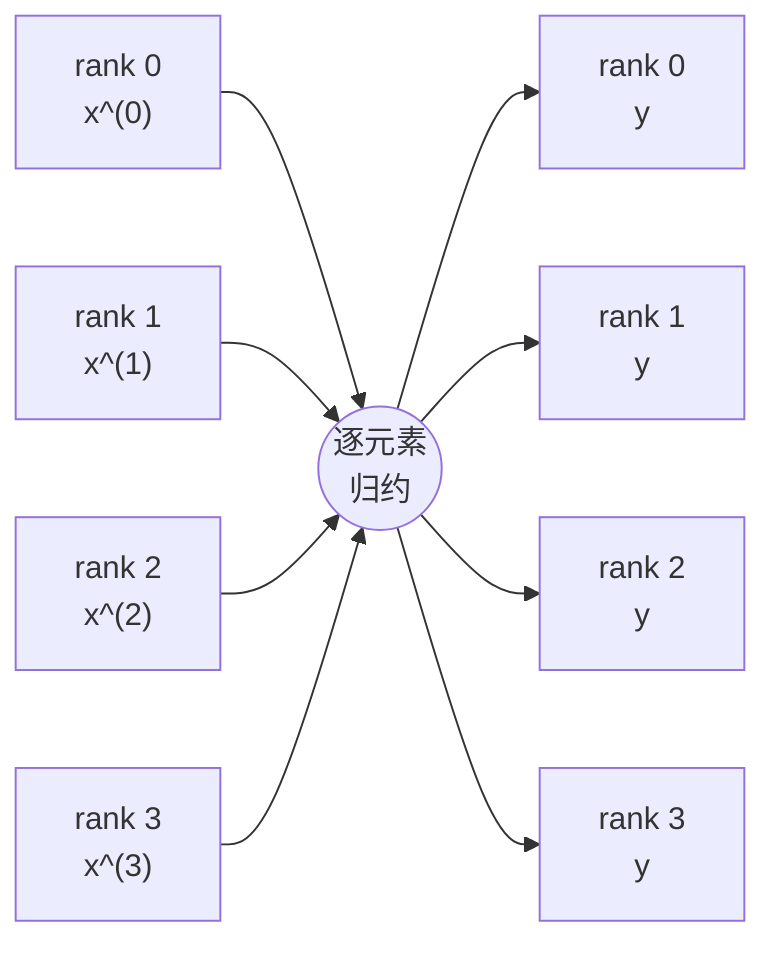
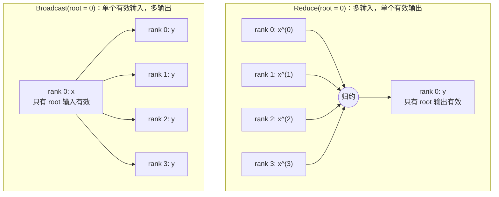
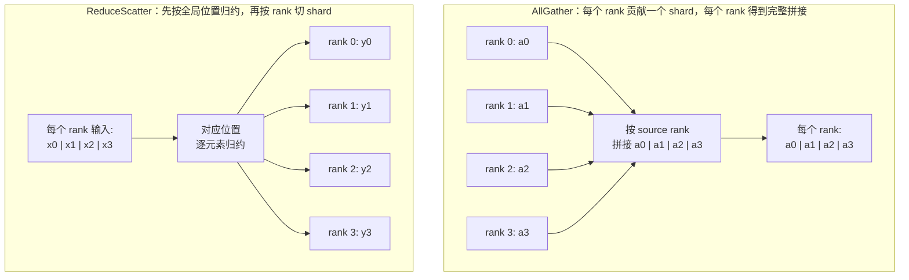
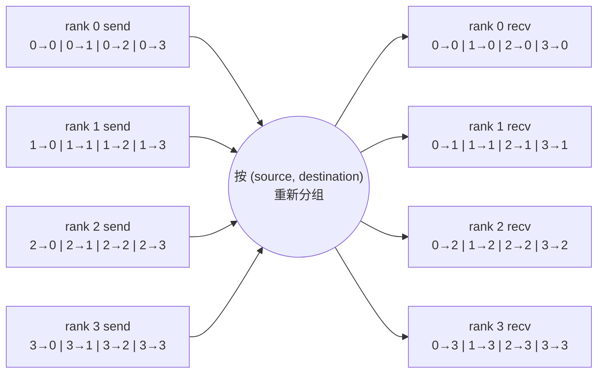
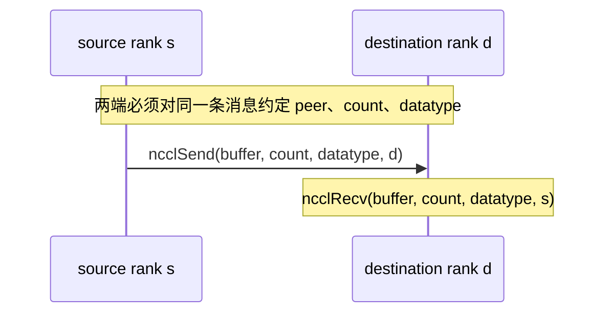

## 本章不是 API 名词表

知道 AllReduce 是“归约后广播”还不够。线上问题通常出现在更具体的地方：

- `count` 对 AllGather 表示单个 rank 的输入元素数，还是总接收元素数？
- ReduceScatter 的输入为什么必须有 `nranks * recvcount` 个元素？
- AllGather 和 ReduceScatter 的 in-place 指针为什么不是简单的 `sendbuff == recvbuff`？
- Reduce 完成后，非 root rank 上的 tensor 能不能继续使用？
- `root=4` 在 4-rank communicator 中为什么非法？
- PyTorch 的 `all_to_all_single` 最终是否调用了一个 `ncclAllToAll`？
- `count=0` 是非法调用、空 kernel，还是直接丢弃的 task？

本章从 NCCL 2.22.3 的 public header、API wrapper、参数检查和 enqueue 路径出发，再用两层实验验证：

1. 原生 C API：直接控制 device pointer，验证 out-of-place 和 in-place 的精确地址关系。
2. PyTorch ProcessGroupNCCL：验证训练框架实际暴露的 tensor 布局、AllToAll 组合和失败路径。

最终结果不是“打印看起来对”，而是 4 个 rank 上逐元素构造 CPU reference 并自动断言。

## 先统一五个术语

| 术语 | 本章中的精确定义 |
|---|---|
| communicator rank | communicator 内的逻辑编号 `[0, nranks)`，不是 CUDA device id |
| count | API 参数指定的元素数；不同 collective 的参照 buffer 不同 |
| rank-major | rank `r` 的连续分块位于 `[r*q, (r+1)*q)` |
| out-of-place | 输入和输出位于不重叠的独立 buffer |
| in-place | 按该 collective 规定的特定指针关系复用输入/输出存储 |

“in-place”不是所有算子统一采用 `sendbuff == recvbuff`。这是本章最重要的内存契约之一。

## 七类通信的数学契约

设 communicator 有 $N$ 个 rank，rank 为 $r$，归约操作为 $\oplus$。

下面的图只描述 **collective 的输入/输出语义**：箭头表示数据依赖，不表示物理链路，也不表示 NCCL 一定先汇聚到某个中心节点。真正的数据路径可能是 Ring、Tree、NVLS，或者多个 Channel 的并行组合，后续章节会再逐层展开。

### AllReduce

每个 rank 输入长度为 $q$ 的 $x^{(r)}$，每个 rank 都得到同一结果：

$$
y_j^{(r)} = x_j^{(0)} \oplus x_j^{(1)} \oplus \cdots \oplus x_j^{(N-1)}
$$



图中的“归约节点”是数学语义，不是实际存在的中心 GPU。AllReduce 的两个约束一眼可见：所有 rank 都贡献输入，所有 rank 都获得同一个逐元素结果。

输入元素数和输出元素数都是 $q$，C API 的 `count=q`。

```text
rank0 [1, 10, 0]
rank1 [2, 11, 2]
rank2 [3, 12, 4]
rank3 [4, 13, 6]

SUM -> every rank [10, 46, 12]
```

### Reduce

计算与 AllReduce 相同，但只有 root 的输出有效：

$$
y_j^{(\text{root})} = \bigoplus_{r=0}^{N-1} x_j^{(r)}
$$

非 root rank 不拥有约定输出。NCCL 甚至允许非 root 的 `recvbuff=nullptr`。

这意味着下面的程序逻辑是错误的：

```python
dist.reduce(tensor, dst=0)
consume(tensor)  # rank != 0 时，不能把 tensor 当作归约结果
```

某次实现可能让非 root 输入看起来保持不变，但那不是 API contract。

### Broadcast

只有 root 的输入有语义，所有 rank 的输出相同：

$$
y_j^{(r)} = x_j^{(\text{root})}
$$

<div class="diagram-scroll" markdown="1">



</div>

Reduce 和 Broadcast 的数据方向互为镜像，但有效 buffer 的契约不同：Reduce 只承诺 root 的输出，Broadcast 只读取 root 的输入。

`root` 是 communicator rank。它与物理 GPU 编号是否相同，取决于 rank 到 device 的映射。

### AllGather

每个 rank 输入 $q$ 个元素，每个 rank 接收 $Nq$ 个元素：

$$
y^{(r)}[s q + j] = x^{(s)}_j
$$

接收布局是 source-rank-major：

```text
recvbuff:
  [rank0 的 q 个元素]
  [rank1 的 q 个元素]
  ...
  [rank(N-1) 的 q 个元素]
```

C API 参数名是 `sendcount`，所以调用时传 $q$，不是 $Nq$。

### ReduceScatter

每个 rank 输入 $Nq$ 个元素，先逐元素归约，再让 rank $r$ 只保留第 $r$ 个长度为 $q$ 的分块：

$$
y_j^{(r)} =
\bigoplus_{s=0}^{N-1} x^{(s)}_{rq+j}
$$

<div class="diagram-scroll" markdown="1">



</div>

这里的 `a0` 到 `a3` 都是长度为 $q$ 的连续 shard；`x0` 到 `x3` 是每个输入 buffer 中按目标 rank 划分的四个位置区间。AllGather 扩张输出，ReduceScatter 缩小输出。

C API 参数名是 `recvcount`，所以调用时也传 $q$，但 `sendbuff` 至少要容纳 $Nq$ 个元素。

AllGather 和 ReduceScatter 的 `count` 都是 $q$，两者的 buffer 容量方向恰好相反：

| operation | send buffer | recv buffer | API count |
|---|---:|---:|---:|
| AllGather | $q$ | $Nq$ | `sendcount=q` |
| ReduceScatter | $Nq$ | $q$ | `recvcount=q` |

### AllToAll

设 source rank $s$ 发给 destination rank $d$ 的元素数是 $c_{s,d}$。

每个 source 的 input 按 destination 顺序分段；每个 destination 的 output 按 source 顺序拼接：

```text
source s input:
  [to rank0][to rank1]...[to rank(N-1)]

destination d output:
  [from rank0][from rank1]...[from rank(N-1)]
```

<div class="diagram-scroll" markdown="1">



</div>

AllToAll 可以理解为分块矩阵从“source-major”变成“destination-major”。中间的重新分组仍然是语义节点；在本章对应的 NCCL/PyTorch 版本里，它会被展开成多组 Send/Recv，而不是调用一个 public `ncclAllToAll`。

必须满足成对守恒：

$$
\text{inputSplitSizes}_s[d] =
\text{outputSplitSizes}_d[s] =
c_{s,d}
$$

“所有 rank 的总输入长度相同”不是必要条件；真正必要的是每个 $(s,d)$ 对的 send/recv count 匹配。

### Send/Recv

一条 `ncclSend(count, datatype, peer)` 必须有 peer 上对应的 `ncclRecv`，并且 count 和 datatype 匹配。

<div class="diagram-scroll" markdown="1">



</div>

多个互相依赖的 P2P 操作必须放进同一个 Group，使它们能够一起建立进度。这一问题会在第 6 章继续展开。

## 源码快照与分析边界

本章解释的是本机实际运行版本：

```text
NCCL tag:    v2.22.3-1
NCCL commit: 178b6b759074597777ce13438efb0e0ba625e429
PyTorch:     2.5.0a0+872d972e41.nv24.08
GPU:         4 x Tesla V100-SXM2-32GB
```

NCCL 源码目录：

```text
~/nccl-learning/third_party/nccl-2.22.3
```

以下结论明确限定在这份源码和运行时。未来版本新增 public API 或改变参数检查时，应重新对齐版本。

## 源码一：public header 就是契约

文件：`src/nccl.h.in:287-375`

这里展示的是 **public header 中的接口声明与契约注释**，不是函数实现。声明回答调用方必须
提供什么以及结果落在哪里；真正的 Host wrapper 位于下一节的 `src/collectives.cc`。

### Public header 声明：Reduce 和 AllReduce

```cpp
/*
 * Reduce
 *
 * Reduces data arrays of length count in sendbuff into recvbuff using op
 * operation.
 * recvbuff may be NULL on all calls except for root device.
 * root is the rank (not the CUDA device) where data will reside after the
 * operation is complete.
 *
 * In-place operation will happen if sendbuff == recvbuff.
 */
ncclResult_t ncclReduce(
    const void* sendbuff, void* recvbuff, size_t count,
    ncclDataType_t datatype, ncclRedOp_t op, int root,
    ncclComm_t comm, cudaStream_t stream);

/*
 * All-Reduce
 *
 * Reduces data arrays of length count in sendbuff using op operation, and
 * leaves identical copies of result on each recvbuff.
 *
 * In-place operation will happen if sendbuff == recvbuff.
 */
ncclResult_t ncclAllReduce(
    const void* sendbuff, void* recvbuff, size_t count,
    ncclDataType_t datatype, ncclRedOp_t op,
    ncclComm_t comm, cudaStream_t stream);
```

注释版：

```cpp
// Reduce:
// [课程注释] 每个 rank 都必须提供 count 个输入元素。
// [课程注释] 只有 root 必须提供有效 recvbuff。
// [课程注释] root 是 comm rank，而不是 CUDA device id。
// [课程注释] sendbuff == recvbuff 时才是普通原地 Reduce。

// AllReduce:
// [课程注释] 每个 rank 都有 count 个输入和 count 个有效输出。
// [课程注释] 每个 rank 的输出都相同。
// [课程注释] sendbuff == recvbuff 激活原地语义。
```

这直接解释两个工程规则：

1. Reduce 的非 root 结果不能参与后续计算。
2. `root=2` 指的是 communicator 中的 rank 2；如果 `CUDA_VISIBLE_DEVICES` 重排，它未必是物理 GPU 2。

### Public header 声明：AllGather 和 ReduceScatter

```cpp
/*
 * Reduce-Scatter
 *
 * Assumes sendcount is equal to nranks*recvcount, which means that sendbuff
 * should have a size of at least nranks*recvcount elements.
 *
 * In-place operations will happen if recvbuff == sendbuff + rank * recvcount.
 */
ncclResult_t ncclReduceScatter(
    const void* sendbuff, void* recvbuff, size_t recvcount,
    ncclDataType_t datatype, ncclRedOp_t op,
    ncclComm_t comm, cudaStream_t stream);

/*
 * All-Gather
 *
 * Each device gathers sendcount values from other GPUs into recvbuff,
 * receiving data from rank i at offset i*sendcount.
 * Assumes recvcount is equal to nranks*sendcount, which means that recvbuff
 * should have a size of at least nranks*sendcount elements.
 *
 * In-place operations will happen if sendbuff == recvbuff + rank * sendcount.
 */
ncclResult_t ncclAllGather(
    const void* sendbuff, void* recvbuff, size_t sendcount,
    ncclDataType_t datatype, ncclComm_t comm, cudaStream_t stream);
```

这里最值得逐字检查的是两个指针等式：

```cpp
// AllGather in-place:
sendbuff == recvbuff + rank * sendcount

// ReduceScatter in-place:
recvbuff == sendbuff + rank * recvcount
```

注释版内存图：

```text
AllGather, rank = r

recv allocation: [slice 0][slice 1]...[slice r]...[slice N-1]
                                      ^
                                      sendbuff

ReduceScatter, rank = r

send allocation: [slice 0][slice 1]...[slice r]...[slice N-1]
                                      ^
                                      recvbuff
```

二者都复用一个 $Nq$ 大小的 allocation，但“完整 buffer”与“本 rank shard”扮演的输入输出角色相反。

## 源码二：Host Wrapper 如何构造并提交 `ncclInfo`

文件：`src/include/info.h:15-31`

原始源码：

```cpp
// Used to pass NCCL call information between functions
struct ncclInfo {
  ncclFunc_t coll;
  const char* opName;
  const void* sendbuff;
  void* recvbuff;
  size_t count;
  ncclDataType_t datatype;
  ncclRedOp_t op;
  int root; // peer for p2p operations
  ncclComm_t comm;
  cudaStream_t stream;
  int chunkSteps;
  int sliceSteps;
};
```

注释版：

```cpp
struct ncclInfo {
  ncclFunc_t coll;       // [课程注释] collective/P2P 类型
  const char* opName;    // [课程注释] 日志和错误中的操作名
  const void* sendbuff;  // [课程注释] 输入地址
  void* recvbuff;        // [课程注释] 输出地址；P2P 内部也复用这个字段
  size_t count;          // [课程注释] API 的原始 count 语义
  ncclDataType_t datatype;
  ncclRedOp_t op;
  int root;              // [课程注释] rooted collective 是 root，P2P 是 peer
  ncclComm_t comm;
  cudaStream_t stream;   // [课程注释] host 返回不等于该 stream 已完成
  int chunkSteps;
  int sliceSteps;
};
```

文件：`src/collectives.cc:75-193`

### AllReduce 的完整 Host Wrapper

下面是固定提交中的完整函数体。`NCCL_API(...)` 是 public symbol/hook 的声明；紧随其后的
`ncclAllReduce(...) { ... }` 才是 Host 侧实现，不能只读第一行就停止。

```cpp
NCCL_API(ncclResult_t, ncclAllReduce,
    const void* sendbuff, void* recvbuff, size_t count,
    ncclDataType_t datatype, ncclRedOp_t op,
    ncclComm* comm, cudaStream_t stream);

ncclResult_t ncclAllReduce(
    const void* sendbuff, void* recvbuff, size_t count,
    ncclDataType_t datatype, ncclRedOp_t op,
    ncclComm* comm, cudaStream_t stream) {
  struct NvtxParamsAllReduce {
    size_t bytes;
    ncclRedOp_t op;
  };

  static constexpr nvtxPayloadSchemaEntry_t AllReduceSchema[] = {
    {0, NVTX_PAYLOAD_ENTRY_TYPE_SIZE, "Message size [bytes]"},
    {0, NVTX_PAYLOAD_ENTRY_NCCL_REDOP, "Reduction operation", nullptr, 0,
      offsetof(NvtxParamsAllReduce, op)}
  };
  NvtxParamsAllReduce payload{count * ncclTypeSize(datatype), op};
  NVTX3_FUNC_WITH_PARAMS(AllReduce, AllReduceSchema, payload)

  struct ncclInfo info = { ncclFuncAllReduce, "AllReduce",
    sendbuff, recvbuff, count, datatype, op, 0, comm, stream,
    ALLREDUCE_CHUNKSTEPS, ALLREDUCE_SLICESTEPS };
  NCCLCHECK(ncclEnqueueCheck(&info));
  return ncclSuccess;
}
```

逐层解释：

1. `count * ncclTypeSize(datatype)` 只进入 NVTX payload，用于观测单 rank 的消息字节数。
2. `ncclInfo.count` 仍保存元素数，不会在 API wrapper 中改成字节数。
3. AllReduce 没有 root，结构体对应字段填占位值 `0`。
4. `ALLREDUCE_CHUNKSTEPS/SLICESTEPS` 把 collective 类型的流水参数交给后续 planner。
5. `ncclEnqueueCheck` 是参数检查与任务提交边界，不是 Ring/Tree 算法本体，也不等待 GPU 完成。

### Reduce 的完整 Host Wrapper

```cpp
NCCL_API(ncclResult_t, ncclReduce,
    const void* sendbuff, void* recvbuff, size_t count,
    ncclDataType_t datatype, ncclRedOp_t op, int root,
    ncclComm_t comm, cudaStream_t stream);

ncclResult_t ncclReduce(
    const void* sendbuff, void* recvbuff, size_t count,
    ncclDataType_t datatype, ncclRedOp_t op, int root,
    ncclComm_t comm, cudaStream_t stream) {
  struct NvtxParamsReduce {
    size_t bytes;
    int root;
    ncclRedOp_t op;
  };

  constexpr nvtxPayloadSchemaEntry_t ReduceSchema[] = {
    {0, NVTX_PAYLOAD_ENTRY_TYPE_SIZE, "Message size [bytes]"},
    {0, NVTX_PAYLOAD_ENTRY_TYPE_INT, "Root", nullptr, 0,
      offsetof(NvtxParamsReduce, root)},
    {0, NVTX_PAYLOAD_ENTRY_NCCL_REDOP, "Reduction operation", nullptr, 0,
      offsetof(NvtxParamsReduce, op)}
  };
  NvtxParamsReduce payload{count * ncclTypeSize(datatype), root, op};
  NVTX3_FUNC_WITH_PARAMS(Reduce, ReduceSchema, payload)

  struct ncclInfo info = { ncclFuncReduce, "Reduce",
    sendbuff, recvbuff, count, datatype, op, root, comm, stream,
    REDUCE_CHUNKSTEPS, REDUCE_SLICESTEPS };
  NCCLCHECK(ncclEnqueueCheck(&info));
  return ncclSuccess;
}
```

Reduce 与 AllReduce 的决定性差异不是函数名，而是 `ncclInfo` 中的 `coll`、`root` 和流水常量。
`root` 在这里原样进入请求，下一节的 `ArgsCheck` 才根据 `comm->nRanks` 验证范围。非 root
允许 `recvbuff == nullptr` 的契约来自 public header；wrapper 不会在这里替调用方分配输出。

### AllGather 与 ReduceScatter 也不是只有声明

为避免对另外两个 API 产生同样误解，下面保留其完整 Host 函数体。二者的 `count` 都保持
public API 口径，而 NVTX 的 message bytes 也按该 API 的单 rank count 计算。

```cpp
ncclResult_t ncclAllGather(
    const void* sendbuff, void* recvbuff, size_t sendcount,
    ncclDataType_t datatype, ncclComm_t comm, cudaStream_t stream) {
  constexpr nvtxPayloadSchemaEntry_t AllGatherSchema[] = {
    {0, NVTX_PAYLOAD_ENTRY_TYPE_SIZE, "Message size [bytes]"}
  };
  size_t msgsize = sendcount * ncclTypeSize(datatype);
  NVTX3_FUNC_WITH_PARAMS(AllGather, AllGatherSchema, msgsize)

  struct ncclInfo info = { ncclFuncAllGather, "AllGather",
    sendbuff, recvbuff, sendcount, datatype, ncclSum, 0, comm, stream,
    ALLGATHER_CHUNKSTEPS, ALLGATHER_SLICESTEPS };
  NCCLCHECK(ncclEnqueueCheck(&info));
  return ncclSuccess;
}

ncclResult_t ncclReduceScatter(
    const void* sendbuff, void* recvbuff, size_t recvcount,
    ncclDataType_t datatype, ncclRedOp_t op,
    ncclComm_t comm, cudaStream_t stream) {
  struct NvtxParamsReduceScatter {
    size_t bytes;
    ncclRedOp_t op;
  };
  constexpr nvtxPayloadSchemaEntry_t ReduceScatterSchema[] = {
    {0, NVTX_PAYLOAD_ENTRY_TYPE_SIZE, "Message size [bytes]"},
    {0, NVTX_PAYLOAD_ENTRY_NCCL_REDOP, "Reduction operation", nullptr, 0,
      offsetof(NvtxParamsReduceScatter, op)}
  };
  NvtxParamsReduceScatter payload{
    recvcount * ncclTypeSize(datatype), op};
  NVTX3_FUNC_WITH_PARAMS(ReduceScatter, ReduceScatterSchema, payload)

  struct ncclInfo info = { ncclFuncReduceScatter, "ReduceScatter",
    sendbuff, recvbuff, recvcount, datatype, op, 0, comm, stream,
    REDUCESCATTER_CHUNKSTEPS, REDUCESCATTER_SLICESTEPS };
  NCCLCHECK(ncclEnqueueCheck(&info));
  return ncclSuccess;
}
```

这四个 wrapper 都做三件事：记录观测字段、把 API 参数归一化成 `ncclInfo`、进入
`ncclEnqueueCheck`。它们没有在 CPU 上执行 reduction，也没有在这里固定选择 Ring 或 Tree。

调用链可以先记成：

```text
ncclAllReduce / ncclAllGather / ncclReduceScatter
  -> construct ncclInfo
  -> ncclEnqueueCheck
     -> communicator ready check
     -> ArgsCheck
     -> taskAppend
     -> ncclGroupEndInternal
     -> planner/launch
```

public API 文件很薄，真正的行为在参数检查、task planner、算法选择和 device kernel。

## 源码三：root 的真实合法区间

文件：`src/misc/argcheck.cc:45-50`

原始源码：

```cpp
if (info->root < 0 || info->root >= info->comm->nRanks) {
  WARN("%s : invalid root %d (root should be in the 0..%d range)",
       info->opName, info->root, info->comm->nRanks);
  return ncclInvalidArgument;
}
```

注释版：

```cpp
// [课程注释] 半开区间检查：
// root < 0 或 root >= nRanks 都非法。
// 所以 N=4 时合法值只有 0,1,2,3。
if (root < 0 || root >= nRanks) {
  return ncclInvalidArgument;
}
```

这里还暴露了 NCCL 2.22.3 的一个日志措辞瑕疵：warning 会写 `0..4 range`，但代码实际上拒绝 4。排障时应相信条件分支和负向实验，而不是把一行日志自然语言当成形式化规范。

## 源码四：零元素 collective 在 enqueue 阶段被丢弃

文件：`src/enqueue.cc:1937-2019`

原始关键分支：

```cpp
static ncclResult_t taskAppend(struct ncclComm* comm, struct ncclInfo* info) {
  if (info->coll == ncclFuncSend || info->coll == ncclFuncRecv) {
    // append P2P task
  } else {
    // Empty collectives can be discarded.
    if (info->count == 0) return ncclSuccess;

    struct ncclTaskColl* t = ...;
    t->func = info->coll;
    t->sendbuff = info->sendbuff;
    t->recvbuff = info->recvbuff;
    t->count = info->count;
    ...
    planner->nTasksColl += 1;
  }
}
```

注释版：

```cpp
if (isP2P) {
  // [课程注释] P2P 走独立 task 路径。
} else {
  if (count == 0) {
    // [课程注释] 参数检查已完成，但不创建 collective task，
    // 也不会为这个空操作发起正常 collective kernel。
    return ncclSuccess;
  }
  appendCollectiveTask();
}
```

本次日志中，零元素 AllReduce 和紧随其后的 Broadcast 都显示 `opCount 2`，与“没有形成可执行 task”一致。

这不等于所有空 P2P 操作也完全采用同一规则；源码明确把 Send/Recv 放在另一个分支。

## 源码五：NVIDIA NCCL 2.22.3 没有 public AllToAll API

在本版本的 `src/nccl.h.in` 中能找到 Send/Recv，却找不到 `ncclAllToAll`。PyTorch 的 AllToAll 是组合操作。

第一层位于：

```text
PyTorch: torch/csrc/distributed/c10d/ProcessGroupNCCL.cpp:3977-4082
```

原始核心分支：

```cpp
if (outputSplitSizes.empty() && inputSplitSizes.empty()) {
  return collective(
      inputTensor,
      outputTensor,
      [&](Tensor& input, Tensor& output, ncclComm_t comm, CUDAStream& stream) {
        torch::cuda::nccl::all2all_single_equal_split(
            input, output, this->getSize(), comm, stream);
        return ncclSuccess;
      },
      OpType::ALLTOALL_BASE,
      "nccl:all_to_all");
} else {
  checkSplitSizes(inputSplitSizes, inputTensor, size_);
  checkSplitSizes(outputSplitSizes, outputTensor, size_);
  computeLengthsAndOffsets(...);
  torch::cuda::nccl::all2all_single_unequal_split(...);
}
```

注释版：

```cpp
if (没有显式 split sizes) {
  // [课程注释] 总元素数按 world size 等分。
  all2all_single_equal_split(...);
} else {
  // [课程注释] 先验证 split 总和与 tensor numel 一致，
  // 再把元素 count 转成长度和偏移。
  checkSplitSizes(...);
  computeLengthsAndOffsets(...);
  all2all_single_unequal_split(...);
}
```

第二层位于 `torch/csrc/cuda/nccl.cpp:810-900`。

等分版本原始代码：

```cpp
size_t count = input.numel() / size;
size_t rankdiff = input.nbytes() / size;
NCCL_CHECK(ncclCommCount(comm, &numranks));
NCCL_CHECK(ncclGroupStart());
for (const auto r : c10::irange(numranks)) {
  NCCL_CHECK(ncclSend(
      sendbuff + r * rankdiff, count, type, r, comm, stream));
  NCCL_CHECK(ncclRecv(
      recvbuff + r * rankdiff, count, type, r, comm, stream));
}
NCCL_CHECK(ncclGroupEnd());
```

uneven 版本的核心：

```cpp
NCCL_CHECK(ncclGroupStart());
for (const auto r : c10::irange(numranks)) {
  if (sendcounts[r] != 0) {
    ncclSend(
        ((char*)sendbuff) + senddispls[r] * elementSize,
        sendcounts[r], type, r, comm, stream);
  }
  if (recvcounts[r] != 0) {
    ncclRecv(
        ((char*)recvbuff) + recvdispls[r] * elementSize,
        recvcounts[r], type, r, comm, stream);
  }
}
NCCL_CHECK(ncclGroupEnd());
```

所以当前软件栈中的真实调用链是：

```text
dist.all_to_all_single
  -> ProcessGroupNCCL::alltoall_base
  -> torch::cuda::nccl::all2all_single_{equal,unequal}_split
  -> ncclGroupStart
  -> N pairs of ncclSend/ncclRecv
  -> ncclGroupEnd
```

看到 PyTorch 的 collective 名叫 AllToAll，不代表 NCCL public API 也有同名 primitive。

## 实验设计

正式运行：

```text
ch05_collective_contracts/20260710T073928Z
```

入口脚本：

```bash
cd ~/nccl-learning
./scripts/29_run_ch05_contracts.sh
```

可复现实验文件：

- [运行入口](/assets/files/nccl-learning/scripts/29_run_ch05_contracts.sh)
- [PyTorch 契约实验](/assets/files/nccl-learning/scripts/29_ch05_collective_contracts.py)
- [原生 NCCL C API 实验](/assets/files/nccl-learning/probes/ch05_native_collective_contracts.cc)
- [结果聚合器](/assets/files/nccl-learning/probes/ch05_summarize.py)
- [正式结果摘要](/assets/files/nccl-learning/logs/ch05_collective_contracts/20260710T073928Z/summary.md)

runner 做四件事：

```bash
# 1. 用 HPC-X mpicxx 编译原生 NCCL/CUDA 程序
mpicxx ch05_native_collective_contracts.cc -lcudart -lnccl

# 2. 4 个 MPI process，各绑定 rank 对应 GPU，直接调用 NCCL C API
mpirun -np 4 ch05_native_collective_contracts raw/native

# 3. 4 个 torchrun process 验证 ProcessGroupNCCL 层
NCCL_DEBUG=INFO NCCL_DEBUG_SUBSYS=COLL,P2P \
TORCH_DISTRIBUTED_DEBUG=DETAIL \
torchrun --standalone --nproc_per_node=4 \
  scripts/29_ch05_collective_contracts.py

# 4. 聚合所有 rank 的 CSV；行数或任一断言不符都会失败
python3 probes/ch05_summarize.py --run-dir RUN_DIR
```

## 原生实验：直接证明指针关系

### AllReduce 的两种形态

实验源码：

```cpp
std::vector<int> input = {rank + 1, rank + 10, rank * 2};

// out-of-place
upload(send, input);
ncclAllReduce(
    send, recv, input.size(), ncclInt32, ncclSum, comm, stream);
check(download(recv), {10, 46, 12});

// in-place：send 和 recv 是同一个 device pointer
upload(send, input);
ncclAllReduce(
    send, send, input.size(), ncclInt32, ncclSum, comm, stream);
check(download(send), {10, 46, 12});
```

这里的第二维为什么是 46：

$$
10 + 11 + 12 + 13 = 46
$$

这组输入不是全常数，可以防止“只检查了一个元素”或错误广播仍然误判为成功。

### AllGather 的 rank-offset in-place

关键代码：

```cpp
std::vector<int> storage(world * sendcount, -1);

// 只把本 rank 输入写到本 rank 对应 slice。
std::copy(
    local.begin(),
    local.end(),
    storage.begin() + rank * sendcount);
upload(recv, storage);

ncclAllGather(
    recv + rank * sendcount, // sendbuff 指向本 rank slice
    recv,                    // recvbuff 指向完整 allocation 开头
    sendcount,
    ncclInt32,
    comm,
    stream);
```

输出逐元素期望：

```text
[0,10,100, 1,11,101, 2,12,102, 3,13,103]
```

如果错误地写成 `ncclAllGather(recv, recv, ...)`，rank 1/2/3 就会把 slice 0 当作本地输入，不满足 in-place contract。

### ReduceScatter 的反向 rank-offset

关键代码：

```cpp
// 每个 rank 输入 12 个元素：rank*100 + global_index
upload(send, scatter_input);

ncclReduceScatter(
    send,                         // 完整 N*q 输入
    send + rank * recvcount,      // 输出落回本 rank slice
    recvcount,
    ncclInt32,
    ncclSum,
    comm,
    stream);
```

对全局位置 $i$，4 个 rank 的和是：

$$
(0+i)+(100+i)+(200+i)+(300+i)=600+4i
$$

所以四个 rank 的期望 shard 是：

```text
rank0, i=0..2:   [600, 604, 608]
rank1, i=3..5:   [612, 616, 620]
rank2, i=6..8:   [624, 628, 632]
rank3, i=9..11:  [636, 640, 644]
```

### Reduce 的非 root 空指针

```cpp
void* output = rank == 3 ? static_cast<void*>(recv) : nullptr;

ncclReduce(
    send,
    output,
    count,
    ncclInt32,
    ncclSum,
    3,
    comm,
    stream);
```

只有 rank 3 下载并断言 `[10,100]`。rank 0、1、2 不读取输出，因为它们根本没有输出 buffer。

## PyTorch 实验：框架层 contract

原生实验负责精确地址，PyTorch 实验负责用户真正会写的 tensor API。

统一的断言函数：

```python
def check(operation, variant, actual, expected, note=""):
    torch.cuda.synchronize(device)

    if expected is None:
        # [课程注释] 只用于 contract 明确声明该 rank 输出无定义的情况。
        correct = True
    else:
        expected = expected.to(actual.device)
        # [课程注释] 对完整 tensor 逐元素比较，不检查 sum/checksum 近似值。
        correct = torch.equal(actual, expected)

    write_rank_csv(
        operation=operation,
        variant=variant,
        actual=actual,
        expected=expected,
        correct=correct,
    )
    if not correct:
        raise AssertionError(...)
```

### ReduceScatter reference 不依赖 NCCL 输出

```python
chunk = 3
input = torch.arange(world * chunk, device=device) + rank * 100
output = torch.empty(chunk, device=device)

dist.reduce_scatter_tensor(output, input, op=dist.ReduceOp.SUM)

# [课程注释] 在 CPU 独立构造 rank r 应获得的全局下标。
rank_slice = torch.arange(rank * chunk, (rank + 1) * chunk)
expected = rank_slice * world + 100 * world * (world - 1) // 2
assert torch.equal(output.cpu(), expected)
```

常数项为：

$$
100 \sum_{r=0}^{3} r = 600
$$

### Uneven AllToAll 用 source/destination 双编码

```python
# source rank s 发给 destination d 的 count = s+d+1
input_splits = [rank + dst + 1 for dst in range(world)]

# destination rank d 从 source s 接收的 count = s+d+1
output_splits = [src + rank + 1 for src in range(world)]

# 元素编码 source、destination 和 slice 内 offset。
value = source * 10000 + destination * 100 + offset
```

rank 2 的输出是：

```text
from source0, count3: 200 201 202
from source1, count4: 10200 10201 10202 10203
from source2, count5: 20200 20201 20202 20203 20204
from source3, count6: 30200 30201 30202 30203 30204 30205
```

编码使三类常见错误都可见：

- source 顺序错；
- destination slice 取错；
- uneven split 的 offset 或 count 错。

### Grouped ring Send/Recv

```python
next_rank = (rank + 1) % world
previous_rank = (rank - 1 + world) % world

requests = dist.batch_isend_irecv([
    dist.P2POp(dist.isend, send, next_rank),
    dist.P2POp(dist.irecv, receive, previous_rank),
])
for request in requests:
    request.wait()

expected = [previous_rank, previous_rank + 100]
```

最终：

```text
rank0 receives [3,103]
rank1 receives [0,100]
rank2 receives [1,101]
rank3 receives [2,102]
```

## 正式实验结果

运行环境清单：

```text
run_id=20260710T073928Z
world_size=4
nccl_source_commit=178b6b759074597777ce13438efb0e0ba625e429
torch=2.5.0a0+872d972e41.nv24.08
```

总验收：

| layer | rank rows | variants | result |
|---|---:|---:|---|
| 原生 NCCL C API | 36 | 9 组操作，10 种指针记录 | PASS |
| PyTorch ProcessGroupNCCL | 56 | 14 | PASS |
| 合计 | 92 | 24 条聚合记录 | PASS |

原生结果：

| operation | variant | pointer relation | result |
|---|---|---|---|
| AllReduce | out-of-place | `sendbuff != recvbuff` | PASS |
| AllReduce | in-place | `sendbuff == recvbuff` | PASS |
| AllGather | out-of-place | 独立 $q$ 输入和 $Nq$ 输出 | PASS |
| AllGather | in-place | `sendbuff == recvbuff + rank*q` | PASS |
| ReduceScatter | out-of-place | 独立 $Nq$ 输入和 $q$ 输出 | PASS |
| ReduceScatter | in-place | `recvbuff == sendbuff + rank*q` | PASS |
| Broadcast | out-of-place, root 2 | 不同输入输出地址 | PASS |
| Broadcast | in-place, root 1 | 相同输入输出地址 | PASS |
| Reduce | root 3 | 非 root `recvbuff == nullptr` | PASS |

PyTorch 结果：

| operation | variables | assertion |
|---|---|---|
| AllReduce | SUM/int64、MAX/float32、count 0 | 每个 rank 完整输出 |
| Broadcast | root 0、root 2 | 每个 rank 等于 root 输入 |
| Reduce | root 0、root 3 | 只断言 root 输出 |
| AllGather | tensor list、flat output | rank-major 完整布局 |
| ReduceScatter | 4 x 12 输入、每 rank 3 输出 | CPU 公式逐元素 |
| AllToAll | equal、uneven splits | source-major 完整布局 |
| Send/Recv | 四 rank 环 | 每 rank 收到前驱编码 |
| invalid root | root 4 | 4 个 rank 全部拒绝 |

## 从 NCCL INFO 日志反证调用链

### 零 count 没有推进正常 collective task

rank 0 的日志：

```text
AllReduce: opCount 1 ... count 3
AllReduce: opCount 2 ... count 0
Broadcast: opCount 2 ... count 4 root 0
```

空 AllReduce 打印了 API 日志，但下一条 Broadcast 仍使用 `opCount 2`。这与 `taskAppend` 的 `count == 0 -> return` 分支吻合。

### Equal AllToAll 展开成四组 Send/Recv

rank 0、`opCount 9`：

```text
Send count 2 peer 0
Recv count 2 peer 0
Send count 2 peer 1
Recv count 2 peer 1
Send count 2 peer 2
Recv count 2 peer 2
Send count 2 peer 3
Recv count 2 peer 3
```

同一个 `opCount` 下出现 8 个 P2P 调用，正是 Group 包住的 4 个 peer pair。

日志中 P2P 的 `sendbuff` 显示为 `(nil)`，不能据此判断发送数据地址为空。原因在 `src/collectives.cc:211-212`：

```cpp
struct ncclInfo info = {
  ncclFuncSend, "Send",
  NULL, (void*)sendbuff, count, datatype, ncclSum, peer, ...
};
```

NCCL 对 P2P 复用了 `ncclInfo.recvbuff` 字段存放实际 buffer，后续 task 也读取这个字段。

### Uneven AllToAll 的 count 随 peer 改变

rank 0、`opCount a`：

```text
peer 0: Send 1, Recv 1
peer 1: Send 2, Recv 2
peer 2: Send 3, Recv 3
peer 3: Send 4, Recv 4
```

rank 0 的 `input_splits=[1,2,3,4]`，日志与 Python 输入完全对应。其他 rank 的 count 按 $s+d+1$ 改变。

### 非法 root 在 NCCL 参数检查层被拒绝

4 个 rank 都得到：

```text
misc/argcheck.cc:48 NCCL WARN
Broadcast : invalid root 4
```

Python 捕获到 `ncclInvalidArgument`，所有 rank 都写入 `invalid-root-rejected=true`。这不是超时后的推断，而是确定的参数错误路径。

## 为什么不能只用 checksum 验证 collective

假设 AllGather 正确输出应为：

```text
[A, B, C, D]
```

错误实现输出：

```text
[D, C, B, A]
```

两者 sum 相同。AllToAll 的 source 顺序错误、ReduceScatter 的 shard owner 错误也可能保留全局 checksum。

因此本实验采用：

```text
rank 编码 + destination 编码 + offset 编码 + 完整 tensor equality
```

性能 benchmark 中常见的 `#wrong` 或聚合 error count 适合快速检测，但在学习 contract 时应保留可读的小 tensor 和 CPU reference。

## 与 DDP、ZeRO/FSDP 的关系

本章只讨论通信 contract，不把训练框架等同于某个 collective。

典型数据状态：

| state | collective 后每 rank 保留什么 |
|---|---|
| DDP replicated gradient | AllReduce 后保留完整归约梯度 |
| ZeRO/FSDP sharded gradient | ReduceScatter 后只保留负责的 gradient shard |
| FSDP 参数计算窗口 | AllGather 临时恢复完整参数或更大参数块 |
| Expert Parallel token dispatch | AllToAll 把 token 发往目标 expert rank |

AllReduce 在数学上可以分解为 ReduceScatter + AllGather，但只有当切分、归约操作、顺序和 buffer contract 都匹配时才等价。第 7 章会通过独立实验验证这件事。

## 工程排障清单

### 遇到结果错误

按顺序检查：

1. 每个 rank 的 collective 类型和调用顺序是否一致。
2. dtype、count、reduction op 和 root 是否一致。
3. AllGather/ReduceScatter 的 buffer 容量是否按 $Nq$ 分配。
4. rank-major slice 是否用 communicator rank 计算。
5. in-place pointer 是否满足该算子的精确偏移等式。
6. AllToAll 每对 source/destination 的 split count 是否相等。
7. CUDA stream 完成前是否提前读写或复用了 buffer。

### 遇到 hang

优先怀疑 contract 不匹配：

```text
rank skip
collective order mismatch
Send/Recv peer mismatch
count or dtype mismatch
不同 rank 使用了不同 communicator
```

不要先用 `NCCL_P2P_DISABLE` 或改算法来“优化”一个语义错误。第 6 章会专门构造这些失败。

### 遇到显存越界

重新计算元素数与字节数：

$$
\text{bytes} =
\text{element count} \times \text{sizeof(datatype)}
$$

特别检查：

```text
AllGather recv elements        = nranks * sendcount
ReduceScatter send elements    = nranks * recvcount
AllToAll input/output elements = sum(split sizes)
```

## 本章可以下的结论

1. NCCL collective 的 `count` 是元素数，不是字节数；但它对不同 API 指向不同的逻辑块。
2. AllGather 输出和 AllToAll 输出都按 source rank 拼接，二者的数据来源模式不同。
3. ReduceScatter 的输入是 $Nq$，输出是本 rank 的第 $r$ 个 $q$-element shard。
4. AllGather/ReduceScatter 的 in-place contract 是 rank-offset 指针等式，不是简单地址相等。
5. Reduce 只有 root 输出有效；本机原生实验已验证非 root 可传 `recvbuff=nullptr`。
6. 4-rank communicator 的 root 合法区间是 $[0,4)$；NCCL 2.22.3 warning 中的 `0..4` 文字不严谨。
7. 本机 NVIDIA NCCL 2.22.3 没有 public AllToAll primitive；PyTorch 用 Group 中的多组 Send/Recv 实现 equal 和 uneven AllToAll。
8. 零 count collective 会通过 API/参数入口，但在 `taskAppend` 被丢弃；实验日志显示其没有推进正常 opCount。
9. 本次 92 条逐 rank 记录全部通过，只证明这些 contract 在当前软件栈和测试输入上成立，不代表已经测量它们的性能优劣。

下一章进入最容易导致 hang 的部分：collective 全局顺序、Group 的提交边界、nested group、rank skip、异步错误和 teardown。
