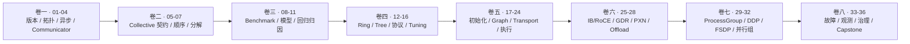

这个专题是一套 36 章 NCCL 专家课程。每章都按“提出可证伪假设、直接阅读固定版本源码、运行控制变量实验、统计结果、用源码解释结果、明确结论边界”的顺序完成，不再把环境检查或文件路径列表当成教程。

实验环境的核心信息：

```text
GPU: 4 x Tesla V100-SXM2-32GB
GPU 拓扑: GPU 两两 NV2
CUDA Toolkit: 12.6
PyTorch: 2.5.0a0+872d972e41.nv24.08
PyTorch CUDA: 12.6
PyTorch NCCL: 2.22.3
RDMA/HCA: 当前环境 ibv_devinfo 显示 0 HCAs found
```

课程规范：

- [36 章完整大纲](/assets/files/nccl-learning/CURRICULUM.md)
- [实验与证据标准](/assets/files/nccl-learning/EXPERIMENT_STANDARD.md)
- [深度文章与源码注释规范](/assets/files/nccl-learning/ARTICLE_STANDARD.md)
- [37 篇源码证据审计](/assets/files/nccl-learning/SOURCE_EVIDENCE_AUDIT.md)
- [课程可视化审计](/assets/files/nccl-learning/VISUAL_AUDIT.md)
- [正式实验结果索引](/assets/files/nccl-learning/RESULTS_INDEX.md)

下面这张图不是按 API 名称分类，而是按一个 NCCL 请求从环境、语义、算法、执行到生产治理所需的
能力依赖排列。后面的卷建立在前一卷已经能够被实验验证的基础上。

<div class="diagram-scroll diagram-scroll--xwide" markdown="1">



</div>

学习顺序可以跳过暂时没有硬件的网络实验，但不能跳过其证据边界：没有 HCA、NVSwitch 或
SHARP 的机器，只能验证门控、fallback 和实验方法，不能生成对应数据面的性能结论。

## 已完成的新版章节

1. [01：从 ELF 动态链接证明实际运行版本](/posts/nccl-stack-version-boundary/)
2. [02：从 NV2 拓扑到 P2P 带宽与并发争用](/posts/nccl-stack-topology/)
3. [03：CUDA Stream、Work.wait 与真正的完成语义](/posts/nccl-cuda-async-completion/)
4. [04：Rank、Process Group 与 Communicator 生命周期](/posts/nccl-rank-process-group/)
5. [05：Collective 契约、内存布局与逐元素证明](/posts/nccl-collectives/)
6. [06：Group、全局顺序与异步错误状态机](/posts/nccl-group-ordering/)
7. [07：AllReduce 等价分解、显存生命周期与 Kernel 证据](/posts/nccl-collective-decomposition/)
8. [08：从 nccl-tests 源码推导 algbw 与 busbw](/posts/nccl-performance-model-statistics/)
9. [09：Benchmark 方法学、同步边界与噪声证据](/posts/nccl-tests-benchmark/)
10. [10：延迟-带宽分段模型、残差与 Tuner 预测](/posts/nccl-latency-bandwidth-model/)
11. [11：性能回归的分层归因与故障指纹](/posts/nccl-parameter-sweeps/)
12. [12：Ring AllReduce 逐步推导、真实 Ring 与 Channel 并行](/posts/nccl-ring-allreduce-steps/)
13. [13：Tree、双树、层次化连接与真实交叉区间](/posts/nccl-tree-double-tree-hierarchy/)
14. [14：Simple、LL、LL128 的线格式、同步与性能边界](/posts/nccl-simple-ll-ll128-protocols/)
15. [15：Channel、Chunk、Slice、Step、Buffer 与 CUDA Block](/posts/nccl-channel-chunk-slice-step-buffer/)
16. [16：Tuning 代价模型、自动选择与 Tuner Plugin](/posts/nccl-tuning-model-auto-selection-plugin/)
17. [17：Bootstrap 与 Communicator 初始化状态机](/posts/nccl-bootstrap-communicator-init-state-machine/)
18. [18：拓扑 XML、节点模型与路径计算](/posts/nccl-topology-xml-path-computation/)
19. [19：Graph Search、Ring/Tree 与 Channel 构造](/posts/nccl-graph-search-ring-tree-channel-construction/)
20. [20：Transport 选择、Connector 与连接生命周期](/posts/nccl-transport-selection-connector-lifecycle/)
21. [21：P2P Direct、CUDA IPC、Read/Write 与 SHM Copy Engine](/posts/nccl-p2p-cuda-ipc-shm-copy-engine/)
22. [22：Enqueue、Task、Plan、Work Batch 与 CUDA Graph](/posts/nccl-enqueue-task-plan-work-batch-cuda-graph/)
23. [23：Device Kernel、Primitives、Step/Credit 与 LL Flag](/posts/nccl-device-kernel-primitives-step-flag/)
24. [24：CPU Proxy、NET Progress、Socket Helper 与 GPU 协作](/posts/nccl-cpu-proxy-net-progress-socket/)
25. [25：Socket、InfiniBand、RoCE 与 Verbs 数据面](/posts/nccl-socket-infiniband-roce-verbs/)
26. [26：GPUDirect RDMA、DMA-BUF、MR 与注册缓存](/posts/nccl-gpudirect-rdma-mr-registration-cache/)
27. [27：Multi-NIC、Rail、Cross-NIC 与 PXN](/posts/nccl-multinic-rail-crossnic-pxn/)
28. [28：CollNet、SHARP、NVLS 与插件门控](/posts/nccl-collnet-sharp-nvls-plugin-fallback/)
29. [29：ProcessGroupNCCL、Stream、Event 与 Work](/posts/nccl-processgroupnccl-stream-event-work/)
30. [30：DDP Reducer、Bucket 与计算通信重叠](/posts/nccl-ddp-reducer-bucket-overlap/)
31. [31：ZeRO-0/1/2/3、FSDP 与状态分片](/posts/nccl-zero-fsdp-state-sharding/)
32. [32：TP、PP、EP/MoE 与多维 Process Group](/posts/nccl-tp-pp-ep-multidim-process-groups/)
33. [33：Collective Mismatch、Hang、Rank Crash 与根因链](/posts/nccl-collective-mismatch-hang-rank-crash-root-cause/)
34. [34：Debug、NVTX、Nsight 与 Flight Recorder 证据链](/posts/nccl-debug-nvtx-nsight-flight-recorder/)
35. [35：生产基线、回归判定与版本治理](/posts/nccl-production-baseline-regression-version-governance/)
36. [36：一条 DDP AllReduce 的端到端证明](/posts/nccl-allreduce-end-to-end-capstone/)

## 面试专题

- [NCCL 面试题详解：54 题从集合通信到大模型推理与生产排障](/posts/nccl-interview-guide/)
- [NCCL 进阶面试实验题：20 个细节追问、源码与实测证据](/posts/nccl-interview-deep-dive-labs/)

## 后续课程结构

| 卷 | 章节 | 主题 |
|---|---:|---|
| 一 | 01-04 | 软件栈、GPU 拓扑、CUDA 异步和 communicator |
| 二 | 05-07 | Collective 契约、顺序和等价分解 |
| 三 | 08-11 | 通信量、Benchmark、性能模型和回归归因 |
| 四 | 12-16 | Ring、Tree、协议、流水线和 Tuning |
| 五 | 17-24 | Bootstrap、Graph、Transport、Planner、Kernel 和 Proxy |
| 六 | 25-28 | IB/RoCE、GDR、PXN、NVLS 和插件 |
| 七 | 29-32 | ProcessGroupNCCL、DDP、FSDP 和模型并行 |
| 八 | 33-36 | 故障、可观测性、生产治理和端到端 Capstone |


配套实验脚本和日志已经作为静态附件放在：

```text
/assets/files/nccl-learning/scripts/
/assets/files/nccl-learning/logs/
```

早期内容较浅的 NCCL 历史文章已下线；其可复用实验结果仍作为静态附件保留。上方 36 章是当前维护的完整课程。RDMA、NVSwitch、CollNet/SHARP 等章节在取得对应硬件前只给出源码结论和可执行实验方案，不给出虚构性能数据。
