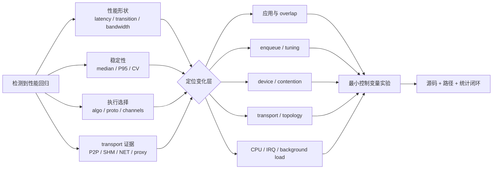

## 面对 20% 回归，先别调环境变量

一条 AllReduce 变慢，可能来自：

```text
应用层:
  collective sequence / bucket / overlap / straggler

enqueue/tuning:
  algorithm / protocol / channel / chunk

device:
  kernel occupancy / contention / clock

transport:
  P2P / SHM / NET / proxy

topology:
  NVLink / PCIe / NUMA / NIC distance

系统:
  CPU scheduling / IRQ / background load
```

这些故障并不产生相同曲线：

- channel 太少：小消息 latency 几乎不变，大消息 slope 变差；
- P2P fallback：中大消息数量级退化，并伴随 transport、graph 和 tuner 全部变化；
- 同核 CPU 争用：median 可能几乎不变，但 P95/CV 爆炸；
- 远端 NUMA：纯 P2P payload 可能几乎不受影响；
- 算法/协议切换：在特定 size 附近出现分段跳变。

正确排障不是“多试几个 `NCCL_*`”，而是：

> 先用性能曲线、稳定性、选择日志和 transport 证据定位层级，再选择最小干预。

<div class="diagram-scroll" markdown="1">



</div>

图中的四类证据需要同时收集：只看到曲线下降无法区分 channel、fallback 或系统噪声；只看到环境变量也不能证明当次运行命中了对应路径。

## 本章实验概览

同一台 4×V100 上，固定 1 KiB、256 KiB、64 MiB 三个区间，受控注入：

| 注入 | 目标层 | 关键控制 |
|---|---|---|
| `channels=1` | 并行度 | transport 与 algorithm/protocol 保持 |
| `P2P_DISABLE` | topology/transport | 验证完整 fallback 连锁变化 |
| remote NUMA | host placement | P2P 开启/关闭分别比较 |
| same-core burner | CPU scheduling | 与 single-core idle 比较 |

正式结果：

```text
14 independent performance processes
7 independent evidence processes
420 out-of-place rows
420 matching in-place checks
all correctness PASS
```

## 证据边界

```text
formal run:
ch11_regression/20260710T152727Z

NCCL:
2.22.3
178b6b759074597777ce13438efb0e0ba625e429

nccl-tests:
5bcd45d2ee8365e37895e118c9d11b0ebc15aa69

GPU topology:
4 x V100, all pairs NV2, GPU on NUMA0
```

附件：

- [故障注入驱动](/assets/files/nccl-learning/scripts/35_ch11_regression_attribution.py)
- [正式命令清单](/assets/files/nccl-learning/logs/ch11_regression/20260710T152727Z/manifest.txt)
- [420 行原始测量](/assets/files/nccl-learning/logs/ch11_regression/20260710T152727Z/raw_measurements.csv)
- [性能指纹聚合](/assets/files/nccl-learning/logs/ch11_regression/20260710T152727Z/summary.csv)
- [transport/graph/tuning 证据](/assets/files/nccl-learning/logs/ch11_regression/20260710T152727Z/evidence.csv)
- [机器生成的摘要](/assets/files/nccl-learning/logs/ch11_regression/20260710T152727Z/summary.md)

## 归因需要四类证据

### 性能形状

```text
latency point:     1 KiB
transition point:  256 KiB
bandwidth point:   64 MiB
```

三个点不是完整曲线，但足以区分固定 latency、过渡区和大消息 slope 的主要指纹。

### 稳定性

```text
median
P95
cycle CV
```

CV>5% 时拒绝精确 slowdown，只保留“存在长尾/不稳定”的结论。

### 执行选择

```text
algorithm
protocol
coll channels
```

只看环境变量不能证明它真的改变了目标路径。

### transport

```text
via P2P/direct pointer
via SHM/direct/direct
graph fallback warning
```

性能下降和日志路径必须形成闭环。

## 源码一：transport 有优先顺序

`transport.cc`：

```cpp
struct ncclTransport* ncclTransports[NTRANSPORTS] = {
  &p2pTransport,
  &shmTransport,
  &netTransport,
  &collNetTransport
};
```

选择逻辑：

```cpp
for (int t=0; t<NTRANSPORTS; t++) {
  struct ncclTransport* transport = ncclTransports[t];
  int ret = 0;

  NCCLCHECK(transport->canConnect(
      &ret, comm->topo, graph, myInfo, peerInfo));

  if (ret) {
    connector->transportComm = transportComm;
    NCCLCHECK(transportComm->setup(...));
    if (transportType) *transportType = t;
    return ncclSuccess;
  }
}
```

带注释的含义：

```text
对一个 send/recv connector:
  先问 P2P.canConnect
  成功则 setup 并停止

  否则问 SHM.canConnect
  成功则 setup 并停止

  再尝试 NET / CollNet
```

所以“机器有 NVLink”不等于“一定使用 P2P”。还要通过：

- topology distance policy；
- CUDA peer access；
- P2P level/disable；
- IPC/cuMem 能力；
- NET better-path 判断；
- transport setup。

## 源码二：P2P_DISABLE 改的是 topology eligibility

`paths.cc`：

```cpp
// In general, use P2P whenever we can.
int p2pLevel = PATH_SYS;

// User override
if (ncclTopoUserP2pLevel == -1)
  NCCLCHECK(ncclGetLevel(
      &ncclTopoUserP2pLevel,
      "NCCL_P2P_DISABLE",
      "NCCL_P2P_LEVEL"));

if (ncclTopoUserP2pLevel != -2) {
  p2pLevel = ncclTopoUserP2pLevel;
  goto compare;
}

compare:
if (path->type <= p2pLevel)
  *p2p = 1;
```

`NCCL_P2P_DISABLE=1` 不是在 transport loop 最后粗暴跳过一个 memcpy。它先改变 topology 对 GPU pair 的 P2P eligibility，后续 graph search、channel 构造、transport 和 tuning 都可能受到影响。

这解释了本章最重要的现象：

```text
baseline:
  12 channels
  P2P
  Ring+LL / Ring+Simple

P2P disabled:
  graph search fallback warning
  2 channels
  SHM
  Tree+LL / Tree+Simple
```

所以本注入不是纯 transport 单变量，而是一个有意观察完整 fallback 连锁反应的实验。

## 源码三：P2P 还要通过 CUDA peer access

`p2p.cc`：

```cpp
int cudaDev1 = busIdToCudaDev(info1->busId);
int cudaDev2 = busIdToCudaDev(info2->busId);

int p2p;
if (cudaDeviceCanAccessPeer(
      &p2p, cudaDev1, cudaDev2) != cudaSuccess) {
  *ret = 0;
  return ncclSuccess;
}

if (p2p == 0) {
  INFO(
      NCCL_INIT|NCCL_P2P,
      "Could not enable P2P between dev ...");
  *ret = 0;
  return ncclSuccess;
}
```

然后还会检查 legacy IPC 或 cuMem shareable allocation。

排查 P2P 时需要区分：

```text
NVLink physical link exists
CUDA reports peer access
NCCL policy permits P2P
IPC/cuMem setup succeeds
connector actually logs P2P
```

任一层失败都可能 fallback。

## 源码四：SHM 的适用条件

`shm.cc`：

```cpp
static ncclResult_t shmCanConnect(
    int* ret,
    struct ncclTopoSystem* topo,
    struct ncclTopoGraph* graph,
    struct ncclPeerInfo* info1,
    struct ncclPeerInfo* info2) {

  *ret = 0;

  if (ncclParamShmDisable() == 1)
    return ncclSuccess;

  int useNet = 0;
  NCCLCHECK(ncclTopoCheckNet(
      topo, info1->busId, info2->busId, &useNet));
  if (useNet)
    return ncclSuccess;

  if (info1->hostHash != info2->hostHash)
    return ncclSuccess;

  if (info1->shmDev != info2->shmDev)
    return ncclSuccess;

  *ret = 1;
  return ncclSuccess;
}
```

SHM 需要：

1. 没被 `NCCL_SHM_DISABLE` 禁用；
2. topology 没判定 NET 更好；
3. peers 在同一 host；
4. peers 可见同一个 shm device。

setup 时分配 host shared memory：

```cpp
NCCLCHECK(ncclShmOpen(
    shmPath,
    resources->shmSize,
    (void**)&resources->hostMem,
    (void**)&resources->devHostMem,
    1,
    &resources->hostHandle));

INFO(
    NCCL_INIT|NCCL_SHM,
    "Channel %02d : ... via SHM/%s/%s",
    channelId,
    useMemcpySend ? "CE" : "direct",
    useMemcpyRecv ? "CE" : "direct");
```

本章 fallback 日志为 `SHM/direct/direct`。

## 源码五：channel 环境变量在哪里生效

`graph/connect.cc`：

```cpp
NCCL_PARAM(MinNchannels, "MIN_NCHANNELS", -2);
NCCL_PARAM(MaxNchannels, "MAX_NCHANNELS", -2);

int ncclMaxNchannels() {
  int maxNchannels = MAXCHANNELS;
  if (ncclParamMaxNchannels() != -2)
    maxNchannels = ncclParamMaxNchannels();

  maxNchannels = min(
      maxNchannels,
      ncclDevMaxChannelsForArgsBytes(...));

  if (maxNchannels < 1)
    maxNchannels = 1;
  return maxNchannels;
}
```

构造 communicator channels 时：

```cpp
nChannels = comm->nChannels = min(
    min(ncclMaxNchannels(), nChannels),
    comm->config.maxCTAs);

nChannels = comm->nChannels = copyChannels(
    comm,
    nChannels,
    max(ncclMinNchannels(), comm->config.minCTAs),
    ringPrev,
    ringNext);
```

本章同时设置：

```text
NCCL_MIN_NCHANNELS=1
NCCL_MAX_NCHANNELS=1
```

目的是固定为一个 channel，而不是只给上限后让其他逻辑改变最小值。

## channel 不只是“线程数”

对 collective data path，channel 通常对应：

```text
一份 ring/tree channel graph
一组 peer connectors
一份 chunk partition
一个或多个 CUDA block/work item
并行搬运的一条逻辑流水
```

channel 太少：

- 每条 channel 要处理更多 payload；
- 可并行使用的 link/path 减少；
- 大消息 slope 明显下降。

channel 太多也可能：

- 增加 launch/block 调度；
- 增加同步和 buffer pressure；
- 小消息收益不够覆盖固定成本。

因此 channel 是调优候选，不是“越多越好”的常数。

## 故障指纹模型

### 固定 latency 抬升

```text
small/medium/large 都增加相近 us
relative slowdown 随 size 变小
```

优先检查 launch、planner、同步和 host 调度。

### bandwidth slope 下降

```text
小消息几乎不变
medium 开始变慢
large 按 bytes 放大
busbw retention 明显下降
```

优先检查 channel、protocol、transport、link。

### tail-only regression

```text
median 近似不变
P95/P99/CV 大幅增加
```

优先检查 CPU scheduling、IRQ、proxy starvation、共享资源。

### step discontinuity

```text
某个 size 阈值突然跳变
日志同时切 algorithm/protocol/channel
```

优先检查 tuner 选择、threshold、版本差异。

### topology/transport fallback

```text
日志路径改变
channel/algorithm 可能一起改变
大消息数量级退化
```

不能只归因为一个 kernel 或一个 bandwidth 常数。

## 实验设计

固定：

```text
collective:        AllReduce SUM float
world size:        4
sizes:             1 KiB, 256 KiB, 64 MiB
warmup:            5
iterations:        20
cycles:            10
blocking:          z0
instrumentation:   I0
correctness:       out + in-place
```

每个 variant 跑两次独立进程，并用正序/逆序平衡：

```text
forward:
  baseline
  channel1
  no_p2p_numa0
  no_p2p_numa1
  remote_numa
  single_core_idle
  same_core_noise

reverse:
  same_core_noise
  single_core_idle
  remote_numa
  no_p2p_numa1
  no_p2p_numa0
  channel1
  baseline
```

每个 variant/size 共 20 个 cycle。

## 为什么需要 single-core idle

same-core noise：

```text
benchmark: taskset CPU0
burner:    taskset CPU0
```

如果拿它与四核 baseline 比，差异同时包含：

```text
4 CPU -> 1 CPU affinity width
+ same-core competition
```

所以单独增加：

```text
single_core_idle:
  benchmark CPU0
  no burner
```

same-core 只与它比较，才能把“单核本身”和“单核争用”分开。

## 为什么 P2P+NUMA 要成对

四个 GPU 均属于 NUMA0：

```text
no_p2p_numa0:
  P2P disabled
  CPU 0,2,4,6

no_p2p_numa1:
  P2P disabled
  CPU 1,3,5,7
```

后一组以 no_p2p_numa0 为 reference，而不是 P2P baseline。

这样比较的是同属 SHM fallback family 的 CPU placement，避免把 P2P→SHM 的 45 倍变化误算成 NUMA。

## INFO 证据如何提取

每个 variant 另跑一次：

```bash
NCCL_DEBUG=INFO \
NCCL_DEBUG_SUBSYS=INIT,GRAPH,TUNING \
all_reduce_perf \
  -b 1K -e 64M -f 256 \
  -g 4 -w 0 -n 1 -N 1 -c 0
```

parser 提取：

```python
coll_channels = set(
    int(value)
    for value in re.findall(
        r"(\d+) coll channels", log
    )
)

has_p2p = "via P2P/direct pointer" in log
has_shm = "via SHM/direct/direct" in log

selection = re.findall(
    r"(\d+) Bytes -> Algo (\d+) proto (\d+)",
    log,
)
```

性能 run 用 WARN 保持报表干净；evidence run 用 INFO 证明路径。两者环境变量、CPU affinity 和 size 相同。

## 基线

| size | median us | P95 us | CV | busbw |
|---:|---:|---:|---:|---:|
| 1 KiB | 18.900 | 20.310 | 4.03% | 0.08 GB/s |
| 256 KiB | 22.210 | 23.057 | 3.05% | 17.705 GB/s |
| 64 MiB | 863.850 | 867.963 | 0.85% | 116.53 GB/s |

日志：

```text
12 coll channels
P2P/direct pointer
1 KiB:    Ring+LL
256 KiB:  Ring+LL
64 MiB:   Ring+Simple
```

三点均 CV≤5%，可以作为各注入的 reference。

## 指纹一：单 channel

| size | baseline us | channel1 us | slowdown | busbw retention | CV |
|---:|---:|---:|---:|---:|---:|
| 1 KiB | 18.900 | 18.575 | -1.72% | 100.00% | 4.08% |
| 256 KiB | 22.210 | 83.950 | +277.98% | 26.46% | 3.49% |
| 64 MiB | 863.850 | 4433.115 | +413.18% | 19.49% | 2.76% |

日志对照：

| field | baseline | channel1 |
|---|---|---|
| transport | P2P | P2P |
| coll channels | 12 | 1 |
| 1 KiB | Ring+LL | Ring+LL |
| 256 KiB | Ring+LL | Ring+LL |
| 64 MiB | Ring+Simple | Ring+Simple |

这是干净的 channel 指纹：

```text
latency point:
  基本不变

transition point:
  已明显受并行度限制

bandwidth point:
  time 5.13x
  busbw 只剩 19.49%

transport/algo/proto:
  不变
```

因此可以把主要因果定位在 channel 并行度，而不是误判 P2P 断链或 protocol 切换。

1 KiB 的 -1.72% 不应解释为“单 channel 优化小消息 1.72%”。它虽然 CV 低于 5%，但绝对差只有 0.325 us，接近基线自然波动；最多说明更多 channel 对当前小消息没有收益。

## 指纹二：禁用 P2P

NUMA0：

| size | baseline us | no P2P us | slowdown | busbw retention | CV |
|---:|---:|---:|---:|---:|---:|
| 1 KiB | 18.900 | 19.870 | +5.13% | 100.00%* | 5.61% |
| 256 KiB | 22.210 | 223.745 | +907.41% | 9.94% | 0.18% |
| 64 MiB | 863.850 | 39278.350 | +4446.89% | 2.20% | 0.04% |

星号：1 KiB busbw 只有两位小数，baseline/no-P2P 都打印 0.08，不能用 100% retention 表示物理效率相同。

64 MiB：

```text
baseline:
  0.864 ms
  116.53 GB/s busbw

no P2P:
  39.278 ms
  2.56 GB/s busbw

time ratio:
  45.47x
```

但日志显示这不是单一 transport 变化：

| layer | baseline | P2P disabled |
|---|---|---|
| graph warning | none | pattern 4 fallback |
| coll channels | 12 | 2 |
| transport | P2P/direct | SHM/direct/direct |
| 1 KiB selection | Ring+LL | Tree+LL |
| 256 KiB selection | Ring+LL | Tree+Simple |
| 64 MiB selection | Ring+Simple | Tree+Simple |

性能 log 原文包含：

```text
Could not find a path for pattern 4,
falling back to simple order
```

完整因果链：

```text
NCCL_P2P_DISABLE
  -> P2P topology eligibility removed
  -> graph search path/capacity changes
  -> channels 12 -> 2
  -> connector P2P -> SHM
  -> tuner Ring -> Tree
  -> payload bandwidth collapses
```

所以正确结论是：

> P2P 禁用触发了 topology/graph/transport/tuning 的跨层 fallback，最终形成 45 倍大消息回归。

只说“SHM 比 NVLink 慢 45 倍”不严谨，因为 channel 和 algorithm 也同时变化。

## 指纹三：SHM fallback 下的 NUMA

| size | no P2P NUMA0 | no P2P NUMA1 | delta | CV NUMA0/1 |
|---:|---:|---:|---:|---:|
| 1 KiB | 19.870 us | 22.005 us | +10.74% | 5.61% / 4.38% |
| 256 KiB | 223.745 us | 226.400 us | +1.19% | 0.18% / 1.22% |
| 64 MiB | 39278.350 us | 39265.150 us | -0.03% | 0.04% / 0.05% |

1 KiB reference NUMA0 的 CV 为 5.61%，所以拒绝“NUMA1 精确慢 10.74%”。

中大消息都稳定：

```text
256 KiB:
  +1.19%

64 MiB:
  -0.03%
```

本次没有观察到错误 NUMA 对 SHM 大 payload 的显著额外惩罚。

可能原因：

- `taskset` 控制 CPU，不等于显式 `membind`；
- SHM/direct 的 GPU 映射访问可能不按普通 CPU memcpy 模式受限；
- 39 ms 主瓶颈已由 fallback transport/graph 决定；
- 当前双 socket 内存/UPI 带宽不是该路径最窄环节。

负向结论同样重要：

> 当前证据不能支持“SHM 回归是错误 NUMA 导致”的判断。

若要继续验证，应增加 `numactl --membind`、page placement、memory controller counter 和 SHM CE/direct 模式，而不是继续猜。

## 指纹四：P2P 路径下的远端 NUMA

| size | baseline NUMA0 | remote NUMA1 | delta | CV remote |
|---:|---:|---:|---:|---:|
| 1 KiB | 18.900 us | 20.175 us | +6.75% | 6.77% |
| 256 KiB | 22.210 us | 22.635 us | +1.91% | 5.08% |
| 64 MiB | 863.850 us | 854.735 us | -1.06% | 0.84% |

小/中过阈值，拒绝精确百分比。

64 MiB 远端 CPU 反而略快 1.06%，说明没有稳定 NUMA penalty；payload 直接走 GPU P2P/NVLink，不经过 CPU DRAM。

日志完全一致：

```text
12 coll channels
P2P/direct pointer
Ring+LL / Ring+Simple
```

这与第 2、9 章结论一致：

> host affinity 可能影响控制面和小消息，但纯 P2P 大 payload 不应被简单等同于 CPU NUMA memory path。

## 指纹五：同核 CPU 争用

reference 是 `single_core_idle`。

| size | idle median | noise median | idle P95 | noise P95 | noise CV |
|---:|---:|---:|---:|---:|---:|
| 1 KiB | 19.215 | 19.315 | 21.117 | 35.607 | 49.33% |
| 256 KiB | 21.445 | 21.190 | 22.837 | 460.376 | 208.99% |
| 64 MiB | 850.975 | 851.295 | 859.174 | 1207.086 | 14.00% |

median：

```text
1 KiB:    +0.52%
256 KiB:  -1.19%
64 MiB:   +0.04%
```

如果只看 median，会得出“CPU 争用没有影响”。

但 tail：

```text
1 KiB P95:
  21.117 -> 35.607 us

256 KiB P95:
  22.837 -> 460.376 us

64 MiB P95:
  859.174 -> 1207.086 us
```

三组 CV 都远超 5%，精确 median slowdown 全部无效。

日志仍然是：

```text
12 channels
P2P
Ring+LL / Ring+Simple
```

这形成纯系统调度指纹：

```text
path unchanged
tuning unchanged
median nearly unchanged
P95/CV explode
```

遇到这种问题，调 `NCCL_ALGO` 或 `NCCL_PROTO` 通常无效；应检查 CPU affinity、proxy/helper thread、cgroup quota、IRQ 和同机 workload。

## 五类指纹总表

| 注入 | 小消息 | 大消息 | tail | path/log | 主要层级 |
|---|---|---|---|---|---|
| channel1 | 基本不变 | 5.13x | 稳定 | P2P/Ring 不变，12→1 ch | channel parallelism |
| P2P off | 小幅/不稳 | 45.47x | 稳定慢 | SHM、2 ch、Tree | topology+graph+transport+tuning |
| remote NUMA | 不稳定 | 无退化 | 基本稳定 | P2P/Ring 不变 | 未发现 payload 瓶颈 |
| no-P2P remote NUMA | 小包不稳 | 无额外退化 | 稳定 | SHM/Tree 不变 | 未发现额外 NUMA 瓶颈 |
| same-core noise | median 不变 | median 不变 | 严重长尾 | P2P/Ring 不变 | CPU scheduling |

这张表才是实验的最终产物，不是某个“最佳参数”。

## 从曲线反推层级

### Case A：1 KiB 正常，64 MiB 只剩 20%

检查：

1. coll channel 数；
2. protocol 是否从 Simple 变 LL；
3. transport 是否仍 P2P；
4. channel env/config 是否被固定。

本章 channel1 就是该签名。

### Case B：64 MiB 只剩 2%，日志出现 SHM

检查：

1. `nvidia-smi topo -m` 和 NVLink；
2. CUDA peer access；
3. `NCCL_P2P_DISABLE/LEVEL`；
4. container IPC/cuMem；
5. graph fallback 和 channel 数；
6. tuner 是否同时换算法。

### Case C：median 正常，step 偶发超时

检查：

1. P95/P99/CV；
2. NCCL helper/proxy CPU；
3. cgroup CPU quota；
4. IRQ/softirq；
5. 同核 sidecar；
6. watchdog 是否只看到最终症状。

本章 same-core noise 是该签名。

### Case D：NUMA1 与 NUMA0 大消息相同

不要继续把所有回归归因于 NUMA。先检查 payload 是否本来就不经过 host memory。

## 生产回归流程

### 第一步：冻结比较边界

```text
same:
  hardware/topology
  software versions
  collective/count/dtype/world
  warmup/iters/cycles
  z/I/C/a
```

### 第二步：确认 correctness

任何 `#wrong != 0` 优先级高于性能。

### 第三步：看 curve shape

至少小、中、大三点，避免单点。

### 第四步：看 median 与 tail

CV>5% 时先处理噪声，不给精确回归率。

### 第五步：读取真实路径

```text
GRAPH:
  channel/ring/tree/path

TUNING:
  algorithm/protocol/predicted

INIT/transport:
  P2P/SHM/NET
```

### 第六步：一次只强制一层

```text
channel
algorithm
protocol
transport
CPU affinity
```

若一个变量天然跨层，如 P2P disable，必须把所有连锁变化写出来。

### 第七步：撤销诊断变量

强制环境变量用于定位，不应未经全 workload 验证就成为永久生产默认。

## 常见错误

### 错误一：P2P off 只验证 transport

反证：本机同时发生 graph fallback、12→2 channels 和 Ring→Tree。

### 错误二：channel 少会让所有 size 等比例变慢

反证：1 KiB 基本不变，64 MiB 慢 5.13 倍。

### 错误三：median 不变说明没有问题

反证：same-core 256 KiB median -1.19%，但 P95 变成 460 us、CV 208.99%。

### 错误四：远端 NUMA 一定更慢

反证：P2P 64 MiB NUMA1 比 NUMA0 快 1.06%，SHM fallback 大消息差 -0.03%；当前没有 NUMA penalty 证据。

### 错误五：看到 SHM 就能把全部差异归因于 host memory bandwidth

反证：channel 与算法也变化，需要进一步固定 graph/algorithm 才能隔离纯 SHM。

### 错误六：环境变量设置了就等于生效

反证：必须用 coll channel、TUNING 和 connector 日志证明。

### 错误七：CV 超阈值仍发布精确 slowdown

反证：同核 noise 的 median 几乎不变，但分布完全不可用。

## 验收题

### 题一

为什么 transport 优先级里 P2P 失败后通常尝试 SHM？

`ncclTransports` 数组顺序是 P2P、SHM、NET、CollNet，`selectTransport` 选择第一个 `canConnect` 成功者。

### 题二

channel1 的什么证据允许归因 channel？

transport 仍 P2P、algorithm/protocol 相同、只有 coll channels 从12变1，同时小消息不变而大消息带宽下降。

### 题三

为什么 P2P off 不能叫“纯 SHM vs P2P”？

因为 graph fallback、channel 数和 tuner selection 也同时改变。

### 题四

median 正常但 CV=200%，应该调 Ring 还是先处理 CPU？

先处理 CPU scheduling/affinity/负载。路径和选择若不变，算法强制没有因果依据。

### 题五

NUMA 对照应该选择哪个 reference？

同 transport family、同 graph/algorithm 的另一 NUMA placement；不能用 P2P baseline 与 SHM+NUMA1 直接比较。

## 本章结论

1. 性能回归归因必须同时使用性能形状、P95/CV、tuning 和 transport 日志。
2. transport 按 P2P→SHM→NET→CollNet 依次测试 `canConnect`。
3. `P2P_DISABLE` 改变 topology eligibility，可能引发跨层连锁变化。
4. 14 个性能进程产生 420 行测量，out/in-place correctness 全部通过。
5. baseline 为 12 channels、P2P、Ring+LL/Simple，64 MiB 116.53 GB/s。
6. 单 channel 保持相同 transport/algorithm/protocol，1 KiB 基本不变，64 MiB time 增加 413%、busbw 只剩 19.49%。
7. P2P off 触发 graph warning、2 channels、SHM 和 Tree，64 MiB time 增加 4447%、busbw 只剩 2.20%。
8. P2P off 是 topology+graph+transport+tuning 的联合 fallback，不是纯 transport 微基准。
9. SHM fallback 的 NUMA1 相对 NUMA0 在 64 MiB 只差 -0.03%，未观察到额外 NUMA payload penalty。
10. P2P 路径远端 NUMA 在 64 MiB 也未退化；小/中点 CV 超阈值，拒绝精确结论。
11. same-core noise 的 median 近似不变，但 256 KiB P95=460.376 us、CV=208.99%。
12. “median 正常、tail 爆炸、路径不变”是 CPU scheduling/proxy starvation 类故障指纹。
13. 诊断变量必须在归因后撤销，不能把强制配置直接变成生产默认。

下一章进入 Ring AllReduce 的逐 step 推导：从四 rank chunk owner、reduce-scatter/all-gather 状态机、ring graph 顺序到 channel 并行，用可视化表格和强制 channel 实验重建真实数据流。
