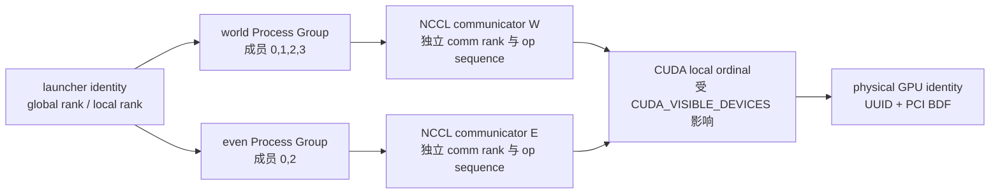

## 本章要解决什么问题

一条 NCCL 初始化日志可能是：

```text
ncclCommInitRank comm 0x... rank 2 nranks 4 cudaDev 2 nvmlDev 2 busId 1d000 ... Init COMPLETE
```

这里至少有五种身份容易混在一起：

```text
global rank
process-group rank
NCCL communicator rank
CUDA visible device ordinal
physical GPU PCI bus ID / UUID
```

它们在最简单的单机四卡 world group 中碰巧都是 `0,1,2,3`，但这只是特例。本章通过原生 NCCL 和 PyTorch 两套实验回答：

1. `ncclUniqueId`、`nranks`、`rank` 分别负责什么？
2. NCCL 为什么要求调用 `ncclCommInitRank` 前先 `cudaSetDevice`？
3. `ncclCommSplit(color,key)` 如何决定子 communicator 的 rank？
4. 一个 OS 进程能否同时拥有多个 NCCL communicator？
5. `CUDA_VISIBLE_DEVICES` 为什么改变 physical GPU，却不改变 local ordinal？
6. 两个 rank 绑定同一 GPU 时，NCCL 在初始化哪个阶段检测出来？
7. `destroy` 和 `abort` 的生命周期语义有何不同？

## 先建立五层身份模型

### 启动器身份

`torchrun` 负责启动进程并设置 rendezvous 环境：

```text
RANK              全局进程编号
WORLD_SIZE        全局进程数
LOCAL_RANK        当前节点内进程编号
LOCAL_WORLD_SIZE  当前节点进程数
MASTER_ADDR/PORT  c10d rendezvous/store 地址
```

NCCL 不直接读取 `RANK` 来决定 communicator 身份。ProcessGroupNCCL 从 c10d 获得 group size/rank，再把整数显式传给 NCCL API。

### Process Group 身份

Process group 定义 collective 的成员集合和组内顺序。例如：

```text
world       [0,1,2,3]  global rank 2 -> group rank 2
even group  [0,2]      global rank 2 -> group rank 1
pair high   [2,3]      global rank 2 -> group rank 0
```

同一个 global rank 在三个 group 中有三个不同 group rank。

<div class="diagram-scroll diagram-scroll--wide" markdown="1">



</div>

这五层不是一组可以互换的编号。同一进程可以同时属于多个 Process Group、持有多个 communicator；local ordinal 还会经过可见设备映射，最后才落到可跨进程核对的 GPU UUID/PCI BDF。

### NCCL Communicator 身份

对一个具体 device，ProcessGroupNCCL 通常把 group size/rank 传给 `ncclCommInitRank`，生成 `ncclComm_t`。communicator 内部有独立的：

- `nRanks` 和 `rank`；
- topology、ring/tree、channel；
- operation ordering；
- transport connections、proxy state 和 error state。

不同 communicator 的 collective 顺序彼此独立，但同一 communicator 内所有 rank 必须遵守一致顺序。

### CUDA ordinal 与物理身份

`cuda:0` 是当前进程可见设备列表中的 ordinal，不是永久物理编号。

```bash
CUDA_VISIBLE_DEVICES=2,0,3,1
```

会建立：

```text
cuda:0 -> physical GPU 2
cuda:1 -> physical GPU 0
cuda:2 -> physical GPU 3
cuda:3 -> physical GPU 1
```

UUID 和 PCI BDF 才能跨进程视图关联同一块物理 GPU。

## Unique ID 不是 Rank，也不是中央 Coordinator

原生多进程初始化通常是：

```text
rank 0: ncclGetUniqueId()
launcher/store/MPI: 把 128-byte ncclUniqueId 分发给全部成员
every rank: ncclCommInitRank(&comm, nranks, same_id, myrank)
```

`ncclUniqueId` 是 communicator bootstrap 的共同令牌。它不包含每个调用者的 rank；每个进程仍必须传入唯一且覆盖 `[0,nranks)` 的 `myrank`。

本章原生实验使用 MPI 只做两件事：启动四个进程、广播 opaque unique ID。数据 collective 由 NCCL 完成，不能因为使用了 `mpirun` 就说 AllReduce 由 MPI 实现。

## NCCL 源码一：Unique ID 的生成

源码基线：

```text
仓库：NVIDIA/nccl
版本：v2.22.3-1
提交：178b6b759074597777ce13438efb0e0ba625e429
文件：src/init.cc
符号：ncclGetUniqueId
行号：100-107
```

原始源码：

```cpp
NCCL_API(ncclResult_t, ncclGetUniqueId, ncclUniqueId* out);
ncclResult_t ncclGetUniqueId(ncclUniqueId* out) {
  NCCLCHECK(ncclInit());
  NCCLCHECK(PtrCheck(out, "GetUniqueId", "out"));
  ncclResult_t res = bootstrapGetUniqueId((struct ncclBootstrapHandle*)out);
  TRACE_CALL("ncclGetUniqueId(0x%llx)", (unsigned long long)hashUniqueId(*out));
  return res;
}
```

注释版：

```cpp
ncclResult_t ncclGetUniqueId(ncclUniqueId* out) {
  // [课程注释] 与只返回版本号的 ncclGetVersion 不同，这里会初始化 NCCL 全局状态。
  NCCLCHECK(ncclInit());
  NCCLCHECK(PtrCheck(out, "GetUniqueId", "out"));

  // [课程注释] public ncclUniqueId 被解释成内部 bootstrap handle。
  // 调用方只应把它当 opaque 128-byte payload，不应解析或修改。
  ncclResult_t res = bootstrapGetUniqueId((struct ncclBootstrapHandle*)out);

  // [课程注释] 日志使用 hash，避免把整个 handle 打印出来。
  TRACE_CALL("ncclGetUniqueId(0x%llx)", hashUniqueId(*out));
  return res;
}
```

唯一 ID 必须对同一 communicator 的全部 rank 完全相同；不同 communicator 应使用不同 bootstrap identity，除非通过 `ncclCommSplit` 从 parent 派生。

## NCCL 源码二：Current CUDA Device 在初始化调用时被捕获

`src/init.cc:1694-1707` 原文：

```cpp
NCCL_API(ncclResult_t, ncclCommInitRank, ncclComm_t* newcomm, int nranks, ncclUniqueId commId, int myrank);
ncclResult_t ncclCommInitRank(ncclComm_t* newcomm, int nranks, ncclUniqueId commId, int myrank) {
  // Load the CUDA driver and dlsym hooks (can fail on old drivers)
  (void)ncclCudaLibraryInit();

  int cudaDev;
  ncclConfig_t config = NCCL_CONFIG_INITIALIZER;
  CUDACHECK(cudaGetDevice(&cudaDev));

  NvtxParamsCommInitRank payload{myrank, nranks, cudaDev};
  NVTX3_FUNC_WITH_PARAMS(CommInitRank, CommInitRankSchema, payload)

  NCCLCHECK(ncclCommInitRankDev(newcomm, nranks, commId, myrank, cudaDev, &config));
  return ncclSuccess;
}
```

注释版：

```cpp
ncclResult_t ncclCommInitRank(/* nranks, commId, myrank */) {
  ncclCudaLibraryInit();

  int cudaDev;
  ncclConfig_t config = NCCL_CONFIG_INITIALIZER;

  // [课程注释] API 没有 device 参数。NCCL 读取当前 CUDA context/device。
  CUDACHECK(cudaGetDevice(&cudaDev));

  // [课程注释] myrank 与 cudaDev 是两个独立维度：
  // rank 是 communicator 身份；cudaDev 是该进程绑定的 visible ordinal。
  ncclCommInitRankDev(newcomm, nranks, commId, myrank, cudaDev, &config);
}
```

这就是下面顺序必须成立的源码原因：

```python
torch.cuda.set_device(local_rank)
dist.init_process_group("nccl")
```

更精确地说，ProcessGroupNCCL communicator 通常延迟到第一次 GPU collective 才创建，但在那之前 current device 和 tensor device 必须正确。

## Communicator 属性 API 不是环境变量回显

`src/init.cc:2128-2165`：

```cpp
ncclResult_t ncclCommCount(const ncclComm_t comm, int* count) {
  NCCLCHECK(CommCheck(comm, "CommCount", "comm"));
  NCCLCHECK(ncclCommEnsureReady(comm));
  *count = comm->nRanks;
  return ncclSuccess;
}

ncclResult_t ncclCommCuDevice(const ncclComm_t comm, int* devid) {
  NCCLCHECK(CommCheck(comm, "CommCuDevice", "comm"));
  NCCLCHECK(ncclCommEnsureReady(comm));
  *devid = comm->cudaDev;
  return ncclSuccess;
}

ncclResult_t ncclCommUserRank(const ncclComm_t comm, int* rank) {
  NCCLCHECK(CommCheck(comm, "CommUserRank", "comm"));
  NCCLCHECK(ncclCommEnsureReady(comm));
  *rank = comm->rank;
  return ncclSuccess;
}
```

注释版要点：

```cpp
// [课程注释] 三个查询都先 ncclCommEnsureReady。
// 对 nonblocking init，这可能完成/检查异步初始化后才能读取属性。
count  = comm->nRanks;  // communicator 规模
device = comm->cudaDev; // visible CUDA ordinal
rank   = comm->rank;    // communicator-local rank
```

它们读取的是 communicator 内部已经建立的状态，不是重新读取 `WORLD_SIZE`、`RANK` 或 `LOCAL_RANK` 环境变量。

## NCCL 源码三：Split Rank 由 Color 和 Key 决定

实验使用：

```text
color = global_rank % 2
key   = 4 - global_rank
```

成员和 key：

```text
color 0: global rank 0(key=4), 2(key=2)
color 1: global rank 1(key=3), 3(key=1)
```

若按 key 升序，两个 child communicator 都会把 global rank 较大的成员排到 split rank 0。

排序源码位于 `src/init.cc:1309-1345`。

原始源码：

```cpp
static ncclResult_t commGetSplitInfo(
    struct ncclComm* comm, struct ncclComm* parent,
    int color, int key, int* nRanksRet, int* myRankRet, int* parentRanksRet) {
  int* colors = NULL;
  int* keys = NULL;
  int nRanks = 0, myRank = 0;

  NCCLCHECKGOTO(ncclCalloc(&colors, parent->nRanks), ret, fail);
  NCCLCHECKGOTO(ncclCalloc(&keys, parent->nRanks), ret, fail);

  colors[parent->rank] = color;
  keys[parent->rank] = key;
  NCCLCHECKGOTO(bootstrapAllGather(parent->bootstrap, colors, sizeof(int)), ret, fail);
  NCCLCHECKGOTO(bootstrapAllGather(parent->bootstrap, keys, sizeof(int)), ret, fail);

  if (color == NCCL_SPLIT_NOCOLOR) goto exit;

  for (int i = 0; i < parent->nRanks; i++) {
    if (colors[i] != color) continue;
    int insert = 0;
    while (insert < nRanks && keys[parentRanksRet[insert]] <= keys[i]) insert++;
    for (int r = nRanks; r > insert; r--) parentRanksRet[r] = parentRanksRet[r - 1];
    parentRanksRet[insert] = i;
    nRanks++;
  }

  for (int i = 0; i < nRanks; i++) {
    if (parentRanksRet[i] == parent->rank) myRank = i;
  }
```

注释版：

```cpp
// [课程注释] Split 是 parent communicator 上的协同操作。
// 全部 parent rank 先交换 color 和 key。
bootstrapAllGather(colors);
bootstrapAllGather(keys);

if (color == NCCL_SPLIT_NOCOLOR) {
  // [课程注释] 仍参与 all-gather，但不创建 child communicator。
  return;
}

for (parent_rank : parent_comm) {
  if (colors[parent_rank] != my_color) continue;

  // [课程注释] 相同 color 的成员按 key 升序插入；key 相同则保持 parent 顺序。
  sorted_insert(parent_rank, keys[parent_rank]);
}

// [课程注释] 我在排序后数组中的位置就是 child communicator rank。
myRank = index_of(parent->rank);
```

`ncclCommSplit` public API 自己先进入内部 group，构造 async init job，再由 `ncclGroupEndInternal()` 推进：

```cpp
NCCLCHECK(ncclGroupStartInternal());
// validate parent, allocate child, save color/key
NCCLCHECKGOTO(ncclAsyncLaunch(
    &job->base, ncclCommInitRankFunc, NULL, free, comm), res, fail);

ncclGroupErrCheck(res);
NCCLCHECK(ncclGroupEndInternal());
```

所以 split 的所有 parent rank 必须以一致顺序参与，即使某些 rank 使用 `NCCL_SPLIT_NOCOLOR`。

## PyTorch 如何分发 Unique ID 和缓存 Communicator

当前 `ProcessGroupNCCL.cpp:1950-1987` 原始核心代码：

```cpp
// For every NCCL communicator that we create we need to broadcast
// a unique ID from rank 0 to all other ranks.
std::string storeKey;
if (!isSingleP2POp) {
  storeKey = std::to_string(ncclCommCounter_++);
} else {
  storeKey = p2pKey;
}
if (rank_ == 0 || (isSingleP2POp && p2pRank == 0)) {
  auto vec = std::vector<uint8_t>(
      reinterpret_cast<uint8_t*>(ncclID),
      reinterpret_cast<uint8_t*>(ncclID) + NCCL_UNIQUE_ID_BYTES);
  store_->set(storeKey, vec);
} else {
  auto vec = store_->get(storeKey);
  std::memcpy(ncclID, vec.data(), vec.size());
}
```

注释版：

```cpp
// [课程注释] c10d Store 取代原生实验中的 MPI_Bcast。
// 它只分发 unique ID，不承担 GPU payload collective。
if (process_group_rank == 0) {
  store.set(sequence_key, ncclUniqueIdBytes);
} else {
  ncclUniqueIdBytes = store.get(sequence_key);
}
```

`getNCCLComm` 先检查 per-device cache：

```cpp
if (devNCCLCommMap_.find(deviceKey) != devNCCLCommMap_.end()) {
  return devNCCLCommMap_[deviceKey];
}

// not cached: get unique ID, create/split communicator, create NCCL stream
```

因此：

- `dist.new_group` 创建 ProcessGroup 对象，不等于每张 GPU 的 NCCL communicator 已经初始化；
- 第一次针对某 device 的 collective 会进入 `getNCCLComm`；
- 后续同一 ProcessGroup/device 会复用 cache；
- 一个 ProcessGroup 若跨多个 device 使用，可能拥有多个 communicator。

## 实验设计

完整代码：

- [28_run_ch04_communicators.sh](/assets/files/nccl-learning/scripts/28_run_ch04_communicators.sh)
- [原生 NCCL/MPI 程序](/assets/files/nccl-learning/probes/ch04_native_communicator.cc)
- [PyTorch process-group 程序](/assets/files/nccl-learning/scripts/28_ch04_process_groups.py)
- [结果汇总器](/assets/files/nccl-learning/probes/ch04_summarize.py)

运行：

```bash
cd /root/nccl-learning
./scripts/28_run_ch04_communicators.sh
```

### 实验 A：原生 NCCL 生命周期

MPI rank 0 生成 unique ID，再广播给四个进程：

```cpp
if (global_rank == 0) ncclGetUniqueId(&unique_id);
MPI_Bcast(&unique_id, sizeof(unique_id), MPI_BYTE, 0, MPI_COMM_WORLD);

cudaSetDevice(global_rank);
ncclCommInitRank(&world_comm, world_size, unique_id, global_rank);
```

随后查询：

```cpp
ncclCommCount(world_comm, &comm_count);
ncclCommUserRank(world_comm, &comm_rank);
ncclCommCuDevice(world_comm, &comm_device);
```

完成 world AllReduce 后按 `color/key` split，再对子 communicator 做 AllReduce 和属性查询，最后按 child → parent 顺序 destroy。

### 实验 B：重叠 Process Group

四个 world rank 按同样顺序创建：

```text
even [0,2]
odd  [1,3]
low  [0,1]
high [2,3]
```

每个进程参与 world、一个 parity group 和一个 pair group：

| rank | parity sum | pair sum | world sum |
|---:|---:|---:|---:|
| 0 | 1+3=4 | 1+2=3 | 10 |
| 1 | 2+4=6 | 1+2=3 | 10 |
| 2 | 1+3=4 | 3+4=7 | 10 |
| 3 | 2+4=6 | 3+4=7 | 10 |

这三个结果同时成立，才能证明不同 group 是独立通信域。

### 实验 C：可见设备重排

保持 rank/local rank 不变，对比：

```text
CUDA_VISIBLE_DEVICES=0,1,2,3
CUDA_VISIBLE_DEVICES=2,0,3,1
```

每个 rank 记录 visible ordinal、UUID 和 PCI BDF。正确性仍由三个 group 的 AllReduce 验证。

### 实验 D：Duplicate GPU 反例

启动两个 rank，但只暴露 physical GPU0，并让两者都 `cudaSetDevice(0)`：

```bash
CUDA_VISIBLE_DEVICES=0 torchrun --nproc_per_node=2 \
  ... --device-mode duplicate-zero
```

runner 设 45 秒 timeout，并要求进程非零退出且日志包含 duplicate-GPU 指纹。如果意外成功，实验整体失败。

## 正式结果

Run ID：`20260710T072334Z`。

- [summary.md](/assets/files/nccl-learning/logs/ch04_communicators/20260710T072334Z/summary.md)
- [summary.csv](/assets/files/nccl-learning/logs/ch04_communicators/20260710T072334Z/summary.csv)
- [device_mapping.csv](/assets/files/nccl-learning/logs/ch04_communicators/20260710T072334Z/device_mapping.csv)
- [native stdout](/assets/files/nccl-learning/logs/ch04_communicators/20260710T072334Z/raw/native.stdout)
- [duplicate failure](/assets/files/nccl-learning/logs/ch04_communicators/20260710T072334Z/raw/duplicate.stdout)

## 结果一：同一个 Unique ID，加上不同 Rank，形成一个 Communicator

四个原生进程记录的 unique-ID hash 都是：

```text
0x3865653fd1be492c
```

注意这只是实验脚本为比较 128 bytes 计算的 FNV hash，不是 NCCL 日志中的内部 hash；不能跨实现比较两种 hash 数字。

属性结果：

| global rank | CUDA device | PCI BDF | comm count | comm rank | comm device | world sum |
|---:|---:|---|---:|---:|---:|---:|
| 0 | 0 | 0000:1A:00.0 | 4 | 0 | 0 | 10 |
| 1 | 1 | 0000:1C:00.0 | 4 | 1 | 1 | 10 |
| 2 | 2 | 0000:1D:00.0 | 4 | 2 | 2 | 10 |
| 3 | 3 | 0000:1E:00.0 | 4 | 3 | 3 | 10 |

`comm rank == global rank == CUDA device` 是实验输入造成的，不是 NCCL 强制关系。下一组 split 立即打破这个等式。

初始化中位数约 `299.739 ms`，但只有一次 communicator initialization，本文不把它作为稳定性能基线。

## 结果二：Split Rank 确实按 Key 重排

| global rank | color | key | split count | split rank | split sum |
|---:|---:|---:|---:|---:|---:|
| 0 | 0 | 4 | 2 | 1 | 4 |
| 2 | 0 | 2 | 2 | 0 | 4 |
| 1 | 1 | 3 | 2 | 1 | 6 |
| 3 | 1 | 1 | 2 | 0 | 6 |

日志也显示：

```text
global rank 2 -> ncclCommSplit rank 0 nranks 2 color 0 key 2
global rank 0 -> ncclCommSplit rank 1 nranks 2 color 0 key 4

global rank 3 -> ncclCommSplit rank 0 nranks 2 color 1 key 1
global rank 1 -> ncclCommSplit rank 1 nranks 2 color 1 key 3
```

源码中的 sorted insertion、日志和 AllReduce 结果三类证据一致。communicator rank 是“成员在当前通信域中的位置”，不能当作 global rank 使用。

## 结果三：一个进程同时拥有三个 NCCL Communicator

PyTorch 默认 mapping 下，每个 rank 完成：

- 一个 world communicator，`nranks=4`；
- 一个 parity communicator，`nranks=2`；
- 一个 pair communicator，`nranks=2`。

全部 rank 日志合计：

```text
Init COMPLETE, nranks=4: 4 条
Init COMPLETE, nranks=2: 8 条
```

四个 4-rank 日志分别对应 communicator 在四个进程中的本地对象；八个 2-rank 日志对应四个二成员 group 的八个成员实例。

正确性：

```text
world sum  = 10 on all ranks
even sum   = 4 on ranks 0,2
odd sum    = 6 on ranks 1,3
low sum    = 3 on ranks 0,1
high sum   = 7 on ranks 2,3
```

这证明 process group 不是 Python 标签，而是映射到了独立 NCCL 通信域。

## 结果四：Local Ordinal 不等于 Physical GPU

默认与 remap：

| rank/local ordinal | default physical BDF | remapped physical BDF |
|---:|---|---|
| 0 | 00000000:1a:00.0 | 00000000:1d:00.0 |
| 1 | 00000000:1c:00.0 | 00000000:1a:00.0 |
| 2 | 00000000:1d:00.0 | 00000000:1e:00.0 |
| 3 | 00000000:1e:00.0 | 00000000:1c:00.0 |

重排后每个进程仍执行：

```python
torch.cuda.set_device(local_rank)
```

但 `cuda:local_rank` 指向另一张 physical GPU。所有 group 的结果仍正确，说明 rank identity 与 physical placement 是可独立配置的。

性能可能改变，因为新的 rank adjacency 会映射到不同 NVLink/PCIe/NIC 路径。本机是完全对称 NV2，所以这次只验证身份语义，不比较性能。

## 结果五：Duplicate GPU 在 Peer Info AllGather 后被发现

失败日志：

```text
NCCL WARN Duplicate GPU detected : rank 1 and rank 0 both on CUDA device 1a000
ncclInvalidUsage
torch.distributed.DistBackendError
```

源码位置 `src/init.cc:727-740`：

```cpp
NCCLCHECKGOTO(fillInfo(comm, comm->peerInfo+rank, comm->commHash), ret, fail);
NCCLCHECKGOTO(bootstrapAllGather(
    comm->bootstrap, comm->peerInfo, sizeof(struct ncclPeerInfo)), ret, fail);

for (int i = 0; i < nranks; i++) {
  if ((i != rank) &&
      (comm->peerInfo[i].hostHash == comm->peerInfo[rank].hostHash) &&
      (comm->peerInfo[i].busId == comm->peerInfo[rank].busId)) {
    WARN("Duplicate GPU detected : rank %d and rank %d both on CUDA device %lx",
         rank, i, comm->peerInfo[rank].busId);
    ret = ncclInvalidUsage;
    goto fail;
  }
}
```

注释版：

```cpp
// [课程注释] 每个 rank 先发布 hostHash、busId、pid 等 peer info。
bootstrapAllGather(peerInfo);

for (peer : communicator) {
  // [课程注释] 只有“同 host + 同 physical busId”才判为重复 GPU。
  // 两台节点都存在 busId 1a000 并不冲突，因为 hostHash 不同。
  if (same_host(peer) && same_physical_gpu(peer)) {
    return ncclInvalidUsage;
  }
}
```

所以错误通常出现在第一次触发 communicator 初始化的 GPU collective，而不一定发生在 `init_process_group()` 返回之前。ProcessGroup 的 lazy communicator 是这个现象的重要原因。

## Destroy 和 Abort 不是同义词

`ncclCommDestroy` 的核心：

```cpp
comm->destroyFlag = 1;
NCCLCHECK(ncclCommEnsureReady(comm));
NCCLCHECKGOTO(ncclAsyncLaunch(
    &job->base, commReclaim, NULL, free, comm), res, fail);
```

`ncclCommAbort` 则先通知 device/child work 停止：

```cpp
if (comm->childAbortFlag != nullptr) {
  __atomic_store_n(comm->childAbortFlag, 1, __ATOMIC_RELEASE);
  __atomic_store_n(comm->childAbortFlagDev, 1, __ATOMIC_RELEASE);
}
__atomic_store_n(comm->abortFlag, 1, __ATOMIC_RELEASE);
__atomic_store_n(comm->abortFlagDev, 1, __ATOMIC_RELEASE);
comm->destroyFlag = 1;
```

语义区别：

```text
Destroy：正常生命周期结束，要求先完成正常使用并回收资源。
Abort：错误/取消路径，主动设置 abort flag，让仍在运行的工作退出。
```

不能看到 teardown 中出现 abort 就倒推它一定是最初根因。框架可能在更早异常后使用 abort 清理 communicator。

## Group 创建顺序为什么重要

本实验让所有 world rank 以相同顺序调用四次 `dist.new_group`，即使某 rank 不是某个 subgroup 成员。原因是 group 创建需要通过 Store 分发 communicator identity；不同 rank 的创建顺序不一致，可能让 sequence key 对应到不同成员集合。

多个 NCCL communicator 并发时还必须维持全局一致的 collective launch order，或使用明确的同步。否则不同进程可能在不同 communicator 上互相等待，形成跨 group deadlock。这个问题会在故障章节专门注入。

## 生产 Rank Mapping 检查表

每个 rank 至少记录：

```text
hostname / pid
global rank / world size
node rank / local rank / local world size
process-group name、成员表和 group rank
CUDA_VISIBLE_DEVICES 原字符串
visible ordinal
GPU UUID
PCI BDF
NUMA node
NCCL comm rank / nranks / comm hash（来自日志）
```

排查顺序：

```text
1. 先证明启动器给每个进程的 global/local rank 唯一且完整。
2. 再证明 local rank 映射到唯一 visible ordinal。
3. 用 UUID/BDF 证明它们是不同 physical GPU。
4. 用 ProcessGroup 成员表计算 group rank。
5. 用 NCCL Init COMPLETE 日志核对 comm rank、nranks、cudaDev、busId。
6. 最后才分析 graph、transport 和性能。
```

## 结论边界

原生实验中的 MPI 只做 bootstrap ID 广播；PyTorch 使用 c10d Store 实现同类职责。其他 launcher 可以用文件、TCP、PMI 或自定义 control plane 分发 ID，只要全部 communicator 成员获得一致 bytes 和一致 rank assignment。

本文没有比较 `NCCL_COMM_SPLIT_SHARE_RESOURCES` 的性能，也没有验证 nonblocking communicator init；它们分别属于执行资源和初始化状态机的后续章节。

## 本章结论

1. global rank、group rank、communicator rank、CUDA ordinal 和 PCI BDF 是五种不同身份，简单 world group 中相等只是特例。
2. `ncclUniqueId` 是 opaque bootstrap handle；launcher/Store/MPI 负责分发它，但 GPU collective 仍由 NCCL 执行。
3. `ncclCommInitRank` 通过 `cudaGetDevice` 捕获 current CUDA device，因此 device mapping 必须在 communicator 创建前正确。
4. 原生 split 实验验证：成员先按 color 分组，再按 key 升序确定 child rank；global rank 2/3 都成为各自 child rank 0。
5. 一个 PyTorch 进程在本实验中同时拥有 world、parity 和 pair 三个 communicator，分别产生独立正确结果。
6. `CUDA_VISIBLE_DEVICES=2,0,3,1` 改变了全部 rank 的 physical BDF，但 local ordinal 和 group rank 均未改变。
7. duplicate-GPU 检查发生在 peer-info all-gather 后，判断条件是同 hostHash 且同 busId；实验得到预期 `ncclInvalidUsage`。
8. Destroy 是正常回收，Abort 是错误退出机制；清理阶段日志不应被误判为第一根因。

## 练习与验收

1. 对 group `[1,4,7]` 和 keys `[30,10,20]`，写出三个 global rank 的 child communicator rank。
2. 为什么 `cudaDev=0` 不能唯一识别 physical GPU？应补充哪两项信息？
3. `init_process_group()` 成功后，为什么第一次 AllReduce 仍可能报 duplicate GPU？
4. 一个进程参与 DP、TP、PP 三种 group 时，至少会有多少种 rank 身份？
5. 根据 duplicate detection 源码，为什么不同节点上的相同 PCI BDF 不会被判成同一 GPU？
