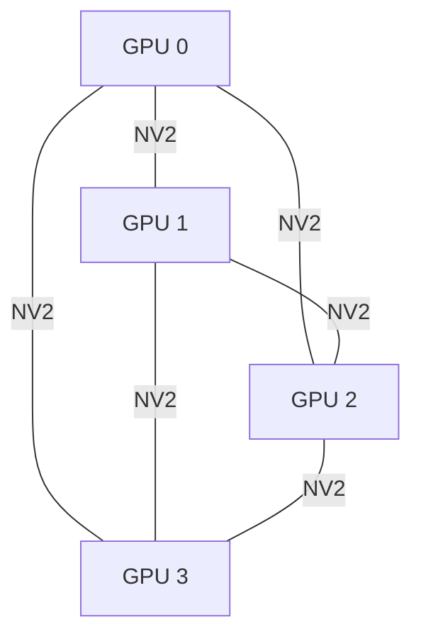
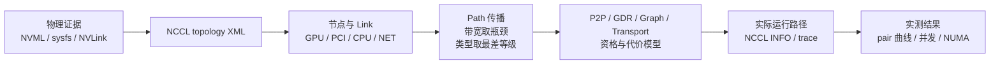

## 本章要解决什么问题

`nvidia-smi topo -m` 在本机输出：

```text
        GPU0  GPU1  GPU2  GPU3  CPU Affinity  NUMA Affinity
GPU0     X    NV2   NV2   NV2   0,2,4,...     0
GPU1    NV2    X    NV2   NV2   0,2,4,...     0
GPU2    NV2   NV2    X    NV2   0,2,4,...     0
GPU3    NV2   NV2   NV2    X    0,2,4,...     0
```

初学者容易把它压缩成一句话：“四张卡全互联，每对有两条 NVLink，所以通信肯定很快。”这句话至少遗漏了五层问题：

1. `NV2` 是连接数量，还是有效 payload 带宽？
2. NCCL 如何把 NVML/sysfs 信息转换成内部 topology graph？
3. NCCL graph 中的 `NVL[40.0]` 为什么和 `nvidia-smi` 的链路速率不同？
4. CUDA peer access 可用，是否意味着 12 个方向性能完全对称？
5. 单 pair 达到链路上限，多个 pair 并发时是否必然线性叠加？

本章建立三层证据：

```text
物理证据：NVML、PCI sysfs、NUMA、NVLink status
模型证据：NCCL topology XML、link/path 类型、内部带宽权重
实测证据：消息大小曲线、12 个有向 pair、并发 pattern、NUMA 绑定
```

## 运行前预测

实验前根据硬件提出可证伪预测：

```text
H1：四张 V100 构成 K4 完全图，每个无向 GPU pair 有两条直连 NVLink。
H2：所有 12 个有向 pair 都支持 CUDA peer access，且大消息带宽应高度对称。
H3：小消息主要受固定开销限制，大消息才接近两条链路的 payload 能力。
H4：互不共享 GPU 的两个 pair 可以并发叠加；共享端点的 pattern 会产生争用。
H5：改变提交线程的 CPU NUMA 只影响控制面，不应改变纯 GPU P2P 的数据路径。
```

H4 只预测“有争用”，不提前断言瓶颈一定是 NVLink、copy engine 还是 GPU memory path。精确归因需要 profiler 和更底层的 CUDA benchmark。



这是 `nvidia-smi topo -m` 所见的 K4 连接关系：任意 GPU pair 都有 `NV2`。它只能证明 pair 级连接存在，不能直接推出多 pair 并发带宽、collective busbw 或 NCCL 最终构造的 channel。

## 先建立拓扑词汇

### PCI 地址不是 GPU 编号

本机四张 GPU 的 PCI BDF 是：

| CUDA device | PCI BDF | NUMA node |
|---:|---|---:|
| 0 | `0000:1a:00.0` | 0 |
| 1 | `0000:1c:00.0` | 0 |
| 2 | `0000:1d:00.0` | 0 |
| 3 | `0000:1e:00.0` | 0 |

CUDA device ordinal 会受 `CUDA_VISIBLE_DEVICES` 影响；PCI BDF 更适合关联 sysfs、NIC 和物理拓扑。生产记录 rank mapping 时必须同时保存两者。

### Link 和 Path 不是一回事

`link` 是图中相邻节点间的物理或逻辑边，例如 GPU 到 GPU 的 NVLink、GPU 到 PCI switch 的 PCIe link。`path` 是两个目标节点之间由一个或多个 link 组成的路线。

例如：

```text
GPU0 --NVLink-- GPU1                  一跳 PATH_NVL
GPU0 --NVLink-- GPU2 --NVLink-- GPU1 两跳 PATH_NVB
GPU0 --PCI-- switch --PCI-- GPU1     PATH_PIX/PXB
GPU0 --PCI-- CPU0 --UPI-- CPU1 ...   PATH_SYS
```

路径类别不仅用于打印，它会参与 P2P、GDR、graph search 和 transport 选择。

<div class="diagram-scroll diagram-scroll--xwide" markdown="1">



</div>

因此本章始终把“硬件事实”“NCCL 内部模型”“当次运行选择”和“测得性能”分开。任何一层都不能单独替代另外三层。

### `NV2` 的准确含义

`NV2` 表示工具观察到两条聚合的 NVLink 连接。它不是：

- NCCL AllReduce busbw；
- 某次 CUDA copy 的实测带宽；
- 多 pair 并发时的 bisection bandwidth；
- NCCL tuning model 中必然使用的带宽常量。

这四个数在本机分别不同。

## NCCL 源码一：节点、Link 和 Path 类型

源码基线：

```text
仓库：NVIDIA/nccl
版本：v2.22.3-1
提交：178b6b759074597777ce13438efb0e0ba625e429
文件：src/graph/topo.h
行号：34-76
```

原始源码：

```cpp
#define GPU 0
#define PCI 1
#define NVS 2
#define CPU 3 // Actually NUMA domains
#define NIC 4
#define NET 5

#define LINK_LOC 0
#define LINK_NVL 1
#define LINK_PCI 3
#define LINK_SYS 7
#define LINK_NET 8

#define PATH_LOC 0
#define PATH_NVL 1
#define PATH_NVB 2
#define PATH_PIX 3
#define PATH_PXB 4
#define PATH_PXN 5
#define PATH_PHB 6
#define PATH_SYS 7
```

注释版：

```cpp
// [课程注释] CPU 节点在 topology graph 中实际代表 NUMA domain，
// 不等于“一颗物理 CPU package”。
#define GPU 0
#define PCI 1
#define NVS 2   // NVSwitch
#define CPU 3   // NUMA domain
#define NIC 4   // NIC device container
#define NET 5   // NCCL net device/port

// [课程注释] Link 描述相邻节点之间的边。
#define LINK_LOC 0
#define LINK_NVL 1
#define LINK_PCI 3
#define LINK_SYS 7
#define LINK_NET 8

// [课程注释] 数值越大通常表示路径越“远”或代价等级越差。
// 后续代码会用 max(path->type, new_link_type) 累积最差等级。
#define PATH_LOC 0
#define PATH_NVL 1  // 直接 NVLink
#define PATH_NVB 2  // 经一张中间 GPU 的 NVLink
#define PATH_PIX 3  // 至多一个 PCI switch
#define PATH_PXB 4  // 多个 PCI switch
#define PATH_PXN 5  // GPU 经中间 GPU 到 NIC
#define PATH_PHB 6  // 经过 PCI Host Bridge/CPU
#define PATH_SYS 7  // 跨 NUMA/SMP interconnect
```

数值顺序很重要。后面 `path->type <= p2pLevel` 不是字符串比较，而是在判断路径是否近到允许 P2P。

## NCCL 源码二：XML 中的两条 NVLink 如何成为一条图边

本次 NCCL topology XML 对 GPU0 包含：

```xml
<gpu dev="0" sm="70" rank="0" gdr="1">
  <nvlink target="0000:1e:00.0" count="2" tclass="0x030200"/>
  <nvlink target="0000:1d:00.0" count="2" tclass="0x030200"/>
  <nvlink target="0000:1c:00.0" count="2" tclass="0x030200"/>
</gpu>
```

其他三张 GPU 具有对称记录，总计 12 条有向 XML entry。

处理这些节点的原始源码位于 `src/graph/topo.cc:532-573`：

```cpp
ncclResult_t ncclTopoAddNvLinks(struct ncclXmlNode* node, struct ncclTopoSystem* system, const char* parentBusId, int systemId) {
  if (strcmp(node->name, "nvlink") == 0) {
    struct ncclTopoNode* gpu = NULL;
    int64_t pBusId;
    NCCLCHECK(busIdToInt64(parentBusId, &pBusId));
    pBusId = NCCL_TOPO_ID(systemId, pBusId);
    NCCLCHECK(ncclTopoGetNode(system, &gpu, GPU, pBusId));
    int count;
    NCCLCHECK(xmlGetAttrInt(node, "count", &count));
    const char* targetClass;
    NCCLCHECK(xmlGetAttrStr(node, "tclass", &targetClass));
    int targetType;
    NCCLCHECK(kvConvertToInt(targetClass, &targetType, kvDictPciClass));
    struct ncclTopoNode* remote = NULL;
    if (targetType == GPU) {
      const char* target;
      NCCLCHECK(xmlGetAttrStr(node, "target", &target));
      int64_t busId;
      NCCLCHECK(busIdToInt64(target, &busId));
      NCCLCHECK(ncclTopoGetNode(system, &remote, GPU, NCCL_TOPO_ID(systemId, busId)));
    }
    if (remote) {
      float nvlBw = ncclTopoNVLinkBw(gpu->gpu.cudaCompCap);
      NCCLCHECK(ncclTopoConnectNodes(gpu, remote, LINK_NVL, count*nvlBw));
    }
  }
```

注释版：

```cpp
ncclResult_t ncclTopoAddNvLinks(/* ... */) {
  if (strcmp(node->name, "nvlink") == 0) {
    // [课程注释] parentBusId 确定这条 XML entry 属于哪张本地 GPU。
    struct ncclTopoNode* gpu = NULL;
    int64_t pBusId;
    NCCLCHECK(busIdToInt64(parentBusId, &pBusId));
    NCCLCHECK(ncclTopoGetNode(system, &gpu, GPU, NCCL_TOPO_ID(systemId, pBusId)));

    // [课程注释] count=2 会作为倍率，不会创建两个独立 graph edge。
    int count;
    NCCLCHECK(xmlGetAttrInt(node, "count", &count));

    // [课程注释] tclass=GPU 时，target 属性被解析成远端 GPU 的 PCI bus ID。
    if (targetType == GPU) {
      NCCLCHECK(ncclTopoGetNode(system, &remote, GPU, remoteBusId));
    }

    if (remote) {
      // [课程注释] 单 link 权重由 compute capability 查表，而非现场测速。
      float nvlBw = ncclTopoNVLinkBw(gpu->gpu.cudaCompCap);

      // [课程注释] 最终 graph edge 带宽 = XML count * 架构常量。
      NCCLCHECK(ncclTopoConnectNodes(gpu, remote, LINK_NVL, count * nvlBw));
    }
  }
}
```

XML 的 `count=2` 和 `nvidia-smi` 的 `NV2` 对应。但 graph 中只有一条聚合 `LINK_NVL`，其带宽是查表值乘以 count。

## 一个关键差异：NCCL 模型不是硬件测速结果

`src/graph/topo.h` 中的常量和函数：

```cpp
#define SM70_NVLINK_BW 20.0
#define SM80_NVLINK_BW 20.0
#define SM90_NVLINK_BW 20.6

static float ncclTopoNVLinkBw(int cudaCompCap) {
  return
    cudaCompCap >= 90 ? SM90_NVLINK_BW :
    cudaCompCap == 86 ? SM86_NVLINK_BW :
    cudaCompCap >= 80 ? SM80_NVLINK_BW :
    cudaCompCap >= 70 ? SM70_NVLINK_BW :
    cudaCompCap >= 60 ? SM60_NVLINK_BW :
    SM80_NVLINK_BW;
}
```

注释版：

```cpp
// [课程注释] V100 是 SM70。NCCL 2.22.3 给每条 NVLink 20 GB/s 的搜索权重。
#define SM70_NVLINK_BW 20.0

static float ncclTopoNVLinkBw(int cudaCompCap) {
  // [课程注释] 这是按 compute capability 查常量，不读取实时链路计数器，
  // 也不会运行 bandwidth benchmark。
  return cudaCompCap >= 70 ? SM70_NVLINK_BW : /* other generations */;
}
```

所以本机出现三个不同数字：

| 数字 | 值 | 含义 |
|---|---:|---|
| `nvidia-smi nvlink --status` | 25.781 GB/s/link | 驱动报告的单 link 状态速率 |
| NCCL topology graph | 20.0 GB/s/link | graph search 使用的 SM70 权重 |
| XML `count=2` 后 NCCL graph | 40.0 GB/s/pair | 聚合搜索权重 |

NCCL 日志因此打印：

```text
+ NVL[40.0] - GPU/1C000
GPU/1A000 : GPU/1C000 (1/40.0/NVL)
```

后面实测能超过 40 GB/s，这不是“突破 NCCL 上限”，因为 40 本来就不是硬件 cap。

## NCCL 源码三：路径如何传播

`src/graph/paths.cc:41-101` 明确写着使用 breadth-first search。核心原始代码：

```cpp
while (nodeList.count) {
  nextNodeList.count = 0;
  for (int n=0; n<nodeList.count; n++) {
    struct ncclTopoNode* node = nodeList.list[n];
    struct ncclTopoLinkList* path;
    NCCLCHECK(getPath(system, node, baseNode->type, baseNode->id, &path));
    for (int l=0; l<node->nlinks; l++) {
      struct ncclTopoLink* link = node->links+l;
      struct ncclTopoNode* remNode = link->remNode;
      struct ncclTopoLinkList* remPath;
      NCCLCHECK(getPath(system, remNode, baseNode->type, baseNode->id, &remPath));
      float bw = std::min(path->bw, link->bw);

      if ((remPath->bw == 0 || remPath->count > path->count) && remPath->bw < bw) {
        remPath->count = path->count + 1;
        remPath->bw = bw;
        int type = link->type == LINK_NET ? LINK_LOC : link->type;
        if (node->type == PCI && remNode->type == PCI) type = PATH_PXB;
        if (link->type == LINK_PCI && (node->type == CPU || link->remNode->type == CPU)) type = PATH_PHB;
        if (node->type == GPU && path->type == PATH_NVL && type == PATH_NVL && remPath->count > 1) type = PATH_NVB;
        remPath->type = std::max(path->type, type);
      }
    }
  }
}
```

注释版：

```cpp
// [课程注释] 从 baseNode 分层向外扩展，建立其他节点到 baseNode 的 path。
while (nodeList.count) {
  for (each node in current_bfs_frontier) {
    for (each outgoing link) {
      // [课程注释] 一条路径的有效带宽由最窄 link 决定。
      float bw = std::min(path->bw, link->bw);

      // [课程注释] 只有 hop 更少且 bottleneck bandwidth 更高时才替换旧路径。
      if ((unvisited_or_shorter) && remPath->bw < bw) {
        remPath->count = path->count + 1;
        remPath->bw = bw;

        // [课程注释] path type 保存整条路径中最差的距离等级。
        int type = classify_current_link_and_nodes();
        remPath->type = std::max(path->type, type);
      }
    }
  }
}
```

它不是简单找“最少 hop”，也不是现场测量每条边。它组合 hop、路径类别和预置带宽权重，给后续 P2P 与 graph search 使用。

本机每对 GPU 都有直接一跳 NVLink，因此 path matrix 是：

```text
GPU/1A000 -> GPU/1C000  count=1 bw=40.0 type=NVL
GPU/1A000 -> GPU/1D000  count=1 bw=40.0 type=NVL
GPU/1A000 -> GPU/1E000  count=1 bw=40.0 type=NVL
GPU/1A000 -> CPU0       count=2 bw=12.0 type=PHB
```

## NCCL 源码四：拓扑允许 P2P 还不够

`src/graph/paths.cc::ncclTopoCheckP2p` 的核心原文：

```cpp
int p2pLevel = PATH_SYS;

if (ncclTopoUserP2pLevel == -1)
  NCCLCHECK(ncclGetLevel(&ncclTopoUserP2pLevel, "NCCL_P2P_DISABLE", "NCCL_P2P_LEVEL"));
if (ncclTopoUserP2pLevel != -2) {
  p2pLevel = ncclTopoUserP2pLevel;
  goto compare;
}

if (arch == NCCL_TOPO_CPU_ARCH_X86 && vendor == NCCL_TOPO_CPU_VENDOR_INTEL) {
  p2pLevel = PATH_PXB;
}

compare:
if (path->type <= p2pLevel) *p2p = 1;

if (*p2p == 1) {
  status = ncclNvmlDevicePairs[indexes[i-1]][indexes[i-0]].p2pStatusRead;
  bool good = status == NVML_P2P_STATUS_OK;
  status = ncclNvmlDevicePairs[indexes[i-1]][indexes[i-0]].p2pStatusWrite;
  good &= status == NVML_P2P_STATUS_OK;
  if (!good) *p2p = 0;
}
```

注释版：

```cpp
// [课程注释] 第一道门：用户是否通过 DISABLE/LEVEL 收紧 P2P 距离。
load_user_p2p_level();

// [课程注释] 第二道门：平台默认策略。当前 Intel x86 默认最多 PATH_PXB。
if (x86_intel) p2pLevel = PATH_PXB;

// [课程注释] 本机 PATH_NVL=1，小于 PATH_PXB=4，所以 topology policy 允许。
if (path->type <= p2pLevel) *p2p = 1;

// [课程注释] 第三道门：NVML 必须同时确认 read/write P2P status 正常。
// 拓扑上连着但 NVML 报 disabled 时，NCCL 会撤销 P2P；
// 对 NVLink path 还会提示这可能是硬件/平台异常。
validate_nvml_read_and_write_status();
```

所以 `NV2` 只是第一层。NCCL 还会经过 policy threshold 和 NVML capability validation。后续 Transport 章节会继续分析 `p2p.cc::canConnect/setup/connect`。

还有一个容易忽略的 V100 细节：源码只在双方 compute capability 都是 80 时默认把 `read` flag 设为 1。V100 是 SM70，因此“允许 P2P”不等于启用 Ampere/NVLink P2P read optimization。

## 实验脚本与控制变量

完整实验：

- [26_run_ch02_topology.sh](/assets/files/nccl-learning/scripts/26_run_ch02_topology.sh)
- [26_ch02_topology_p2p.py](/assets/files/nccl-learning/scripts/26_ch02_topology_p2p.py)
- [ch02_summarize.py](/assets/files/nccl-learning/probes/ch02_summarize.py)

运行：

```bash
cd /root/nccl-learning
./scripts/26_run_ch02_topology.sh
```

固定条件：

```text
GPU                   4 x V100-SXM2-32GB
topology              all pairs NV2
dtype                 uint8，避免元素大小换算影响 payload
warmup                5
independent cycles    10
CPU affinity          matrix 固定 NUMA0
correctness           每个输出做全 tensor 比较
timing                单 pair 用目标 GPU CUDA event
concurrency timing    所有相关 GPU 同步后的 host monotonic wall time
```

### 实验 A：消息大小 × 有向 GPU pair

消息大小：

```text
1 KiB, 64 KiB, 1 MiB, 16 MiB, 256 MiB
```

四张 GPU 有 $4\times3=12$ 个有向 pair。每个大小、每个方向运行十个 cycle。迭代数按大小调整，使小消息有足够采样、大消息不会运行过久。

计时核心：

```python
start = torch.cuda.Event(enable_timing=True)
end = torch.cuda.Event(enable_timing=True)
start.record(stream)
for _ in range(iterations):
    dst.copy_(src, non_blocking=True)
end.record(stream)
end.synchronize()

time_us = start.elapsed_time(end) * 1000 / iterations
bandwidth_GBs = nbytes / (time_us / 1e6) / 1e9
```

`end.synchronize()` 是测量成立的关键；不等待 event 就只是在测 host enqueue。

### 实验 B：并发 pattern

固定每条 edge 256 MiB：

| pattern | edges | 目的 |
|---|---|---|
| single | 0→1 | 单 pair 基线 |
| bidirectional | 0→1, 1→0 | 同一 GPU pair 双向 |
| disjoint | 0→1, 2→3 | 无共享 GPU 的两组传输 |
| ring | 0→1, 1→2, 2→3, 3→0 | 每张 GPU 同时是 src 和 dst |
| fan-in | 1→0, 2→0, 3→0 | 三条 link 共享目标 GPU |

这里报告的是所有 edge payload 总和除以 wall time，称为 aggregate payload bandwidth。它不是 NCCL busbw。

### 实验 C：CPU NUMA 绑定

同一并发矩阵分别由 NUMA0 和 NUMA1 的 CPU 提交：

```bash
numactl --cpunodebind=0 python3 ... --mode concurrency
numactl --cpunodebind=1 python3 ... --mode concurrency
```

没有使用 `--membind`，因为 payload 在 GPU memory 中。这个实验只隔离 host submission affinity，不是在测试 host staging。

## 正式结果

Run ID：`20260710T070553Z`。

- [summary.md](/assets/files/nccl-learning/logs/ch02_topology/20260710T070553Z/summary.md)
- [summary.csv](/assets/files/nccl-learning/logs/ch02_topology/20260710T070553Z/summary.csv)
- [pair_summary.csv](/assets/files/nccl-learning/logs/ch02_topology/20260710T070553Z/pair_summary.csv)
- [concurrency_summary.csv](/assets/files/nccl-learning/logs/ch02_topology/20260710T070553Z/concurrency_summary.csv)
- [NCCL topology XML](/assets/files/nccl-learning/logs/ch02_topology/20260710T070553Z/artifacts/topology.xml)
- [NCCL topology log](/assets/files/nccl-learning/logs/ch02_topology/20260710T070553Z/raw/nccl_topology_dump.log)

### 物理与模型证据

| 指标 | 结果 |
|---|---:|
| GPU | 4 × Tesla V100-SXM2-32GB |
| active NVLink/GPU | 6 |
| NVLink/GPU pair | 2 |
| `nvidia-smi` rate/link | 25.781 GB/s |
| 两 link 报告总速率 | 51.562 GB/s |
| NCCL model/link | 20.0 GB/s |
| NCCL model/GPU pair | 40.0 GB/s |
| directed XML NVLink entries | 12 |
| GPU NUMA | 全部 NUMA0 |

物理图、XML 和源码计算一致地证明：每张 GPU 用六条 link 分别连接另外三张 GPU，每个 pair 两条，构成 K4 完全图。

### 消息大小曲线

| bytes | median latency | median GB/s | pair median min | pair median max | max pair CV |
|---:|---:|---:|---:|---:|---:|
| 1 KiB | 17.380 us | 0.059 | 0.058 | 0.060 | 3.10% |
| 64 KiB | 17.785 us | 3.685 | 3.641 | 3.723 | 1.99% |
| 1 MiB | 39.041 us | 26.858 | 26.133 | 27.223 | 0.94% |
| 16 MiB | 359.289 us | 46.696 | 46.645 | 46.713 | 0.16% |
| 256 MiB | 5553.777 us | 48.334 | 48.322 | 48.372 | 0.05% |

最大正反向不对称：

```text
1 KiB      2.90%
64 KiB     1.91%
1 MiB      2.49%
16 MiB     0.14%
256 MiB    0.10%
```

小消息的百分比差异更大，是因为 17 微秒附近的固定开销占主导；256 MiB 时 12 个方向几乎重合。

### 为什么 1 KiB 的 GB/s 没有意义

1 KiB 用时约 17.38 微秒：

$$
\frac{1024}{17.38\times10^{-6}}\approx 0.059\text{ GB/s}
$$

链路并没有“退化成 0.059 GB/s”，只是消息太小，固定提交、copy engine 和同步开销远大于 payload 传输时间。到 16 MiB 后才接近稳定带宽区。

### 大消息效率

若只用 `nvidia-smi` 报告的两 link 速率作为参考：

$$
\text{payload ratio}=\frac{48.334}{2\times25.781}=93.74\%
$$

这是“copy payload / 驱动报告总速率”的比例，不是协议效率的严格硬件计数。它足以说明路径没有明显退化到 PCIe/host staging，但不能代替 NVLink hardware counter。

本机 `nvidia-smi nvlink --getthroughput` 对 V100 返回 `N/A`，因此本文没有伪造链路 counter 证据。

## 并发结果：完全图不等于任意 pattern 线性扩展

NUMA0 提交结果：

| pattern | edges | median aggregate GB/s | 相对 single |
|---|---:|---:|---:|
| single 0→1 | 1 | 48.310 | 1.00× |
| bidirectional 0↔1 | 2 | 48.372 | 1.00× |
| disjoint 0→1, 2→3 | 2 | 96.583 | 2.00× |
| ring four edges | 4 | 48.356 | 1.00× |
| fan-in to GPU0 | 3 | 48.403 | 1.00× |

所有 CV 不超过 0.13%，所以差异不是一次偶然波动。

### 可以直接推出什么

1. 两个 disjoint pair 几乎精确叠加，证明机器至少能同时利用两组互不共享 GPU 的 P2P 路径。
2. fan-in 共享目标 GPU 后没有按三条 edge 叠加，端点资源成为约束。
3. bidirectional 和 ring 中每张相关 GPU 同时承担读写角色，这个 `torch.copy_` workload 的 aggregate 也没有叠加。
4. “有六条 active NVLink”不能直接推出任意 memcpy pattern 都获得六条链路总和。

### 目前不能直接推出什么

不能仅凭这组实验断言：

```text
NVLink 不是 full duplex；
V100 一张 GPU 只能使用 48 GB/s 总带宽；
NCCL Ring 只能达到 48 GB/s；
瓶颈一定是某一个 copy engine。
```

原因是 PyTorch cross-device copy、CUDA copy scheduling、GPU memory controller 和 endpoint engine 都可能参与。NCCL collective 使用持久化 GPU kernel、多个 channel 和不同数据流，不等价于并发 `copy_`。后续 Kernel/Transport 章节会用 Nsight 和 NCCL 路径继续拆解。

## NUMA 结果为什么几乎不变

NUMA0 与 NUMA1 的各 pattern 最大相对差异只有 `0.028%`：

| pattern | NUMA0 GB/s | NUMA1 GB/s |
|---|---:|---:|
| single | 48.310 | 48.310 |
| disjoint | 96.583 | 96.590 |
| fan-in | 48.403 | 48.413 |

这符合 H5：host 线程只负责 enqueue，256 MiB payload 直接在 GPU memory 之间移动，不经过 CPU DRAM。把这个结论外推到 SHM、Socket、IB proxy 或 host staging 是错误的，那些路径可能强烈受 CPU/NIC NUMA 影响。

## 四个带宽数字不要混用

| 指标 | 本机示例 | 用途 |
|---|---:|---|
| NVLink status rate | 51.562 GB/s/pair | 硬件连接参考 |
| NCCL topology model | 40.0 GB/s/pair | graph search 权重 |
| CUDA P2P payload | 48.334 GB/s/pair | 单 pair copy 实测 |
| NCCL AllReduce busbw | 约 122 GB/s | collective 归一化模型指标 |

AllReduce busbw 大于单 pair 48 GB/s 并不矛盾。它按 collective 通信量归一化，并且 NCCL 可以用多个 channel 同时利用不同 pair。busbw 公式会在第 8 章严格推导。

## 生产排障方法

### 看到性能不对称时

按以下顺序检查：

```text
1. 保存 CUDA ordinal、UUID、PCI BDF 和 rank mapping。
2. 比较 nvidia-smi topo、NCCL XML 和 NCCL path matrix。
3. 检查所有方向 cudaDeviceCanAccessPeer/NVML P2P status。
4. 跑小/中/大消息，而不是只看一个点。
5. 分离单 pair、disjoint、fan-in 和双向 pattern。
6. 检查 GPU clock、P-state、ECC/Xid 和 NVLink error counter。
7. 再用 NCCL_DEBUG 证明 transport；不要仅凭物理连接猜数据路径。
```

### 容器环境特别要检查什么

容器能看到 `/dev/nvidia*` 不代表 NVML topology 和 peer access 完整。常见问题包括：

- GPU device 注入不完整；
- PCI sysfs 被裁剪；
- IOMMU/ACS 或虚拟化破坏 P2P；
- `CUDA_VISIBLE_DEVICES` 改变 ordinal 后 rank mapping 错位；
- MIG 或平台策略限制 peer access。

源码表明 NCCL 会同时依赖 topology model 和 NVML P2P status，所以两者都要采集。

## 结论边界

本文验证的是四张 V100-SXM2 的单机 CUDA P2P copy。当前没有 NVSwitch，也没有可见 IB/RoCE HCA：

```text
可以验证：直连 NVLink、P2P capability、消息曲线、pair 对称性、并发端点争用
不能验证：NVSwitch/NVLS、跨节点 GDR、multi-rail、RoCE fabric
```

NCCL XML 中 `gdr="1"` 表示 GPU 具备相关属性，不等于当前存在 NIC 或实际启用了 GPUDirect RDMA。

## 本章结论

1. 四张 V100 构成全互联 K4，每个 GPU pair 有两条直连 NVLink，12 个有向 pair 全部支持 CUDA peer access。
2. `NV2` 只描述 link count；本机驱动报告每 link 25.781 GB/s，NCCL 2.22.3 对 SM70 的 graph 权重则是每 link 20 GB/s。
3. NCCL 使用 XML 构造聚合 `LINK_NVL`，再通过最窄带宽和最差路径等级传播 path；它不是现场 bandwidth benchmark。
4. 256 MiB 单向 P2P copy 中位数为 48.334 GB/s，pair median 范围仅 48.322～48.372 GB/s，路径高度对称。
5. 小消息由约 17 微秒固定开销主导；至少到 16 MiB 才进入接近饱和区。
6. 两个 disjoint pair 可扩展到 96.583 GB/s，但共享端点或同时收发的 memcpy pattern 没有线性叠加。
7. CPU NUMA 绑定对纯 GPU P2P payload 几乎无影响，这一结论不适用于 host staging、proxy 或网络路径。
8. NCCL topology bandwidth、CUDA copy bandwidth 和 nccl-tests busbw 是三种不同指标，不能横向当作同一物理带宽。

## 练习与验收

1. 给定 `PATH_NVL=1`、`PATH_PXB=4`，解释 Intel x86 默认策略为何允许本机 P2P。
2. 根据 XML 的 `count=2` 和 `SM70_NVLINK_BW=20`，手算日志中的 `NVL[40.0]`。
3. 为什么实测 48.334 GB/s 大于 NCCL graph 的 40 GB/s，却不构成源码或测量矛盾？
4. 为什么两个 disjoint pair 能达到约 96.6 GB/s，而 fan-in 三条 edge 仍约 48.4 GB/s？哪些证据还不足以确定根因？
5. 设计一组实验区分 NVLink、copy engine、GPU memory bandwidth 和 host submission 四种瓶颈。
