## “跑十次取平均”为什么不够

同一台 4×V100 机器、同一个 1 MiB AllReduce，本章实际测到：

```text
-I 0:       50.385 us
-I 1:       54.125 us

-z 0:       60.730 us
-z 1:       77.315 us
-z 2:       77.905 us
-z 3:       88.210 us

-n 1:       85.975 us, CV 8.62%
-n 100:     53.570 us, CV 0.19%

same-core CPU noise:
median        59.935 us
P95          584.271 us
CV           143.94%
```

这些数字都来自正确完成的 AllReduce，`#wrong` 全部为 0。差异不是“某一条结果肯定错了”，而是参数改变了计时边界、摊销方式和干扰条件。

因此一个 NCCL benchmark 结论必须同时回答：

1. 计时从哪里开始，到哪里结束？
2. host 只 enqueue，还是每轮等待 device completion？
3. warmup 是否真的覆盖了首次连接和时钟爬升？
4. 单个报表 time 平均了多少次操作？
5. CUDA event instrumentation 是否扰动被测对象？
6. 取 rank0、平均 rank，还是 critical rank？
7. correctness 是否执行，是否在 timed region 内？
8. cycle 间 CV 和单 cycle 内 P99 是否都稳定？
9. CPU affinity、GPU clock、温度和后台负载是否受控？
10. 参数顺序是否与机器热身过程混在一起？

本章从 nccl-tests 源码建立计时状态机，再用 46 次独立进程、920 行测量和 9,976 条 NVML telemetry 验证。

## 证据边界

固定版本：

```text
nccl-tests:
2.19.5
5bcd45d2ee8365e37895e118c9d11b0ebc15aa69

NCCL:
2.22.3
178b6b759074597777ce13438efb0e0ba625e429
```

正式运行：

```text
ch09_benchmark/20260710T150350Z
4 x Tesla V100-SXM2-32GB
GPU 均位于 NUMA0
CPU0 属于 NUMA0
CPU1 属于 NUMA1
```

实验附件：

- [正式实验驱动](/assets/files/nccl-learning/scripts/33_ch09_benchmark_methodology.py)
- [全部命令与版本清单](/assets/files/nccl-learning/logs/ch09_benchmark/20260710T150350Z/manifest.txt)
- [920 行原始测量](/assets/files/nccl-learning/logs/ch09_benchmark/20260710T150350Z/raw_measurements.csv)
- [38 组聚合结果](/assets/files/nccl-learning/logs/ch09_benchmark/20260710T150350Z/summary.csv)
- [机器生成的实验摘要](/assets/files/nccl-learning/logs/ch09_benchmark/20260710T150350Z/summary.md)
- [NVML telemetry 摘要](/assets/files/nccl-learning/logs/ch09_benchmark/20260710T150350Z/telemetry_summary.csv)

原始 NVML 采样有 9,976 行，保留在本机用于审计；博客只发布按配置聚合后的 telemetry，避免低价值附件膨胀。

## 三层时间不能混用

一次 nccl-tests 进程包含三层时间：

```text
process lifetime
  |
  +-- communicator init / buffer allocation
  +-- size-level warmup
  +-- out-of-place BenchTime
  |     +-- untimed priming collective
  |     +-- measured loop
  |     +-- completion
  |     +-- separate correctness
  +-- in-place BenchTime
  |     +-- untimed priming collective
  |     +-- measured loop
  |     +-- completion
  |     +-- separate correctness
  +-- teardown
```

报表的 `time` 不是 process wall time，也不包括 communicator 初始化。它通常是 `BenchTime` measured loop 与最终 completion 的归一化时间。

训练端到端 step time 又是另一层：

```text
forward + backward + collective wait/overlap
+ optimizer + input pipeline + framework scheduling
```

所以 nccl-tests 正常只能证明独立 collective 路径正常，不能自动证明训练没有通信瓶颈。

```mermaid
flowchart LR
  START["process start"] --> INIT["communicator init<br/>buffer allocation"]
  INIT --> WARMUP["size-level warmup"]
  WARMUP --> PRIME["untimed priming collective"]
  PRIME --> TIMER_START["start timing"]
  TIMER_START --> LOOP["measured loop<br/>iters × agg_iters"]
  LOOP --> COMPLETE["completion / synchronization"]
  COMPLETE --> TIMER_STOP["stop + normalize time"]
  TIMER_STOP --> CHECK["separate correctness"]
  CHECK --> TEARDOWN["next mode/size or teardown"]
```

<div class="diagram-scroll diagram-scroll--xwide" markdown="1">



</div>

只有中间被计时边界包住的 loop 与其完成语义能够进入报表时间；初始化、warmup、独立 correctness 和进程 teardown 不属于同一个统计量。修改 blocking、event 或 completion 位置，本质上是在改变这个窗口。

## 源码一：默认参数是什么

`src/common.cu` 原始代码：

```cpp
// Command line parameter defaults
int nThreads = 1;
int nGpus = 1;
size_t minBytes = 32*1024*1024;
size_t maxBytes = 32*1024*1024;
size_t stepBytes = 1*1024*1024;
size_t stepFactor = 1;
int datacheck = 1;
int warmup_iters = 1;
int iters = 20;
int agg_iters = 1;
static int run_cycles = 1;
int blocking_coll = 0;
int per_iter_timing = 0;
static int report_cputime = 0;

// 0=RANK0, 1=AVG, 2=MIN, 3=MAX
static int average = 1;
```

这些默认值意味着裸跑一条命令时：

| 参数 | 默认 | 含义 |
|---|---:|---|
| `-w` | 1 | 每个 warmup size 提交一次 |
| `-n` | 20 | 一个报表 time 平均 20 次 outer iteration |
| `-m` | 1 | 每个 outer iteration 一次 collective |
| `-N` | 1 | 整个 size sweep 只打印一个 cycle |
| `-z` | 0 | 循环内异步 enqueue，末尾统一完成 |
| `-I` | 0 | 不插入 per-iteration CUDA event |
| `-C` | 0 | 报告包含完成的 `deltaSec` |
| `-a` | 1 | 多进程时报告 process 平均时间 |
| `-c` | 1 | 额外做一次 correctness |

如果基线不显式记录这些参数，后续两个“相同命令”可能测的是不同语义。

## 源码二：显式 warmup

`TimeTest` 原始代码：

```cpp
// Warm-up for all sizes (using a stepfactor of 2)
for (size_t size = args->minbytes;
     size <= args->maxbytes;
     size = size * 2) {
  setupArgs(size, type, args);
  for (int iter = 0; iter < warmup_iters; iter++) {
    TESTCHECK(startColl(args, type, op, root, 0, iter));
  }
  TESTCHECK(completeColl(args));
}

// Benchmark
long repeat = run_cycles;
do {
  for (size_t size = args->minbytes; size <= args->maxbytes; ...) {
    setupArgs(size, type, args);
    writeBenchmarkLinePreamble(...);
    TESTCHECK(BenchTime(args, type, op, root, 0));
    TESTCHECK(BenchTime(args, type, op, root, 1));
    writeBenchmarkLineTerminator(iters, "");
  }
} while (--repeat);
```

带注释解释：

```cpp
// warmup sweep 固定按 *2 遍历，不使用 benchmark 的 -f 步长。
for (size = min; size <= max; size *= 2) {
  // -w 决定每个 warmup size 提交几次。
  repeat(warmup_iters) {
    startColl(...);
  }

  // z0 下此前只是 enqueue，这里统一 stream sync。
  completeColl(...);
}

// -N 决定整个正式 size sweep 重复并打印多少次。
repeat(run_cycles) {
  for (benchmark sizes) {
    BenchTime(out_of_place);
    BenchTime(in_place);
  }
}
```

这里有两个工程细节：

1. `-w` 是每个 size 的 warmup iteration，不是整个程序只 warmup 一次；
2. `-N` 的多个 cycle 共享同一个 communicator 和 buffer，不是多个独立进程。

所以 cycle CV 衡量同一进程内重复 sweep 的稳定性，不能覆盖进程启动、communicator 初始化和容器冷启动差异。

## 源码三：w0 也不是零预热

`BenchTime` 在 measured loop 前还有一条不计时的 collective：

```cpp
testResult_t BenchTime(...) {
  size_t count = args->nbytes / wordSize(type);
  if (datacheck) {
    TESTCHECK(args->collTest->initData(
        args, type, op, root, 99, in_place));
  }

  // Sync
  TESTCHECK(startColl(args, type, op, root, in_place, 0));
  TESTCHECK(completeColl(args));

  Barrier(args);

  // 此后才创建 timer 并进入 performance loop。
  ...
}
```

逐行含义：

```text
-w 0:
  跳过 TimeTest 的 size-level warmup

但每个 BenchTime 仍执行:
  1 次 untimed startColl
  1 次 completeColl
  1 次 Barrier

而 out-of-place 与 in-place 各执行一个 BenchTime
```

因此本章的 warmup 问题是：

> 在已有 BenchTime priming collective 的前提下，额外的 `-w 0/1/5/20` 对稳定性还有多大边际作用？

它不是首次调用 latency 实验。要测真正的 communicator cold-start，必须自己写 probe，把 init、首个 collective 和后续 collective 分开打点。

## 源码四：z0 的计时窗口

默认 `-z 0` 下，performance loop：

```cpp
int record = per_iter_timing;
if (record) TESTCHECK(initEvents(args, iters));

timer tim;
for (int iter = 0; iter < iters; iter++) {
  if (record)
    TESTCHECK(recordEvents(args, iters, iter));

  for (int aiter = 0; aiter < agg_iters; aiter++) {
    TESTCHECK(startColl(
        args, type, op, root, in_place,
        iter*agg_iters+aiter));
  }
}

if (record)
  TESTCHECK(recordEvents(args, iters, iters));

TESTCHECK(completeColl(args));

double deltaSec =
    tim.elapsed() / (iters*agg_iters);
```

`startColl` 的尾部：

```cpp
if (blocking_coll) {
  // Complete op before returning
  TESTCHECK(testStreamSynchronize(
      args->nGpus, args->streams, args->comms));
}
if (blocking_coll == 1) Barrier(args);
```

`completeColl`：

```cpp
testResult_t completeColl(struct threadArgs* args) {
  if (blocking_coll && agg_iters <= 1)
    return testSuccess;

  TESTCHECK(testStreamSynchronize(
      args->nGpus, args->streams, args->comms));
  return testSuccess;
}
```

所以 z0 的真实结构：

```text
timer start
  enqueue iteration 0
  enqueue iteration 1
  ...
  enqueue iteration n-1
  completeColl -> stream synchronize
timer read
divide by n
```

它测的是稳态批量提交加最终完成的平均值。前后 iteration 可以在 NCCL pipeline 中连续流动，固定 host/timer 开销也被 n 次摊销。

这通常适合吞吐基线，但不等于应用每次 collective 后立即等待的 latency。

## 源码五：四种 blocking 模式

CLI 帮助直接给出：

```text
-z 0: default asynchronous batch
-z 1: barrier after each inner iteration
-z 2: no barrier
-z 3: wait and barrier after each outer iteration
```

结合 `startColl` 和 `BenchTime`，更精确的状态机：

| mode | `startColl` 内 stream sync | `startColl` 内 Barrier | outer loop 额外 sync | outer loop Barrier | 报告时间 |
|---:|---|---|---|---|---|
| z0 | 否 | 否 | 否 | 否 | 批量 enqueue + 末尾完成 |
| z1 | 是 | 是 | 否 | 否 | 每次完成 + barrier |
| z2 | 是 | 否 | 否 | 否 | 每次完成，无 barrier |
| z3 | 是 | 否 | 是 | 是 | `collOnlySec`，barrier 前截止 |

z3 原始分支：

```cpp
for (int iter = 0; iter < iters; iter++) {
  double t0 = tim.elapsed();
  ...
  TESTCHECK(startColl(...));

  if (blocking_coll == 3) {
    TESTCHECK(testStreamSynchronize(...));
    if (pairedEvents)
      TESTCHECK(recordEvents(args, iters, iter, 1));
    collOnlySec += tim.elapsed() - t0;
    Barrier(args);
  }
}

double deltaSec =
    (blocking_coll == 3 ? collOnlySec : tim.elapsed())
    / (iters*agg_iters);
```

z3 的 `collOnlySec` 截止在 Barrier 前，所以报表总时间试图排除 barrier。但 `startColl` 已因 `blocking_coll != 0` 做过一次 stream sync，后面的第二次 sync 通常只确认没有剩余工作。

不同 z 模式不是单纯“同一个 kernel 的四种测速方式”，而是不同同步工作负载。比较它们时，应解释同步策略，不应把差异归因于 Ring/Tree 算法变化。

## 源码六：-C 可能把完成排除

关键代码：

```cpp
double cputimeSec =
    blocking_coll == 3 ? collOnlySec : tim.elapsed();
cputimeSec /= iters*agg_iters;

TESTCHECK(completeColl(args));

double deltaSec =
    (blocking_coll == 3 ? collOnlySec : tim.elapsed())
    / (iters*agg_iters);

double timeUsec =
    (report_cputime ? cputimeSec : deltaSec) * 1.0E6;
```

z0 下：

```text
cputimeSec:
  在 completeColl 之前读取
  更接近 host enqueue 平均时间

deltaSec:
  在 completeColl 之后读取
  包含 device/communication completion
```

如果使用 `-C 1`，可能得到非常小的“CPU time”和看似异常高的带宽。它回答的是 host submission cost，不是 collective 完成 latency。

本章固定 `-C 0`。要专门分析 enqueue cost，应同时报告 host enqueue、CUDA event 和同步完成三个时间，而不是只切换一列的名字。

## 源码七：per-iteration event 会扰动

`-I 1` 为每张 GPU 创建 event：

```cpp
int eventCount =
    blocking_coll == 3 ? eventIters*2 : eventIters + 1;

for (int i = 0; i < args->nGpus; i++) {
  for (int j = 0; j < eventCount; j++) {
    cudaEventCreate(&args->events[i*eventCount + j]);
  }
}
```

普通模式共享相邻 iteration 的边界 event：

```text
event0 -> iter0 -> event1 -> iter1 -> event2
```

z3 使用每轮独立的 start/stop pair：

```text
start0 -> iter0 -> stop0 -> host barrier
start1 -> iter1 -> stop1 -> host barrier
```

每轮时间先取 GPU 间最大值：

```cpp
for (int iter = 0; iter < iters; iter++) {
  double maxSec = 0;
  for (int i = 0; i < args->nGpus; i++) {
    double sec = args->ms[i * iters + iter] * 1e-3;
    if (sec > maxSec) maxSec = sec;
  }
  iterTimes[iter] = maxSec;
}
```

多进程时又对同一 iteration 取 process max：

```cpp
for (int i = 0; i < nIters; i++) {
  double maxSec = allProcessTimes[i];
  for (int p = 1; p < nProcs; p++)
    maxSec = max(maxSec, allProcessTimes[p*nIters+i]);
  iterTimes[i] = maxSec;
}
```

这是合理的 critical-rank 口径，但 event 自身也会进入 stream：

- 创建和销毁 event 增加 host 工作；
- 每轮 `cudaEventRecord` 增加 stream command；
- 小消息原本只有几十微秒，instrumentation 相对开销不可忽略；
- z1 的相邻 event 区间会跨过 host barrier 引起的 stream idle。

所以 `-I 1` 不是“免费地多打印四列”。本章专门测量它相对 `-I 0` 的扰动。

## 源码八：correctness 在 timed region 外

计时和带宽计算完成后，代码才重新初始化数据：

```cpp
double algBw, busBw;
args->collTest->getBw(
    count, wordSize(type), deltaSec,
    &algBw, &busBw, nranks);

Barrier(args);

int64_t wrongElts = 0;
for (int c = 0; c < datacheck; c++) {
  TESTCHECK(args->collTest->initData(...));
  TESTCHECK(startColl(...));
  TESTCHECK(completeColl(args));
  TESTCHECK(CheckData(
      args, type, op, root, in_place, &wrongElts));
  Allreduce(args, &wrongElts, /*sum*/4);
}
```

这说明 `-c 1`：

- 增加进程总运行时间；
- 不进入当前报表的 `deltaSec`；
- 对 out-of-place 和 in-place 分别验证；
- 将所有 thread/process 的错误数求和。

性能数字没有 `#wrong=0` 只是未验证的吞吐，不是合格基线。

## average 参数与 critical rank

源码定义：

```cpp
// 0=RANK0, 1=AVG, 2=MIN, 3=MAX
static int average = 1;

...

Allreduce(args, &deltaSec, average);
```

多进程 benchmark 中：

- `-a 0`：rank0/process0 口径；
- `-a 1`：process 平均值；
- `-a 2`：最快 process；
- `-a 3`：最慢 process，即 critical process。

训练 step 通常被最慢 rank 决定，所以回归基线更适合同时保存 AVG 和 MAX，或至少明确使用 MAX。

本章一个进程管理四张 GPU，process 聚合只有一行，因此 `-a 3` 不会改变主报表 time；per-iteration event 仍会在四张 GPU 上取 max。

## cycle CV 与 iteration CV

本章区分两个统计量。

### Cycle CV

```text
同一配置:
  nccl-tests -N 10
  每个 cycle 打印一个平均 time

cycle CV:
  这十个平均 time 的变异系数
```

它回答“这条基线重复打印时是否稳定”。

### Iteration CV

```text
同一个 cycle:
  -n 20
  -I 1
  获取 20 个 CUDA event interval

iteration CV:
  单 cycle 内 20 次 critical-GPU interval 的变异
```

它回答“单轮内部是否有尾延迟”。

两者可能同时出现：

```text
cycle median 很稳定
但每个 cycle 内都有相似比例的长尾
```

不能用一个低 cycle CV 推导“没有 iteration tail”，也不能用一个高 iteration CV 推导“cycle 基线一定漂移”。

## 为什么用 median、P95 和 CV

对 cycle 时间序列 (t_1,...,t_k)：

$$
CV = population_stddev(t) / mean(t) * 100%
$$

本课程预先固定：

```text
CV <= 5%:
  允许在同一实验边界内给出精确相对差异

CV > 5%:
  保存数据
  报告不稳定
  拒绝精确优化百分比
```

median 抵抗少数极端值；P95 描述尾部；CV 将波动相对均值归一化。三者不能互相替代。

只有 10 个样本时，P95 仍很粗糙。本章的 P95 用于发现数量级长尾，不将它当成生产 SLO 的精密估计。

## 实验假设

### H1：额外 warmup 对大消息稳态 median 影响很小

因为 `BenchTime` 自带 untimed priming collective，预测 64 MiB 在 w0/1/5/20 间差异小；w0 的首 cycle 和时钟采样可能更差。

### H2：iteration 太少会放大固定开销

预测 n1 比 n20/n100 更慢、更不稳定，小消息最明显。

### H3：per-iteration event 不是零开销

预测 `-I 1` 对 1 MiB 的相对扰动高于 64 MiB。

### H4：blocking 改变 benchmark 语义

预测 z1/z2/z3 比 z0 慢，差异在 1 MiB 更显著。

### H5：纯 GPU P2P 大消息对 host NUMA 不敏感

预测 CPU0/NUMA0 与 CPU1/NUMA1 对 64 MiB 的差异较小；单个 CPU core 的身份仍是混杂变量。

### H6：同核 CPU 争用主要制造长尾

预测 benchmark 和 burner 共享 CPU0 时 P95/CV 大幅增加；burner 位于远端 CPU1 时影响较小。

## 为什么首轮实验被拒绝

首轮试运行只为每个 warmup 值启动一个进程，顺序是：

```text
w0 -> w20 -> w1 -> w5
```

得到 1 MiB median：

```text
w0:  62.075 us
w20: 60.000 us
w1:  61.245 us
w5:  54.010 us
```

但 NVML 同时显示首个 w0 进程的 active SM clock 曾低至 135 MHz，后续多数配置达到 1530 MHz。参数值与执行位置一一对应，不能区分：

```text
warmup effect
vs
GPU clock/process-order drift
```

因此首轮结果不进入正式结论。

这个失败本身是方法学证据：控制了参数，不代表控制了执行顺序。

## 正式实验的平衡顺序

warmup 使用 4×4 Latin-square：

```text
replicate 1: w0,  w1,  w5,  w20
replicate 2: w1,  w5,  w20, w0
replicate 3: w5,  w20, w0,  w1
replicate 4: w20, w0,  w1,  w5
```

每个 warmup 值跨四个执行位置，得到每个 size 40 个 cycle。

iteration 使用镜像顺序：

```text
replicate 1: n1, n5,  n20, n100
replicate 2: n100, n20, n5, n1
```

blocking：

```text
replicate 1: z0, z1, z2, z3
replicate 2: z3, z2, z1, z0
```

instrumentation：

```text
I0, I1, I1, I0
```

affinity：

```text
CPU0/NUMA0, CPU1/NUMA1,
CPU1/NUMA1, CPU0/NUMA0
```

noise：

```text
idle, same-core, remote-NUMA,
remote-NUMA, same-core, idle
```

这不能消除所有环境漂移，但不再让一个参数值永远占据同一个位置。

## 正式矩阵

固定参数：

| 变量 | 值 |
|---|---|
| collective | AllReduce SUM |
| world size | 4 GPU，一个进程 |
| datatype | float |
| sizes | 1 MiB、64 MiB |
| cycles | 每个进程 10 |
| correctness | 1 次，out/in-place 都检查 |
| process aggregation | `-a 3` |
| report CPU time | `-C 0` |
| CPU affinity | 除 affinity 组外固定 CPU0 |
| NVML sampling | 每 100 ms，四张 GPU |

变量矩阵：

| matrix | variants | process runs | cycles per variant/size |
|---|---|---:|---:|
| warmup | 0、1、5、20 | 16 | 40 |
| iterations | 1、5、20、100 | 8 | 20 |
| blocking | 0、1、2、3 | 8 | 20 |
| instrumentation | I0、I1 | 4 | 20 |
| affinity | CPU0、CPU1 | 4 | 20 |
| noise | idle、same core、remote NUMA | 6 | 20 |

总计：

```text
46 independent nccl-tests processes
920 out-of-place report rows
920 corresponding in-place checks
9,976 NVML telemetry rows
```

## 实验驱动关键代码

配置结构明确保存每个变量：

```python
@dataclass(frozen=True)
class RunSpec:
    matrix: str
    variant: str
    replicate: int
    warmup: int = 5
    iterations: int = 20
    blocking: int = 0
    per_iter: int = 1
    cpu: int = 0
    noise_cpu: int | None = None
```

每个进程命令：

```python
command = [
    "taskset", "-c", str(spec.cpu),
    str(binary),
    "-b", "1M",
    "-e", "64M",
    "-f", "64",
    "-g", "4",
    "-w", str(spec.warmup),
    "-n", str(spec.iterations),
    "-N", "10",
    "-c", "1",
    "-I", str(spec.per_iter),
    "-z", str(spec.blocking),
    "-d", "float",
    "-o", "sum",
    "-a", "3",
    "-C", "0",
]
```

同核噪声：

```python
subprocess.Popen([
    "taskset", "-c", str(noise_cpu),
    "sh", "-c", "while :; do :; done",
])
```

driver 在 `finally` 中 terminate/kill burner，避免失败后残留后台负载。

## 正确性与完整性结果

```text
config process runs:         46
expected report rows:        920
actual report rows:          920
out-of-place #wrong:         all zero
in-place #wrong:             all zero
process failures:            zero
out-of-bounds values:        zero
```

所有性能结论都建立在逐行 correctness 通过之后。

## Warmup 结果

### 64 MiB

| warmup | samples | median us | P95 us | CV | vs w5 | first-cycle penalty |
|---:|---:|---:|---:|---:|---:|---:|
| 0 | 40 | 855.135 | 869.897 | 0.81% | +0.16% | +1.29% |
| 1 | 40 | 854.220 | 869.198 | 0.79% | +0.05% | +1.61% |
| 5 | 40 | 853.780 | 868.692 | 0.75% | baseline | +0.85% |
| 20 | 40 | 853.955 | 864.668 | 0.47% | +0.02% | +0.46% |

四组 CV 都低于 1%，median 最大差异只有 0.16%。H1 在本机 64 MiB、当前 `BenchTime` priming 语义下成立。

不能外推为“所有 benchmark 都不需要 warmup”。这里的 w0 仍有 untimed priming，且 communicator 已完成初始化。

### 1 MiB

| warmup | median us | P95 us | CV | vs w5 | first-cycle penalty |
|---:|---:|---:|---:|---:|---:|
| 0 | 56.155 | 63.172 | 6.75% | +3.65% | +15.96% |
| 1 | 54.195 | 62.114 | 6.17% | +0.03% | +7.10% |
| 5 | 54.180 | 62.327 | 6.46% | baseline | +0.26% |
| 20 | 54.065 | 61.969 | 5.32% | -0.21% | +5.60% |

四组 CV 全部超过 5%。因此：

- 可以说 w0 的 first-cycle 暖机现象更明显；
- 可以说额外 warmup 没有消除全部小消息波动；
- 不能发布“w20 比 w5 快 0.21%”这样的精确结论。

## Iteration 数结果

### 1 MiB

| iterations | median us | P95 us | CV | vs n20 |
|---:|---:|---:|---:|---:|
| 1 | 85.975 | 96.039 | 8.62% | +59.11% |
| 5 | 61.180 | 65.208 | 5.85% | +13.22% |
| 20 | 54.035 | 62.020 | 5.55% | baseline |
| 100 | 53.570 | 53.717 | 0.19% | -0.86% |

n1/n5/n20 的 CV 都超阈值，精确倍率不作为稳定优化结论；但“样本太少会显著放大固定开销和波动”的方向性证据很强。n100 才把本次 1 MiB cycle CV 压到 0.19%。

### 64 MiB

| iterations | median us | P95 us | CV | vs n20 |
|---:|---:|---:|---:|---:|
| 1 | 888.720 | 901.073 | 1.06% | +4.07% |
| 5 | 863.110 | 870.532 | 0.78% | +1.07% |
| 20 | 853.985 | 866.161 | 0.54% | baseline |
| 100 | 852.740 | 853.271 | 0.05% | -0.15% |

所有 64 MiB 组都稳定。n1 仍比 n20 慢 4.07%，说明即使大消息也会受到单次 timer/event/submission 边界影响；n20 与 n100 已非常接近。

工程建议：

```text
小消息:
  优先 n >= 100，再看稳定性

大消息:
  n >= 20 通常可作为起点

任何消息区间:
  最终由 cycle CV 决定，不背固定 n
```

## Instrumentation 扰动

| size | I0 median | I1 median | I0 CV | I1 CV | I1 overhead |
|---:|---:|---:|---:|---:|---:|
| 1 MiB | 50.385 us | 54.125 us | 0.55% | 0.50% | +7.42% |
| 64 MiB | 850.330 us | 853.855 us | 0.08% | 0.08% | +0.41% |

两组都稳定，H3 得到定量验证。

`-I 1` 的用途是获得 min/max/P99/CV，不是生成无扰动的主性能基线。推荐双轨：

```text
baseline run:
  -I 0
  得到低扰动 median/bandwidth

diagnostic run:
  -I 1
  得到 iteration tail
  同时记录 instrumentation overhead
```

## Blocking 结果

### 1 MiB

| mode | median us | P95 us | CV | vs z0 | 结论 |
|---:|---:|---:|---:|---:|---|
| z0 | 60.730 | 62.461 | 5.22% | baseline | CV 超阈值 |
| z1 | 77.315 | 79.490 | 1.58% | +27.31% | 每轮 sync+barrier |
| z2 | 77.905 | 79.052 | 1.18% | +28.28% | 每轮 sync |
| z3 | 88.210 | 100.778 | 5.87% | +45.25% | CV 超阈值 |

z1 和 z2 稳定且接近，说明本机单进程下 Barrier 的额外代价有限，主要差异来自“每轮完成”而非末尾批量完成。

z0/z3 CV 超 5%，对应精确百分比只作为观测，不发布为稳定倍率。

### 64 MiB

| mode | median us | P95 us | CV | vs z0 |
|---:|---:|---:|---:|---:|
| z0 | 862.645 | 867.817 | 0.59% | baseline |
| z1 | 874.620 | 879.107 | 0.26% | +1.39% |
| z2 | 874.545 | 878.291 | 0.18% | +1.38% |
| z3 | 885.650 | 898.853 | 2.49% | +2.67% |

大消息中 payload 时间占主导，同步边界的相对代价降到 1.38%-2.67%。

H4 成立，但正确表述是：

> blocking 模式测量不同的完成/同步工作负载。

不是：

> blocking 让 NCCL kernel 本身慢了固定百分比。

## CPU affinity 结果

| size | CPU0/NUMA0 | CPU1/NUMA1 | delta | CV0/CV1 |
|---:|---:|---:|---:|---:|
| 1 MiB | 61.725 us | 54.355 us | -11.94% | 1.10% / 4.15% |
| 64 MiB | 864.620 us | 854.025 us | -1.23% | 0.32% / 0.37% |

64 MiB 的差异较小，符合纯 GPU P2P payload 不经过 CPU DRAM 的预期。

1 MiB 的 CPU1 反而更快。不能据此声称“远端 NUMA 更优”，因为实验同时改变了：

```text
NUMA node
CPU core identity
该 core 的系统进程竞争
CPU frequency/scheduler history
NCCL helper thread placement
```

严格 NUMA 实验需要在每个 NUMA 选择多个等价物理 core，检查频率与 IRQ，再分层比较。本章的结论是“单核绑核能控制调度，但一对 core 不能单独证明 NUMA 因果”。

这是比强行解释 -11.94% 更重要的工程结论。

## 后台负载结果

| size | variant | median us | P95 us | CV | median vs idle |
|---:|---|---:|---:|---:|---:|
| 1 MiB | idle | 54.210 | 59.131 | 4.49% | baseline |
| 1 MiB | remote NUMA | 53.990 | 55.045 | 2.85% | -0.41% |
| 1 MiB | same core | 59.935 | 584.271 | 143.94% | +10.56% |
| 64 MiB | idle | 853.685 | 859.895 | 0.36% | baseline |
| 64 MiB | remote NUMA | 853.290 | 854.162 | 0.07% | -0.05% |
| 64 MiB | same core | 865.610 | 1157.343 | 11.34% | +1.40% |

远端 CPU1 burner 对 median 几乎没有影响，两组 CV 仍低。

同核争用的重点不是 median：

```text
1 MiB:
  median +10.56%
  P95 接近 idle 的 9.9 倍
  CV 143.94%

64 MiB:
  median +1.40%
  P95 +34.6%
  CV 11.34%
```

因为 CV 超阈值，不能把 `+10.56%` 或 `+1.40%` 当作稳定 slowdown。可以下的结论是：

> 同核 CPU 争用制造了数量级明确的长尾和不可用基线，而远端单核负载没有复现该现象。

这验证了 H6。

## GPU telemetry

46 个配置的 active samples 中：

```text
P-state:
  全部最差仍为 P0

active median SM clock:
  绝大多数配置为 1530 MHz

observed active minimum:
  首个 w0 replicate 曾到 135 MHz
  若干启动阶段为 1290-1387 MHz

temperature:
  最大 46 C

power:
  最大约 136 W
```

没有温度接近 V100 thermal limit 的证据，也没有 P-state 降级；但启动阶段 clock ramp 确实存在，这正是必须平衡执行顺序的原因。

NVML 100 ms 采样无法捕获每个几十微秒 collective 的瞬时时钟，只能作为进程阶段的环境证据，不能代替 CUPTI 或硬件性能计数器。

## 如何设计一份可信基线

### 固定身份

```text
GPU model / UUID
driver / CUDA / NCCL / nccl-tests commit
container image digest
topology / NUMA / link state
```

### 固定 workload

```text
collective
world size
actual bytes
datatype / reduction / root
in-place or out-of-place
algorithm/protocol constraints if any
```

### 固定计时

```text
warmup count
iterations / agg_iters
cycles
blocking mode
report_cputime
average mode
per-iteration instrumentation
```

### 固定系统状态

```text
CPU affinity
NUMA policy
GPU clocks / P-state / temperature
background CPU/GPU/network load
persistence mode
```

### 固定统计决策

```text
median
P95/P99
cycle CV
iteration CV
correctness threshold
regression threshold
minimum sample count
unstable-result rejection rule
```

## 推荐的双阶段命令

低扰动主基线：

```bash
taskset -c 0 ./build/all_reduce_perf \
  -b 1M -e 256M -f 2 \
  -g 4 \
  -w 5 \
  -n 100 \
  -N 10 \
  -c 1 \
  -I 0 \
  -z 0 \
  -C 0 \
  -a 3
```

尾延迟诊断：

```bash
taskset -c 0 ./build/all_reduce_perf \
  -b 1M -e 256M -f 2 \
  -g 4 \
  -w 5 \
  -n 100 \
  -N 10 \
  -c 1 \
  -I 1 \
  -z 0 \
  -C 0 \
  -a 3
```

两者要分开保存，不能把 `-I 1` 结果悄悄替换低扰动基线。

## 回归判定示例

假设历史 64 MiB median 为 850 us，新版本为 875 us：

$$
regression = (875 / 850 - 1) * 100% = 2.94%
$$

不能马上判定失败。先检查：

1. 新旧两组 CV 是否都低于 5%；
2. P95 是否也同方向变化；
3. correctness 是否都通过；
4. 实际 bytes、`-z/-I/-n` 是否相同；
5. GPU clock/P-state 是否同一分布；
6. topology、transport、algorithm/protocol 是否变化；
7. 重复顺序是否平衡；
8. 差异是否超过预先设定阈值和历史自然波动。

回归系统应保存原始 cycle，而不是只保存 median；否则无法重算置信区间或识别单个异常值。

## 常见错误

### 错误一：w0 等于真正冷启动

反证：`BenchTime` 自带 untimed priming collective。

### 错误二：n1 最接近单次 latency，所以最准确

反证：本机 1 MiB n1 CV 8.62%，且 median 比 n20 高 59.11%；它暴露固定边界，但不是稳定稳态基线。

### 错误三：I1 只增加报表列

反证：1 MiB 稳定实验中 I1 带来 7.42% 扰动。

### 错误四：z0/z1 只是同一结果的两种打印方式

反证：z1 在每轮 `startColl` 内 stream sync 和 Barrier，工作负载已经改变。

### 错误五：correctness 会污染报表 time

反证：`CheckData` 位于 `deltaSec` 和 `getBw` 之后；它增加进程 wall time，不进入该报表 time。

### 错误六：median 看起来合理就可以忽略 CV

反证：same-core 64 MiB median 只慢 1.40%，但 P95 达 1157 us、CV 11.34%，基线不可用。

### 错误七：一个 NUMA0 core 和一个 NUMA1 core 足以证明 NUMA

反证：core identity、频率、IRQ 和系统竞争同时变化。应跨多个 core 重复。

### 错误八：单机 nccl-tests 正常就能证明 DDP 正常

反证：训练还包含 bucket、stream overlap、autograd ready order、compute contention 和 watchdog。

## 验收题

### 题一

`-w 0` 是否把首个 collective 放进正式计时？

不是。`BenchTime` 仍先执行一条 untimed `startColl + completeColl`。

### 题二

z0 的 time 是 enqueue time 吗？

默认 `-C 0` 不是。它包含所有 enqueue 和末尾 `completeColl`，再除以 iteration 数。`-C 1` 才更接近 host submission time。

### 题三

为什么 z1 的 per-iteration event 可能包含 barrier 影响？

普通 event 共享相邻 iteration 边界；下一 event 要等 host 从 Barrier 返回后才能提交，因此 event 区间可能包含 stream idle。

### 题四

一组 median 提升 3%，CV 为 12%，能否发布“优化 3%”？

不能。先增加样本、消除噪声或报告不稳定；当前只能说观察到 3% median 差异。

### 题五

为什么本章保留 I0 和 I1 两套 run？

I0 提供低扰动主基线；I1 提供 iteration tail，且其自身扰动必须量化。

### 题六

为什么多进程更关心 MAX process？

collective 和同步训练 step 由最慢 rank 决定，平均值会掩盖 straggler。

## 本章结论

1. nccl-tests 报表 time 只覆盖 `BenchTime` 的特定计时窗口，不是进程 wall time或训练 step time。
2. `-w 0` 仍有每个 BenchTime 的 untimed priming collective，不能用于真实首调用 latency。
3. 正式实验使用 Latin-square 和镜像顺序，避免参数值与 GPU 热身位置一一对应。
4. 46 次独立进程产生 920 行测量，out-of-place/in-place correctness 全部通过。
5. 64 MiB 的 w0/1/5/20 median 最大差异只有 0.16%，CV 均低于 1%。
6. 1 MiB warmup 四组 CV 都超过 5%，拒绝精确 warmup 百分比。
7. 64 MiB n1 比 n20 慢 4.07%；n100 与 n20 只差 -0.15%。
8. 1 MiB n1/n5/n20 不稳定，n100 将 CV 降到 0.19%。
9. `-I 1` 对 1 MiB 和 64 MiB 分别产生 7.42% 和 0.41% 的稳定扰动。
10. z1/z2 每轮完成使 1 MiB 稳定增加约 27%-28%；这反映同步语义，不等于 kernel 变慢。
11. 64 MiB 的 z1/z2/z3 相对 z0 增加 1.38%-2.67%。
12. 同核 CPU 争用把 1 MiB P95 推到 584.271 us、CV 推到 143.94%；精确 median slowdown 被拒绝。
13. 远端 CPU1 burner 对 64 MiB median 影响 -0.05%、CV 0.07%，没有复现同核长尾。
14. active telemetry 以 P0/1530 MHz 为主，温度最高 46 C；首轮启动仍观察到 clock ramp。
15. 单个 NUMA0/NUMA1 core 对照不足以证明 NUMA 因果，必须跨多个 core 分层重复。

下一章将建立 `T = alpha + n/beta` 的分段延迟-带宽模型：从 1 byte 到大消息密集扫描，用残差和真实 algorithm/protocol 切换判断模型在哪些区间成立。
