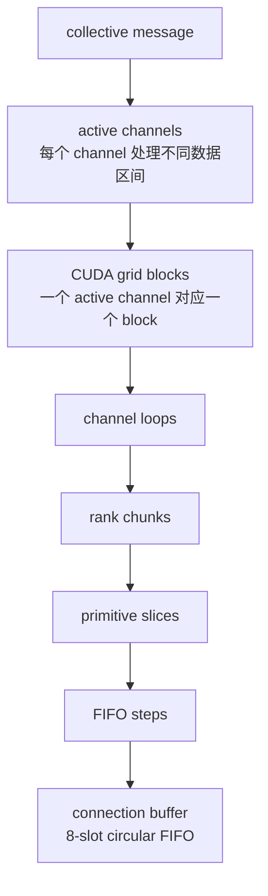

## 本章问题

NCCL 性能排障中最容易混用的词是：

```text
channel
CUDA block / CTA
worker thread / blockDim.x
chunk
slice
step
buffer
loop
```

如果把它们都理解成“并行度”，就无法解释：

- 为什么请求 12 channels 的 4 KiB AllReduce 实际只 launch 1 个 CTA。
- 为什么 `NCCL_NTHREADS=512` 时 profiler 显示 `blockX=544`。
- 为什么 `NCCL_NTHREADS=64` 时不是 96，而是 `blockX=128`。
- 为什么 64 MiB 的 `NCCL_BUFFSIZE=64 KiB` 比 4 MiB 慢 139%。
- 为什么 512 KiB 用 128 worker threads 更快，64 MiB 却需要 256/512。
- 为什么 channel、buffer、threads 的联合效果不能用三个单变量倍率相乘。

本章从 host planner 一直追到 device primitive，建立这些粒度的严格定义，
然后用 1060 条性能记录和 7 个 Nsight profile 验证。

## 证据边界

固定环境：

```text
NCCL: 2.22.3+cuda12.6
source: v2.22.3-1 @ 178b6b7
nccl-tests: 5bcd45d
GPU: 4 x V100-SXM2-32GB
topology: every GPU pair NV2
algorithm/protocol: Ring + Simple
datatype/op: float + sum
```

正式运行：`ch15_pipeline/20260710T191306Z`。

- [实验汇总](/assets/files/nccl-learning/logs/ch15_pipeline/20260710T191306Z/summary.md)
- [运行清单](/assets/files/nccl-learning/logs/ch15_pipeline/20260710T191306Z/manifest.txt)
- [1060 条原始记录](/assets/files/nccl-learning/logs/ch15_pipeline/20260710T191306Z/raw_measurements.csv)
- [53 个统计 group](/assets/files/nccl-learning/logs/ch15_pipeline/20260710T191306Z/summary.csv)

本文的精确百分比只属于当前单机 Ring+Simple。Tree、LL/LL128、网络 proxy
和多节点 transport 使用部分相同概念，但 chunk adaptation 和最优参数可能
完全不同。

## 七层粒度

先给出从大到小的心智模型：

```text
collective message
  -> planner 分到 active channels
      -> 每个 channel 对应 kernel 中一个 CUDA block
          -> channel partition 分成多个 loop
              -> 每个 loop 处理 rank chunks
                  -> chunk 分成 slices
                      -> slice 占用一个或多个 FIFO steps
                          -> step 是 connection buffer 的循环槽
```

严格定义：

| 名称 | 所属层 | 作用 |
|---|---|---|
| channel | communicator/plan | 一份 topology、peers、work queue 和数据分区 |
| CUDA block | kernel launch | 执行一个 active channel 的 work batch |
| worker threads | device work | copy/reduce/protocol 实际参与线程 |
| step | connection FIFO | sender/receiver 推进的 8 槽循环队列单位 |
| slice | primitive | 一次 wait/copy-reduce/post 的流水单位 |
| chunk | algorithm | 一个 rank step 中发送/规约的数据单位 |
| loop | algorithm/proxy | 处理完当前 channel partition 所需的重复轮次 |

它们有关系，但不相等。例如一个 channel 可以在多个 loop 中处理许多 chunk，
一个 chunk 又有两个 slice；一个 CUDA block 的 `blockDim.x` 还可能包含 sync
或 minimum launch threads，不等于 `NCCL_NTHREADS`。



箭头表示规划与执行粒度逐层细化，不表示这些对象是一对一关系。一个 channel 可运行多个 loop，一个 chunk 可含多个 slice，而一个 slice 又可能占一个或多个 FIFO step。

## FIFO 固定有 8 steps

仓库：`NVIDIA/nccl`  
版本：`v2.22.3-1`  
提交：`178b6b7`  
文件：`src/include/device.h:24`；`src/include/collectives.h:14-25`  
符号：`NCCL_STEPS`、`ALLREDUCE_*STEPS`

原始源码：

```cpp
#define NCCL_STEPS 8

// CHUNKSIZE must be a multiple of SLICESIZE
#define ALLREDUCE_SLICESTEPS (NCCL_STEPS/4)
#define ALLREDUCE_CHUNKSTEPS (NCCL_STEPS/2)
#define ALLGATHER_SLICESTEPS (NCCL_STEPS/4)
#define ALLGATHER_CHUNKSTEPS (NCCL_STEPS/2)
#define REDUCESCATTER_SLICESTEPS (NCCL_STEPS/4)
#define REDUCESCATTER_CHUNKSTEPS (NCCL_STEPS/2)
#define BROADCAST_SLICESTEPS 1
#define BROADCAST_CHUNKSTEPS 1
#define REDUCE_SLICESTEPS 1
#define REDUCE_CHUNKSTEPS 1
#define NCCL_MAX_SLICE_PER_CHUNK 2
```

注释版：

```cpp
// [课程注释] 每条 connection 的循环 FIFO 有 8 个 step 槽。
#define NCCL_STEPS 8

// [课程注释] Ring AllReduce Simple：每 slice 推进 2 steps，
// [课程注释] 每 chunk 占 4 steps，因此每 chunk 正好 2 slices。
ALLREDUCE_SLICESTEPS = 8/4 = 2;
ALLREDUCE_CHUNKSTEPS = 8/2 = 4;
slices_per_chunk = 4/2 = 2;
```

`NCCL_STEPS` 不是 AllReduce 的 Ring step 数。四 rank Ring AllReduce 的
算法通信阶段仍是 `2(N-1)=6`；这里的 8 是每条 connection buffer 的 FIFO
槽数。两种 “step” 位于不同抽象层，必须区分。

## Buffer 如何变成 step、slice、chunk

对 Simple：

$$
stepBytes = \frac{NCCL\_BUFFSIZE}{NCCL\_STEPS}
$$

对 Ring AllReduce：

$$
sliceBytes_{nominal} = stepBytes \times 2
$$

$$
chunkBytes_{nominal} = stepBytes \times 4
$$

因此默认 `NCCL_BUFFSIZE=4 MiB`：

```text
step  = 512 KiB
slice = 1 MiB
chunk = 2 MiB
```

buffer 是每个 protocol connection 的循环空间，不是用户 message buffer，
也不是每 channel 永远一次处理的消息大小。

## Host 侧 chunk 计算

仓库：`NVIDIA/nccl`  
版本：`v2.22.3-1`  
提交：`178b6b7`  
文件：`src/enqueue.cc:1727-1762,1811-1820`  
符号：`calcCollChunking`

关键源码摘录（省略其他 pattern 分支）：

```cpp
int nstepsPerLoop, nchunksPerLoop;
switch (pattern) {
case ncclPatternRing:
  nstepsPerLoop = comm->nRanks-1;
  nchunksPerLoop = comm->nRanks;
  break;
case ncclPatternRingTwice:
  nstepsPerLoop = 2*(comm->nRanks-1);
  nchunksPerLoop = comm->nRanks;
  break;
// ...
}

int stepSize = comm->buffSizes[info->protocol]/NCCL_STEPS;
int chunkSteps = (info->protocol == NCCL_PROTO_SIMPLE &&
                  info->algorithm == NCCL_ALGO_RING)
                   ? info->chunkSteps : 1;
int sliceSteps = (info->protocol == NCCL_PROTO_SIMPLE &&
                  info->algorithm == NCCL_ALGO_RING)
                   ? info->sliceSteps : 1;
int chunkSize = stepSize*chunkSteps;
if (info->protocol == NCCL_PROTO_LL) chunkSize /= 2;
if (info->protocol == NCCL_PROTO_LL128)
  chunkSize = (chunkSize/NCCL_LL128_LINEELEMS)*NCCL_LL128_DATAELEMS;

chunkSize = chunkSize / grainSize * grainSize;
int nLoops = (int)DIVUP(nBytes,
  size_t(nChannels)*nchunksPerLoop*chunkSize);
proxyOp->nsteps = nstepsPerLoop * nLoops * chunkSteps;
proxyOp->sliceSteps = sliceSteps;
proxyOp->chunkSteps = chunkSteps;
proxyOp->chunkSize = chunkSize;
```

注释版：

```cpp
// [课程注释] AllReduce RingTwice 每 loop 有 6 algorithm steps，
// [课程注释] 但每 loop 按 4 个 rank chunks 覆盖数据。
nstepsPerLoop = 2*(4-1) = 6;
nchunksPerLoop = 4;

// [课程注释] Simple step 是 buffer 的 1/8。
stepSize = simpleBuffer / 8;

// [课程注释] Ring+Simple 使用 collective 定义的 4 chunk steps、2 slice steps。
chunkSize = stepSize * 4;

// [课程注释] chunk 必须向下对齐到 protocol grain；Simple grain 是 512 B。
chunkSize = floor_to_multiple(chunkSize, 512);

// [课程注释] channel 越多、chunk 越大，每 loop 能覆盖的数据越多，
// [课程注释] 但更多 channel/更大 chunk 也有启动和流水填充成本。
nLoops = ceil(messageBytes /
  (activeChannels * 4 rankChunks * chunkSize));
```

对 64 MiB、4 ranks、12 channels 的名义 loop：

| buffer | step | slice | chunk | estimated loops |
|---:|---:|---:|---:|---:|
| 64 KiB | 8 KiB | 16 KiB | 32 KiB | 43 |
| 256 KiB | 32 KiB | 64 KiB | 128 KiB | 11 |
| 1 MiB | 128 KiB | 256 KiB | 512 KiB | 3 |
| 4 MiB | 512 KiB | 1 MiB | 2 MiB | 1 |
| 16 MiB | 2 MiB | 4 MiB | 8 MiB | 1 |

机械计算附件：

- [chunk_layout.csv](/assets/files/nccl-learning/logs/ch15_pipeline/20260710T191306Z/chunk_layout.csv)

这张表能预测 64 KiB buffer 会产生大量 loop，但不能单独预测 4 MiB 与
16 MiB 谁更快：二者都是一个名义 loop，性能由填充、同步和硬件上限决定。

## Device 侧 slice 会自适应

仓库：`NVIDIA/nccl`  
版本：`v2.22.3-1`  
提交：`178b6b7`  
文件：`src/device/prims_simple.h:170-183,215-268`  
符号：`genericOp`

关键源码摘录（省略 pointer 选择和 `reduceCopy` 展开）：

```cpp
nelem = nelem < 0 ? 0 : nelem;
int sliceSize = stepSize*StepPerSlice;
sliceSize = max(divUp(nelem, 16*SlicePerChunk)*16, sliceSize/32);
int slice = 0;
int offset = 0;

do {
  sliceSize = sliceSize < nelem-offset ? sliceSize : nelem-offset;
  // ... set user/FIFO pointers ...
  waitPeer<DirectRecv, DirectSend, Recv, Send, Src, Dst>(
    srcIx, dstIx, offset, sliceSize);
  subBarrier();
  int workSize = ncclShmem.aborted ? 0 : sliceSize;
  // ... reduceCopy ...
  barrier();
  postPeer<Recv, Send>(0 < sliceSize);
  offset += sliceSize;
  slice += 1;
} while (slice < SlicePerChunk && offset < nelem);
```

注释版：

```cpp
// [课程注释] nominal slice 上限来自 stepSize * 2。
sliceSize = stepSize * StepPerSlice;

// [课程注释] 小 nelem 时不盲目搬满 nominal slice；
// [课程注释] 按两个 slices 均分并对齐 16 elements，同时设置 nominal/32 下限。
sliceSize = max(
    ceil_align(nelem / SlicePerChunk, 16),
    nominalSlice / 32);

for (at most 2 slices) {
  // [课程注释] 每 slice 的完整生命周期：等 peer -> copy/reduce -> barrier -> post。
  waitPeer();
  reduceCopy();
  postPeer();
}
```

因此前表是 **nominal maximum**，不是每次 primitive 实际都搬这么多。小消息
会缩小 slice，解释了为什么把 buffer 从 4 MiB 增大到 16 MiB 不会要求
512 KiB 消息填满 4 MiB slice。

## CBD：消息如何分到 channels

仓库：`NVIDIA/nccl`  
版本：`v2.22.3-1`  
提交：`178b6b7`  
文件：`src/include/device.h:260-320`  
符号：`ncclDevWorkColl::cbd`、`ncclCollCbdPart`

关键数据结构摘录（省略与 CBD 无关的字段和 union 分支）：

```cpp
struct alignas(16) ncclDevWorkColl {
  // Running on channels [channelLo..channelHi], hi is inclusive.
  uint32_t channelLo:8, channelHi:8;
  uint32_t nWarps:8;
  // ...
  union {
    struct {
      size_t countLo, countMid, countHi;
      uint64_t chunkGrainsLo:21,
               chunkGrainsMid:21,
               chunkGrainsHi:21;
    } cbd;
    // ...
  };
};

template<typename Int>
__host__ __device__ inline void ncclCollCbdPart(
    struct ncclDevWorkColl* work, uint32_t channelId,
    int proto, int eltSize, Int* count, Int* partOffset,
    Int* partCount, Int* chunkCount) {
  int eltPerGrain = ncclProtoGrainSize(proto)/eltSize;
  int nMidChannels = work->channelHi - work->channelLo - 1;
  if (channelId == work->channelLo) {
    *partOffset = 0;
    *partCount = work->cbd.countLo;
    *chunkCount = work->cbd.chunkGrainsLo*eltPerGrain;
  } else if (channelId == work->channelHi) {
    *partOffset = work->cbd.countLo +
      nMidChannels*work->cbd.countMid;
    *partCount = work->cbd.countHi;
    *chunkCount = work->cbd.chunkGrainsHi*eltPerGrain;
  } else {
    int mid = channelId - work->channelLo - 1;
    *partOffset = work->cbd.countLo + mid*work->cbd.countMid;
    *partCount = work->cbd.countMid;
    *chunkCount = work->cbd.chunkGrainsMid*eltPerGrain;
  }
}
```

注释版：

```cpp
// [课程注释] 一个 work 可以使用连续 channel 区间，不保证从 0 开始。
active_channels = [channelLo, channelHi];

// [课程注释] Continuous Byte Distribution 不为每个 channel 存一整套字段，
// [课程注释] 而是压缩成首 channel、中间 channels、尾 channel 三类。
counts = {countLo, countMid, countHi};
chunks = {chunkGrainsLo, chunkGrainsMid, chunkGrainsHi};

// [课程注释] device 根据自己的 channelId 恢复连续、不重叠的 offset/count。
if (first_channel) use_lo_partition();
else if (last_channel) use_hi_partition();
else use_mid_partition(channelId-channelLo-1);
```

channel 并行不是每个 channel 处理完整 message。CBD 保证各 channel 获得
不同连续区间；首尾区间允许与中间不同，解决不能整除和 16-byte cell 对齐。

## Planner 不一定使用所有 topology channels

`NCCL_MIN_NCHANNELS/MAX_NCHANNELS` 约束 communicator 可用 channel 数，
但每个 collective 的 active channel 仍会按消息大小缩减。

仓库：`NVIDIA/nccl`  
版本：`v2.22.3-1`  
提交：`178b6b7`  
文件：`src/enqueue.cc:1617-1657`  
符号：`topoGetAlgoInfo`

原始源码：

```cpp
int nc = comm->nChannels;
int nt = comm->maxThreads[info->algorithm][info->protocol];
int threadThreshold =
  comm->threadThresholds[info->algorithm][info->protocol];

// Ring/Tree channel tuning
while (nBytes < nc * nt * threadThreshold) {
  if (nc >= 2) nc--;
  else break;
}

if (info->algorithm != NCCL_ALGO_NVLS &&
    info->algorithm != NCCL_ALGO_NVLS_TREE &&
    info->algorithm != NCCL_ALGO_COLLNET_DIRECT) {
  while (nBytes < nc * nt * threadThreshold) {
    if (nt % 128 == 0) nt /= 2;
    else break;
  }
}
if (info->protocol == NCCL_PROTO_SIMPLE) {
  if (info->algorithm == NCCL_ALGO_RING)
    nt += WARP_SIZE; // Extra warp for sync
  if (info->algorithm == NCCL_ALGO_TREE)
    nt += 4*WARP_SIZE;
}
nt = nt/WARP_SIZE < 3 ? 3*WARP_SIZE : nt;
if (info->algorithm == NCCL_ALGO_TREE)
  nt = NCCL_MAX_NTHREADS;
info->nMaxChannels = nc;
info->nWarps = nt/WARP_SIZE;
```

注释版：

```cpp
nc = communicator_topology_channels;
nt = protocol_max_worker_threads;

// [课程注释] 小消息先逐个减少 active channel，至少保留 1 个。
while (message_too_small_for(nc, nt, threshold))
  nc--;

// [课程注释] channel 已缩到最小仍太小，再按 2 倍减少 workers；
// [课程注释] 只有 128 的整数倍才继续除 2。
while (message_too_small_for(nc, nt, threshold) && nt%128 == 0)
  nt /= 2;

// [课程注释] Simple Ring 额外增加一个 sync warp。
nt += 32;

// [课程注释] work 至少描述 3 warps；最终 kernel launch 还有全局最小 block。
nt = max(nt, 96);
```

这段源码直接否定：

```text
NCCL_MAX_NCHANNELS=12 => 每次 collective 一定 12 CTAs
NCCL_NTHREADS=512     => 每次 collective 一定 512 block threads
```

它们是候选上限/输入，planner 还会按 `nBytes` 调整。

## NTHREADS 的合法范围

仓库：`NVIDIA/nccl`  
版本：`v2.22.3-1`  
提交：`178b6b7`  
文件：`src/graph/tuning.cc:12-31,118-131`  
符号：`getNthreads`、`ncclTopoTuneModel`

原始源码：

```cpp
NCCL_PARAM(Nthreads, "NTHREADS", -2);

static int getNthreads(const char* name, int env,
    int min, int max, int def) {
  int nt = env;
  if (nt > 0) {
    if (nt % WARP_SIZE != 0) {
      WARN("Invalid %s %d (must be a multiple of %d)",
        name, nt, WARP_SIZE);
      nt = max;
    } else if (nt > max) {
      WARN("Invalid %s %d (maximum %d).", name, nt, max);
      nt = max;
    } else if (nt < min) {
      WARN("Invalid %s %d (minimum %d).", name, nt, min);
      nt = min;
    }
  } else {
    nt = def;
  }
  return nt;
}

comm->maxThreads[NCCL_ALGO_RING][NCCL_PROTO_SIMPLE] =
  getNthreads("NCCL_NTHREADS", ncclParamNthreads(),
    2*WARP_SIZE, NCCL_SIMPLE_MAX_NTHREADS,
    simpleDefaultThreads);
```

注释版：

```cpp
// [课程注释] 合法值必须是 warp 的整数倍。
if (requested % 32 != 0) use_max_and_warn();

// [课程注释] Ring+Simple 的 worker 范围是 64..512。
workers = clamp(requested, 64, 512);

// [课程注释] 未设置时根据 topology bandwidth 选择 256 或 512 默认值。
workers = requested_or_topology_default;
```

实验选择 `64/128/256/512`，全部合法且覆盖允许范围。设置 96 虽是 32 的
倍数，也会影响后续 `nt%128` 缩减行为；不能把任意 warp 倍数当成等价档位。

## CUDA block 如何映射 channel

仓库：`NVIDIA/nccl`  
版本：`v2.22.3-1`  
提交：`178b6b7`  
文件：`src/device/common.h:308-354`  
符号：`ncclKernelMain`

原始源码：

```cpp
int tid = threadIdx.x;
int tn = blockDim.x;

// To map blockId to channelId, we need the n'th set bit of channelMask.
if (tid < MAXCHANNELS &&
    (args->channelMask & (1ull<<tid))) {
  int n = __popcll(args->channelMask & ((1ull<<tid)-1));
  if (blockIdx.x == n) ncclShmem.channelId = tid;
}
__syncthreads();

// Use first 2 warps to load comm and channel, and remaining load work batch.
switch (tid/WARP_SIZE) {
case 0:
  copyToShmem16(tid, &ncclShmem.comm, args->comm,
    sizeof(ncclDevComm));
  break;
case 1:
  copyToShmem16(tid-WARP_SIZE, &ncclShmem.channel,
    &args->comm->channels[ncclShmem.channelId],
    sizeof(ncclDevChannel));
  break;
default:
  loadWorkBatchToShmem(tid-2*WARP_SIZE,
    tn-2*WARP_SIZE, args, blockIdx.x);
  break;
}
__syncthreads();
```

注释版：

```cpp
// [课程注释] channelMask 可以稀疏，例如 channel 0、2、5 active。
// [课程注释] blockIdx.x 是稠密 0..gridX-1，必须找到 mask 中第 n 个 set bit。
channelId = nth_set_bit(channelMask, blockIdx.x);

// [课程注释] block 的 warp 还承担 kernel 元数据装载：
warp0 -> communicator metadata
warp1 -> selected channel metadata
remaining warps -> work batch

// [课程注释] 同步后才进入真正 RunWorkColl。
```

一个 block 对应一个 **active** channel，但 `blockIdx.x` 不必等于 channel ID。
当 mask 稀疏时，需要 set-bit 映射。

## gridX 和 blockX 在 host 端决定

仓库：`NVIDIA/nccl`  
版本：`v2.22.3-1`  
提交：`178b6b7`  
文件：`src/enqueue.cc:153-159,1387-1393`  
符号：`finishPlan`、`ncclLaunchKernel`

关键源码摘录（省略 plan 回收与 kernel launch plumbing）：

```cpp
static void finishPlan(struct ncclComm* comm,
    struct ncclKernelPlan* plan) {
  // ...
  plan->threadPerBlock =
    std::max(plan->threadPerBlock, NCCL_MIN_NTHREADS);
  // ...
}

ncclResult_t ncclLaunchKernel(struct ncclComm* comm,
    struct ncclKernelPlan* plan) {
  int nChannels = countOneBits(plan->channelMask);
  void* sym = plan->kernelFn;
  dim3 grid = {(unsigned)nChannels, 1, 1};
  dim3 block = {(unsigned)plan->threadPerBlock, 1, 1};
  // ... launch ...
}
```

注释版：

```cpp
// [课程注释] 整个 kernel plan 的 block 至少 4 warps = 128 threads。
threadPerBlock = max(planned_threads, 128);

// [课程注释] gridX 精确等于 channelMask 的 set-bit 数，不是 comm->nChannels。
gridX = popcount(active_channel_mask);

// [课程注释] blockX 是 planner 最终 threadPerBlock，包含 sync/minimum 规则。
blockX = threadPerBlock;
```

这完整解释 Nsight 几何：

```text
requested workers 64:
  64 + 32 sync warp = 96
  finishPlan max(96, 128) = blockX 128

requested workers 128/256/512:
  +32 sync warp => blockX 160/288/544
```

## 可证伪预测

1. 4 KiB 太小，planner 应减少 active channels 和 workers；改变请求上限
   对延迟影响很小。
2. 64 MiB 需要多 channel，1→12 应显著提升 busbw。
3. 小 buffer 会减小 chunk、增加 loop；64 MiB 应明显变慢。
4. 16 MiB buffer 不应无限优于 4 MiB，因为二者对 64 MiB 都已接近单 loop。
5. 512 KiB 的最佳 workers 可能小于 512；64 MiB 更需要高 workers。
6. 1 MiB profile 的 `gridX` 应等于请求 1/4/12；4 KiB 请求 12 时应更小。
7. `blockX` 应符合 sync warp 和 128 minimum，而不是等于 `NCCL_NTHREADS`。
8. channel/buffer/threads 的联合效果可能有 interaction residual，特别是大
   partition 配少 channel 和少 threads 时。

## 实验脚本与矩阵

脚本：

- [39_ch15_channels_chunks_buffers.py](/assets/files/nccl-learning/scripts/39_ch15_channels_chunks_buffers.py)
- [39b_ch15_geometry_only.py](/assets/files/nccl-learning/scripts/39b_ch15_geometry_only.py)

四层矩阵：

```text
channel sweep:
  channels = 1,2,4,8,12
  buffer = 4 MiB, workers = 512
  sizes = 4 KiB, 512 KiB, 64 MiB

buffer sweep:
  buffer = 64 KiB,256 KiB,1 MiB,4 MiB,16 MiB
  channels = 12, workers = 512
  sizes = 512 KiB,64 MiB

thread sweep:
  workers = 64,128,256,512
  channels = 12, buffer = 4 MiB
  sizes = 4 KiB,512 KiB,64 MiB

interaction:
  channels = 2,12
  buffer = 256 KiB,4 MiB
  workers = 128,512
  sizes = 512 KiB,64 MiB
```

每个配置两个独立进程、顺序正反各一次；每进程 10 cycles、每 cycle 20
iterations，总计 44 次进程配置和 1060 条记录。

命令模板：

```bash
NCCL_ALGO=Ring \
NCCL_PROTO=Simple \
NCCL_MIN_NCHANNELS=12 \
NCCL_MAX_NCHANNELS=12 \
NCCL_BUFFSIZE=4194304 \
NCCL_NTHREADS=512 \
./build/all_reduce_perf \
  -b 4K -e 64M -f 128 -g 4 \
  -w 5 -n 20 -N 10 -c 1 -I 0 -z 0 -u 0 \
  -C 0 -a 3 -d float -o sum
```

所有 out-of-place/in-place `#wrong=0`。53 个统计 group 只有
`4 KiB/channel=4` 的 CV 为 12.72%；其余全部低于 5%。该 noisy group
处于所有 channel 配置 practical tie 的区间，不用于精确收益结论。

## Channel sweep 结果

| channels | 4 KiB | 512 KiB | 64 MiB busbw | 64 MiB vs ch12 |
|---:|---:|---:|---:|---:|
| 1 | 34.675 us | 79.030 us | 22.69 GB/s | +421.85% time |
| 2 | 34.515 us | 64.585 us | 39.66 GB/s | +198.52% time |
| 4 | 34.585 us | 57.610 us | 75.78 GB/s | +56.21% time |
| 8 | 34.570 us | 52.445 us | 87.88 GB/s | +34.72% time |
| 12 | 34.675 us | 51.625 us | 118.38 GB/s | baseline |

4 KiB 的最大 median 差只有 0.46%，channel 请求完全没有形成有效加速。
64 MiB 则从 1 channel 的 22.69 提升到 12 channels 的 118.38 GB/s。

**源码证明**：planner 会对小消息减少 active channels。  
**本机实验验证**：4 KiB 延迟几乎不随请求 channel 变化；64 MiB 强依赖。  
**trace 验证**：后面会看到 4 KiB 请求 12 实际 `gridX=1`。

512 KiB 已开始受益，但 8 与 12 channels 只差 1.59%，属于 practical tie；
消息大小决定“更多 channel”是否能摊薄足够数据。

## Buffer sweep 结果

| buffer | nominal chunk | 512 KiB median | 64 MiB median | 64 MiB busbw | vs 4 MiB |
|---:|---:|---:|---:|---:|---:|
| 64 KiB | 32 KiB | 57.500 us | 2037.065 us | 49.42 GB/s | +138.89% |
| 256 KiB | 128 KiB | 57.385 us | 1131.525 us | 88.96 GB/s | +32.70% |
| 1 MiB | 512 KiB | 57.350 us | 918.710 us | 109.57 GB/s | +7.74% |
| 4 MiB | 2 MiB | 52.320 us | 852.715 us | 118.05 GB/s | baseline |
| 16 MiB | 8 MiB | 51.660 us | 850.545 us | 118.35 GB/s | -0.25% |

64 MiB 的结果与 loop 模型一致：buffer 从 64 KiB 增至 4 MiB，估算 loop
从 43 降至 1，延迟降低约 58%。继续增到 16 MiB 只改善 0.25%，因为：

```text
4 MiB buffer 已是一个名义 loop
链路/算法已经接近当前 118 GB/s 上限
更大的 nominal chunk 没有更多 loop 可消除
```

512 KiB 上，64 KiB 到 1 MiB buffer 几乎相同，4/16 MiB 快约 9%-10%。
但 4 MiB 与 16 MiB 仍只有 1.26% 差异。结论不是“buffer 越大越好”，而是
“buffer 小到制造额外 loop 会慢；达到足够流水后收益饱和”。

## Thread sweep 结果

| workers requested | 4 KiB | 512 KiB | 64 MiB median | 64 MiB busbw | vs 512 |
|---:|---:|---:|---:|---:|---:|
| 64 | 34.655 us | 50.175 us | 1607.250 us | 62.63 GB/s | +88.92% |
| 128 | 34.675 us | **48.125 us** | 1028.420 us | 97.88 GB/s | +20.88% |
| 256 | 34.635 us | 49.830 us | 874.825 us | 115.06 GB/s | +2.83% |
| 512 | 34.595 us | 51.700 us | **850.765 us** | 118.32 GB/s | baseline |

三段行为：

```text
4 KiB:
  planner 动态缩减，四个请求值都约 34.6 us

512 KiB:
  128 workers 最快，比 512 快 6.91%
  更少同步/调度成本胜过更多 copy/reduce threads

64 MiB:
  512 最快；256 只慢 2.83%，属于 tie
  64/128 无法提供足够每 CTA 吞吐
```

因此 `NCCL_NTHREADS` 的最优值与 message size 相关。把 128 因 512 KiB
结果写死，会让 64 MiB 慢 20.88%；把 512 写死虽然大消息快，却让中消息
多付约 7% 成本。

## Kernel geometry 实验

对 1 MiB 分别 profile：

```text
channels = 1,4,12 at workers=512
workers = 64,128,256 at requested channels=12
```

再加反例：

```text
4 KiB, requested channels=12, workers=512
```

`.nsys-rep/.sqlite` 只留本机私有目录；公开 SQLite 聚合：

- [kernel_geometry.csv](/assets/files/nccl-learning/logs/ch15_pipeline/20260710T191306Z/kernel_geometry.csv)
- [geometry_manifest.txt](/assets/files/nccl-learning/logs/ch15_pipeline/20260710T191306Z/geometry_manifest.txt)
- [4 KiB profile 文本](/assets/files/nccl-learning/logs/ch15_pipeline/20260710T191306Z/raw/nsys/07_tiny_4k_requested_ch12_t512_profile.log)

## Kernel geometry 结果

| bytes | requested channels | requested workers | gridX | blockX |
|---:|---:|---:|---:|---:|
| 1 MiB | 1 | 512 | 1 | 544 |
| 1 MiB | 4 | 512 | 4 | 544 |
| 1 MiB | 12 | 512 | 12 | 544 |
| 1 MiB | 12 | 64 | 12 | 128 |
| 1 MiB | 12 | 128 | 12 | 160 |
| 1 MiB | 12 | 256 | 12 | 288 |
| 4 KiB | 12 | 512 | **1** | **128** |

1 MiB 足够填充请求 channel，`gridX` 精确等于 1/4/12。4 KiB 则被 planner
缩成 1 channel 和最小 block，直接验证 `topoGetAlgoInfo` 的两个 while。

Nsight profile 会引入跟踪开销，表中的 kernel duration 不作为主性能数据；
这里只使用结构字段 `gridX/blockX`。性能结论来自无 profiler 的 nccl-tests
统计。

## 为什么 blockX 不等于 NTHREADS

将源码与 trace 对齐：

| request | planner Simple sync warp | minimum rule | observed blockX |
|---:|---:|---:|---:|
| 64 | 64+32=96 | max(96,128) | 128 |
| 128 | 128+32=160 | unchanged | 160 |
| 256 | 256+32=288 | unchanged | 288 |
| 512 | 512+32=544 | unchanged | 544 |

“NCCL_NTHREADS” 更准确的理解是 protocol worker 上限输入。最终 CUDA block
还包含 algorithm/protocol sync warp、动态缩减和 kernel plan minimum。

## Interaction 实验

联合矩阵只选两档：

```text
channels = 2 / 12
buffer = 256 KiB / 4 MiB
workers = 128 / 512
```

为了判断参数能否独立外推，先从三个单变量 sweep 得到相对倍率：

$$
\hat T(c,b,t)=T_{default}
\times r_{channel}(c)
\times r_{buffer}(b)
\times r_{thread}(t)
$$

再计算：

$$
residual=\frac{T_{actual}}{\hat T}-1
$$

完整结果：

- [interaction_model.csv](/assets/files/nccl-learning/logs/ch15_pipeline/20260710T191306Z/interaction_model.csv)

## 512 KiB Interaction

| ch | buffer | workers | actual | independent prediction | residual |
|---:|---:|---:|---:|---:|---:|
| 2 | 256 KiB | 128 | 65.445 us | 65.888 us | -0.67% |
| 2 | 256 KiB | 512 | 64.855 us | 70.782 us | -8.37% |
| 2 | 4 MiB | 128 | 65.335 us | 60.072 us | +8.76% |
| 2 | 4 MiB | 512 | 64.780 us | 64.535 us | +0.38% |
| 12 | 256 KiB | 128 | 53.265 us | 52.666 us | +1.14% |
| 12 | 256 KiB | 512 | 57.470 us | 56.579 us | +1.58% |
| 12 | 4 MiB | 128 | **48.410 us** | 48.018 us | +0.82% |
| 12 | 4 MiB | 512 | 51.585 us | baseline | 0.00% |

中消息大部分 residual 在 ±2%，最极端是 ±9%。独立效应模型尚可作为粗略
预测；最佳组合仍是 12 channels、4 MiB、128 workers。

## 64 MiB Interaction

| ch | buffer | workers | actual | independent prediction | residual |
|---:|---:|---:|---:|---:|---:|
| 2 | 256 KiB | 128 | 5277.510 us | 4070.881 us | +29.64% |
| 2 | 256 KiB | 512 | 4061.520 us | 3367.654 us | +20.60% |
| 2 | 4 MiB | 128 | 4526.305 us | 3067.808 us | **+47.54%** |
| 2 | 4 MiB | 512 | 2539.165 us | 2537.858 us | +0.05% |
| 12 | 256 KiB | 128 | 1188.540 us | 1363.677 us | -12.84% |
| 12 | 256 KiB | 512 | 1130.910 us | 1128.108 us | +0.25% |
| 12 | 4 MiB | 128 | 1028.755 us | 1027.664 us | +0.11% |
| 12 | 4 MiB | 512 | **850.140 us** | baseline | 0.00% |

大消息中参数明显耦合。2 channels 让每个 channel 分区变大，再叠加 128
workers 后，实际比独立模型慢 47.54%。同样的 128 workers 在 12 channels
只带来 21% slowdown，因为更多 CTA 分担了数据。

这说明不能做：

```text
channel sweep 收益 × buffer sweep 收益 × thread sweep 收益
= 联合配置收益
```

当每 CTA 的工作量发生变化时，worker 吞吐和 loop 数也同时改变。

## 为什么更多 channel 会变慢或无效

更多 channel 带来：

```text
正面：更多 CTAs、更多独立 topology paths、更小 channel partition
负面：更多 work batches/连接状态、更多小分区、更多启动与同步成本
```

4 KiB 时 planner 直接减少到 1 active channel。512 KiB 时 8/12 已接近饱和。
64 MiB 时 12 channels 仍能充分利用全 NV2 链路。

所以 channel 最优值必须同时看：

```text
active grid，不只是 communicator channel 上限
message bytes per active channel
每 channel chunk/loop
topology paths 是否真正独立
CTA occupancy 与其他计算 kernel 争用
```

## 为什么 buffer 太小会慢

小 buffer 的直接后果：

```text
step 变小
slice/chunk 上限变小
同一 channel partition 的 loops 增多
wait/post/barrier/proxy step 次数增多
```

64 MiB 的 64 KiB buffer 估算 43 loops，实测 busbw 只有 49.42 GB/s；4 MiB
buffer 约 1 loop，达到 118.05 GB/s。该结论来自源码和本机稳定统计。

buffer 过大也不是免费收益：它增加 connection memory footprint，并可能让
小消息 nominal chunk 过大。当前 16 MiB 没变慢，但只比 4 MiB 快 0.25%，
没有证据支持继续增大。

## 为什么 threads 存在中间最优

线程多的收益：

```text
更多并行 load/reduce/store
大 chunk 的每 CTA 吞吐更高
```

线程多的成本：

```text
更大 block
更多 barrier participants
更高 register/shared resource pressure
小 partition 上工作不足
```

512 KiB 的 128 workers 最快，64 MiB 的 512 最快，正是 work per CTA
变化后的权衡。生产 workload 若 bucket size 分布很宽，固定单一
`NCCL_NTHREADS` 很难同时最优。

## 工程调优方法

建议按层次调试：

```text
1. 固定 algorithm/protocol/transport
2. 用 INFO/trace 确认 communicator channels
3. 用 profiler gridX 确认 active channels
4. 扫 message size，找 channel 饱和区
5. 固定 channel 后扫 buffer，关联 chunk/loop
6. 固定前两项后扫 workers，关联 blockX
7. 只对有工程价值的两档做 interaction matrix
8. 所有配置保留 correctness、median、P95、CV
9. 最终在真实训练 bucket 分布和 compute overlap 下复测
```

不要一开始做 5×5×5 全因子然后只挑最快行。分层 sweep 先建立机制，少量
interaction 再识别耦合，结论更可解释。

## 排障签名

| 现象 | 证据与检查 |
|---|---|
| 设置 12 channels 但性能不变 | profiler `gridX`；小消息可能动态缩成 1 |
| `blockX` 比 NTHREADS 多 32 | Simple Ring sync warp，属于预期 |
| request 64 却看到 block128 | sync 后 96，再被 `NCCL_MIN_NTHREADS=128` 抬高 |
| 大消息低 busbw、proxy steps 多 | buffer/chunk 太小导致 loops 多 |
| 中消息 512 threads 更慢 | work/CTA 不足、barrier/resource overhead |
| 单变量都不差，联合配置很差 | interaction；少 channel × 少 threads × 大 partition |
| channel 增加但 grid 不增加 | planner threshold、tuner/plugin channel override |
| buffer 改了但 chunk 没按比例 | protocol 非 Simple、Tree/NVLS 专用 adaptation、grain 对齐 |

## 常见错误

1. 把算法 `2(N-1)` steps 与 connection `NCCL_STEPS=8` 混为一谈。
2. 把 `NCCL_BUFFSIZE` 当用户 message buffer。
3. 把 nominal slice 当每次实际 slice；device 会按 `nelem` 缩小。
4. 认为一个 channel 处理完整消息；CBD 分配不重叠连续区间。
5. 认为 `comm->nChannels` 就是每次 kernel `gridX`。
6. 认为 `NCCL_NTHREADS` 就是 profiler `blockX`。
7. 用 4 KiB 测 channel scaling，却不检查 active grid。
8. 只增大 buffer，不计算 chunk 和 loop 是否已经饱和。
9. 把单变量倍率相乘预测联合参数，忽略每 CTA work 变化。
10. 用 Nsight duration 替代无 profiler 性能基线；trace 应主要做路径证据。

## 版本与硬件边界

源码级稳定结论：

- 2.22.3 的 8-step FIFO、Ring Simple 4/2 chunk/slice steps。
- CBD 首/中/尾 channel 分区。
- message-size channel/thread 动态缩减。
- Simple Ring sync warp、128-thread kernel plan minimum。
- `gridX=popcount(channelMask)`。

本机定量结论：

- 64 MiB 1→12 channels 的 22.69→118.38 GB/s。
- 64 KiB→4 MiB buffer 的 49.42→118.05 GB/s。
- 512 KiB 128 workers 最快；64 MiB 256/512 接近最优。
- 2 channels × 128 workers 在 64 MiB 有 +47.54% interaction residual。

尚未验证：

```text
多节点 proxy/network step 与 NCCL_BUFFSIZE
IB/RoCE registration 和 buffer memory pressure
Tree/LL/LL128/NVLS 的联合矩阵
训练 compute overlap 下 CTA/SM 竞争
CUDA Graph 和 persistent plan 对 geometry 的影响
```

## 本章结论

1. channel 是 topology/work/data partition；active channel 在 kernel 中通常
   对应一个 CTA，但每次 collective 可以动态少于 communicator channel 数。
2. step 是 8 槽 connection FIFO 单位；Ring AllReduce Simple 每 slice
   2 steps、每 chunk 4 steps，即每 chunk 2 slices。
3. 默认 4 MiB buffer 对应 512 KiB step、1 MiB nominal slice、2 MiB chunk。
4. device slice 会按实际 `nelem` 自适应，nominal 值不是强制搬运量。
5. CBD 将消息按首/中/尾三类连续分区分给 channels，不复制完整消息。
6. planner 会先减少小消息 active channels，再减少 workers；4 KiB 请求
   12×512 最终实测 `gridX=1, blockX=128`。
7. Simple Ring 增加一个 sync warp，kernel plan 至少 128 threads，所以
   request 64/128/256/512 对应 block 128/160/288/544。
8. 64 MiB 需要多 channels 和足够 buffer/workers；512 KiB 的最优 workers
   则是 128，参数最优点随消息大小变化。
9. 参数存在显著 interaction，单变量收益不能直接相乘外推联合配置。
10. 环境变量是 planner 输入，不是最终执行几何；必须结合 TUNING 和 profiler。

## 验收题

1. 分别解释 algorithm step 与 FIFO step，并给出四 rank AllReduce 的两个值。
2. 4 MiB Simple buffer 的 step/slice/chunk 各是多少？
3. 为什么一个 chunk 正好有两个 slices？
4. 用公式计算 64 MiB、12 channels、32 KiB chunk 的估算 Ring loops。
5. CBD 为什么只需要 `countLo/countMid/countHi`，而不是每 channel 一个 count？
6. `channelMask=0b100101` 时，`blockIdx.x=1` 映射到哪个 channel ID？
7. 请求 12 channels 为什么可能只看到 `gridX=1`？
8. 请求 64 workers 为什么最终 `blockX=128`？
9. 为什么 512 KiB 的 128 workers 可以快于 512 workers？
10. 为什么 16 MiB buffer 没明显快于 4 MiB？
11. interaction residual +47.54% 说明单变量模型哪里失效？
12. 设计一个多节点实验，把 buffer 对 device chunk 和 network proxy step 的
    影响分开验证。
13. 在 DDP bucket 分布已知时，如何选择本章参数实验的 size 权重？
14. 如果升级 NCCL 后 4 KiB 仍 launch 12 CTAs，应优先检查哪些源码和 tuner
    变化？

能够从环境变量追到 planner 的 active geometry，再追到 CBD 和 primitive
slice，才算真正理解 NCCL pipeline。
