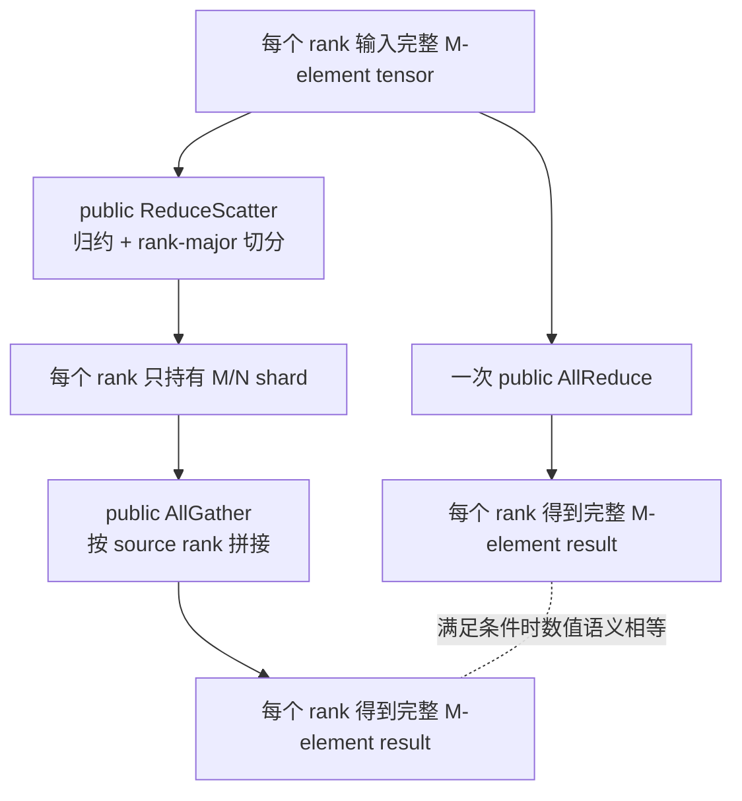

## “AllReduce = ReduceScatter + AllGather”少了什么

这句等式在分布式训练中经常出现：

$$
\text{AllReduce}
=
\text{ReduceScatter}
+
\text{AllGather}
$$

它至少有四种不同含义：

1. **输出语义等价**：每个 rank 最终拿到相同完整 tensor。
2. **通信步数等价**：Ring 模型中两段的 step 数之和相同。
3. **执行结构等价**：是否是相同 API、Work、planner、kernel 和同步边界。
4. **训练状态等价**：每个 rank 在中间和结束时保留完整 tensor 还是 shard。

前两种在满足条件时成立，后两种通常不成立。

<div class="diagram-scroll" markdown="1">



</div>

上下两条路径的最终 tensor 可以相等，但中间状态、public API 数、planner 边界、kernel 数和峰值显存并不相同。图中的分叉正是本章后续实验要逐项验证的边界。

本章用源码和实验回答：

- 等价证明需要哪些 layout、count、reduction op 和 rank-order 条件？
- tensor 长度不能被 world size 整除时怎么办？
- 为什么 SUM 与 MAX、错误 chunk 顺序会破坏等价？
- 对浮点数能否要求 bitwise equal？
- Ring AllReduce 源码里哪里是 ReduceScatter phase，哪里是 AllGather phase？
- direct AllReduce 与两个 public collective 的 kernel 数是否相同？
- RS-only 为什么能把 steady gradient state 从 256 MiB 降到 64 MiB？
- 为什么朴素 RS+AG 反而把峰值推到 576 MiB？
- FSDP/ZeRO 为什么不会把每次 ReduceScatter 都立即接一个 AllGather？

## 数学证明

设 world size 为 $N$，每个 rank $s$ 有长度 $M=Nq$ 的输入：

$$
x^{(s)} =
[x^{(s)}_0,\ldots,x^{(s)}_{M-1}]
$$

归约操作为 $\oplus$。

### Direct AllReduce

每个 rank $r$ 的完整输出：

$$
y^{(r)}_i =
\bigoplus_{s=0}^{N-1}x^{(s)}_i,
\quad 0 \le i < M
$$

输出与 $r$ 无关，所以所有 rank 相同。

### ReduceScatter

把全局下标按 rank-major 分成 $N$ 个等长 shard。rank $r$ 得到：

$$
z^{(r)}_j =
\bigoplus_{s=0}^{N-1}x^{(s)}_{rq+j},
\quad 0 \le j < q
$$

此时完整归约结果已经算完，但每个 rank 只保留自己负责的连续分块。

### AllGather

AllGather 按 source rank 顺序拼接：

$$
\hat y^{(r)}_{sq+j}=z^{(s)}_j
$$

代入 ReduceScatter 结果：

$$
\hat y^{(r)}_{sq+j}
=
\bigoplus_{t=0}^{N-1}x^{(t)}_{sq+j}
=
y^{(r)}_{sq+j}
$$

遍历 $s \in [0,N)$、$j \in [0,q)$，覆盖所有 $i=sq+j$，所以：

$$
\hat y^{(r)} = y^{(r)}
$$

这就是输出语义等价。

## 等价成立的条件

### 条件一：相同 communicator 与 rank order

ReduceScatter 中 shard owner 的 rank 顺序，必须与 AllGather 的 source-rank-major 顺序一致。

错误变换：

```python
wrong = gathered.reshape(world, -1).roll(shifts=1, dims=0)
```

即使每个 shard 内数值正确，完整 tensor 的全局下标也全部错位。

### 条件二：相同 reduction op

```text
direct: AllReduce(SUM)
decomposed: ReduceScatter(MAX) + AllGather
```

AllGather 不做归约，无法把 MAX 结果恢复成 SUM。

本章把这条错误路径作为负向实验，而不是只在文字中声明。

### 条件三：输入能分成等长 rank-major shard

NCCL 的 `ncclReduceScatter` 使用单一 `recvcount`，每个 rank 输出相同元素数。

$$
M = Nq
$$

若 $M$ 不能被 $N$ 整除，需要：

1. 选择 $q=\lceil M/N\rceil$；
2. padding 到 $Nq$；
3. padding 值使用 reduction identity；
4. RS+AG 后 trim 回逻辑长度 $M$。

SUM 的 identity 是 0，MAX 的 identity 通常应是 dtype 可表示的负无穷或最小值，不能机械填 0。

### 条件四：两段之间不改变 shard

下面不再等价于原始 AllReduce：

```text
ReduceScatter(SUM)
  -> optimizer update / scale / quantize / reorder
  -> AllGather
```

这可能是有意的分片训练算法，但等价对象已经变成“变换后的 shard state”，不是原始 AllReduce 输出。

### 条件五：数值等价不总是 bitwise 等价

整数 SUM 在不溢出时可以做 exact equality。

浮点加法不满足结合律：

$$
(a+b)+c \ne a+(b+c)
$$

不同 collective、算法、protocol、channel 或 rank order 可能采用不同归约顺序。因此浮点比较通常要使用：

```python
torch.testing.assert_close(actual, expected, rtol=..., atol=...)
```

本章 contract 使用 int64 和小数值，目的是证明 layout 与 operation，而不是把浮点舍入差异混进结果。

## 一个四 rank 手算例子

设每个 rank 输入 20 个 int64：

$$
x^{(r)}_i = 100r + i
$$

SUM：

$$
\sum_{r=0}^{3}(100r+i)
=600+4i
$$

完整结果：

```text
i=0..19:
[600, 604, 608, 612, 616,
 620, 624, 628, 632, 636,
 640, 644, 648, 652, 656,
 660, 664, 668, 672, 676]
```

ReduceScatter 的每 rank shard 长度 $q=5$：

```text
rank0: [600, 604, 608, 612, 616]
rank1: [620, 624, 628, 632, 636]
rank2: [640, 644, 648, 652, 656]
rank3: [660, 664, 668, 672, 676]
```

AllGather 按 rank0、1、2、3 拼接，恢复完整结果。

## 源码与版本

```text
NCCL tag:    v2.22.3-1
NCCL commit: 178b6b759074597777ce13438efb0e0ba625e429
PyTorch:     2.5.0a0+872d972e41.nv24.08
Nsight:      2024.4.2
GPU:         4 x Tesla V100-SXM2-32GB
```

## 源码一：不同 collective 的 send/recv count

文件：`src/enqueue.cc:55-73`

原始源码：

```cpp
static size_t ncclFuncMaxSendRecvCount(
    ncclFunc_t func, int nRanks, size_t count) {
  switch (func) {
  case ncclFuncAllReduce: return 2;
  case ncclFuncAllGather: return nRanks;
  case ncclFuncReduceScatter: return nRanks;
  default: return 1;
  }
}

static size_t ncclFuncSendCount(
    ncclFunc_t func, int nRanks, size_t count) {
  return func == ncclFuncReduceScatter ? nRanks*count : count;
}

static size_t ncclFuncRecvCount(
    ncclFunc_t func, int nRanks, size_t count) {
  return func == ncclFuncAllGather ? nRanks*count : count;
}
```

注释版：

```cpp
AllReduce:
  send elements = count
  recv elements = count

ReduceScatter:
  send elements = nRanks * recvcount
  recv elements = recvcount

AllGather:
  send elements = sendcount
  recv elements = nRanks * sendcount
```

RS 的输出 count 正好成为 AG 的输入 count：

```text
full M=Nq
  -> ReduceScatter recvcount=q
  -> each rank owns q
  -> AllGather sendcount=q
  -> every rank receives Nq=M
```

## 源码二：Tuning 模型中的 step 数

文件：`src/graph/tuning.cc:155-161`

原始源码：

```cpp
int nsteps =
  coll == ncclFuncAllReduce ? 2*(nRanks-1) :
  coll == ncclFuncReduceScatter || coll == ncclFuncAllGather
    ? nRanks-1 :
  nRanks;
```

代数上：

$$
\underbrace{2(N-1)}_{\text{AllReduce}}
=
\underbrace{(N-1)}_{\text{ReduceScatter}}
+
\underbrace{(N-1)}_{\text{AllGather}}
$$

这解释通信 step 模型等价，但没有包含两个 public API 之间额外的：

- Python/C++ dispatch；
- ProcessGroup Work；
- stream event dependency；
- planner 选择；
- kernel launch；
- 中间 buffer 生命周期。

所以 step 数相同不推出端到端 latency 相同。

## 源码三：Ring AllReduce 本身包含两个 phase

文件：`src/device/all_reduce.h:12-80`

原始源码被分成两段。

第一段，归约并让每个 rank 拥有一个最终 chunk：

```cpp
// step 0: push data to next GPU
prims.send(offset, nelem);

// k-2 steps: reduce and copy to next GPU
for (int j = 2; j < nranks; ++j) {
  prims.recvReduceSend(offset, nelem);
}

// step k-1: produce final reduced chunk and push it onward
prims.directRecvReduceCopySend(
    offset, offset, nelem, /*postOp=*/true);
```

第二段，把已归约 chunk 传播给所有 rank：

```cpp
// k-2 steps: copy to next GPU
for (int j = 1; j < nranks - 1; ++j) {
  prims.directRecvCopySend(offset, nelem);
}

// final copy into destination
prims.directRecv(offset, nelem);
```

注释版：

```text
phase A: ReduceScatter-like
  send
  repeated recv + reduce + send
  final recv + reduce + local copy

phase B: AllGather-like
  repeated recv + copy + send
  final recv
```

关键是 “-like”：direct Ring AllReduce 在一个 collective kernel 的状态机中连续执行这两段，不等于 host 连续调用两个独立 public API。

## 源码四：独立 ReduceScatter 与 AllGather kernel

`src/device/reduce_scatter.h:33-50`：

```cpp
// begin ReduceScatter steps
prims.send(offset, nelem);

for (int j=2; j<nranks; ++j) {
  prims.recvReduceSend(offset, nelem);
}

// produce this rank's final result
prims.recvReduceCopy(
    offset, dataOffset, nelem, /*postOp=*/true);
```

与 direct AllReduce 相比，最后一步把结果写到独立 RS output，不继续 push 到下一阶段。

`src/device/all_gather.h:29-57`：

```cpp
// begin AllGather steps
if (inputBuf + dataOffset == outputBuf + offset) {
  prims.directSend(dataOffset, offset, nelem); // in-place
} else {
  prims.directCopySend(dataOffset, offset, nelem);
}

for (int j=1; j<nranks-1; ++j) {
  prims.directRecvCopySend(offset, nelem);
}

prims.directRecv(offset, nelem);
```

独立 AllGather 从自己的 input/output pointer contract 开始，不能自动继承前一个 ReduceScatter kernel 的寄存器、shared state 或单 kernel 流水。

## 源码五：PyTorch 真的发出三个不同 NCCL API

### Direct AllReduce

`ProcessGroupNCCL.cpp:3257-3280`：

```cpp
return collective(
    tensor,
    tensor,
    [&](Tensor& input, Tensor& output,
        ncclComm_t comm, CUDAStream& stream) {
      auto type = getNcclDataType(input.scalar_type());
      auto op = getNcclReduceOp(...);
      return ncclAllReduce(
          input.data_ptr(),
          output.data_ptr(),
          input.numel(),
          type,
          op,
          comm,
          stream.stream());
    },
    OpType::ALLREDUCE,
    "nccl:all_reduce");
```

input/output 是同一个 tensor，所以是 in-place AllReduce。

### ReduceScatter

`ProcessGroupNCCL.cpp:3816-3879` 首先检查容量：

```cpp
if (inputTensor.numel() != outputTensor.numel() * size_) {
  C10_THROW_ERROR(
      TypeError,
      "input tensor must be the same size as output size times world size");
}
```

然后调用：

```cpp
return ncclReduceScatter(
    input.data_ptr(),
    output.data_ptr(),
    output.numel(), // recvcount，不是 input.numel()
    ncclDataType,
    ncclReduceOp,
    comm,
    stream.stream());
```

注释版：

```cpp
assert input.numel == output.numel * world_size;

ncclReduceScatter(
    full_input,        // N*q
    local_shard,       // q
    local_shard.numel  // C API recvcount=q
);
```

### AllGather

`ProcessGroupNCCL.cpp:3601-3623`：

```cpp
return ncclAllGather(
    input.data_ptr(),
    output.data_ptr(),
    input.numel(), // sendcount=q
    getNcclDataType(input.scalar_type()),
    comm,
    stream.stream());
```

PyTorch 两段式路径是两个独立 Work：

```text
ProcessGroup collective(ReduceScatter)
  -> ncclReduceScatter
  -> Work/end event

ProcessGroup collective(AllGather)
  -> ncclAllGather
  -> Work/end event
```

这与 direct path 的一个 `collective -> ncclAllReduce -> Work` 不同。

## 实验设计

正式运行：

```text
ch07_decomposition/20260710T081207Z
```

总入口：

```bash
cd ~/nccl-learning
./scripts/31_run_ch07_decomposition.sh
```

实验文件：

- [总入口](/assets/files/nccl-learning/scripts/31_run_ch07_decomposition.sh)
- [PyTorch contract/performance/memory 实验](/assets/files/nccl-learning/scripts/31_ch07_decomposition.py)
- [原生四 GPU Nsight probe](/assets/files/nccl-learning/probes/ch07_trace_decomposition.cc)
- [Nsight 结构化解析器](/assets/files/nccl-learning/probes/ch07_parse_nsys.py)
- [结果统计器](/assets/files/nccl-learning/probes/ch07_summarize.py)
- [正式结果摘要](/assets/files/nccl-learning/logs/ch07_decomposition/20260710T081207Z/summary.md)

实验分为四层：

1. int64 exact contract 与负向变换；
2. 五档消息大小的交替顺序 benchmark；
3. 256 MiB tensor 生命周期显存测量；
4. 64 MiB 原生 NCCL + Nsight kernel 归因。

## Contract 实验一：exact full-tensor equality

```python
count = 20
base = torch.arange(count, dtype=torch.int64, device=device)
base += rank * 100

direct = base.clone()
dist.all_reduce(direct, op=dist.ReduceOp.SUM)

shard = torch.empty(count // world, dtype=torch.int64, device=device)
gathered = torch.empty(count, dtype=torch.int64, device=device)
dist.reduce_scatter_tensor(shard, base, op=dist.ReduceOp.SUM)
dist.all_gather_into_tensor(gathered, shard)

expected = torch.arange(count, device=device) * world + 600
assert torch.equal(direct, gathered)
assert torch.equal(gathered, expected)
```

三个结果相等：

```text
direct NCCL output
RS+AG output
independent formula 600+4*i
```

这避免了“两个实现碰巧以同样方式错”的弱验证。

## Contract 实验二：错误 shard order

```python
wrong_order = (
    gathered.reshape(world, -1)
    .roll(shifts=1, dims=0)
    .reshape(-1)
)

assert not torch.equal(direct, wrong_order)
```

每个 shard 内元素完全没变，只改变 rank-major 拼接顺序，完整结果就不等价。

## Contract 实验三：错误 reduction op

```python
dist.reduce_scatter_tensor(
    max_shard, base, op=dist.ReduceOp.MAX)
dist.all_gather_into_tensor(max_gathered, max_shard)

assert not torch.equal(direct_sum, max_gathered)
```

AllGather 只是传播，不能修复 ReduceScatter 的归约语义差异。

## Contract 实验四：1003 元素如何分给四 rank

$$
\lceil1003/4\rceil=251
$$

padding 后：

$$
251 \times 4=1004
$$

代码：

```python
logical_count = 1003
padded_count = math.ceil(logical_count / world) * world

padded = torch.zeros(padded_count, dtype=torch.int64, device=device)
padded[:logical_count].copy_(logical)

shard = torch.empty(padded_count // world, dtype=torch.int64, device=device)
gathered = torch.empty(padded_count, dtype=torch.int64, device=device)
dist.reduce_scatter_tensor(shard, padded, op=dist.ReduceOp.SUM)
dist.all_gather_into_tensor(gathered, shard)

assert torch.equal(direct_1003, gathered[:logical_count])
```

NCCL INFO：

```text
AllReduce count 1003
ReduceScatter recvcount 251
AllGather sendcount 251
```

不 padding：

```python
output = torch.empty(1003 // 4)  # 250
dist.reduce_scatter_tensor(output, input_1003)
```

在 ProcessGroupNCCL 容量检查层被拒绝：

```text
input tensor must be the same size as output size times world size
```

四个 rank 都捕获该错误，没有把不一致 buffer 送入 NCCL kernel。

## Contract 正式结果

| contract | rank rows | result |
|---|---:|---|
| exact-sum-equivalence | 4 | PASS |
| wrong-shard-order-rejected | 4 | PASS |
| wrong-reduction-op-rejected | 4 | PASS |
| padding-and-trim-equivalence | 4 | PASS |
| nondivisible-without-padding-rejected | 4 | PASS |

总计 20 条逐 rank contract 全部通过。

## 性能实验为什么交替执行顺序

如果先测完所有 direct，再测所有 decomposed，clock、temperature、后台负载或 allocator 漂移可能与模式相关。

本章按 cycle 交替：

```python
for cycle in range(10):
    modes = (
        ("direct", "decomposed")
        if cycle % 2 == 0
        else ("decomposed", "direct")
    )
```

每个 mode：

1. 重置输入为 rank 编码值；
2. device synchronize，排除 reset；
3. CUDA event start；
4. 执行 collective；
5. CUDA event stop/synchronize；
6. 每个 rank 写本地时间；
7. 聚合器对每 cycle 取四 rank 最大值。

最大 rank latency 才是 collective critical path。

参数：

```text
world size: 4
sizes: 1 KiB, 64 KiB, 1 MiB, 16 MiB, 256 MiB
warmups: 3 per mode/size
cycles: 10 per mode/size
correctness: every element, chunked full scan
```

`payload GB/s` 是 full logical payload 除以 latency，不是 NCCL busbw。不同 collective 的 bus traffic 归一化放到第 8 章。

## 性能正式结果

| size | mode | median us | P95 us | CV | payload GB/s | RS+AG / AR |
|---:|---|---:|---:|---:|---:|---:|
| 1 KiB | direct | 86.272 | 113.674 | 15.19% | 0.012 | - |
| 1 KiB | decomposed | 133.920 | 145.674 | 5.03% | 0.008 | unstable |
| 64 KiB | direct | 93.328 | 370.274 | 86.53% | 0.702 | - |
| 64 KiB | decomposed | 132.272 | 455.768 | 72.39% | 0.495 | unstable |
| 1 MiB | direct | 113.600 | 510.243 | 85.38% | 9.230 | - |
| 1 MiB | decomposed | 152.176 | 190.872 | 11.76% | 6.891 | unstable |
| 16 MiB | direct | 381.440 | 408.765 | 3.28% | 43.984 | - |
| 16 MiB | decomposed | 431.568 | 445.875 | 1.95% | 38.875 | 1.131x |
| 256 MiB | direct | 3611.792 | 3633.774 | 0.48% | 74.322 | - |
| 256 MiB | decomposed | 3990.800 | 4026.605 | 0.62% | 67.264 | 1.105x |

### 严格处理不稳定点

课程标准要求：比较双方任一 CV 大于 5%，就拒绝给出精确倍率结论。

因此：

- 1 KiB、64 KiB、1 MiB 保留原始 median/P95/CV，但倍率标为 `unstable`；
- 不引用这些点的 1.552x、1.417x、1.340x 作为稳定 slowdown；
- 16 MiB 双方 CV 为 3.28%/1.95%，可接受 1.131x；
- 256 MiB 双方 CV 为 0.48%/0.62%，可接受 1.105x。

稳定结论：

```text
16 MiB:  RS+AG latency = direct AR * 1.131
256 MiB: RS+AG latency = direct AR * 1.105
```

也就是当前机器、当前版本、当前自动算法下，拆成两个 public collective 在稳定大消息点慢约 10.5%-13.1%。

这不是“通信字节多一倍”。Ring 模型的网络 step 总数相同；差距来自执行边界、流水连续性和具体 tuning/launch。

## 显存实验必须区分 steady 与 peak

payload 是每 rank 256 MiB，所有值是相对 clean ProcessGroup baseline 的 PyTorch allocated-memory delta。

四种生命周期：

### 1. AllReduce full

```python
full = allocate(256 MiB)
all_reduce(full)
# final state: full
```

```text
steady = 256 MiB
peak   = 256 MiB
```

### 2. ReduceScatter only

```python
full = allocate(256 MiB)
shard = allocate(64 MiB)
reduce_scatter(shard, full)
synchronize()
del full
# final state: shard
```

```text
steady = 64 MiB
peak   = 320 MiB
```

steady state 降低：

$$
1-\frac{64}{256}=75\%
$$

但这个 out-of-place 实验在通信瞬间同时持有 full input 和 shard output，所以峰值是 320 MiB。

### 3. 朴素 RS+AG 生命周期

```python
full = allocate(256 MiB)
shard = allocate(64 MiB)
gathered = allocate(256 MiB)
reduce_scatter(shard, full)
all_gather(gathered, shard)
synchronize()
del full, shard
```

```text
steady = 256 MiB
peak   = 576 MiB
```

$$
256+64+256=576
$$

数学上等价的实现，显存峰值却是 direct AllReduce 的 2.25 倍。

### 4. 优化 RS+AG 生命周期

```python
full = allocate(256 MiB)
shard = allocate(64 MiB)
reduce_scatter(shard, full)
synchronize()
del full

gathered = allocate(256 MiB)
all_gather(gathered, shard)
synchronize()
del shard
```

```text
steady = 256 MiB
peak   = 320 MiB
```

在 AllGather allocation 前释放 full input，把 peak 从 576 MiB 降到 320 MiB。

这里显式 synchronize 是实验用的安全生命周期边界。生产框架通常用 stream recording、event dependency、allocator-aware buffer 管理，不能为了省显存在 NCCL 尚未读完时直接释放 input。

## 显存正式结果

| mode | steady allocated MiB | peak allocated MiB |
|---|---:|---:|
| allreduce-full | 256.0 | 256.0 |
| reduce-scatter-shard | 64.0 | 320.0 |
| rs-ag-naive-lifetime | 256.0 | 576.0 |
| rs-ag-optimized-lifetime | 256.0 | 320.0 |

三条结论：

1. 真正的 sharding 收益来自**停在 ReduceScatter 结果**，而不是立即 AllGather。
2. 只看最终 tensor 大小会遗漏通信窗口 peak。
3. buffer lifetime schedule 与 collective 选择同样重要。

## Nsight 实验如何避免框架噪声

为了精确计算 NCCL kernel，另写一个单进程原生 probe：

```text
one host process
four CUDA devices
ncclCommInitAll
one nonblocking stream per GPU
64 MiB per GPU
2 warmups
5 measured iterations in one named NVTX range
```

Direct：

```cpp
nvtxRangePushA("direct");
for (int i = 0; i < 5; ++i) {
  ncclGroupStart();
  for (rank = 0; rank < 4; ++rank)
    ncclAllReduce(... comm[rank], stream[rank]);
  ncclGroupEnd();
  synchronize_all_streams();
}
nvtxRangePop();
```

Decomposed：

```cpp
nvtxRangePushA("decomposed");
for (int i = 0; i < 5; ++i) {
  group_across_four_gpus(ncclReduceScatter(...));
  group_across_four_gpus(ncclAllGather(...));
  synchronize_all_streams();
}
nvtxRangePop();
```

解析器只读取 `nvtx_kern_sum` 中 `:direct` 和 `:decomposed` range，不把 warmup、init 或 destroy kernel 混进 measured count。

## Nsight 正式证据

Direct：

```text
NVTX range: direct
kernel instances: 20
kernel:
  ncclDevKernel_AllReduce_Sum_u32_RING_LL(...)
```

分解：

```text
NVTX range: decomposed
ReduceScatter kernel instances: 20
AllGather kernel instances:      20
total:                           40

kernels:
  ncclDevKernel_ReduceScatter_Sum_u32_RING_LL(...)
  ncclDevKernel_AllGather_RING_LL(...)
```

计数恰好为：

$$
\text{direct}=5\text{ iterations}\times4\text{ GPUs}=20
$$

$$
\text{decomposed}
=5\times2\text{ collectives}\times4\text{ GPUs}
=40
$$

endpoint correctness 也通过。kernel 数不是根据 API 名推测，而是 NVTX attribution 后的实际 GPU trace。

## 为什么 trace 是 Ring + LL

kernel 名明确记录：

```text
RING_LL
```

这只说明原生 probe 的 64 MiB、int32、单进程四 GPU 运行在当次自动 tuning 下选到了 Ring/LL。它不保证 PyTorch float32 benchmark 的所有大小都选同一 protocol。

算法与 protocol 选择由每次 collective 的类型、bytes、拓扑和 tuning table 决定。第 14、16 章会系统拆解。

## 通信量等价不等于 API overhead 等价

在理想 Ring 中，每 rank 的逻辑链路流量：

AllReduce：

$$
B_{\text{AR}}=2\frac{N-1}{N}M
$$

ReduceScatter：

$$
B_{\text{RS}}=\frac{N-1}{N}M
$$

AllGather：

$$
B_{\text{AG}}=\frac{N-1}{N}M
$$

所以：

$$
B_{\text{RS}}+B_{\text{AG}}=B_{\text{AR}}
$$

但端到端时间可以写成：

$$
T_{\text{AR}}
\approx
\alpha_{\text{AR}}+\frac{B}{\beta_{\text{AR}}}
$$

$$
T_{\text{RS+AG}}
\approx
\alpha_{\text{RS}}+\alpha_{\text{AG}}
+\frac{B_{\text{RS}}}{\beta_{\text{RS}}}
+\frac{B_{\text{AG}}}{\beta_{\text{AG}}}
+T_{\text{boundary}}
$$

多出的固定边界对小消息尤其敏感；大消息也可能因两个 kernel 各自启动/收尾而慢。

本章小消息统计不稳定，所以不定量声称固定开销是多少；第 10 章会用更密集扫描和分段拟合估计 $\alpha$。

## DDP 为什么偏向 AllReduce

经典 DDP 的目标状态：

```text
每个 rank:
  replicated parameters
  replicated optimizer update
  needs full reduced gradient
```

AllReduce 直接产出完整 gradient，避免在框架层显式管理 shard owner 和后续 gather。

这不表示 DDP 永远只能 AllReduce；communication hook、reduce-scatter optimization 或 optimizer sharding 可以改变状态契约。

## ZeRO/FSDP 为什么停在 ReduceScatter

分片训练的目标状态：

```text
after backward:
  rank0 keeps gradient shard 0
  rank1 keeps gradient shard 1
  rank2 keeps gradient shard 2
  rank3 keeps gradient shard 3
```

如果立刻 AllGather gradient：

- steady 又回到 full gradient；
- 失去 75% shard state 节省；
- 多一次通信和 kernel boundary。

FSDP/ZeRO 更典型的流程：

```text
full/local gradient production
  -> ReduceScatter
  -> keep local gradient shard
  -> sharded optimizer update
  -> keep parameter/optimizer shard
  -> only when computation needs full parameter:
       AllGather parameter
  -> release full parameter window
```

RS 与 AG 作用在不同时间、甚至不同 state 上。训练算法利用的是中间 shard 状态，不是把它们机械拼成慢版 AllReduce。

## 什么时候应该主动分解

适合：

1. 后续计算本来只需要本 rank shard；
2. optimizer state/parameter 已按同一 owner layout 分片；
3. 可以在 RS 和 AG 之间插入有意义的计算或生命周期释放；
4. 需要 overlap 不同阶段；
5. 框架能管理 padding、stream、buffer 和 rank mapping。

不适合：

1. 下一行代码立即需要完整结果；
2. 只是因为“公式等价”就替换；
3. 没有测量额外 Work/kernel overhead；
4. 不能安全管理中间 buffer；
5. reduction op/layout 不一致；
6. 以为分解自动减少网络字节。

## 工程排障清单

RS+AG 与 AR 结果不一致时检查：

1. `input.numel == shard.numel * world_size`；
2. padding 是否使用当前 reduction 的 identity；
3. trim 是否只移除尾部 padding；
4. shard owner 是否按 communicator rank；
5. AllGather 是否按 source-rank-major 拼接；
6. reduction op 是否一致；
7. dtype 和 pre/post scale 是否一致；
8. 两段之间是否修改 shard；
9. 浮点比较是否误用 bitwise equality；
10. 各 rank collective sequence 是否一致。

性能不一致时检查：

1. 是否比较同一 logical payload；
2. 是否对每 cycle 取 critical rank；
3. CV 是否低于阈值；
4. 算法/protocol 是否相同；
5. kernel 数和 launch boundary；
6. input reset 是否计入时间；
7. allocator/stream lifetime 是否改变；
8. RS 与 AG 是否能被实际计算 overlap。

## 本章结论

1. 在相同 communicator、rank-major 等分、相同 reduction、无中间变换的条件下，AllReduce 与 RS+AG 输出语义等价。
2. int64 20 元素实验在 4 rank 上逐元素证明 direct、RS+AG 和独立公式完全相等。
3. 错误 shard 顺序和错误 reduction op 都被负向实验明确拒绝。
4. 1003 元素需要用 SUM identity 0 padding 到 1004，再 trim；不 padding 在 ProcessGroup 容量检查层失败。
5. Tuning 模型中 AllReduce 的 $2(N-1)$ step 等于 RS 和 AG 两个 $N-1$ step 之和。
6. direct Ring AllReduce 在一个 kernel 状态机中连续执行 reduce-scatter-like 与 all-gather-like phase。
7. Nsight 实测 direct 5 次四 GPU 为 20 个 NCCL kernel，分解路径为 40 个。
8. 稳定大消息点中，RS+AG 比 direct AR 慢 13.1%（16 MiB）和 10.5%（256 MiB）。
9. 小消息点 CV 超阈值，只保留原始观测，不给精确倍率。
10. RS-only steady state 从 256 MiB 降到 64 MiB，但 out-of-place 通信峰值仍为 320 MiB。
11. 朴素 RS+AG peak 是 576 MiB；优化 buffer lifetime 后是 320 MiB。
12. 分片训练的价值来自保留并利用中间 shard，不是立即用 AllGather 把它恢复成完整状态。

下一章进入通信复杂度、`algbw` 和 `busbw`：从 nccl-tests 源码推导每个 collective 的归一化系数，并用 world size 2/3/4 的实测时间独立重算。
