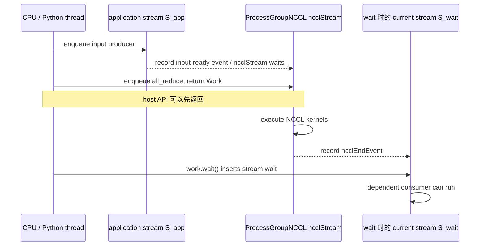

## 本章要解决什么问题

下面三种代码看起来分别是同步、异步后等待和显式设备同步：

```python
# A
dist.all_reduce(x, async_op=False)

# B
work = dist.all_reduce(x, async_op=True)
work.wait()

# C
work = dist.all_reduce(x, async_op=True)
torch.cuda.synchronize()
```

在当前 PyTorch + ProcessGroupNCCL 实现中，它们的 host completion 和 GPU completion 并不相同。需要回答：

1. `async_op=False` 是否意味着 Python 函数等到 GPU collective 完成才返回？
2. 默认 `work.wait()` 等待的是 CPU、CUDA stream，还是 NCCL communicator？
3. `work.is_completed()` 查询什么状态？
4. 在自定义 stream 中调用 `work.wait()`，依赖会加到哪个 stream？
5. `TORCH_NCCL_BLOCKING_WAIT=1` 为什么可能让一个百微秒操作在 host 上等十毫秒？
6. CUDA event 应该放在哪里，才能测到 collective 依赖而不是 host enqueue？

## 四种“完成”不能混用

先定义术语：

| 完成层级 | 准确定义 | 常用证据 |
|---|---|---|
| API enqueue 完成 | host 已把操作交给 ProcessGroup/NCCL | CPU monotonic clock |
| Work stream dependency 建立 | 当前 CUDA stream 已被设置为等待 NCCL end event | `work.wait()` 源码、后续 event |
| NCCL Work 完成 | ProcessGroup 记录在 NCCL stream 的 end event 已完成 | `work.is_completed()` |
| device 完成 | 指定 stream 或整个 device 上此前工作均完成 | event/stream/device synchronize |

一个 API 可以在第一层就返回，同时保证后续同 stream 工作最终遵守第三层依赖。这就是 CUDA 异步编程的正常语义。

## 当前软件栈中实际有三类 Stream

对一次 `torch.distributed.all_reduce`，至少要画出：

```text
CPU thread
  Python -> ProcessGroupNCCL -> NCCL API -> return

application current stream S_app
  input producer -> input-ready event ------------------------------+
                                                                  wait
ProcessGroupNCCL ncclStream                                          |
  wait(input-ready) -> ncclAllReduce kernel -> ncclEndEvent --------+

stream S_wait（调用 work.wait 时的 current stream）
  previous work -> wait(ncclEndEvent) -> dependent consumer
```

<div class="diagram-scroll" markdown="1">



</div>

图中虚线表示 CUDA Event 建立的跨 stream 依赖，不是 host 搬运数据。`work.wait()` 的默认语义是把 NCCL 完成依赖接回调用时的 current stream；它不必让 CPU 一直阻塞到 kernel 完成。

ProcessGroupNCCL 使用自己从 CUDA stream pool 取得的 `ncclStream`。它把这个 stream 作为参数传给 NCCL。对 NCCL 而言，它就是 API 的 user stream；NCCL 2.22.3 会在 group 内聚合 user streams，并最终选择第一条 user stream 作为 launch stream。

因此不要笼统地说“NCCL 总在内部 stream 上运行”：

- 原生 NCCL API 在调用者传入的 CUDA stream 上建立执行顺序；
- PyTorch ProcessGroupNCCL 选择了一条专用 ncclStream，再把它传给 NCCL；
- `Work.wait()` 负责把完成依赖接回调用 wait 时的 current stream。

## PyTorch 源码一：同步 API 只是自动调用 `work.wait()`

源码快照来自当前安装镜像：

```text
PyTorch build：2.5.0a0+872d972e41.nv24.08
文件：torch/distributed/distributed_c10d.py
符号：all_reduce
行号：2486-2491
```

原始源码：

```python
work = group.allreduce([tensor], opts)

if async_op:
    return work
else:
    work.wait()
```

注释版：

```python
# [课程注释] 无论 async_op 是什么，backend 都先返回一个 Work。
work = group.allreduce([tensor], opts)

if async_op:
    # [课程注释] 用户拿到 Work，自行决定何时建立/检查依赖。
    return work
else:
    # [课程注释] 所谓“同步 API”只是 Python wrapper 自动调用 wait。
    # wait 是否阻塞 host，要继续看 backend 的 WorkNCCL 实现。
    work.wait()
```

这段源码已经推翻一个常见假设：`async_op=False` 的精确定义不是“调用 `cudaDeviceSynchronize`”，而是“不把 Work 返回给用户，并在 wrapper 内调用 `wait()`”。

## PyTorch 源码二：输入 Stream 如何接到 NCCL Stream

`ProcessGroupNCCL.cpp:230-248` 的注释和实现：

```cpp
// stream. NCCL communications run on ncclStreams, but input tensors are
// allocated on different streams (i.e., current streams). Communications on
// ncclStreams cannot start before pending input tensor ops on current streams
// finish. Otherwise, ops on two streams might read/write same tensors
// concurrently.
//
// The synchronization above alone is not enough. We also need to make sure
// input tensors are not freed before their usages on ncclStreams finish.
void syncStream(
    at::Device& device,
    at::cuda::CUDAEvent& ncclEvent,
    at::cuda::CUDAStream& ncclStream) {
  ncclEvent.record(at::cuda::getCurrentCUDAStream(device.index()));
  ncclEvent.block(ncclStream);
}
```

注释版：

```cpp
void syncStream(Device& device, CUDAEvent& inputReady, CUDAStream& ncclStream) {
  // [课程注释] 在调用 collective 时的 application current stream 上记录 event。
  // 它代表此前的 tensor producer 已完成。
  inputReady.record(getCurrentCUDAStream(device.index()));

  // [课程注释] 让 ProcessGroup 的 ncclStream 等待 inputReady。
  // 这是 stream-to-stream dependency，不阻塞 CPU。
  inputReady.block(ncclStream);
}
```

对应调用点 `ProcessGroupNCCL.cpp:2603-2608`：

```cpp
auto ncclStream = ncclStreams_.at(key);

// First let NCCL streams wait for input tensors allocation streams
syncStream(device, ncclEvents_[key], ncclStream);
```

数据安全还需要 buffer lifetime。源码注释紧接着说明 CUDACachingAllocator 会通过 `recordStream` 延迟内存块复用，或者在特定配置下由 Work 暂存 tensor 引用。仅有执行顺序而没有生命周期保护，allocator 可能在 NCCL 使用结束前复用同一块显存。

## PyTorch 源码三：Work 完成由 CUDA Event 定义

Work 构造时创建 end event，`ProcessGroupNCCL.cpp:474-480`：

```cpp
if (enableTiming) {
  ncclStartEvent_ = std::make_shared<at::cuda::CUDAEvent>(cudaEventDefault);
}
ncclEndEvent_ = std::make_shared<at::cuda::CUDAEvent>(
    enableTiming ? cudaEventDefault : cudaEventDisableTiming);
```

collective 提交后，event 被记录到 `ncclStream`，`ProcessGroupNCCL.cpp:2670-2675`：

```cpp
post(ncclStream, work);

// End event should only be recorded after the ncclGroupEnd()
if (!coalescing_state_) {
  work->ncclEndEvent_->record(ncclStream);
}
```

`isCompleted()` 最终查询这个 event：

```cpp
bool ProcessGroupNCCL::WorkNCCL::isCompleted() {
  if (!ncclComm_->isAborted()) {
    checkAndSetException();
  }
  return exception() || finishedGPUExecutionInternal();
}

bool ProcessGroupNCCL::WorkNCCL::finishedGPUExecutionInternal() const {
  if (!ncclEndEvent_->query()) {
    return false;
  }
  return true;
}
```

注释版：

```cpp
bool WorkNCCL::isCompleted() {
  // [课程注释] 先检查 communicator 异步错误。
  checkAndSetException();

  // [课程注释] 无错误时，完成的定义是 ncclStream 上 end event 已执行。
  // query 是非阻塞查询，不会为了得到 true 而等待 GPU。
  return exception() || ncclEndEvent_->query();
}
```

所以刚 enqueue 后 `is_completed=False` 是正常状态，不是通信故障。

## PyTorch 源码四：默认 `wait()` 等待的是 Stream，不是 Host

最关键源码位于 `ProcessGroupNCCL.cpp:635-680`。

关键源码摘录（省略 timeout 错误字符串构造）：

```cpp
void ProcessGroupNCCL::WorkNCCL::synchronizeStream() {
  auto currentStream = at::cuda::getCurrentCUDAStream(device_.index());
  // Block the current stream on the NCCL stream
  ncclEndEvent_->block(currentStream);
}

void ProcessGroupNCCL::WorkNCCL::synchronizeInternal(
    std::chrono::milliseconds timeout) {
  synchronizeStream();

  // In case of blocking, wait for the operation to complete.
  if (blockingWait_) {
    while (!isCompleted()) {
      bool timedOut = checkTimeout(
          timeout == kNoTimeout ? c10::nullopt : c10::make_optional(timeout));
      if (timedOut) {
        // ... construct timeout error ...
        break;
      }
      std::this_thread::sleep_for(
          std::chrono::milliseconds(kSynchronizeBusyWaitMillis));
    }
  }
}
```

注释版：

```cpp
void WorkNCCL::synchronizeStream() {
  // [课程注释] 这是“调用 wait() 这一刻”的 current stream。
  auto currentStream = getCurrentCUDAStream(device);

  // [课程注释] 向该 stream 插入 wait-on-event。
  // block 的对象是 CUDA stream，不是执行这段 C++ 的 CPU thread。
  ncclEndEvent_->block(currentStream);
}

void WorkNCCL::synchronizeInternal(timeout) {
  synchronizeStream();

  if (blockingWait_) {
    // [课程注释] 只有 blockingWait_ 为 true，host 才轮询 event。
    while (!isCompleted()) {
      checkTimeout(timeout);

      // [课程注释] 当前源码常量为 10 ms，因此短 collective 的 host wait
      // 可能被量化到约 10、20... ms，不能当作 kernel duration。
      sleep_for(10ms);
    }
  }
}
```

`wait()` 本身只是调用 `synchronizeInternal`：

```cpp
bool ProcessGroupNCCL::WorkNCCL::wait(std::chrono::milliseconds timeout) {
  synchronizeInternal(timeout);
  return true;
}
```

因此默认模式下：

```text
work.wait()
  -> 在 current stream 插入对 ncclEndEvent 的等待
  -> CPU 很快返回
  -> 该 stream 后续 kernel 自动等 collective
```

开启 `TORCH_NCCL_BLOCKING_WAIT=1` 后才增加 host polling。

## NCCL 源码：它如何处理传入的 Stream

ProcessGroup 把 `ncclStream` 传给 NCCL，NCCL 将 stream 放入 planner。`src/enqueue.cc:2035-2043`：

```cpp
l = ncclMemoryStackAlloc<struct ncclCudaStreamList>(&comm->memScoped);
l->stream = info->stream;
l->next = planner->streams;
planner->streams = l;
```

`ncclEnqueueCheck` 先追加 task，再在最外层 group end 触发执行：

```cpp
NCCLCHECKGOTO(taskAppend(info->comm, info), ret, fail);

ncclGroupErrCheck(ret);
NCCLCHECK(ncclGroupEndInternal());
```

当一个 group 聚合多个 user stream 时，`src/enqueue.cc:1321-1343` 给出了明确的 fan-in/fan-out 设计：

```cpp
// Semantically we want these dependencies for the kernels launched:
//   1. Launch host task on hostStream.
//   2. Launch kernel, depends on all of {deviceStream, hostStream, userStream[i]...}
//   3. {deviceStream, userStream[i]...} depend on kernel.
// ...
cudaStream_t launchStream = planner->streams->stream;
NCCLCHECKGOTO(ncclStrongStreamAcquire(
    planner->capturingGraph, &comm->sharedRes->deviceStream), result, failure);

for (struct ncclCudaStreamList* l=planner->streams->next; l != nullptr; l = l->next) {
  NCCLCHECKGOTO(ncclStrongStreamWaitStream(
      planner->capturingGraph, &comm->sharedRes->deviceStream, l->stream), result, failure);
}
NCCLCHECKGOTO(ncclStrongStreamWaitStream(
    planner->capturingGraph, launchStream, &comm->sharedRes->deviceStream), result, failure);
```

注释版心智模型：

```cpp
// [课程注释] 多条 user stream 先 fan-in 到 NCCL strong deviceStream；
for (extra_user_stream : group) {
  deviceStream.wait(extra_user_stream);
}

// [课程注释] 第一条 user stream 等 deviceStream，成为真正 launchStream。
launchStream.wait(deviceStream);

// [课程注释] NCCL kernel 在 launchStream 上启动。
cuLaunchKernel(..., launchStream, ...);

// [课程注释] 完成后再让其他 user stream 经 deviceStream fan-out 等待 kernel。
```

这里的 strong stream 主要用于在普通执行和 CUDA Graph capture 之间维持持久资源顺序。它不改变“CUDA API 异步提交”的基本事实。

## 实验设计

完整脚本：

- [27_run_ch03_async.sh](/assets/files/nccl-learning/scripts/27_run_ch03_async.sh)
- [27_ch03_async_semantics.py](/assets/files/nccl-learning/scripts/27_ch03_async_semantics.py)
- [ch03_summarize.py](/assets/files/nccl-learning/probes/ch03_summarize.py)

运行：

```bash
cd /root/nccl-learning
./scripts/27_run_ch03_async.sh
```

### 实验 A：三种 API 模式

消息大小：`1 KiB、1 MiB、64 MiB、256 MiB`，每种模式十个 cycle、四个 rank。

| 模式 | host 路径 | 预期 |
|---|---|---|
| `sync_api` | wrapper 自动 `work.wait()` | 默认 host 早返回，current stream 受依赖 |
| `async_wait` | 显式 `work.wait()` | 与 sync API 的完成语义接近，但保留 Work |
| `async_device_sync` | `cudaDeviceSynchronize` | host 等待整个 device，时间接近依赖完成 |

每组同时在以下环境运行：

```text
TORCH_NCCL_BLOCKING_WAIT=0
TORCH_NCCL_BLOCKING_WAIT=1
```

### 实验 B：wait 的 Stream 作用域

为了让 race window 足够长，在 application default stream 上排入约 130 ms GPU sleep，再提交 64 MiB AllReduce：

```python
torch.cuda._sleep(200_000_000)
work = dist.all_reduce(x, async_op=True)

with torch.cuda.stream(wait_stream):
    work.wait()
    wait_marker.record()

with torch.cuda.stream(free_stream):
    free_marker.record()
```

如果源码理解正确：

- `wait_stream` 的 marker 必须等 collective；
- `free_stream` 没有这个依赖，可以先完成；
- 默认 host `work.wait()` 应在几微秒内返回；
- 此时 `work.is_completed()` 仍为 false。

### 正确性和计时边界

每个输出都执行全 tensor 检查：

```python
expected = world_size * (world_size + 1) / 2
assert torch.all(x == expected)
```

文章把 CUDA event 区间称为 **stream dependency interval**，而不是 NCCL kernel duration。它可能包含 stream wait、调度和 end event 提交位置。尤其在 blocking-wait 模式下，host 延迟提交 end event，会把轮询空档带入 interval。

## 正式结果

Run ID：`20260710T071511Z`。

- [summary.md](/assets/files/nccl-learning/logs/ch03_async/20260710T071511Z/summary.md)
- [timing_summary.csv](/assets/files/nccl-learning/logs/ch03_async/20260710T071511Z/timing_summary.csv)
- [stream_scope_summary.csv](/assets/files/nccl-learning/logs/ch03_async/20260710T071511Z/stream_scope_summary.csv)
- [nonblocking rank0 raw](/assets/files/nccl-learning/logs/ch03_async/20260710T071511Z/raw/nonblocking/rank0.csv)
- [blocking rank0 raw](/assets/files/nccl-learning/logs/ch03_async/20260710T071511Z/raw/blocking/rank0.csv)

### 默认非阻塞 wait：256 MiB

| 模式 | median host call | wait/sync 部分 | stream dependency interval | wait 后 Work 已完成 |
|---|---:|---:|---:|---:|
| sync API | 74.236 us | wrapper 内部 | 3584.432 us | 未直接返回 Work |
| async + wait | 80.366 us | 4.150 us | 3573.712 us | 0% |
| async + device sync | 3585.578 us | 3508.935 us | 3606.304 us | 100% |

最直接的证据：

```text
sync API stream interval / host call = 48.28x
async+wait stream interval / host call = 44.47x
```

`async_op=False` 在 host 上只用了约 74 微秒，却在 current stream 上建立了约 3.58 毫秒的依赖。它是调用语义上的“同步”，不是 host/device 全同步。

`async_wait` 的 `work.wait()` 本身中位数只有 4.15 微秒，并且 256 MiB 的 40 个样本在 wait 返回后 `is_completed()` 全是 false。源码中的 event block 语义得到直接验证。

显式 `torch.cuda.synchronize()` 让 host call 增加到约 3.59 毫秒，此时 Work 完成率为 100%。这是 host completion 与 device completion 的清晰对照。

### 消息大小如何影响 `is_completed()`

非阻塞 `async_wait` 在 wait 返回后的完成率：

| bytes | completed rate |
|---:|---:|
| 1 KiB | 75% |
| 1 MiB | 0% |
| 64 MiB | 0% |
| 256 MiB | 0% |

1 KiB 太快，部分操作在 host 查询前已经自然完成。完成率不是 API 契约，只是 host/GPU race 的观测。不能因为小消息常返回 true，就把 `wait()` 误解成 host blocking。

## Blocking wait：为什么短操作也会等约 10 ms

开启 `TORCH_NCCL_BLOCKING_WAIT=1` 后，源码每次检查失败会 sleep 10 ms。

实测中：

```text
1 KiB async+wait host call median      10.455 ms
1 MiB async+wait host call median      10.456 ms
64 MiB async+wait host call median     20.598 ms
256 MiB async+wait host call median    10.527 ms
```

它们呈现约 10 ms 的量化，而不是随 payload 平滑增长。256 MiB blocking 样本 CV 超过 30%，所以不能拿 `10.527 ms` 当 collective 性能；能下的结论只有：

```text
blocking-wait 确实让 host 轮询完成；
10 ms polling interval 主导了短操作的可见 host latency；
该模式主要服务 timeout/error semantics，不是精密计时器。
```

同一环境下 `async_device_sync` 不依赖 Work polling loop，256 MiB 仍约 3.7 ms，但样本也受 rank 调度影响；正式 NCCL 性能应由 nccl-tests 和 profiler 测量。

## Stream 作用域实验

40 个样本的结果：

| 指标 | 结果 |
|---|---:|
| queued GPU sleep median | 130135.376 us |
| host `work.wait()` median | 5.442 us |
| free stream 先于 wait stream 完成 | 40/40 |
| wait 返回时 Work 已完成 | 0/40 |
| AllReduce full-tensor correctness | 40/40 |

时序是：

```text
default stream: sleep(130ms) -> input ready
ncclStream:     wait(input) -> AllReduce -> ncclEndEvent
wait_stream:    wait(ncclEndEvent) -----------------------> marker
free_stream:    marker -> complete first
CPU:            work.wait() returns in ~5.4us
```

这证明依赖加在调用 `wait()` 时的 current stream 上，而不是所有 CUDA stream。其他 stream 若要读取或覆盖同一个 tensor，必须显式继承依赖，否则会形成 data race。

## 三种常见错误计时

### 错误一：只用 Python wall clock

```python
t0 = time.perf_counter()
dist.all_reduce(x)
print(time.perf_counter() - t0)
```

默认模式主要测到约 74 微秒 host call，而不是约 3.58 毫秒 stream dependency。

### 错误二：在无依赖的 Stream 上记录 end event

ProcessGroup collective 在 ncclStream 上运行。如果 end event 所在 stream 没有等待 `ncclEndEvent`，它可以提前完成。正确方法是调用 `work.wait()` 把依赖接到计时 stream，或直接使用 profiler/ProcessGroup timing event。

### 错误三：blocking wait 后才提交 end event

host 轮询可能晚 10～20 ms 才提交 end event。此时两个 CUDA event 的时间差包含 GPU idle wall-time，不能解释为 kernel duration。本实验因此把它命名为 stream dependency interval，并只用非阻塞配置做设备区间比较。

## Buffer 生命周期为什么同样重要

异步正确性包含两件事：

```text
execution ordering：consumer 必须等 producer/collective
storage lifetime：allocator 不能在 collective 完成前复用 buffer
```

ProcessGroupNCCL 源码通过 `recordStream` 或 Work 暂存引用保护 allocator safety。但应用仍不能在另一个无依赖 stream 中原地改写 tensor。内存没有被 allocator 释放，不代表并发读写安全。

生产代码应遵循：

- 在产生 input 的 stream 上调用 collective，使 ProcessGroup 能记录 input-ready event；
- 在消费 output 的 stream 上调用 `work.wait()`；
- 不要只因 Python 对象仍存在就假设跨 stream 顺序正确；
- 不要在 Work 完成前让外部 allocator、IPC peer 或自定义扩展复用指针。

## `barrier()` 是特殊情况

源码在 Work 中检测 `barrierTensor_`。barrier 的 `wait()` 会额外同步 current stream 到 host，因为其语义要求 CPU 进程等 dummy AllReduce 完成；它使用 `cudaStreamSynchronize(currentStream)`，而不是同步整个 device。

因此不能用 barrier 的 host 行为推断普通 AllReduce 的 `wait()` 行为。

## 生产性能分析应该记录什么

至少拆分以下指标：

```text
CPU dispatch gap
ProcessGroup host enqueue
NCCL kernel/device interval
current-stream exposed wait
compute/communication overlap
step critical-path stall
watchdog/blocking-wait polling latency
```

只看 Python 函数耗时，会把“通信仍在后台执行”误报成通信很快；只看 NCCL kernel，又可能忽略它完全被计算覆盖、没有暴露在 step critical path 上。

## 版本边界

本文源码语义固定在当前 PyTorch 构建和 NCCL 2.22.3。以下因素可能改变行为：

- PyTorch 新版 ProcessGroupNCCL 的 wait/timeout 实现；
- `TORCH_NCCL_BLOCKING_WAIT`、high-priority stream、avoid-record-streams；
- CUDA Graph capture/coalescing；
- barrier、P2P 或非 NCCL backend；
- NCCL nonblocking communicator config。

无论具体实现如何变化，分析方法不变：分别证明 host return、stream dependency、Work event 和 device completion。

## 本章结论

1. 当前 `dist.all_reduce(async_op=False)` 只是 Python wrapper 自动调用 `WorkNCCL::wait()`，不是自动 `cudaDeviceSynchronize()`。
2. ProcessGroupNCCL 先让专用 ncclStream 等 application input stream，再在 ncclStream 上记录 Work end event。
3. 默认 `work.wait()` 把该 end event 接到调用 wait 时的 current stream，CPU 可以在 GPU 完成前返回。
4. 256 MiB 默认 sync API host call 约 74.236 微秒，而 stream dependency 约 3584.432 微秒，相差 48.28 倍。
5. stream-scope 故障实验中，40/40 个 free-stream marker 在 wait-dependent stream 前完成；wait 返回时 Work 全部尚未完成。
6. blocking-wait 使用 10 ms host polling interval，适合 timeout/error 语义，不适合测量 NCCL kernel 时间。
7. 正确异步代码必须同时处理 stream ordering 和 buffer lifetime；对象存活不能替代 CUDA dependency。

## 练习与验收

1. 画出 input producer、ProcessGroup ncclStream、`work.wait()` current stream 和 CPU 的完整时序。
2. 为什么 `async_op=False` 的 host 时间远小于 AllReduce device interval，却仍能保证同 stream consumer 正确？
3. `work.is_completed()` 和 `work.wait()` 分别查询或修改了什么状态？
4. 为什么在 stream A 调用 wait 后，stream B 仍不能安全读取同一个输出？
5. 设计一个不会把 host polling 空档计入 GPU interval 的 blocking-wait profiler 方案。
