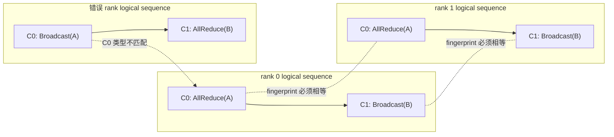

## 本章要区分的四件事

下面四句话经常被混在一起：

1. 所有 rank 必须按相同顺序调用 collective。
2. `ncclGroupStart/End` 可以批量提交多次 NCCL 调用。
3. `ncclGroupEnd` 返回时，操作已经进入 CUDA stream。
4. CUDA stream 上的通信已经完成。

只有前两句都正确，第三句也不推出第四句。

本章回答：

- “相同顺序”要匹配 operation、shape、dtype，还是只匹配调用次数？
- Group 是 barrier、transaction、kernel fusion，还是 host-side batching boundary？
- nested Group 为什么合法，真正 launch 发生在哪一层？
- Group 内某个 API 参数错误后，为什么仍必须调用外层 `GroupEnd`？
- blocking 与 nonblocking communicator 的返回状态如何变化？
- `ncclCommGetAsyncError` 查询的是什么，和 CUDA event 有什么区别？
- PyTorch 的 `TORCH_DISTRIBUTED_DEBUG=DETAIL` 在 NCCL 之前做了什么？
- 关闭 DETAIL 后，operation mismatch 为什么可能一个 rank 返回、另一个 rank 超时？
- watchdog timeout 为什么意味着数据可能已经不一致，不能继续训练？

实验同时覆盖正确路径、参数错误、类型错配、shape 错配和 rank skip。

## 第一原则：collective 是 communicator 上的全局序列

对同一个 communicator，给每个 collective 编号：

$$
C_0, C_1, C_2, \ldots
$$

每个 rank 都必须让第 $k$ 个调用描述同一个通信协议实例。可以把最小 fingerprint 写成：

$$
F_k =
(\text{sequence},\text{op type},\text{count/shape},
\text{dtype},\text{root},\text{reduction op})
$$

对所有参与 rank：

$$
F_k^{(0)} = F_k^{(1)} = \cdots = F_k^{(N-1)}
$$

正确顺序：

```text
rank0: AllReduce(A) -> Broadcast(B, root=0)
rank1: AllReduce(A) -> Broadcast(B, root=0)
rank2: AllReduce(A) -> Broadcast(B, root=0)
rank3: AllReduce(A) -> Broadcast(B, root=0)
```

错误顺序：

```text
rank0: Broadcast(A) -> AllReduce(B)
rank1: AllReduce(A) -> Broadcast(B)
```

同 operation 不同 count 也错误：

```text
rank0: AllReduce(count=4)
rank1: AllReduce(count=8)
```

<div class="diagram-scroll" markdown="1">



</div>

匹配键是 communicator 上的逻辑序号加完整 fingerprint，不是 tensor 变量名。Group 可以批量准备这些 operation，但不会重排或自动修复不同 rank 的序列。

NCCL kernel 不是负责交换完整 schema 的 RPC 系统。协议参数不一致可能造成：

- 某些 rank hang；
- 某些 rank 局部返回；
- watchdog 超时；
- transport error；
- 错误数据；
- 上层 debug wrapper 提前拒绝。

不能把“没有立即报错”解释成 contract 正确。

## Group 不改变全局顺序

Group 只把一段本线程 NCCL 调用收集起来，在最外层 `GroupEnd` 统一准备和 launch。

```cpp
ncclGroupStart();
ncclAllReduce(A, ...);        // logical operation 0
ncclBroadcast(B, ..., root);  // logical operation 1
ncclGroupEnd();
```

其他 rank 仍必须用相同 logical order。Group 不是让不同 operation 自动配对的类型系统，也不是跨 rank 的全局事务。

## Group 也不是 GPU completion barrier

```text
CPU thread:
  GroupStart -> API A -> API B -> GroupEnd returns
                                      |
                                      +-- 已完成 planner/launch/enqueue

CUDA stream:
  prior work -> NCCL kernels A/B -> dependent work -> completion event
                                     ^
                                     GroupEnd 返回时通常还没到这里
```

`GroupEnd` 可以在 GPU kernel 仍执行时返回。要证明 device completion，必须使用 CUDA event、stream/device synchronize，或框架定义明确的完成 event。

## 源码与版本边界

```text
NCCL tag:    v2.22.3-1
NCCL commit: 178b6b759074597777ce13438efb0e0ba625e429
PyTorch:     2.5.0a0+872d972e41.nv24.08
GPU:         4 x Tesla V100-SXM2-32GB
```

源码目录：

```text
NCCL:   ~/nccl-learning/third_party/nccl-2.22.3
PyTorch: /opt/pytorch/pytorch
```

## 源码一：public header 对 Group 的定义

文件：`src/nccl.h.in:411-451`

Public header 原文（接口声明，不是实现）：

```cpp
/*
 * Group semantics
 *
 * ncclGroupStart will enqueue all collective calls until the ncclGroupEnd
 * call, which will wait for all calls to be complete. Note that for collective
 * communication, ncclGroupEnd only guarantees that the operations are
 * enqueued on the streams, not that the operation is effectively done.
 *
 * Group semantics also allow to fuse multiple operations on the same device
 * to improve performance, or to permit concurrent progress of multiple
 * send/receive operations.
 */

/*
 * Group Start
 *
 * Nothing will be started on the CUDA stream until ncclGroupEnd.
 */
ncclResult_t ncclGroupStart();

/*
 * Group End
 *
 * Start a fused NCCL operation consisting of all calls since ncclGroupStart.
 * Operations on the CUDA stream depending on the NCCL operations need to be
 * called after ncclGroupEnd.
 */
ncclResult_t ncclGroupEnd();
```

注释版：

```cpp
ncclGroupStart();
// [课程注释] 从这里开始，当前 host thread 的调用进入 thread-local group。
// API 会创建 task，但最外层 GroupEnd 前不启动这批 CUDA 工作。

ncclAllReduce(...);
ncclSend(...);
ncclRecv(...);

ncclGroupEnd();
// [课程注释] planner、连接准备和 launch 在这里触发。
// 返回只保证操作 enqueue 到 stream。
// 不保证 GPU 已完成，不等价于 cudaStreamSynchronize。
```

原文中的 “wait for all calls to be complete” 指 group 中各 host API 的收集/提交完成；后一句立即限定 collective 只保证 stream enqueue。不能截取前半句忽略完成层级。

这一节只用 header 确立完成语义。真正改变 `ncclGroupDepth`、积累 task 并在最外层
`GroupEnd` 触发 launch 的实现，分别在下面的 `group.cc`、`group.h` 和 `enqueue.cc` 中展开。

## 源码二：Group state 是 thread-local

文件：`src/group.cc:15-23`

原始源码：

```cpp
__thread int ncclGroupDepth = 0;
__thread ncclResult_t ncclGroupError = ncclSuccess;
__thread struct ncclComm* ncclGroupCommHead = nullptr;
__thread struct ncclComm* ncclGroupCommPreconnectHead = nullptr;
__thread ncclIntruQueue<ncclAsyncJob, &ncclAsyncJob::next> ncclAsyncJobs;
__thread struct ncclGroupJob *ncclGroupJobMainPtr = NULL;
__thread struct ncclGroupJob ncclGroupJobMain;
__thread int ncclGroupBlocking = -1;
__thread bool ncclGroupJobAbortFlag = false;
```

注释版：

```cpp
__thread int ncclGroupDepth;
// [课程注释] nesting depth 属于当前 CPU thread。

__thread ncclResult_t ncclGroupError;
// [课程注释] 任一非 success/in-progress 错误暂存在这里。

__thread ncclComm* ncclGroupCommHead;
// [课程注释] 当前 thread 这一组的 communicator 链表。

__thread ncclAsyncJobQueue ncclAsyncJobs;
// [课程注释] init、connect、finalize 等 host 异步 job。

__thread int ncclGroupBlocking;
// [课程注释] -1 表示尚未遇到 comm，之后记录 blocking mode。
```

工程含义：

1. 线程 A 的 `GroupStart` 不能由线程 B 的 `GroupEnd` 配对。
2. 同一进程多线程操作 NCCL 时，要分别维护平衡的 group scope。
3. Group 不是进程级 mutex，也不自动序列化不同线程的业务逻辑。

## 源码三：为什么 nested Group 合法

文件：`src/include/group.h:94-103`

原始源码：

```cpp
inline ncclResult_t ncclGroupStartInternal() {
  ncclGroupDepth++;
  return ncclSuccess;
}

inline ncclResult_t ncclGroupErrCheck(ncclResult_t ret) {
  if (ncclGroupDepth > 0) {
    if (ret != ncclSuccess && ret != ncclInProgress)
      ncclGroupError = ret;
  }
  return ret;
}
```

`ncclGroupEndInternal` 位于 `src/group.cc:479-495`：

```cpp
if (ncclGroupDepth == 0) {
  WARN("ncclGroupEnd: not in a group call.");
  ret = ncclInvalidUsage;
  goto exit;
}

if ((--ncclGroupDepth) > 0) goto exit;

if ((ret = ncclGroupError) != ncclSuccess) goto fail;
```

注释版：

```cpp
if (depth == 0) {
  // [课程注释] 没有对应 GroupStart，返回 invalid usage。
  return ncclInvalidUsage;
}

depth -= 1;
if (depth > 0) {
  // [课程注释] 只关闭一层嵌套，不 launch。
  return ncclSuccess;
}

// [课程注释] 只有 depth 从 1 变成 0 的最外层 End 才继续。
if (groupError != ncclSuccess) cleanup_and_return_error();
```

调用过程：

```cpp
GroupStart();        // explicit depth 1
  AllReduce(A);      // API 内部暂时 depth 2，再回到 1
  GroupStart();      // explicit depth 2
    AllReduce(B);    // API 内部暂时 depth 3，再回到 2
  GroupEnd();        // depth 2 -> 1，不 launch
  AllReduce(C);
GroupEnd();          // depth 1 -> 0，统一 launch A/B/C
```

public collective 自己也调用 `ncclGroupStartInternal/EndInternal`。没有外层 Group 时，这个隐式 scope 立即提交一个 API；有外层 Group 时，它只回到外层 depth。

文件：`src/enqueue.cc:2050-2079`

```cpp
ncclResult_t ncclEnqueueCheck(struct ncclInfo* info) {
  NCCLCHECK(ncclGroupStartInternal());
  ...
  NCCLCHECKGOTO(ArgsCheck(info), ret, fail);
  NCCLCHECKGOTO(taskAppend(info->comm, info), ret, fail);
exit:
  ncclGroupErrCheck(ret);
  NCCLCHECK(ncclGroupEndInternal());
  if (info->comm && !info->comm->config.blocking)
    NCCLCHECK(ncclCommGetAsyncError(info->comm, &ret));
  return ret;
}
```

## 源码四：Group 内错误如何传播和清理

`ncclGroupErrCheck` 忽略 `ncclSuccess` 与 `ncclInProgress`，保存其他错误。

```cpp
ncclGroupStart();
result_api = ncclBroadcast(..., root = nranks); // invalid argument
result_end = ncclGroupEnd();
```

执行过程：

```text
outer GroupStart: depth 0 -> 1
Broadcast internal start: depth 1 -> 2
ArgsCheck: invalid root
group error = ncclInvalidArgument
Broadcast internal end: depth 2 -> 1
Broadcast returns ncclInvalidArgument
outer GroupEnd: depth 1 -> 0
sees stored group error
cleanup planner/jobs/thread-local state
GroupEnd returns ncclInvalidArgument
```

不能在 Broadcast 返回错误后跳过 `GroupEnd`。外层 scope 仍处于 depth 1，需要平衡结束并触发 cleanup。

本机还验证：blocking communicator 在平衡 cleanup 后可以继续完成下一次合法 AllReduce。这个结论只适用于本次本地参数错误，不表示 system/remote/async error 后都可复用 communicator。

## 源码五：最外层 GroupEnd 才准备并 launch

文件：`src/group.cc:389-464`

原始主干：

```cpp
static ncclResult_t groupLaunch(
    struct ncclAsyncJob *job_, ncclSimInfo_t* simInfo) {
  ...
  if (groupCommPreconnectHeadMain != nullptr) {
    // construct P2P preconnect jobs
  }

  NCCLCHECKGOTO(
      asyncJobLaunch(asyncJobsMain, groupAbortFlag), ret, fail);

  for (ncclComm* comm = groupCommHeadMain;
       comm; comm = comm->groupNext) {
    ncclPrepareTasks(comm, algoNeedConnect, &needConnect, simInfo);
    // optional collective connect jobs
  }

  NCCLCHECKGOTO(
      asyncJobLaunch(asyncJobsMain, groupAbortFlag), ret, fail);

  if (!simInfo && groupCommHeadMain != nullptr) {
    NCCLCHECKGOTO(doLaunches(groupCommHeadMain), ret, fail);
  }

  // leave communicators and publish async result
}
```

注释版调用链：

```text
outer GroupEnd
  -> groupLaunch
     -> P2P preconnect jobs
     -> run/join async host jobs
     -> ncclPrepareTasks
        -> algorithm/protocol/channel planning
     -> optional collective connect jobs
     -> doLaunches
        -> enqueue NCCL device work on CUDA stream
     -> leave/reset group state
```

Group 让 planner 同时看到整批 task，也让互相依赖的 Send/Recv 一起建立 progress。但是“fuse”不保证：

- 永远变成一个 CUDA kernel；
- 任意 operation 组合都更快；
- 不同 rank 可以采用不同批次；
- GroupEnd 会等待 device completion。

这些要由具体版本、operation 组合和 profiler 证据判断。

## 源码六：blocking 与 nonblocking Group

文件：`src/group.cc:509-549`

原始关键分支：

```cpp
if (ncclGroupBlocking == 0 &&
    (ncclGroupCommPreconnectHead != nullptr ||
     !ncclIntruQueueEmpty(&ncclAsyncJobs))) {
  // nonblocking group
  for (comm in group) {
    ncclCommSetAsyncError(comm, ncclInProgress);
    comm->groupJob = ncclGroupJobMainPtr;
  }
  pthread_create(... groupLaunchNonBlocking ...);
  ret = ncclInProgress;
} else {
  // blocking group
  groupLaunch(...);
  groupResetJobState(...);
}
```

注释版：

```cpp
if (comm.blocking == 0 && 本组有 async job 或 preconnect) {
  // [课程注释] 发布 communicator state = in progress。
  // 创建后台 pthread 执行 groupLaunch。
  return ncclInProgress;
} else {
  // [课程注释] host 线程内完成 groupLaunch 的控制面工作。
  // 仍然只 enqueue CUDA work，不等 device kernel 完成。
  return groupLaunch(...);
}
```

条件不是单纯 `blocking == 0`，还要求本组存在 preconnect/async job。因此 nonblocking communicator 的某次 collective 也可能直接返回 `ncclSuccess`。

本章实验观察到：

| phase | initial return | async polling |
|---|---|---|
| nonblocking init | `ncclInProgress` | 47 polls 后 success |
| tested AllReduce Group | `ncclSuccess` | 第 1 次查询就是 success |
| nonblocking finalize | `ncclInProgress` | 2 polls 后 success |

这不是矛盾，而是源码条件分支的直接结果。

## 源码七：`ncclCommGetAsyncError` 查询什么

文件：`src/init.cc:2118-2125`

原始源码：

```cpp
ncclResult_t ncclCommGetAsyncError(
    ncclComm_t comm, ncclResult_t *asyncError) {
  NCCLCHECK(CommCheck(comm, "ncclGetAsyncError", "comm"));
  NCCLCHECK(PtrCheck(asyncError, "ncclGetAsyncError", "asyncError"));

  *asyncError = __atomic_load_n(
      &comm->asyncResult, __ATOMIC_ACQUIRE);
  if (*asyncError == ncclSuccess && comm->proxyState)
    *asyncError = __atomic_load_n(
        &comm->proxyState->asyncResult, __ATOMIC_ACQUIRE);
  return ncclSuccess;
}
```

调用中有两个结果：

```cpp
ncclResult_t api_result =
    ncclCommGetAsyncError(comm, &async_state);
```

- `api_result`：查询动作本身是否成功。
- `async_state`：communicator/proxy 当前异步状态。

它不是 CUDA event query：

- `async_state == ncclSuccess` 表示没有已发布的 communicator/proxy 异步错误；
- 不表示某个 collective 的 GPU output 已可读；
- `ncclInProgress` 表示控制面异步 job 尚未到 terminal state；
- Work/device completion 仍应由 stream/event 证明。

## Nonblocking communicator 的正确轮询模式

实验代码：

```cpp
ncclConfig_t config = NCCL_CONFIG_INITIALIZER;
config.blocking = 0;

ncclResult_t initial = ncclCommInitRankConfig(
    &comm, nranks, id, rank, &config);

ncclResult_t async = ncclInProgress;
while (async == ncclInProgress) {
  NCCLCHECK(ncclCommGetAsyncError(comm, &async));
  if (async == ncclInProgress)
    sleep_for(1ms);
}

if (async != ncclSuccess) {
  // terminal error: abort/cleanup，不能继续 enqueue 普通工作
}
```

本机四个 rank 的 init：

```text
initial = NCCL operation in progress
terminal = no error
polls = 47
elapsed = 48.945 - 48.960 ms
```

1 ms polling interval 决定了 poll 次数的时间粒度，它不是 NCCL 内部阶段精确计时。

Finalize：

```cpp
ncclResult_t initial = ncclCommFinalize(comm);
poll_until_terminal(comm);
ncclCommDestroy(comm);
```

结果：

```text
initial = NCCL operation in progress
terminal = no error
polls = 2
elapsed = 1.059 - 1.069 ms
```

## 源码八：PyTorch DETAIL 是 NCCL 前置 wrapper

`TORCH_DISTRIBUTED_DEBUG=DETAIL` 不是打开一个 NCCL 参数。PyTorch 会给 backend 加 `ProcessGroupWrapper`。

创建逻辑：

```text
torch/distributed/distributed_c10d.py:1806-1828
```

```python
if get_debug_level() == DebugLevel.DETAIL:
    if _GLOO_AVAILABLE:
        backend_class = _create_process_group_wrapper(
            wrapped_pg=backend_class,
            store_prefix=group_name,
            store=backend_prefix_store,
            rank=group_rank,
            world_size=group_size,
            timeout=timeout,
        )
```

fingerprint 位于 `ProcessGroupWrapper.cpp:23-50`：

```cpp
struct CollectiveFingerPrint {
  OpType op_type_;
  std::size_t num_tensors_;
  std::vector<int8_t> tensor_dtypes_;
  std::vector<int8_t> tensor_device_types_;
  std::vector<std::vector<int64_t>> tensor_sizes_;
  uint64_t sequence_number_;
};
```

注释版：

```cpp
fingerprint = {
  sequence_number, // [课程注释] communicator logical sequence
  op_type,         // ALLREDUCE/BROADCAST/...
  tensor_count,
  dtype,
  device_type,
  tensor_shape
};
```

检查入口 `ProcessGroupWrapper.cpp:578-604`：

```cpp
auto seq = getSequenceNumberForGroup();
auto finger_print = CollectiveFingerPrint(op_type, tensors, seq);

glooBackend_->monitoredBarrier(options, /* waitAllRanks */ true);
finger_print.verify(glooBackend_);
```

`verify` 用 Gloo AllGather 收集各 rank fingerprint，再逐 rank 比较。检查通过后 wrapper 才调用真正的 NCCL backend：

```text
坏 collective 进入 NCCL 前
  -> 辅助 Gloo control plane 对齐
  -> 报出 sequence/op/shape/dtype 差异
```

代价是每次 collective 多了 control-plane 同步与 fingerprint 通信。它适合调试，不应未经测量直接作为生产性能配置。

## 源码九：PyTorch watchdog 的超时定义

`ProcessGroupNCCL.cpp:577-607`：

```cpp
bool WorkNCCL::checkTimeout(optional<milliseconds> timeout) {
  auto timeElapsed = steady_clock::now() - workStartTime_;
  auto workTimeout = timeout ? *timeout : opTimeout_;

  if (timeElapsed < workTimeout)
    return false;

  auto exceptionMsg =
      "Watchdog caught collective operation timeout: " +
      work_description + " ran for " + timeElapsed +
      " before timing out.";
  setException(DistBackendError(exceptionMsg));
  return true;
}
```

异常处理紧接着说明：

```cpp
"Due to the asynchronous nature of CUDA kernels, subsequent GPU operations "
"might run on corrupted/incomplete data."
```

注释版：

```text
Work enqueue timestamp
  -> watchdog periodically checks elapsed
  -> elapsed >= opTimeout
  -> attach DistBackendError to Work
  -> depending on error mode, abort communicator/process
```

watchdog 是上层 liveness guard，不是 NCCL collective schema validator。

## 实验设计

正式运行：

```text
ch06_group_ordering/20260710T075642Z
```

入口：

```bash
cd ~/nccl-learning
./scripts/30_run_ch06_group_ordering.sh
```

实验文件：

- [总入口](/assets/files/nccl-learning/scripts/30_run_ch06_group_ordering.sh)
- [ProcessGroup 顺序故障 worker](/assets/files/nccl-learning/scripts/30_ch06_order_worker.py)
- [原生 Group/async probe](/assets/files/nccl-learning/probes/ch06_native_group_semantics.cc)
- [故障矩阵 runner](/assets/files/nccl-learning/probes/ch06_run_failures.py)
- [统计聚合器](/assets/files/nccl-learning/probes/ch06_summarize.py)
- [正式结果摘要](/assets/files/nccl-learning/logs/ch06_group_ordering/20260710T075642Z/summary.md)

### 原生成功与确定性错误矩阵

4 个 MPI rank 直接调用 NCCL C API：

| variant | 要证明的内容 |
|---|---|
| GroupEnd without start | depth 0 确定性返回 `ncclInvalidUsage` |
| nested depth two | 内层 End 不 launch，外层 End 后三次 AllReduce 正确 |
| two user streams | 同组两个 stream 的 task 都正确 |
| async error after success | blocking comm 查询为 success |
| invalid root cleanup | inner API 与 outer End 都返回 invalid argument |
| valid op after cleanup | 平衡 cleanup 后 blocking comm 可继续 |
| nonblocking init | in-progress 经 polling 到 success |
| nonblocking collective | 本次直接 success，数据正确 |
| nonblocking finalize | in-progress 经 polling 到 success |

每种 semantic variant 在 4 个 rank 都写一条 CSV，共 36 条。

### GroupEnd 与 device completion

参数：

```text
operation: in-place AllReduce SUM/int32
payload: 256 MiB per rank
world size: 4
warmup: 3
measured cycles: 10
rank aggregation: each cycle takes max across four ranks
```

关键测量代码：

```cpp
cudaEventRecord(start, stream);

auto host_start = steady_clock::now();
ncclGroupStart();
ncclAllReduce(
    buffer, buffer, count, ncclInt32, ncclSum, comm, stream);
ncclGroupEnd();
auto host_end = steady_clock::now();

cudaEventRecord(stop, stream);
bool ready_now = (cudaEventQuery(stop) == cudaSuccess);
cudaEventSynchronize(stop);
cudaEventElapsedTime(&gpu_ms, start, stop);
```

两个区间：

- host interval：`GroupStart -> API -> GroupEnd`；
- CUDA interval：stream 上 start event 到 NCCL 后 stop event。

`ready_now` 直接回答 GroupEnd 返回时 device 是否已经完成。

### ProcessGroup 失败矩阵

每个负向 case 都先完成一次有效 AllReduce，再注入故障，排除初始化和基础 P2P 路径问题。

| case | debug | 注入 |
|---|---|---|
| ordered | OFF | 两 rank 都 Broadcast -> AllReduce |
| op mismatch | DETAIL | rank0 Broadcast，rank1 AllReduce |
| size mismatch | DETAIL | rank0 count 4，rank1 count 8 |
| op mismatch | OFF | 同一错配，不使用 wrapper |
| rank skip | OFF | rank0 跳过，rank1 进入 AllReduce |

ProcessGroup timeout 设置 6 秒，外层 subprocess 保险 timeout 为 25 秒。

## 实验结果一：Group semantic 全部通过

```text
Native rank rows: 76
Semantic variants: 9
Completion timing rows: 40
Full-tensor and return-code checks: PASS
```

| variant | rank rows | result |
|---|---:|---|
| group-end-without-start | 4 | PASS |
| nested-depth-two | 4 | PASS |
| two-user-streams | 4 | PASS |
| async-error-after-success | 4 | PASS |
| invalid-root-group-cleanup | 4 | PASS |
| valid-op-after-group-error | 4 | PASS |
| nonblocking-init-poll | 4 | PASS |
| nonblocking-group-poll | 4 | PASS |
| nonblocking-finalize-poll | 4 | PASS |

NCCL warning 与源码对应：

```text
group.cc:488 NCCL WARN ncclGroupEnd: not in a group call.
misc/argcheck.cc:48 NCCL WARN Broadcast : invalid root 4
```

nested Group 中三次 AllReduce 的 INFO 都先显示同一 `opCount 0`，与它们被一个最外层 scope 收集一致；下一组 task 才进入后续 opCount。

## 实验结果二：GroupEnd 不是 GPU 完成

统计：

| metric | median | P95 | CV |
|---|---:|---:|---:|
| host GroupStart/API/End interval | 14.945 us | 26.219 us | 26.88% |
| CUDA event completion interval | 3548.625 us | 3561.929 us | 0.25% |

最强的 correctness-style 证据：

```text
CUDA stop event ready immediately after GroupEnd: 0 / 40 rank-cycles
```

这 40 次都证明：

```text
GroupEnd returned
!=
CUDA stream reached post-NCCL event
```

两者观察中位数相差约 237 倍，但 host interval CV 26.88%，超过课程 5% 精确结论阈值。因此：

- 可以下结论：host enqueue 与 device completion 是不同阶段，量级明显不同；
- 不把 14.945 us 或 237.44x 当作稳定性能基线；
- CUDA interval CV 0.25%，本次大 payload device 测量稳定。

## 实验结果三：DETAIL 提前拒绝 mismatch

op mismatch：

```text
SequenceNumber=2
Rank 0: OpType=BROADCAST, TensorShape=[1], Dtype=Float
Rank 1: OpType=ALLREDUCE, TensorShape=[1], Dtype=Float

Detected mismatch between collectives on ranks
Collectives differ in: Op type
```

shape mismatch：

```text
SequenceNumber=2
Rank 0: ALLREDUCE, TensorShape=[4]
Rank 1: ALLREDUCE, TensorShape=[8]

Detected mismatch between collectives on ranks
Collectives differ in: Tensor shapes
```

两组都在约 5 秒的完整 `torchrun` 进程周期内失败。这个 wall time 包含进程启动和 communicator warmup，不能当作 wrapper 检查本身的 5 秒延迟。

关键结论是错误签名来自 `ProcessGroupWrapper`，不是 NCCL warning。

## 实验结果四：关闭 DETAIL 后出现局部进展

raw op mismatch：

```text
rank0 seq=1 operation=broadcast
rank1 seq=1 operation=all_reduce

rank0 op_mismatch_returned value=10.0

rank1 Watchdog caught collective operation timeout:
WorkNCCL(SeqNum=3, OpType=ALLREDUCE, NumelIn=1, NumelOut=1, Timeout(ms)=6000)
ran for 6009 milliseconds before timing out.
```

rank 0 在 `torch.cuda.synchronize` 后已经打印返回，rank 1 仍在约 6 秒后 watchdog。这证明 operation mismatch 不保证“所有 rank 一起 hang”：

```text
same bad sequence
  -> rank0 local operation can complete
  -> rank1 remains incomplete
  -> distributed state diverges
```

rank 0 的 `value=10` 只是本地 Broadcast root input，不代表错配 collective 产生了合法全局结果。

这也是 timeout 后不能继续训练的原因：有些 rank 的 stream 可能已越过部分工作，另一些没有。

## 实验结果五：rank skip 走 watchdog

```text
warmup AllReduce: PASS
rank0: intentionally skips seq=1 collective
rank1: enters seq=1 AllReduce

Watchdog caught collective operation timeout
Timeout(ms)=6000
observed=6008 ms
```

因为 warmup 已成功：

- communicator 初始化不是故障点；
- GPU/NVLink 基础路径不是故障点；
- 第二个 logical sequence 缺 rank 才是直接原因。

## 五种机制的职责边界

| mechanism | 解决的问题 | 不保证什么 |
|---|---|---|
| NCCL Group | 当前线程批量收集、准备、launch task | 跨 rank schema 一致、GPU 完成 |
| DETAIL fingerprint | 调用前检查 seq/op/shape/dtype | 低开销生产运行、所有 root/业务语义 |
| NCCL async state | communicator/proxy 控制面状态 | 某个 tensor 已可读 |
| ProcessGroup watchdog | Work 超时后的 liveness/error handling | 自动恢复一致数据 |
| CUDA event | 指定 stream 位置是否完成 | 其他 rank 的业务 contract 正确 |

诊断时先问“我现在拿到的是哪一层证据”，不要只看 `success` 或 `timeout`。

## 为什么 Group 不是 barrier

barrier 通常是所有参与者到达后才越过同步点。Group 的作用域首先是本 host thread：

```text
GroupStart:
  does not wait for peers
  does not launch
  increments thread-local depth

GroupEnd:
  prepares and enqueues this thread's collected NCCL tasks
  may perform host-side synchronization/connect work
  does not wait for CUDA completion
```

collective 内部需要跨 rank 通信进度，但不能把 Group API 本身抽象成业务 barrier。

如果业务需要“所有 rank 的 GPU work 完成后再进入 host phase”，要明确组合 stream synchronization、distributed barrier 或更高层 protocol，并承担性能成本。

## 多 stream Group 的工程含义

本章在一个 Group 中分别向两条 nonblocking CUDA stream 提交 AllReduce，两个完整 tensor 都正确。这证明当前版本支持该受控模式，不表示可以忽略依赖：

1. 输入 producer 必须在对应 user stream 之前可见。
2. 每个输出 consumer 必须依赖自己的 NCCL completion。
3. buffer lifetime 必须覆盖所有参与 stream。
4. 各 rank 的 logical operation order 仍要一致。

NCCL planner 会记录 group 中看到的 stream，细节在第 22 章继续展开。

## P2P 为什么更依赖 Group

`ncclSend/ncclRecv` 的 GPU 操作可能需要多个方向并发进展。

风险模式：

```text
rank0 stream: Send to rank1 blocks before Recv from rank1
rank1 stream: Send to rank0 blocks before Recv from rank0
```

常见正确模式：

```cpp
ncclGroupStart();
ncclSend(send_to_next, ..., next, comm, stream);
ncclRecv(recv_from_prev, ..., prev, comm, stream);
ncclGroupEnd();
```

PyTorch `batch_isend_irecv` 也使用 coalescing manager，并明确说明 P2P list 顺序需要与 remote end 匹配。Group 解决并发 progress，不解决 peer/count/dtype 配错。

## 生产代码的顺序设计

### 用单一控制流生成 collective sequence

风险代码：

```python
# local condition 在 rank 间可能不同
if local_has_tokens:
    dist.all_reduce(x)
```

更可靠：

```python
global_has_tokens = globally_agree(local_has_tokens)
if global_has_tokens:
    dist.all_reduce(x)
```

也可以让所有 rank 都进入 collective，对空数据采用明确支持的 contract。

### 给高层 phase 分配逻辑 sequence

日志至少记录：

```text
global rank
process group name/description
logical step
collective sequence
operation
shape/count
dtype
root/peer
CUDA device
```

仅记录“开始 allreduce”不足以关联不同 rank。

### 参数错误后平衡 Group scope

原生 C/C++ 结构：

```cpp
ncclResult_t first_error = ncclSuccess;
ncclGroupStart();

for (operation : operations) {
  ncclResult_t result = issue(operation);
  if (result != ncclSuccess && result != ncclInProgress &&
      first_error == ncclSuccess) {
    first_error = result;
  }
}

ncclResult_t end_result = ncclGroupEnd(); // 始终平衡 scope
handle(first_error != ncclSuccess ? first_error : end_result);
```

生产代码还要采用项目统一的 cleanup/abort policy，不要在错误分支随意复用 communicator。

### Timeout 后停止使用相关输出

watchdog 源码已明确提示 incomplete/corrupted data。常见动作：

```text
capture diagnostics
abort communicator/process group
fail current training attempt
let orchestrator restart or restore checkpoint
```

不能捕获 timeout 后继续下一 step。

## 排障决策树

### DETAIL 报 fingerprint mismatch

比较 sequence、op type、tensor shape、dtype/device type，以及哪个 rank 首先分叉。先修控制流，不调整算法或 transport。

### 只有 watchdog timeout

检查：

1. last enqueued / last completed sequence；
2. rank skip、提前退出或异常；
3. operation/count/root/peer 是否一致；
4. 是否使用同一个 process group；
5. GPU kernel 是否开始；
6. proxy/transport 是否推进；
7. timeout 是否对合法 workload 设置过小。

### 原生 API 返回 `ncclInProgress`

检查：

1. communicator 是否 `blocking=0`；
2. 只调用允许的状态查询/cleanup API；
3. 轮询 `ncclCommGetAsyncError`；
4. terminal success 后再进入下一阶段；
5. terminal error 时执行 abort policy；
6. 不把 API query success 当成 async state success。

### GroupEnd 返回 invalid usage

检查当前 CPU thread 的 Start/End 是否平衡、异常早退是否跳过 End、是否跨线程配对、是否重复 End。

## 本章结论

1. 同一 communicator 每个 logical sequence 的 collective contract 必须在所有 rank 一致。
2. Group 是 thread-local 的批量提交和 planner 边界，不是跨 rank schema checker，也不是 GPU barrier。
3. nested Group 通过 depth 实现，只有最外层 End 才 launch。
4. GroupEnd without start 在本机四 rank 上均返回 `ncclInvalidUsage`。
5. Group 内参数错误会累积；内部 API 返回错误后仍要平衡外层 End 做 cleanup。
6. 256 MiB 实验中，GroupEnd 后 0/40 个 CUDA end event 立即 ready。
7. host enqueue 区间 CV 26.88%，只能做语义和量级证据，不能作为精确性能基线。
8. nonblocking init/finalize 经历 `ncclInProgress -> ncclSuccess`；本次 collective 直接 success，说明 blocking=0 不保证每次调用都返回 in-progress。
9. `ncclCommGetAsyncError` 查询 communicator/proxy 状态，不证明某个 Work 的 GPU output 已完成。
10. PyTorch DETAIL 通过 Gloo-backed fingerprint wrapper 在 NCCL 前检查 sequence/op/shape/dtype。
11. 关闭 DETAIL 后，错误序列出现 rank0 局部完成、rank1 watchdog；mismatch 不保证整齐失败。
12. timeout 后数据完整性不可信，生产系统应进入 abort/restart 路径。

下一章验证 AllReduce 在什么条件下等价于 ReduceScatter + AllGather，并比较结果布局、显存、中间状态、kernel 数与时间。
