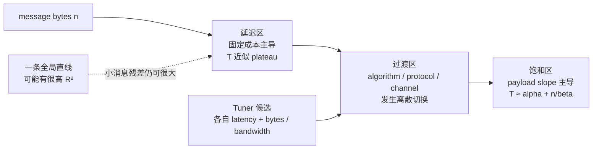

## 一条直线为什么解释不了 1 B 到 1 GiB

通信性能最常见的模型：

$$
T(n) = alpha + n / beta
$$

其中：

- `alpha`：与 payload 无关的固定时间；
- `beta`：稳态有效 payload bandwidth；
- `n`：消息字节数；
- `T`：完成时间。

本机对 1 B 到 1 GiB 的 31 个 AllReduce median 做一条全局直线，得到：

```text
alpha: 27.486 us
beta:  81.209 GB/s
R2:    0.999972
```

看起来几乎完美。

但同一个模型：

```text
MAPE:                    32.87%
maximum relative error:  51.78%
```

R2 很高是因为 1 GiB 的 13,246 us 在平方和中拥有巨大杠杆；模型可以把大消息拟合得很好，同时把几十微秒的小消息预测错一半。

这就是本章的核心：

> 性能模型是否可用，要看目标区间、残差、协议切换和稳定性，不能只看全局 R2。

<div class="diagram-scroll" markdown="1">



</div>

这张图不是把所有消息强行切成三个固定阈值，而是说明为何模型必须按实际执行路径分段。切换点由候选代价、拓扑和 planner 共同决定；本章用 INFO 选择证据与实测残差确定当前机器的区间。

## 本章回答的问题

1. `T=alpha+n/beta` 的单位如何换算？
2. alpha 是真实首字节 latency 吗？
3. NCCL tuner 的 latency/bandwidth table 如何构造？
4. tuner 如何在 Ring/Tree 与 LL/LL128/Simple 间选择？
5. 为什么自动选择不是硬编码 size threshold？
6. 1 B 到 1 GiB 的真实 latency plateau 在哪里？
7. 本机 LL、LL128、Simple 的实际切换点是什么？
8. 什么尺寸开始进入带宽饱和区？
9. tuner predicted time 与 nccl-tests measured time 差多少？
10. 为什么两个点的 LL128 拟合不能称为验证？
11. 如何用 residual 定位模型失配和潜在回归？

## 证据边界

```text
GPU:
4 x Tesla V100-SXM2-32GB

topology:
all GPU pairs NV2

NCCL:
2.22.3
178b6b759074597777ce13438efb0e0ba625e429

nccl-tests:
5bcd45d2ee8365e37895e118c9d11b0ebc15aa69

formal run:
ch10_latency_model/20260710T151843Z
```

实验附件：

- [正式实验脚本](/assets/files/nccl-learning/scripts/34_ch10_latency_bandwidth_model.py)
- [版本与命令清单](/assets/files/nccl-learning/logs/ch10_latency_model/20260710T151843Z/manifest.txt)
- [310 行原始测量](/assets/files/nccl-learning/logs/ch10_latency_model/20260710T151843Z/raw_measurements.csv)
- [逐尺寸结果和残差](/assets/files/nccl-learning/logs/ch10_latency_model/20260710T151843Z/summary.csv)
- [自动选择结果](/assets/files/nccl-learning/logs/ch10_latency_model/20260710T151843Z/selections.csv)
- [模型参数](/assets/files/nccl-learning/logs/ch10_latency_model/20260710T151843Z/model_fits.csv)
- [机器生成的实验摘要](/assets/files/nccl-learning/logs/ch10_latency_model/20260710T151843Z/summary.md)

本章用 int8 扫描，目的是保留真正的 1-byte 点。float 的最小非零 count 是 4 bytes，且 reduction throughput 与 int8 不一定相同；不要把本章的绝对时间直接替换 float 训练基线。

## 模型的单位推导

如果：

```text
n: bytes
T: microseconds
slope: microseconds / byte
beta: decimal GB/s
```

线性回归：

$$
T_us = alpha_us + slope * n_bytes
$$

1 GB/s 等于每微秒 1000 bytes，所以：

$$
beta_GBs = 1 / (1000 * slope)
$$

例如大消息拟合 slope：

```text
slope = 1.22824e-5 us/byte
```

则：

$$
beta = 1 / (1000 * 1.22824e-5)
     = 81.417 GB/s
$$

这里的 beta 是 algorithm payload bandwidth，和第 8 章 nccl-tests 的 algbw 同一分子口径。四 rank AllReduce 的 busbw 还要乘 1.5。

## alpha 不等于所有固定开销

alpha 是指定数据区间上线性回归外推到 n=0 的截距。

它可能包含：

```text
kernel launch
planner/enqueue
protocol startup
channel pipeline fill/drain
stream synchronization
benchmark timer boundary
部分固定 transport/proxy 成本
```

但它不自动包含：

```text
communicator initialization
首个连接建立
buffer allocation
JIT/module loading
训练框架调度
之前 stream 上的排队
```

更重要的是，不同拟合区间有不同 alpha：

| fit | alpha |
|---|---:|
| LL 1 B–512 KiB | 18.184 us |
| Simple 4 MiB–1 GiB | 50.929 us |
| Simple 16 MiB–1 GiB | 50.011 us |
| 全局错误模型 | 27.486 us |

Simple 大消息拟合的 50 us 截距不代表 1-byte latency 是 50 us。真实 1-byte median 是 18.435 us，而且自动路径使用 LL。

因此：

> alpha 是“当前区间、当前执行路径的模型参数”，不是机器的唯一通信延迟常数。

## NCCL 内部也使用 latency + bytes/bandwidth

NCCL 2.22.3 的核心估时入口：

```cpp
ncclResult_t ncclTopoGetAlgoTime(
    struct ncclComm* comm,
    int coll,
    int algorithm,
    int protocol,
    size_t nBytes,
    int numPipeOps,
    float* time,
    bool* backup) {

  float bw = comm->bandwidths[coll][algorithm][protocol];
  float lat = comm->latencies[coll][algorithm][protocol];

  ...

  int latCount =
      algorithm == NCCL_ALGO_RING
      ? numPipeOps
      : DIVUP(numPipeOps, NCCL_MAX_DEV_WORK_BATCH_COLLS);

  *time = lat * latCount + nBytes / (1000 * bw);
  return ncclSuccess;
}
```

带注释版本：

```cpp
// 每个 collective/algorithm/protocol 候选都有模型 bandwidth。
float bw = comm->bandwidths[coll][algo][proto];

// 也有模型 latency，单位 us。
float lat = comm->latencies[coll][algo][proto];

// Ring 与 Tree 对 aggregation/pipelined ops 的 latency 计数不同。
int latCount =
    algo == Ring
    ? numPipeOps
    : ceil(numPipeOps / maxBatchColls);

// nBytes/(1000*bw) 的单位是 us：
// bw GB/s = 1000 bytes/us。
predicted_us = lat * latCount + nBytes / (1000 * bw);
```

这与经验 alpha-beta 形式相似，但不能直接画等号：

| NCCL tuner | 本章经验回归 |
|---|---|
| 输入为 topology/algorithm/protocol 模型表 | 输入为实际 measured median |
| 用于候选相对排序 | 用于描述和审计实测 |
| 有 Tree correction、backup、numPipeOps | 由选择后的混合路径产生 |
| 不覆盖 nccl-tests 全部边界开销 | 报表 time 包含 benchmark completion 边界 |

## 源码一：base latency 与硬件 latency

`tuning.cc` 原始表：

```cpp
// Latencies in us, Bandwidths in GB/s
// Tree { LL, LL128, Simple }, Ring { LL, LL128, Simple }
static const float baseLat
  [NCCL_NUM_ALGORITHMS][NCCL_NUM_PROTOCOLS] = {
  { 6.8, 14.0, 0.0 },  // Tree
  { 6.6, 14.0, 8.4 },  // Ring
  { 0.0,  0.0, 0.0 },  // CollNet Direct
  { 0.0,  0.0, 0.0 },  // CollNet Chain
  { 0.0,  0.0, 0.0 },  // NVLS
  { 0.0,  0.0, 0.0 }   // NVLS Tree
};
```

NVLink hardware latency：

```cpp
static float hwLat[...] = {
  /* NVLINK */
  {
    /* Tree LL/LL128/Simple */ { .6, 1.25, 28 },
    /* Ring LL/LL128/Simple */ { .6, 1.9, 3.4 },
    ...
  },
  ...
};
```

本机是单节点 NVLink，因此 model 会从 NVLink 路径构造候选 latency。它不是拿 `baseLat` 一个数直接当最终 time，还会按算法 step 和 topology 叠加硬件项。

## 源码二：从 graph bandwidth 到 algorithm bandwidth

关键原始代码：

```cpp
float bw =
    nNodes <= 2 || collnet
    ? graphs[a]->bwIntra
    : graphs[a]->bwInter;

float busBw = graphs[a]->nChannels * bw;

if (a == NCCL_ALGO_RING && p == NCCL_PROTO_LL)
  busBw = min(llMaxBw, busBw * .5);

if (a == NCCL_ALGO_RING && p == NCCL_PROTO_LL128)
  busBw = min(
      busBw * (ppn < 2 ? .7 : .92),
      graphs[a]->nChannels * perChMaxRingLL128Bw);

...

float ratio = 1.0f;
if (a == NCCL_ALGO_RING)
  ratio *= (1.0 * nRanks) / nsteps;
else
  ratio *= .5;

busBw *= ratio;
comm->bandwidths[coll][a][p] = busBw;
```

逐层解释：

```text
topology graph:
  per-channel intra/inter bandwidth

乘 nChannels:
  aggregate bus bandwidth

协议修正:
  LL payload efficiency
  LL128 efficiency和per-channel cap
  Tree correction/cap

collective/algorithm ratio:
  bus bandwidth -> algorithm payload bandwidth

最终:
  comm->bandwidths[coll][algo][proto]
```

因此 tuner 的 bw 不是 NVLink 标称线速，也不是刚刚跑 benchmark 在线测出的结果；它是 topology graph 和经验修正构造出的模型值。

## 源码三：候选可用性

每个 candidate 不一定都能进入比较：

```cpp
for (int a=0; a<NCCL_NUM_ALGORITHMS; a++) {
  if (Broadcast && a != RING) continue;
  if (Reduce && a != RING) continue;

  for (int p=0; p<NCCL_NUM_PROTOCOLS; p++) {
    if ((a == NVLS || a == NVLS_TREE) && p != SIMPLE)
      continue;
    ...
  }
}
```

LL128 默认也有硬件条件：

```cpp
// Enable LL128 by default only on
// Volta/Ampere/Hopper + NVLink.
pEnable &= graphs[a]->typeIntra <= PATH_NVB;
pEnable &= minCompCap == maxCompCap;

switch (minCompCap) {
case 70: pEnable &= 1; break;
case 80: pEnable &= 1; break;
case 90: ...; break;
default: pEnable &= 0; break;
}
```

本机同构 V100、NVLink 路径满足 LL128 默认启用条件。

这解释了为什么“候选 time 最小”之前还有“候选是否存在”。算法选择是：

```text
hardware/topology availability
  -> env enable/disable
  -> collective support
  -> candidate time
  -> choose minimum
  -> fallback if needed
```

## 源码四：Tree 不是一条完美直线

源码直接承认 medium-size Tree 偏离简单模型：

```cpp
// Trees are not perfectly sticking to the model for medium sizes.
// Applying a static correction factor is not ideal but works quite well.
// Powers of two, 64 B to 256MB.
static float treeCorrectionFactor
  [NCCL_NUM_PROTOCOLS][23] = {
  { 1.0, 1.0, 1.0, 1.0, .9, .8, ... },
  { 1.0, 1.0, 1.0, 1.0, 1.0, .9, ... },
  { .9, .9, .9, .9, .9, .9, .9, .8, ... }
};

int logSize = log2i(nBytes >> 6);
if (algorithm == NCCL_ALGO_TREE &&
    logSize >= 0 && logSize < 23)
  bw *= treeCorrectionFactor[protocol][logSize];
```

这给出一个重要认知：

> NCCL 的 tuning model 本身就是分段、带修正的工程模型，不是纯理论公式。

把 `lat+n/bw` 当作骨架是正确的；认为一条不变直线能覆盖所有算法、协议、size 和 topology 是错误的。

## 源码五：选择最小候选

`enqueue.cc` 先填 cost table：

```cpp
for (int a=0; a<NCCL_NUM_ALGORITHMS; a++) {
  for (int p=0; p<NCCL_NUM_PROTOCOLS; p++) {
    bool backup;
    float time;
    ncclTopoGetAlgoTime(
        comm, info->func, a, p, nBytes,
        numPipeOps, &time, &backup);

    if (!backup)
      table[a][p] = time;
    else if (time >= 0.0 && time < *backupTime) {
      *backupAlgo = a;
      *backupProto = p;
      *backupTime = time;
    }
  }
}
```

再做最小值搜索：

```cpp
float minTime = 3600000000.0;
int algorithm = NCCL_ALGO_UNDEF;
int protocol = NCCL_PROTO_UNDEF;

for (int a=0; a<NCCL_NUM_ALGORITHMS; a++) {
  for (int p=0; p<NCCL_NUM_PROTOCOLS; p++) {
    if (table[a][p] == NCCL_ALGO_PROTO_IGNORE)
      continue;

    if (table[a][p] >= 0.0 && table[a][p] < minTime) {
      algorithm = a;
      protocol = p;
      minTime = table[a][p];
    }
  }
}
```

最后打印：

```cpp
INFO(
    NCCL_TUNING,
    "%ld Bytes -> Algo %d proto %d time %f",
    nBytes, algorithm, protocol, minTime);
```

所以切换点来自候选曲线交叉，而不是：

```cpp
if (bytes < 1MiB) use LL;
else if (bytes < 4MiB) use LL128;
else use Simple;
```

当前机器恰好出现这些边界，不代表其他 GPU、channel 或拓扑也相同。

## 选择后还会调整 channel 与 thread

算法/协议确定后：

```cpp
int nc = comm->nChannels;
int nt = comm->maxThreads[algorithm][protocol];
int threshold = comm->threadThresholds[algorithm][protocol];

while (nBytes < nc * nt * threshold) {
  if (nc >= 2) nc--;
  else break;
}

while (nBytes < nc * nt * threshold) {
  if (nt % 128 == 0) nt /= 2;
  else break;
}

info->nMaxChannels = nc;
info->nWarps = nt/WARP_SIZE;
```

这意味着同一个 Ring+LL 标签内部，channel/thread 资源也会随 size 改变。即使 protocol 不切换，局部 slope 和 residual 仍可能变化。

## 实验假设

### H1

1 B 到小消息区形成近似固定 latency plateau，algbw 随 size 增大但 time 基本不变。

### H2

自动选择会出现 LL -> LL128 -> Simple，切换点由 TUNING trace 直接证明。

### H3

全局线性模型会得到高 R2，但小消息相对误差很大。

### H4

按自动 protocol 分段后，LL 和 Simple 模型的 MAPE 明显降低。

### H5

大消息 Simple 区接近线性，拟合 beta 接近 1 GiB 点的 algbw。

### H6

tuner 在大消息区预测较准，在小消息区会系统性低于 nccl-tests measured completion time。

## 实验矩阵

```text
collective:       AllReduce SUM
datatype:         int8
world size:       4
message sizes:    1 B -> 1 GiB
step factor:      2
size groups:      31
warmup:           5
iterations:       30
cycles:           10
instrumentation:  I0
blocking:         z0
report cputime:   C0
CPU affinity:     0,2,4,6 on NUMA0
correctness:      out-of-place + in-place
```

主性能命令：

```bash
taskset -c 0,2,4,6 ./build/all_reduce_perf \
  -b 1 -e 1G -f 2 \
  -g 4 \
  -d int8 -o sum \
  -w 5 -n 30 -N 10 \
  -c 1 -I 0 \
  -z 0 -C 0 -a 3
```

独立 TUNING trace：

```bash
NCCL_DEBUG=INFO \
NCCL_DEBUG_SUBSYS=TUNING \
taskset -c 0,2,4,6 ./build/all_reduce_perf \
  -b 1 -e 1G -f 2 \
  -g 4 -d int8 -o sum \
  -w 0 -n 1 -N 1 \
  -c 0 -I 0 -z 0 -C 0 -a 3
```

性能与 TUNING 分开运行有两个原因：

1. INFO 日志会与 nccl-tests 表格交错，污染主性能解析；
2. TUNING 只需证明选择和预测，不需要 10 cycle。

## 解析与断言

性能 parser 要求：

```python
expected_sizes = 31
expected_rows = expected_sizes * cycles

if len(rows) != expected_rows:
    raise RuntimeError(...)

if any(
    row["wrong"] != 0 or
    row["in_place_wrong"] != 0
    for row in rows
):
    raise RuntimeError("correctness failed")
```

TUNING parser 对每个 size 收集所有重复选择：

```python
candidates[size_bytes].add(
    (algorithm, protocol, predicted_us)
)

if len(candidates) != 31:
    raise RuntimeError(...)

for size, choices in candidates.items():
    if len(choices) != 1:
        raise RuntimeError(
            f"inconsistent choices: {choices}"
        )
```

同一 size 会因 priming、out-of-place、in-place 多次打印 TUNING 记录；脚本要求所有重复记录的 algorithm/protocol/time 完全一致。

## 线性回归实现

对于点集 ((x_i,y_i))：

```python
x_mean = statistics.fmean(xs)
y_mean = statistics.fmean(ys)

slope = sum(
    (x - x_mean) * (y - y_mean)
    for x, y in points
) / sum(
    (x - x_mean) ** 2
    for x in xs
)

intercept = y_mean - slope * x_mean
beta_GBs = 1.0 / (slope * 1e3)
```

同时计算：

```python
R2
MAPE
maximum absolute relative error
per-point residual
```

MAPE：

$$
MAPE = mean(abs(predicted / measured - 1)) * 100%
$$

residual 定义：

$$
residual_us = measured_us - predicted_us
$$

正 residual 表示模型过于乐观；负 residual 表示模型预测比实测更慢。

## 正确性与稳定性

```text
performance rows:       310
out-of-place wrong:     all zero
in-place wrong:         all zero
stable size groups:     24 / 31
CV > 5% groups:         7 / 31
```

不稳定的七个 size：

| bytes | median us | P95 us | CV |
|---:|---:|---:|---:|
| 128 | 18.110 | 31.925 | 36.12% |
| 4 KiB | 18.845 | 27.651 | 23.75% |
| 8 KiB | 18.370 | 27.343 | 23.11% |
| 16 KiB | 18.305 | 26.983 | 23.19% |
| 32 KiB | 19.010 | 31.525 | 24.07% |
| 64 KiB | 19.640 | 28.465 | 21.70% |
| 128 KiB | 20.595 | 30.901 | 24.79% |

这些点的 median 仍可用于观察整体曲线，但不能用于声称两个相邻小点的精确差异。

1 B–64 B 的 CV 为 2.37%-4.71%，262 KiB 以后除协议切换点外也普遍稳定。

## 自动选择区间

TUNING trace 的 31 个 size 全部选择 Ring，协议分段：

| bytes | algorithm | protocol | points |
|---|---|---|---:|
| 1 B–512 KiB | Ring | LL | 20 |
| 1 MiB–2 MiB | Ring | LL128 | 2 |
| 4 MiB–1 GiB | Ring | Simple | 9 |

切换点：

```text
1,048,576 bytes:
  Ring+LL -> Ring+LL128

4,194,304 bytes:
  Ring+LL128 -> Ring+Simple
```

这验证 H2。

为什么没有 Tree：

- 当前四卡全 NV2 topology；
- 当前 TUNING table 中 Ring 候选在所有 size 的 predicted time 更小；
- 这不是“Tree 不支持 AllReduce”；
- 第 13 章会强制 Ring/Tree 并重建候选交叉。

## 31 点实测曲线

| bytes | median us | P95 us | CV | algbw GB/s | selection |
|---:|---:|---:|---:|---:|---|
| 1 | 18.435 | 19.763 | 4.71% | 0.00 | Ring+LL |
| 2 | 18.315 | 19.012 | 3.78% | 0.00 | Ring+LL |
| 4 | 18.410 | 19.810 | 4.27% | 0.00 | Ring+LL |
| 8 | 18.465 | 18.765 | 3.29% | 0.00 | Ring+LL |
| 16 | 18.400 | 19.301 | 3.07% | 0.00 | Ring+LL |
| 32 | 18.285 | 19.105 | 2.37% | 0.00 | Ring+LL |
| 64 | 18.385 | 18.892 | 2.41% | 0.00 | Ring+LL |
| 128 | 18.110 | 31.925 | 36.12% | 0.01 | Ring+LL |
| 256 | 18.215 | 19.035 | 2.85% | 0.01 | Ring+LL |
| 512 | 18.350 | 18.975 | 2.60% | 0.03 | Ring+LL |
| 1 KiB | 18.330 | 19.336 | 2.55% | 0.06 | Ring+LL |
| 2 KiB | 18.490 | 19.314 | 2.30% | 0.11 | Ring+LL |
| 4 KiB | 18.845 | 27.651 | 23.75% | 0.22 | Ring+LL |
| 8 KiB | 18.370 | 27.343 | 23.11% | 0.45 | Ring+LL |
| 16 KiB | 18.305 | 26.983 | 23.19% | 0.90 | Ring+LL |
| 32 KiB | 19.010 | 31.525 | 24.07% | 1.72 | Ring+LL |
| 64 KiB | 19.640 | 28.465 | 21.70% | 3.33 | Ring+LL |
| 128 KiB | 20.595 | 30.901 | 24.79% | 6.37 | Ring+LL |
| 256 KiB | 23.390 | 24.389 | 1.92% | 11.21 | Ring+LL |
| 512 KiB | 33.515 | 35.008 | 2.03% | 15.64 | Ring+LL |
| 1 MiB | 49.620 | 51.313 | 1.68% | 21.13 | Ring+LL128 |
| 2 MiB | 73.985 | 76.617 | 1.80% | 28.35 | Ring+LL128 |
| 4 MiB | 105.105 | 107.268 | 1.04% | 39.91 | Ring+Simple |
| 8 MiB | 155.030 | 157.361 | 0.79% | 54.11 | Ring+Simple |
| 16 MiB | 269.645 | 272.896 | 0.62% | 62.22 | Ring+Simple |
| 32 MiB | 469.645 | 473.039 | 0.36% | 71.44 | Ring+Simple |
| 64 MiB | 865.005 | 869.207 | 0.25% | 77.58 | Ring+Simple |
| 128 MiB | 1692.910 | 1694.500 | 0.04% | 79.28 | Ring+Simple |
| 256 MiB | 3347.170 | 3349.381 | 0.04% | 80.19 | Ring+Simple |
| 512 MiB | 6629.795 | 6633.874 | 0.03% | 80.97 | Ring+Simple |
| 1 GiB | 13246.050 | 13261.500 | 0.06% | 81.06 | Ring+Simple |

## 延迟区

1 B 到 2 KiB 的 median 基本在：

```text
18.1 us – 18.5 us
```

消息放大 2048 倍，time 几乎不变，algbw 从接近 0 上升到 0.11 GB/s。

这个区间：

$$
n / beta << alpha
$$

优化重点不是链路带宽，而是：

```text
collective fusion
larger DDP buckets
fewer synchronization points
CUDA Graph / launch reduction
better overlap and scheduling
```

“小消息 busbw 低”只是分母太小，不表示 NVLink 故障。

## 过渡区

从 256 KiB 开始 time 明显离开 plateau：

```text
256 KiB:  23.390 us, LL
512 KiB:  33.515 us, LL
1 MiB:    49.620 us, LL128
2 MiB:    73.985 us, LL128
4 MiB:   105.105 us, Simple
8 MiB:   155.030 us, Simple
16 MiB:  269.645 us, Simple
```

这个区间同时发生：

- payload term 变得可见；
- LL -> LL128 -> Simple；
- channel/thread 数可能调整；
- pipeline fill/drain 相对占比变化；
- Simple 尚未达到稳态大消息 bandwidth。

它最不适合用一条全局 slope 粗暴解释。

## 饱和区

脚本定义一个可复算标准：

> 从某个 size 起，该点和所有更大点的 algbw 都不低于全曲线最大 algbw 的 80%。

本次最大 algbw：

```text
81.06 GB/s at 1 GiB
80% threshold = 64.85 GB/s
```

第一个满足“此后全部高于阈值”的点是：

```text
32 MiB
71.44 GB/s
```

因此本章把 32 MiB 作为经验饱和区入口，而不是宣称 16 MiB 是绝对边界。

## 模型一：错误的全局直线

31 点全局拟合：

```text
range:       1 B – 1 GiB
points:      31
alpha:       27.486 us
beta:        81.209 GB/s
R2:          0.999972
MAPE:        32.87%
max error:   51.78%
```

对 128 B：

```text
measured:    18.110 us
predicted:   27.487 us
relative:    +51.78%
```

模型的 beta 看起来正确，因为大消息支配 slope；alpha 则被迫在不同协议区间之间折中，导致 latency 区失败。

H3 得到直接验证。

## 模型二：Ring+LL 分段

1 B–512 KiB 的 20 点：

```text
alpha:       18.184 us
beta:        37.216 GB/s
R2:          0.969511
MAPE:         1.73%
max error:    7.86%
```

相比全局 MAPE 32.87%，分协议后降到 1.73%。

LL 的 beta 只有 37.2 GB/s，符合协议为低延迟牺牲 payload efficiency 的预期；但该值来自 512 KiB 以下的 slope，不等于大消息稳态带宽。

最大误差在 256 KiB 附近，说明即使 protocol 标签没变，channel/thread/pipeline 也会让单一 LL 直线存在局部失配。

## 模型三：LL128 的两点陷阱

LL128 只有：

```text
1 MiB: 49.620 us
2 MiB: 73.985 us
```

两点拟合必然得到：

```text
R2:        1.0
MAPE:      0
max error: 0
```

这不是模型验证，只是“任意两个 x 不同的点都能定义一条直线”。

所以本章只记录：

```text
alpha from two points: 25.255 us
beta from two points:  43.036 GB/s
```

不将其当作稳健 LL128 参数。第 14 章会强制 LL128，在更多 size 上独立扫描。

## 模型四：Ring+Simple

4 MiB–1 GiB 九点：

```text
alpha:       50.929 us
beta:        81.426 GB/s
R2:          0.999996
MAPE:         1.24%
max error:    4.70%
```

只取 16 MiB–1 GiB：

```text
alpha:       50.011 us
beta:        81.417 GB/s
R2:          0.999995
MAPE:         1.19%
max error:    5.03%
```

两个 beta 几乎相同，说明大消息 slope 稳定。1 GiB 实际 algbw 81.06 GB/s，也与拟合 beta 81.42 接近。

H5 成立。

但 16 MiB 的相对误差仍约 5%，说明它处于 Simple 的早期爬升；32 MiB 以后才满足本章 80% saturation criterion。

## Tuner 预测与实测

代表点：

| size | selection | tuner us | measured us | tuner error |
|---:|---|---:|---:|---:|
| 1 B | Ring+LL | 10.200 | 18.435 | -44.67% |
| 1 KiB | Ring+LL | 10.239 | 18.330 | -44.14% |
| 256 KiB | Ring+LL | 20.282 | 23.390 | -13.29% |
| 512 KiB | Ring+LL | 30.365 | 33.515 | -9.40% |
| 1 MiB | Ring+LL128 | 39.647 | 49.620 | -20.10% |
| 2 MiB | Ring+LL128 | 53.894 | 73.985 | -27.16% |
| 4 MiB | Ring+Simple | 81.229 | 105.105 | -22.72% |
| 16 MiB | Ring+Simple | 238.515 | 269.645 | -11.54% |
| 64 MiB | Ring+Simple | 867.661 | 865.005 | +0.31% |
| 256 MiB | Ring+Simple | 3384.243 | 3347.170 | +1.11% |
| 1 GiB | Ring+Simple | 13450.572 | 13246.050 | +1.54% |

小消息 tuner 系统性偏乐观，原因可能包括：

- model 主要为候选排序，不承诺拟合 nccl-tests wall completion；
- benchmark 的 enqueue/completion/timer 固定边界；
- 实际 channel/thread/launch overhead；
- 模型表与当前运行环境的经验误差。

64 MiB 以后误差缩到约 0.3%-1.7%，说明 model 对大消息 slope 和 bandwidth 很准确。

H6 成立。

重要边界：

> tuner 预测绝对值不准，不等于选择错误。

选择只要求正确比较候选的相对成本。要证明选择错误，需要强制其他候选并实测，而不是只比较 predicted 与 measured。

## residual 应该怎样读

按 size 画 residual，可以识别：

```text
随机散点:
  measurement noise

连续正 residual:
  model too optimistic
  hidden fixed cost / contention

随 bytes 线性增长:
  bandwidth estimate too high

某个阈值后跳变:
  protocol/algorithm/channel transition

只有单个尖峰:
  outlier / OS scheduling / clock event
```

回归诊断比只看 busbw 更强：

```text
baseline model residual pattern
vs
new version residual pattern
```

如果所有大消息 residual 随 bytes 扩大，优先怀疑 bandwidth/transport；如果只有固定抬升，优先怀疑 launch/planner/synchronization。

## 为什么不能只测 64 MiB

64 MiB 本次结果：

```text
865.005 us
77.58 GB/s algbw
Ring+Simple
tuner error +0.31%
CV 0.25%
```

它是优秀的大消息基线，但完全看不到：

- 18.4 us latency floor；
- 4–128 KiB 的长尾区；
- 1 MiB LL128 切换；
- 4 MiB Simple 切换；
- 32 MiB 饱和入口；
- per-iteration 固定开销；
- 小消息 tuner -44% 绝对误差。

训练 bucket、tensor parallel collective 和 expert token exchange 覆盖不同 size；一个点不能代表 workload 分布。

## 工程建模流程

1. 先固定版本、拓扑、datatype、world size 和计时边界；
2. 从最小有效字节到最大业务消息做对数扫描；
3. 每点至少 10 cycle，并保留 correctness；
4. 标出 CV 超阈值的点；
5. 从 TUNING/trace 获取真实 algorithm/protocol；
6. 先画 time-vs-bytes 和 algbw-vs-bytes；
7. 找 latency plateau、过渡区和 saturation criterion；
8. 按执行路径分段拟合；
9. 同时报告 R2、MAPE、max error 和 residual；
10. 对只有两个点的 segment 拒绝“验证完成”；
11. 将模型预测与实测分开保存；
12. 用新版本 residual pattern 做回归归因。

## 常见错误

### 错误一：R2 接近 1，模型就适用于所有 size

反证：全局 R2=0.999972，但 MAPE=32.87%、最大误差=51.78%。

### 错误二：大消息 alpha 就是小消息 latency

反证：Simple 大消息 alpha 约 50 us，真实 1-byte LL median 约 18.4 us。

### 错误三：自动切换是固定 size if/else

反证：源码先构造候选 cost table，再选最小 time；size 只是公式输入之一。

### 错误四：tuner time 必须等于 nccl-tests time

反证：1 B tuner 比实测低 44.67%，但大消息选择和实测曲线都合理。

### 错误五：LL128 R2=1，模型已经完美验证

反证：该 segment 只有两个点，两点直线的 R2 必然为 1。

### 错误六：协议相同就一定是一条直线

反证：同一协议内 channel/thread 会随 size 调整，LL 在 256 KiB 附近仍有最大 7.86% 分段误差。

### 错误七：algbw 达到峰值的 80% 是通用饱和定义

反证：80% 是本章预先声明的工程 criterion；不同 SLO 可以选 90% 或 slope/residual 标准，但必须明确。

## 验收题

### 题一

为什么 slope 为 `1.25e-5 us/byte` 时 beta 约 80 GB/s？

$$
beta = 1 / (1000 * 1.25e-5) = 80 GB/s
$$

### 题二

全局 R2 很高但 MAPE 很高，说明什么？

大消息的绝对时间支配了平方和；模型捕获了总体 slope，却没有正确描述小消息相对误差。

### 题三

为什么 alpha 可能随 protocol 改变？

不同 protocol 有不同 launch、同步、pipeline 和模型 base/hardware latency，不能共用唯一固定成本。

### 题四

怎样证明当前 1 MiB 使用 LL128？

读取匹配版本 TUNING 记录：`1048576 Bytes -> Algo 1 proto 1`，并用枚举映射证明 Algo1=Ring、proto1=LL128。

### 题五

tuner 在 1 B 预测错 44%，能否直接说 tuner 选错？

不能。绝对时间模型偏差与候选相对排序是两个问题；需要强制其他候选实测才能判定选择错误。

### 题六

为什么 32 MiB 被称为本章饱和入口？

它是第一个满足“本点及所有更大点 algbw 均不低于全曲线峰值 80%”的 size。

## 本章结论

1. `T=alpha+n/beta` 只在固定执行路径和指定区间内有意义。
2. alpha 是回归截距，不是 communicator cold-start，也不是机器唯一 latency 常数。
3. NCCL 2.22.3 用 topology-derived latency/bandwidth、correction 和 availability 构造候选 time。
4. enqueue 层选择 cost table 中最小的 algorithm/protocol，再按 size 调整 channel/thread。
5. 310 行 out-of-place 结果和对应 in-place correctness 全部通过。
6. 24/31 个 size 的 CV≤5%；128 B 与 4–128 KiB 七个点被标记为不稳定。
7. 自动路径为 Ring+LL 1 B–512 KiB、Ring+LL128 1–2 MiB、Ring+Simple 4 MiB–1 GiB。
8. 1 B–2 KiB 形成约 18.1–18.5 us latency plateau。
9. 按 80% peak algbw criterion，32 MiB 是本章经验饱和入口。
10. 全局模型 R2=0.999972，但 MAPE=32.87%、最大误差=51.78%，不能用于全区间预测。
11. LL 分段 alpha=18.184 us、beta=37.216 GB/s、MAPE=1.73%。
12. LL128 只有两个点，R2=1 不构成模型验证。
13. Simple 4 MiB–1 GiB beta=81.426 GB/s、MAPE=1.24%。
14. 16 MiB–1 GiB 大消息 beta=81.417 GB/s，与 1 GiB 实测 algbw 81.06 接近。
15. tuner 小消息绝对时间偏乐观约 44%，64 MiB 以后与实测误差收敛到约 0.3%-1.7%。
16. 选择正确性必须通过强制候选实验验证，不能仅由 predicted-vs-measured 误差判断。

下一章把模型用于故障归因：分别限制 channel、禁用 P2P、注入 CPU 争用和改变 NUMA 绑定，提取 latency、bandwidth、tail 和 transport 日志的分层指纹。
