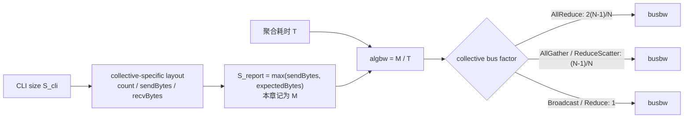

## 122 GB/s 到底是什么

在四张 V100 上运行 `all_reduce_perf`，经常会看到类似结果：

```text
size       time       algbw       busbw
256 MiB    3290 us    81.59 GB/s  122.38 GB/s
```

但第 2 章实测单个 GPU pair 的单向 P2P 吞吐约为 48.3 GB/s。

如果把 122.38 GB/s 当成“一条 NVLink 的实测速率”，马上会得到矛盾。真正的解释是：

> `busbw` 是 nccl-tests 根据 collective 的逻辑 payload、rank 数和理想通信量系数计算出的归一化指标，不是 NVLink、PCIe 或 NIC 的硬件计数器。

要正确使用这个数字，必须回答五个问题：

1. 报表中的 `size` 是命令行请求值、send buffer，还是 recv buffer？
2. `algbw` 的分子对不同 collective 是否相同？
3. `busbw` 的系数从哪里来？
4. 3 rank 时为什么请求 64 MiB，报表却是 67,108,848 bytes？
5. world size 增大后 busbw 上升，能否直接解释为扩展效率提高？

本章不背公式，而是从 nccl-tests 2.19.5 的固定源码逐层推导，再用 360 行正式测量独立复算。

## 本章证据边界

源码版本：

```text
nccl-tests commit:
5bcd45d2ee8365e37895e118c9d11b0ebc15aa69

NCCL runtime/source:
2.22.3
v2.22.3-1 @ 178b6b759074597777ce13438efb0e0ba625e429
```

正式实验：

```text
run:
ch08_busbw/20260710T082109Z

GPU:
4 x Tesla V100-SXM2-32GB

topology:
all GPU pairs are NV2
```

本章讨论 nccl-tests 这个版本的报表语义。未来版本若修改 `GetBw`、AllToAll API 或字节布局，必须重新阅读对应 commit，不能把本文公式当成永久 ABI。

实验附件：

- [实验脚本](/assets/files/nccl-learning/scripts/32_ch08_busbw_matrix.py)
- [正式运行清单](/assets/files/nccl-learning/logs/ch08_busbw/20260710T082109Z/manifest.txt)
- [360 行原始测量 CSV](/assets/files/nccl-learning/logs/ch08_busbw/20260710T082109Z/raw_measurements.csv)
- [聚合结果 CSV](/assets/files/nccl-learning/logs/ch08_busbw/20260710T082109Z/summary.csv)
- [机器生成的实验摘要](/assets/files/nccl-learning/logs/ch08_busbw/20260710T082109Z/summary.md)

## 先区分四种“字节数”

讨论性能前，先固定符号：

| 符号 | 含义 |
|---|---|
| `S_cli` | `-b/-e` 请求的 size |
| `C_param` | 真正传给 NCCL API 的 count |
| `B_send` | 每个 rank 的 send buffer 有效字节 |
| `B_recv` | 每个 rank 的 recv/expected buffer 有效字节 |
| `S_report` | nccl-tests 第一列打印的 size |
| `M` | 本章公式采用的逻辑 payload，即 `S_report` |
| `T` | nccl-tests 聚合后的单次耗时，单位秒 |

这些值对 AllReduce 恰好相同，很容易让人误以为所有 collective 都如此。

例如 AllGather：

```text
每个 rank 输入: M / N
每个 rank 输出: M
NCCL sendcount: (M / N) / typesize
报表 size: max(sendBytes, expectedBytes) = M
```

ReduceScatter 正好相反：

```text
每个 rank 输入: M
每个 rank 输出: M / N
NCCL recvcount: (M / N) / typesize
报表 size: max(sendBytes, expectedBytes) = M
```

因此“第一列 size 除以时间”能统一得到本版本报表的 `algbw`，不是因为 NCCL API 的 count 都一样，而是 nccl-tests 先经过 collective-specific layout，再选择较大的逻辑 buffer 作为打印口径。

<div class="diagram-scroll diagram-scroll--wide" markdown="1">



</div>

这是一条“报表口径换算链”，不是物理链路流量追踪。`busbw` 用 collective-specific factor 把不同算子归一化，不能据此断言某一条 NVLink 或 NIC 实际传输了同样多的字节。

## 调用链总览

```text
CLI requested size
  |
  v
TimeTest
  |
  +-- setupArgs(size, type)
  |     |
  |     +-- count = size / wordSize(type)
  |     +-- collTest->getCollByteCount(...)
  |     +-- nbytes / sendBytes / expectedBytes
  |
  +-- print max(sendBytes, expectedBytes)
  |
  +-- BenchTime(...)
        |
        +-- enqueue iters * agg_iters
        +-- completeColl
        +-- normalize deltaSec
        +-- process-level Allreduce(deltaSec)
        +-- collTest->getBw(paramCount, typesize, deltaSec, N)
```

这条链里有两次 collective-specific dispatch：

1. `getCollByteCount` 决定 buffer layout 和 API 参数 count；
2. `getBw` 决定如何从 count、时间和 rank 数计算 algbw/busbw。

只看 `AllReduceGetBw` 而不看 `setupArgs`，无法解释 AllGather、ReduceScatter 和 AllToAll 的分子。

## 源码一：size 如何变成报表列

以下是 `src/common.cu` 的原始代码：

```cpp
void setupArgs(size_t size, ncclDataType_t type, struct threadArgs* args) {
  int nranks = args->nProcs*args->nGpus*args->nThreads;
  size_t count, sendCount, recvCount, paramCount;
  size_t sendInplaceOffset, recvInplaceOffset;

  count = size / wordSize(type);
  args->collTest->getCollByteCount(
      &sendCount, &recvCount, &paramCount,
      &sendInplaceOffset, &recvInplaceOffset,
      count, wordSize(type), nranks);

  args->nbytes = paramCount * wordSize(type);
  args->sendBytes = sendCount * wordSize(type);
  args->expectedBytes = recvCount * wordSize(type);
  args->sendInplaceOffset = sendInplaceOffset * wordSize(type);
  args->recvInplaceOffset = recvInplaceOffset * wordSize(type);
}
```

逐行解释：

```cpp
// 全局 rank 数，不只是当前进程内 GPU 数。
int nranks = nProcs * nGpus * nThreads;

// CLI size 先按 datatype 截断为元素数。
// 本章固定 float，因此 wordSize(type) == 4。
count = size / wordSize(type);

// 每种 collective 自己决定：
// - send buffer 有多少元素
// - recv buffer 有多少元素
// - NCCL API 的 count 参数是多少
// - in-place 指针应偏移多少元素
getCollByteCount(...);

// nbytes 是 API paramCount 对应的字节数；
// 它不一定等于完整 send/recv buffer 的字节数。
args->nbytes = paramCount * wordSize(type);

args->sendBytes = sendCount * wordSize(type);
args->expectedBytes = recvCount * wordSize(type);
```

`TimeTest` 中的原始打印逻辑：

```cpp
for (size_t size = args->minbytes; size <= args->maxbytes; ...) {
  setupArgs(size, type, args);
  writeBenchmarkLinePreamble(
      max(args->sendBytes, args->expectedBytes),
      args->nbytes / wordSize(type),
      typeName, opName, root);
  TESTCHECK(BenchTime(args, type, op, root, 0));
  TESTCHECK(BenchTime(args, type, op, root, 1));
}
```

这段直接证明：

```text
S_report = max(B_send, B_recv)
count column = C_param
```

所以本章独立复算使用每一行实际打印的 `S_report`，绝不拿 CLI 请求值覆盖它。

## 源码二：耗时如何进入 GetBw

`BenchTime` 的关键原始代码：

```cpp
double cputimeSec = blocking_coll == 3 ? collOnlySec : tim.elapsed();
cputimeSec /= iters*agg_iters;
TESTCHECK(completeColl(args));

double deltaSec =
    (blocking_coll == 3 ? collOnlySec : tim.elapsed())/(iters*agg_iters);
if (cudaGraphLaunches >= 1)
  deltaSec = deltaSec/cudaGraphLaunches;

Allreduce(args, &deltaSec, average);

double algBw, busBw;
args->collTest->getBw(
    count, wordSize(type), deltaSec,
    &algBw, &busBw,
    args->nProcs*args->nThreads*args->nGpus);
```

带注释的执行语义：

```cpp
// 先完成当前 benchmark 的通信。
completeColl(args);

// 总时间除以 iters * agg_iters，得到“单次 collective”时间。
double deltaSec = elapsed / (iters * agg_iters);

// 多进程场景再聚合时间；具体 average/max 由运行参数决定。
// 性能结论要知道取的是平均 rank 还是 critical rank。
Allreduce(args, &deltaSec, average);

// 最终不是 common.cu 统一套公式，
// 而是跳转到当前 collective 的 GetBw。
collTest->getBw(
    paramCount,
    datatypeBytes,
    deltaSec,
    &algbw,
    &busbw,
    nranks);
```

这里还有一个容易误读的边界：`algbw` 和 `busbw` 都由 host 代码事后计算；这段路径没有读取 NVLink counter、PCIe counter 或 NIC port counter。

## algbw 的单位

nccl-tests 使用 `1.0E9`：

$$
\text{algbw} =
\frac{\text{bytes}}{10^9 \cdot T}
$$

+单位是十进制 GB/s，不是 GiB/s。

```text
1 GB = 1,000,000,000 bytes
1 GiB = 1,073,741,824 bytes
```

输入参数 `64M` 在 nccl-tests 中表示 64 MiB，即 67,108,864 bytes；但除法分母仍是十进制 `1e9`。如果用 GiB/s 重算，数字会相差约 7.37%。

## AllReduce：系数 2(N-1)/N

原始源码：

```cpp
void AllReduceGetBw(
    size_t count, size_t typesize, double sec,
    double* algBw, double* busBw, int nranks) {
  double baseBw = (double)(count * typesize) / 1.0E9 / sec;

  *algBw = baseBw;
  double factor =
      ((double)(2*(nranks - 1)))/((double)nranks);
  *busBw = baseBw * factor;
}
```

带注释版本：

```cpp
// AllReduce 的 API count 覆盖完整输入 M。
double baseBw = M / 1e9 / T;
*algBw = baseBw;

// Ring 模型：
// ReduceScatter 发送 (N-1)/N * M；
// AllGather    发送 (N-1)/N * M；
// 合计         2(N-1)/N * M。
double factor = 2.0 * (N - 1) / N;

*busBw = algBw * factor;
```

于是：

$$
\text{algbw}_{AR} = \frac{M}{10^9T}
$$

$$
\text{busbw}_{AR}
=
\frac{M}{10^9T}\cdot\frac{2(N-1)}{N}
$$

不同 world size 的系数：

| N | AllReduce factor |
|---:|---:|
| 2 | 1.000000 |
| 3 | 1.333333 |
| 4 | 1.500000 |

注意：这是 Ring 理想每-rank 字节模型形成的归一化口径。即使实际选择 Tree，nccl-tests 仍按这个公式报告 busbw；busbw 不是“算法识别器”。

## AllGather：输入小、输出大

原始 layout 源码：

```cpp
void AllGatherGetCollByteCount(
    size_t *sendcount, size_t *recvcount, size_t *paramcount,
    size_t *sendInplaceOffset, size_t *recvInplaceOffset,
    size_t count, size_t eltSize, int nranks) {
  size_t base = (count/nranks) & ~(16/eltSize - 1);
  *sendcount = base;
  *recvcount = base*nranks;
  *sendInplaceOffset = base;
  *recvInplaceOffset = 0;
  *paramcount = base;
}
```

带注释版本：

```cpp
// 先把 CLI 元素数除以 N，再向下对齐到 16-byte 边界。
size_t base = (count / N) & ~(16 / eltSize - 1);

// 每个 rank 发送一份 base。
sendcount = base;

// 每个 rank 收到 N 份，完整 recv buffer 是 base*N。
recvcount = base * N;

// ncclAllGather 的 sendcount 参数仍是 base。
paramcount = base;
```

带宽原始源码：

```cpp
double baseBw =
    (double)(count * typesize * nranks) / 1.0E9 / sec;
*algBw = baseBw;
double factor = ((double)(nranks - 1))/((double)nranks);
*busBw = baseBw * factor;
```

传入 `GetBw` 的 `count` 是 `base`，因此：

$$
M = base \cdot typesize \cdot N
$$

$$
\text{algbw}_{AG} = \frac{M}{10^9T}
$$

$$
\text{busbw}_{AG}
=
\text{algbw}\cdot\frac{N-1}{N}
$$

每个 rank 初始已有自己的 (M/N)，只需接收其余 (N-1) 份，因此理想新增通信量是 ((N-1)M/N)。

## ReduceScatter：输入大、输出小

原始 layout：

```cpp
size_t base = (count/nranks) & ~(16/eltSize - 1);
*sendcount = base*nranks;
*recvcount = base;
*sendInplaceOffset = 0;
*recvInplaceOffset = base;
*paramcount = base;
```

带注释版本：

```cpp
// base 是每个 rank 最终收到的 shard 元素数。
size_t base = align_down(cliCount / N, 16 / eltSize);

// 输入包含 N 个 shard。
sendcount = base * N;

// 输出只包含本 rank shard。
recvcount = base;

// ncclReduceScatter API 的 count 参数是 recvcount。
paramcount = base;
```

`GetBw` 与 AllGather 同形：

```cpp
double baseBw =
    (double)(count * typesize * nranks) / 1.0E9 / sec;
*algBw = baseBw;
double factor = ((double)(nranks - 1))/((double)nranks);
*busBw = baseBw * factor;
```

这里乘 `nranks` 是把 API 的 `recvcount` 恢复成完整输入 payload (M)。

$$
\text{algbw}_{RS} = \frac{M}{10^9T}
$$

$$
\text{busbw}_{RS}
=
\text{algbw}\cdot\frac{N-1}{N}
$$

这与第 7 章的分解一致：

$$
\text{factor}_{RS}+\text{factor}_{AG}
=
\frac{2(N-1)}{N}
=
\text{factor}_{AR}
$$

## Broadcast 与 Reduce：factor = 1

Broadcast 原始源码：

```cpp
void BroadcastGetBw(
    size_t count, size_t typesize, double sec,
    double* algBw, double* busBw, int nranks) {
  double baseBw = (double)(count * typesize) / 1.0E9 / sec;
  *algBw = baseBw;
  double factor = 1;
  *busBw = baseBw * factor;
}
```

Reduce 的实现更直接：

```cpp
void ReduceGetBw(
    size_t count, size_t typesize, double sec,
    double* algBw, double* busBw, int nranks) {
  double baseBw = (double)(count * typesize) / 1.0E9 / sec;
  *algBw = baseBw;
  *busBw = baseBw;
}
```

两者都报告：

$$
algbw = busbw = M / (10^9 T)
$$

这里的 factor=1 是 nccl-tests 约定，不代表：

- 每个 rank 都发送了恰好 M；
- 所有物理链路上的总字节恰好是 M；
- Tree 与 Ring 的 link traffic 完全相同；
- root 与非 root 承担相同流量。

例如 Tree Broadcast 中，内部节点可能既接收又转发；叶节点只接收。报表使用单个逻辑 payload 口径，并没有展开每条边。

## AllToAll：先看它究竟调用什么

本环境运行 NCCL 2.22.3。该版本没有本测试新分支所要求的 public `ncclAlltoAll` 路径，因此 nccl-tests 走 grouped Send/Recv fallback。

关键源码摘录（函数参数与 device implementation 分支省略）：

```cpp
testResult_t AlltoAllRunColl(...) {
  if (deviceImpl == 0) {
    char* sptr = (char*)sendbuff + sendoffset;
    char* rptr = (char*)recvbuff + recvoffset;
#if NCCL_VERSION_CODE >= NCCL_VERSION(2,28,0)
    if (test_ncclVersion >= NCCL_VERSION(2,28,0)) {
      NCCLCHECK(ncclAlltoAll(
          sptr, rptr, count, type, comm, stream));
      return testSuccess;
    }
#endif
#if NCCL_VERSION_CODE >= NCCL_VERSION(2,7,0)
    int nRanks;
    NCCLCHECK(ncclCommCount(comm, &nRanks));
    size_t rankOffset = count * wordSize(type);
    NCCLCHECK(ncclGroupStart());
    for (int r=0; r<nRanks; r++) {
      NCCLCHECK(ncclSend(
          sptr+r*rankOffset, count, type, r, comm, stream));
      NCCLCHECK(ncclRecv(
          rptr+r*rankOffset, count, type, r, comm, stream));
    }
    NCCLCHECK(ncclGroupEnd());
#endif
  }
}
```

带注释版本：

```cpp
// 每个 peer 占 count 个元素。
size_t rankOffset = count * typesize;

// 一个 group 中为每个 peer 提交一对 Send/Recv。
ncclGroupStart();
for (int peer = 0; peer < N; peer++) {
  ncclSend(send + peer * rankOffset, count, ..., peer, ...);
  ncclRecv(recv + peer * rankOffset, count, ..., peer, ...);
}
ncclGroupEnd();
```

循环也包括 `peer == self`，但 busbw 模型只计跨 rank 的 N-1 份，不把 self copy 算成总线流量。

layout 原始源码：

```cpp
*paramcount = (count/nranks) & ~(16/eltSize - 1);
*sendcount = nranks*(*paramcount);
*recvcount = *sendcount;
*sendInplaceOffset = 0;
*recvInplaceOffset = 0;
```

`GetBw` 原始源码：

```cpp
double baseBw =
    (double)(count * nranks * typesize) / 1.0E9 / sec;
*algBw = baseBw;
double factor = ((double)(nranks-1))/((double)(nranks));
*busBw = baseBw * factor;
```

因此：

$$
algbw_{A2A} = M / (10^9 T)
$$

$$
busbw_{A2A} = algbw (N-1) / N
$$

本版 nccl-tests 明确写着：

```cpp
// We don't support in-place alltoall
args->reportErrors = in_place ? 0 : 1;
```

所以正式实验要求：

```text
AllToAll out-of-place #wrong == 0
AllToAll in-place     #wrong == N/A
```

不能把 `N/A` 误报为“in-place 正确性通过”。

## 六类 collective 的统一公式

令 M 等于实际报表 size，则本章六类操作在当前 nccl-tests 中都满足：

$$
algbw = M / (10^9 T)
$$

busbw 由操作类型乘系数：

| collective | factor | 模型含义 |
|---|---:|---|
| AllReduce | 2(N-1)/N | ReduceScatter + AllGather 两阶段 |
| AllGather | (N-1)/N | 收齐除本 rank 外的 shard |
| ReduceScatter | (N-1)/N | 完整输入归约并只保留本 rank shard |
| AllToAll | (N-1)/N | 每 rank 向其余 rank 发送分片 |
| Broadcast | 1 | nccl-tests 的单 payload 归一化约定 |
| Reduce | 1 | nccl-tests 的单 payload 归一化约定 |

代入 N=2/3/4：

| collective | N=2 | N=3 | N=4 |
|---|---:|---:|---:|
| AllReduce | 1.000000 | 1.333333 | 1.500000 |
| AllGather | 0.500000 | 0.666667 | 0.750000 |
| ReduceScatter | 0.500000 | 0.666667 | 0.750000 |
| AllToAll | 0.500000 | 0.666667 | 0.750000 |
| Broadcast | 1.000000 | 1.000000 | 1.000000 |
| Reduce | 1.000000 | 1.000000 | 1.000000 |

## 三 rank 对齐反例

为什么 3 rank 的 AllGather、ReduceScatter、AllToAll 请求 64 MiB 后，实际报表是：

```text
requested: 67,108,864 bytes
reported:  67,108,848 bytes
difference:        16 bytes
```

固定参数：

```text
datatype = float
eltSize  = 4 bytes
N        = 3
```

源码计算：

$$
count_{cli} = 67,108,864 / 4 = 16,777,216
$$

$$
floor(count_{cli} / 3) = 5,592,405
$$

对齐 mask：

```cpp
16 / eltSize - 1 = 16 / 4 - 1 = 3
base = 5,592,405 & ~3 = 5,592,404
```

完整逻辑 payload：

$$
M = 5,592,404 * 3 * 4 = 67,108,848 bytes
$$

这正好比请求值少 16 bytes。

同理，1 MiB 请求值在 3 rank 下会打印 1,048,560 bytes，而不是 1,048,576。

这个反例很重要：如果解析脚本用命令行的 64 MiB 重算，会引入系统性误差；如果只测 N=2/4，则因为尺寸刚好整除，错误实现可能一直潜伏。

## 实验假设与失败条件

正式实验验证四个可证伪假设：

1. 每行 `algbw` 可由“实际打印 bytes / 实际打印 time”独立重算。
2. 每行 `busbw` 可由 `algbw * collective_factor(N)` 独立重算。
3. N=3 的 AG/RS/A2A 会按源码向下对齐，解析器必须保留实际 size。
4. `busbw` 只依赖 host 公式；本实验不读取任何物理链路 counter。

负向判定：

```text
任意 out-of-place #wrong != 0           -> FAIL
支持 in-place 的操作任意 #wrong != 0     -> FAIL
AllToAll in-place 不为 N/A               -> FAIL
总记录数不等于 360                       -> FAIL
公式误差超过两位小数打印的量化容差        -> FAIL
```

## 实验矩阵

| 变量 | 取值 |
|---|---|
| collective | AR、AG、RS、A2A、Broadcast、Reduce |
| world size | 2、3、4 |
| requested size | 1 MiB、64 MiB |
| datatype | float |
| reduction | sum |
| warmup | 5 |
| measured iterations | 20 |
| independent cycles | 10 |
| correctness | enabled |
| out-of-place | measured and checked |
| in-place | supported operations checked |

共计：

$$
6 * 3 * 2 * 10 = 360
$$

这里的 360 行只统计 out-of-place 主测量行；支持的 in-place 结果也逐行检查，但不混入这份性能聚合。

## 实验命令

脚本对 18 个 binary/world-size 组合分别执行：

```bash
./build/<collective>_perf \
  -b 1M \
  -e 64M \
  -f 64 \
  -g <2|3|4> \
  -w 5 \
  -n 20 \
  -N 10 \
  -c 1 \
  -I 1 \
  -z 0 \
  -d float \
  -o sum \
  -r 0
```

关键参数：

- `-f 64`：只取 1 MiB 和 64 MiB 两点；
- `-g`：一个进程管理 N 张 GPU；
- `-N 10`：10 个独立 cycle；
- `-c 1`：启用 correctness；
- `-I 1`：同时输出 in-place 路径；
- `-z 0`：使用默认 blocking behavior。

完整命令已经逐条保存在 `manifest.txt`，而不是只记录一条代表命令。

## 解析器的关键代码

实验脚本不直接信任报表带宽列，而是独立计算：

```python
def factor(collective: str, nranks: int) -> float:
    if collective == "all_reduce":
        return 2.0 * (nranks - 1) / nranks
    if collective in {
        "all_gather", "reduce_scatter", "alltoall"
    }:
        return (nranks - 1) / nranks
    return 1.0

size_bytes = int(parts[0])
time_us = float(parts[5])
printed_algbw = float(parts[6])
printed_busbw = float(parts[7])

calculated_algbw = (
    size_bytes / (time_us * 1e-6) / 1e9
)
calculated_busbw = (
    calculated_algbw * factor(collective, nranks)
)
```

关键设计是 `size_bytes = parts[0]`。这取的是 nccl-tests 实际报表列，保留了 3 rank 对齐，而不是假设 CLI size。

每一行同时保留：

```python
{
    "collective": collective,
    "nranks": nranks,
    "cycle": cycle,
    "size_bytes": size_bytes,
    "count_column": int(parts[1]),
    "time_us": time_us,
    "printed_algbw_GBs": printed_algbw,
    "printed_busbw_GBs": printed_busbw,
    "calculated_algbw_GBs": calculated_algbw,
    "calculated_busbw_GBs": calculated_busbw,
    "algbw_abs_error": abs(printed_algbw - calculated_algbw),
    "busbw_abs_error": abs(printed_busbw - calculated_busbw),
    "wrong": int(parts[8]),
    "inplace_wrong": parts[16],
}
```

这使公式验证、正确性和统计聚合可以从同一份原始记录重新审计。

正确性断言：

```python
if any(int(row["wrong"]) != 0 for row in rows):
    raise RuntimeError("out-of-place correctness failed")

if collective != "alltoall":
    if any(row["inplace_wrong"] != "0" for row in rows):
        raise RuntimeError("in-place correctness failed")
else:
    if any(row["inplace_wrong"] != "N/A" for row in rows):
        raise RuntimeError("unexpected AllToAll in-place result")
```

公式误差容差不是为了放过错误，而是因为 nccl-tests 最终只打印两位小数：

```python
if max_alg_error > 0.011 or max_bus_error > 0.016:
    raise RuntimeError(
        "formula verification exceeded print-rounding tolerance"
    )
```

## 统计口径

每个 collective、N、actual size 组合有 10 个 cycle。聚合代码：

```python
times = [float(row["time_us"]) for row in rows]

summary = {
    "median_time_us": statistics.median(times),
    "p95_time_us": percentile(times, 0.95),
    "cycle_cv_percent":
        statistics.pstdev(times) / statistics.mean(times) * 100,
    "median_algbw_GBs": statistics.median(algbws),
    "median_busbw_GBs": statistics.median(busbws),
}
```

为什么不只看 nccl-tests 最后一行 average bus bandwidth：

1. average 会隐藏不同 size 和 N 的差异；
2. 单次运行无法估计 cycle 间稳定性；
3. median 对偶发长尾更稳健；
4. P95 能暴露尾延迟；
5. CV 可以决定某个精确百分比是否值得发布。

本章用 5% 作为精确比较的拒绝阈值。阈值不是自然定律，但必须在看结果前固定。

## 正式实验结果

所有断言通过：

```text
out-of-place rows:           360
out-of-place correctness:    PASS
supported in-place checks:   PASS
AllToAll in-place:           N/A as expected
max algbw absolute error:    0.00891 GB/s
max busbw absolute error:    0.00912 GB/s
```

误差小于 0.01 GB/s，与报表只保留两位小数完全一致。这证明 360 行结果均可由本文公式复算，而不是只挑一个 AllReduce 样例。

## 64 MiB 全结果

下表使用每组 10 cycle 的 median；CV 是 cycle 间耗时变异系数：

| collective | N | actual bytes | factor | median us | CV | algbw GB/s | busbw GB/s |
|---|---:|---:|---:|---:|---:|---:|---:|
| AllGather | 2 | 67,108,864 | 0.500000 | 791.410 | 0.07% | 84.79 | 42.40 |
| AllGather | 3 | 67,108,848 | 0.666667 | 621.610 | 0.34% | 107.96 | 71.97 |
| AllGather | 4 | 67,108,864 | 0.750000 | 469.425 | 0.23% | 142.96 | 107.22 |
| AllReduce | 2 | 67,108,864 | 1.000000 | 1533.285 | 0.40% | 43.77 | 43.77 |
| AllReduce | 3 | 67,108,864 | 1.333333 | 1107.190 | 1.06% | 60.61 | 80.81 |
| AllReduce | 4 | 67,108,864 | 1.500000 | 859.710 | 0.75% | 78.06 | 117.09 |
| AllToAll | 2 | 67,108,864 | 0.500000 | 842.290 | 0.09% | 79.67 | 39.84 |
| AllToAll | 3 | 67,108,848 | 0.666667 | 684.665 | 2.15% | 98.02 | 65.34 |
| AllToAll | 4 | 67,108,864 | 0.750000 | 535.965 | 0.08% | 125.22 | 93.91 |
| Broadcast | 2 | 67,108,864 | 1.000000 | 1494.360 | 0.02% | 44.91 | 44.91 |
| Broadcast | 3 | 67,108,864 | 1.000000 | 858.130 | 0.15% | 78.20 | 78.20 |
| Broadcast | 4 | 67,108,864 | 1.000000 | 648.795 | 1.85% | 103.44 | 103.44 |
| Reduce | 2 | 67,108,864 | 1.000000 | 1488.855 | 0.01% | 45.07 | 45.07 |
| Reduce | 3 | 67,108,864 | 1.000000 | 852.540 | 0.06% | 78.72 | 78.72 |
| Reduce | 4 | 67,108,864 | 1.000000 | 695.360 | 0.21% | 96.51 | 96.51 |
| ReduceScatter | 2 | 67,108,864 | 0.500000 | 1138.075 | 1.26% | 58.97 | 29.48 |
| ReduceScatter | 3 | 67,108,848 | 0.666667 | 639.390 | 0.09% | 104.95 | 69.97 |
| ReduceScatter | 4 | 67,108,864 | 0.750000 | 524.570 | 0.10% | 127.93 | 95.95 |

所有 64 MiB 点的 cycle CV 都低于 5%，可用于本章公式和同配置基线。1 MiB 的 N=4 AllToAll CV 为 29.54%，只能保留原始观测，不能据此声称精确性能差异；第 9 章会专门分析这种 benchmark 噪声。

## 手算一：四 rank AllReduce

取实测：

```text
M = 67,108,864 bytes
T = 859.710 us = 0.000859710 s
N = 4
```

算法带宽：

$$
algbw = 67,108,864 / (10^9 * 0.000859710)
      = 78.06 GB/s
$$

系数：

$$
2(N-1)/N = 2*3/4 = 1.5
$$

busbw：

$$
busbw = 78.06 * 1.5 = 117.09 GB/s
$$

这与 nccl-tests 报表一致。

## 手算二：四 rank AllGather

取实测：

```text
M = 67,108,864 bytes
T = 469.425 us
N = 4
```

$$
algbw = 142.96 GB/s
$$

$$
busbw = 142.96 * 3/4 = 107.22 GB/s
$$

AllGather 的 algbw 比 AllReduce 高，不表示它在相同物理链路上神奇地传输了更多数据。两者的 collective 语义、通信阶段和归约计算不同；只有先乘各自归一化系数，才得到 nccl-tests 试图提供的通信量比较口径。

## 手算三：三 rank 对齐后的 AllToAll

```text
M = 67,108,848 bytes
T = 684.665 us
N = 3
```

$$
algbw = 67,108,848 / (10^9 * 0.000684665)
      = 98.02 GB/s
$$

$$
busbw = 98.02 * 2/3 = 65.34 GB/s
$$

若错误使用 CLI 的 67,108,864 bytes，单行误差很小，但这是确定性的口径错误；在更小尺寸、不同 datatype 或更严格回归阈值下会破坏可重复性。

## 为什么 N 增大，时间反而下降

本机 64 MiB AllReduce：

```text
N=2: 1533.285 us
N=3: 1107.190 us
N=4:  859.710 us
```

不能仅凭这三点说“world size 越大，NCCL 扩展越好”。因为此处固定的是每 rank 逻辑 payload，而硬件资源也同时改变：

- N=2 只使用两张 GPU 和它们之间的链路；
- N=3 使用三张 GPU 构成的 ring/tree；
- N=4 使用全部四张 GPU、更多并行链路和 channel；
- NCCL 可能因 N 和 topology 改变算法、协议或 channel；
- GPU 子集与 ring order 不是抽象的同一网络。

这是一个“active topology + concurrency + collective model”共同变化的实验，不是干净的强扩展或弱扩展实验。

要做扩展性结论，至少需要固定：

1. 每 rank payload 还是全局 payload；
2. GPU 选择和 topology class；
3. 算法、协议和 channel；
4. 每个 N 的独立 cycle 稳定性；
5. 单链路与聚合链路的硬件计数或独立 microbenchmark。

## 为什么 117 GB/s 不违反 NV2 的 48 GB/s

第 2 章测得的是：

```text
一个 GPU pair
一个方向
一次 P2P copy
单对链路的有效 payload throughput
```

本章的 AllReduce busbw 是：

```text
四个 rank 并行
多个 GPU pair 同时传输
多个 channel 流水
按 2(N-1)/N 归一化
host 公式计算的 aggregate metric
```

两者分母、并发度和物理对象不同，数值不能直接一一比较。

正确的三层指标体系：

| 层级 | 指标 | 回答的问题 |
|---|---|---|
| collective | algbw | 逻辑 payload 多快完成 |
| normalized traffic | busbw | 按 nccl-tests 模型折算的通信效率 |
| physical link | NVML/CUPTI/NIC counter 或 P2P probe | 某条链路实际搬了多少字节 |

生产排障时，这三层要并列观察，不能互相替代。

## busbw 能做什么

适合：

1. 在相同 nccl-tests 版本和 collective 下做回归基线；
2. 将不同 N 的理想每-rank 通信量纳入一个归一化指标；
3. 快速发现 P2P 被禁用、transport fallback 等大幅回归；
4. 配合算法、协议、channel 和 topology 记录比较配置；
5. 对实测时间做公式一致性检查。

不适合：

1. 当作单条 NVLink 或 NIC port 线速；
2. 反推实际走了 Ring 还是 Tree；
3. 不记录 collective 就横向比较一个裸数字；
4. 跨 nccl-tests 版本盲目比较；
5. 替代硬件 counter；
6. 只测一个大包就代表训练 workload。

## 从本章结果能推导什么

可以推导：

- 当前版本的报表计算与源码完全一致；
- 当前 4xV100 环境下，六类操作的大消息基线已建立；
- N=3 对齐路径确实执行；
- 64 MiB 的 18 个组合在 10 cycle 上均低于 5% CV；
- AllToAll in-place 未被当前 nccl-tests 支持；
- busbw 与单链路 P2P throughput 是不同层级的指标。

不能推导：

- 实际算法一定是 Ring；
- 每条 NVLink 都达到相同利用率；
- N=4 对任意机器都比 N=2 更快；
- 训练 step 会获得相同 algbw；
- 1 MiB N=4 AllToAll 的精确性能；
- 多机 IB/RoCE 的 busbw；
- Tree/Broadcast 的逐边流量。

## 如何加入生产基线

推荐的记录 schema：

```yaml
software:
  nccl_runtime: 2.22.3
  nccl_tests_commit: 5bcd45d2
hardware:
  gpu_model: Tesla V100-SXM2-32GB
  world_size: 4
  topology_hash: <normalized-topology-hash>
workload:
  collective: all_reduce
  requested_bytes: 67108864
  actual_bytes: 67108864
  datatype: float
  in_place: false
measurement:
  warmup: 5
  iterations: 20
  cycles: 10
  median_us: 859.710
  p95_us: 867.217
  cycle_cv_percent: 0.752
  algbw_GBs: 78.065
  busbw_GBs: 117.095
  wrong: 0
formula:
  factor: 1.5
  max_recompute_error_GBs: 0.00912
```

必须同时存 `requested_bytes` 与 `actual_bytes`。否则三 rank 对齐后无法还原报表。

## 报表审计清单

拿到一份 nccl-tests 输出时，按以下顺序审计：

1. 固定 nccl-tests commit 和运行时 NCCL 版本；
2. 确认 collective binary；
3. 确认 datatype，区分元素 count 与 bytes；
4. 读取实际打印 size，不复用 CLI 请求值；
5. 确认 N 是全局 rank 数；
6. 检查 out-of-place 和 in-place 是哪一组列；
7. 检查 `#wrong`；
8. 用 `size/time/1e9` 重算 algbw；
9. 用对应 `GetBw` factor 重算 busbw；
10. 对 AG/RS/A2A 检查对齐和 count 语义；
11. 记录 warmup、iterations、cycles 和 blocking mode；
12. 计算 median、P95、CV；
13. CV 超过阈值时拒绝精确优化结论；
14. 与链路理论值比较时明确是 aggregate 还是 per-link；
15. 需要物理利用率时额外采集硬件 counter。

## 常见错误

### 错误一：busbw 就是物理总线读数

反证：源码只是 `baseBw * factor`，没有任何 counter API。

### 错误二：所有 collective 的 count 都表示完整 payload

反证：AllGather/ReduceScatter 的 API count 是单 shard 元素数，`GetBw` 显式乘 N。

### 错误三：命令请求 64M，实际一定是 67,108,864 bytes

反证：N=3 的 AG/RS/A2A 实际为 67,108,848 bytes。

### 错误四：algbw 最大的 collective 就最高效

反证：不同 collective 的逻辑输入输出与通信阶段不同，裸 algbw 不具有相同物理含义。

### 错误五：大消息 busbw 高，所以小消息也没问题

反证：固定 launch、同步、planner 和协议开销会主导小消息；第 10 章会分段拟合。

### 错误六：一次结果足以作为基线

反证：本次 1 MiB N=4 AllToAll 的 cycle CV 达 29.54%，而同配置 64 MiB 只有 0.08%。

### 错误七：factor 是 NCCL runtime 自动返回的

反证：factor 写死在 nccl-tests 各 collective 的 `GetBw` 中；NCCL runtime 只执行通信，不返回这个归一化值。

### 错误八：公式验证通过就说明测试可信

反证：公式只能证明报表内部一致；correctness、同步边界、稳定性、拓扑和干扰仍需独立验证。

## 验收题

### 题一

四 rank AllReduce 的 algbw 是 80 GB/s，busbw 是多少？

$$
80 * 2(4-1)/4 = 120 GB/s
$$

### 题二

四 rank AllGather 的 algbw 是 120 GB/s，busbw 是多少？

$$
120 * 3/4 = 90 GB/s
$$

### 题三

为什么 ReduceScatter `GetBw` 要乘 N？

因为 API count 是每 rank 输出 shard 的元素数，而报表 algbw 的逻辑 payload 是完整输入：

$$
M = N * recvcount * typesize
$$

### 题四

看到 busbw 超过单链路理论值，首先检查什么？

先确认指标是否为多 rank、多 channel 的模型化 aggregate normalization，再确认 topology 和物理 counter；不要直接判断“测速错误”。

### 题五

为什么本章不能据 N=2/3/4 结果给出通用 scaling 结论？

因为 N 改变时 active GPU subset、可用链路、并发度、graph 和 tuning 都可能改变，不是只改变 rank 数的单变量实验。

### 题六

N=3、float、请求 64 MiB 的 AllGather，为什么 size 少 16 bytes？

`count/N` 先向下取整，再按 16-byte 对齐；`base=5,592,404` 个元素，乘 3 rank 和 4 bytes 后得到 67,108,848 bytes。

### 题七

如何证明 busbw 不是 counter？

顺着 `BenchTime -> collTest->getBw` 调用链，可以看到输入只有 count、typesize、sec、nranks，函数体只做算术，没有硬件遥测 API。

## 本章结论

1. nccl-tests 第一列 size 是 `max(sendBytes, expectedBytes)`，不是无条件等于 CLI 请求值。
2. `setupArgs -> getCollByteCount` 决定 API count、send/recv layout 和对齐；`BenchTime -> getBw` 决定报表公式。
3. 当前六类 collective 都可用实际报表 bytes 除以时间重算 algbw。
4. AllReduce busbw factor 是 `2(N-1)/N`。
5. AllGather、ReduceScatter、AllToAll factor 是 `(N-1)/N`。
6. Broadcast、Reduce factor=1 是 nccl-tests 的归一化约定，不是逐链路 traffic 证明。
7. N=3 时 AG/RS/A2A 的 64 MiB 请求因 16-byte 对齐变成 67,108,848 bytes，实验与源码完全一致。
8. NCCL 2.22.3 下 AllToAll 实际是 grouped Send/Recv fallback，且 nccl-tests 不支持 in-place correctness。
9. 360 行 out-of-place 结果全部正确；支持的 in-place 结果全部正确。
10. 独立复算最大 algbw/busbw 误差仅 0.00891/0.00912 GB/s，来自两位小数打印量化。
11. 四 rank 64 MiB AllReduce 实测 859.710 us、78.06 algbw、117.09 busbw。
12. busbw 是模型化归一指标，不是硬件 counter；它可以做同口径回归，不能代替链路遥测。
13. 64 MiB 全部稳定，但 1 MiB N=4 AllToAll CV 为 29.54%，说明公式正确不等于 benchmark 已稳定。

下一章进入“怎样产生可信的性能证据”：控制 warmup、iteration、cycle、blocking mode、CPU/NUMA 和后台负载，并证明什么时候必须拒绝一个看似精确的优化百分比。
