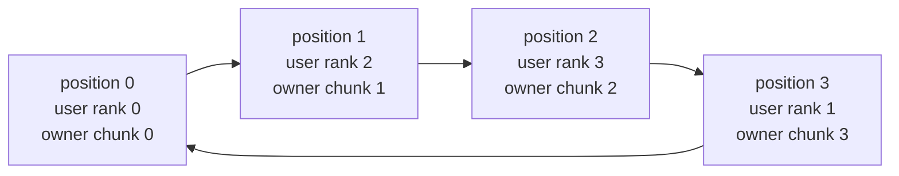
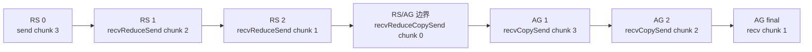

## Ring AllReduce 不只是“绕一圈”

最常见的描述：

```text
Ring AllReduce
= ReduceScatter
+ AllGather
```

这句话是正确的，但不足以读源码或排障。

还需要回答：

1. chunk 编号按 user rank，还是 ring position？
2. 每个 rank 第一次发送哪个 chunk？
3. `recvReduceSend` 连续执行多少次？
4. ReduceScatter 与 AllGather 是否有独立 kernel 边界？
5. 为什么源码中有一个 `directRecvReduceCopySend`？
6. 每个 rank 到底 send/recv 多少次？
7. 12 channels 是 12 份同一个 ring，还是不同排列？
8. 多 channel 如何切分 payload？
9. channel 越多是否一定越快？
10. world size 增大为何可能反而缩短固定 payload 时间？

本章从 `device/all_reduce.h::runRing` 逐行重建四 rank 状态机，再用 600 行正式测量和 GRAPH 日志验证。

## 证据边界

```text
formal run:
ch12_ring/20260710T154018Z

GPU:
4 x Tesla V100-SXM2-32GB
all GPU pairs NV2

NCCL:
2.22.3
178b6b759074597777ce13438efb0e0ba625e429

nccl-tests:
5bcd45d2ee8365e37895e118c9d11b0ebc15aa69
```

附件：

- [实验与 schedule 生成脚本](/assets/files/nccl-learning/scripts/36_ch12_ring_steps_channels.py)
- [正式命令清单](/assets/files/nccl-learning/logs/ch12_ring/20260710T154018Z/manifest.txt)
- [600 行原始测量](/assets/files/nccl-learning/logs/ch12_ring/20260710T154018Z/raw_measurements.csv)
- [channel sweep 聚合](/assets/files/nccl-learning/logs/ch12_ring/20260710T154018Z/summary.csv)
- [GRAPH 日志重建的 rings](/assets/files/nccl-learning/logs/ch12_ring/20260710T154018Z/rings.csv)
- [四 rank 逐操作 schedule](/assets/files/nccl-learning/logs/ch12_ring/20260710T154018Z/step_schedule.csv)
- [机器生成的摘要](/assets/files/nccl-learning/logs/ch12_ring/20260710T154018Z/summary.md)

## 先固定三个坐标系

### User rank

communicator 对外暴露的 rank：

```text
0, 1, 2, 3
```

### Ring position

某个 channel 的 ring 顺序中的位置。

例如：

```text
ring order:
0 -> 2 -> 3 -> 1 -> 0

position 0 -> user rank 0
position 1 -> user rank 2
position 2 -> user rank 3
position 3 -> user rank 1
```



这里的箭头是该 channel 的 `next` 方向。chunk owner 按 ring position 编号，因此 position 1 的 owner 是 user rank 2，而不是 user rank 1；后续所有 step 都必须在这个坐标系中解释。

### Chunk index

`runRing` 中 `chunk * chunkCount` 的 chunk index 按 ring position 坐标编号。

如果 ring 不是 `0-1-2-3`，则：

```text
chunk index 1
不等于
user rank 1
```

它对应 ring position 1 的 owner user rank。

本章 schedule 同时保存 `chunk_index` 和 `chunk_owner_user_rank`，避免把两者混为一谈。

## ring index 如何计算

`init.cc::setupChannel` 原始源码：

```cpp
struct ncclRing* ring =
    &comm->channels[channelId].ring;

// Find our ring-distance from rank zero.
int ixZero = 0;
int ixRank = 0;
for (int i=0; i<nranks; i++) {
  if (ringRanks[i] == 0)
    ixZero = i;
  if (ringRanks[i] == rank)
    ixRank = i;
}

ring->index =
    (ixRank - ixZero + nranks) % nranks;

for (int i=0; i<nranks; i++) {
  ring->userRanks[i] =
      ringRanks[(i+ixRank) % nranks];
}
```

带注释解释：

```cpp
// ring->index 是当前 user rank 相对 user rank 0
// 在此 ring 中的距离，不是 user rank id。
ringIndex = distance_in_ring(rank0, currentRank);

// userRanks 从当前 rank 开始旋转，
// 便于 primitive 获取本地视角下的 peer 顺序。
```

对于 channel0 的 `0-1-2-3`：

| user rank | ring index | prev | next |
|---:|---:|---:|---:|
| 0 | 0 | 3 | 1 |
| 1 | 1 | 0 | 2 |
| 2 | 2 | 1 | 3 |
| 3 | 3 | 2 | 0 |

对于 `0-2-3-1`：

| user rank | ring index | prev | next |
|---:|---:|---:|---:|
| 0 | 0 | 1 | 2 |
| 2 | 1 | 0 | 3 |
| 3 | 2 | 2 | 1 |
| 1 | 3 | 3 | 0 |

## Graph 如何变成完整 ring

`graph/rings.cc`：

```cpp
ncclResult_t ncclBuildRings(
    int nrings,
    int* rings,
    int rank,
    int nranks,
    int* prev,
    int* next) {

  for (int r=0; r<nrings; r++) {
    int current = rank;
    for (int i=0; i<nranks; i++) {
      rings[r*nranks+i] = current;
      current = next[r*nranks+current];
    }

    if (current != rank) {
      WARN("ring does not loop back");
      return ncclInternalError;
    }
    ...
  }
}
```

这个函数从起始 rank 反复沿 `next` 走 N 次：

1. 保存经过的 rank；
2. 验证最后回到起点；
3. 验证所有 rank 恰好出现。

GRAPH 行：

```text
Channel 02/12 : 0 2 3 1
```

不是调试装饰，而是从 connector graph 可复算出的有向环。

## 多节点 ring 如何接起来

`connectRings` 的关键逻辑：

```cpp
for (int c=0; c<nChannels; c++) {
  int* recv = ringRecv + c*nNodes;
  int* send = ringSend + c*nNodes;
  int* prev = ringPrev + c*nRanks;
  int* next = ringNext + c*nRanks;

  for (int n=0; n<nNodes; n++) {
    int recvRank = recv[n];
    int prevSendRank = send[(n-1+nNodes)%nNodes];
    prev[recvRank] = prevSendRank;

    int sendRank = send[n];
    int nextRecvRank = recv[(n+1)%nNodes];
    next[sendRank] = nextRecvRank;
  }
}
```

每个节点内 graph 给出入口/出口，再把前一节点的 send 出口接到当前节点 recv 入口。

本章是单节点，因此 inter-node 拼接退化为节点内完整 ring；后续多机章节会把 NIC/rail 纳入。

## runRing 的数据切分

原始开头：

```cpp
ncclRing* ring = &ncclShmem.channel.ring;
int ringIx = ring->index;
const int nranks = ncclShmem.comm.nRanks;

ssize_t gridOffset;
ssize_t channelCount;
ssize_t chunkCount;

ncclCollCbdPart(
    work,
    ncclShmem.channelId,
    Proto::Id,
    sizeof(T),
    nullptr,
    &gridOffset,
    &channelCount,
    &chunkCount);

const ssize_t loopCount = nranks * chunkCount;
```

三个关键值：

| value | 含义 |
|---|---|
| `gridOffset` | 当前 channel 负责的全局起始位置 |
| `channelCount` | 当前 channel 负责的元素数 |
| `chunkCount` | 一个 ring chunk 的元素数 |

每轮处理：

$$
loopCount = N * chunkCount
$$

即一组 N 个 chunk。

尾部不足一整轮时：

```cpp
if (remCount < loopCount)
  chunkCount = alignUp(
      divUp(remCount, nranks),
      16/sizeof(T));
```

每个 chunk 向上对齐，但实际 `nelem` 会用剩余元素裁剪。

## Primitive 的 peer

`runRing` 构造：

```cpp
Primitives<
    T,
    RedOp,
    FanSymmetric<1>,
    1,
    Proto,
    0
> prims(
    tid,
    nthreads,
    &ring->prev,
    &ring->next,
    work->sendbuff,
    work->recvbuff,
    work->redOpArg);
```

`FanSymmetric<1>` 表示：

```text
one recv peer: prev
one send peer: next
```

每个 rank 只直接与前后邻居通信。AllReduce 的全局传播来自 chunk 连续经过多个 rank，而不是每个 rank 直接连接所有 peers。

## 源码步骤一：初始 send

```cpp
// step 0: push data to next GPU
chunk = modRanks(ringIx + nranks - 1);
chunkOffset = chunk * chunkCount;
offset = gridOffset + elemOffset + chunkOffset;
nelem = min(chunkCount, remCount - chunkOffset);
prims.send(offset, nelem);
```

rank at ring position (i) 首先发送：

$$
chunk = (i - 1) mod N
$$

四 rank channel0：

| rank | first send chunk | next |
|---:|---:|---:|
| 0 | 3 | 1 |
| 1 | 0 | 2 |
| 2 | 1 | 3 |
| 3 | 2 | 0 |

发送的是本地原始输入对应 chunk，没有先 reduce。

## 源码步骤二：recvReduceSend

```cpp
// k-2 steps: reduce and copy to next GPU
for (int j = 2; j < nranks; ++j) {
  chunk = modRanks(ringIx + nranks - j);
  ...
  prims.recvReduceSend(offset, nelem);
}
```

每一步：

```text
从 prev 收到该 chunk 的部分和
与本 rank sendbuff 同位置元素归约
把新部分和发送给 next
```

N=4 时 j=2、3，共两次。

rank0：

```text
j=2: chunk2
j=3: chunk1
```

## 源码步骤三：融合边界

```cpp
// step k-1: reduce this buffer and data,
// which will produce the final result
// that we store in this data and push to the next GPU
chunk = ringIx;
...
prims.directRecvReduceCopySend(
    offset,
    offset,
    nelem,
    /*postOp=*/true);
```

这个 primitive 同时：

1. 从 prev 接收当前 rank-position 的 chunk；
2. 与本地输入做最后一次 reduce；
3. 把最终结果写入 recvbuff；
4. 应用 post-op；
5. 立即把最终 chunk 发给 next。

所以它是：

```text
ReduceScatter 最后一次 recv+reduce
+
AllGather 第一次 send
```

二者在一个 device 状态机中融合，没有 public API 或第二个 kernel 边界。

对 rank0，最终生成 chunk0；对 rank1 生成 chunk1，以此类推。这里的 owner 是 ring position owner。

## 源码步骤四：AllGather 转发

```cpp
// k-2 steps: copy to next GPU
for (int j = 1; j < nranks - 1; ++j) {
  chunk = modRanks(ringIx + nranks - j);
  ...
  prims.directRecvCopySend(offset, nelem);
}
```

此阶段不再 reduce：

```text
recv final chunk from prev
copy into local recvbuff
forward same chunk to next
```

N=4 时每个 rank 两次。

rank0：

```text
j=1: chunk3
j=2: chunk2
```

## 源码步骤五：最终 recv

```cpp
// Make final copy from buffer to dest.
chunk = modRanks(ringIx + 1);
...
prims.directRecv(offset, nelem);
```

最后一个 chunk 不需要继续转发，只接收并写入 recvbuff。

rank0 最终接收 chunk1。此后 rank0 已拥有：

```text
chunk0: fused boundary 本地完成
chunk3: AG recv/copy/send
chunk2: AG recv/copy/send
chunk1: final recv
```

四个 chunk 全部完成。

## rank0 的完整操作序列

真实 channel0 ring：

```text
3 <- 0 -> 1
```

<div class="diagram-scroll diagram-scroll--xwide" markdown="1">



</div>

这七个 primitive 是 rank0 在一个 channel、一个 kernel 内的逻辑顺序。中间节点同时完成 ReduceScatter 的最后一次归约和 AllGather 的第一次发送，所以两 phase 没有第二个 public API 或 kernel 边界。

schedule：

| seq | phase | primitive | chunk | recv | send |
|---:|---|---|---:|---|---|
| 0 | RS | `send` | 3 | - | rank1 |
| 1 | RS | `recvReduceSend` | 2 | rank3 | rank1 |
| 2 | RS | `recvReduceSend` | 1 | rank3 | rank1 |
| 3 | fused | `directRecvReduceCopySend` | 0 | rank3 | rank1 |
| 4 | AG | `directRecvCopySend` | 3 | rank3 | rank1 |
| 5 | AG | `directRecvCopySend` | 2 | rank3 | rank1 |
| 6 | AG | `directRecv` | 1 | rank3 | - |

每个 rank 都有同样结构，只是 chunk index 按 ring index 旋转。

## 为什么是 2(N-1) 次发送

每 rank send primitive：

```text
initial send:                      1
recvReduceSend:                  N-2
fused reduce-copy-send:            1
directRecvCopySend:              N-2
------------------------------------
total sends:                     2N-2
```

recv：

```text
recvReduceSend:                  N-2
fused recv-reduce-copy-send:       1
directRecvCopySend:              N-2
final directRecv:                  1
------------------------------------
total receives:                  2N-2
```

脚本对四个 rank 独立断言 send/recv 都等于6。

每个 chunk 理想大小 (M/N)，因此每 rank 发送：

$$
2(N-1) * M/N
= 2(N-1)M/N
$$

这正是第 8 章 AllReduce busbw factor。

## 为什么源码 primitive 数是 2N-1

每 rank schedule 行数：

```text
1 + (N-2) + 1 + (N-2) + 1
= 2N-1
```

但 send 数是 `2N-2`，因为最后 `directRecv` 只接收不发送。

传统“2(N-1) communication steps”统计链路发送轮次；源码 schedule 还显式保留最终 receive completion。两种计数对象不同，并不矛盾。

## 实验假设

### H1

GRAPH 输出的每条 ring 都包含所有 rank，沿 next 走 N 次回到0。

### H2

`runRing` schedule 对每 rank 产生 `2(N-1)` send 和 receive，chunk 集合覆盖 `0..N-1`。

### H3

单 channel 对 64 MiB 的惩罚远大于 1 MiB，且 world size 越大越需要 channel 并行。

### H4

channel 收益不是单调；rank 少或消息较小时，过多 channel 的固定成本可能抵消并行收益。

### H5

多 channel 会使用多个不同 ring 排列，让不同 GPU pair/path 并行承载数据。

## 三维矩阵

```text
world size:
  2, 3, 4

message size:
  1 MiB, 64 MiB

channels:
  1, 2, 4, 8, 12

algorithm:
  Ring forced

protocol:
  Simple forced

cycles:
  10 per process

replicates:
  forward + reverse channel order
```

总计：

$$
3 * 5 * 2 * 2 * 10 = 600
$$

这里最后一个2分别表示两个 size 和两个独立进程顺序。

每个 world/channel/size 有 20 个 cycle。

## 正反顺序

每个 world size：

```text
replicate1:
  1 -> 2 -> 4 -> 8 -> 12

replicate2:
  12 -> 8 -> 4 -> 2 -> 1
```

避免 channel12 永远处于机器最热或最晚的位置。

## 正确性与稳定性

```text
measurement rows:        600
out-of-place wrong:      all zero
in-place wrong:          all zero
CV <= 5% groups:         30 / 30
maximum group CV:        3.62%
```

所有组合都可用于本章定量比较。

## World size 4

| channels | 1 MiB us | 1 MiB vs ch12 | 64 MiB us | 64 MiB busbw | 64 MiB vs ch12 |
|---:|---:|---:|---:|---:|---:|
| 1 | 112.595 | +85.45% | 4440.330 | 22.67 | +422.59% |
| 2 | 81.375 | +34.03% | 2537.280 | 39.67 | +198.61% |
| 4 | 67.940 | +11.90% | 1328.825 | 75.75 | +56.39% |
| 8 | 66.020 | +8.74% | 1145.425 | 87.88 | +34.81% |
| 12 | 60.715 | baseline | 849.685 | 118.47 | baseline |

64 MiB 从1到12 channels：

```text
time:
  4440.330 -> 849.685 us

busbw:
  22.67 -> 118.47 GB/s

speedup:
  5.23x
```

并不是12倍，因为：

- channel 并非独占一条完全独立物理链路；
- 多 ring 共享 GPU memory、SM、NVLink resources；
- chunk 和同步有固定开销；
- 1 channel 已能使用一条完整 ring。

1 MiB 的收益小得多，但 channel12 仍最快。四 rank 下有足够 path diversity 使用12条 ring。

## World size 3

| channels | 1 MiB us | 1 MiB vs ch12 | 64 MiB us | 64 MiB busbw | 64 MiB vs ch12 |
|---:|---:|---:|---:|---:|---:|
| 1 | 104.465 | +81.03% | 4224.825 | 21.18 | +292.32% |
| 2 | 74.460 | +29.04% | 2208.990 | 40.50 | +105.13% |
| 4 | 59.780 | +3.60% | 1267.465 | 70.59 | +17.70% |
| 8 | 56.360 | -2.33% | 1104.370 | 81.02 | +2.55% |
| 12 | 57.705 | baseline | 1076.885 | 83.09 | baseline |

1 MiB 最快是8 channels，比12快2.33%。

64 MiB 仍是12最快，但8只慢2.55%。说明：

```text
small/medium payload:
  channel overhead 已开始抵消并行

large payload:
  仍能利用更多 channel
```

## World size 2

| channels | 1 MiB us | 1 MiB vs ch12 | 64 MiB us | 64 MiB busbw | 64 MiB vs ch12 |
|---:|---:|---:|---:|---:|---:|
| 1 | 83.125 | +50.47% | 3671.295 | 18.28 | +133.78% |
| 2 | 58.490 | +5.87% | 1997.920 | 33.59 | +27.22% |
| 4 | 51.210 | -7.30% | 1528.700 | 43.90 | -2.66% |
| 8 | 52.475 | -5.01% | 1500.415 | 44.73 | -4.46% |
| 12 | 55.245 | baseline | 1570.405 | 42.73 | baseline |

1 MiB 最快4 channels；64 MiB 最快8 channels。

12 channels 反而比8慢4.46%，且两组 CV 只有0.02%，差异稳定。

原因不是“12 channel 配置失败”。两 rank 只有同一 GPU pair：

```text
all rings:
  0 -> 1 -> 0
```

额外 channel 不能创造新的 peer pair，只会继续切分相同 payload 和共享同一链路；到8以后调度/切分开销超过收益。

H4 得到直接验证。

## World size 不能只看 N

固定 64 MiB、12 channels：

```text
N=2: 1570.405 us
N=3: 1076.885 us
N=4:  849.685 us
```

N 增大时间下降，不违反 Ring step 增加：

```text
N=2:
  fewer steps
  one GPU pair/path

N=4:
  more steps
  more GPUs and disjoint NVLink paths active
  12 ring permutations exploit more concurrency
```

这是 active hardware resources 与 communication steps 同时变化的实验，不是纯算法复杂度曲线。

## GRAPH 重建：N=2

1 channel：

```text
Channel 00/01: 0 1
```

12 channels：

```text
Channel 00/12: 0 1
...
Channel 11/12: 0 1
```

所有 ring 完全相同。多 channel 只增加并行 chunk streams，不增加 path diversity。

## GRAPH 重建：N=3

12 channels 交替两种方向：

```text
0 -> 1 -> 2 -> 0
0 -> 2 -> 1 -> 0
```

各出现6次。

三卡 fully connected NV2 下，这两种有向环覆盖反向 link direction，使多个 channel 能更均匀并行。

## GRAPH 重建：N=4

12 channels 的前6个：

```text
ch0: 0-1-2-3
ch1: 0-1-3-2
ch2: 0-2-3-1
ch3: 0-2-1-3
ch4: 0-3-1-2
ch5: 0-3-2-1
```

ch6–11 重复这六个排列。

对于固定 rank0，first hop 分散到：

```text
rank1
rank2
rank3
```

最后 hop 也分散到不同 peer。H5 成立。

## 为什么 channels 会重复

`connect.cc` 在基础 graph channels 之后复制：

```cpp
// Duplicate ringPrev/ringNext
memcpy(
    ringPrev + nChannels*nranks,
    ringPrev,
    nChannels*nranks*sizeof(int));

memcpy(
    ringNext + nChannels*nranks,
    ringNext,
    nChannels*nranks*sizeof(int));

...

nChannels = comm->nChannels =
    min(MAXCHANNELS, nChannels*2);
```

本机基础 ring graph 有6条，复制后成为12条，所以 ch6–11 与 ch0–5 同序。

复制 channel 仍有价值：即使 topology order 相同，也能承载不同 payload partition 和 CUDA block。

## 多 channel 如何并行

每个 channel 进入同一个 `runRing`，但：

```cpp
ncclCollCbdPart(
    work,
    channelId,
    protocol,
    elementSize,
    ...,
    &gridOffset,
    &channelCount,
    &chunkCount);
```

`channelId` 决定该 channel 的 payload partition。

概念上：

```text
full tensor M
  -> channel0 range
  -> channel1 range
  -> ...
  -> channelC-1 range

each channel:
  own ring order
  own prev/next connector
  own runRing state machine
```

channels 不把同一 chunk 重复发送C次，而是并行处理不同范围。

## slow edge 与稳态上限

一条 ring 的所有 chunk 必须经过每条 edge。稳态吞吐受最慢 edge 限制：

$$
throughput_ring <= min(edge_bandwidth)
$$

多个 channel 若映射到不同 path，可以聚合；若都共享同一物理瓶颈，增加 channel 只会争用。

生产中某条 NVLink 降速可能表现为：

- 使用该 edge 的所有 ring 被拖慢；
- channel 增加收益变小；
- 某些 ring order 比其他 order 慢；
- aggregate busbw 低但 topology 仍显示 NVL。

需要把 per-link counter 与 ring order 关联，而不是只看平均。

## Schedule 生成器的断言

脚本从真实 `0-1-2-3` 构造每个 rank：

```python
send chunk i-1

for j in range(2, N):
    recvReduceSend chunk i-j

directRecvReduceCopySend chunk i

for j in range(1, N-1):
    directRecvCopySend chunk i-j

directRecv chunk i+1
```

然后断言：

```python
sends == 2 * (N - 1)
receives == 2 * (N - 1)
seen_chunk_indexes == set(range(N))
```

结果：

```text
schedule rows: 28
per rank rows: 7
per rank sends: 6
per rank receives: 6
all chunk indexes covered
```

这把源码公式变成机器可检查的证据。

## 工程排障清单

Ring 大消息不达标时：

1. 确认实际 algorithm/protocol；
2. 读取 GRAPH 的每条 ring；
3. 确认 coll channel 数；
4. 检查是否被 MIN/MAX_NCHANNELS 强制；
5. 将 ring edge 映射到 GPU pair；
6. 检查各 pair P2P bandwidth 和 NVLink state；
7. 检查 channel 是否全部共享同一慢 edge；
8. 比较1/2/4/8/12 channel 曲线；
9. 检查 CV，排除 CPU/clock 噪声；
10. 检查 chunk/buffer/protocol 参数；
11. world size 改变时重新读 ring，不能沿用旧图；
12. 不要因为 channel12 在四卡最快就全局强制12。

## 常见错误

### 错误一：chunk index 等于 user rank

只在 ring order 与 user rank 顺序相同才成立。一般应通过 ring position 映射 owner。

### 错误二：RS 与 AG 是两个独立 kernel

`directRecvReduceCopySend` 融合 RS 最后归约与 AG 第一次发送。

### 错误三：源码只有 2(N-1) 行 primitive

源码操作行是2N-1，因为最终 `directRecv` 不发送；链路 sends 仍是2(N-1)。

### 错误四：12 channels 表示12条物理 NVLink

channel 是逻辑流水；多个 channel 可共享物理 edge。

### 错误五：channel 越多越快

N=2 64 MiB 中8 channels 比12快4.46%，且结果稳定。

### 错误六：world size 越大 step 越多，所以一定更慢

active GPU/link resources 也变化。本机固定 payload 下N4比N2快。

## 验收题

### 题一

ring `0-2-3-1` 中 user rank3 的 ring index、prev、next 是什么？

ring index2，prev=user rank2，next=user rank1。

### 题二

N=4、ring index0 第一个发送哪个 chunk？

`(0+4-1)%4=3`。

### 题三

`directRecvReduceCopySend` 为什么是融合边界？

它接收并完成本 owner chunk 的最后归约、写入输出，同时把最终结果发给 next，开始 AllGather。

### 题四

每 rank 为何发送6个 chunk 而 schedule 有7行？

最后一行 `directRecv` 只接收不发送。

### 题五

为什么 N=2 的12 channels 没有 path diversity？

所有 ring 只能是 `0->1->0`，channel 只能切分 payload，不能创造第三个 peer/path。

## 本章结论

1. `ring->index` 是 user rank 相对 rank0 的 ring position，不是 user rank id。
2. chunk index 按 ring position 编号，需要映射到 owner user rank。
3. `runRing` 使用 prev/next 单 peer primitive，chunk 通过多跳完成全局归约。
4. 每轮操作为 send、N-2次recvReduceSend、融合primitive、N-2次recvCopySend、final recv。
5. 融合 primitive 同时结束 ReduceScatter 并启动 AllGather，没有第二个 public collective/kernel 边界。
6. 每 rank send/recv 都为2(N-1)个 chunk，字节数为2(N-1)M/N。
7. 四 rank真实 channel0 ring 为 `0->1->2->3->0`，机器生成28行 schedule 全部通过断言。
8. 600 行 out/in-place 结果全部正确，30个聚合组 CV 全低于5%。
9. N4 64 MiB 从1到12 channels 加速5.23倍，busbw从22.67升到118.47 GB/s。
10. N3 1 MiB 的8 channels 比12快2.33%。
11. N2 64 MiB 的8 channels 比12快4.46%，证明channel收益不单调。
12. N2所有12条ring相同；N3有两种方向；N4有六种排列各重复两次。
13. 多 channel 通过 `ncclCollCbdPart` 切分不同 payload range，并不重复发送整个 tensor。
14. channel最佳值依赖world size、message、protocol、topology，强制值只应用于诊断。

下一章进入 Tree/双树：从 parent/children、up-reduce/down-broadcast、树深和 split-thread 实现推导延迟，并用强制 Ring/Tree 全消息扫描寻找本机真实交叉点。
