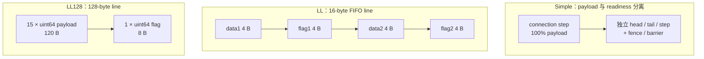

## 本章问题

NCCL 的 algorithm 和 protocol 是两个正交维度：

```text
algorithm: rank 之间怎样组织数据流
           Ring / Tree / CollNet / NVLS ...

protocol:  一条逻辑边上怎样编码 payload、发布 ready 状态并推进 FIFO step
           LL / LL128 / Simple
```

“LL 低延迟、Simple 高带宽、LL128 折中”仍然太浅。这一章要从源码和
实验回答：

1. 三种协议在线上实际放了多少 data 和 flag。
2. sender 如何发布 ready，receiver 如何判断数据已经完整可见。
3. FIFO 的 `NCCL_STEPS`、buffer 和有效 data bytes/step 如何关联。
4. LL 为什么只有 50% payload efficiency，却能在小消息上最快。
5. LL128 为什么是 93.75%，以及 16-byte 非对齐为什么触发不同代码路径。
6. Simple 为什么没有 inline flag，仍能正确同步。
7. protocol 的硬件启用条件在哪里。
8. 为什么 Nsight 中的 `_RING_LL` kernel 名可能实际执行 LL128 或 Simple。
9. 在当前 4×V100 上，六种 algorithm/protocol 组合的真实区间是什么。

目标不是记住三个标签，而是能从 FIFO line、flag、step、chunk 和 kernel
dispatch 推导性能与故障边界。

## 证据边界

本文固定：

```text
NCCL source: v2.22.3-1 @ 178b6b7
runtime NCCL: 2.22.3+cuda12.6
nccl-tests: 5bcd45d
GPU: 4 x Tesla V100-SXM2-32GB, compute capability 7.0
topology: every GPU pair NV2
world size: 4
channels: 12
datatype/op: float/sum
```

正式运行：`ch14_protocol/20260710T161632Z`。

- [完整汇总](/assets/files/nccl-learning/logs/ch14_protocol/20260710T161632Z/summary.md)
- [运行清单](/assets/files/nccl-learning/logs/ch14_protocol/20260710T161632Z/manifest.txt)
- [1740 条主矩阵原始值](/assets/files/nccl-learning/logs/ch14_protocol/20260710T161632Z/raw_measurements.csv)
- [160 条 LL128 对齐实验](/assets/files/nccl-learning/logs/ch14_protocol/20260710T161632Z/alignment_raw.csv)
- [3000 条小消息复测](/assets/files/nccl-learning/logs/ch14_protocol/20260710T161632Z/small_repeat_raw.csv)

多节点网络、GDR、PCIe-only 路径和混合 GPU architecture 没有在当前机器
验证。LL128 的默认启用条件可由源码证明，但不能用本机结果代替这些硬件
上的正确性和性能实验。

## 前置心智模型

NCCL connection buffer 是循环 FIFO，`NCCL_STEPS=8`。可以把发送方和
接收方的关系抽象成：

```text
step 0 -> step 1 -> ... -> step 7 -> wrap to step 0
```

发送方必须保证：

```text
不覆盖 receiver 尚未消费的 step
data 对 receiver 可见后再发布 ready 状态
```

接收方必须保证：

```text
没有看到本 step 的 ready 前不消费 data
消费完成后推进 head，让 sender 可以复用 FIFO 槽
```

三种协议解决的是同一个生产者/消费者问题，差别在于 ready metadata 放哪、
多细粒度地发布，以及为这些 metadata 牺牲多少 payload 空间。

## 三种协议的统一接口

仓库：`NVIDIA/nccl`  
版本：`v2.22.3-1`  
提交：`178b6b7`  
文件：`src/device/primitives.h:17-73`  
符号：`ProtoSimple`、`ProtoLL`、`ProtoLL128`

原始源码：

```cpp
template<int SlicePerChunk_1, int StepPerSlice_1,
    int Unroll_1 = COLL_UNROLL, int MultimemSrcs_1 = 0,
    int MultimemDsts_1 = 0>
struct ProtoSimple {
  static constexpr int Id = NCCL_PROTO_SIMPLE;
  static constexpr int SlicePerChunk = SlicePerChunk_1;
  static constexpr int StepPerSlice = StepPerSlice_1;
  static constexpr int Unroll = Unroll_1;

  __device__ static int calcBytePerStep() {
    return ncclShmem.comm.buffSizes[NCCL_PROTO_SIMPLE]/NCCL_STEPS;
  }
  static constexpr int MaxGroupWidth = 2;
};

struct ProtoLL {
  static constexpr int Id = NCCL_PROTO_LL;
  __device__ static int calcBytePerStep() {
    return ncclShmem.comm.buffSizes[NCCL_PROTO_LL]/NCCL_STEPS/2;
  }
  __device__ static int calcBytePerGrain() {
    return sizeof(uint64_t); // One 16-byte line has 8-bytes of data
  }
  static constexpr int MaxGroupWidth = 1;
};

struct ProtoLL128 {
  static constexpr int Id = NCCL_PROTO_LL128;
  __device__ static int calcBytePerStep() {
    return (ncclShmem.comm.buffSizes[NCCL_PROTO_LL128]/NCCL_STEPS)
      *NCCL_LL128_DATAELEMS/NCCL_LL128_LINEELEMS;
  }
  __device__ static int calcBytePerGrain() {
    return NCCL_LL128_SHMEM_ELEMS_PER_THREAD*NCCL_LL128_DATAELEMS
      *sizeof(uint64_t)/NCCL_LL128_LINEELEMS;
  }
  static constexpr int MaxGroupWidth = 1;
};
```

注释版：

```cpp
struct ProtoSimple {
  static constexpr int Id = NCCL_PROTO_SIMPLE;
  // [课程注释] Simple 的 FIFO step 全部可用于 data，不扣 inline flag。
  __device__ static int calcBytePerStep() {
    return buffSize / NCCL_STEPS;
  }
  // [课程注释] Simple primitive 可能占两个连续 group 槽。
  static constexpr int MaxGroupWidth = 2;
};

struct ProtoLL {
  static constexpr int Id = NCCL_PROTO_LL;
  // [课程注释] 16 B line 只有 8 B data，buffer/step 后还要除以 2。
  __device__ static int calcBytePerStep() {
    return buffSize / NCCL_STEPS / 2;
  }
  static constexpr int MaxGroupWidth = 1;
};

struct ProtoLL128 {
  static constexpr int Id = NCCL_PROTO_LL128;
  // [课程注释] 每 16 个 uint64 word 中只有 15 个是 data。
  __device__ static int calcBytePerStep() {
    return (buffSize / NCCL_STEPS) * 15 / 16;
  }
  static constexpr int MaxGroupWidth = 1;
};
```

算法实现因此可以写成 protocol-parametric 代码：Ring 和 Tree 的步骤不变，
只替换 `Proto` 与对应 `Primitives` specialization。

## 线格式的精确效率

源码常量直接给出：

| protocol | wire line | data | readiness metadata | payload efficiency |
|---|---:|---:|---|---:|
| LL | 16 B | 8 B | 两个 32-bit flag | 50.00% |
| LL128 | 128 B | 120 B | 一个 64-bit flag | 93.75% |
| Simple | 无固定 inline line | 全部 | 独立 connection step/head/tail | 100.00% |

效率公式：

$$
\eta_{LL}=\frac{8}{16}=50\%
$$

$$
\eta_{LL128}=\frac{120}{128}=\frac{15}{16}=93.75\%
$$

这只是编码效率，不是端到端带宽相对值。协议还包含 load/store、flag polling、
barrier、reduction、channel 争用和实际链路上限。

<div class="diagram-scroll diagram-scroll--wide" markdown="1">



</div>

图展示的是每种协议的同步元数据放置方式。LL 的 data/flag 交错使 receiver 能细粒度轮询；LL128 用 15/16 空间装 payload；Simple 的 readiness 不占 inline payload，但需要独立 step/head/tail 协议。

## LL 的 16-byte FIFO line

仓库：`NVIDIA/nccl`  
版本：`v2.22.3-1`  
提交：`178b6b7`  
文件：`src/include/device.h:46-59`  
符号：`ncclLLFifoLine`

原始源码：

```cpp
union ncclLLFifoLine {
  /* Flags have to be *after* data, because otherwise, an incomplete receive
     from the network may receive the flag but not the data.
     Note this is assuming that either we receive contiguous chunks of data
     (sockets) or data is written with an atomicity of 8 bytes (IB/RDMA). */
  struct {
    uint32_t data1;
    uint32_t flag1;
    uint32_t data2;
    uint32_t flag2;
  };
  uint64_t v[2];
  int4 i4;
};
```

注释版：

```cpp
union ncclLLFifoLine {
  struct {
    uint32_t data1;  // [课程注释] 第一个 4 B payload
    uint32_t flag1;  // [课程注释] 紧跟 data1，表示前 8 B pair ready
    uint32_t data2;  // [课程注释] 第二个 4 B payload
    uint32_t flag2;  // [课程注释] 紧跟 data2，表示后 8 B pair ready
  };

  // [课程注释] sender 以两个 64-bit pair 写入；receiver 也检查两个 flag。
  uint64_t v[2];
  int4 i4;
};
```

flag 必须排在对应 data 后面，是一个内存可见性协议，而不是排版偏好。
源码依赖两种 transport 属性之一：Socket 连续接收，或 IB/RDMA 具有 8-byte
写入原子性。如果先看到 flag、后看到未完整 data，receiver 就会消费旧值。

## LL 如何发布和等待 flag

仓库：`NVIDIA/nccl`  
版本：`v2.22.3-1`  
提交：`178b6b7`  
文件：`src/device/prims_ll.h:39-44,98-135`  
符号：`recvFlag`、`sendFlag`、`readLL`、`storeLL`

原始源码：


```cpp
inline __device__ int recvOffset(int i) {
  return (recvStep[i]%NCCL_STEPS)*stepLines;
}
inline __device__ int sendOffset(int i) {
  return (sendStep[i]%NCCL_STEPS)*stepLines;
}
inline __device__ uint32_t recvFlag(int i) {
  return NCCL_LL_FLAG(recvStep[i]+1);
}
inline __device__ uint32_t sendFlag(int i) {
  return NCCL_LL_FLAG(sendStep[i]+1);
}

__device__ uint64_t readLL(int offset, int i) {
  union ncclLLFifoLine* src = recvPtr(i) + offset;
  uint32_t flag = recvFlag(i);
  uint32_t data1, flag1, data2, flag2;
  int spins = 0;
  do {
    asm("ld.volatile.global.v4.u32 {%0,%1,%2,%3}, [%4];"
      : "=r"(data1), "=r"(flag1), "=r"(data2), "=r"(flag2)
      : "l"(&src->i4));
    if (checkAbort(spins, 0)) break;
  } while ((flag1 != flag) || (flag2 != flag));
  return data1 + (((uint64_t)data2) << 32);
}

__device__ void storeLL(union ncclLLFifoLine* dst,
    uint64_t val, uint32_t flag) {
  asm volatile("st.volatile.global.v4.u32 [%0], {%1,%2,%3,%4};"
    :: "l"(&dst->i4), "r"((uint32_t)val), "r"(flag),
       "r"((uint32_t)(val >> 32)), "r"(flag));
}
```


注释版：

```cpp
// [课程注释] step 对 8 取模选择循环 FIFO 槽。
offset = (step % NCCL_STEPS) * stepLines;

// [课程注释] 期望 flag 是逻辑 step+1，不是固定布尔值。
flag = NCCL_LL_FLAG(step + 1);

do {
  // [课程注释] volatile 读取一整条 16 B line。
  load(data1, flag1, data2, flag2);
  // [课程注释] 长时间自旋时检查 communicator abort，避免永久死等。
  if (checkAbort(spins, 0)) break;
} while (flag1 != expected || flag2 != expected);

// [课程注释] sender 在同一个 16 B volatile store 中交错写 data 和 flag。
store(data_low32, flag, data_high32, flag);
```

LL 的“low latency”来自细粒度 readiness：receiver 可以按 8 B payload pair
轮询并立即处理，不必等一个大 step 的独立 tail 更新。代价是每 8 B data
都携带 8 B flag，以及频繁 volatile load/store 和 polling。

## LL128 的 128-byte line

仓库：`NVIDIA/nccl`  
版本：`v2.22.3-1`  
提交：`178b6b7`  
文件：`src/include/device.h:81-89`；`src/device/prims_ll128.h:9-24,369-374`  
符号：`NCCL_LL128_*`、`Primitives<..., ProtoLL128>`

原始源码：

```cpp
#define NCCL_LL128_LINESIZE 128
#define NCCL_LL128_LINEELEMS (NCCL_LL128_LINESIZE/sizeof(uint64_t))
#define NCCL_LL128_DATAELEMS (NCCL_LL128_LINEELEMS-1)

#define NCCL_LL128_MAX_NTHREADS 640
#define NCCL_LL128_ELEMS_PER_THREAD 120
#define NCCL_LL128_SHMEM_ELEMS_PER_THREAD 8

// Constructor fields
flagThread((tid%8)==7),
stepSize(ncclShmem.comm.buffSizes[NCCL_PROTO_LL128]
  /NCCL_STEPS/sizeof(uint64_t))
```

注释版：

```cpp
#define NCCL_LL128_LINESIZE 128
// [课程注释] 一条 line 有 16 个 uint64 word。
#define NCCL_LL128_LINEELEMS 16
// [课程注释] 其中 15 个 word 是 data，最后 1 个承担 flag。
#define NCCL_LL128_DATAELEMS 15

// [课程注释] 每 8 个连续 thread 中最后一个是 flag thread；
// [课程注释] 每个 thread 写 16 B，8 threads 正好覆盖 128 B line。
flagThread((tid % 8) == 7)

// [课程注释] stepSize 先按 wire uint64 words 计算，data 数再乘 15/16。
stepSize = buffSize / NCCL_STEPS / sizeof(uint64_t);
```

LL128 不是“128-bit 协议”。名字对应 128-byte line；每条线 120 B data，
8 B flag。

## LL128 的 warp-level ready 检查

仓库：`NVIDIA/nccl`  
版本：`v2.22.3-1`  
提交：`178b6b7`  
文件：`src/device/prims_ll128.h:185-210,273-288`  
符号：`recvReduceSendCopy`

原始源码：

```cpp
if (RECV) {
  uint64_t* ptr = recvPtr(0)+ll128Offset;
  uint64_t flag = recvFlag(0);
  bool needReload;
  int spins = 0;
  do {
    needReload = false;
    #pragma unroll
    for (int u=0; u<ELEMS_PER_THREAD; u+=2) {
      load128(ptr+u*WARP_SIZE, vr[u], vr[u+1]);
      needReload |= flagThread && (vr[u+1] != flag);
    }
    needReload &= (0 == checkAbort(spins, 0, 0));
  } while (__any_sync(WARP_MASK, needReload));

  #pragma unroll
  for (int u=0; u<ELEMS_PER_THREAD; u+=2)
    load128(ptr+u*WARP_SIZE, vr[u], vr[u+1]);
}

if (SEND) {
  uint64_t flag = sendFlag(0);
  uint64_t* ptr = sendPtr(0)+ll128Offset;
  #pragma unroll
  for (int u=0; u<ELEMS_PER_THREAD; u+=2) {
    store128(ptr+u*WARP_SIZE, v[u], flagThread ? flag : v[u+1]);
  }
}
```

注释版：

```cpp
do {
  // [课程注释] 所有 lane 发起 128-bit load。
  load128(data_or_flag_pair);

  // [课程注释] 每组 8 lanes 的最后一个 lane 检查本 line 的 flag word。
  needReload |= flagThread && (second_word != expected_flag);

  // [课程注释] 任意 lane 所属 line 未 ready，整个 warp 继续轮询。
} while (__any_sync(0xffffffff, needReload));

// [课程注释] ready 后再读一次，取得和已确认 flag 对应的完整数据。
load128(all_pairs_again);

// [课程注释] 普通 lane 的两个 word 都是 data；flagThread 的第二个 word
// [课程注释] 被 expected flag 替换，因此每 16 words 损失 1 word。
store128(first_word, flagThread ? flag : second_word);
```

相比 LL，ready metadata 从每 8 B data 配一组 flag，降低到每 120 B data
配一个 8 B flag；同步粒度变粗，但 payload efficiency 大幅提高。

## LL128 对齐为何重要

仓库：`NVIDIA/nccl`  
版本：`v2.22.3-1`  
提交：`178b6b7`  
文件：`src/device/prims_ll128.h:95-141`  
符号：`loadRegsBegin`

关键源码摘录（省略 misaligned shared-memory 重排循环）：

```cpp
if(reinterpret_cast<uintptr_t>(src)%16 == 0) {
  #pragma unroll
  for(int g=0; g < WordPerThread/2; g++) {
    int ix = g*WARP_SIZE - 4*(g/2) + wid - (g%2)*(wid/8);
    if(!flagThread || g%2==0) {
      if(ix*EltPer16B < eltN)
        load128((uint64_t*)(src + ix*EltPer16B),
          regs[2*g+0], regs[2*g+1]);
    }
  }
}
else {
  int misalignment = reinterpret_cast<uintptr_t>(src) % 16;
  uint64_t *src8 = reinterpret_cast<uint64_t*>(
    reinterpret_cast<uintptr_t>(src) & -uintptr_t(16));
  uint64_t *shm8 = shmemCvtPtr(
    (uint64_t*)ncclScratchForWarp(warpInBlock));
  #pragma unroll
  for(int g=0; g < WordPerThread/2; g++)
    if((g*WARP_SIZE + wid)*16 < misalignment + eltN*sizeof(T))
      load128(src8 + 2*(g*WARP_SIZE + wid),
        regs[2*g+0], regs[2*g+1]);
  #pragma unroll
  for(int g=0; g < WordPerThread/2; g++)
    storeShmem128(shm8 + 2*(g*WARP_SIZE + wid),
      regs[2*g+0], regs[2*g+1]);
  __syncwarp();
  // ... load the requested misaligned region back from shmem ...
}
```

注释版：

```cpp
if (src_address % 16 == 0) {
  // [课程注释] 快路径：用户 buffer 直接 128-bit load 到 registers。
  load128(src, reg0, reg1);
} else {
  // [课程注释] 慢路径第一步：地址向下对齐到 16 B 边界。
  aligned_src = floor_to_16B(src);

  // [课程注释] 慢路径第二步：扩大的对齐区域 load 到 registers，
  // [课程注释] 再写入每 warp scratch shared memory。
  load128(aligned_src, regs);
  storeShmem128(scratch, regs);
  __syncwarp();

  // [课程注释] 慢路径第三步：从 shmem 按原始 misalignment 重排回 registers。
}
```

因此“P2P/NVLink 很快”不能消除用户 buffer 非对齐的 device 侧重排成本。
后面的 0/4/8/12 B 偏移实验会直接验证这一分支。

## Simple 如何同步

Simple 不在 payload line 中嵌 flag，而是通过 connection 的 `head/tail`
或 step pointer 管理 FIFO 所有权。它的同步粒度更粗，但 data 区没有 LL
那样的固定 50% metadata 税。

仓库：`NVIDIA/nccl`  
版本：`v2.22.3-1`  
提交：`178b6b7`  
文件：`src/device/prims_simple.h:107-167`  
符号：`waitPeer`、`postPeer`

关键源码摘录（省略 direct/FIFO pointer 选择分支）：

```cpp
template <int DirectRecv, int DirectSend, int Recv, int Send,
          int Src, int Dst>
__device__ __forceinline__ void waitPeer(
    intptr_t srcIx, intptr_t dstIx, int offset, int nelts) {
  const bool isSendNotRecv = (Send && Recv)
    ? (flags & RoleWaitSend) : Send;
  const bool noRecvWait = DirectRecv && Src && (flags & DirectRead);
  const bool noSendWait = DirectSend &&
    (flags & (DirectRead|DirectWrite));
  if (((flags & (Recv*RoleWaitRecv)) && !noRecvWait) ||
      ((flags & (Send*RoleWaitSend)) && !noSendWait)) {
    int spins = 0;
    while (connStepCache + (isSendNotRecv ? NCCL_STEPS : 0)
        < step + StepPerSlice) {
      connStepCache = loadStepValue(connStepPtr);
      if (checkAbort(spins)) break;
    }
  }

  if (flags & (Recv*RoleWaitRecv | Send*RoleWaitSend)) {
    if (flags & ConnFifoEnabled)
      connFifo[step%NCCL_STEPS].size = nelts*sizeof(T);
    // ... choose direct user pointer or the current FIFO step pointer ...
    step += StepPerSlice;
  }
}

template<int Recv, int Send>
inline __device__ void postPeer(bool dataStored) {
  if (flags & (Recv*RolePostRecv | Send*RolePostSend)) {
    step += StepPerSlice;
    if (Send && (flags & RolePostSend) &&
        (dataStored||(flags&ConnFifoEnabled))) {
      fence_acq_rel_sys();
    }
    st_relaxed_sys_global(connStepPtr, step);
  }
}
```

注释版：

```cpp
// [课程注释] sender 要保证不会追上尚未释放的 receiver head；
// [课程注释] receiver 要等 sender 发布目标 step。
while (cached_peer_step + send_window_adjustment
    < local_step + StepPerSlice) {
  cached_peer_step = loadStepValue(connStepPtr);
  if (checkAbort(spins)) break;
}

// [课程注释] 当前 slice 获得 FIFO 槽或 direct user pointer 后推进本地 step。
step += StepPerSlice;

if (must_post) {
  step += StepPerSlice;
  if (sender_stored_data) {
    // [课程注释] 先让 data 对 system scope 可见，再发布新 step。
    fence_acq_rel_sys();
  }
  // [课程注释] ready metadata 不在 payload 内，而在独立 connStepPtr。
  st_relaxed_sys_global(connStepPtr, step);
}
```

Simple 的关键 happens-before 关系是：

```text
sender stores data
  -> system-scope fence
  -> sender publishes step
  -> receiver observes step
  -> receiver consumes data
```

这解释了两个常见误区：

1. Simple 没有 inline flag，不等于没有同步。
2. 删除或弱化发布前 fence 可能得到“多数时候正确”的程序，但会破坏跨
   device/transport 的 memory ordering。

DirectRead/DirectWrite 可以跳过某些 FIFO wait，因为 peer 直接读写 user
buffer；它们仍要遵守对应 direct pointer 交换和完成协议，不能理解成完全
无同步。

## 默认 buffer 与每 step 有效数据

仓库：`NVIDIA/nccl`  
版本：`v2.22.3-1`  
提交：`178b6b7`  
文件：`src/init.cc:560-580`  
符号：`DEFAULT_*_BUFFSIZE`、`computeBuffSizes`

关键源码摘录（省略 `computeBuffSizes` 的日志与收尾）：

```cpp
#define DEFAULT_LL_BUFFSIZE \
  (NCCL_LL_LINES_PER_THREAD*NCCL_LL_MAX_NTHREADS* \
   NCCL_STEPS*sizeof(union ncclLLFifoLine))
#define DEFAULT_LL128_BUFFSIZE \
  (NCCL_LL128_ELEMS_PER_THREAD*NCCL_LL128_MAX_NTHREADS* \
   NCCL_STEPS*sizeof(uint64_t))
#define DEFAULT_BUFFSIZE (1 << 22) /* 4MiB */
NCCL_PARAM(BuffSize, "BUFFSIZE", -2);
NCCL_PARAM(LlBuffSize, "LL_BUFFSIZE", -2);
NCCL_PARAM(Ll128BuffSize, "LL128_BUFFSIZE", -2);

static ncclResult_t computeBuffSizes(struct ncclComm* comm) {
  int64_t envs[NCCL_NUM_PROTOCOLS] = {
    ncclParamLlBuffSize(), ncclParamLl128BuffSize(), ncclParamBuffSize()
  };
  int defaults[NCCL_NUM_PROTOCOLS] = {
    DEFAULT_LL_BUFFSIZE, DEFAULT_LL128_BUFFSIZE, DEFAULT_BUFFSIZE
  };
  for (int p=0; p<NCCL_NUM_PROTOCOLS; p++) {
    comm->buffSizes[p] = envs[p] != -2 ? envs[p] : defaults[p];
  }
  // ...
}
```

注释版：

```cpp
// [课程注释] LL: 8 lines/thread * 512 threads * 8 steps * 16 B.
DEFAULT_LL_BUFFSIZE = 524288;

// [课程注释] LL128: 120 words/thread * 640 threads * 8 steps * 8 B.
DEFAULT_LL128_BUFFSIZE = 4915200;

// [课程注释] Simple 默认 4 MiB。
DEFAULT_BUFFSIZE = 4194304;

// [课程注释] 环境变量不是额外 buffer；设置后直接替换对应默认值。
comm->buffSizes[LL]     = LL_BUFFSIZE env or 524288;
comm->buffSizes[LL128]  = LL128_BUFFSIZE env or 4915200;
comm->buffSizes[Simple] = BUFFSIZE env or 4194304;
```

结合 `NCCL_STEPS=8` 和 payload efficiency：

| protocol | default wire buffer | wire bytes/step | data bytes/step |
|---|---:|---:|---:|
| LL | 524288 | 65536 | 32768 |
| LL128 | 4915200 | 614400 | 576000 |
| Simple | 4194304 | 524288 | 524288 |

LL 的 data/step 只有 32 KiB，适合细粒度推进，但会增加大消息的 step 数。
LL128 的默认 wire buffer 虽比 Simple 大，扣除每 line flag 后 data/step 是
576000 B；不能只比较 `NCCL_BUFFSIZE` 一个环境变量来推断三协议 chunk。

## Host planner 会换算 payload chunk

仓库：`NVIDIA/nccl`  
版本：`v2.22.3-1`  
提交：`178b6b7`  
文件：`src/enqueue.cc:1757-1762,1795-1801`  
符号：`computeColl` 中的 `stepSize/chunkSize`

关键源码摘录（省略其他 algorithm 的 chunk 调整分支）：

```cpp
int stepSize   = comm->buffSizes[info->protocol]/NCCL_STEPS;
int chunkSteps = (info->protocol == NCCL_PROTO_SIMPLE &&
                  info->algorithm == NCCL_ALGO_RING)
                   ? info->chunkSteps : 1;
int sliceSteps = (info->protocol == NCCL_PROTO_SIMPLE &&
                  info->algorithm == NCCL_ALGO_RING)
                   ? info->sliceSteps : 1;
int chunkSize = stepSize*chunkSteps;
if (info->protocol == NCCL_PROTO_LL) chunkSize /= 2;
if (info->protocol == NCCL_PROTO_LL128)
  chunkSize = (chunkSize / NCCL_LL128_LINEELEMS)
    * NCCL_LL128_DATAELEMS;

// ...
else if (info->algorithm == NCCL_ALGO_TREE &&
         info->protocol == NCCL_PROTO_LL128) {
  int nNodes = comm->nNodes;
  float ppn = comm->nRanks / (float)nNodes;
  float nstepsLL128 = 1+log2i(nNodes) + 0.1*ppn;
  while (nBytes / (nChannels*chunkSize) < nstepsLL128*64/ppn &&
         chunkSize > 131072) chunkSize /= 2;
  while (nBytes / (nChannels*chunkSize) < nstepsLL128*16/ppn &&
         chunkSize > 32768) chunkSize /= 2;
}
```

注释版：

```cpp
// [课程注释] 初始 stepSize 是 wire bytes，不是用户 data bytes。
stepSize = protocol_buffer / 8;
chunkSize = stepSize * chunkSteps;

if (protocol == LL)
  chunkSize /= 2;            // [课程注释] 只剩 50% payload

if (protocol == LL128)
  chunkSize = chunkSize/16*15; // [课程注释] 扣除每 16 words 的 flag word

if (algorithm == Tree && protocol == LL128) {
  // [课程注释] 当每 channel 的 chunk 数不足以填满估算树流水时，
  // [课程注释] 继续把 chunk 从大到小减半，最低可到 32 KiB。
  adapt_chunk_to(nBytes, nChannels, nNodes, ranks_per_node);
}
```

Tree+LL128 在中消息区可能优于 Tree+Simple，不只是 93.75% efficiency 的
结果；planner 还有一条专门按树深和 ppn 缩小 chunk 的分支。

`sliceSteps` 在此片段计算后由后续 work 参数使用。Simple Ring 保留
collective 专用 `chunkSteps/sliceSteps`，LL/LL128 统一按 1 step；所以
protocol 还会改变流水切分，不只是 wire line。

## Algorithm 与 protocol 的模板组合

仓库：`NVIDIA/nccl`  
版本：`v2.22.3-1`  
提交：`178b6b7`  
文件：`src/device/all_reduce.h:712-737`  
符号：`RunWorkColl` 的 LL/LL128 specializations

原始源码：

```cpp
template<typename T, typename RedOp>
struct RunWorkColl<ncclFuncAllReduce, T, RedOp,
    NCCL_ALGO_RING, NCCL_PROTO_LL> {
  __device__ __forceinline__ void run(int tid, int nthreads,
      struct ncclDevWorkColl* work) {
    runRing<T, RedOp, ProtoLL>(tid, nthreads, work);
  }
};

template<typename T, typename RedOp>
struct RunWorkColl<ncclFuncAllReduce, T, RedOp,
    NCCL_ALGO_TREE, NCCL_PROTO_LL> {
  __device__ __forceinline__ void run(int tid, int nthreads,
      struct ncclDevWorkColl* work) {
    runTreeSplit<T, RedOp, ProtoLL>(tid, nthreads, work);
  }
};

template<typename T, typename RedOp>
struct RunWorkColl<ncclFuncAllReduce, T, RedOp,
    NCCL_ALGO_RING, NCCL_PROTO_LL128> {
  __device__ __forceinline__ void run(int tid, int nthreads,
      struct ncclDevWorkColl* work) {
    runRing<T, RedOp, ProtoLL128>(tid, nthreads, work);
  }
};

template<typename T, typename RedOp>
struct RunWorkColl<ncclFuncAllReduce, T, RedOp,
    NCCL_ALGO_TREE, NCCL_PROTO_LL128> {
  __device__ __forceinline__ void run(int tid, int nthreads,
      struct ncclDevWorkColl* work) {
    runTreeSplit<T, RedOp, ProtoLL128>(tid, nthreads, work);
  }
};
```

注释版：

```cpp
// [课程注释] algorithm 决定 runRing 或 runTreeSplit；
// [课程注释] protocol 决定这套步骤实例化哪种 Primitives。
Ring + LL     -> runRing<ProtoLL>();
Tree + LL     -> runTreeSplit<ProtoLL>();
Ring + LL128  -> runRing<ProtoLL128>();
Tree + LL128  -> runTreeSplit<ProtoLL128>();

// [课程注释] Simple 有另外的 specialization，但组合维度完全相同。
```

因此“LL 就是 Ring 的一部分”是错误的。Tree 同样可以使用 LL、LL128、
Simple；同一个 Ring 也可以在不同消息大小使用三种不同 wire protocol。

## LL128 的默认硬件白名单

仓库：`NVIDIA/nccl`  
版本：`v2.22.3-1`  
提交：`178b6b7`  
文件：`src/graph/tuning.cc:301-318`  
符号：protocol enable loop

关键源码摘录（省略 bandwidth table 的后续赋值）：

```cpp
for (int c=0; c<NCCL_NUM_FUNCTIONS; c++)
for (int a=0; a<NCCL_NUM_ALGORITHMS; a++)
for (int p=0; p<NCCL_NUM_PROTOCOLS; p++) {
  int pEnable = protoEnable[p];
  if (pEnable == 2 && p == NCCL_PROTO_LL128) {
    // Enable LL128 by default only on Volta/Ampere/Hopper+NVLink.
    // Other cases are not tested and may cause silent data corruption.
    pEnable = 1;
    pEnable &= (graphs[a]->typeInter <= PATH_PXB ||
      (minCompCap >= 90 && graphs[a]->typeInter <= PATH_PXN));
    pEnable &= (graphs[a]->typeIntra <= PATH_NVB);
    pEnable &= (minCompCap == maxCompCap);
    switch (minCompCap) {
    case 70: pEnable &= 1; break;
    case 80: pEnable &= 1; break;
    case 90: pEnable &= !(CUDART_VERSION == 11080 &&
      c == ncclFuncAllReduce && a == NCCL_ALGO_RING &&
      comm->nRanks == 2); break;
    default: pEnable &= 0; break;
    }
  }
  if (pEnable == 0) comm->bandwidths[c][a][p] = 0;
  // ...
}
```

注释版：

```cpp
if (protocol == LL128 && enable_state == DEFAULT) {
  // [课程注释] inter path、intra path、GPU architecture 都必须过白名单。
  enabled &= inter_path_supported;
  enabled &= intra_path_no_worse_than_NVB;

  // [课程注释] communicator 内 GPU compute capability 必须一致。
  enabled &= (min_compute_capability == max_compute_capability);

  // [课程注释] 2.22.3 默认只认可 Volta(70)、Ampere(80)、Hopper(90)。
  enabled &= architecture_in_allowlist;
}

if (!enabled)
  estimated_bandwidth[collective][algorithm][LL128] = 0;
```

当前 V100 是 compute capability 7.0，全 NV2 intra path，满足默认启用条件。
这里的注释明确警告 unsupported case 可能 silent data corruption；强制
`NCCL_PROTO=LL128` 绕过默认选择前，必须先确认版本和硬件支持，不能只看
“命令能启动”。

## Nsight kernel 名的陷阱

实验最初把如下断言当作路径证明：

```text
request NCCL_PROTO=LL128
expect kernel name contains _LL128
```

它失败了：TUNING 明确选择 `proto 1`，Nsight 却显示
`ncclDevKernel_AllReduce_Sum_f32_RING_LL`。这不是 fallback，而是 NCCL
的 kernel specialization/dispatch 设计。

仓库：`NVIDIA/nccl`  
版本：`v2.22.3-1`  
提交：`178b6b7`  
文件：`src/device/generate.py:135-149`  
符号：`best_kernel`

原始源码：

```python
def best_kernel(coll, redop, ty, algo, proto):
  def best(coll, redop, ty, algo, proto):
    # Modify this logic to control how many kernels are specialized.
    if coll=="Nop": return ("Generic", None, None, None, None)
    if coll=="SendRecv": return ("SendRecv", None, None, None, None)
    if coll in ("AllGather","Broadcast"):
      return (coll, None, None, "RING", "LL")
    return (coll, "Sum", ty,
      ("TREE" if algo=="TREE" else "RING"), "LL")
  kfn = equivalent_primary(*best(coll, redop, ty, algo, proto))
  if not func_filter(*kfn):
    return ("Generic", None, None, None, None)
  return kfn
```

注释版：

```python
def best_kernel(coll, redop, ty, algo, proto):
    # [课程注释] 对普通 collective，保留 algorithm 维度，
    # [课程注释] 但无论请求 LL/LL128/Simple，launch kernel 都映射到 LL family。
    return (
        coll,
        "Sum",
        ty,
        "TREE" if algo == "TREE" else "RING",
        "LL",
    )
```

再看 kernel 内分派。

仓库：`NVIDIA/nccl`  
版本：`v2.22.3-1`  
提交：`178b6b7`  
文件：`src/device/common.h:361-366,388-395`  
符号：`ncclKernelMain`、`DEFINE_ncclDevKernel`、`DEFINE_ncclDevFunc`

关键源码摘录（省略 next work batch 的装载细节）：

```cpp
while (true) {
  if (0 <= SpecializedFnId &&
      ncclShmem.funcId == (unsigned)SpecializedFnId) {
    SpecializedRunWorkBatch().run();
  } else {
    ncclDevFuncTable[ncclShmem.funcId]();
  }
  if (ncclShmem.nextBatchIx == -1) break;
  // ... load next batch ...
}

#define DEFINE_ncclDevKernel(suffix, coll, redop, ty, algo, proto, specializedFnId) \
  __global__ void ncclDevKernel_##suffix(ncclDevKernelArgs4K const args4K) { \
    ncclKernelMain<specializedFnId, \
      RunWorkBatch<coll, ty, redop<ty>, algo, proto>>(&args4K.args); \
  }

#define DEFINE_ncclDevFunc(suffix, coll, redop, ty, algo, proto) \
  __device__ void ncclDevFunc_##suffix() { \
    RunWorkBatch<coll, ty, redop<ty>, algo, proto>().run(); \
  }
```

注释版：

```cpp
if (work_func_id == launch_kernel_specialized_LL_func_id) {
  // [课程注释] 请求恰好是 LL specialization，走无间接调用快路径。
  SpecializedRunWorkBatch().run();
} else {
  // [课程注释] 请求是 LL128/Simple 等其他 funcId，
  // [课程注释] 在同一个名字为 *_LL 的 launch kernel 内查 device func table。
  ncclDevFuncTable[work_func_id]();
}
```

结论：

```text
Nsight kernel symbol:
  证明 launch family 和 algorithm
  不能单独证明实际 protocol

TUNING/TRACE 中的 task protocol 或 devFuncId:
  才能证明实际 LL / LL128 / Simple work
```

这类证据层级对生产 trace 很关键。仅按 kernel 名聚合 LL/LL128/Simple，
会把所有 AllReduce protocol 错标成 LL。

## 可证伪预测

基于源码固定以下预测：

1. 六种 `Ring/Tree × LL/LL128/Simple` 在支持硬件上都应正确，全部
   out-of-place/in-place `#wrong=0`。
2. 小消息中 LL 应因细粒度 ready 和较小 step 获胜，即使其 payload
   efficiency 最低。
3. 大消息中 Simple 应超过 LL；LL128 应处在二者之间或接近 Simple。
4. crossover 不只依赖 protocol，也依赖 Ring/Tree 的 planner 分支。
5. LL128 的 4/8/12 B 非对齐应命中 shmem staging，并稳定慢于 16 B 对齐。
6. TUNING 应分别报告 proto 0/1/2；Nsight launch kernel 则只报告算法级
   `_RING_LL` 或 `_TREE_LL` family。

若 LL128 kernel symbol 必须包含 `_LL128` 才算验证，预测 6 就会失败；
实验正是通过这个失败迫使我们阅读 `generate.py` 和 `common.h`。

## 实验脚本

完整脚本：

- [38_ch14_protocol_wire_sync.py](/assets/files/nccl-learning/scripts/38_ch14_protocol_wire_sync.py)
- [38b_ch14_small_stability_repeat.py](/assets/files/nccl-learning/scripts/38b_ch14_small_stability_repeat.py)

主实验命令模板：

```bash
NCCL_ALGO=Ring \
NCCL_PROTO=LL128 \
NCCL_MIN_NCHANNELS=12 \
NCCL_MAX_NCHANNELS=12 \
./build/all_reduce_perf \
  -b 4 -e 1G -f 2 -g 4 \
  -w 5 -n 20 -N 5 \
  -c 1 -I 0 -z 0 -u 0 -C 0 -a 3 \
  -d float -o sum
```

替换 `NCCL_ALGO` 和 `NCCL_PROTO` 形成六种组合。`-u 0` 固定 16-byte
对齐的基线；后续实验单独改变 `-u`。

## 主矩阵设计

```text
world size:       4
algorithm:        Ring, Tree
protocol:         LL, LL128, Simple
channels:         12
message:          4 B -> 1 GiB, factor 2, 29 sizes
process repeats:  2, reverse combination order
cycles/process:   5
iterations/cycle: 20
samples/group:    10
```

主矩阵记录数：

$$
2\ algorithms \times 3\ protocols \times 29\ sizes
\times 2\ processes \times 5\ cycles = 1740
$$

控制变量包括 GPU/rank mapping、datatype、redop、channel、blocking mode、
warmup 和 correctness check。没有设置 `NCCL_NTHREADS`，因为本章比较的是
每个协议在 NCCL 默认线程模型下的完整实现，不是强行让它们使用相同 block。

运行顺序也做镜像：

```text
process round 1:
  Ring+LL -> Ring+LL128 -> Ring+Simple
  -> Tree+LL -> Tree+LL128 -> Tree+Simple

process round 2:
  Tree+Simple -> Tree+LL128 -> Tree+LL
  -> Ring+Simple -> Ring+LL128 -> Ring+LL
```

这可以降低固定冷热顺序偏差，但不能保证小消息绝对延迟跨时间稳定；后面的
独立复测会展示这个限制。

## 正确性与样本完整性

脚本对每条记录同时断言：

```python
assert out_of_place_wrong == 0
assert in_place_wrong == 0
```

正式结果：

```text
main rows:       1740 / 1740
alignment rows:   160 / 160
small repeat:    3000 / 3000
out-of-place:    PASS
in-place:        PASS
```

六种强制组合都能正确运行，证明当前 V100/NVLink 环境确实支持 LL128。
这不等于所有 architecture/path 都支持；前面的默认白名单仍是版本边界。

## 路径验证设计

对六种组合分别 profile 1 MiB AllReduce：

```text
NCCL_DEBUG=INFO
NCCL_DEBUG_SUBSYS=ENV,TUNING
nsys profile --trace=cuda,nvtx ...
```

验证分成两层：

1. 从 INFO 日志解析 `1048576 Bytes -> Algo A proto P`。
2. 将 `.nsys-rep` 导出 SQLite，从
   `CUPTI_ACTIVITY_KIND_KERNEL` 与 `StringIds` 查询真实 kernel symbol、
   instances、duration、grid 和 block。

原始 `.nsys-rep/.sqlite` 保留在本机私有目录，不作为博客附件；公开去环境化
汇总：

- [kernel_trace_summary.csv](/assets/files/nccl-learning/logs/ch14_protocol/20260710T161632Z/kernel_trace_summary.csv)
- [Ring+LL128 profile 文本](/assets/files/nccl-learning/logs/ch14_protocol/20260710T161632Z/raw/nsys/02_ring_ll128_1m_profile.log)
- [Tree+Simple profile 文本](/assets/files/nccl-learning/logs/ch14_protocol/20260710T161632Z/raw/nsys/06_tree_simple_1m_profile.log)

## 路径验证结果

枚举映射：

```text
algorithm 0 = Tree
algorithm 1 = Ring

protocol 0 = LL
protocol 1 = LL128
protocol 2 = Simple
```

| requested | selected algo/proto | Nsight launch family | grid | block |
|---|---|---|---:|---:|
| Ring+LL | 1 / 0 | `_RING_LL` | 12 | 512 |
| Ring+LL128 | 1 / 1 | `_RING_LL` | 12 | 640 |
| Ring+Simple | 1 / 2 | `_RING_LL` | 12 | 544 |
| Tree+LL | 0 / 0 | `_TREE_LL` | 12 | 640 |
| Tree+LL128 | 0 / 1 | `_TREE_LL` | 12 | 640 |
| Tree+Simple | 0 / 2 | `_TREE_LL` | 12 | 640 |

六组 `selected algo/proto` 全部与请求一致。所有 launch symbol 又严格符合
`generate.py` 的算法级 LL family 映射。两类证据没有冲突，而是在观察
dispatch 的不同层。

Ring+Simple 的 block 544 大于其 512 worker 上限，说明 profiler 的
`blockX` 不是简单等于 `NCCL_SIMPLE_MAX_NTHREADS`；kernel 还包含加载 work、
同步等角色线程。第 15 章会专门分析 thread/channel/block 的结构，本章不把
blockX 直接解释成 544 个 data worker。

## 协议布局计算结果

脚本将源码常量机械重算并写入：

- [protocol_layout.csv](/assets/files/nccl-learning/logs/ch14_protocol/20260710T161632Z/protocol_layout.csv)

| protocol | line | data/line | efficiency | default buffer | data/step |
|---|---:|---:|---:|---:|---:|
| LL | 16 B | 8 B | 50.00% | 524288 B | 32768 B |
| LL128 | 128 B | 120 B | 93.75% | 4915200 B | 576000 B |
| Simple | inline line 不适用 | 全部 | 100.00% | 4194304 B | 524288 B |

这些数值全部能从本章展示的宏和 `calcBytePerStep()` 复算，不来自性能拟合。

## 主矩阵统计规则

每个 group 发布：

```text
sample count
median
P95
population CV
min/max
algbw/busbw
```

完整统计：

- [summary.csv](/assets/files/nccl-learning/logs/ch14_protocol/20260710T161632Z/summary.csv)
- [best_by_algorithm.csv](/assets/files/nccl-learning/logs/ch14_protocol/20260710T161632Z/best_by_algorithm.csv)
- [best_overall.csv](/assets/files/nccl-learning/logs/ch14_protocol/20260710T161632Z/best_overall.csv)

winner 与 runner 差距小于 5% 时标记 `practical_tie`。小消息有长尾的 group
不使用精确 P95/CV 下性能结论，协议排序再由 40 样本独立复测确认。

## Ring 内部的协议区间

Ring 的关键点：

| bytes | LL | LL128 | Simple | winner |
|---:|---:|---:|---:|---|
| 1 KiB | 18.545 us | 26.035 us | 33.380 us | LL |
| 64 KiB | 19.020 us | 32.985 us | 45.250 us | LL |
| 1 MiB | 41.675 us | 50.425 us | 60.730 us | LL |
| 2 MiB | 74.290 us | 74.465 us | 77.150 us | LL/LL128 tie |
| 4 MiB | 136.675 us | 114.825 us | 102.020 us | Simple |
| 16 MiB | 537.625 us | 313.045 us | 257.880 us | Simple |
| 1 GiB | 37803.400 us | 16373.000 us | 13043.200 us | Simple |

按 5% practical threshold：

```text
4 B - 1 MiB:   LL
2 MiB:         LL / LL128 tie
4 MiB - 1 GiB: Simple
```

注意 LL128 在 Ring 中没有成为 overall winner：它在 2 MiB 与 LL 持平，
到 4 MiB 已被 Simple 超过。它仍是重要候选，因为别的 topology/transport、
Tree 或 channel 配置可能移动 crossover。

## Tree 内部的协议区间

Tree 的关键点：

| bytes | LL | LL128 | Simple | winner |
|---:|---:|---:|---:|---|
| 1 KiB | 18.870 us | 21.955 us | 36.485 us | LL |
| 64 KiB | 22.350 us | 24.980 us | 48.155 us | LL |
| 1 MiB | 58.130 us | 59.550 us | 92.745 us | LL/LL128 tie |
| 2 MiB | 102.340 us | 90.140 us | 142.290 us | LL128 |
| 4 MiB | 194.710 us | 130.770 us | 244.205 us | LL128 |
| 16 MiB | 801.500 us | 426.520 us | 519.500 us | LL128 |
| 64 MiB | 3308.605 us | 1535.680 us | 1477.455 us | LL128/Simple tie |
| 1 GiB | 53936.600 us | 22441.000 us | 20884.550 us | Simple |

Tree 的区间不同：

```text
小消息:        LL
约 1 MiB:      LL / LL128 tie
2-16 MiB:      LL128 明确获胜
32-64 MiB:     LL128 / Simple 接近
128 MiB-1 GiB: Simple 明确获胜
```

**源码证明**：Tree+LL128 有专门的 chunk 缩小逻辑。  
**本机实验验证**：2-16 MiB LL128 比 Tree 的 LL/Simple 都快。  
**合理推断**：这条 planner 分支与 93.75% payload efficiency 共同形成了
中消息优势；本文没有逐 chunk trace，不能把收益百分比分摊到某一项。

## 六组合 overall winner

把 algorithm 和 protocol 一起比较：

```text
4 B - 8 KiB:
  Ring+LL 与 Tree+LL 大多 practical tie

16 KiB - 1 MiB:
  Ring+LL 最快

2 MiB:
  Ring+LL 与 Ring+LL128 practical tie

4 MiB - 1 GiB:
  Ring+Simple 最快
```

这台单机全 NV2 的总体选择没有出现 Tree+LL128 winner，因为第 13 章已经
证明本机 Tree 是深度 `N-1` 的链，Ring 在中大消息有明显算法优势。

因此 protocol 的结论不能脱离 algorithm：Tree+LL128 可以是 Tree 内最优，
却仍输给同 size 的 Ring+Simple。

## 大消息带宽与 payload efficiency

1 GiB busbw：

| algorithm | LL | LL128 | Simple |
|---|---:|---:|---:|
| Ring | 42.61 GB/s | 98.37 GB/s | 123.48 GB/s |
| Tree | 29.86 GB/s | 71.77 GB/s | 77.12 GB/s |

相对同算法 Simple：

```text
Ring LL:      34.50%
Ring LL128:   79.66%
Tree LL:      38.72%
Tree LL128:   93.06%
```

LL 的端到端比例不是精确 50%，LL128 也不是精确 93.75%。编码效率只给
理论 payload tax；实际结果还叠加不同 step 数、primitive、线程数、树/ring
依赖和链路利用率。

不过方向与源码一致：

```text
50% efficiency LL       -> 大消息带宽最低
93.75% efficiency LL128 -> 明显高于 LL
100% payload Simple     -> 当前大消息最终最高
```

## 为什么 LL 小消息最快

小消息几乎不受 payload throughput 限制，主要支付：

```text
kernel launch / work dispatch
peer readiness
barrier / polling
少量 data load-reduce-store
```

LL 将 readiness 与 8 B payload pair 绑定，receiver 可细粒度轮询；默认
data/step 也只有 32 KiB。主矩阵和独立复测中，Ring/Tree 内的 protocol
winner 在所有 4 B-64 KiB 点都是 LL。

这不是说 LL 的绝对微秒值稳定。下一节会看到系统状态能让小消息延迟整体
漂移，但 LL 相对其他 protocol 的排序保持。

## 小消息长尾与独立复测

主矩阵在 64 KiB 以下有 19 个 group 的 CV 超过 5%。不能删除这些样本，
也不能引用它们的精确 P95。实验另启两个进程，对受影响的五种组合执行：

```text
4 B -> 64 KiB, factor 2
20 cycles/process
2 processes
40 samples/group
3000 rows total
```

附件：

- [small_repeat_summary.csv](/assets/files/nccl-learning/logs/ch14_protocol/20260710T161632Z/small_repeat_summary.csv)
- [small_repeat_manifest.txt](/assets/files/nccl-learning/logs/ch14_protocol/20260710T161632Z/small_repeat_manifest.txt)

复测仍有 45/75 group 的普通 CV 超过 5%，原因包括单个长尾和不同进程状态。
而且 LL128/Simple 在选定 size 的 median 相对首轮整体漂移约 14%-16%。

这说明当前共享机器上的小消息**绝对微秒基线不稳定**。但相对排序很强：

```text
Ring: LL 在所有复测 size 获胜，领先第二 protocol 37.05%-104.34%
Tree: LL 在所有复测 size 获胜，领先第二 protocol 32.80%-47.95%
```

算法之间则接近：

| bytes | best | runner | difference |
|---:|---|---|---:|
| 4 | Tree+LL 17.750 us | Ring+LL 18.115 us | 2.06% |
| 1 KiB | Ring+LL 17.880 us | Tree+LL 18.200 us | 1.79% |
| 16 KiB | Ring+LL 18.185 us | Tree+LL 19.365 us | 6.49% |
| 64 KiB | Ring+LL 19.220 us | Tree+LL 21.555 us | 12.15% |

所以本章只下“LL 是小消息 protocol winner”的稳定结论，不把 17.880 us
当作生产 SLO，也不在 4 B/1 KiB 上宣称 Ring 或 Tree 稳定获胜。

## LL128 对齐实验设计

固定：

```text
algorithm: Ring
protocol: LL128
world size: 4
channels: 12
sizes: 1 MiB, 64 MiB
```

改变 nccl-tests `-u`：

```text
-u 0 -> float offset 0  -> 0 B
-u 1 -> float offset 1  -> 4 B
-u 2 -> float offset 2  -> 8 B
-u 3 -> float offset 3  -> 12 B
```

每个 offset 两个独立进程、每进程 10 cycles，共 20 样本/size/offset。
执行顺序正反各一次，正确性同时检查。

统计附件：

- [alignment_summary.csv](/assets/files/nccl-learning/logs/ch14_protocol/20260710T161632Z/alignment_summary.csv)

## LL128 对齐结果

| offset | 1 MiB median | vs aligned | 64 MiB median | vs aligned | max CV |
|---:|---:|---:|---:|---:|---:|
| 0 B | 50.340 us | baseline | 1116.085 us | baseline | 0.40% |
| 4 B | 54.775 us | +8.81% | 1204.765 us | +7.95% | 0.47% |
| 8 B | 54.750 us | +8.76% | 1205.905 us | +8.05% | 0.47% |
| 12 B | 54.790 us | +8.84% | 1204.470 us | +7.92% | 0.20% |

所有 offset 的 CV 都低于 0.5%，三种 misalignment 的代价高度一致。

**源码证明**：`src % 16 != 0` 命中 shared-memory staging 分支。  
**本机实验验证**：4/8/12 B offset 在两个 size 都慢约 8%。  
**结论边界**：只测试 float、Ring、LL128；不同 datatype、buffer registration
和 transport 需要重新测量。

## 参数变化如何影响结果

把本章的变量和机制对应起来：

| parameter | source path | observed effect |
|---|---|---|
| message size | step/chunk 循环次数 | winner 从 LL 过渡到 Simple |
| algorithm | `runRing` / `runTreeSplit` | Tree 的 LL128 中消息区不同于 Ring |
| protocol | line/flag/primitive | 1 GiB Ring 42.61/98.37/123.48 GB/s |
| buffer alignment | `loadRegsBegin` 分支 | LL128 非对齐稳定慢约 8% |
| channel 固定为 12 | channel data partition | 排除并行度变化的混杂 |
| process execution order | GPU/host state | 小消息绝对 median 可整体漂移 |

第 15 章会继续改变 channel、buffer 和 nthreads。一次联合扫完所有参数会
产生无法归因的交互，因此本章刻意固定这些变量。

## 生产中的选择与排障

不要长期写死 `NCCL_PROTO` 作为“优化”。正确流程是：

```text
1. 从 TUNING/TRACE 确认实际 algorithm/protocol
2. 用强制六组合建立候选性能面
3. 检查 topology、channel、transport 是否一致
4. 小消息看 median/P95/长尾和执行状态
5. 大消息看 busbw 与 payload efficiency 上限
6. LL128 检查 architecture/path 白名单和 buffer alignment
7. 对自动选择失准再分析 tuner model，不直接永久覆盖
```

故障指纹：

| 现象 | 优先检查 |
|---|---|
| LL 大消息带宽约为 Simple 很小一部分 | 正常 payload tax、step 数、是否误选 LL |
| LL128 correctness 偶发错误 | GPU 混用、路径是否超出默认白名单、版本已知限制 |
| LL128 稳定慢约 8% | user buffer 16 B alignment、view/slice offset |
| Nsight 全显示 `_LL` | 先读 `generate.py`；用 proto id/devFuncId 证明实际协议 |
| 小消息 P95 飙升但 median 正常 | 首 cycle、GPU power state、CPU noise、进程间漂移 |
| Tree+Simple 中消息异常慢 | 与 Tree+LL128 对照，检查专用 chunk adaptation |
| 强制协议后初始化或运行失败 | 该组合是否被版本/硬件禁用，不要强行上线 |

## 常见误判

### 误判一：LL128 是 128-bit payload

实际是 128-byte wire line，其中 120 B data、8 B flag。

### 误判二：LL 低延迟，所以所有 size 都应该最快

LL 每 8 B data 携带 8 B flag。1 GiB Ring 只有 42.61 GB/s，而 Simple
达到 123.48 GB/s。

### 误判三：Simple 没有 flag，所以没有 ready protocol

Simple 用独立 `connStepPtr`、head/tail 和发布前 system-scope fence。

### 误判四：LL128 的 93.75% efficiency 就等于 93.75% Simple 带宽

Ring 上实测只有 79.66%，Tree 上是 93.06%；其余差异来自实现和算法。

### 误判五：kernel 名包含 LL 就证明执行 LL

AllReduce LL128/Simple 也从算法级 `_RING_LL/_TREE_LL` launch family
进入，再按 `funcId` 间接分派。

### 误判六：强制 LL128 成功启动就说明硬件受支持

源码警告 unsupported case 可能 silent data corruption。默认白名单和完整
correctness matrix 都必须检查。

### 误判七：小消息最快一次就是基线

本实验 40 样本复测仍观察到长尾和 14%-16% 的跨进程状态漂移。小消息必须
报告分布和运行状态。

### 误判八：非对齐只损失一次地址计算

LL128 源码会把扩大的对齐区域搬到 per-warp shmem 再重排，本机稳定损失
约 8%。

## 版本与硬件边界

以下结论属于**固定源码**：

- LL line 的 8/16 data efficiency。
- LL128 line 的 120/128 data efficiency。
- Simple 的独立 step 发布和 fence 顺序。
- `best_kernel` 映射与 `ncclDevFuncTable` 分派。
- 2.22.3 的 LL128 默认硬件白名单。

以下结论属于**本机实验**：

- Ring 的 LL→tie→Simple 交叉区间。
- Tree 的 LL→LL128→Simple 区间。
- 1 GiB 六组合带宽。
- LL128 4/8/12 B offset 约 8% 代价。
- 小消息跨进程绝对延迟漂移。

以下仍**尚未验证**：

```text
IB/RoCE 上 LL flag 的实际 transport 行为
GDR read/write 与三协议组合
PCIe-only topology 的 LL128 默认选择
混合 compute capability communicator
Hopper/NVLink4/NVSwitch/NVLS
不同 dtype、reduction op 和 registered buffer
```

升级 NCCL 后应首先重查 `device.h` line 定义、`tuning.cc` enable 条件、
`generate.py` specialization 逻辑和对应实验 crossover。

## 本章结论

1. LL、LL128、Simple 解决同一个 FIFO producer/consumer 同步问题，但
   readiness metadata 的位置和粒度不同。
2. LL 每 16 B line 只有 8 B data，payload efficiency 50%；它以带宽换取
   细粒度 ready，在小消息中最快。
3. LL128 每 128 B line 有 120 B data，efficiency 93.75%；每组 8 threads
   的 flag thread 发布一个 line flag。
4. Simple 的 payload 没有 inline flag，依赖独立 step/head/tail 与发布前
   system-scope fence，大消息最终带宽最高。
5. 默认 data/step 分别是 LL 32768 B、LL128 576000 B、Simple 524288 B；
   planner 还会按 protocol 换算 chunk。
6. 当前 Ring 在 1 MiB 前由 LL 获胜，2 MiB 持平，4 MiB 起 Simple 获胜。
7. 当前 Tree 在 2-16 MiB 由 LL128 获胜，说明 protocol crossover 依赖
   algorithm 和专用 chunk adaptation。
8. 1 GiB Ring 的 LL/LL128/Simple 是 42.61/98.37/123.48 GB/s。
9. LL128 的 4/8/12 B 非对齐命中 shmem staging，本机稳定慢约 8%。
10. Nsight `_RING_LL/_TREE_LL` 是 launch family，不足以证明实际 protocol；
    必须结合 TUNING proto id 或 work `devFuncId`。
11. 小消息绝对微秒值在当前共享机器不稳定，只使用复测后仍一致的协议排序。

## 验收题

1. 写出 LL 一条 16 B line 四个 `uint32_t` 字段的顺序，并解释 flag 为什么
   必须在对应 data 后面。
2. LL 为什么需要同时检查 `flag1` 和 `flag2`？
3. 用源码常量复算 LL 默认 buffer 和 data bytes/step。
4. 用 `15/16` 复算 LL128 的 576000 data bytes/step。
5. LL128 的 `flagThread((tid%8)==7)` 如何对应一条 128 B line？
6. 为什么 receiver 在确认 LL128 flag 后还要再执行一次 `load128`？
7. 画出 Simple 的 data store、system fence、step publish、receiver load 的
   happens-before 关系。
8. 为什么 Tree+LL128 的 crossover 不能只用 93.75% efficiency 解释？
9. 当前 Ring 在 2 MiB 和 4 MiB 分别应该选择什么 protocol？
10. 一个 Nsight kernel 名为 `_TREE_LL`，如何证明它实际执行 Simple？
11. 为什么强制 LL128 后 `#wrong=0` 仍不能证明所有硬件路径都安全？
12. 设计一个实验，区分 LL128 非对齐代价来自 user buffer load 还是 network
    transport；需要固定哪些变量？
13. 小消息 CV 高但 protocol winner margin 为 50%，可以下什么结论，不能下
    什么结论？
14. 如果升级后 Simple 在 1 MiB 提前获胜，应检查哪些源码、buffer、channel
    和 tuner 变量？

能够从 line layout 推导 payload tax，从 step/flag 推导 memory ordering，
并能识别 profiler symbol 的 dispatch 层级，才算真正掌握 NCCL protocol。
