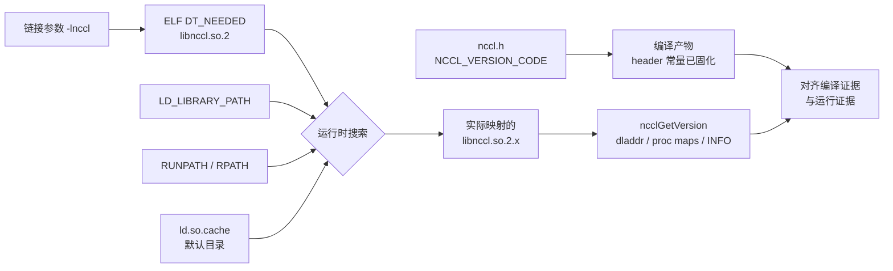

## 本章要解决什么问题

排查 NCCL 问题时，经常会看到下面几条信息：

```text
nvidia-smi: CUDA Version 13.0
nvcc: release 12.6
torch.version.cuda: 12.6
torch.cuda.nccl.version(): 2.22.3
dpkg: libnccl2 2.22.3-1+cuda12.6
NCCL INFO: NCCL version 2.22.3+cuda12.6
```

它们可以同时成立，因为它们描述的不是同一层。真正需要回答的是：

1. 程序编译时看到了哪个 `nccl.h`？
2. ELF 文件要求加载哪个 SONAME？
3. 动态链接器最终选择了哪个文件？
4. PyTorch 展示的是编译时 NCCL 版本，还是运行库版本？
5. 系统安装包正确，是否足以证明训练进程加载正确？

本章提出三个可以被实验推翻的假设：

```text
H1：系统 nccl.h 与系统 libnccl.so.2 都是 2.22.3。
H2：当前 PyTorch 的编译时 NCCL 和进程中加载的 NCCL 恰好一致。
H3：二进制只记录 SONAME；改变搜索路径可以让同一二进制加载另一份实现。
```

第三条是假设也是风险模型。实验会构造一份隔离的测试动态库证明它，而不会修改系统库或 linker cache。

## 先区分六个版本概念

### NVIDIA 驱动和 `nvidia-smi` 的 CUDA Version

GPU 内核驱动负责设备管理、提交命令和实现 CUDA Driver API。`nvidia-smi` 顶部的 `CUDA Version` 表示该驱动能够兼容的最高 CUDA 版本，不表示 `/usr/local/cuda` 中安装了对应 Toolkit。

本机实际结果是：

```text
Driver Version: 580.159.03
CUDA Version:   13.0
```

这不能推出本机存在 CUDA 13.0 的 `nvcc`。

### CUDA Toolkit 和 PyTorch CUDA

`nvcc --version` 描述本机编译 CUDA 源码时默认使用的 Toolkit：

```text
Cuda compilation tools, release 12.6, V12.6.20
```

`torch.version.cuda` 描述该 PyTorch 构建所针对的 CUDA 版本。本机也是 `12.6`。两者一致有利于扩展编译，但 PyTorch wheel/镜像也可能携带自己的 CUDA 用户态库，因此不能只凭系统 `nvcc` 判断 PyTorch runtime。

### NCCL header、runtime 和日志版本

这三者必须分开：

| 名称 | 发生阶段 | 证据 |
|---|---|---|
| header version | 编译 | `NCCL_MAJOR/MINOR/PATCH`、`NCCL_VERSION_CODE` |
| ELF dependency | 链接 | `DT_NEEDED: libnccl.so.2` |
| runtime version | 进程启动/加载 | `ncclGetVersion`、`dladdr`、`/proc/<pid>/maps` |
| NCCL log version | NCCL 初始化 | 实际运行库编译进 `VERSION_STRING` 的值 |

因此，“编译成功”只证明 header 和链接阶段可用，不证明部署时加载了同一份库。

## 从编译到运行：动态链接的完整链条

探针程序经过下面四步：

<div class="diagram-scroll" markdown="1">



</div>

这张图表达 ELF 动态链接的证据链，不表示所有搜索项具有相同优先级。最关键的断点位于 `DT_NEEDED` 与“实际映射文件”之间：前者通常只有 SONAME，后者才决定当前进程真正执行哪份 NCCL。

```text
预处理/编译
  nccl.h 把 NCCL_VERSION_CODE=22203 编进探针

链接
  linker 发现 -lnccl，把 libnccl.so.2 写进 DT_NEEDED

进程启动
  ld-linux 根据 LD_LIBRARY_PATH、RUNPATH、cache、默认目录搜索 SONAME

函数调用
  ncclGetVersion 来自被映射的那个 ELF object
```

关键点是：ELF 默认记录 `libnccl.so.2`，而不是 `/usr/lib/x86_64-linux-gnu/libnccl.so.2.22.3` 这个绝对路径。最终文件由运行时搜索规则决定。

## NCCL 源码一：版本号如何编码

源码基线：

```text
仓库：NVIDIA/nccl
版本：v2.22.3-1
提交：178b6b759074597777ce13438efb0e0ba625e429
生成文件：/usr/include/nccl.h
模板文件：src/nccl.h.in
行号：生成文件 16-22
```

安装到系统的原始 header：

```c
#define NCCL_MAJOR 2
#define NCCL_MINOR 22
#define NCCL_PATCH 3
#define NCCL_SUFFIX ""

#define NCCL_VERSION_CODE 22203
#define NCCL_VERSION(X,Y,Z) (((X) <= 2 && (Y) <= 8) ? (X) * 1000 + (Y) * 100 + (Z) : (X) * 10000 + (Y) * 100 + (Z))
```

加入课程注释后：

```c
// [课程注释] 这四个宏来自编译时 header，不需要加载 libnccl.so。
#define NCCL_MAJOR 2
#define NCCL_MINOR 22
#define NCCL_PATCH 3
#define NCCL_SUFFIX ""

// [课程注释] 2.9 以后使用 major*10000 + minor*100 + patch。
// [课程注释] 因而 2.22.3 -> 2*10000 + 22*100 + 3 = 22203。
#define NCCL_VERSION_CODE 22203

// [课程注释] 兼容分支说明 2.8 及以前采用较短的旧编码。
#define NCCL_VERSION(X,Y,Z) \
  (((X) <= 2 && (Y) <= 8) \
    ? (X) * 1000 + (Y) * 100 + (Z) \
    : (X) * 10000 + (Y) * 100 + (Z))
```

这段代码解释了两个工程事实：

1. 编译时版本可以在完全不加载 NCCL 动态库的情况下得到。
2. 自己解析整数时必须处理 NCCL 2.9 的编码变化，不能永远用同一除数。

## NCCL 源码二：运行库版本从哪里返回

元数据：

```text
文件：src/init.cc
符号：ncclGetVersion
行号：93-98
```

原始源码：

```cpp
NCCL_API(ncclResult_t, ncclGetVersion, int* version);
ncclResult_t ncclGetVersion(int* version) {
  if (version == NULL) return ncclInvalidArgument;
  *version = NCCL_VERSION_CODE;
  return ncclSuccess;
}
```

注释版：

```cpp
// [课程注释] NCCL_API 让该 C 符号具有 default visibility，可被动态链接器解析。
NCCL_API(ncclResult_t, ncclGetVersion, int* version);

ncclResult_t ncclGetVersion(int* version) {
  // [课程注释] 这里只做参数检查，不创建 communicator，也不触发 GPU 通信。
  if (version == NULL) return ncclInvalidArgument;

  // [课程注释] 这个宏属于“编译 libnccl.so 时使用的 header”。
  // 所以返回值描述当前已加载的动态库，而不是调用方自己的 header。
  *version = NCCL_VERSION_CODE;
  return ncclSuccess;
}
```

注意 `ncclGetVersion()` 没有调用上方的 `ncclInit()`。因此用它检查版本不会完成 network plugin、NVML、topology 或 communicator 初始化，也不能证明通信路径健康。

调用方 header 和运行库各自带一份 `NCCL_VERSION_CODE`：

```text
probe 中展开的 NCCL_VERSION_CODE       -> 编译时版本
libnccl.so 内 ncclGetVersion 返回的宏  -> 运行时版本
```

比较这两个值，才能发现 header/runtime mismatch。

## NCCL 源码三：日志里的版本来自哪里

元数据：`src/init.cc:491-499`，符号 `showVersion`。

原始源码：

```cpp
// Pre-process the string so that running "strings" on the lib can quickly reveal the version.
#define VERSION_STRING "NCCL version " STR(NCCL_MAJOR) "." STR(NCCL_MINOR) "." STR(NCCL_PATCH) NCCL_SUFFIX "+cuda" STR(CUDA_MAJOR) "." STR(CUDA_MINOR)
static void showVersion() {
  if (ncclDebugLevel == NCCL_LOG_VERSION || ncclDebugLevel == NCCL_LOG_WARN) {
    VERSION("%s", VERSION_STRING);
  } else {
    INFO(NCCL_ALL,"%s", VERSION_STRING);
  }
}
```

注释版：

```cpp
// [课程注释] 预处理器在构建 libnccl.so 时生成完整字符串。
// 它同时包含 NCCL 版本和构建该 NCCL 所使用的 CUDA major/minor。
#define VERSION_STRING \
  "NCCL version " STR(NCCL_MAJOR) "." STR(NCCL_MINOR) "." \
  STR(NCCL_PATCH) NCCL_SUFFIX "+cuda" STR(CUDA_MAJOR) "." STR(CUDA_MINOR)

static void showVersion() {
  // [课程注释] debug level 只改变输出通道，不改变版本来源。
  if (ncclDebugLevel == NCCL_LOG_VERSION || ncclDebugLevel == NCCL_LOG_WARN) {
    VERSION("%s", VERSION_STRING);
  } else {
    INFO(NCCL_ALL, "%s", VERSION_STRING);
  }
}
```

因此运行日志中的 `NCCL version 2.22.3+cuda12.6` 是被加载 NCCL object 自己的构建信息，比 `dpkg -l` 更接近真实进程。但若 NCCL 尚未初始化，日志可能根本没有这行，所以仍需 loader 证据。

## 一个反直觉细节：`torch.cuda.nccl.version()` 是编译时版本

本机 PyTorch 构建标签为 `2.5.0a0+872d972e41.nv24.08`。安装镜像中的源码快照没有可用 Git metadata，因此本文固定构建标签和本地源码内容，不虚构 commit provenance。

Python binding 原始源码，`torch/csrc/cuda/python_nccl.cpp:23-25`：

```cpp
PyObject* THCPModule_nccl_version(PyObject* self, PyObject* args) {
  return PyLong_FromUnsignedLongLong(version());
}
```

它调用的 `version()` 位于 `torch/csrc/cuda/nccl.cpp:473-484`：

```cpp
std::uint64_t version() {
#if defined(NCCL_MAJOR)
  constexpr std::uint64_t ver = (((uint64_t)NCCL_MAJOR) << 32) |
      (((uint64_t)NCCL_MINOR) << 16) | ((uint64_t)NCCL_PATCH);
  return ver;
#elif defined(USE_NCCL)
  // return major version "1"
  return ((uint64_t)1) << 32;
#else
  return 0;
#endif
}
```

注释版：

```cpp
std::uint64_t version() {
#if defined(NCCL_MAJOR)
  // [课程注释] 直接读取编译 PyTorch 时可见的 NCCL header 宏。
  // [课程注释] 这里没有调用动态库中的 ncclGetVersion()。
  constexpr std::uint64_t ver =
      (((uint64_t)NCCL_MAJOR) << 32) |
      (((uint64_t)NCCL_MINOR) << 16) |
      ((uint64_t)NCCL_PATCH);
  return ver;
#elif defined(USE_NCCL)
  // [课程注释] 老 NCCL header 没有版本宏时只能退化为 major=1。
  return ((uint64_t)1) << 32;
#else
  // [课程注释] PyTorch 未启用 NCCL。
  return 0;
#endif
}
```

所以 `torch.cuda.nccl.version()` 更准确的名字应该是“PyTorch 编译时 NCCL 版本”。它不能单独证明进程加载了相同版本。

PyTorch c10d 打印运行时版本采用了另一条路径。`torch/csrc/distributed/c10d/NCCLUtils.cpp:96-116` 的核心代码是：

```cpp
std::string getNcclVersion() {
  static c10::once_flag ncclGetVersionFlag;
  static std::string versionString;

  c10::call_once(ncclGetVersionFlag, []() {
    int version;
    ncclResult_t status = ncclGetVersion(&version);
    if (status != ncclSuccess || version < 100) {
      versionString = "Unknown NCCL version";
    } else {
      const int majorBase = version < 2900 ? 1000 : 10000;
      const int minorBase = 100;
      auto ncclMajor = version / majorBase;
      auto ncclMinor = (version % majorBase) / minorBase;
```

这里真实调用了 `ncclGetVersion`，并显式处理 2.9 编码变化。源码证据表明两个 PyTorch 接口语义不同：

```text
torch.cuda.nccl.version()       -> PyTorch compile-time macros
c10d getNcclVersion()           -> loaded libnccl runtime API
```

## 实验设计

完整脚本：

- [25_ch01_stack_version.sh](/assets/files/nccl-learning/scripts/25_ch01_stack_version.sh)
- [ch01_version_probe.c](/assets/files/nccl-learning/probes/ch01_version_probe.c)
- [ch01_torch_runtime.py](/assets/files/nccl-learning/probes/ch01_torch_runtime.py)
- [隔离测试库源码](/assets/files/nccl-learning/probes/ch01_fake_nccl.c)

运行命令：

```bash
cd /root/nccl-learning
./scripts/25_ch01_stack_version.sh
```

实验矩阵：

| Case | 主要变量 | 保持不变 | 预期 |
|---|---|---|---|
| system | 默认 loader path | 同一个 probe ELF | header=runtime=22203 |
| fake override | `LD_LIBRARY_PATH=<isolated-dir>` | 同一个 probe ELF | header 仍为 22203，runtime 改为 29999 |
| PyTorch | 导入当前 PyTorch | 系统 loader path | compile-time 和 loaded runtime 分别采集 |

正确性 oracle：

```text
system header code == native ncclGetVersion code
system runtime code == PyTorch 进程内 ctypes ncclGetVersion code
fake runtime code == 29999
fake runtime code != compile-time header code
/proc maps 必须出现预期 object
```

## 探针为什么同时使用四种证据

探针核心代码是：

```c
ncclResult_t result = ncclGetVersion(&runtime_code);
dladdr((void*)&ncclGetVersion, &symbol_info);

printf("header_version_code=%d\n", NCCL_VERSION_CODE);
printf("runtime_version_code=%d\n", runtime_code);
printf("nccl_get_version_object=%s\n", symbol_info.dli_fname);
```

四种证据回答不同问题：

| 证据 | 能证明什么 | 不能证明什么 |
|---|---|---|
| `readelf -d` | ELF 请求哪个 SONAME、是否带 RUNPATH | 最终选中哪个文件 |
| `LD_DEBUG=libs` | loader 搜索顺序和候选路径 | 进程稳定运行后映射是否变化 |
| `dladdr(symbol)` | 某个函数地址来自哪个 object | object 的磁盘真实版本名 |
| `/proc/<pid>/maps` | 进程真实映射文件及 inode | 调用者编译时 header |

这也是生产排障时应该组合证据的原因。

## 实际运行结果

正式 Run ID：`20260710T065547Z`。

- [summary.md](/assets/files/nccl-learning/logs/ch01_stack_version/20260710T065547Z/summary.md)
- [summary.csv](/assets/files/nccl-learning/logs/ch01_stack_version/20260710T065547Z/summary.csv)
- [system loader trace](/assets/files/nccl-learning/logs/ch01_stack_version/20260710T065547Z/raw/probe_system_ld_debug.stderr)
- [override loader trace](/assets/files/nccl-learning/logs/ch01_stack_version/20260710T065547Z/raw/probe_fake_ld_debug.stderr)
- [PyTorch runtime evidence](/assets/files/nccl-learning/logs/ch01_stack_version/20260710T065547Z/raw/torch_runtime.log)

结果矩阵：

| 观测 | system | isolated override |
|---|---:|---:|
| probe compile-time header | 22203 / 2.22.3 | 22203 / 2.22.3 |
| `ncclGetVersion()` | 22203 / 2.22.3 | 29999 / 2.99.99 |
| `dladdr` object | `/lib/x86_64-linux-gnu/libnccl.so.2` | `.../artifacts/fake/libnccl.so.2` |
| maps object | `/usr/lib/.../libnccl.so.2.22.3` | `.../artifacts/fake/libnccl.so.2` |

PyTorch 进程的独立结果：

| 观测 | 值 | 语义 |
|---|---|---|
| `torch.cuda.nccl.version()` | 2.22.3 | 编译 PyTorch 时的宏 |
| ctypes `ncclGetVersion()` | 22203 | PyTorch 进程加载的运行库 |
| `/proc/self/maps` | `/usr/lib/.../libnccl.so.2.22.3` | 实际映射文件 |

## 结果一：ELF 没有记录绝对路径

探针 dynamic section：

```text
NEEDED  Shared library: [libnccl.so.2]
NEEDED  Shared library: [libc.so.6]
```

没有 `RPATH` 或 `RUNPATH`。默认运行时，loader trace 是：

```text
find library=libnccl.so.2
trying file=/lib/x86_64-linux-gnu/libnccl.so.2
calling init: /lib/x86_64-linux-gnu/libnccl.so.2
```

`/lib` 在该系统上最终对应同一 inode 的版本化文件：

```text
/usr/lib/x86_64-linux-gnu/libnccl.so.2.22.3
```

系统 object 的 Build ID 为 `b1a769ca928f7a4958df700fe24ff5b0205307fb`，SHA-256 为 `b18757d3...f61817abd`。生产基线记录 Build ID 或 hash，比只记录软链接路径更能识别文件漂移。

## 结果二：同一二进制可以得到不同运行版本

加入隔离搜索目录后，loader 先尝试 glibc hardware capability 子目录，最后命中：

```text
trying file=.../artifacts/fake/libnccl.so.2
calling init: .../artifacts/fake/libnccl.so.2
```

同一探针的输出变成：

```text
header_version_code=22203
runtime_version_code=29999
runtime_version=2.99.99
```

编译时值没有变化，因为它已经成为 probe ELF 中的常量；运行时值变化，因为 `ncclGetVersion` 符号来自另一个 object。H3 得到直接验证。

测试库只导出了 `ncclGetVersion`，不能运行 collective。它的作用是用最小反例证明 loader 机制，不是伪装成另一版 NCCL，也没有注入 PyTorch 或系统进程。

## 结果三：本机恰好全部对齐，但证据来源不同

本机版本矩阵：

| 层 | 值 |
|---|---|
| Driver | 580.159.03，最高兼容 CUDA 13.0 |
| CUDA Toolkit | 12.6.20 |
| PyTorch build | 2.5.0a0+872d972e41.nv24.08 |
| PyTorch CUDA build | 12.6 |
| PyTorch NCCL compile-time macros | 2.22.3 |
| loaded NCCL runtime | 2.22.3 |
| Debian `libnccl-dev` | 2.22.3-1+cuda12.6 |
| Debian `libnccl2` | 2.22.3-1+cuda12.6 |

H1 和 H2 在当前节点成立。但这不是因为 `torch.cuda.nccl.version()` 自动验证了 runtime，而是因为我们分别采集后发现它们相等。

## 常见错误判断

### 错误一：`nvidia-smi` 显示 CUDA 13，所以程序用 CUDA 13

错误。它描述驱动兼容上限。本机 `nvcc` 和 PyTorch 都是 CUDA 12.6。

### 错误二：`dpkg -l | grep nccl` 足以证明训练进程版本

错误。容器 bind mount、`LD_LIBRARY_PATH`、RUNPATH 和手工安装都可能覆盖系统包。

### 错误三：`ldd` 永远等于真实运行路径

不够严谨。`ldd` 在当前环境下模拟解析；实际进程可能有不同环境变量、启动器或动态 `dlopen`。对运行中的 PID 查看 maps 更直接。

### 错误四：`torch.cuda.nccl.version()` 是 runtime query

当前 PyTorch 源码明确表明它读取编译时宏。要检查 runtime，调用 `ncclGetVersion` 或查看 c10d/NCCL 初始化日志和进程 maps。

### 错误五：版本相同就不存在 ABI 或行为差异

包版本字符串相同仍可能存在 vendor patch、不同编译选项或被替换的二进制。Build ID、hash、包来源和精确源码 tag都应该进入基线。

## 生产排查顺序

遇到版本和加载问题时，按以下顺序收集证据：

```text
1. 保存进程启动环境中的 LD_LIBRARY_PATH、容器 mount 和 NCCL_*。
2. 记录 PyTorch/CUDA 的编译版本，但标明它们是 compile-time 信息。
3. 对目标 ELF 执行 readelf -d，检查 NEEDED、RPATH 和 RUNPATH。
4. 用 LD_DEBUG=libs 在最小复现上观察搜索顺序。
5. 在真实进程中调用 ncclGetVersion，并检查 /proc/<pid>/maps。
6. 解析实际文件的 SONAME、Build ID、hash 和 package owner。
7. 使用匹配 runtime 的 tag/commit 阅读源码。
8. 升级时同时做正确性、路径和性能回归，不能只比较版本字符串。
```

## 版本与结论边界

本文实验验证的是当前 Linux/glibc 环境、系统 NCCL 2.22.3 和这份 PyTorch 构建。ELF 搜索优先级还会受到 secure-execution、`DT_RPATH`/`DT_RUNPATH`、`dlopen` flags 和容器 runtime 影响。

本地两份 NCCL 源码用途不同：

```text
third_party/nccl-2.22.3  v2.22.3-1@178b6b7  解释本机运行行为
third_party/nccl         2026 master           研究新版本演进
```

后续文章的源码结论默认基于第一份。master 中即使函数同名，也不能覆盖 2.22.3 的实际分支。

## 本章结论

1. `nvidia-smi`、`nvcc`、PyTorch CUDA、NCCL header 和 NCCL runtime 是不同层的版本证据。
2. `torch.cuda.nccl.version()` 在当前 PyTorch 实现中返回编译时宏，不是 runtime query。
3. `ncclGetVersion()` 返回构建已加载 `libnccl.so` 时使用的 `NCCL_VERSION_CODE`，但不会初始化 communicator。
4. 探针 ELF 只依赖 `libnccl.so.2` SONAME；`LD_LIBRARY_PATH` 反例证明同一二进制可以加载不同实现。
5. 当前节点的 header、PyTorch compile-time 和实际 runtime 都是 2.22.3，但这个结论来自独立证据相互印证。
6. 生产基线至少应记录 maps 路径、Build ID/hash、runtime API、包版本和匹配源码 commit。

## 练习与验收

完成本章后应能独立回答：

1. `DT_NEEDED`、SONAME、RPATH、RUNPATH 和 `LD_LIBRARY_PATH` 分别在哪个阶段起作用？
2. 为什么 probe 中的 `NCCL_VERSION_CODE` 和 `ncclGetVersion` 可能不同？
3. 为什么 `dladdr` 显示 `/lib/.../libnccl.so.2`，maps 却显示 `/usr/lib/.../libnccl.so.2.22.3`？
4. 如何在不重启训练、不修改系统库的情况下证明某个 PID 正在使用哪份 NCCL？
5. 版本升级 canary 中，为什么必须记录 Build ID 和 hash，而不能只记录 `2.22.3`？
