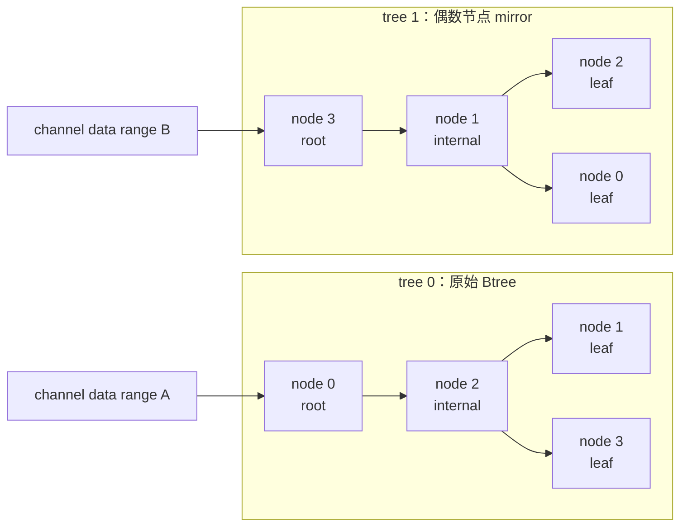

## 本章问题

“Tree 小消息快，Ring 大消息快”只能当作待验证的经验，不能当作
NCCL 原理。它省略了至少五个变量：

```text
Tree 是平衡二叉树，还是节点内链 + 节点间树？
Tree 和 Ring 是否使用同一个 protocol？
消息被多少个 channel 切分？
world size 和 node 数分别是多少？
当前拓扑搜索究竟生成了什么 parent/children？
```

这一章不从口号出发，而是回答以下问题：

1. NCCL 中 `up`、`down[]`、reduce-up 和 broadcast-down 分别是什么。
2. 单机 GPU 间的 Tree 和多节点间的 double binary tree 如何拼起来。
3. `runTreeSplit` 如何让上行规约和下行广播在同一个 kernel 中流水。
4. 偶数节点为什么 mirror，奇数节点为什么 shift。
5. 当前 4×V100 机器上的 active tree 到底是什么形状。
6. 固定 `Simple + 12 channels` 后，Ring/Tree 的真实交叉区间在哪里。

学完后，应该能从 GRAPH 日志复原每个 channel 的树，能判断某个 rank
是 root、leaf 还是 internal node，并且不会把“源码支持双树”误写成
“当前单机已经测到了多节点双树收益”。

## 证据边界

本文固定以下源码和运行环境：

```text
NCCL source: v2.22.3-1
source commit: 178b6b759074597777ce13438efb0e0ba625e429
runtime NCCL: 2.22.3+cuda12.6
nccl-tests commit: 5bcd45d2ee8365e37895e118c9d11b0ebc15aa69
GPU: 4 x Tesla V100-SXM2-32GB
GPU links: every GPU pair reports NV2
nodes: 1
visible RDMA HCA: 0
```

本文区分三类结论：

- **源码证明**：Tree 的构造和 device 数据流可从固定提交直接推出。
- **本机实验验证**：单节点 active tree、正确性和 Ring/Tree 性能来自正式运行。
- **尚未验证**：多节点 IB/RoCE 上的真实双树性能没有对应硬件，不能虚构。

正式运行目录：

- [实验汇总](/assets/files/nccl-learning/logs/ch13_tree/20260710T155522Z/summary.md)
- [运行清单](/assets/files/nccl-learning/logs/ch13_tree/20260710T155522Z/manifest.txt)
- [1740 条原始性能记录](/assets/files/nccl-learning/logs/ch13_tree/20260710T155522Z/raw_measurements.csv)
- [完整统计表](/assets/files/nccl-learning/logs/ch13_tree/20260710T155522Z/summary.csv)

## 前置知识

建议先完成：

- [第 08 章：algbw 与 busbw](/posts/nccl-performance-model-statistics/)
- [第 09 章：Benchmark 方法学](/posts/nccl-tests-benchmark/)
- [第 10 章：延迟-带宽模型](/posts/nccl-latency-bandwidth-model/)
- [第 12 章：Ring AllReduce 逐步推导](/posts/nccl-ring-allreduce-steps/)

本文继续沿用两个概念：

```text
channel: 一份独立的通信拓扑和 device work 分片
chunk:   一个 channel 内继续流水处理的数据块
```

多个 channel 不是把完整消息重复发送多次。`ncclCollCbdPart` 会给每个
channel 分配不同的 `gridOffset/channelCount/chunkCount`，各 channel
并行处理整条消息的不同区间。

## 先固定方向

对任意 rank，`ncclTree` 的方向定义是：

```text
up       = parent，朝向 root
down[]   = children，离开 root
```

AllReduce 的两个数据流方向相反：

```text
Reduce:
  receive from down[]
  reduce local input
  send to up

Broadcast:
  receive from up
  copy result
  send to down[]
```

所以日志：

```text
Tree 0 : -1 -> 0 -> 1/-1/-1
```

表示 channel 0 上 rank 0 的 `up=-1`、`down[0]=1`。rank 0 是 root，
child 是 rank 1。它绝不是“rank 0 从 -1 收到、再发送给 1”的事件日志，
而是静态邻接关系。

## 数据结构不是纯二叉树

仓库：`NVIDIA/nccl`  
版本：`v2.22.3-1`  
提交：`178b6b7`  
文件：`src/include/device.h:160-168`  
符号：`NCCL_MAX_TREE_ARITY_TOP`、`NCCL_MAX_TREE_ARITY`、`ncclTree`

原始源码：

```cpp
// The root of each tree only has one node down (+1 intra-node).
#define NCCL_MAX_TREE_ARITY_TOP 2
// Nodes inside the binary tree can have to two nodes down (+1 intra-node).
#define NCCL_MAX_TREE_ARITY 3
struct ncclTree {
  int depth;
  int up;
  int down[NCCL_MAX_TREE_ARITY];
};
```

注释版：

```cpp
// [课程注释] 节点间二叉树 root 最多一个远端 child，
// [课程注释] 再加一个节点内方向，所以顶部 primitive 最大 fan-out 为 2。
#define NCCL_MAX_TREE_ARITY_TOP 2

// [课程注释] 非 root 可有两个远端 children，再叠加一个节点内 child。
#define NCCL_MAX_TREE_ARITY 3

struct ncclTree {
  int depth;                         // [课程注释] 近似深度，供模型与调度使用
  int up;                            // [课程注释] parent rank，root 为 -1
  int down[NCCL_MAX_TREE_ARITY];     // [课程注释] child ranks，空槽为 -1
};
```

为什么叫 binary tree，数组却有三个 child 槽？因为 NCCL 构造的是
**层次化树**：节点间最多两个二叉树 child，节点内还可能接一条 GPU 链。
只看 `down[3]` 就断言它是三叉树，同样是错误的。

`depth` 也不是运行时遍历每条边得到的精确图论深度。后面会看到，
`connectTrees` 用 local ranks 和 node count 给出近似值。

## 理想成本模型

设：

```text
N = rank 数
D = 实际 tree 深度
M = 每个 rank 的消息字节数
α = 每个依赖阶段的固定成本
B = 有效链路带宽
```

忽略 channel、chunk 和双树流水时，可先写出粗略模型：

$$
T_{tree} \approx 2D\alpha + \frac{2M}{B_{tree}}
$$

上行 reduce 走 $D$ 层，下行 broadcast 再走 $D$ 层。每条树边分别承载
完整数据区间的上行和下行流量。

Ring 的同阶模型是：

$$
T_{ring} \approx 2(N-1)\alpha
+ \frac{2(N-1)}{N}\frac{M}{B_{ring}}
$$

如果 $D\approx\lceil\log_2 N\rceil$，Tree 的依赖深度可能更小；如果
实际树退化成深度 $N-1$ 的链，Tree 的延迟项就没有这个优势。同时，
Ring 将消息切成 $N$ 份并让所有链路稳态流水，通常更容易获得大消息带宽。

这些公式不能直接预测本机数值，因为：

1. Tree 上下行能以 chunk 粒度重叠，不是两个完全串行的全消息阶段。
2. 多 channel 会并行处理不同数据区间。
3. `B_tree` 和 `B_ring` 包含不同 primitive、线程分工和链路争用。
4. 当前单机 active tree 不是节点间平衡树。

它们的正确用途是提出可证伪预测，而不是代替测量。

## 层次化构图总览

NCCL 2.22.3 的关键路径可以简化为：

```text
topology graph search
  -> graph->intra[c][local rank order]
  -> ncclTopoPreset: 先建立节点内 chain 和候选 head
  -> allgather every node's topoRanks
  -> ncclTopoPostset
  -> connectTrees
       -> ncclGetDtree(nNodes, node)
       -> 把节点间 parent/children 接到本地 head rank
  -> comm->channels[c].tree
  -> connect tree transports
  -> RunWorkColl<Tree, Protocol>
```

这里有两个不同坐标系：

```text
treeIntra[] / treeToParent[]: user rank
ncclGetDtree():              node index
```

`connectTrees` 负责把 node index 映射回每个节点上的 head rank。把
`ncclGetDtree(nNodes, node)` 误读为 `ncclGetDtree(nRanks, rank)`，就会
错误地把所有 GPU 画成一棵全局二叉树。

## 节点内先形成链

仓库：`NVIDIA/nccl`  
版本：`v2.22.3-1`  
提交：`178b6b7`  
文件：`src/graph/connect.cc:41-72`  
符号：`ncclTopoPreset`

原始源码：

```cpp
int* ringIntra = graphs[NCCL_ALGO_RING]->intra+c*localRanks;
int* treeIntra = graphs[NCCL_ALGO_TREE]->intra+c*localRanks;
int* collNetIntra = graphs[NCCL_ALGO_COLLNET_CHAIN]->intra+c*localRanks;

for (int i=0; i<localRanks; i++) {
  if (ringIntra[i] == rank) {
    topoRanks->ringRecv[c] = ringIntra[0];
    topoRanks->ringSend[c] = ringIntra[localRanks-1];
    topoRanks->ringPrev[c] = (i == 0) ? -1 : ringIntra[i-1];
    topoRanks->ringNext[c] = (i == localRanks-1) ? -1 : ringIntra[i+1];
  }
  if (treeIntra[i] == rank) {
    int parentIndex = 0;
    int child0Index = graphs[NCCL_ALGO_TREE]->pattern == NCCL_TOPO_PATTERN_TREE ? 0 : 1;
    int child1Index = graphs[NCCL_ALGO_TREE]->pattern == NCCL_TOPO_PATTERN_SPLIT_TREE ? 1 : 0;

    topoRanks->treeToParent[c] = treeIntra[parentIndex];
    topoRanks->treeToChild0[c] = treeIntra[child0Index];
    topoRanks->treeToChild1[c] = treeIntra[child1Index];
    channel->tree.up         = i == 0 ? -1 : treeIntra[i-1];
    channel->tree.down[0]    = i == localRanks-1 ? -1 : treeIntra[i+1];
  }
}

// Duplicate channels trees
struct ncclChannel* channel0 = comm->channels;
struct ncclChannel* channel1 = channel0+nChannels;
memcpy(channel1, channel0, nChannels*sizeof(struct ncclChannel));
```

注释版：

```cpp
// [课程注释] topology search 已经为每个 channel 给出本地 GPU 顺序。
int* treeIntra = graphs[NCCL_ALGO_TREE]->intra+c*localRanks;

for (int i=0; i<localRanks; i++) {
  if (treeIntra[i] == rank) {
    // [课程注释] 三种 pattern 决定哪个本地 GPU 对接节点间 parent/children。
    int parentIndex = 0;
    int child0Index = graphs[NCCL_ALGO_TREE]->pattern == NCCL_TOPO_PATTERN_TREE ? 0 : 1;
    int child1Index = graphs[NCCL_ALGO_TREE]->pattern == NCCL_TOPO_PATTERN_SPLIT_TREE ? 1 : 0;

    // [课程注释] 保存 head rank，稍后 connectTrees 用它连接不同节点。
    topoRanks->treeToParent[c] = treeIntra[parentIndex];
    topoRanks->treeToChild0[c] = treeIntra[child0Index];
    topoRanks->treeToChild1[c] = treeIntra[child1Index];

    // [课程注释] 节点内不是在这里造平衡树，而是按 treeIntra 顺序造链。
    channel->tree.up      = i == 0 ? -1 : treeIntra[i-1];
    channel->tree.down[0] = i == localRanks-1 ? -1 : treeIntra[i+1];
  }
}

// [课程注释] 为第二棵节点间树复制一组 channel 元数据。
struct ncclChannel* channel0 = comm->channels;
struct ncclChannel* channel1 = channel0+nChannels;
memcpy(channel1, channel0, nChannels*sizeof(struct ncclChannel));
```

这个片段给出三个直接结论：

1. `treeIntra` 的顺序由 topology graph search 产生，不必等于 user rank 顺序。
2. 节点内先构造 `up=前一个、down[0]=后一个` 的链。
3. channel metadata 先复制一份，随后两份分别连接到两棵节点间树。

当前环境只有一个 node，因此第三步不会增加任何跨节点边。实验中看到的
active tree 是多个不同 `treeIntra` 排列形成的 GPU 链；这不是源码没有
double tree，而是 double tree 的 node-level 输入只有一个顶点。

## 节点间连接

仓库：`NVIDIA/nccl`  
版本：`v2.22.3-1`  
提交：`178b6b7`  
文件：`src/graph/connect.cc:137-172`  
符号：`connectTrees`

原始源码：

```cpp
static ncclResult_t connectTrees(struct ncclComm* comm, int* treeToParent,
    int* treeToChild0, int* treeToChild1, int* treePatterns) {
  const int nChannels = comm->nChannels, nNodes = comm->nNodes, node = comm->node;

  // Compute tree depth. Not an exact value but a good approximation in most
  // cases
  int depth = comm->nRanks/nNodes - 1 + log2i(nNodes);

  int t0u, t0d0, t0d1, t0ChildType, t1u, t1d0, t1d1, t1ChildType;
  int* ttp, *ttc0, *ttc1;
  NCCLCHECK(ncclGetDtree(nNodes, node, &t0u, &t0d0, &t0d1, &t0ChildType,
      &t1u, &t1d0, &t1d1, &t1ChildType));
  for (int c=0; c<nChannels; c++) {
    struct ncclChannel* channel0 = comm->channels+c;
    struct ncclChannel* channel1 = channel0+nChannels;
    ttp = treeToParent+c*comm->nNodes;
    ttc0 = treeToChild0+c*comm->nNodes;
    ttc1 = treeToChild1+c*comm->nNodes;
    if (comm->rank == ttp[node]) {
      NCCLCHECK(setTreeUp(&channel0->tree, t0ChildType == 0 ? ttc0 : ttc1, t0u));
      NCCLCHECK(setTreeUp(&channel1->tree, t1ChildType == 0 ? ttc0 : ttc1, t1u));
    }
    if (comm->rank == ttc0[node]) {
      NCCLCHECK(setTreeDown(&channel0->tree, ttp, t0d0));
      NCCLCHECK(setTreeDown(&channel1->tree, ttp, t1d0));
    }
    if (comm->rank == ttc1[node]) {
      NCCLCHECK(setTreeDown(&channel0->tree, ttp, t0d1));
      NCCLCHECK(setTreeDown(&channel1->tree, ttp, t1d1));
    }
    channel0->tree.depth = channel1->tree.depth = depth;
  }
  return ncclSuccess;
}
```

注释版：

```cpp
const int nChannels = comm->nChannels;
const int nNodes = comm->nNodes;
const int node = comm->node;  // [课程注释] 当前 rank 所在节点的 index

// [课程注释] 节点内链深度 + 节点间近似二叉树深度。
int depth = comm->nRanks/nNodes - 1 + log2i(nNodes);

// [课程注释] 输入是 nNodes/node，不是 nRanks/rank。
NCCLCHECK(ncclGetDtree(nNodes, node,
    &t0u, &t0d0, &t0d1, &t0ChildType,
    &t1u, &t1d0, &t1d1, &t1ChildType));

for (int c=0; c<nChannels; c++) {
  // [课程注释] channel0 和 channel1 承载两棵互补 node-level tree。
  struct ncclChannel* channel0 = comm->channels+c;
  struct ncclChannel* channel1 = channel0+nChannels;

  // [课程注释] ttp/ttc 保存每个 node 上负责接 parent/child 的 user rank。
  ttp = treeToParent+c*comm->nNodes;
  ttc0 = treeToChild0+c*comm->nNodes;
  ttc1 = treeToChild1+c*comm->nNodes;

  if (comm->rank == ttp[node]) {
    // [课程注释] 只有本节点的 parent head 增加跨节点 up 边。
    NCCLCHECK(setTreeUp(&channel0->tree,
        t0ChildType == 0 ? ttc0 : ttc1, t0u));
    NCCLCHECK(setTreeUp(&channel1->tree,
        t1ChildType == 0 ? ttc0 : ttc1, t1u));
  }
  if (comm->rank == ttc0[node]) {
    // [课程注释] child0 head 增加跨节点 down 边。
    NCCLCHECK(setTreeDown(&channel0->tree, ttp, t0d0));
    NCCLCHECK(setTreeDown(&channel1->tree, ttp, t1d0));
  }
  if (comm->rank == ttc1[node]) {
    NCCLCHECK(setTreeDown(&channel0->tree, ttp, t0d1));
    NCCLCHECK(setTreeDown(&channel1->tree, ttp, t1d1));
  }
}
```

`treePatterns` 在这个函数签名中存在，但这段实现没有读取它；真正决定
本地 head 的 pattern 分支已经在 `ncclTopoPreset` 中完成。

对当前机器：

```text
nRanks = 4
nNodes = 1
depth = 4/1 - 1 + log2i(1) = 3
```

正式 GRAPH 日志复原的每棵 active tree 最大深度也确实是 3。

## Btree 的 bit 构造

仓库：`NVIDIA/nccl`  
版本：`v2.22.3-1`  
提交：`178b6b7`  
文件：`src/graph/trees.cc:31-64`  
符号：`ncclGetBtree`

原始源码：

```cpp
ncclResult_t ncclGetBtree(int nranks, int rank, int* u, int* d0, int* d1,
    int* parentChildType) {
  int up, down0, down1;
  int bit;
  for (bit=1; bit<nranks; bit<<=1) {
    if (bit & rank) break;
  }

  if (rank == 0) {
    *u = -1;
    *d0 = -1;
    *d1 = nranks > 1 ? bit >> 1 : -1;
    return ncclSuccess;
  }

  up = (rank ^ bit) | (bit << 1);
  if (up >= nranks) up = (rank ^ bit);
  *parentChildType = (rank < up) ? 0 : 1;
  *u = up;

  int lowbit = bit >> 1;
  down0 = lowbit == 0 ? -1 : rank-lowbit;

  down1 = lowbit == 0 ? -1 : rank+lowbit;
  while (down1 >= nranks) {
    down1 = lowbit == 0 ? -1 : rank+lowbit;
    lowbit >>= 1;
  }
  *d0 = down0; *d1 = down1;
  return ncclSuccess;
}
```

注释版：

```cpp
// [课程注释] 找 rank 二进制表示中的最低有效 1 bit。
for (bit=1; bit<nranks; bit<<=1) {
  if (bit & rank) break;
}

if (rank == 0) {
  *u = -1;                         // [课程注释] rank 0 是 tree0 root
  *d0 = -1;
  *d1 = nranks > 1 ? bit >> 1 : -1;
  return ncclSuccess;
}

// [课程注释] 清除 low bit，再设置高一位，优先寻找 parent。
up = (rank ^ bit) | (bit << 1);
// [课程注释] 非 2 的幂节点数可能越界，退回只清除 low bit 的 parent。
if (up >= nranks) up = (rank ^ bit);

// [课程注释] parentChildType 告诉 connectTrees 应使用哪类本地 head。
*parentChildType = (rank < up) ? 0 : 1;
*u = up;

int lowbit = bit >> 1;
// [课程注释] 左、右子树候选在 rank 两侧各偏移 lowbit。
down0 = lowbit == 0 ? -1 : rank-lowbit;
down1 = lowbit == 0 ? -1 : rank+lowbit;
while (down1 >= nranks) {
  // [课程注释] 右 child 越界时逐级缩小偏移寻找合法节点。
  down1 = lowbit == 0 ? -1 : rank+lowbit;
  lowbit >>= 1;
}
```

以四个 node 为例，tree0 是：

```text
      node 0
         |
      node 2
      /    \
 node 1  node 3
```

深度是 2。注意源码注释中的 Btree 会让 node 0 顶部只有一个 child，
这与 `NCCL_MAX_TREE_ARITY_TOP` 的约束一致。

## 双树：偶数 mirror，奇数 shift

仓库：`NVIDIA/nccl`  
版本：`v2.22.3-1`  
提交：`178b6b7`  
文件：`src/graph/trees.cc:88-108`  
符号：`ncclGetDtree`

原始源码：

```cpp
ncclResult_t ncclGetDtree(int nranks, int rank,
    int* s0, int* d0_0, int* d0_1, int* parentChildType0,
    int* s1, int* d1_0, int* d1_1, int* parentChildType1) {
  ncclGetBtree(nranks, rank, s0, d0_0, d0_1, parentChildType0);
  if (nranks % 2 == 1) {
    int shiftrank = (rank-1+nranks) % nranks;
    int u, d0, d1;
    ncclGetBtree(nranks, shiftrank, &u, &d0, &d1, parentChildType1);
    *s1 = u == -1 ? -1 : (u+1) % nranks;
    *d1_0 = d0 == -1 ? -1 : (d0+1) % nranks;
    *d1_1 = d1 == -1 ? -1 : (d1+1) % nranks;
  } else {
    int u, d0, d1;
    ncclGetBtree(nranks, nranks-1-rank, &u, &d0, &d1, parentChildType1);
    *s1 = u == -1 ? -1 : nranks-1-u;
    *d1_0 = d0 == -1 ? -1 : nranks-1-d0;
    *d1_1 = d1 == -1 ? -1 : nranks-1-d1;
  }
  return ncclSuccess;
}
```

注释版：

```cpp
// [课程注释] tree0 永远使用原始 Btree。
ncclGetBtree(nranks, rank, s0, d0_0, d0_1, parentChildType0);

if (nranks % 2 == 1) {
  // [课程注释] 奇数节点无法用完全镜像保证理想互补，循环平移一个 rank。
  int shiftrank = (rank-1+nranks) % nranks;
  ncclGetBtree(nranks, shiftrank, &u, &d0, &d1, parentChildType1);

  // [课程注释] 把临时坐标中的 parent/children 平移回原 node index。
  *s1 = u == -1 ? -1 : (u+1) % nranks;
  *d1_0 = d0 == -1 ? -1 : (d0+1) % nranks;
  *d1_1 = d1 == -1 ? -1 : (d1+1) % nranks;
} else {
  // [课程注释] 偶数节点将 rank 映射为 nranks-1-rank，得到镜像树。
  ncclGetBtree(nranks, nranks-1-rank, &u, &d0, &d1, parentChildType1);

  // [课程注释] 再把镜像坐标映射回原 node index。
  *s1 = u == -1 ? -1 : nranks-1-u;
  *d1_0 = d0 == -1 ? -1 : nranks-1-d0;
  *d1_1 = d1 == -1 ? -1 : nranks-1-d1;
}
```

对 4 node，tree1 是 tree0 的镜像：

```text
      node 3
         |
      node 1
      /    \
 node 2  node 0
```

tree0 的 internal nodes 是 `{0,2}`，tree1 是 `{1,3}`，没有重合。
这让一个 node 不必在两棵树上同时承担内部转发热点。对奇数 node，实验会
看到 internal node 仍可能有一个重合；“双树内部节点绝对不重合”只对
这里的偶数 mirror 构造成立。

<div class="diagram-scroll" markdown="1">



</div>

这是 `ncclGetDtree(4, node)` 的节点间结构。两棵树处理不同 channel 数据区间，而不是各自重复处理整条消息；单机 active tree 还会受节点内 chain 影响，不能把这张 4-node 构造图直接当成本机四 GPU 的实测树形。

## 为什么不是发送两份完整消息

`connect.cc` 复制的是 channel 拓扑元数据，不是用户 buffer。执行时，
两棵树所在的 channel 仍通过 `ncclCollCbdPart` 获得不同数据范围：

```text
full message
  -> channel 0 data range -> tree 0 path
  -> channel 1 data range -> tree 1 path
  -> channel 2 data range -> another topology path
  ...
```

double tree 的目标是把不同 chunk 的内部转发负担摊到互补节点，不是把
每个 byte 在两棵树上各做一次 AllReduce。

## 当前环境命中哪个 device 实现

仓库：`NVIDIA/nccl`  
版本：`v2.22.3-1`  
提交：`178b6b7`  
文件：`src/device/all_reduce.h:223-239`  
符号：`RunWorkColl<ncclFuncAllReduce, ..., NCCL_ALGO_TREE, NCCL_PROTO_SIMPLE>`

原始源码：

```cpp
template<typename T, typename RedOp>
struct RunWorkColl<ncclFuncAllReduce, T, RedOp,
    NCCL_ALGO_RING, NCCL_PROTO_SIMPLE> {
  __device__ __forceinline__ void run(int tid, int nthreads,
      struct ncclDevWorkColl* work) {
    using Proto = ProtoSimple<ALLREDUCE_CHUNKSTEPS/ALLREDUCE_SLICESTEPS,
                              ALLREDUCE_SLICESTEPS>;
    runRing<T, RedOp, Proto>(tid, nthreads, work);
  }
};

template<typename T, typename RedOp>
struct RunWorkColl<ncclFuncAllReduce, T, RedOp,
    NCCL_ALGO_TREE, NCCL_PROTO_SIMPLE> {
  __device__ __forceinline__ void run(int tid, int nthreads,
      struct ncclDevWorkColl* work) {
    #if CUDART_VERSION >= 11020 && CUDART_VERSION < 11040 && __CUDA_ARCH__ >= 800
      runTreeUpDown<T, RedOp, ProtoSimple<1, 1>>(tid, nthreads, work);
    #else
      runTreeSplit<T, RedOp, ProtoSimple<1, 1>>(tid, nthreads, work);
    #endif
  }
};
```

注释版：

```cpp
// [课程注释] Ring+Simple 使用 AllReduce 专用 chunk/slice 参数。
using Proto = ProtoSimple<
    ALLREDUCE_CHUNKSTEPS/ALLREDUCE_SLICESTEPS,
    ALLREDUCE_SLICESTEPS>;
runRing<T, RedOp, Proto>(tid, nthreads, work);

// [课程注释] 只有 CUDA 11.2/11.3 编译且 Ampere+ 才走旧的 UpDown 分支。
#if CUDART_VERSION >= 11020 && CUDART_VERSION < 11040 && __CUDA_ARCH__ >= 800
  runTreeUpDown<T, RedOp, ProtoSimple<1, 1>>(tid, nthreads, work);
#else
  // [课程注释] 当前 CUDA 12.6 + V100 明确命中 runTreeSplit。
  runTreeSplit<T, RedOp, ProtoSimple<1, 1>>(tid, nthreads, work);
#endif
```

因此本文不能用 `runTreeUpDown` 解释本机 kernel。固定源码版本后，还要
根据编译 CUDA 版本和 GPU architecture 展开预处理分支。

## runTreeSplit 如何流水

仓库：`NVIDIA/nccl`  
版本：`v2.22.3-1`  
提交：`178b6b7`  
文件：`src/device/all_reduce.h:146-219`  
符号：`runTreeSplit`

先看线程分配和 root：

```cpp
int nthreadsSplit;
if (Proto::Id == NCCL_PROTO_SIMPLE) {
  nthreadsSplit = nthreads/2;
  if (nthreadsSplit >= 256) nthreadsSplit += 64;
} else { // LL & LL128
  // Receiving from up to 3 sources is more compute intensive than sending
  // to 3 dests. Use 70% for reduce and 30% for bcast.
  nthreadsSplit = (nthreads*7/(10*WARP_SIZE))*WARP_SIZE;
}

if (tree->up == -1) {
  // Reduce and broadcast. Max number of recv is 2, max number of send is 2
  Primitives<T, RedOp, FanSymmetric<NCCL_MAX_TREE_ARITY_TOP>,
      /*Direct=*/1, Proto, 0>
    prims(tid, nthreads, tree->down, tree->down,
        work->sendbuff, work->recvbuff, work->redOpArg);
  for (size_t elemOffset = 0; elemOffset < channelCount;
      elemOffset += chunkCount) {
    offset = gridOffset + elemOffset;
    nelem = min(chunkCount, channelCount - elemOffset);
    prims.directRecvReduceCopySend(offset, offset, nelem, /*doPost=*/true);
  }
}
```

注释版：

```cpp
if (Proto::Id == NCCL_PROTO_SIMPLE) {
  // [课程注释] Simple 基本按一半切线程；大 block 再向 reduce 侧多给 64 线程。
  nthreadsSplit = nthreads/2;
  if (nthreadsSplit >= 256) nthreadsSplit += 64;
} else {
  // [课程注释] LL/LL128 固定约 70% 线程做多源规约，30% 做广播。
  nthreadsSplit = (nthreads*7/(10*WARP_SIZE))*WARP_SIZE;
}

if (tree->up == -1) {
  // [课程注释] up=-1 唯一标识 root。
  Primitives<T, RedOp, FanSymmetric<NCCL_MAX_TREE_ARITY_TOP>,
      /*Direct=*/1, Proto, 0> prims(
          tid, nthreads,
          tree->down, tree->down,  // [课程注释] 从 children 收，也发回 children
          work->sendbuff, work->recvbuff, work->redOpArg);

  for (...) {
    // [课程注释] 对每个 chunk：接收 children、规约、写 output、立即向下发。
    prims.directRecvReduceCopySend(
        offset, offset, nelem, /*doPost=*/true);
  }
}
```

root 没有把完整消息全部 reduce 完再启动第二个 broadcast kernel。
`directRecvReduceCopySend` 在 chunk 粒度融合了：

```text
recv children
  -> reduce
  -> post-op
  -> copy output
  -> send children
```

这就是前面成本模型中不能把两个全消息阶段完全串行相加的原因。

再看非 root：

```cpp
else if (tid < nthreadsSplit) {
  Primitives<T, RedOp, FanAsymmetric<NCCL_MAX_TREE_ARITY, 1>,
      /*Direct=*/1, Proto, 0>
    prims(tid, nthreadsSplit, tree->down, &tree->up,
        work->sendbuff, work->recvbuff, work->redOpArg,
        0*Proto::MaxGroupWidth);
  if (tree->down[0] == -1) {
    for (size_t elemOffset = 0; elemOffset < channelCount;
        elemOffset += chunkCount) {
      offset = gridOffset + elemOffset;
      nelem = min(chunkCount, channelCount - elemOffset);
      prims.send(offset, nelem);
    }
  } else {
    for (size_t elemOffset = 0; elemOffset < channelCount;
        elemOffset += chunkCount) {
      offset = gridOffset + elemOffset;
      nelem = min(chunkCount, channelCount - elemOffset);
      prims.recvReduceSend(offset, nelem);
    }
  }
}
else {
  Primitives<T, RedOp, FanAsymmetric<1, NCCL_MAX_TREE_ARITY>,
      /*Direct=*/1, Proto, 0>
    prims(tid-nthreadsSplit, nthreads-nthreadsSplit,
        &tree->up, tree->down,
        work->sendbuff, work->recvbuff, work->redOpArg,
        1*Proto::MaxGroupWidth);
  if (tree->down[0] == -1) {
    for (size_t elemOffset = 0; elemOffset < channelCount;
        elemOffset += chunkCount) {
      offset = gridOffset + elemOffset;
      nelem = min(chunkCount, channelCount - elemOffset);
      prims.directRecv(offset, nelem);
    }
  } else {
    for (size_t elemOffset = 0; elemOffset < channelCount;
        elemOffset += chunkCount) {
      offset = gridOffset + elemOffset;
      nelem = min(chunkCount, channelCount - elemOffset);
      prims.directRecvCopySend(offset, nelem);
    }
  }
}
```

注释版：

```cpp
else if (tid < nthreadsSplit) {
  // [课程注释] block 前半部分线程只负责 reduce-up。
  // recv peers = down[]; send peer = up。
  Primitives<..., FanAsymmetric<NCCL_MAX_TREE_ARITY, 1>, ...>
    prims(..., tree->down, &tree->up, ...,
          0*Proto::MaxGroupWidth);

  if (tree->down[0] == -1) {
    // [课程注释] leaf 无 children，直接把本地 input 向 parent 发送。
    prims.send(offset, nelem);
  } else {
    // [课程注释] internal node 收 children，叠加本地 input，再发给 parent。
    prims.recvReduceSend(offset, nelem);
  }
}
else {
  // [课程注释] block 后半部分线程并发负责 broadcast-down。
  // recv peer = up; send peers = down[]。
  Primitives<..., FanAsymmetric<1, NCCL_MAX_TREE_ARITY>, ...>
    prims(..., &tree->up, tree->down, ...,
          1*Proto::MaxGroupWidth);

  if (tree->down[0] == -1) {
    // [课程注释] leaf 从 parent 直接接收最终结果。
    prims.directRecv(offset, nelem);
  } else {
    // [课程注释] internal node 接收、写本地 output，并继续发给 children。
    prims.directRecvCopySend(offset, nelem);
  }
}
```

这里的 `0*Proto::MaxGroupWidth` 和 `1*Proto::MaxGroupWidth` 把 reduce 与
broadcast primitive 放到不同 group 槽，避免两组线程共享同一组同步状态。

`Direct=1` 在 reduce primitive 看起来反常，因为该分支没有调用 direct
operation。上游源码紧邻注释解释了原因：构造器仍需与远端 Direct 构造器
交换 pointer，否则会 hang。这里暴露了一个重要工程事实：primitive 的
模板能力不仅描述当前调用的方法，还影响 peer 间初始化协议。

## 每种 rank 的操作

把源码整理成状态表：

| rank 类型 | reduce-up | broadcast-down |
|---|---|---|
| root | `directRecvReduceCopySend`，融合上下行边界 | 已融合在同一 primitive |
| internal | `recvReduceSend` | `directRecvCopySend` |
| leaf | `send` | `directRecv` |

对本机 channel 0 的链 `0 -> 1 -> 2 -> 3`：

```text
rank 3 leaf:
  send(input3 -> rank2)
  directRecv(result <- rank2)

rank 2 internal:
  recv(input3) + input2 -> rank1
  recv(result) <- rank1, copy locally, send -> rank3

rank 1 internal:
  recv(partial2+3) + input1 -> rank0
  recv(result) <- rank0, copy locally, send -> rank2

rank 0 root:
  recv(partial1+2+3) + input0
  write result and send -> rank1
```

所有这些操作按多个 chunk 流水；上表表示依赖关系，不表示整个 buffer
只能顺序执行一次。

## 可证伪预测

运行实验前固定以下预测：

1. **正确性预测**：所有 Ring/Tree、N=2/3/4、4 B 到 1 GiB 的
   out-of-place 和 in-place `#wrong` 都应为 0。
2. **图预测**：单节点 active tree 的最大 fan-out 应为 1，深度应为
   `N-1`；若日志出现平衡二叉树，本章对 `ncclTopoPreset` 的理解错误。
3. **双树预测**：直接编译调用 `ncclGetDtree` 后，偶数 node 使用 mirror，
   奇数 node 使用 shift；偶数构造的两棵树 internal node 不重合。
4. **性能预测**：固定 Simple 后，N=4 的 Tree 没有 $\log_2N$ 深度优势，
   大消息 Ring 应明显更快。
5. **交叉预测**：不同 world size 不应共享一个固定 crossover；若所有 N
   都在同一 byte 精确翻转，应先排查测试或强制变量是否真正生效。

任一条失败，都必须回到 GRAPH 日志和源码分支重新解释，不能只保留符合
经验的性能点。

## 实验矩阵

完整脚本：

- [37_ch13_tree_ring_hierarchy.py](/assets/files/nccl-learning/scripts/37_ch13_tree_ring_hierarchy.py)
- [ch13_dtree_probe.cc](/assets/files/nccl-learning/probes/ch13_dtree_probe.cc)
- [37b_ch13_stability_repeat.py](/assets/files/nccl-learning/scripts/37b_ch13_stability_repeat.py)

主性能矩阵：

```text
world size:       2, 3, 4
algorithm:        Ring, Tree
protocol:         Simple
channels:         exactly 12
message:          4 B -> 1 GiB, factor 2, 29 sizes
process repeats:  2, mirrored execution order
cycles:           5 per process
iterations:       20 per cycle
samples/group:    10
correctness:      out-of-place + in-place
```

总行数：

$$
3\ world\ sizes \times 2\ algorithms \times 29\ sizes
\times 2\ processes \times 5\ cycles = 1740
$$

主命令等价于：

```bash
NCCL_ALGO=Ring \
NCCL_PROTO=Simple \
NCCL_MIN_NCHANNELS=12 \
NCCL_MAX_NCHANNELS=12 \
./build/all_reduce_perf \
  -b 4 -e 1G -f 2 -g 4 \
  -w 5 -n 20 -N 5 \
  -c 1 -I 0 -z 0 -C 0 -a 3 \
  -d float -o sum
```

把 `NCCL_ALGO` 改成 `Tree` 得到算法对照。实验不让 tuner 自由选择，
因为这一章要隔离算法；protocol 自动选择将在第 16 章验证。

## 为什么固定 12 channels

本章的主自变量是 algorithm、world size 和 message size。如果让 NCCL
为不同算法使用不同 channel 数，就不能确认差异来自算法还是并行度。

```text
NCCL_MIN_NCHANNELS=12
NCCL_MAX_NCHANNELS=12
```

同时固定上下界，GRAPH 日志最终也报告 12 coll channels。channel 本身
如何影响 chunk 和 buffer 将在第 15 章做独立联合 Sweep。

## 为什么镜像执行顺序

第一轮：

```text
N=2 -> 3 -> 4
Ring -> Tree
```

第二轮：

```text
N=4 -> 3 -> 2
Tree -> Ring
```

这样不能消除所有温度和系统噪声，但可以避免“Ring 总在冷机先跑，Tree
总在热机后跑”的固定偏差。每个统计 group 合并两个独立进程的 10 个
cycle，输出 median、P95 和 CV。

## 正确性 oracle

脚本同时读取 nccl-tests 每行的：

```text
out-of-place #wrong
in-place #wrong
```

解析后立即断言：

```python
if any(
    int(row["wrong"]) != 0
    or int(row["in_place_wrong"]) != 0
    for row in rows
):
    raise RuntimeError("correctness")
```

正式结果：

```text
measurement rows: 1740
out-of-place wrong: 0 for every row
in-place wrong: 0 for every row
```

性能快不代表数据流正确；特别是 Tree 的 root/leaf 分支不同，不能只抽查
rank 0 或只检查 out-of-place。

## 从 GRAPH 日志复原 active tree

机制实验对 N=2/3/4 分别执行：

```bash
NCCL_ALGO=Tree \
NCCL_PROTO=Simple \
NCCL_MIN_NCHANNELS=12 \
NCCL_MAX_NCHANNELS=12 \
NCCL_DEBUG=INFO \
NCCL_DEBUG_SUBSYS=INIT,GRAPH,TUNING \
./build/all_reduce_perf -b 1M -e 1M -g 4 -w 0 -n 1 -N 1 -c 0
```

日志中的最终结构是：

```text
Trees [channel] child0/child1/child2->rank->up
```

脚本不是只做字符串展示，而是建立每个 channel 的邻接表并断言：

```python
if up != -1:
    assert rank in nodes[up].children

for child in children:
    assert nodes[child].up == rank

assert root_count == 1
assert edge_count == world_size - 1
assert no_cycle
assert every_rank_reaches_root
```

完整邻接记录：

- [active_trees.csv](/assets/files/nccl-learning/logs/ch13_tree/20260710T155522Z/active_trees.csv)
- [active_tree_summary.csv](/assets/files/nccl-learning/logs/ch13_tree/20260710T155522Z/active_tree_summary.csv)
- [N=4 原始 GRAPH 日志](/assets/files/nccl-learning/logs/ch13_tree/20260710T155522Z/raw/graph/03_n4_tree_ch12.log)

## 本机真实树形

108 条邻接记录全部形成合法、连通、无环的树。去掉重复 channel 后：

| world size | channels | root-to-leaf order | depth | max fan-out |
|---:|---|---|---:|---:|
| 2 | 0,2,4,6,8,10 | `0-1` | 1 | 1 |
| 2 | 1,3,5,7,9,11 | `1-0` | 1 | 1 |
| 3 | 0,1,4,5,8,9 | `0-1-2` | 2 | 1 |
| 3 | 2,3,6,7,10,11 | `0-2-1` | 2 | 1 |
| 4 | 0,1,6,7 | `0-1-2-3` | 3 | 1 |
| 4 | 2,3,8,9 | `0-2-1-3` | 3 | 1 |
| 4 | 4,5,10,11 | `1-0-3-2` | 3 | 1 |

这张表直接证伪了“本机 Tree 是深度 2 的四 rank 平衡二叉树”。

多个 channel 仍然有价值：它们用不同链顺序和 root 分散链路与 rank 角色。
但对于每一个独立 active channel，4 rank 的依赖深度就是 3。

## 直接执行源码中的 DTree

多节点硬件缺失不等于只能画概念图。实验探针不复制 Python 版本算法，
而是把当前 checkout 的 `src/graph/trees.cc` 直接传给 `g++`：

```bash
g++ -std=c++17 -O2 \
  -I/usr/include \
  -I/usr/local/cuda-12.6/targets/x86_64-linux/include \
  probes/ch13_dtree_probe.cc \
  third_party/nccl-2.22.3/src/graph/trees.cc \
  -o ch13_dtree_probe

./ch13_dtree_probe 16
```

探针结果：

- [dtree_raw.csv](/assets/files/nccl-learning/logs/ch13_tree/20260710T155522Z/dtree_raw.csv)
- [dtree_summary.csv](/assets/files/nccl-learning/logs/ch13_tree/20260710T155522Z/dtree_summary.csv)

关键行：

| nodes | construction | roots tree0/tree1 | depths | internal overlap |
|---:|---|---|---|---|
| 1 | trivial | 0 / 0 | 0 / 0 | none |
| 2 | mirror | 0 / 1 | 1 / 1 | none |
| 3 | shift | 0 / 1 | 2 / 2 | node 0 |
| 4 | mirror | 0 / 3 | 2 / 2 | none |
| 5 | shift | 0 / 1 | 3 / 3 | node 0 |
| 8 | mirror | 0 / 7 | 3 / 3 | none |
| 16 | mirror | 0 / 15 | 4 / 4 | none |

这验证的是固定源码的**构图逻辑**，不是多节点通信性能。真实多节点上还要
验证 NIC 距离、transport、rail、不同节点的 local GPU head 和链路拥塞。

## 性能结果的判定规则

每个 group 使用 10 个样本的中位数。为避免把 1% 的抖动描述成算法胜负，
本文定义 practical tie：

```text
abs(loser / winner - 1) < 5%  => Tie
```

5% 不是统计显著性检验，而是工程上的最小效果阈值。原始 median、P95、
CV 仍完整公开，读者可以使用自己的阈值重算：

- [winner_segments.csv](/assets/files/nccl-learning/logs/ch13_tree/20260710T155522Z/winner_segments.csv)
- [summary.csv](/assets/files/nccl-learning/logs/ch13_tree/20260710T155522Z/summary.csv)

## 真实交叉区间

| N | winner | message interval | points | median margin | max margin |
|---:|---|---:|---:|---:|---:|
| 2 | Ring | 4 B - 8 KiB | 12 | 13.61% | 18.01% |
| 2 | Tie | 16 - 32 KiB | 2 | 2.24% | 3.97% |
| 2 | Tree | 64 KiB - 1 MiB | 5 | 6.15% | 7.35% |
| 2 | Tie | 2 MiB - 1 GiB | 10 | 0.82% | 3.58% |
| 3 | Ring | 4 B - 2 KiB | 10 | 11.80% | 15.87% |
| 3 | Tie | 4 - 128 KiB | 6 | 0.82% | 4.73% |
| 3 | Ring | 256 KiB - 1 GiB | 13 | 51.12% | 125.94% |
| 4 | Ring | 4 B - 8 KiB | 12 | 9.35% | 20.05% |
| 4 | Tie | 16 KiB | 1 | 3.84% | 3.84% |
| 4 | Ring | 32 KiB - 1 GiB | 16 | 60.60% | 149.57% |

这台机器、这个协议和 channel 配置下，不存在统一的“Tree 小包区间”：

- N=2 只有 64 KiB 到 1 MiB 的窄 Tree 优势。
- N=3 的中间小包区主要是 Tie，不是 Tree 明显领先。
- N=4 没有任何超过 5% 的 Tree 获胜点。

## 选定性能点

| N | bytes | Ring median | Tree median | Tree 相对 Ring | Ring/Tree busbw |
|---:|---:|---:|---:|---:|---:|
| 2 | 4 KiB | 19.700 us | 22.080 us | +12.08% | 0.21 / 0.19 GB/s |
| 2 | 256 KiB | 33.940 us | 31.615 us | -6.85% | 7.73 / 8.29 GB/s |
| 2 | 1 GiB | 24689.800 us | 24807.750 us | +0.48% | 43.49 / 43.28 GB/s |
| 3 | 256 KiB | 41.555 us | 45.770 us | +10.14% | 8.41 / 7.64 GB/s |
| 3 | 64 MiB | 1076.765 us | 1662.215 us | +54.37% | 83.10 / 53.84 GB/s |
| 3 | 1 GiB | 16861.950 us | 25462.950 us | +51.01% | 84.91 / 56.22 GB/s |
| 4 | 4 KiB | 34.215 us | 36.945 us | +7.98% | 0.18 / 0.17 GB/s |
| 4 | 1 MiB | 60.960 us | 93.080 us | +52.69% | 25.80 / 16.90 GB/s |
| 4 | 64 MiB | 851.840 us | 1477.910 us | +73.50% | 118.17 / 68.11 GB/s |
| 4 | 1 GiB | 13046.350 us | 20888.900 us | +60.11% | 123.45 / 77.10 GB/s |

表中“Tree 相对 Ring”为 `(Tree/Ring - 1) × 100%`，正数表示 Tree 更慢。

## 为什么 N=4 的 Tree 没有小包优势

**源码证明**：本机命中 `runTreeSplit`；每个 active tree 是深度 3 的链，
不是深度 2 的平衡树。Tree 理想模型中的低依赖深度前提不成立。

**本机实验验证**：GRAPH 邻接表中每棵树的 `max_out_degree=1`、
`max_depth=3`；4 B 到 8 KiB，Ring 中位数仍领先 9.35%。

**合理推断**：固定 Simple 后，Tree 还要维护 reduce/broadcast 两组
primitive 和线程分区；在没有深度优势时，这些固定开销不会自动小于 Ring。
本文没有做 device 指令级归因，因此不把具体微秒差全部归因于某条指令。

这也解释了为什么不能把“Tree 理论是 $O(\log N)$”直接套到单机 GPU 数。
本版本的 node-level tree 是 $O(\log\ nNodes)$，local GPU 部分是拓扑链。

## 为什么大消息 Ring 明显更快

N=4、1 GiB 时：

```text
Ring: 13.046 ms, 123.45 GB/s busbw
Tree: 20.889 ms,  77.10 GB/s busbw
```

**源码证明**：Ring 将数据分成 rank chunk，执行 ReduceScatter +
AllGather；Tree 的一个 channel 沿整条链对其数据区间做 reduce-up 和
broadcast-down。

**本机实验验证**：N=4 从 32 KiB 到 1 GiB 连续由 Ring 获胜，64 MiB
和 1 GiB 的 CV 分别都低于 0.2%，不是单次峰值。

**合理推断**：全 NV2 拓扑允许多个 ring channel 同时利用不同 GPU 对；
Tree 链每个 chunk 仍受逐层依赖约束，因而稳态有效带宽较低。精确链路利用率
需要 NVLink counter 或更细 trace，本章只对端到端结果下结论。

## 为什么 N=2 又接近持平

当 N=2：

```text
Ring steps: 2(N-1) = 2
Tree depth: 1 up + 1 down = 2
```

两种结构都只有一对 peer，拓扑差异基本消失。64 KiB 到 1 MiB Tree 有
5% 到 7% 的优势，但 2 MiB 以上回到 practical tie，1 GiB 只差 0.48%。

这说明“算法复杂度”在 N=2 上不能预测大幅差异；primitive、chunk 和
线程分工的常数项反而更重要。该窄区间收益只属于本机固定配置，不应写成
通用生产规则。

## 异常样本与定向复测

正式主矩阵只有一个 group 的 CV 超过 5%：

```text
N=3, Ring, Simple, 12 channels, 1 MiB
samples: 316.10, 57.69, 57.96, 57.61, 57.60,
          57.93, 57.88, 57.69, 57.53, 57.63 us
median: 57.69 us
CV: 92.76%
```

这是一个首 cycle 长尾，不应该删除后重新声称原始 group 稳定。处理方法是：

1. 原始 10 样本原样保留在 `raw_measurements.csv`。
2. 不使用该 group 的 P95/CV 做精确性能结论。
3. 用独立脚本启动两个新进程，各做 20 cycle。
4. 复测数据写入新 CSV，不覆盖主矩阵。

复测结果：

| samples | median | P95 | CV | min | max | >2×median |
|---:|---:|---:|---:|---:|---:|---:|
| 40 | 60.885 us | 61.391 us | 0.52% | 60.410 | 62.190 | 0 |

附件：

- [复测原始值](/assets/files/nccl-learning/logs/ch13_tree/20260710T155522Z/stability_repeat_raw.csv)
- [复测统计](/assets/files/nccl-learning/logs/ch13_tree/20260710T155522Z/stability_repeat_summary.csv)
- [复测命令清单](/assets/files/nccl-learning/logs/ch13_tree/20260710T155522Z/stability_repeat_manifest.txt)

复测 median 比首轮 median 慢约 5.5%，但仍显著快于 Tree 的 84.940 us，
因此 N=3、1 MiB 的算法胜负不变。精确的 57.69 us 不作为稳定基线。

## 反例：一句话经验为何失败

### 反例一：Tree 不等于所有 rank 的平衡二叉树

当前 4 rank active tree 是深度 3 的链。只有 node-level DTree 在多节点
场景中使用 Btree；本地 GPU 顺序来自 topology graph。

### 反例二：double tree 不等于双倍通信量

复制的是 channel topology，消息由 channel 分片。把每棵树画成完整消息
会把算法通信量错误放大两倍。

### 反例三：Tree 不保证最小消息最快

本机 N=4、4 B：

```text
Ring + Simple: 30.375 us
Tree + Simple: 36.465 us
```

Tree 标签不能抵消实际深度、protocol 和 kernel 固定开销。

### 反例四：奇数节点不是严格镜像

`ncclGetDtree` 对奇数 nodes 使用 shift。3/5/7 node 的探针结果中，两棵
树的 internal nodes 都在 node 0 有重合。只有偶数 mirror 在本实验范围
内得到零重合。

### 反例五：GRAPH 中 `Tree c` 与 `Trees [...]` 不要混读

初始化阶段可能打印单 channel 的连接行，也会在最终 channel summary 中
把多个 `[channel]` 放到一行。做自动解析时应按 rank 和 channel 去重，并
验证 parent-child 双向一致；只截取第一条 `Tree 0` 可能拿到中间状态。

## 工程排障方法

当 Tree 性能或初始化异常时，按以下顺序缩小范围：

```text
1. NCCL_DEBUG=INFO,NCCL_DEBUG_SUBSYS=GRAPH,INIT
2. 确认最终 coll channel 数
3. 解析每个 channel 的 up/down[]
4. 验证一个 root、N-1 edges、无环、全连通
5. 区分 local rank、global rank 和 node index
6. 查看 tree pattern 对 parent/child head 的选择
7. 确认实际 algorithm/protocol，而不是只看环境变量
8. 对小/中/大消息输出 median/P95/CV
9. CV>5% 时保留原始值并独立复测
10. 多节点再关联 NIC/rail/NUMA 和 transport 日志
```

典型故障签名：

| 现象 | 优先检查 |
|---|---|
| 某 rank 永久等待 | parent/child 是否互相连接，collective 顺序是否一致 |
| Tree 突然比基线慢很多 | protocol/channel 是否变化，某条边是否退化到 SHM/Socket |
| root GPU 利用率异常 | 多 channel root 分布、双树是否实际建立、节点内 head 选择 |
| 多节点只有一条 NIC 忙 | tree pattern、head 到 NIC 距离、rail 选择 |
| 小包结果反复翻转 | practical tie、频率、首 cycle 长尾、进程执行顺序 |

## 版本和硬件边界

本文定量结论只适用于：

```text
NCCL 2.22.3
4 x V100-SXM2
single node
all GPU pairs NV2
Simple protocol
12 channels
float sum AllReduce
```

以下变化可能改变结论：

- 多节点数改变 node-level DTree 深度和 internal node 角色。
- PCIe 拓扑可能让 `treeIntra` 顺序和有效带宽不同。
- LL/LL128 会改变线程分配、同步粒度和小消息交叉区间。
- H100/NVSwitch 可能允许 NVLS/NVLS Tree，不再只比较传统 Ring/Tree。
- tuner 自动选择会同时改变算法与协议。
- 新版 NCCL 可能修改 graph search、tuning correction 或 kernel 实现。

当前没有 RDMA HCA，所以尚未验证：

```text
跨节点双树的端到端性能
不同 tree head 到 NIC 的距离
IB/RoCE transport 和 GDR
multi-rail 上的双树负载分布
```

探针只能证明 `ncclGetDtree` 的构图结果，不能替代这些实验。

## 常见错误

1. 把 `up` 理解成“数据总是向上发送”。广播阶段数据从 `up` 接收。
2. 用 `nRanks` 解释 `ncclGetDtree`。调用参数实际是 `nNodes/node`。
3. 看到 `down[3]` 就称为三叉树。第三槽用于层次化的节点内连接。
4. 只读 `trees.cc`，不读 `connect.cc`。这样看不到 node 到 GPU head 的映射。
5. 只比较 Ring/Tree，不固定 protocol 和 channels，实验无法归因。
6. 只给最快值，不给 P95/CV 和原始样本，无法识别长尾。
7. 删除异常值后覆盖原始 CSV。正确做法是保留并单独复测。
8. 把源码探针当成真实网络实验。它没有经过 NIC、transport 或 proxy。
9. 认为双树让每个 byte 传两次完整 AllReduce。channel 会分片消息。
10. 长期设置 `NCCL_ALGO=Tree`。强制变量是诊断工具，不是通用调优答案。

## 本章结论

1. NCCL Tree 的 `up` 是 parent，`down[]` 是 children；reduce 向上，
   broadcast 向下。
2. NCCL 2.22.3 先按 topology graph 在节点内形成 GPU 链，再用
   `ncclGetDtree(nNodes,node)` 连接节点间双树。
3. 偶数节点的第二棵树使用 mirror，奇数节点使用 shift；偶数构造能把
   两棵树的 internal node 角色完全分开，奇数构造仍可能重合。
4. 当前 CUDA 12.6 + V100 命中 `runTreeSplit`；reduce 与 broadcast
   由同一个 block 的不同线程组并发流水，root 用融合 primitive。
5. 本机 12 个 active tree 全部是链。N=4 深度 3、fan-out 1，不具备
   平衡树的 $\log_2N$ 深度优势。
6. 固定 Simple+12 channels 后，N=4 从 32 KiB 到 1 GiB 连续由 Ring
   明显领先，1 GiB 为 123.45 对 77.10 GB/s。
7. N=2 在 64 KiB 到 1 MiB 有 5%-7% 的 Tree 窄优势，2 MiB 以上持平；
   所以交叉区间不能脱离 world size 和真实图形背诵。
8. 多节点 Tree 性能尚未验证；本文只用直接源码探针验证了 DTree 构造。

## 验收题

1. 日志 `Trees [2] 1/5/-1->3->7` 中，rank 3 在 reduce 和 broadcast
   阶段分别从哪里接收、向哪里发送？
2. 为什么 `NCCL_MAX_TREE_ARITY=3` 不代表节点间是三叉树？
3. 解释 `depth = localRanks-1 + log2i(nNodes)` 的两项各来自哪里。
4. 画出 4 node 的 tree0 和 mirror tree1，并列出两棵树的 internal nodes。
5. 为什么奇数 node 不能直接套偶数 mirror 的“内部节点完全不重合”结论？
6. 当前机器的 Tree 为什么是深度 3 的链，而不是四 GPU 平衡二叉树？
7. `runTreeSplit` 中 leaf、internal、root 分别调用哪些 primitive？
8. 为什么 reduce 分支的 `Primitives` 即使没调用 direct operation 仍设置
   `Direct=1`？
9. 如果不固定 channel，Ring 比 Tree 快能否归因于算法？为什么？
10. 一个 group 的 10 样本中有单个 5 倍长尾，应该如何报告和复测？
11. 为什么 `ncclGetDtree` 源码探针不能证明 IB/RoCE 上双树更快？
12. 在一台 8 GPU、2 node 的机器上，设计实验分别验证 local chain、
    node-level DTree、transport 类型和 Ring/Tree crossover。

能够独立回答这些问题，并从 GRAPH 日志重建一棵 active tree，才算完成
本章；记住“Tree 小包、Ring 大包”不算。
