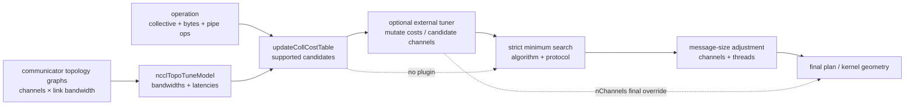

## 本章问题

不设置 `NCCL_ALGO` 和 `NCCL_PROTO` 时，NCCL 如何从 Tree、Ring、LL、
LL128 和 Simple 中选出一个组合？

“NCCL 会 benchmark 后选择最快实现”是错误答案。NCCL 2.22.3 在 communicator
初始化时根据 topology graph、硬件类型和经验常量建立 latency/bandwidth table；
每次 collective 再用消息大小计算候选时间，选择最小值。默认路径不在线实测六个候选。

本章回答六个可检验问题：

1. TUNING 日志中的 `10.2/26.0` 到底是 bandwidth/latency 还是相反？
2. graph 的 bus bandwidth 如何变成算法 bandwidth？
3. `time = latency + bytes / bandwidth` 在源码中怎样落地？
4. 为什么 Tree 还有一张随消息大小变化的 correction table？
5. 自动选择与强制六组合后的实测最优是否一致？
6. 外部 tuner plugin 能否真正改写 algorithm、protocol 和 channel？

## 可证伪假设

正式实验前定义假设：

```text
H1: 从 INFO 日志提取的 table，按 ncclTopoGetAlgoTime 复算后，
    能重现 4 B 至 1 GiB 的全部自动选择和估算时间。

H2: 自动选择不是实际性能 oracle；至少存在一个 size，
    其选择相对六组合强制实测最优慢 5% 以上。

H3: v3 tuner plugin 把 Tree+Simple cost 改为 0、nChannels 改为 2 后，
    TUNING 应显示 Algo 0/proto 2，Nsight 应显示 gridX=2。
```

如果 H1 失败，说明我们漏掉了 correction、pipeline operation 或其他候选；
如果 H2 失败，只能说明本机这个 sweep 没找到反例；如果 H3 只在日志成立而
profiler geometry 不变，不能声称 plugin channel override 已生效。

## 环境与证据

```text
NCCL runtime: 2.22.3+cuda12.6
NCCL source: v2.22.3-1 @ 178b6b7
nccl-tests: 5bcd45d
GPU: 4 x Tesla V100-SXM2-32GB
topology: every GPU pair NV2
collective: AllReduce sum float
sizes: 4 B ... 1 GiB, powers of two
auto performance: 2 replicates x 5 cycles x 29 sizes = 290 rows
forced reference: Chapter 14 Tree/Ring x LL/LL128/Simple
plugin comparison: 10 cycles x 20 iterations at 64 MiB
```

正式运行：`ch16_tuning/20260710T194200Z`。

- [实验汇总](/assets/files/nccl-learning/logs/ch16_tuning/20260710T194200Z/summary.md)
- [完整运行清单](/assets/files/nccl-learning/logs/ch16_tuning/20260710T194200Z/manifest.txt)
- [模型原始日志](/assets/files/nccl-learning/logs/ch16_tuning/20260710T194200Z/raw/auto/model_selection.log)
- [290 条自动性能记录](/assets/files/nccl-learning/logs/ch16_tuning/20260710T194200Z/auto_raw_measurements.csv)
- [全部候选模型时间](/assets/files/nccl-learning/logs/ch16_tuning/20260710T194200Z/model_candidates.csv)
- [自动选择与强制实测对照](/assets/files/nccl-learning/logs/ch16_tuning/20260710T194200Z/selection_vs_measured.csv)
- [插件性能结果](/assets/files/nccl-learning/logs/ch16_tuning/20260710T194200Z/plugin_summary.csv)
- [插件 kernel geometry](/assets/files/nccl-learning/logs/ch16_tuning/20260710T194200Z/plugin_kernel_geometry.csv)
- [完整实验脚本](/assets/files/nccl-learning/scripts/40_ch16_tuner_model.py)
- [实验 tuner plugin 源码](/assets/files/nccl-learning/probes/ch16_force_tree_simple_tuner.cc)

精确数值只适用于当前单机 V100/NVLink。模型结构属于 2.22.3 源码事实，
其中经验系数和 plugin ABI 都可能随版本变化。

## 先建立完整调用链

一次 AllReduce 的调优路径不是一个 `if size < threshold`：

```text
communicator initialization
  ncclTopoTuneModel
    topology graph x channels x link bandwidth
    -> protocol/algorithm efficiency corrections
    -> bus bandwidth to algorithm bandwidth
    -> latency accumulation
    -> comm->bandwidths / comm->latencies

collective enqueue
  initCollCostTable                 all entries = -1
  updateCollCostTable
    ncclTopoGetAlgoTime             calculate every supported candidate
  external tuner getCollInfo        optional: mutate cost table/channels
  topoGetAlgoInfo                   strict minimum search
  dynamic channel/thread tuning
  plugin nChannels final override
```

要区分三个阶段：

| 阶段 | 主要输入 | 输出 |
|---|---|---|
| communicator 建模 | graph、rank/node、link、compute capability | 每 collective/algo/proto 的 latency 和 bandwidth |
| operation 估时 | message bytes、numPipeOps | 每个候选的 predicted time |
| operation planning | 最小候选、message bytes、threshold、plugin | algorithm、protocol、active channels、threads |

模型 table 不直接等于最终 kernel geometry。上一章验证过，选完 algorithm/protocol
之后，planner 还会按消息大小减少 channel/thread；plugin 又能在最后覆盖 channel。

<div class="diagram-scroll diagram-scroll--wide" markdown="1">



</div>

这张图同时标出初始化期模型和 operation 期选择。External Tuner 位于候选代价表与最终计划之间；它不是替换 graph search，也不能让硬件或源码不支持的候选凭空变得可用。

## 第一层：Topology Graph 生成基础带宽

仓库：`NVIDIA/nccl`  
版本：`v2.22.3-1`，提交 `178b6b7`  
文件：`src/graph/tuning.cc:155-183`  
符号：`ncclTopoTuneModel`

关键执行路径摘录（省略候选合法性判断和其他模型修正分支）：

```cpp
for (int coll=0; coll<NCCL_NUM_FUNCTIONS; coll++) {
  int nsteps = coll == ncclFuncAllReduce ? 2*(nRanks-1) :
    coll == ncclFuncReduceScatter || coll == ncclFuncAllGather ? nRanks-1 :
    nRanks;

  for (int a=0; a<NCCL_NUM_ALGORITHMS; a++) {
    for (int p=0; p<NCCL_NUM_PROTOCOLS; p++) {
      float bw = nNodes <= 2 || collnet
                   ? graphs[a]->bwIntra : graphs[a]->bwInter;
      float busBw = graphs[a]->nChannels * bw;

      if (a == NCCL_ALGO_RING && p == NCCL_PROTO_LL)
        busBw = std::min(llMaxBw, busBw * .5);
      if (a == NCCL_ALGO_RING && p == NCCL_PROTO_LL128)
        busBw = std::min(busBw * (ppn < 2 ? 0.7 : 0.92),
                         graphs[a]->nChannels*perChMaxRingLL128Bw);
      if (a == NCCL_ALGO_TREE)
        busBw = std::min(busBw*.92,
                         graphs[a]->nChannels*perChMaxTreeBw);
      if (a == NCCL_ALGO_TREE && p == NCCL_PROTO_LL)
        busBw = std::min(busBw*1.0/3.8, llMaxBw);
      if (a == NCCL_ALGO_TREE && p == NCCL_PROTO_LL128)
        busBw = std::min(busBw * (nNodes == 1 ? 7.0/9.0 : 120.0/128.0),
                         graphs[a]->nChannels*perChMaxTreeLL128Bw);
      if (a == NCCL_ALGO_TREE &&
          graphs[a]->pattern == NCCL_TOPO_PATTERN_TREE) busBw *= .85;
```

注释版：

```cpp
// [课程注释] 四 rank AllReduce 的算法通信阶段数是 2*(4-1)=6。
nsteps = 2*(nRanks-1);

// [课程注释] graph search 给出单 channel 带宽和 channel 数。
// 这里先得到总的“总线侧候选带宽”，尚不是用户 payload algbw。
busBw = graph.nChannels * graph.bwIntra;

// [课程注释] 以下不是协议定义推导出的恒等式，而是硬件上限和经验修正。
Ring+LL:    min(LL硬上限, graphBusBw * 0.5)
Ring+LL128: min(graphBusBw * 0.92, channels * 每channel上限)
Tree+all:   min(graphBusBw * 0.92, channels * 每channel上限)
Tree+LL:    再除以 3.8，并受 LL 上限约束
Tree+LL128: 单节点再乘 7/9，多节点乘 120/128
Tree pattern: 再乘 0.85
```

这里有三个工程结论：

1. graph 的 `bwIntra/bwInter` 不是最终性能；协议效率和 per-channel cap 会修改它。
2. 这些系数是模型先验，不是当前 operation 的在线测量结果。
3. channel 数进入模型，但某次 operation 的 active channel 还可能随后减少。

因此，不能读取 topology XML 中一条 NVLink bandwidth 就直接预测 AllReduce 性能。

## 第二层：Bus BW 转为 Algorithm BW

同一文件的后续源码：

```cpp
// Convert bus BW to algorithm BW
float ratio = 1.0f;
if (a == NCCL_ALGO_RING) ratio *= (1.0 * nRanks) / nsteps;
else if (a == NCCL_ALGO_NVLS || a == NCCL_ALGO_NVLS_TREE)
  ratio *= 5.0/6.0;
else ratio *= .5;
busBw *= ratio;
comm->bandwidths[coll][a][p] = busBw;

/* Ring bandwidth backup */
if (a == NCCL_ALGO_RING)
  comm->ringbdw[coll][p] =
    comm->bandwidths[coll][NCCL_ALGO_RING][p];
```

变量仍叫 `busBw`，但乘完 ratio 后写入的是 algorithm bandwidth。对于四 rank
Ring AllReduce：

$$
nsteps=2(N-1)=6
$$

$$
BW_{algorithm}=BW_{bus}\frac{N}{2(N-1)}
=BW_{bus}\frac{4}{6}
$$

反过来就是第 8 章 nccl-tests 使用的 AllReduce busbw 归一化：

$$
BW_{bus}=BW_{algorithm}\frac{2(N-1)}{N}
$$

Tree 和多数非 Ring 算法在这里使用 `0.5`。这个换算保证 cost formula 中用
`nBytes / algorithmBw` 估算用户 payload 的完成时间，而不是把 bus traffic
和 message bytes 混在一个单位中。

`ringbdw` 是 backup 快照。它不是“Ring 总是第二候选”，而是在后续 enable/
disable 逻辑导致正常 table 没有可用算法时，为 Ring 保留恢复路径。

## 第三层：Latency 如何累积

原始源码：

```cpp
comm->latencies[coll][a][p] = baseLat[a][p];
float intraLat = hwLat[intraHw[a]][a][p];
float interLat = hwLat[NCCL_HW_NET][a][p] + graphs[a]->latencyInter;
if (p == NCCL_PROTO_SIMPLE) interLat += graphs[a]->latencyInter;

if (a == NCCL_ALGO_RING) {
  float netOverhead = 0.0;
  if (nNodes > 1) {
    netOverhead = getNetOverhead(comm);
    if (p == NCCL_PROTO_SIMPLE) netOverhead *= 3;
  }
  intraLat = std::max(intraLat, netOverhead);
  comm->latencies[coll][a][p] +=
    (nsteps-nInterSteps)*intraLat + nInterSteps*interLat;
} else if (a == NCCL_ALGO_TREE) {
  comm->latencies[coll][a][p] +=
    2 * ((nRanks/nNodes-1) * intraLat +
         log2i(nNodes) * interLat);
}
```

注释版：

```cpp
latency = protocol_algorithm_base_latency;

// Ring：所有通信 step 的启动/链路开销相加；多节点拆分 intra/inter steps。
latency += intraSteps * intraLatency + interSteps * interLatency;

// Tree：节点内按 local ranks-1，节点间按 log2(nodes)，乘 2 表示 up/down。
latency += 2 * ((localRanks-1)*intraLatency
                + log2(nodes)*interLatency);
```

本机只有一个 node，所以 Tree 式中的 inter-node 项为 0。多节点时，Ring Simple
还会引入更高 network overhead 和后面的 plateau correction。本章不能用单机
数据验证这些网络分支。

## TUNING 表的字段顺序

NCCL 打印表格的格式源码是：

```cpp
sprintf(line+strlen(line), "%8.1f/%6.1f |",
        comm->latencies[c][a][p],
        comm->bandwidths[c][a][p]);
```

因此 `10.2/26.0` 是：

```text
latency_us / algorithm_bandwidth_GBps
```

不是 `bandwidth/latency`。本机 AllReduce 表：

| Algorithm | Protocol | Latency (us) | Algorithm BW (GB/s) |
|---|---|---:|---:|
| Tree | LL | 10.4 | 14.5 |
| Tree | LL128 | 21.5 | 42.9 |
| Tree | Simple | 168.0 | 55.2 |
| Ring | LL | 10.2 | 26.0 |
| Ring | LL128 | 25.4 | 73.6 |
| Ring | Simple | 28.8 | 80.0 |

这解释了基本趋势：Ring+LL 固定延迟最小，Ring+Simple 渐近带宽最高，
Ring+LL128 位于两者之间。但只看 table 还不够，Tree 有 size correction。

## 第四层：每次 Operation 的代价公式

文件：`src/graph/tuning.cc:409-442`  
符号：`treeCorrectionFactor`、`ncclTopoGetAlgoTime`

关键源码摘录（省略完整函数签名和多节点 Ring plateau 分支）：

```cpp
static float treeCorrectionFactor[NCCL_NUM_PROTOCOLS][23] = {
  { 1.0, 1.0, 1.0, 1.0, .9, .8, .7, .7, .7, .7, .6, .5,
    .4, .4, .5, .6, .7, .8, .9, 1.0, 1.0, 1.0, 1.0 },
  { 1.0, 1.0, 1.0, 1.0, 1.0, .9, .8, .8, .8, .7, .6, .6,
    .6, .6, .6, .6, .8, .9, .9, .9, .9, 1.0, 1.0 },
  { .9, .9, .9, .9, .9, .9, .9, .8, .7, .6, .6, .5,
    .5, .5, .5, .6, .7, .8, .7, .7, .8, .9, .9 }
};

ncclResult_t ncclTopoGetAlgoTime(..., size_t nBytes,
                                 int numPipeOps,
                                 float* time, bool* backup) {
  float bw = comm->bandwidths[coll][algorithm][protocol];
  float lat = comm->latencies[coll][algorithm][protocol];

  if (backup) {
    *backup = false;
    if (algorithm == NCCL_ALGO_RING && bw == 0.0f) {
      bw = comm->ringbdw[coll][protocol];
      *backup = true;
    }
  }
  if (bw == 0) {
    *time = -1.0; return ncclSuccess;
  }

  int logSize = log2i(nBytes>>6);
  if (algorithm == NCCL_ALGO_TREE && logSize >= 0 && logSize < 23)
    bw *= treeCorrectionFactor[protocol][logSize];

  int latCount = algorithm == NCCL_ALGO_RING ? numPipeOps :
    DIVUP(numPipeOps, NCCL_MAX_DEV_WORK_BATCH_COLLS);
  *time = lat * latCount + nBytes / (1000 * bw);
  return ncclSuccess;
}
```

单个、非 aggregation AllReduce 的核心式为：

$$
T_{candidate}(B)=L_{candidate}+\frac{B}{1000\cdot BW_{candidate}}
$$

其中 `B` 是 bytes，`BW` 是 GB/s，结果单位为 microseconds。因为：

$$
\frac{byte}{GB/s}=ns,\qquad \frac{byte}{1000\cdot GB/s}=\mu s
$$

Tree 在计算前做：

$$
BW_{effective}=BW_{table}\times correction[protocol][\lfloor\log_2(B/64)\rfloor]
$$

这张 23 档表覆盖 64 B 到 256 MiB。源码注释明确承认它是为了弥补 Tree
在中等尺寸不贴合基础模型的静态修正。也就是说，NCCL 的 tuner 是带经验
分段 correction 的解析模型，而不是纯粹的物理模型。

### numPipeOps 不是固定为 1

普通单 operation 中 `numPipeOps=1`。Group aggregation/pipelining 时可以更大：

```text
Ring latency count = numPipeOps
Tree latency count = ceil(numPipeOps / NCCL_MAX_DEV_WORK_BATCH_COLLS)
```

因此单 operation sweep 得到的 crossover 不能无条件外推到包含许多 grouped
collectives 的 workload。Tree 能将一批 operation 的 latency 聚合，模型会相应
降低其相对 latency 次数。

### 多节点 Ring Simple plateau

完整函数还有这一分支：

```cpp
if (algorithm == NCCL_ALGO_RING && protocol == NCCL_PROTO_SIMPLE &&
    comm->nNodes > 1 && coll == ncclFuncAllReduce &&
    nBytes/(comm->nChannels*comm->nRanks) >= 64) {
  lat *= comm->minCompCap < 80 ? 1.9 : 1.4;
}
```

它只在多节点、Ring+Simple、每 rank/channel work 达阈值时放大 latency；V100
compute capability 小于 80，系数是 1.9。当前单节点没有命中，不能把本章
transition size 用作多节点预测。

## 从表手算一次自动选择

以 1 MiB 为例。Ring 不使用 Tree correction：

```text
Ring+LL:
  10.2 + 1048576 / (1000 * 26.0)
  = 50.530 us

Ring+LL128:
  25.4 + 1048576 / (1000 * 73.6)
  = 39.647 us

Ring+Simple:
  28.8 + 1048576 / (1000 * 80.0)
  = 41.907 us
```

所以模型选择 Ring+LL128。原始日志：

```text
1048576 Bytes -> Algo 1 proto 1 time 39.646954
```

ID 映射来自 `nccl_common.h`：

```cpp
#define NCCL_ALGO_TREE 0
#define NCCL_ALGO_RING 1

#define NCCL_PROTO_LL 0
#define NCCL_PROTO_LL128 1
#define NCCL_PROTO_SIMPLE 2
```

对 Ring 的三条直线求理论交点：

| 两个候选 | 连续模型交点 |
|---|---:|
| LL / LL128 | 596.7 KiB |
| LL128 / Simple | 2.983 MiB |
| LL / Simple | 699.7 KiB |

实际只测试 2 的幂，所以日志 transition 是：

```text
4 B ... 512 KiB       Ring + LL
1 MiB ... 2 MiB       Ring + LL128
4 MiB ... 1 GiB       Ring + Simple
```

这不是写死三个阈值，而是六个候选代价函数在离散 size 上求最小值的结果。
拓扑、rank/node、channel、协议 enable 状态变化后，交点也会变化。

## 第五层：候选表、严格最小值与 Backup

文件：`src/enqueue.cc:1533-1615`

原始源码：

```cpp
static void initCollCostTable(float** collCostTable) {
  float (*table)[NCCL_NUM_PROTOCOLS] =
    (float (*)[NCCL_NUM_PROTOCOLS])collCostTable;
  for (int a = 0; a < NCCL_NUM_ALGORITHMS; a++)
    for (int p = 0; p < NCCL_NUM_PROTOCOLS; p++)
      table[a][p] = NCCL_ALGO_PROTO_IGNORE;
}

for (int a=0; a<NCCL_NUM_ALGORITHMS; a++) {
  for (int p=0; p<NCCL_NUM_PROTOCOLS; p++) {
    bool backup;
    float time;
    ncclTopoGetAlgoTime(comm, info->func, a, p, nBytes,
                        numPipeOps, &time, &backup);
    if (!backup) {
      table[a][p] = time;
    } else if (time >= 0.0 && time < *backupTime) {
      *backupAlgo = a;
      *backupProto = p;
      *backupTime = time;
    }
  }
}
```

`-1` 有明确语义：忽略/不可用。它不能当作“最快的负数”参与选择。正常候选
和 Ring backup 被分开保存，避免 fallback 抢赢正常候选。

最小值搜索源码：

```cpp
float minTime = 3600000000.0;
for (int a=0; a<NCCL_NUM_ALGORITHMS; a++) {
  for (int p=0; p<NCCL_NUM_PROTOCOLS; p++) {
    if (table[a][p] == NCCL_ALGO_PROTO_IGNORE) continue;
    if (table[a][p] >= 0.0 && table[a][p] < minTime) {
      algorithm = a;
      protocol = p;
      minTime = table[a][p];
    }
  }
}

if (algorithm == NCCL_ALGO_UNDEF || protocol == NCCL_PROTO_UNDEF) {
  algorithm = backupAlgo;
  protocol = backupProto;
  time = backupTime;
}
```

选择器是严格的 `< minTime`。同值时，algorithm/protocol 循环中先出现者保留；
但浮点模型精确相等并不是值得依赖的稳定 API。生产系统不应根据枚举顺序构造策略。

## 实验一：复算 29 个自动选择

脚本提取 INFO 表格和每个 size 的选择，再逐候选复算：

```python
def tree_factor(protocol, nbytes):
    shifted = nbytes >> 6
    log_size = -1 if shifted == 0 else shifted.bit_length() - 1
    factor = TREE_CORRECTION[protocol][log_size] \
        if 0 <= log_size < 23 else 1.0
    return log_size, factor

effective_bw = base_bw * (
    correction if algorithm == "Tree" else 1.0
)
predicted_us = base_latency_us + nbytes / (1000 * effective_bw)
predicted_best = min(candidates, key=lambda row: row["predicted_time_us"])

assert predicted_best.id == logged_selection.id
assert abs(predicted_best.time - logged_time) <= tolerance
```

验收结果：

```text
29 / 29 algorithm-protocol selections reproduced
29 / 29 selected estimated times within tolerance
290 / 290 performance rows out-of-place #wrong = 0
290 / 290 performance rows in-place #wrong = 0
```

这验证 H1，也验证日志字段顺序、Tree correction 索引和单位换算没有理解反。

## 实验二：自动选择不是实测 Oracle

第 14 章固定相同 4 GPU/topology/channel，对六个组合各做十 cycle。这里对每个
size 做两次排序：

```text
model winner   = min(model predicted time)
measured winner = min(forced combination median time)

regret = selected measured median / best measured median - 1
```

“强制实测最优”也不是生产全局最优，因为强制参数会限制 planner，并且独立
microbenchmark 不含 compute overlap；但它足以检验默认 model 在同一实验条件下
是否正确排序候选。

结果：

```text
exact hit:               26 / 29
regret < 5% practical:   28 / 29
worst regret:            21.00% at 1 MiB
```

三个不完全一致的 size：

| Size | Auto | Forced measured best | Auto median | Best median | Regret |
|---:|---|---|---:|---:|---:|
| 128 B | Ring+LL | Tree+LL | 18.675 us | 18.660 us | 0.08% |
| 1 MiB | Ring+LL128 | Ring+LL | 50.425 us | 41.675 us | 21.00% |
| 2 MiB | Ring+LL128 | Ring+LL | 74.465 us | 74.290 us | 0.24% |

128 B 和 2 MiB 都是实用平局，不能把 0.08%/0.24% 当优化机会。1 MiB 则不是
噪声边界：LL128 比 LL 慢 21%，达到可行动的模型失准。

### 为什么 1 MiB 会选错

模型预测：

| Candidate | Predicted | Forced measured median |
|---|---:|---:|
| Ring+LL | 50.530 us | 41.675 us |
| Ring+LL128 | 39.647 us | 50.425 us |
| Ring+Simple | 41.907 us | 约 52 us |

模型认为 LL128 的较高带宽足以覆盖多出的 15.2 us latency，但当前 V100 在
1 MiB 时并未达到 table 中的 LL128 渐近带宽；同时 LL 的实际固定/中包成本
比模型更好。两条预测曲线因此提前发生交叉。

这不是“LL128 实现错误”，而是静态 table 对当前 topology、size 和运行版本
的排序误差。到 4 MiB 自动切到 Simple 后，选择重新与实测最优一致。

### Model absolute error 应怎样读

4 B 的 model time 约 10.2 us，端到端 nccl-tests median 约 18.4 us，绝对误差
约 45%。这不妨碍它正确选择 Ring+LL。Tuner 的目标首先是候选排序，而不是作为
精确 SLA predictor：

```text
ranking quality != absolute prediction accuracy
```

大消息时模型绝对误差下降到约 1%-3%，因为 bandwidth term 主导、固定的 host/
launch overhead 占比降低。排障时应分别报告 selection regret 和 prediction error。

## 第六层：External Tuner 的真正介入点

文件：`src/enqueue.cc:1661-1687`

原始源码：

```cpp
float collCostTable[NCCL_NUM_ALGORITHMS][NCCL_NUM_PROTOCOLS];
initCollCostTable((float **)collCostTable);
updateCollCostTable(comm, info, nBytes, collNetSupport, nvlsSupport,
                    numPipeOps, (float **)collCostTable,
                    &backupAlgo, &backupProto, &backupTime);

if (comm->tuner != NULL) {
  comm->tuner->getCollInfo(
      comm->tunerContext, info->func, nBytes, numPipeOps,
      (float **)collCostTable,
      NCCL_NUM_ALGORITHMS, NCCL_NUM_PROTOCOLS,
      &nMaxChannels);
}

topoGetAlgoInfo(comm, info, nBytes, (float **)collCostTable,
                backupAlgo, backupProto, backupTime, simInfo);
info->nMaxChannels =
  nMaxChannels == 0 ? info->nMaxChannels : nMaxChannels;
```

顺序非常关键：

1. NCCL 先生成默认 cost table。
2. plugin 得到一个 in/out table，可以修改任意受支持候选的 cost。
3. NCCL 仍用同一个 strict-min selector 选 algorithm/protocol。
4. 默认 planner 计算动态 channel/thread。
5. plugin 返回的非零 `nMaxChannels` 最后覆盖默认 channel。

所以 v3 plugin 不是返回一个神秘“策略 ID”，而是修改代价和并行度。它可以只
改变 channel，也可以让一个候选 cost 为 0 从而获胜；但不可用的 `-1` 候选不应
被盲目强行启用，因为 topology/transport 可能根本未构造对应资源。

## v3 Plugin ABI

文件：`src/include/nccl_tuner.h:14-60`

原始接口：

```cpp
typedef struct {
  const char* name;

  ncclResult_t (*init)(size_t nRanks, size_t nNodes,
                       ncclDebugLogger_t logFunction, void **context);

  ncclResult_t (*getCollInfo)(void* context, ncclFunc_t collType,
                              size_t nBytes, int numPipeOps,
                              float** collCostTable,
                              int numAlgo, int numProto,
                              int* nChannels);

  ncclResult_t (*destroy)(void* context);
} ncclTuner_v3_t;

#define NCCL_TUNER_PLUGIN_SYMBOL "ncclTunerPlugin_v3"
```

工程含义：

| 字段 | 生命周期/约束 |
|---|---|
| `init` | 每 communicator 初始化 context；可记录 rank/node/topology class |
| `getCollInfo` | 每次 collective planning 调用；不能做高延迟 RPC 或在线 benchmark |
| `collCostTable` | `[numAlgo][numProto]` in/out table；`-1` 表示 ignore |
| `nChannels` | 0 表示让默认 planner 决定；非零最终覆盖 |
| `destroy` | communicator 销毁时释放 context |
| exported symbol | 必须导出全局 `ncclTunerPlugin_v3`，仅有同名函数不够 |

生产 plugin 应把策略数据预加载到 communicator context，`getCollInfo` 只做
O(1) 或很小的 table lookup。热路径做文件 I/O、网络请求或复杂锁竞争会直接
增加 collective enqueue 开销。

## Plugin 加载与 ABI Fallback

文件：`src/misc/tuner.cc:105-226`

关键源码：

```cpp
const char *envTunerPluginName = getenv("NCCL_TUNER_PLUGIN");
if (envTunerPluginName && strlen(envTunerPluginName)) {
  pluginLib = tryOpenLib(envTunerPluginName, &openErr, openErrStr);
  if (pluginLib) return pluginLib;

  snprintf(tunerPluginLibName, PATH_MAX,
           "libnccl-tuner-%s.so", envTunerPluginName);
  pluginLib = tryOpenLib(tunerPluginLibName, &openErr, openErrStr);
  if (pluginLib) return pluginLib;
} else {
  pluginLib = tryOpenLib("libnccl-tuner.so", &openErr, openErrStr);
}

tunerSymbol = (ncclTuner_v3_t*)
  dlsym(tunerPluginLib, "ncclTunerPlugin_v3");
if (tunerSymbol == nullptr) {
  ncclTuner_v2 = (ncclTuner_v2_t*)
    dlsym(tunerPluginLib, "ncclTunerPlugin_v2");
  if (ncclTuner_v2 == nullptr) {
    dlclose(tunerPluginLib);
    goto fail;
  }
  tunerSymbol = &ncclTuner_v2_as_v3;
}
comm->tuner = tunerSymbol;
```

搜索顺序还允许从 net plugin 中加载 tuner。当前机器没有设置 tuner，但系统的
`libnccl-net.so` 被打开；它不导出 v3/v2 tuner symbol，于是日志为：

```text
TUNER/Plugin: Failed to find ncclTunerPlugin_v3 symbol.
TUNER/Plugin: Failed to find ncclTunerPlugin_v2 symbol,
              using internal tuner instead.
```

这仍是正常 internal tuner fallback，不是 communicator 初始化失败。监控规则
不能看到 `Failed to find ... tuner symbol` 就直接报警，必须结合最终 fallback
和通信是否正常判断。

## 实验 Plugin：强制 Tree+Simple 与 2 Channels

实验源码完整核心：

```cpp
constexpr std::size_t kTargetBytes = 64ull << 20;

ncclResult_t tunerGetCollInfo(
    void*, ncclFunc_t collType, std::size_t nBytes, int,
    float** collCostTable, int numAlgo, int numProto,
    int* nChannels) {
  if (collType != ncclFuncAllReduce || nBytes != kTargetBytes)
    return ncclSuccess;

  auto* costs = reinterpret_cast<float*>(collCostTable);
  for (int algorithm = 0; algorithm < numAlgo; ++algorithm) {
    for (int protocol = 0; protocol < numProto; ++protocol) {
      float& cost = costs[algorithm * numProto + protocol];
      if (cost != NCCL_ALGO_PROTO_IGNORE) cost = 1.0e9f;
    }
  }

  costs[NCCL_ALGO_TREE * numProto + NCCL_PROTO_SIMPLE] = 0.0f;
  *nChannels = 2;
  return ncclSuccess;
}

extern "C" {
ncclTuner_v3_t ncclTunerPlugin_v3 = {
  "ch16-force-tree-simple",
  tunerInit,
  tunerGetCollInfo,
  tunerDestroy,
};
}
```

这个 plugin 故意选择已知较差策略，用来制造清晰反事实。它只改 64 MiB
AllReduce；其他 collective/size 保持默认 cost table。

编译和运行：

```bash
g++ -std=c++17 -O2 -fPIC -shared -Wall -Wextra \
  -I third_party/nccl-2.22.3/src/include \
  -I /usr/local/cuda/include \
  probes/ch16_force_tree_simple_tuner.cc \
  -o ch16_force_tree_simple_tuner.so

NCCL_TUNER_PLUGIN=/private/path/ch16_force_tree_simple_tuner.so \
NCCL_DEBUG=INFO NCCL_DEBUG_SUBSYS=ENV,TUNING \
  all_reduce_perf -b 64M -e 64M -g 4 ...
```

加载与选择日志：

```text
TUNER/Plugin: NCCL_TUNER_PLUGIN set to ...so
TUNER/Plugin: Using tuner plugin ch16-force-tree-simple
67108864 Bytes -> Algo 0 proto 2 time 0.000000
```

日志证明 algorithm/protocol，不能单独证明 channel。为此又做一次 Nsight profile，
导出 SQLite 后查询 collective kernel：

```sql
SELECT s.value, k.end-k.start, k.gridX, k.blockX
FROM CUPTI_ACTIVITY_KIND_KERNEL AS k
JOIN StringIds AS s ON s.id = k.shortName
WHERE s.value LIKE 'ncclDevKernel_AllReduce%';
```

路径结果：

```text
kernel: ncclDevKernel_AllReduce_Sum_f32_TREE_LL
TUNING selected protocol: Simple (proto 2)
gridX: 2
blockX: 640
instances: 64
```

kernel 名中的 `_TREE_LL` 是 launch specialization family，不代表实际 protocol
一定是 LL；第 14 章已经从 `generate.py::best_kernel` 和 `ncclKernelMain` 证明，
实际 function 可以通过 function table 分派。这里 protocol 证据必须使用 TUNING
的 `proto 2`，kernel 名主要证明 Tree family，`gridX=2` 证明 channel override。

`blockX=640` 也符合上一章源码：Tree+Simple 增加 4 个 sync warps，Tree 最终使用
`NCCL_MAX_NTHREADS` worker threads，总 launch threads 为 640。

## Plugin 性能反事实

| Policy | Median | P95 | CV | busbw |
|---|---:|---:|---:|---:|
| 默认 auto：Ring+Simple | 849.825 us | 851.000 us | 0.09% | 118.45 GB/s |
| plugin：Tree+Simple, ch=2 | 2955.280 us | 2956.914 us | 0.06% | 34.06 GB/s |

插件策略慢 `3.48x`，两组 CV 都低于 0.1%，且 correctness 全通过。这同时说明：

1. plugin 确实改变执行路径，而不是日志装饰。
2. plugin 能推翻 NCCL 默认模型，但不会自动保证更快。
3. algorithm/protocol 与 channel 一起改变时，性能差异不能归因于单一变量。

本实验的目的不是说 Tree 慢，而是验证介入机制。要评估生产 plugin，必须将
algorithm/protocol 和 channel 分层做 controlled sweep，再用真实 workload 分布
加权，不能从这个联合反事实计算 Tree 单独的 slowdown。

## 如何构建生产 Tuner 数据

一个可维护的离线 autotuning 流程：

```text
1. 定义硬件签名
   NCCL version, GPU CC/model, nodes, ranks/node,
   topology hash, HCA/NIC, transport/plugin version

2. 定义 workload key
   collective, datatype, reduction op, bytes bucket,
   numPipeOps/group shape, in-place, graph capture mode

3. 强制候选但保留正确性
   algorithm x protocol x channels，过滤 NCCL 不支持项

4. 重复测量
   median/P95/CV，随机/平衡顺序，独立进程，记录噪声

5. 用 regret 而不是 winner 次数评估
   0.1% 错选和 20% 错选不能同权

6. 压缩策略表
   合并相邻 size bucket，只保留超过 practical threshold 的规则

7. plugin 只做快速 lookup
   未命中或置信度不足时不改 table，回退 internal tuner

8. shadow/canary
   记录建议、实际选择、延迟分布和 fallback，不直接全量发布
```

推荐的目标函数不一定是裸通信最短：

$$
objective = step\_time + \lambda_1\cdot tail\_risk
+\lambda_2\cdot SM\_contention
$$

训练中多 channels 可能提高通信带宽，却抢占更多 SM、破坏 compute overlap。
因此 plugin 的 channel policy 应在真实训练 timeline 上验证，不能只优化
`all_reduce_perf` busbw。

## 自动选择失准时的排障顺序

### 1. 先确认实际选择

```bash
NCCL_DEBUG=INFO NCCL_DEBUG_SUBSYS=TUNING,ENV ...
```

记录每个 bucket 的 bytes、Algo ID、proto ID、estimated time。不要从 kernel 名
单独反推 protocol。

### 2. 检查是否被外部输入覆盖

```text
NCCL_ALGO
NCCL_PROTO
NCCL_TUNER_PLUGIN
NCCL_NET_PLUGIN 中打包的 tuner
NCCL_MIN_NCHANNELS / NCCL_MAX_NCHANNELS
NCCL_THREAD_THRESHOLDS
```

“没有设置 `NCCL_TUNER_PLUGIN`”不等于没有 tuner；源码还会查看 net plugin。

### 3. 提取 communicator table

确认字段是 latency/bandwidth，记录 Tree/Ring/CollNet/NVLS 可用性。bandwidth=0
通常表示不可用，不应把它当性能为零的正常候选。

### 4. 复算候选

包含：

```text
Tree size correction
multi-node Ring Simple plateau
numPipeOps latency count
backup separation
algorithm bandwidth units
```

如果复算不匹配日志，先解决版本/源码/单位问题，不要开始调阈值。

### 5. 强制候选矩阵

对实际 bucket 周围至少做前一档、当前档、后一档；记录 correctness、median、P95、
CV。单次测量或只看 average busbw 不足以判定模型失准。

### 6. 计算 regret

```text
regret < noise/practical threshold: 保持默认
regret 稳定且只在少数 bucket: plugin/上层 bucket policy
regret 跨大范围: 检查 topology graph、transport、版本 regression
```

### 7. 回到真实训练

DDP bucket size、gradient ready order、compute overlap 和多个 communicator 并发都会
改变最优点。microbenchmark override 必须在 step time、tail 和 GPU utilization
上复验。

## 常见错误

1. 认为 NCCL 启动时在线 benchmark 所有 algorithm/protocol。
2. 把 INFO 的 `latency/bandwidth` 读反。
3. 直接用 topology graph busbw 代替 algorithm bandwidth。
4. 忽略 Tree correction，复算后怪罪浮点误差。
5. 忽略 `numPipeOps`，把单 collective crossover 外推到 Group aggregation。
6. 把 `-1` ignore cost 当作有效最小值。
7. 把 Ring backup 当作普通候选参与排名。
8. 只比较 model prediction error，不比较 selection regret。
9. 把 0.08% 的 winner 变化当成有效优化。
10. 看到 kernel 名 `_LL` 就认定实际 protocol 是 LL。
11. 只看 plugin load 日志，不用 TUNING/profiler 验证实际路径。
12. plugin 把 topology 不支持的 `-1` 条目强行改成 0。
13. 在 `getCollInfo` 热路径做在线 benchmark、文件 I/O 或 RPC。
14. 用 microbenchmark 最优 channel 覆盖训练，却不测 SM contention。
15. plugin 出错时没有“什么都不改、回退 internal tuner”的策略。

## 版本与硬件边界

本章已验证：

```text
NCCL 2.22.3 单节点 4xV100
Tree/Ring x LL/LL128/Simple
4 B ... 1 GiB auto selection
v3 tuner cost-table and channel override
Nsight grid/block geometry
```

本章没有验证：

```text
多节点 Ring plateau correction 的定量准确度
IB/RoCE、GDR 对 table 和 crossover 的影响
CollNet/SHARP 与 NVLS 候选
multi-rail/PXN topology signature
numPipeOps > 1 的 grouped workload crossover
CUDA Graph capture 下的 plugin 行为
真实 DDP/FSDP compute overlap 最优 channel
```

升级 NCCL 时至少重新检查：

```text
nccl_tuner.h ABI version and symbol
tuning.cc correction tables and hardware constants
algorithm/protocol enum count and order
getAlgoInfo plugin call order
dynamic channel/thread planner
kernel specialization naming
```

## 本章结论

1. NCCL 2.22.3 的默认选择来自 communicator 初始化时建立的解析/经验模型，
   不是每次 operation 在线 benchmark。
2. TUNING table 格式是 `latency_us/algorithm_bandwidth_GBps`。
3. graph bandwidth 先乘 channel，再经过协议/算法效率和硬件 cap，最后从 busbw
   转为 algbw。
4. 单 operation 的核心代价是 `latency + bytes/(1000*algbw)`；Tree 还有
   64 B 到 256 MiB 的 23 档静态 bandwidth correction。
5. 本机模型自动选择 Ring+LL 至 512 KiB、LL128 在 1-2 MiB、Simple 从 4 MiB
   开始；源码公式复算 29/29 成功。
6. 默认模型精确命中强制实测最优 26/29，5% practical threshold 命中 28/29。
7. 1 MiB 是真实反例：自动 LL128 比实测最优 LL 慢 21.00%，说明静态模型会
   在特定硬件/size 上提前预测 crossover。
8. 小消息 prediction absolute error 可达约 45%，但 ranking 仍正确；精确预测
   和正确排序是两个指标。
9. v3 tuner plugin 通过修改 cost table 改 algorithm/protocol，并用非零
   `nChannels` 最终覆盖默认 channel。
10. 实验 plugin 的 Algo 0/proto 2 和 Nsight `gridX=2` 同时通过，证明覆盖进入
    实际执行；错误策略也让 64 MiB 慢 3.48x，plugin 不自带性能正确性。
11. 生产 tuner 应基于离线重复测量、regret、硬件签名和真实 workload，未命中时
    回退 internal tuner，热路径只做快速 lookup。

## 验收题

1. 为什么 `10.2/26.0` 不能解释成 10.2 GB/s、26 us？给出源码证据。
2. 四 rank Ring AllReduce 从 busbw 到 algbw 的 ratio 是多少？
3. 用表格手算 512 KiB 的 Ring LL/LL128/Simple 三个时间并判断 winner。
4. 为什么连续模型的 LL/LL128 交点约 596.7 KiB，而离散 sweep 在 1 MiB 才切换？
5. Tree correction 的索引为什么是 `log2(nBytes >> 6)`？32 B 时会怎样？
6. `numPipeOps=8` 时 Ring 和 Tree 的 latency count 有什么区别？
7. multi-node V100 在什么条件下 Ring Simple latency 乘 1.9？
8. 为什么不可用候选使用 `-1`，strict-min 又要求 `>=0`？
9. Ring backup 为什么不直接写进正常 cost table？
10. 1 MiB 的 21% regret 说明模型哪一项排序失真？
11. 为什么 4 B 的 45% prediction error 不等于 tuner 选择错误？
12. plugin 如何只修改 channel 而保留默认 algorithm/protocol？
13. 为什么不能把 topology 不支持的 cost 从 `-1` 改为 0？
14. 如何用日志和 profiler 分别证明 plugin 的 protocol 与 channel？
15. 为什么 `_TREE_LL` kernel 名不能推翻 TUNING 的 `proto 2`？
16. 设计一个不混淆 algorithm 和 channel 的 plugin controlled experiment。
17. 如何为 DDP bucket distribution 构建 size-weighted regret？
18. plugin policy miss 时应如何安全回退，不影响 communicator 正确性？
19. 升级到另一个 NCCL 版本后，哪些模型常量和 ABI 必须重新审计？
20. 多节点取得 HCA 后，如何验证 plateau correction、Tree correction 和
    transport 切换分别对 selection 的影响？

能够从 topology graph 推到 latency/bandwidth table，从 table 复算每个候选，
再用强制实测和 plugin 反事实检验排序，才算真正掌握 NCCL tuner。
