## 本章问题

训练在第一次 collective 之前 hang 住时，“NCCL 初始化失败”几乎没有诊断价值。
初始化至少包含：

```text
参数和 CUDA runtime 校验
unique ID / bootstrap root
全部 rank rendezvous
bootstrap ring 建立
peerInfo AllGather
local rank / node 划分
topology detection 与 path computation
Ring/Tree graph search
跨 rank graph 对齐
transport setup/connect
device communicator setup
本地 barrier
tuner plugin initialization
```

这些阶段的阻塞原因、日志和处置完全不同。本章要回答：

1. `ncclUniqueId` 是 communicator 本身，还是 bootstrap rendezvous 信息？
2. bootstrap root 与后续 bootstrap ring 分别做什么？
3. peerInfo 如何导出 node、local rank 和 duplicate GPU？
4. topology、graph 和 transport 为什么是三个阶段？
5. NCCL 内置 `Init timings` 的七个字段精确覆盖哪些源码区间？
6. rank 数从 1 增至 4 时，当前机器哪一阶段主导初始化？
7. 非法地址、重复设备和缺 rank 的故障签名如何区分？

## 可证伪假设

```text
H1: NCCL 2.22.3 的 Init timings 能在源码层映射到七个明确阶段，
    且各阶段之和与 total 只相差日志格式化误差。

H2: 单进程 1/2/3/4 GPU 的初始化总时间不会只由 bootstrap 决定；
    至少一个其他阶段会随本进程 GPU 数显著增长。

H3: 三类故障会停在不同状态：
    invalid NCCL_COMM_ID 在创建 communicator 前失败；
    duplicate devlist 在 ncclCommInitAll 参数检查失败；
    missing rank 在 bootstrap root 收齐 handles 前阻塞。
```

如果只测 API wall time，无法验证 H1；如果 missing-rank 只用一个不存在的外部
IP，则只能证明 connect 失败，不能证明 root 已收到部分 rank。本实验因此用
`ncclGetUniqueId` 创建真实 root，再故意只提交 rank 0/2。

## 环境与证据

```text
NCCL runtime: 2.22.3+cuda12.6
NCCL source: v2.22.3-1 @ 178b6b7
nccl-tests: 5bcd45d
GPU: 4 x Tesla V100-SXM2-32GB
topology: every GPU pair NV2
rank scaling: 1, 2, 3, 4 GPUs
cycles: 10 per world size, balanced execution order
correctness op: 4 KiB float sum AllReduce
timing samples: 100 per-rank Init timings rows
failure cases: invalid ID, duplicate GPU, missing rank
```

正式运行：`ch17_init/20260710T200500Z`。

- [实验汇总](/assets/files/nccl-learning/logs/ch17_init/20260710T200500Z/summary.md)
- [运行清单](/assets/files/nccl-learning/logs/ch17_init/20260710T200500Z/manifest.txt)
- [100 条阶段计时](/assets/files/nccl-learning/logs/ch17_init/20260710T200500Z/init_timings_raw.csv)
- [rank scaling 汇总](/assets/files/nccl-learning/logs/ch17_init/20260710T200500Z/init_timings_summary.csv)
- [故障矩阵](/assets/files/nccl-learning/logs/ch17_init/20260710T200500Z/failure_matrix.csv)
- [完整实验脚本](/assets/files/nccl-learning/scripts/41_ch17_init_state_machine.py)
- [故障注入 probe](/assets/files/nccl-learning/probes/ch17_bootstrap_failures.cc)

本章定量结果只属于单进程、单节点、四张 V100。bootstrap 和初始化状态机是
2.22.3 源码事实；跨节点 socket、HCA、DNS、防火墙和 scheduler 启动偏斜没有
在当前硬件验证。

## 先区分四种身份

| 概念 | 含义 | 何时确定 |
|---|---|---|
| global rank | communicator 中的逻辑序号 | 调用方传入 |
| CUDA device | 当前 rank 使用的本地 CUDA ordinal | API 调用前选择 |
| node/local rank | 同 hostHash rank 的节点编号与节点内序号 | peerInfo AllGather 后计算 |
| intra-process rank | 同 hostHash 且同 pidHash 的进程内序号 | peerInfo AllGather 后计算 |

global rank 不等于 GPU ordinal，也不天然包含 node 信息。每个 rank 先只知道
`nranks/myrank/commId/cudaDev`，交换 `peerInfo` 后才知道其他 rank 的 hostHash、
pidHash、busId、compute capability 和 capability flags。

## 总状态机

从公开 API 到完成：

```text
ncclCommInitRank
  -> ncclCommInitRankDev
      ncclInit / cudaFree(NULL)
      rank and pointer validation
      allocate comm + abort flags
      initState = ncclInternalError
      ncclAsyncLaunch(ncclCommInitRankFunc)

ncclCommInitRankFunc
  -> cudaSetDevice
  -> ncclInitKernelsForDevice
  -> commAlloc
  -> bootstrapInit
  -> initTransportsRank
       peerInfo AllGather
       topology/path/search init
       local graph compute
       graphInfo/topoRanks AllGather
       graph postset and rank alignment
       proxy + transport connect
       tuning model + devCommSetup
       local barrier
  -> ncclTunerPluginLoad/init
  -> initState = ncclSuccess
  -> publish newcomm
```

函数名 `initTransportsRank` 容易误导：它不仅连接 transport，还包含 peer discovery、
topology、graph、channel、tuning model 和 device communicator setup。排障时必须
继续按 timer 和日志拆分，不能把该函数整体称为“网络初始化”。

```mermaid
flowchart LR
  API["ncclCommInitRank<br/>参数与 CUDA context"] --> JOB["async init job<br/>initState = internal error"]
  JOB --> BOOT["bootstrap rendezvous<br/>root + bootstrap ring"]
  BOOT --> PEER["peerInfo AllGather<br/>host/pid/busId/capability"]
  PEER --> TOPO["topology detect<br/>path + graph search"]
  TOPO --> GRAPH["graphInfo/topoRanks AllGather<br/>postset + rank alignment"]
  GRAPH --> CONNECT["proxy + transport connect"]
  CONNECT --> TUNE["tuning model<br/>device comm setup"]
  TUNE --> BARRIER["local barrier<br/>tuner plugin init"]
  BARRIER --> SUCCESS["initState = success<br/>publish newcomm"]
  API -. "validation failure" .-> FAIL["cleanup / abort state"]
  BOOT -. "missing rank / bad endpoint" .-> FAIL
  CONNECT -. "connector failure" .-> FAIL
```

<div class="diagram-scroll diagram-scroll--xwide" markdown="1">



</div>

这是一张初始化控制面状态图，不是 payload 数据路径。只有走到 `publish newcomm` 后 communicator 才对调用者可用；卡在 bootstrap、peer exchange、graph 或 connect 的日志与修复方向完全不同。

## API 入口与异步 Job

仓库：`NVIDIA/nccl`  
版本：`v2.22.3-1`，提交 `178b6b7`  
文件：`src/init.cc:1624-1679`  
符号：`ncclCommInitRankDev`

关键执行路径摘录（省略环境变量入口、配置解析和失败清理）：

```cpp
static ncclResult_t ncclCommInitRankDev(
    ncclComm_t* newcomm, int nranks, ncclUniqueId commId,
    int myrank, int cudaDev, ncclConfig_t *config) {
  ncclResult_t res = ncclSuccess;
  ncclComm_t comm = NULL;

  NCCLCHECKGOTO(ncclInit(), res, fail);
  CUDACHECKGOTO(cudaFree(NULL), res, fail);

  if (nranks < 1 || myrank < 0 || myrank >= nranks) {
    WARN("Invalid rank requested : %d/%d", myrank, nranks);
    res = ncclInvalidArgument;
    goto fail;
  }

  NCCLCHECKGOTO(ncclCalloc(&comm, 1), res, fail);
  NCCLCHECKGOTO(ncclCalloc(&comm->abortFlag, 1), res, fail);
  NCCLCHECKGOTO(ncclCudaHostCalloc(&comm->abortFlagDev, 1), res, fail);
  comm->initState = ncclInternalError;
  *newcomm = comm;

  job->comm = comm;
  job->nranks = nranks;
  job->commId = commId;
  job->myrank = myrank;
  job->cudaDev = cudaDev;
  NCCLCHECKGOTO(ncclAsyncLaunch(
      &job->base, ncclCommInitRankFunc, NULL, free, comm), res, fail);
  return ncclGroupErrCheck(res);
}
```

注释版：

```cpp
// [课程注释] 先初始化 NCCL 全局状态和 CUDA runtime；
// 此时还没有进入跨 rank rendezvous。
ncclInit();
cudaFree(NULL);

// [课程注释] rank 范围错误属于本地参数错误，不应等待其他 rank。
validate(0 <= myrank < nranks);

// [课程注释] 初始状态故意设为 error，只有完整状态机成功才改为 success。
comm->initState = ncclInternalError;

// [课程注释] 初始化工作以 async job 表示；blocking/nonblocking config
// 决定调用方何时等待和查询，不改变内部阶段依赖。
ncclAsyncLaunch(ncclCommInitRankFunc);
```

这解释了第 6 章的 nonblocking communicator：异步是 host API 完成语义，
不是 topology 可以绕过 bootstrap 提前构造。

## Unique ID 到底包含什么

文件：`src/bootstrap.cc:183-219`  
符号：`bootstrapCreateRoot`、`bootstrapGetUniqueId`

关键执行路径摘录（省略分配、错误检查宏和日志参数）：

```cpp
ncclResult_t bootstrapCreateRoot(
    struct ncclBootstrapHandle* handle, bool idFromEnv) {
  ncclSocketListen(listenSock);
  ncclSocketGetAddr(listenSock, &handle->addr);
  args->listenSock = listenSock;
  args->magic = handle->magic;
  pthread_create(&thread, NULL, bootstrapRoot, (void*)args);
  ncclSetThreadName(thread, "NCCL BootstrapR");
  pthread_detach(thread);
  return ncclSuccess;
}

ncclResult_t bootstrapGetUniqueId(
    struct ncclBootstrapHandle* handle) {
  memset(handle, 0, sizeof(ncclBootstrapHandle));
  const char* env = ncclGetEnv("NCCL_COMM_ID");
  if (env) {
    if (ncclSocketGetAddrFromString(&handle->addr, env)
        != ncclSuccess) return ncclInvalidArgument;
    handle->magic = NCCL_MAGIC;
  } else {
    getRandomData(&handle->magic, sizeof(handle->magic));
    memcpy(&handle->addr, &bootstrapNetIfAddr, sizeof(...));
    bootstrapCreateRoot(handle, false);
  }
  return ncclSuccess;
}
```

`ncclUniqueId` 在这里承载 bootstrap address 和 magic。它不是已经构造好的
communicator，也不包含全部 rank/GPU/topology。调用 `ncclGetUniqueId` 的进程会
启动 detached `NCCL BootstrapR` root thread；其他进程拿到相同 ID 后才能向同一
root check in。

如果使用 `NCCL_COMM_ID=host:port`，地址来自环境，rank 0 随后在该地址创建 root。
这要求 hostname/IP、address family、监听端口和所有节点路由一致。

## Bootstrap Root 是 Rendezvous，不是数据平面

文件：`src/bootstrap.cc:111-167`  
符号：`bootstrapRoot`

关键执行路径摘录（省略 socket 初始化/关闭、错误检查宏和清理）：

```cpp
int nranks = 0, c = 0;
do {
  ncclSocketAccept(&sock, listenSock);
  bootstrapNetRecv(&sock, &info, sizeof(info));

  if (c == 0) {
    nranks = info.nranks;
    ncclCalloc(&rankAddresses, nranks);
    ncclCalloc(&rankAddressesRoot, nranks);
  }
  if (nranks != info.nranks) {
    WARN("Bootstrap Root : mismatch in rank count ...");
    goto out;
  }
  if (rankAddressesRoot[info.rank] != zero) {
    WARN("Bootstrap Root : rank %d ... has already checked in", ...);
    goto out;
  }
  rankAddressesRoot[info.rank] = info.extAddressListenRoot;
  rankAddresses[info.rank] = info.extAddressListen;
  ++c;
} while (c < nranks);

for (int r=0; r<nranks; ++r) {
  int next = (r+1) % nranks;
  ncclSocketConnect(&sock, rankAddressesRoot+r, ...);
  bootstrapNetSend(&sock, rankAddresses+next, sizeof(...));
}
```

root 的职责只有：

1. 接受每个 rank 的 check-in。
2. 第一个 rank 决定期望 `nranks`。
3. 检查 rank count 一致和 rank 是否重复。
4. 收齐后把“下一个 rank 的监听地址”发回每个 rank。

它没有转发后续所有 AllGather 数据。收齐 address 后，每个 rank 建立 next/prev
socket，bootstrap control plane 转成 ring。因此 root 是 rendezvous coordinator，
不是长期中心化 collective server。

## 为什么 Missing Rank 会永久等

root 的核心条件是：

```cpp
do {
  accept_one_rank();
  ++checked_in;
} while (checked_in < nranks);
```

实验 probe：

```cpp
ncclUniqueId id;
ncclGetUniqueId(&id);             // 创建真实 BootstrapR root
cudaSetDevice(0);
ncclCommInitRank(&comm, 2, id, 0); // 声明 2 ranks，但永远不提交 rank 1
```

日志：

```text
Bootstrap : Using eth0:10.244.49.68<0>
MISSING_RANK entering ncclCommInitRank rank=0 nranks=2
```

5.12 s 后由实验 harness 外部 timeout，退出码 124；没有 `Init START` 或
`Init COMPLETE`。原因是源码中的 `Init START` 在 `bootstrapInit` 返回后才打印，
rank 0 此时仍等待 root 发回 next rank 地址，而 root 等 rank 1 check-in。

这形成一个实用定位规则：

```text
看到 Bootstrap interface，但看不到 ncclCommInitRank ... Init START
  -> 优先检查 rendezvous/缺 rank/rank count/address/firewall

看到 Init START，但看不到 peer/local rank 或 graph 日志
  -> bootstrap ring 已建立，检查 peerInfo AllGather 和本地 discovery
```

NCCL 本身不知道 scheduler 是否永远不会启动 rank 1，所以 blocking API 没有在
5 s 自动失败。本实验的 5 s 是 harness watchdog，不是 NCCL 内部 timeout。

## Bootstrap Ring 与 AllGather

每个 rank 在 `bootstrapInit` 中：

```cpp
// 向 root 发送本 rank 的两个监听地址。
ncclSocketConnect(&sock, &handle->addr, ...);
bootstrapNetSend(&sock, &info, sizeof(info));

// 从 root 收到 next rank 地址。
ncclSocketAccept(&sock, &listenSockRoot);
bootstrapNetRecv(&sock, &nextAddr, sizeof(nextAddr));

// 主动连接 next，接受 prev。
ncclSocketConnect(&state->ringSendSocket);
ncclSocketAccept(&state->ringRecvSocket, &state->listenSock);
```

ring AllGather 源码：

```cpp
for (int i=0; i<nranks-1; i++) {
  size_t rslice = (rank - i - 1 + nranks) % nranks;
  size_t sslice = (rank - i + nranks) % nranks;
  bootstrapNetSendRecv(
      nextSocket, data+sslice*size, size,
      prevSocket, data+rslice*size, size);
}
```

这是 CPU/socket control plane AllGather，不是 GPU 上的 NCCL AllGather kernel。
每个 rank 经过 `N-1` 轮，将本地 slice 逐轮向 next 转发，同时从 prev 收数据。

四 rank、rank 0 的索引：

| i | send slice | receive slice |
|---:|---:|---:|
| 0 | 0 | 3 |
| 1 | 3 | 2 |
| 2 | 2 | 1 |

完成后 rank 0 持有 0/1/2/3 全部条目。该 ring 会交换 bootstrap addresses、
proxy addresses、peerInfo、graphInfo/topoRanks 等多种结构。

## PeerInfo AllGather 与第一层 Duplicate GPU

文件：`src/init.cc:727-744`

关键执行路径摘录（省略错误检查宏、cuMem 汇总和日志格式参数）：

```cpp
timers[TIMER_INIT_ALLGATHER] = clockNano();
ncclCalloc(&comm->peerInfo, nranks+1);
fillInfo(comm, comm->peerInfo+rank, comm->commHash);
bootstrapAllGather(
    comm->bootstrap, comm->peerInfo, sizeof(struct ncclPeerInfo));

for (int i = 0; i < nranks; i++) {
  if (comm->peerInfo[i].hostHash !=
      comm->peerInfo[rank].hostHash) nNodes++;

  if ((i != rank) &&
      (comm->peerInfo[i].hostHash ==
       comm->peerInfo[rank].hostHash) &&
      (comm->peerInfo[i].busId ==
       comm->peerInfo[rank].busId)) {
    WARN("Duplicate GPU detected : rank %d and rank %d "
         "both on CUDA device %lx", rank, i, ...);
    ret = ncclInvalidUsage;
    goto fail;
  }
}
```

多进程场景无法在一个 API 调用中比较 devlist；必须等 peerInfo AllGather 后，用
`hostHash + PCI busId` 检测两个 rank 是否指向同一物理 GPU。只比较本地 CUDA
ordinal 是错误的，因为不同 node 都可以有 device 0。

## 第二层 Duplicate GPU：InitAll Early Check

实验使用单进程：

```cpp
int devices[2] = {0, 0};
ncclComm_t comms[2];
ncclResult_t result = ncclCommInitAll(comms, 2, devices);
```

`ncclCommInitAll` 在创建 unique ID 前已有更早的检查：

```cpp
cudaGetDeviceCount(&totalnDev);
if (devlist) {
  ncclCalloc(&gpuFlags, totalnDev);
  for (int i = 0; i < ndev; ++i) {
    if (devlist[i] < 0 || devlist[i] >= totalnDev) {
      ret = ncclUnhandledCudaError;
      goto fail;
    }
    if (gpuFlags[devlist[i]] != 0) {
      ret = ncclInvalidUsage;
      goto fail;
    }
    gpuFlags[devlist[i]] = 1;
  }
}
```

结果：

```text
DUPLICATE_GPU entering ncclCommInitAll devices=0,0
DUPLICATE_GPU result=invalid usage ... code=5
wall time: 0.169 s
```

没有 `Duplicate GPU detected` WARN 是预期行为：早期 devlist 分支直接返回
`ncclInvalidUsage`，还未进入 peerInfo。两种相同表象对应不同层级：

| 使用方式 | 检测依据 | 阶段 | 典型输出 |
|---|---|---|---|
| 单进程 `ncclCommInitAll` | devlist bitmap | unique ID 前 | invalid usage code 5 |
| 多进程 `ncclCommInitRank` | hostHash + busId | peerInfo AllGather 后 | Duplicate GPU detected |

排障规则不能强制所有 duplicate GPU 都出现同一句 WARN。

## Local Rank 与 Intra-process Rank

peerInfo 到齐后，NCCL 分别计算两种集合。

进程内集合：

```cpp
if (peer.hostHash == my.hostHash &&
    peer.pidHash == my.pidHash) {
  if (intraProcRanks == 0) intraProcRank0 = i;
  if (i == rank) intraProcRank = intraProcRanks;
  intraProcRanks++;
}
```

节点内集合在 graphInfo AllGather 后构造：

```cpp
for (int r=0; r<comm->nRanks; r++) {
  int node = comm->rankToNode[r];
  comm->rankToLocalRank[r] = comm->nodeRanks[node].localRanks;
  comm->nodeRanks[node].localRanks++;
}
comm->node = comm->rankToNode[rank];
comm->localRank = comm->rankToLocalRank[rank];
comm->localRanks = comm->nodeRanks[comm->node].localRanks;
```

同一 node 上可以有多个 process，所以 `localRank != intraRank`。共享 proxy、
barrier、资源 owner 和 launch mode 会使用不同集合；混用它们容易造成只在
multi-process-per-node 场景出现的初始化问题。

## Topology Detection 不是 Graph Search

Topology timer 覆盖：

```cpp
timers[TIMER_INIT_TOPO] = clockNano();
ncclTopoGetSystem(comm, &comm->topo);
ncclTopoComputePaths(comm->topo, comm);
ncclTopoTrimSystem(comm->topo, comm);
ncclTopoComputePaths(comm->topo, comm);
ncclTopoSearchInit(comm->topo);
ncclTopoComputeCommCPU(comm);
ncclTopoPrint(comm->topo);
timers[TIMER_INIT_TOPO] = clockNano() - timers[TIMER_INIT_TOPO];
```

这一阶段建立 GPU/CPU/PCI/NIC 节点和任意两端之间的路径，之后才知道哪些 GPU/NIC
可达、路径类型和带宽。第 18 章会展开 XML 与 path computation。

Graph timer 则覆盖 algorithm graph 搜索：

```cpp
timers[TIMER_INIT_GRAPHS] = clockNano();

ringGraph->pattern = NCCL_TOPO_PATTERN_RING;
ringGraph->minChannels = 1;
ringGraph->maxChannels = MAXCHANNELS/2;
ncclTopoCompute(comm->topo, ringGraph);

treeGraph->pattern = NCCL_TOPO_PATTERN_BALANCED_TREE;
treeGraph->minChannels = ringGraph->nChannels;
treeGraph->maxChannels = ringGraph->nChannels;
ncclTopoCompute(comm->topo, treeGraph);

// 条件满足时继续 CollNet/NVLS graph。
timers[TIMER_INIT_GRAPHS] = clockNano() - timers[TIMER_INIT_GRAPHS];
```

Topology 回答“有哪些资源和路径”；graph search 回答“针对 Ring/Tree 等 pattern，
选择哪些路径、顺序和 channel”。二者失败时要检查不同日志和源码。

## 为什么还要第二次 AllGather

每个 rank 的本地 topology 视图和 graph search 结果可能不同，NCCL 必须交换：

```cpp
struct allGatherInfo {
  struct graphInfo graphInfo[NCCL_NUM_ALGORITHMS];
  struct ncclTopoRanks topoRanks;
  int cpuArch;
  int cpuVendor;
};

allGather3Data[rank].graphInfo[a] = local_graph_summary;
ncclTopoPreset(comm, graphs, &allGather3Data[rank].topoRanks);
bootstrapAllGather(comm->bootstrap, allGather3Data, sizeof(*allGather3Data));
```

随后按保守方向对齐：

```cpp
graphs[a]->nChannels = min(allRanks.nChannels);
graphs[a]->sameChannels = min(allRanks.sameChannels);
graphs[a]->bwIntra = min(allRanks.bwIntra);
graphs[a]->bwInter = min(allRanks.bwInter);
graphs[a]->typeIntra = max(allRanks.typeIntra);
graphs[a]->typeInter = max(allRanks.typeInter);
graphs[a]->crossNic = max(allRanks.crossNic);
```

所有 rank 必须得到一致 algorithm/channel/tuning view。否则同一个 collective
可能在不同 rank 选择不同 protocol 或 connection，最终表现为 hang，而非简单变慢。

## Connection 阶段包含什么

Connection timer 从 P2P schedule 前开始，到 `devCommSetup` 后结束：

```cpp
timers[TIMER_INIT_CONNECT] = clockNano();

buildP2pSchedule();
ncclProxyCreate(comm);

if (comm->runtimeConn) {
  setupChannel(...);
  ncclNvlsSetup(...);
} else {
  setupChannel(...);
  ncclTransportRingConnect(comm);
  ncclTransportTreeConnect(comm);
  ncclNvlsSetup(...);
  ncclCollNetSetup(...);
  ncclProxyConnect(...);
}

ncclTopoTuneModel(...);
devCommSetup(comm);
timers[TIMER_INIT_CONNECT] = clockNano() - timers[TIMER_INIT_CONNECT];
bootstrapIntraNodeBarrier(...);
```

因此 `connections` 不只是 socket connect：还包括 P2P schedule、channel setup、
proxy、transport、tuning model 和 device-side communicator allocation。2.22.3 的
runtime connect 分支还可能把部分 P2P connection 延迟到首次使用；不同配置下
该字段语义相同，但实际 eager work 量不同。

最后的 local barrier 不在 `connections` timer 内，而会计入 `rest`。源码刻意在
barrier 前完成 device memory allocation，防止某 rank 提前 launch kernel 与其他
rank 的 CUDA allocation 形成死锁。

## initState 何时变成 Success

主函数关键顺序：

```cpp
timers[TIMER_INIT_TOTAL] = clockNano();
ncclInitKernelsForDevice(...);
bootstrapInit(...);
initTransportsRank(...);
ncclTunerPluginLoad(comm);
if (comm->tuner) comm->tuner->init(...);

comm->initState = ncclSuccess;
timers[TIMER_INIT_TOTAL] = clockNano() - timers[TIMER_INIT_TOTAL];

INFO(..., "Init COMPLETE");
INFO(..., "Init timings: ...");
```

只有 transport、device setup 和 tuner 都成功，`initState` 才提交 success。
failure path 保留具体错误：

```cpp
fail:
  comm->initState = res;
```

这也是 nonblocking init 要轮询 async error 的原因：拿到非空 `comm` 指针不代表
初始化状态机已经提交成功。

## 七段 Timer 的严格边界

源码定义：

```cpp
#define TIMER_INIT_TOTAL      0
#define TIMER_INIT_KERNELS    1
#define TIMER_INIT_BOOTSTRAP  2
#define TIMER_INIT_ALLGATHER  3
#define TIMER_INIT_TOPO       4
#define TIMER_INIT_GRAPHS     5
#define TIMER_INIT_CONNECT    6
```

输出：

```cpp
INFO(NCCL_INIT|NCCL_PROFILE,
  "Init timings: rank %d nranks %d total %.2f "
  "(kernels %.2f, bootstrap %.2f, allgathers %.2f, "
  "topo %.2f, graphs %.2f, connections %.2f, rest %.2f)", ...);
```

| 字段 | 起止边界 |
|---|---|
| kernels | `ncclInitKernelsForDevice` 和 stack size setup |
| bootstrap | `commAlloc + bootstrapInit` 或 split bootstrap |
| allgathers | peerInfo AllGather + graphInfo AllGather/postset |
| topo | system detect、paths、trim、search init、CPU affinity model |
| graphs | Ring/Tree/CollNet/NVLS 本地 graph compute |
| connections | schedule、proxy、channel/transport、tuning、devCommSetup |
| rest | total 减前六段，包括未单独计时逻辑和最后 barrier/tuner |

### 显示精度限制

timer 内部是 nanoseconds，但日志用 `%.2f` 秒打印，即 10 ms 刻度。于是：

```text
allgathers 0.00 != 没有执行 AllGather
allgathers 0.00 只说明格式化后小于 0.005 s 左右
```

各字段都独立四舍五入，阶段和相对 total 出现 `-10/0/+10 ms` 是预期格式误差。
本实验保存了 `phase_sum_error_ms`，观测正落在该范围。不能用这些日志比较
1-2 ms 微优化；需要源码 instrumentation、NVTX 或更高精度 trace。

## 实验一：Rank Scaling

脚本以平衡顺序执行 40 个独立进程，避免所有 N=1 完成后再测 N=4 的时间漂移：

```python
for world in balanced_order:
    all_reduce_perf(
        begin="4K", end="4K", gpus=world,
        warmup=1, iterations=1, cycles=1,
        check=1,
        env={"NCCL_DEBUG": "INFO",
             "NCCL_DEBUG_SUBSYS": "INIT"},
    )
    assert "# Out of bounds values : 0 OK" in output
    rows = parse_all_rank_init_timings(output)
    assert len(rows) == world
```

每个 world size 有十个独立 process cycle；per-rank 样本数因此为 N×10：

| N | Rank samples | Total median | P95 | CV |
|---:|---:|---:|---:|---:|
| 1 | 10 | 360 ms | 390 ms | 4.62% |
| 2 | 20 | 405 ms | 440 ms | 5.61% |
| 3 | 30 | 555 ms | 580 ms | 2.93% |
| 4 | 40 | 670 ms | 690 ms | 2.85% |

N=2 CV 为 5.61%，略超课程 5% 稳定阈值，因此 405 ms 不应作为精确回归门槛。
整体增长和阶段归因仍清晰，但生产基线应增加 cycles 并控制 GPU persistence/
clock、CPU cache 和并发负载。

## 阶段结果与归因

| N | kernels | bootstrap | allgathers | topo | graphs | connections | rest |
|---:|---:|---:|---:|---:|---:|---:|---:|
| 1 | 180 ms | 150 ms | 0 ms* | 10 ms | 0 ms* | 20 ms | 0 ms* |
| 2 | 270 ms | 120 ms | 0 ms* | 10 ms | 0 ms* | 0 ms* | 0 ms* |
| 3 | 360 ms | 120 ms | 0 ms* | 60 ms | 0 ms* | 10 ms | 0 ms* |
| 4 | 450 ms | 155 ms | 0 ms* | 20 ms | 0 ms* | 20 ms | 10 ms |

`0 ms*` 表示日志显示 `0.00 s`，不是源码未执行。

从 N=1 到 N=4：

```text
total:   360 -> 670 ms, +310 ms
kernels: 180 -> 450 ms, +270 ms
```

kernel initialization 解释约 87% 的 median 增量。原因是 `ncclCommInitAll` 在一个
进程中为每个 CUDA device 启动 init job，每个 device 都执行
`ncclInitKernelsForDevice(cudaArch, ...)` 和 CUDA context/device setup。本机
rank scaling 的主导项不是 bootstrap ring 轮数。

不能外推成“多节点初始化也由 kernels 主导”：单进程增加 GPU 同时增加本进程
CUDA contexts；多节点一进程一 GPU 时 kernel 项可能近似不变，而 DNS/socket、
root fan-in、peerInfo 和 transport connect 随 rank/node 增长。

N=3 topology median 60 ms 高于其他点，但 graph 为 0.00、总样本有限，且内置
精度粗。它可能与使用三张 GPU 后 topology trim/path/search 不同有关；没有更细
profile 前只报告现象，不宣称“非 2 次幂必然增加 50 ms”。

## 实验二：Invalid NCCL_COMM_ID

变量：

```bash
NCCL_COMM_ID=not-an-address
NCCL_DEBUG=INFO
NCCL_DEBUG_SUBSYS=ENV,INIT
all_reduce_perf -g 1 ...
```

结果：

```text
Net : error encountered when getting address info : Name or service not known
Invalid NCCL_COMM_ID, please use format:
  <ipv4>:<port> or [<ipv6>]:<port> or <hostname>:<port>
exit status: 3
wall time: 0.182 s
```

它在 `bootstrapGetUniqueId -> ncclSocketGetAddrFromString` 失败，尚未创建
communicator，也没有等待其他 rank。这类错误应检查配置生成、IPv6 bracket、
DNS 和端口字符串，而不是调 transport 或 NCCL timeout。

注意“格式正确但不可达”会进入更后面的 socket listen/connect 路径，故障签名
不同；本实验只验证语法/解析失败。

## 三类故障矩阵

| Case | Wall | Exit | 最后证据 | 状态机位置 |
|---|---:|---:|---|---|
| invalid comm ID | 0.182 s | 3 | Invalid NCCL_COMM_ID | unique ID/address parse |
| duplicate devlist | 0.169 s | 0** | invalid usage code 5 | InitAll local validation |
| missing rank | 5.122 s | 124 | Bootstrap interface + probe marker | root rendezvous |

`duplicate devlist` 的 probe 以“观察到预期 ncclInvalidUsage”为测试成功，所以
probe 进程退出 0；NCCL API 本身返回 code 5。`missing rank` 的 124 来自外部
timeout。必须同时看 harness 语义和 NCCL result，不能只看 shell exit code。

三项全部命中自动断言，H3 通过。

## 生产初始化 Hang 定位树

### A. 没有任何 NCCL 日志

检查：

```text
进程是否启动到 CUDA/NCCL 代码
动态库是否加载
NCCL_DEBUG_FILE 路径/权限
scheduler/rank launcher 是否提前失败
```

### B. 出现 Invalid NCCL_COMM_ID

检查 address 格式、环境注入、DNS。不要检查 GPU P2P。

### C. 出现 Bootstrap interface，但无 Init START

检查：

```text
所有 rank 是否实际启动
nranks/world size 是否一致
rank 是否重复或越界
root address 是否所有节点可达
listen/connect port 与 firewall/security group
interface/address family 是否一致
launcher 是否让某 rank 在 CUDA init 前崩溃
```

### D. 有 Init START，无 peer/local rank

bootstrap root/ring 大概率已建立。检查 peerInfo AllGather、rank 进程中途退出、
socket reset、duplicate hostHash+busId。

### E. 有 topology 日志，无 BUILT TREES/RINGS

检查 sysfs/NVML、topology XML、GPU/NIC visibility、path compute 和 graph search。

### F. 有 BUILT，无 CONNECTED

检查 transport `canConnect/setup/connect`、CUDA IPC、SHM、NET plugin、proxy 和
asymmetric rank environment。第 20-24 章会逐层展开。

### G. 有 CONNECTED，无 Init COMPLETE

检查 devCommSetup、local barrier、某 local rank allocation failure、tuner plugin
init。对 nonblocking communicator 同时查询 async error。

### H. 所有 rank 都 Init COMPLETE，首个 collective hang

初始化已经提交。转向 collective ordering、shape/count mismatch、不同 process
group 顺序、stream dependency 和 runtime connection first-use，而不是继续追 root。

## 可观测性建议

生产至少保存：

```text
job/rank/node/pid/GPU busId
NCCL version and loaded path
NCCL_COMM_ID redacted address class（不要公开凭据）
Bootstrap interface
Init START / COMPLETE per rank
Init timings per rank
nRanks/nNodes/localRanks/localRank
graph/channel summary
transport path summary
async error and watchdog stage
```

聚合指标建议：

```text
max Init COMPLETE timestamp - min process start timestamp
per-stage median/P95/max across ranks
straggler rank and node
complete_rank_count / expected_world_size
last initialization milestone per rank
```

初始化是全局状态机，整体完成时间由最慢 rank 决定。只看 rank 0 median 会掩盖
单节点 DNS、GPU context 或 transport connect straggler。

## 常见错误

1. 把 unique ID 当作已经创建的 communicator。
2. 认为 bootstrap root 转发整个训练的数据平面。
3. 看到 `Init START` 就认为 bootstrap 尚未完成；该日志实际在 `bootstrapInit` 后。
4. 把 CPU socket bootstrap AllGather 与 GPU collective AllGather 混为一谈。
5. 用 CUDA ordinal 检查跨节点 duplicate GPU，不结合 hostHash/busId。
6. 要求所有 duplicate GPU 都打印 `Duplicate GPU detected`，忽略 InitAll 早期分支。
7. 把 `allgathers 0.00` 写成“没有 AllGather”。
8. 用两位小数秒级日志比较 1 ms 初始化优化。
9. 把 `connections` 当纯网络 socket 时间。
10. 把 `initTransportsRank` 整体归因给 transport。
11. 认为 blocking missing-rank 必然由 NCCL 在固定时间自动报错。
12. 把外部 timeout 124 当作 NCCL error code。
13. 只看平均 init time，不找最慢 rank/node。
14. 看到 `Init COMPLETE` 后仍把 collective ordering hang 归因给 bootstrap。
15. 单节点 rank scaling 结论直接外推到多节点启动。

## 版本与硬件边界

本章已验证：

```text
NCCL 2.22.3 single-process ncclCommInitAll
1/2/3/4 local ranks on V100 NVLink node
seven built-in init timing fields
invalid NCCL_COMM_ID parse failure
InitAll duplicate devlist early failure
real bootstrap root with one missing rank
```

尚未验证：

```text
multi-node root fan-in and >128-rank stagger
DNS/IPv4/IPv6/firewall failure matrix
rank-count mismatch and duplicate check-in from separate processes
one process per GPU versus multiple GPUs per process timing
IB/RoCE NET plugin and proxy connect timing
runtime connect first-operation cost
nonblocking init cancellation during each stage
heterogeneous CPU/GPU graph alignment
```

源码中 `nranks > 128` 会让 rank 按自身序号毫秒级 stagger root connection，避免
root overload；当前最多四 rank，未命中该分支。大规模训练不能从本章 bootstrap
120-155 ms 估算启动时间。

## 本章结论

1. `ncclUniqueId` 主要提供 bootstrap address 和 magic，不包含完整 communicator
   topology 或 connections。
2. bootstrap root 收齐 rank check-in 并分发 next-rank address；后续 control-plane
   AllGather 走 rank ring，不由 root 中心转发。
3. missing rank 会使 root 等待 `c == nranks`，已 check-in 的 rank 又等待 next
   address；本实验在真实 root 上稳定停住，5 s 后由外部 watchdog 终止。
4. peerInfo AllGather 后才能计算 node/local/intra-process rank，并用
   `hostHash + busId` 做多进程 duplicate GPU 检测。
5. `ncclCommInitAll` 还有更早的 devlist bitmap 去重，本实验返回
   `ncclInvalidUsage code=5`，不会出现后期 duplicate WARN。
6. topology detection/path computation 与 algorithm graph search 是两个独立阶段；
   graph 结果还要跨 rank AllGather 并保守对齐。
7. connection timer 包括 schedule、proxy、channel/transport、tuning model 和
   devCommSetup，不是纯 socket 时间。
8. 只有所有阶段和 tuner init 完成后，`initState` 才改为 success 并打印
   `Init COMPLETE`。
9. 本机 N=1/2/3/4 total median 为 360/405/555/670 ms；N=1→4 的 310 ms 增量中，
   kernel initialization 增加 270 ms，是单进程 rank scaling 的主导项。
10. 内置 timer 用纳秒采集、`%.2f` 秒输出；`0.00` 只代表显示分辨率以下，阶段和
    total 的 ±10 ms 差异来自独立舍入。
11. 非法 ID、duplicate devlist、missing rank 分别在地址解析、本地 API 校验和
    root rendezvous 失败，不能用同一个“调大 timeout”处理。

## 验收题

1. `ncclGetUniqueId` 为什么会启动线程？该线程何时退出？
2. bootstrap root 为什么只需要给每个 rank 下一个 rank 的地址？
3. 写出四 rank bootstrap ring AllGather 中 rank 2 的三轮 send/receive slice。
4. missing rank 为什么可能连 `Init START` 都看不到？
5. `Init START` 在源码中位于 `bootstrapInit` 前还是后？
6. peerInfo 至少需要携带哪些字段才能计算 local rank 和 duplicate GPU？
7. 为什么 duplicate 检测必须同时比较 hostHash 和 busId？
8. InitAll devlist duplicate 与跨进程 duplicate 的日志为何不同？
9. localRank 和 intraProcRank 在什么部署方式下不同？
10. topology compute 和 graph search 分别回答什么问题？
11. 为什么各 rank 的 graph 结果要取 min bandwidth/channel、max path type？
12. `connections` timer 为什么包含 tuning model 和 devCommSetup？
13. `allgathers=0.00` 能推出什么，不能推出什么？
14. 100 条 timing row 为什么不是 40 条？
15. N=1→4 的初始化增量中 kernels 占多少，能否外推多节点？
16. N=2 CV 5.61% 时，如何设计更可靠的回归门槛？
17. 给出“有 Bootstrap interface、无 Init START”的五个检查项。
18. 给出“有 CONNECTED、无 COMPLETE”的三个可能卡点。
19. 如何区分 NCCL 内部 error code 与外部 watchdog exit 124？
20. 设计一个 16 节点实验，分别测 root fan-in、bootstrap ring、topology 和
    transport connect，并定位最慢 rank。

能够根据最后一条 milestone 判断状态机卡在哪一段，再把 timer 映射回精确源码
区间，才算具备 NCCL 初始化故障的工程定位能力。
