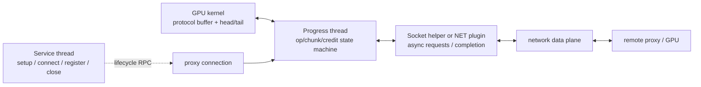

## 本章问题

第 23 章已经看到 GPU primitive 通过 `head/tail/flag` 与 connector 交换 credit。
但走 NET transport 时，GPU 不会自己调用 `send()`、verbs `ibv_post_send()` 或
plugin `test()`。GPU kernel 与 NIC/TCP 之间还有 CPU progress engine：

```text
GPU primitive
  <-> connFifo + head/tail + protocol buffer
  <-> NCCL Progress thread
  <-> ncclNet isend/irecv/test
  <-> Socket helper / IB plugin
  <-> network
```

本章回答：

1. Service、UDS Service、Progress 和 Socket helper 分别负责什么？
2. host enqueue 如何把 `ncclProxyOp` 交给 progress thread？
3. `ProxyArgs`、`SubArgs`、connection 和 network request 如何关联？
4. send proxy 如何等待 GPU、提交网络请求、归还 GPU credit？
5. recv proxy 如何 post receive、等待 completion、flush、通知 GPU？
6. `posted/received/transmitted/done` 为什么不能合并为一个计数器？
7. Socket 默认为什么可能没有 helper thread？
8. `NCCL_SOCKET_NTHREADS` 和 `NCCL_NSOCKS_PERTHREAD` 改变了哪一层并行？
9. 为什么 GPU 上看到长时间 NCCL kernel，不等于 GPU 在高效计算？
10. 如何区分 GPU primitive 等待、CPU progress 饥饿和网络 completion 慢？

## 可证伪假设

```text
H1: P2P 与 SHM 同时禁用后，每条 Ring connector 必须记录 NET/Socket。
H2: 显式配置 2 threads x 2 sockets 后，必须观测到 Progress、Service、
    UDS Service 和 Socket send/recv helper，而不仅是主线程。
H3: 默认 Socket 与 helper 配置对 4 KiB、512 KiB、64 MiB 的影响不同；
    更多 helper 不应被假定为单调更快。
H4: 只限制 Progress + Socket helper 的 CPU，不限制调用线程和 CUDA driver，
    仍会显著拉长 GPU collective completion。
H5: 给成功的大块 send/recv completion 注入小延迟时，可被并行流水隐藏；
    延迟超过隐藏窗口后，总时间必须明显上升。
H6: Nsight 的同一个 net-loop 中应同时存在 CPU OS runtime 活动和每 rank
    NCCL kernel；没有独立 memcpy kernel 不代表 CPU proxy 没有参与。
```

## 环境、实验与公开证据

```text
GPU: 4 x Tesla V100-SXM2-32GB, all pairs NV2
NCCL runtime/source: 2.22.3 / 178b6b7
data transport: forced NET/Socket over local eth0/TCP
algorithm/protocol: Ring/Simple
Socket configs: default, 1x1, 1x2, 2x1, 2x2
sizes: 4 KiB, 512 KiB, 64 MiB
performance rows: 150, all correctness PASS
completion-delay rows: 20, all correctness PASS
affinity rows: 15, all correctness PASS
```

正式运行：`ch24_proxy_socket/20260711T170000Z`。

- [实验汇总](/assets/files/nccl-learning/logs/ch24_proxy_socket/20260711T170000Z/summary.md)
- [运行清单](/assets/files/nccl-learning/logs/ch24_proxy_socket/20260711T170000Z/manifest.txt)
- [150 条性能记录](/assets/files/nccl-learning/logs/ch24_proxy_socket/20260711T170000Z/raw_measurements.csv)
- [Socket 参数统计](/assets/files/nccl-learning/logs/ch24_proxy_socket/20260711T170000Z/performance_summary.csv)
- [线程与亲和性汇总](/assets/files/nccl-learning/logs/ch24_proxy_socket/20260711T170000Z/thread_summary.csv)
- [completion 延迟原始记录](/assets/files/nccl-learning/logs/ch24_proxy_socket/20260711T170000Z/delay_measurements.csv)
- [completion 延迟统计](/assets/files/nccl-learning/logs/ch24_proxy_socket/20260711T170000Z/delay_summary.csv)
- [数据面线程亲和性记录](/assets/files/nccl-learning/logs/ch24_proxy_socket/20260711T170000Z/affinity_measurements.csv)
- [数据面线程亲和性统计](/assets/files/nccl-learning/logs/ch24_proxy_socket/20260711T170000Z/affinity_summary.csv)
- [Nsight 脱敏统计](/assets/files/nccl-learning/logs/ch24_proxy_socket/20260711T170000Z/nsys_summary.csv)
- [实验驱动](/assets/files/nccl-learning/scripts/48_ch24_proxy_socket_progress.py)
- [原生 workload probe](/assets/files/nccl-learning/probes/ch24_proxy_socket.cc)
- [Socket 延迟注入器](/assets/files/nccl-learning/probes/ch24_socket_delay.c)

原始 `.nsys-rep` 与 SQLite 只保留在本机，不发布。当前机器没有可用 HCA，
所以本章证明的是 NCCL NET proxy 与 Socket backend，不把结论外推成 IB/RDMA 性能。

## 先建立三平面模型

### 控制面：Service thread

Service thread 负责连接生命周期 RPC：Init、Setup、Connect、Register、Deregister、
Close。它处理本地 rank 到 proxy 的 Unix/TCP control socket，不搬运每个 data chunk。

### 数据面调度：Progress thread

Progress thread 从共享 op pool 取得已提交操作，调用 transport 提供的
`proxyProgress`。NET send/recv 的状态机、GPU credit 和 network completion 都在这里推进。

### Backend 数据搬运：Socket helper 或 network plugin

Socket helper 执行非阻塞 `send/recv`；IB plugin 则可能 post WQE、poll CQ，或者让
plugin/device 自己承担更多 progress。`needsProxyProgress` 决定 connector 是否需要
NCCL CPU proxy，不能把 Socket 的线程结构直接套到所有 network plugin。

三者的关系不是“Service thread 负责网络”：

```text
Service: setup/connect/register/teardown
Progress: op/chunk/credit/completion state machine
Socket helper: actual TCP byte progress
GPU kernel: protocol buffer producer/consumer and reduction
```

<div class="diagram-scroll diagram-scroll--wide" markdown="1">



</div>

实线是每个 operation 的 progress 路径，虚线是连接生命周期控制。Service thread 不逐 chunk 搬运 payload；Progress thread 也通常不直接执行 TCP 字节循环，而是驱动 backend helper/plugin 的异步请求。

## 从 ncclProxyOp 到 ncclProxyArgs

`src/include/proxy.h` 摘录并加注释：

```cpp
struct ncclProxyOp {
  struct ncclProxyConnection* connection; // 选中的 transport connector
  ssize_t nbytes;
  uint64_t opCount;                        // collective 全局次序
  int nsteps;
  int chunkSize;
  uint8_t sliceSteps, chunkSteps;
  uint8_t channelId;
  uint8_t protocol;
  int next;                                // 共享 op pool 的索引链
};

struct ncclProxySubArgs {
  struct ncclProxyConnection* connection;
  int channelId;
  int nsteps;
  ssize_t nbytes;
  uint64_t base;
  uint64_t posted;
  uint64_t received;
  uint64_t flushed;
  uint64_t transmitted;
  uint64_t done;
  void* requests[NCCL_STEPS];              // backend 的异步 request
};

struct ncclProxyArgs {
  struct ncclProxySubArgs subs[NCCL_PROXY_MAX_SUBS];
  proxyProgressFunc_t progress;             // sendProxyProgress 等
  int nsubs;
  int done;
  int state;                                // Ready -> Progress -> None
  int idle;                                 // 本轮调用是否做了有效推进
  struct ncclProxyArgs* next;               // active op 链
  struct ncclProxyArgs* nextPeer;            // 可合并 peer op
};
```

`ncclProxyOp` 是 enqueue 侧的紧凑描述，适合放入共享 pool；Progress thread 取出后，
把相容操作组织成 `ncclProxyArgs`，其中每个 `SubArgs` 通常对应一个 channel/connector
子操作。`requests[step % NCCL_STEPS]` 把逻辑 step 映射到 backend 异步请求槽。

五个计数器表达不同的 happens-before：

```text
send: posted(GPU credit) -> transmitted(isend posted) -> done(net test complete)
recv: posted(irecv posted) -> received(net complete) -> transmitted(flush/visible)
      -> done(GPU consumed / credit returned)
```

若只保留一个 offset，就无法区分“缓冲区已允许 GPU 写”“网络请求已提交”“NIC/TCP
已经完成”“数据已对 GPU 可见”和“GPU 已消费，可以复用 slot”。

## Op Pool 如何避免阻塞 Active Progress

`src/proxy.cc::ncclProxyGetPostedOps` 的关键分支：

```cpp
// active 非空时，不等待 mutex；先继续推进当前网络请求。
if (state->active != NULL &&
    (pool->nextOps == -1 || pthread_mutex_trylock(&pool->mutex) != 0))
  return ncclSuccess;

// 完全空闲时才在 condition variable 上睡眠。
if (state->active == NULL) {
  pthread_mutex_lock(&pool->mutex);
  while (pool->nextOps == -1 && !state->stop)
    pthread_cond_wait(&pool->cond, &pool->mutex);
}

// 一次最多追加有限批次，避免新 op 无限挤占已有 completion。
NCCL_PARAM(ProxyAppendBatchSize, "PROXY_APPEND_BATCH_SIZE", 16);
```

这是一个公平性设计：active request 存在时，progress thread 不能为了等新任务阻塞；
但也不能每轮都抢锁扫描 pool。2.22.3 还用 `NCCL_PROGRESS_APPENDOP_FREQ=8`
降低小消息场景的 append 检查频率。

`progressOps` 本身很短：

```cpp
while (op) {
  NCCLCHECK(op->progress(proxyState, op)); // transport 状态机推进一次
  *idle &= op->idle;
  if (op->state == ncclProxyOpNone)
    NCCLCHECK(removeOp(state, &op, &prevOp));
  else {
    prevOp = op;
    op = op->next;
  }
}
```

这里的 progress 是 cooperative polling，不是“一次调用完成一个 collective”。每次
调用通常只完成一个状态迁移；未就绪就保留 active，下一轮继续检查。

## Progress 主循环为何会 sched_yield

`src/proxy.cc::ncclProxyProgress` 摘录：

```cpp
while ((state->stop == 0 || (state->stop == 1 && state->active)) &&
       __atomic_load_n(proxyState->abortFlag, __ATOMIC_ACQUIRE) == 0) {
  int idle = 1;
  ncclResult_t ret = progressOps(proxyState, state, state->active, &idle);

  if (idle || (++proxyOpAppendCounter == ncclParamProgressAppendOpFreq())) {
    int added = 0;
    proxyOpAppendCounter = 0;
    if (state->stop == 0) ret = ncclProxyGetPostedOps(proxyState, &added);
    if (added == 0) sched_yield();
  }
}
```

active 不等于一直有进展。网络 request 未完成、GPU tail 未发布时，状态机返回 idle；
线程 `sched_yield()`，把 CPU 让给 Socket helper、应用线程或其他 proxy。若容器 CPU
quota 很小、cpuset 错绑，yield 后多久重新获得 CPU 就成为 collective latency 的一部分。

本版本源码中 Progress 和 Service 内部的两处 `sched_setaffinity` 都被注释；但这不表示
线程一定拥有全机 CPU。线程会继承创建者 mask，而 communicator 初始化线程此前可能
已按 GPU/NUMA 设置 affinity。本章实验因此以 `/proc/TID/status` 的最终值为证，不能只
看一行源码或启动命令。

## Service Thread 不是 Data Progress Thread

Service 主循环使用 `poll()`：

```cpp
do {
  ret = poll(pollfds, NCCL_MAX_LOCAL_RANKS+1,
             asyncOpCount ? 0 : 500);
} while (ret < 0 && errno == EINTR);

// 先推进未完成的 setup/connect/register RPC
for (ncclProxyAsyncOp* op = peer->asyncOps; op != nullptr; )
  proxyProgressAsync(op, proxyState, &asyncOpCount, peer, &connectionPool);

// 再读取新的控制命令
if (pollfds[s].revents & POLLIN) {
  ncclSocketTryRecv(sock, &type, sizeof(int), &closed, false);
  // Init / SharedInit / Setup / Connect / Register / Deregister
}
```

无 async control op 时，poll timeout 是500 ms；有异步连接操作时是0。这个500 ms
不是数据面每个 chunk 的轮询周期。把 Service 的 `poll()` 误判为 AllReduce 慢的直接
原因，会把控制面和数据面混在一起。

2.22.3 还创建 UDS Service，处理 cuMem/FD 交换。线程名可能因 Linux 15字符限制显示为
`NCCL UDS Servic`，排障脚本应允许截断。

## Send Proxy：GPU Producer 到 Network Consumer

`src/transport/net.cc::sendProxyProgress` 初始化：

```cpp
if (args->state == ncclProxyOpReady) {
  sub->base = ROUNDUP(resources->step, args->chunkSteps);
  resources->step = sub->base + sub->nsteps;
  sub->posted = sub->transmitted = sub->done = 0;
  args->state = ncclProxyOpProgress;
}
```

`base` 对齐 `chunkSteps`，避免相邻 op 在 protocol FIFO 中使用不一致的 generation。
接下来每轮按三个阶段推进。

### 阶段一：给 GPU 可写 credit

```cpp
int maxDepth = std::min(NCCL_STEPS, NCCL_SHARED_STEPS/args->nsubs);

if (sub->posted < sub->nsteps && sub->posted < sub->done + maxDepth) {
  int buffSlot = (sub->base+sub->posted) % NCCL_STEPS;
  // shared buffer 时先写 offset，再用 full fence 发布 head credit
  resources->recvMem->connFifo[buffSlot].offset = offset;
  __sync_synchronize();
  sub->posted += args->sliceSteps;
  *sendHead = sub->base + sub->posted - NCCL_STEPS;
}
```

`posted < done + maxDepth` 是有界窗口。network completion 不前进，`done` 停住，
最终不再给 GPU 新 credit；GPU primitive 会在 FIFO wait 中常驻。

### 阶段二：等待 GPU 数据并 isend

```cpp
if (sub->transmitted < sub->posted) {
  int buffSlot = (sub->base+sub->transmitted) % NCCL_STEPS;
  uint64_t tail = sub->base + sub->transmitted;
  if (connFifo[buffSlot].size != -1 && *recvTail > tail) {
    int size = connFifo[buffSlot].size;
    ncclNet->isend(netSendComm, buff, size, tpRank, mhandle,
                   sub->requests+buffSlot);
    if (sub->requests[buffSlot] != NULL)
      sub->transmitted += args->sliceSteps;
  }
}
```

Simple 以 tail/size 判定 GPU 已发布数据；LL/LL128 位于 host sysmem 时，proxy 还会扫描
每条 line flag，确认 GPU 的 `threadfence()` 之后数据完整。也就是说 protocol flag
不仅给 GPU peer 看，某些 NET staging 路径中 CPU proxy 也会解释它。

### 阶段三：test completion 并归还 credit

```cpp
if (sub->done < sub->transmitted) {
  ncclNet->test(sub->requests[buffSlot], &done, &size);
  if (done) {
    connFifo[buffSlot].size = -1; // 先清 slot metadata
    __sync_synchronize();         // 再发布可复用 head
    sub->done += args->sliceSteps;
    *sendHead = sub->base + sub->done;
  }
}
```

顺序不能反转。若先更新 head，GPU 可能复用 slot，而旧 `size` 或旧网络请求仍可见，
形成覆盖或错误 completion 关联。

## Recv Proxy：Network Producer 到 GPU Consumer

recv 比 send 多两个阶段，因为 NIC 写 GPU memory 后可能还需要 flush/visibility：

```text
posted -> received -> flushed/transmitted -> done
 irecv      test          visibility          GPU consumed
```

### Post irecv

```cpp
if (sub->posted < sub->nsteps && sub->posted < sub->done + maxDepth) {
  ptrs[subCount] = localBuff + buffSlot*stepSize;
  sizes[subCount] = stepSize * args->sliceSteps;
}

ncclNet->irecv(netRecvComm, subCount, ptrs, sizes, tags, mhandles,
               subGroup->requests+(step%NCCL_STEPS));
if (*requestPtr) sub->posted += args->sliceSteps;
```

先 post receive 才能让远端发送方推进。`maxRecvs` 大于1的 plugin 可把共享 recvComm 的
多个 sub 分组；Socket backend 声明 `maxRecvs=1`，所以每次只接一个 receive。

### Network complete 与 GDR flush

```cpp
ncclNet->test(request, &done, sizes);
if (done) {
  sub->received += args->sliceSteps;
  if (p == NCCL_PROTO_SIMPLE && resources->useGdr && resources->needFlush)
    ncclNet->iflush(...);
}
```

`test(done)` 只证明 backend 完成；是否已对 GPU load 可见取决于 plugin、GPU/NIC 和
memory registration 能力。Socket 只支持 host pointer，`iflush` 返回不支持；真正
GDR 的 flush 语义留到第26章。

### 通知 GPU 与等待 GPU 消费

recv proxy 在网络数据可见后更新 recv tail，让 GPU primitive 消费。GPU 更新 send head
后，proxy 才把对应 step 计入 done 并允许 backend buffer 复用。因此“网络收完”与
“collective 完成”之间仍可能隔着 GPU reduce/copy 和下游发送。

## Shared NET Buffer 与 maxDepth

源码定义：

```cpp
#define NCCL_SHARED_STEPS 16
state->size = nChannels * NCCL_SHARED_STEPS * proxyState->p2pChunkSize;

int globalSlot = channel*NCCL_SHARED_STEPS + slot;
*offset = proxyState->p2pChunkSize * globalSlot;

int maxDepth = min(NCCL_STEPS, NCCL_SHARED_STEPS/args->nsubs);
```

共享 buffer 不是所有 channel 随意竞争同一地址。channel 与 slot 共同决定 offset；同一个
proxy op 合并更多 sub 时，每个 sub 可占的 in-flight depth 会下降。这样以有限内存换取
多个 channel/P2P op 的安全复用。

## Socket Backend 的两级 Progress

`src/transport/net_socket.cc` 的 backend API 本身是异步 request：

```cpp
ncclNetSocketIsend(...) {
  ncclNetSocketGetRequest(comm, NCCL_SOCKET_SEND, data, size, &request);
  return ncclSuccess; // 此处没有保证 bytes 已发完
}

ncclNetSocketIrecv(...) {
  if (n != 1) return ncclInternalError;
  ncclNetSocketGetRequest(comm, NCCL_SOCKET_RECV, data[0], sizes[0], &request);
  return ncclSuccess;
}
```

当 `nThreads=0`，`ncclNetSocketTest` 由调用它的 NCCL Progress thread 直接执行
`ncclSocketProgress`。当 `nThreads>0`，request 被拆成 socket task，交给 helper：

```cpp
void* persistentSocketThread(void* arg) {
  while (1) {
    for (task in myQueue) {
      do {
        task->result = ncclSocketProgress(task->op, task->sock,
                                          task->data, task->size,
                                          &task->offset);
      } while (task->offset < task->size);
    }
    if (idle) pthread_cond_wait(&threadCond, &threadLock);
  }
}
```

Socket helper 对自己的多个 socket task 做轮询；Progress thread 仍负责更上层的
`posted/transmitted/done` 状态。开启 helper 并没有删除 Progress thread，而是把实际
TCP byte progress 从它分流出去。

## Socket Thread/Socket 参数的真实含义

自动选择源码：

```cpp
int autoNt=0, autoNs=1; // 默认只用 progress 主线程，不创建 helper
if (vendor == AWS) { autoNt=2; autoNs=8; }
else if (vendor == GCP) { autoNt=4; autoNs=1; }

nSocks = nSocksPerThread * nThreads;
```

因此：

```text
default on this host: 0 helper, 1 control/data socket path
t1_s1: 1 helper x 1 socket
t1_s2: 1 helper x 2 sockets
t2_s1: 2 helpers x 1 socket each
t2_s2: 2 helpers x 2 sockets each
```

`NCCL_NSOCKS_PERTHREAD` 不是总 socket 数；总数是它与 thread 数的乘积，并受
`MAX_SOCKETS=64`、`MAX_THREADS=16` 限制。helper 是按 send/recv comm、channel 和 rank
按需创建，不能用环境变量值直接推导整个进程只有几个线程。

## 线程名与最终 CPU Mask 实验

线程命名默认也有开关：

```cpp
NCCL_PARAM(SetThreadName, "SET_THREAD_NAME", 0);
if (ncclParamSetThreadName() != 1) return;
pthread_setname_np(thread, threadName);
```

所以生产排障若希望从 `ps -T` 区分线程，应设置 `NCCL_SET_THREAD_NAME=1`。实验在 warmup
之后采样10次 `/proc/PID/task/TID/{status,stat}`，观测到：

| 类型 | unique threads | 作用 |
|---|---:|---|
| `NCCL Progress 1` | 4 | 每个伪 node/rank 的 NET 状态机 |
| `NCCL Service 0..3` | 4 | setup/connect/register 控制面 |
| `NCCL UDS Servic` | 4 | cuMem/FD UDS 控制面 |
| `NCCL SockS*` | 16 | 2 channels x 2 helpers 的 send comm |
| `NCCL SockR*` | 16 | 2 channels x 2 helpers 的 recv comm |

数据面 helper 共32个，不是环境变量表面上的2个。原因是每个 rank、方向、channel 的
Socket comm 各自按需创建 helper。

主线程 mask 是 `0-79`；采样到的 NCCL 线程 mask 是40个偶数 CPU。这证明它们继承了
communicator 初始化线程的 GPU affinity，即使 `ncclProxyProgress` 内部那行
`sched_setaffinity` 被注释。最终 mask 才是事实来源。

## 原生 Workload Probe

probe 在4张 GPU 上创建 communicator，先 warmup 以建立 connector/helper，再输出
`READY` 并暂停，让实验驱动修改/读取 TID：

```cpp
enqueue(comms, streams, send, recv, count);
sync_all(streams);
printf("READY pid=%d ...\n", getpid());
sleep_for(milliseconds(pauseMs));

auto begin = steady_clock::now();
nvtxRangePushA("net-loop");
for (int i=0; i<iterations; i++)
  enqueue(comms, streams, send, recv, count);
auto submitted = steady_clock::now();
sync_all(streams);
nvtxRangePop();
auto done = steady_clock::now();
```

`host_us` 截止到全部 enqueue 返回，`total_us` 截止到四个 stream 完成。最后逐 rank
复制首尾元素，验证 AllReduce sum 等于10。暂停和线程采样不计入测量区间。

## 强制 NET/Socket 路径

实验统一设置：

```bash
NCCL_P2P_DISABLE=1
NCCL_SHM_DISABLE=1
NCCL_ALGO=Ring
NCCL_PROTO=Simple
```

INFO 日志对每个 channel 同时出现：

```text
Channel 00/0 : 0[0] -> 1[1] [send] via NET/Socket/0
Channel 00/0 : 0[0] -> 1[1] [receive] via NET/Socket/0
```

禁用 P2P 与 SHM 后，NCCL 把本机 GPU 视作通过 NET 连接的节点。本实验是可控的
loopback/本机 TCP transport 模拟，不等同于真实多机 RTT、交换机拥塞或 NIC DMA。

## Socket 参数性能矩阵

每个配置正序、逆序各一轮，每个 size 共10个 cycle，所有 out-of-place/in-place
correctness 均通过。

### 64 MiB

| config | median time | median busbw | CV |
|---|---:|---:|---:|
| default | 46982.25 us | 2.14 GB/s | 0.43% |
| t1_s1 | 40353.10 us | 2.49 GB/s | 0.18% |
| t1_s2 | 40368.35 us | 2.49 GB/s | 0.30% |
| t2_s1 | 40478.60 us | 2.49 GB/s | 0.18% |
| t2_s2 | 40386.70 us | 2.49 GB/s | 0.25% |

从默认无 helper 到1x1，64 MiB 时间下降14.1%；继续增加 socket/helper 没有收益。
当前是同机 TCP，单 helper 已能把 byte progress 与 Progress 状态机解耦，额外线程只
共享同一 CPU/memory/network path。

### 512 KiB

| config | median time | median busbw |
|---|---:|---:|
| default | 815.315 us | 0.965 GB/s |
| t1_s1 | 727.920 us | 1.08 GB/s |
| t1_s2 | 736.080 us | 1.07 GB/s |
| t2_s1 | 767.605 us | 1.025 GB/s |
| t2_s2 | 751.930 us | 1.045 GB/s |

1x1 相对 default 下降10.7%。但2x1的 CV 为12.65%，超过课程5%阈值，不能把各 helper
配置之间几十微秒的排序当稳定结论。

### 4 KiB

| config | median time | CV |
|---|---:|---:|
| default | 469.105 us | 9.93% |
| t1_s1 | 414.120 us | 23.75% |
| t1_s2 | 482.890 us | 6.79% |
| t2_s1 | 563.405 us | 10.43% |
| t2_s2 | 556.050 us | 6.68% |

全部 CV 超过5%。小消息由调度、系统调用和 wakeup 主导，这组数据只支持“没有单调
更多更快”，不支持宣称 t1_s1 是可靠最优值。工程调优必须以业务消息分布和多机网络
复测，不能抄本机某一行。

## Completion 延迟注入

`LD_PRELOAD` shim 拦截 NCCL Socket 最终调用的 libc `send/recv`。关键点是只在调用
成功且实际传输不少于64 KiB后 sleep：

```c
ssize_t done = real_recv(fd, buf, len, flags);
if (done > 0) {
  atomic_fetch_add(&recv_bytes, done);
  if ((size_t)done >= min_bytes) {
    atomic_fetch_add(&delayed_calls, 1);
    syscall(SYS_nanosleep, &ts, NULL);
  }
}
return done;
```

不能在调用前按 requested length 延迟：nonblocking recv 大量返回 `EAGAIN`，那样注入的
是 polling penalty，不是成功 completion latency。shim 的计数覆盖进程完整生命周期，
包括 warmup/control，不把它冒充仅 NVTX range 的 wire payload。

5次64 MiB AllReduce 的结果：

| 每次大块成功 I/O 延迟 | median total | 相对 baseline | CV |
|---:|---:|---:|---:|
| 0 us | 201.829 ms | baseline | 0.13% |
| 20 us | 201.910 ms | +0.04% | 0.12% |
| 100 us | 200.712 ms | -0.55% | 0.42% |
| 1000 us | 620.216 ms | +207.3% | 0.56% |

20/100 us 没有形成可测 slowdown，不表示注入未命中：100 us case 每次约有一万余次
大块成功 I/O 被记录。多个 helper、socket 和8-step FIFO 把短延迟重叠隐藏。1 ms 超过
可隐藏窗口后，总时间增至3.07倍。这是 pipeline overlap 的直接反例：累加所有 sleep
次数不能预测 wall time。

## 只饿死数据面线程

为了避免启动前 `taskset` 被 NCCL 后续 affinity 修改，驱动执行：

1. warmup，等待 `READY`；
2. 从 `/proc/PID/task` 选出 `NCCL Progress*` 与 `NCCL Sock*`；
3. 对36个 TID 调用 `sched_setaffinity(tid, {0})`；
4. 回读36个 mask，必须全部精确为 `0`；
5. 主线程、CUDA driver、Service thread保持原 mask；
6. 才开始 NVTX 测量区间。

结果：

| case | target mask | median host enqueue | median total | total CV |
|---|---|---:|---:|---:|
| wide | inherited even CPUs | 0.548 ms | 201.863 ms | 0.17% |
| proxy_cpu0 | CPU 0 verified | 0.570 ms | 3834.234 ms | 17.19% |
| proxy_cpu0 + burner | CPU 0 verified | 0.505 ms | 3512.841 ms | 14.77% |

数据面 pin 后 host enqueue 基本不变，而 completion 约19倍，证明瓶颈位于 enqueue
之后的 CPU progress/GPU wait 链。pin 两组 CV 超过5%，精确的3.834/3.513秒不能用作
回归基线，但相对 wide 的数量级差异远大于噪声。

加一个同核 burner 没有继续单调变慢，反而中位数略低；这不能解释成 burner 优化
NCCL。36个 polling/yield/condition-wait线程挤在一个 CPU 时，Linux 调度顺序高度
非线性，正是 CV 升高的原因。可靠结论是“错误数据面 cpuset 产生数量级退化”，不是
“每增加一个竞争线程会增加固定百分比”。

## Nsight 联合时间线

`nsys profile --trace=cuda,nvtx,osrt` 对同一个 probe 采集：

```text
NVTX range: net-loop
iterations: 5
GPU ops projected into range: 20
NCCL kernels in complete process: 24
```

20 = 5 iterations x 4 ranks；完整进程多出的4个 kernel是 range外 warmup。OS runtime
汇总同时出现：

```text
recv 341260 calls
send 12378 calls
pthread_cond_wait 9232 calls
poll 254 calls
```

OS runtime 计数是 profiler 运行本身的观测，不能与非 profiler shim run 的调用数逐项
对齐。它证明同一进程中 CPU socket/proxy 活跃；GPU 上4个 rank的 NCCL kernel则一直
等到对应 progress 链完成。

Socket host staging 的 copy 发生在 GPU primitive 对 protocol buffer 的 load/store 和
CPU `send/recv` 中，不要求出现独立 CUDA memcpy kernel。只搜索 timeline 中有没有
Memcpy，是错误的 transport 识别方法。

## 三类“Kernel 很长”的区分方法

### 1. GPU primitive spin / credit wait

现象：NCCL kernel 常驻，某 connector 的 head/tail/flag不变；proxy可能正常运行，但在
等待另一个 rank或下游 credit。检查 collective 顺序、protocol slot、rank crash和
对应 send/recv sub 的计数器停点。

### 2. CPU proxy 没有得到运行机会

现象：host enqueue快，GPU kernel duration和 collective总时间一起拉长；Progress/
Socket helper CPU time不足、run queue过长或 cpuset过窄；网络 counters可能没有按预期
增长。本章 pin 实验就是此指纹。

### 3. Network completion 慢

现象：proxy线程持续得到CPU，`isend/irecv` 已提交，但 `ncclNet->test` 长时间不 done；
GPU最终因 credit window耗尽停住。检查 Socket RTT/retransmit，或 IB CQ/QP/port counters。
本章1 ms注入隔离了这一层。

三者最后都可能表现为 GPU utilization 非零和 NCCL kernel 很长。必须同时看 GPU timeline、
proxy线程调度、request状态和网络计数，不能从一个表象下结论。

## 生产排障顺序

```text
1. 证明 transport：NCCL_DEBUG_SUBSYS=NET,PROXY，确认 Socket/IB/plugin。
2. 证明线程：NCCL_SET_THREAD_NAME=1，采集 ps -T 与 /proc mask。
3. 证明调用一致：所有 rank 的 opCount/collective/shape/order。
4. 证明 enqueue vs completion：CUDA event/NVTX，不用 host API latency代替。
5. 证明 progress：Progress/helper CPU time、run queue、cgroup quota/cpuset。
6. 证明 network request：isend/irecv已提交，test是否done，CQ/TCP counters。
7. 证明 GPU credit：head/tail/connFifo/flag在哪一阶段停止。
8. 最后才调 SOCKET_NTHREADS/NSOCKS、channel、buffer。
```

hang 时可在受控环境设置 `NCCL_PROXY_DUMP_SIGNAL=10` 或12，对进程发送对应
SIGUSR1/SIGUSR2，让源码的 `ncclDumpProxyState` 输出最近 proxy state。不要在不了解
应用 signal handler 的生产进程中直接占用信号。

## 容器与调度工程细节

1. Kubernetes CPU limit 可能用 CFS quota，而 cpuset 看起来仍很宽；两者都要检查。
2. `taskset` 只表示当时设置，线程后续可修改自身 affinity；必须回读每个 TID。
3. 一个进程多 GPU 时，proxy/helper 数量按 rank、channel、方向和 comm 扩张。
4. helper 与 dataloader、tokenizer、checkpoint线程共 NUMA node 时会争 CPU/memory。
5. Socket helper 更多会增加线程和 socket，不保证提升单流或 loopback性能。
6. IB/RDMA plugin 的 progress、CQ polling和 affinity可能不同，需按 plugin源码验证。
7. profiler 会改变系统调用与调度频率，性能基线与 profile run 分开采集。

## 常见错误

1. 把 Service thread 当成每个 chunk 的 data progress线程。
2. 认为 GPU kernel 已 launch 后 CPU 不再参与 NET collective。
3. 把 `isend` 返回当作网络发送完成。
4. 把 `irecv` posted 当作数据已经对 GPU 可见。
5. 合并 posted/received/transmitted/done，丢失故障停点。
6. 先归还 GPU head credit，再清 request/connFifo metadata。
7. 把 `NCCL_STEPS=8` 理解为永远可同时飞8个sub，忽略 shared maxDepth。
8. 只设置 `NCCL_SOCKET_NTHREADS`，忘记总 socket 是两个参数乘积。
9. 根据参数值猜线程数，不考虑 rank/channel/send/recv comm。
10. 不开 `NCCL_SET_THREAD_NAME`，然后声称进程没有 proxy线程。
11. 只看启动命令的 taskset，不回读最终 TID affinity。
12. 把小消息高CV下的最小中位数当成最优配置。
13. 累加所有并行 helper 的 sleep，直接预测 wall time。
14. 没看到 CUDA memcpy kernel，就声称没有 host staging。
15. 用本机 TCP 模拟结果外推真实 IB/RoCE/GDR带宽。

## 版本与边界

已验证 NCCL 2.22.3、4xV100、Ring/Simple、强制 NET/Socket、本机 TCP、默认与四组
Socket helper配置、成功 I/O 延迟注入、最终 TID affinity、NVTX/CUDA/OSRT联合证据。

未验证真实多机 RTT/丢包、TCP retransmit、IB verbs、CQ moderation、RoCE PFC/ECN、
GPUDirect RDMA、DMA-BUF、registration cache、PXN、多 rail、network plugin
`needsProxyProgress=0`、真实 NIC flush 和跨 NUMA NIC affinity。这些属于第25-28章。

## 本章结论

1. Service处理连接控制面，Progress处理chunk/credit/completion数据面，Socket helper
   执行实际TCP byte progress。
2. `ncclProxyOp`经共享pool转为带多个SubArgs的active ProxyArgs；progress是重复状态迁移。
3. send链是GPU credit -> tail/flag -> isend -> test done -> head credit。
4. recv链是irecv -> test -> optional flush -> GPU tail -> GPU consumed -> slot reuse。
5. posted/received/transmitted/done分别编码不同的buffer ownership与可见性边界。
6. 默认Socket在本机不创建helper；显式1x1使64 MiB从46.98降至40.35 ms，更多helper无收益。
7. 小消息全部CV超5%，不能据其排名选择生产参数。
8. 实际观测到4 Progress、4 Service、4 UDS Service和32 Socket helper。
9. 线程最终继承偶数CPU mask；源码中局部affinity调用被注释不代表线程mask为全机。
10. 20/100 us成功I/O延迟被流水隐藏；1 ms使5次64 MiB从201.8增至620.2 ms。
11. 精确pin 36个数据面TID到CPU0后，host enqueue不变，总完成约放大19倍。
12. Nsight中测量range有20个GPU op，同时有大量send/recv/cond-wait/poll，证明GPU/CPU协作。
13. 长驻NCCL kernel可能是primitive wait、CPU progress饥饿或network completion慢，
    必须联合四层证据区分。

## 验收题

1. Service、Progress、Socket helper各自处理哪类状态？
2. 为什么active op存在时 `ncclProxyGetPostedOps` 使用 trylock？
3. `NCCL_PROGRESS_APPENDOP_FREQ` 对小消息有什么权衡？
4. ProxyArgs为何能合并多个SubArgs？
5. send的posted、transmitted、done分别证明什么？
6. recv为什么比send多received/flush阶段？
7. `request[step % NCCL_STEPS]` 何时可以复用？
8. 为什么更新head前必须清connFifo size并做fence？
9. LL/LL128 host staging时proxy为什么扫描flag？
10. `maxDepth=min(8,16/nsubs)` 对4个sub是多少？
11. Socket的default 0 thread如何继续搬运数据？
12. 2 threads x 2 sockets为什么不表示整个进程只有2 helper？
13. 如何证明 `NCCL_SET_THREAD_NAME` 默认未开启？
14. 为什么启动前taskset不能替代最终TID mask证据？
15. completion delay为何不能按nonblocking调用次数简单累加？
16. 本章100 us结果为何不能解读成“延迟让性能更快”？
17. 数据面pin实验为何保留主线程和CUDA driver的mask？
18. pin case CV超过5%后，哪些结论仍成立，哪些数字不能作为基线？
19. Nsight中没有Memcpy kernel为何不能否认host staging？
20. 给出区分primitive spin、proxy starvation和network completion慢的最小证据集。
