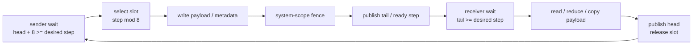

## 本章问题

第 22 章停在 `cuLaunchKernel`。进入 GPU 后，NCCL 还要完成：

```text
blockIdx -> channel
batch -> shared-memory work
funcId -> RunWorkBatch / RunWorkColl
Ring chunk -> send / recvReduceSend / recvCopySend
Primitives -> worker、wait、post、barrier、credit、flag
```

本章回答：

1. 一个 CUDA block 为什么对应一个 active channel？
2. 前两个 warp、其余线程分别加载什么？
3. 一个 block 如何顺序执行多个 fused work？
4. Ring AllReduce 的 reduce-scatter/all-gather 如何映射到 primitive 调用？
5. Simple 中 `step/head/tail/NCCL_STEPS` 如何形成有界 FIFO？
6. 哪些线程负责 wait/post，哪些线程真正 reduce/copy？
7. direct read/write 为什么能跳过部分 FIFO wait？
8. 为什么发布 tail/head 前需要 memory fence 与 barrier？
9. LL 每16字节为什么只有8字节 payload，双 flag 防什么？
10. LL128 的128字节 line 为什么是15个 data word + 1个 flag word？
11. buffer、step、slice、chunk 如何量化影响吞吐？

## 可证伪假设

```text
H1: 强制 channels=1/4/12 后，Nsight gridX 和 TRACE channel range 必须精确对应。
H2: LL、LL128、Simple 应生成不同 devFuncId、blockX 与 chunk geometry。
H3: Simple buffer 64KiB/1MiB/4MiB 在 chunkSteps=4 时应得到
    32KiB/512KiB/2MiB chunk，并显著影响大消息性能。
H4: 小消息增加 channel 不应必然更快；同步和空闲线程成本可能占主导。
H5: 状态模型中不发布 recv head 应在恰好 FIFO slots 后停顿；
    提前发布 tail/flag 应允许 corruption；缺 flag 应持续 blocked。
```

## 环境与证据

```text
GPU: 4 x V100-SXM2-32GB, all pairs NV2
NCCL: 2.22.3 / source 178b6b7
TRACE geometry: 12/12 PASS
performance: 720 rows, all correctness PASS
Nsight kernel cases: 9/9 PASS
state model: 27/27 PASS
sizes: 4 KiB, 512 KiB, 64 MiB
protocols: LL, LL128, Simple
channels: 1, 4, 12
```

正式运行：`ch23_device_primitives/20260711T154500Z`。

- [实验汇总](/assets/files/nccl-learning/logs/ch23_device_primitives/20260711T154500Z/summary.md)
- [运行清单](/assets/files/nccl-learning/logs/ch23_device_primitives/20260711T154500Z/manifest.txt)
- [work geometry](/assets/files/nccl-learning/logs/ch23_device_primitives/20260711T154500Z/work_geometry.csv)
- [720 条性能记录](/assets/files/nccl-learning/logs/ch23_device_primitives/20260711T154500Z/raw_measurements.csv)
- [性能统计](/assets/files/nccl-learning/logs/ch23_device_primitives/20260711T154500Z/performance_summary.csv)
- [Nsight kernel geometry](/assets/files/nccl-learning/logs/ch23_device_primitives/20260711T154500Z/nsys_kernel_geometry.csv)
- [同步状态模型结果](/assets/files/nccl-learning/logs/ch23_device_primitives/20260711T154500Z/protocol_state_model.csv)
- [实验驱动](/assets/files/nccl-learning/scripts/47_ch23_device_primitives.py)
- [状态模型源码](/assets/files/nccl-learning/probes/ch23_protocol_state_model.py)

原始 Nsight report/SQLite 保持本机私有；公开的是解析后的 kernel geometry。

## Kernel 如何把 Block 映射到 Channel

`src/device/common.h::ncclKernelMain`：

```cpp
if (tid < MAXCHANNELS && (args->channelMask & (1ull<<tid))) {
  int n = __popcll(args->channelMask & ((1ull<<tid)-1));
  if (blockIdx.x == n) ncclShmem.channelId = tid;
}
__syncthreads();
```

`blockIdx.x` 是 active channel 的稠密索引，而 channel ID 可能是稀疏 bitmask。线程
并行扫描 mask，计算目标 bit 前的 popcount，把第 N 个 active bit 映射给 block N。
所以：

```text
gridX = popcount(plan.channelMask)
block N != 必然 channel N
```

实验强制连续1/4/12 channels，因此 gridX 分别1/4/12；稀疏 mask 时仍应以 bitset
映射为准。

## 前两个 Warp 与 Work Loader

kernel 先把固定参数复制到 shared memory，再分工：

```cpp
switch (tid/WARP_SIZE) {
case 0:
  copyToShmem16(tid, &ncclShmem.comm,
                 ncclShmem.args.comm, sizeof(ncclDevComm));
  break;
case 1:
  copyToShmem16(tid-WARP_SIZE, &ncclShmem.channel,
                 &devComm->channels[channelId], sizeof(ncclDevChannel));
  break;
default:
  loadWorkBatchToShmem(tid-2*WARP_SIZE, tn-2*WARP_SIZE,
                       args, blockIdx.x);
}
__syncthreads();
```

warp0 加载 communicator hot fields，warp1 加载当前 channel，其余线程把该 channel
的首个 batch/work 搬到 shared memory。work 若在 Args storage，编译器可生成
`ld.param`；FIFO/Persistent 则用 global load。源码刻意分开两条分支，避免参数
地址被泛化后整块4 KiB kernel args spill 到每线程 local memory。

batch 最多1024 bytes，因此至少64线程以16-byte pack 可一次搬完。`offsetBitset`
由 warp 协作转为第 N 个置位 offset，shared scratch 避免昂贵的 PTX fns 展开。

## RunWorkBatch 与 Fused Work

```cpp
for (int w=0; w<ncclShmem.nWorks; w++) {
  ncclDevWorkColl* work = workStorage + w*workSize;
  if (w != 0 && work->nWarps != workPrev->nWarps)
    __syncthreads();
  int subtn = work->nWarps * WARP_SIZE;
  if (tid < subtn)
    RunWorkColl<Fn,T,RedOp,Algo,Proto>().run(tid,subtn,work);
}
```

同一 block/channel 可以顺序执行多个 fused work。每个 work 用 `nWarps` 指定 active
线程；其余线程不执行 primitive。相邻 work active warp 数改变时先全 block barrier，
防止前一 work 的大线程集合与下一 work 状态重叠。

batch 结束后，kernel 按 `nextJump` 加载下一 batch；`barrier_red_or` 同时广播 abort
状态。FIFO storage 还要写 `workConsumed[channelId]`，host 才能安全复用环形 work
metadata 空间。

## RunWorkColl 与 Template Dispatch

`funcId` 编码 collective、datatype、redop、algorithm、protocol。若等于 specialized
kernel ID，直接调用编译期 specialization；否则通过 `ncclDevFuncTable[funcId]`。
两条路径最终进入如：

```cpp
RunWorkColl<ncclFuncAllReduce, float, FuncSum<float>,
            NCCL_ALGO_RING, NCCL_PROTO_SIMPLE>::run(...)
```

模板把 protocol 和 fan arity 编译成常量，使 reduce/copy loops、线程角色和 direct
分支可展开；代价是生成大量 specialization，TRACE 库编译耗时也源于此。

## Ring AllReduce 到 Primitive

`src/device/all_reduce.h::runRing` 先调用 `ncclCollCbdPart`，把 work 的
countLo/Mid/Hi 转成当前 channel 的 `gridOffset/channelCount/chunkCount`，再构造：

```cpp
Primitives<T, RedOp, FanSymmetric<1>, 1, Proto, 0> prims(
  tid, nthreads, &ring->prev, &ring->next,
  work->sendbuff, work->recvbuff, work->redOpArg);
```

Ring 每个 rank 只有一个 prev 与 next，`FanSymmetric<1>` 让编译器知道 recv/send
上界都是1。每轮 chunk 的调用序列：

```cpp
prims.send(offset, nelem);
for (j=2; j<nranks; j++)
  prims.recvReduceSend(offset, nelem);
prims.directRecvReduceCopySend(offset, offset, nelem, true);

for (j=1; j<nranks-1; j++)
  prims.directRecvCopySend(offset, nelem);
prims.directRecv(offset, nelem);
```

前半完成 reduce-scatter，后半完成 all-gather。中间
`directRecvReduceCopySend` 同时接收最终归约 chunk、写用户 output 并向下一 rank
发送，形成相位衔接。对4 ranks，一个 chunk 的物理 Ring 数据传播仍是
`2*(N-1)=6` 轮；primitive call 可在一轮内融合 recv/reduce/copy/send，不能简单把
函数调用数当网络轮数。

## Primitive API 是模板组合

对 Simple，公开方法只是 `genericOp` 的编译期组合：

```text
send                  Recv=0 Send=1 Src=Input
recv                  Recv=1 Send=0 Dst=Output
recvReduceSend        Recv=1 Send=1 Src=Input
directRecvCopySend    DirectRecv=1 Recv=1 Send=1 Dst=Output
directRecvReduceCopySend
                      DirectRecv=1 DirectSend=1 Recv=1 Send=1
```

`genericOp` 每个 slice 执行：

```text
waitPeer
  -> subBarrier
  -> reduceCopy / direct skip-copy
  -> barrier
  -> postPeer
```

这套骨架同时覆盖纯 copy、多输入 reduce、in-place、direct read/write、SHM/NET FIFO
以及 device plugin unpack；模板常量去掉不需要的分支。

## Simple 的线程角色

constructor 按边缘线程分配同步角色：

```cpp
if      (tid < nrecv)            flags |= RoleWaitRecv;
else if (tid < nrecv+nsend)      flags |= RoleWaitSend;
else if (nthreads-nsend <= tid)  flags |= RolePostSend;
else if (nthreads-nrecv-nsend <= tid)
                                    flags |= RolePostRecv;
```

最前面的线程轮询 recv/send 条件，最后面的线程发布 send/recv progress；中间
`nworkers` 线程执行 reduceCopy。把 polling 与 payload workers 分开，可以避免所有
线程重复读取 volatile head/tail。worker/non-worker 都必须经过配对 barrier，保证
slice 生命周期一致。

Nsight 实测 blockX：

| protocol | blockX | 解释 |
|---|---:|---|
| LL | 512 | LL 上限与当前 work nWarps |
| LL128 | 640 | LL128 最大20 warps |
| Simple | 544 | 17 warps；包含同步角色和 payload workers |

三者 gridX 随 channel1/4/12 精确为1/4/12。所有 case registers/thread=96，
static shared约0.007 MiB、dynamic shared约0.041 MiB；这适用于当前编译与 V100，
不是跨版本常数。

## Simple 的 Credit 与 Step

`NCCL_STEPS=8`，每条 connector buffer 是8槽环。wait 条件：

```cpp
while (connStepCache + (isSend ? NCCL_STEPS : 0)
       < step + StepPerSlice) {
  connStepCache = loadStepValue(connStepPtr);
  if (checkAbort(spins)) break;
}
```

两种语义：

```text
receiver wait:
  tail >= desired step
  没有生产完成的数据就不能读

sender wait:
  head + NCCL_STEPS >= desired step
  consumer 未释放 slot 时不能覆盖
```

buffer pointer 通常为：

```cpp
connEltsFifo + (step % NCCL_STEPS) * connStepSize
```

因此 step 单调增长，槽下标取模；head/tail 单调值消除仅看 slot index 的 ABA 歧义。
`connFifo[step%8]` 同时传 size、offset 和 mode，NET shared buffer 可用 offset mode
指向动态位置。

<div class="diagram-scroll diagram-scroll--xwide" markdown="1">



</div>

这是 Simple connector 的 producer/consumer credit 环。槽位会循环复用，但 head/tail 的逻辑 step 单调递增；fence 位于 payload 与 ready 发布之间，不能只保留尾指针更新。

## 发布顺序与 Fence

`postPeer`：

```cpp
step += StepPerSlice;
if (Send && RolePostSend &&
    (dataStored || ConnFifoEnabled))
  fence_acq_rel_sys();
st_relaxed_sys_global(connStepPtr, step);
```

必须先使 payload/metadata 对 peer、CPU proxy 或 NIC 可见，再发布 tail。否则 consumer
可能看见“ready step”却读到旧数据。system-scope fence 是数据与控制变量之间的
happens-before 边；`st_relaxed` 本身不替代前面的 fence。

direct read/write 可跳过部分 wait：

```cpp
noRecvWait = DirectRecv && Src && DirectRead;
noSendWait = DirectSend && (DirectRead | DirectWrite);
```

因为数据直接位于 user buffer，不占常规 FIFO slot；但 primitive barrier、其他方向
progress 和 operation ordering 仍存在。“direct”不是完全无同步。

## Slice Size

Simple 计算：

```cpp
sliceSize = stepSize * StepPerSlice;
sliceSize = max(
  divUp(nelem, 16*SlicePerChunk)*16,
  sliceSize/32);
```

它在平均分片与 FIFO step 的1/32下限之间取较大值，并按16元素对齐。worker loop
只处理非空 slice；non-worker 仍为剩余空 slice执行 wait/barrier/post，确保各 peer
step 数一致。若某 rank 因空 slice 少 post 一次，后续 collective 会永久错位。

## Buffer 到 Chunk 的实测公式

Simple 每 step payload：

```text
stepBytes = NCCL_BUFFSIZE / NCCL_STEPS
chunkBytes = stepBytes * ALLREDUCE_CHUNKSTEPS
           = buffer / 8 * 4
           = buffer / 2
```

TRACE：

| Simple buffer | step bytes | observed chunk bytes |
|---:|---:|---:|
| 64 KiB | 8 KiB | 32 KiB |
| 1 MiB | 128 KiB | 512 KiB |
| 4 MiB/default | 512 KiB | 2 MiB |

三项精确匹配。buffer 不是“缓存越大越好”的孤立参数，它决定 step capacity、chunk
粒度、循环次数和 pipeline in-flight window。

## LL：Data 与 Flag 同 Line

`ncclLLFifoLine` 是16 bytes：

```text
data1 32-bit | flag1 32-bit | data2 32-bit | flag2 32-bit
```

每 line 只有8 bytes payload，wire efficiency 50%。sender 写 payload 与两个相同
flag；receiver 用一个 volatile 128-bit load 反复读取：

```cpp
uint32_t flag = NCCL_LL_FLAG(recvStep[i]+1);
do {
  asm("ld.volatile.global.v4.u32 ...");
} while (flag1 != flag || flag2 != flag);
return data1 | ((uint64_t)data2 << 32);
```

双 flag 夹在两个 payload half 后，只有整 line 达到 expected generation 才可消费。
expected flag 来自单调 step+1，slot 即使 `step%8` 复用，旧 generation 也不匹配。

生产默认 `NCCL_LL_FLAG(a)=a`。测试宏可让 flag 在0x100 wrap；cleanup mask 命中时，
sender 把 slice 剩余 flags 全写为当前 generation，避免 wrap 后未覆盖区域携带同值
旧 flag。cleanup 是 generation wrap 的正确性机制，不是普通数据清零。

LL 单 step data 是 LL buffer 的 `1/8/2`，TRACE 默认 chunk=32 KiB。50% wire payload
和更轻同步适合小消息，不能期待大消息接近 Simple 带宽。

## LL128：15/16 Payload

LL128 line 为128 bytes，即16个64-bit words，其中15个 data、1个 flag：

```text
payload efficiency = 15 / 16 = 93.75%
```

warp 中 `wid % 16 == 15` 的 flag thread 负责每 line flag word。receiver 先加载
128-bit pairs，flag thread 比较 expected flag，再用 warp-wide `__any_sync` 决定
是否所有 lane 重载：

```cpp
do {
  needReload = false;
  for (u=0; u<ELEMS_PER_THREAD; u+=2) {
    load128(ptr + u*WARP_SIZE, vr[u], vr[u+1]);
    needReload |= flagThread && (vr[u+1] != flag);
  }
} while (__any_sync(0xffffffff, needReload));
```

只有 flag lane 产生 predicate，但整个 warp 一致等待，防止部分 lane 提前进入 reduce。
aligned user buffer 直接 load 到 registers；misaligned 路径先取覆盖区域到 warp scratch
shared memory，再重排，解释了第14章非对齐性能损失。

LL128 default TRACE chunk=576000 bytes，blockX=640；payload efficiency 接近 Simple，
同步开销低于 Simple，但 register/shared staging 与固定 line layout 仍有成本。

## Nsight Kernel 结果

64 MiB scenario 的每 rank kernel duration 中位数：

| protocol | channels1 | channels4 | channels12 |
|---|---:|---:|---:|
| LL | 23312.746 us | 5888.806 us | 2622.775 us |
| LL128 | 9965.515 us | 2845.079 us | 1183.767 us |
| Simple | 5234.459 us | 1437.254 us | 865.930 us |

每 case 都是4个 kernel instance，即4 ranks各一个。gridX 与请求 channel 精确相同。
kernel duration 与 nccl-tests event time口径不同，但 protocol/channel 趋势一致。

## 性能矩阵

### 4 KiB

| protocol | ch1 | ch4 | ch12 |
|---|---:|---:|---:|
| LL | 19.030 us | 19.355 us | 19.680 us |
| LL128 | 26.560 us | 26.700 us | 26.650 us |
| Simple | 34.510 us | 34.610 us | 34.585 us |

小消息只有极少 payload，增加 channel 不增加有效并行，反而可能增加 block/sync
调度。LL 的 inline flag 与轻量路径延迟最低。这个结果反驳“channel 越多总越快”。

### 512 KiB busbw

| protocol | ch1 | ch4 | ch12 |
|---|---:|---:|---:|
| LL | 4.86 | 16.66 | 31.06 GB/s |
| LL128 | 7.90 | 15.39 | 19.67 GB/s |
| Simple | 9.97 | 13.65 | 15.29 GB/s |

此 size 的 crossover 与纯大消息不同：LL ch12 达31.06 GB/s。固定 protocol/channel
矩阵用于理解机制，不代表 auto tuner 应总选全局最高 channel；tuner还考虑占用、
任务并发和预测模型。

### 64 MiB busbw

| protocol | ch1 | ch4 | ch12 |
|---|---:|---:|---:|
| LL | 4.99 | 19.67 | 44.32 GB/s |
| LL128 | 11.86 | 40.35 | 91.13 GB/s |
| Simple | 22.71 | 75.78 | 118.38 GB/s |

大消息有足够 chunk 填满 channels，三种 protocol 都随并行度增长；Simple 的 payload
效率与大 buffer 最适合带宽区间。ch12 相对ch1 speedup分别约4.46x、7.68x、5.21x，
仍小于理想12x，因为多个 channel 共享同一组 NVLinks、SM和memory subsystem。

## Simple Buffer Sweep

固定4 channels、64 MiB：

| buffer | chunk | median time | busbw |
|---:|---:|---:|---:|
| 64 KiB | 32 KiB | 5092.540 us | 19.77 GB/s |
| 1 MiB | 512 KiB | 1480.490 us | 68.00 GB/s |
| 4 MiB | 2 MiB | 1328.385 us | 75.78 GB/s |
| default | 2 MiB | 1328.350 us | 75.78 GB/s |

显式4 MiB与default仅差0.003%，是参数/默认值负对照。64 KiB 导致大量 step/chunk
循环和更频繁 credit handoff，带宽只剩26.1%；1 MiB 已接近但仍慢11.5%。

4 KiB 下64 KiB buffer反而从34.61增至38.895 us，说明减小 buffer 没有普遍降低
小消息延迟，初始化/分支和 geometry 仍主导。

## 状态机故障注入

模型使用与源码相同的有界 credit、slot取模和 generation flag，测试
`fifo_steps=2/4/8`，共27行。它是确定性离散模型，不是 GPU benchmark。

### 正常与故障

| protocol | fault | observed |
|---|---|---|
| Simple | normal head/tail | 64 steps complete |
| Simple | drop recv head | 恰在 N slots 后 deadlock |
| Simple | tail before payload | consumer corruption |
| LL | 双 flag=step+1 | complete |
| LL | second flag missing | blocked |
| LL | constant flag at wrap | stale slot accepted |
| LL128 | line flag normal | complete |
| LL128 | flag word missing | warp blocked |
| LL128 | flag before data | incomplete line corruption |

`drop_recv_head` 的 deadlock 点随 slots 精确为2/4/8，直接验证 credit window。constant
flag 在第一次 slot wrap 产生 ABA；单调 generation flag 让旧 slot 保持 mismatch。
提前发布的 corruption case 说明 fence/order 不是性能装饰。

模型不能证明真实 GPU memory ordering一定发生 corruption；它证明若破坏源码建立的
happens-before，协议允许错误执行。真实9个 Nsight case与720条 correctness记录则
证明未注入故障的生产实现运行正确。

## 常见错误

1. 把 blockIdx直接当 channelId，忽略稀疏 mask。
2. 认为一个 block 只执行一个 work。
3. 把 primitive call 数当 Ring network round 数。
4. 让所有 worker都轮询 head/tail，忽略专用 thread role。
5. 把 `step%8` 当完整状态，忽略单调 generation。
6. 认为 direct path完全没有 barrier/progress。
7. 发布 tail 后才做 fence。
8. 空 slice 不执行 post，导致 rank step 漂移。
9. 把 LL 16-byte line 当16-byte payload。
10. 认为 LL128 每128 bytes 全是数据。
11. 把 flag 当校验和；它表达 ready generation，不校验 payload内容。
12. 减小 buffer 后只看显存占用，不看 step/chunk循环。
13. 小消息强加更多 channel，期待线性加速。
14. 用离散模型数据冒充 GPU 性能。
15. 用 Nsight duration 与 nccl-tests event time绝对值直接比较。

## 排障树

### Kernel 长时间运行、GPU utilization 有但无进展

检查所有 rank 是否进入相同 op/protocol，connector head/tail 哪一侧停止，proxy
是否推进，abort flag是否可见。primitive spin 会表现为 kernel常驻，不等于计算忙。

### 固定在第 N 个 chunk 后 hang

若 N 接近 `NCCL_STEPS` 或其倍数，优先检查 recv head credit、proxy completion 和
slot reuse；若立即 hang，检查首个 tail/flag generation 与 connector step初始化。

### Correctness 偶发错误但不 hang

检查 payload publication 与 tail/flag fence、direct pointer lifetime、LL flag cleanup、
misalignment staging，以及应用是否在 NCCL stream完成前复用 buffer。

## 版本与边界

已验证 NCCL 2.22.3/V100 的 Ring AllReduce、三协议、1/4/12 channels、Simple buffer
sweep、TRACE work、Nsight geometry 与离散同步模型。未验证实际故障版 GPU kernel、
Tree primitive、多 recv fan-in、NET proxy FIFO、SM90 multimem/NVLS、abort during
spin 和 LL flag真实 wrap cleanup。

## 本章结论

1. 一个 block对应channelMask中的第N个active channel，不一定等于同编号 channel。
2. warp0/1加载 comm/channel，其余线程加载 batch/work 到 shared memory。
3. 一个 block可顺序执行多个 fused work，nWarps控制每个 work active线程。
4. Ring algorithm 通过 protocol-parametric Primitives 组合 recv/reduce/copy/send。
5. Simple 用 head/tail credit和8槽step ring防覆盖、判ready。
6. 专用 wait/post线程与 payload workers通过 barrier配合，发布前有system fence。
7. LL 双 flag只有50% payload，但提供低延迟 generation-ready line。
8. LL128 每128B有120B payload，以flag thread和warp-wide投票同步。
9. Nsight 的 gridX精确等于1/4/12，blockX为LL512、LL128640、Simple544。
10. 默认Simple 4MiB buffer推导并实测2MiB chunk；64KiB buffer使64MiB busbw
    从75.78降至19.77 GB/s。
11. 720条真实记录正确；27个模型 case证明缺credit、flag或ordering的故障后果。

## 验收题

1. 稀疏 channelMask 如何映射 blockIdx？
2. 前两个 warp 为什么不参与首轮 work load？
3. Args work为何必须与 global work分开编译分支？
4. 一个 batch如何在device端找到多个work？
5. grouped work为什么可共享channel但不共享buffer？
6. 对4 ranks写出 Ring primitive序列与6轮传播。
7. Simple sender/receiver wait不等式分别是什么？
8. `head+8` 的物理含义是什么？
9. 为什么 empty slice仍必须post？
10. direct read/write跳过哪些wait，哪些同步仍保留？
11. fence与tail store的顺序为什么不能反转？
12. LL双flag如何防止torn line？
13. generation flag如何防slot wrap ABA？
14. LL cleanup在什么条件下必要？
15. LL128 flag thread和 `__any_sync` 如何协作？
16. 从4MiB buffer推导Simple chunk bytes。
17. 为什么channel12对4KiB无收益、对64MiB有收益？
18. 如何从常驻kernel区分compute慢与primitive spin？
