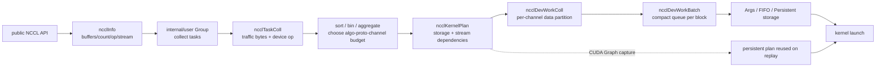

## 本章问题

调用 `ncclAllReduce` 不等于立即启动一个固定 kernel。API 参数依次经历：

```text
public API -> ncclInfo -> ncclTaskColl -> tuning/scheduling
           -> ncclDevWorkColl -> ncclWorkBatch
           -> ncclKernelPlan -> upload -> cuLaunchKernel
```

本章回答：

1. public API 如何封装 count、datatype、op、root 和 stream？
2. 为什么每次 API 都有 internal group，显式 group 又改变什么？
3. task 为什么先按 traffic 排序，再按函数、op、datatype 聚合？
4. grouped4 为何不是4个独立 kernel？
5. task、work、batch、plan 和 kernel 分别是什么粒度？
6. channel 与 count/chunk 分片如何进入 device work？
7. batch 在什么条件下可以追加，什么时候必须新建？
8. work metadata 放 kernel args、FIFO 或 persistent buffer 的条件是什么？
9. CUDA Graph 为何使用 persistent plan，graph 销毁时如何回收？

## 可证伪假设

```text
H1: sequential N 每 rank 应启动 N 个 kernel；grouped N 若预算足够，
    应把 N 个 work 放进一个 plan，每 rank只启动1个 kernel。
H2: grouped 不会丢掉每个操作的 buffer/count；TRACE 应显示 N 个 device work。
H3: grouped tuning 聚合近似大小 task 后，algorithm/protocol/channel 可改变。
H4: grouped4 捕获后重放5次应执行4x5个 NCCL kernel。
H5: width 增大时 grouped host submit 优势扩大；width1 是负对照。
```

## 环境与证据

```text
GPU: 4 x V100-SXM2-32GB, all pairs NV2
NCCL runtime/source: 2.22.3 / 178b6b7
TRACE library: same source, TRACE=1, only for work metadata
system library: all performance and Nsight profiles
payload: 1 MiB float32 AllReduce per logical operation
measurement rows: 190
TRACE work rows: 15
Nsight acceptance: 3/3 PASS
correctness: all PASS
```

正式运行：`ch22_enqueue_plan/20260711T151500Z`。

- [实验汇总](/assets/files/nccl-learning/logs/ch22_enqueue_plan/20260711T151500Z/summary.md)
- [运行清单](/assets/files/nccl-learning/logs/ch22_enqueue_plan/20260711T151500Z/manifest.txt)
- [work geometry](/assets/files/nccl-learning/logs/ch22_enqueue_plan/20260711T151500Z/trace_work_geometry.csv)
- [190 条原始测量](/assets/files/nccl-learning/logs/ch22_enqueue_plan/20260711T151500Z/raw_measurements.csv)
- [性能统计](/assets/files/nccl-learning/logs/ch22_enqueue_plan/20260711T151500Z/performance_summary.csv)
- [脱敏 Nsight 汇总](/assets/files/nccl-learning/logs/ch22_enqueue_plan/20260711T151500Z/nsys_summary.csv)
- [实验驱动](/assets/files/nccl-learning/scripts/46_ch22_enqueue_plan_graph.py)
- [原生 probe](/assets/files/nccl-learning/probes/ch22_enqueue_plan_graph.cc)

Nsight report 与 SQLite 含进程环境细节，只保存在本机 private 目录，不公开。

<div class="diagram-scroll diagram-scroll--xwide" markdown="1">



</div>

这条链描述 host planner 如何逐步丢弃 API 层抽象并生成 device work。CUDA Graph 复用的是 persistent plan 与依赖，不是跳过 task/plan 语义后直接重放一个裸 kernel 名称。

## API 到 ncclInfo

`src/collectives.cc:94-114`：

```cpp
ncclResult_t ncclAllReduce(const void* sendbuff, void* recvbuff,
    size_t count, ncclDataType_t datatype, ncclRedOp_t op,
    ncclComm* comm, cudaStream_t stream) {
  NvtxParamsAllReduce payload{count * ncclTypeSize(datatype), op};
  NVTX3_FUNC_WITH_PARAMS(AllReduce, AllReduceSchema, payload);

  struct ncclInfo info = {
    ncclFuncAllReduce, "AllReduce",
    sendbuff, recvbuff, count, datatype, op, 0, comm, stream,
    ALLREDUCE_CHUNKSTEPS, ALLREDUCE_SLICESTEPS
  };
  NCCLCHECK(ncclEnqueueCheck(&info));
  return ncclSuccess;
}
```

`ncclInfo` 只是短生命周期 host 描述，保存 function、buffers、count、datatype、
op、root、comm、stream 和 chunk/slice steps。此时尚无 algorithm、protocol、
channel 或 kernel。NVTX payload 在 API 边界记录 bytes/op，后续 Nsight 可把 API
range 投影到 GPU。

## Internal Group 与显式 Group

`ncclEnqueueCheck` 的骨架：

```cpp
NCCLCHECK(ncclGroupStartInternal());
CommCheck(info->comm, ...);
ncclCommEnsureReady(info->comm);
ArgsCheck(info);
INFO(NCCL_COLL, "%s: opCount ... count %zu datatype %d op %d ...");
NCCLCHECKGOTO(taskAppend(info->comm, info), ret, fail);
ncclGroupErrCheck(ret);
NCCLCHECK(ncclGroupEndInternal());
```

没有显式 group 时，internal depth 回到0，当前 task 随即 prepare/launch。外层
`ncclGroupStart` 先增加 depth，每个 API 的 internal start/end 只回到外层深度，
直到用户 `ncclGroupEnd` 才统一排程。显式 group 扩大了 planner 同时可见的 task
集合，不是仅减少函数调用。

## ncclInfo 到 ncclTaskColl

`src/enqueue.cc:1988-2030`：

```cpp
ncclTaskColl* t = ncclMemoryStackAlloc<ncclTaskColl>(&comm->memScoped);
t->func = info->coll;
t->sendbuff = info->sendbuff;
t->recvbuff = info->recvbuff;
t->count = info->count;
t->root = info->root;
t->datatype = info->datatype;
t->trafficBytes = t->count * elementSize *
                  ncclFuncTrafficPerByte(t->func, comm->nRanks);
t->opHost = info->op;
t->opDev = opDev;
t->chunkSteps = info->chunkSteps;
t->sliceSteps = info->sliceSteps;
planner->nTasksColl += 1;
ncclTaskCollSorterInsert(&planner->collSorter, t, t->trafficBytes);
```

每个 API 的 buffers/count 都保留在独立 task。reduction op 立即转换为 device form，
因为用户可能在 GroupEnd 前销毁自定义 op handle。task 位于 communicator scoped
memory stack，plan 回收后整体释放。AllGather/Broadcast 会转成 byte count 与
`ncclInt8`；空 collective 直接丢弃；单 rank 走 memcpy，不创建 task。

planner 去重保存全部 user stream，并要求一个 group 内的 stream 要么都 uncaptured，
要么属于同一 CUDA Graph：

```cpp
ncclCudaGetCapturingGraph(&graph, info->stream);
if (planner->streams != nullptr &&
    !ncclCudaGraphSame(planner->capturingGraph, graph))
  return ncclInvalidUsage;
planner->capturingGraph = graph;
```

## Task Prepare、排序与聚合

`ncclPrepareTasks` 先按 `trafficBytes` 近似降序取出 sorter，再按 function、device
redop、datatype 分 bin。每个 bin 内，流量在4倍范围内的相邻 task 会临时聚合：

```cpp
struct ncclTaskColl agg = *aggBeg;
while (aggEnd != nullptr &&
       aggEnd->trafficBytes < 4*aggBeg->trafficBytes) {
  agg.count += aggEnd->count;
  agg.trafficBytes += aggEnd->trafficBytes;
  aggEnd = aggEnd->next;
}
getAlgoInfo(comm, &agg, ..., nTasksPerChannel, ...);
```

聚合对象只用于选择 algorithm/protocol/channel budget；真实 task 的 buffers/count
没有合并丢失。grouped4 因 tuner 看见约4 MiB 聚合流量，可能选择与四个 sequential
1 MiB 不同的 protocol。任务还按 CollNet/NVLS 约束分 bin，避免不兼容算法进入同一
plan。

## ncclTaskColl 到 ncclDevWorkColl

device work 保留 kernel 真正需要的字段：

```cpp
struct ncclDevWorkColl {
  uint32_t channelLo:8, channelHi:8;
  uint32_t nWarps:8;
  uint32_t redOpArgIsPtr:1, regUsed:2, oneNode:1, direct:4;
  uint32_t root;
  void* recvbuff;
  void* sendbuff;
  union {
    struct {
      size_t countLo, countMid, countHi;
      uint64_t chunkGrainsLo:21, chunkGrainsMid:21, chunkGrainsHi:21;
    } cbd;
    struct { size_t count; uint32_t chunkCount; } collnet;
  };
  uint64_t redOpArg;
};
```

`channelLo/Hi` 表示该 work 使用的连续 channel 区间。首、中、尾 channel 可分到
不同 count，保证总 count 不整除 channel 数时仍无遗漏；chunk 以 protocol grain
编码，Simple grain 为512 bytes。device 通过 `ncclCollCbdPart` 根据当前
`channelId` 复算 partOffset、partCount 和 chunkCount。

## Work Batch 为什么存在

同一 channel 上，work 先写入 work queue，再由 `ncclDevWorkBatch` 的
`offsetBase + offsetBitset` 索引。可以追加到当前 batch 的前提是：

```text
相同 workType
相同 devFuncId
融合后 work bytes 不超过 1024
offset 可由 64-bit bitset 表达且按 workSize 对齐
P2P batch 不重复使用同一 round，且不超过8个 P2P work
```

不满足 type/func/容量时创建新 batch；仅 offset 距离过远时创建 extension batch，
device 端通过 `nextExtends` 融合。`nextJump` 则把同一 channel 的 batch 串起来。
batch 把“每个 block 该运行哪些同型 work”编码紧凑，避免每个 work 携带完整链表。

## Plan Budget 与 Storage

`ncclLaunchPrepare` 持续从 task queue 剥离 plan。collective 必须先于 P2P drain，
否则各 rank 在不同位置切 plan，shortest-channel picker 可能分歧。

```cpp
budget.inArgsBytes = comm->workArgsBytes - sizeof(ncclDevKernelArgs);
budget.outArgsBytes = persistent ? (1<<30) : comm->workFifoBytes/2;

scheduleCollTasksToPlan(comm, plan, &budget);
if (planner->nTasksColl == 0)
  scheduleP2pTasksToPlan(comm, plan, &budget);
finishPlan(comm, plan);
```

非捕获 plan 初始 storage 是 FIFO，persistent plan 是 persistent buffer。如果
kernel args 能容纳 `kernelArgs + batches + works`，`finishPlan` 会提升为 Args，
省去 FIFO upload。否则 `uploadWork` 预留 FIFO，处理 wrap sentinel，再异步 H2D；
CUDA Graph 则把 work copy 到稳定的 persistent buffer，地址必须跨 replay 有效。

`finishPlan` 还把各 channel 的第一 batch round-robin 排到
`batchZero[blockIdx.x]`，并写入：

```cpp
kernelArgs->comm = comm->devComm;
kernelArgs->channelMask = plan->channelMask;
kernelArgs->workStorageType = plan->workStorageType;
```

## Stream 依赖、Upload 与 Launch

多 user stream 采用两级 fan-in/fan-out：

```text
extra user streams -> device strong stream -> launch user stream
host stream proxy task ---------------------> launch user stream
launch user stream -> device strong stream -> extra user streams
```

这样 kernel 在所有输入 stream 之前的 work 完成后启动，所有 user stream 又在 NCCL
kernel 后继续。实际 launch：

```cpp
int nChannels = countOneBits(plan->channelMask);
dim3 grid = {(unsigned)nChannels, 1, 1};
dim3 block = {(unsigned)plan->threadPerBlock, 1, 1};
void* extra[] = {
  CU_LAUNCH_PARAM_BUFFER_POINTER, plan->kernelArgs,
  CU_LAUNCH_PARAM_BUFFER_SIZE, &plan->kernelArgsSize,
  CU_LAUNCH_PARAM_END
};
cuLaunchKernelEx(&launchConfig, fn, nullptr, extra);
```

gridX 是 plan channel mask 的 popcount，不是 API 数；blockX 是 plan 中所有 work
要求的最大 thread 数并至少为 `NCCL_MIN_NTHREADS`。一个 kernel block 从
`batchZero[blockIdx.x]` 开始，依次解释该 channel 的 batch/work。

## CUDA Graph 的 Persistent Plan

capturing graph 有效时 `plan->persistent=true`。work metadata 不能放会被普通
callback 回收的 FIFO；plan、proxy op 与 buffer 必须活到 graph 销毁。NCCL 增加
`persistentRefs`，并注册 graph destructor：

```cpp
if (persistent) {
  comm->persistentRefs += nPlans;
  ncclCudaGraphAddDestructor(
    planner->capturingGraph, persistentDestructor, planHead);
}

static void persistentDestructor(void* plans) {
  for (plan : plans)
    ncclIntruQueueMpscEnqueue(&comm->callbackQueue, &plan->reclaimer);
}
```

graph replay 不再经过 public NCCL API、task append 和 tuning；它重放已捕获的 kernel
与依赖节点。comm 不能在 graph 仍持有 persistent plan 时无条件释放相关资源。

## 原生实验

probe 在一个进程管理4个 GPU/communicator，每个 logical op 使用独立 send/recv
buffer，输入为 rank+1，输出首尾元素必须为10：

```cpp
// grouped N：一个外层 group 内提交 N x 4 rank API。
ncclGroupStart();
for (int op=0; op<N; op++)
  for (int rank=0; rank<4; rank++)
    ncclAllReduce(send[op][rank], recv[op][rank], count,
                  ncclFloat, ncclSum, comm[rank], stream[rank]);
ncclGroupEnd();
```

sequential N 对每个 op 单独 start/end。graph N 先在4个 stream capture grouped N，
实例化4个 graph，再重放1/5/20次。NVTX range 只包围目标 scenario；连接 warmup
在 range 外。性能计时从 enqueue/capture 开始，到4个 stream 全部 synchronize。

TRACE 使用同提交 `178b6b7` 的 `TRACE=1` 隔离库；所有性能和 Nsight 使用系统
2.22.3，防调试日志改变定量结果。

## TRACE：API 字段真的进入 Work

1 MiB 单个 sequential work：

```text
AllReduce(Sum, ncclFloat32, RING, LL128)
count=262144 devFuncId=210
channel{Lo..Hi}={0..11}
count{Lo,Mid,Hi}={21844,21848,21820}
chunkBytes{Lo,Mid,Hi}={576000,576000,576000}
```

验证总 count：

```text
21844 + 10 * 21848 + 21820 = 262144
```

grouped4 中，4个 API 仍生成4个 work，但聚合 tuning 选择 Ring/Simple、
`devFuncId=211`，channel range 分布为：

| work | channelLo..Hi | countLo/Mid/Hi | chunk bytes |
|---:|---|---|---:|
| 1 | 0..2 | 87380 / 87384 / 87380 | 2097152 |
| 2 | 3..5 | 87384 / 87384 / 87376 | 2097152 |
| 3 | 5..8 | 4 / 87384 / 87372 | 2097152 |
| 4 | 8..11 | 8 / 87384 / 87368 | 2097152 |

每行独立求和均为262144。边界 channel5/8 可承载相邻 work 的 batch，这不是数据
重叠：work 有不同 buffers，channel scheduler 在同一 block 内依次解释它们。
这直接证明 grouped 是 **work fusion**，不是把四个 tensor 拼成一个 count。

graph capture 的4条 work geometry 与 grouped 完全相同；replay 不重新生成 TRACE
work，因为 planner 只在 capture 时运行。

## Nsight：Task、Plan 与 Kernel 数对齐

| mode | logical ops | replay | NVTX 范围 GPU kernels | gridX | blockX |
|---|---:|---:|---:|---:|---:|
| sequential | 4 | 1 | 16 | 12 | 640 |
| grouped | 4 | 1 | 4 | 12 | 544 |
| graph grouped | 4 | 5 | 20 | 12 | 544 |

一个进程有4个 rank/GPU，因此 sequential4 是 `4 ops x 4 ranks = 16 kernels`；
grouped4 是一个 plan，每 rank一个 kernel，共4；graph5次重放是 `4 x 5 = 20`。
三项与假设精确一致。

gridX 始终12，证明 fusion 没减少 communicator active channels。blockX 从640变544
来自 grouped 后 protocol/work plan 的线程需求变化；API 数不直接决定 block 数。

## Group Width 性能

| ops | sequential host us | grouped host us | host变化 | sequential total us | grouped total us | total变化 |
|---:|---:|---:|---:|---:|---:|---:|
| 1 | 65.006 | 71.391 | +9.82% | 125.070 | 133.636 | +6.85% |
| 2 | 99.397 | 85.232 | -14.25% | 188.110 | 172.660 | -8.21% |
| 4 | 129.285 | 93.501 | -27.68% | 289.513 | 236.563 | -18.29% |
| 8 | 232.076 | 88.739 | -61.76% | 521.728 | 299.421 | -42.61% |
| 16 | 449.536 | 114.527 | -74.52% | 991.490 | 447.925 | -54.82% |

每格10样本、两轮反向顺序。width1 负对照中 grouped 包装略慢，说明 group 本身有
固定成本。width 增大后，一次 prepare/launch 与 work fusion 摊薄 host launch 和
GPU kernel 边界，优势快速扩大。

不能把 width16 的54.82%解释成通信量减少：仍有16个1 MiB AllReduce work，首尾
逐元素结果全部正确。减少的是 kernel/launch/scheduling 边界，且 grouped tuning
改变了 protocol/channel-to-work assignment。

## CUDA Graph 成本与摊销

| ops | replay | median host us | median total us | graph nodes总数 |
|---:|---:|---:|---:|---:|
| 1 | 1 / 5 / 20 | 493.894 / 621.533 / 952.912 | 509.221 / 756.659 / 1624.470 | 12 |
| 4 | 1 / 5 / 20 | 521.823 / 569.994 / 831.538 | 606.681 / 1129.170 / 3203.073 | 12 |
| 16 | 1 / 5 / 20 | 546.238 / 626.528 / 911.592 | 817.312 / 2132.265 / 6979.275 | 12 |

这里 host/total **包含 capture、instantiate、全部 replay 和 destroy**，不能与单次
grouped steady time直接比较。节点总数每个 case 都是跨4设备12，且与 ops 无关，
因为 N 个同型 work 已融合进每 rank一个 kernel node；ops metadata 位于 persistent
plan，不对应 N 个 graph kernel node。

用 replay5到20的增量粗估每次重放总完成成本：

```text
ops1:  (1624.470 - 756.659) / 15 = 57.85 us
ops4:  (3203.073 - 1129.170) / 15 = 138.26 us
ops16: (6979.275 - 2132.265) / 15 = 323.13 us
```

这是同一进程多设备 graph launch 的经验增量，不是精确 kernel duration；destroy、
排队和同步仍在区间中。它只用于说明 capture 固定成本随 replay 被摊薄。

## 常见错误

1. 把一次 NCCL API 等同于一个 GPU kernel。
2. 认为显式 group 只减少 host 函数调用。
3. 认为 grouped 会把多个 tensor count 合成一个 tensor。
4. 忽略 grouped 聚合流量会改变 tuning。
5. 把 task、work、batch、plan 当同一对象。
6. 把 gridX 当 group 内 API 数。
7. 认为每个 work 独占 channel；一个 channel block 可解释多个 batch/work。
8. 忽略 batch 必须匹配 workType 与 devFuncId。
9. 认为所有 work 永远从 FIFO 上传；小 plan 可内联 Args。
10. 捕获时使用临时 work 地址，忽略 persistent lifetime。
11. 混用不同 capture graph 的 stream。
12. 把包含 capture/instantiate 的时间称作 graph replay latency。
13. Nsight kernel count 不减去 range 外的 warmup。
14. 用 TRACE 调试库的时延做生产性能结论。
15. 发布含完整环境的 nsys SQLite。

## 排障方法

### API 有记录但没有 kernel

检查 count是否为0、single-rank memcpy、group depth 是否未闭合、ArgsCheck 是否失败、
task 是否因 plan budget/collective mismatch 卡在跨 rank prepare。

### grouped kernel 数没有下降

检查 workType/devFuncId 是否不同，algorithm/protocol 是否无法共 batch，plan budget
是否溢出，多 stream capture 是否不一致，以及 collective/P2P 是否被分成不同 plan。

### Graph replay 后 use-after-free

检查 communicator、buffers、custom redop、registered buffer 和 graph 的销毁顺序，
以及 persistent destructor 是否已进入 callback queue。捕获成功不代表用户 buffer
可以在 graph replay 前释放。

## 版本与硬件边界

已验证 NCCL 2.22.3、4xV100 的 AllReduce task/work fusion、Args/FIFO/persistent
源码状态机、group width1-16、CUDA Graph replay1-20、TRACE geometry 和 Nsight
kernel/grid/block。未验证跨多个 user stream 的真实 fan-in、plan budget 强制溢出、
混合 collective+P2P、registered work、NVLS/CollNet work 和 SM90 CGA。

## 本章结论

1. API 先变成 `ncclInfo`，再复制为具有独立 buffer/count 的 `ncclTaskColl`。
2. 显式 group 推迟 depth归零，让 planner 联合观察多个 task。
3. task 按 traffic 与函数/op/datatype组织，近似大小可聚合用于统一 tuning。
4. device work 保留 channel/count/chunk/buffer/root/redop 等执行字段。
5. batch 以 func/type/容量和 offset bitset 压缩同一 channel 的 work。
6. plan 决定 channelMask、threads、storage、proxy ops 与一次 kernel launch。
7. grouped4 保留4个 work，但每 rank从4个 kernel融合为1个。
8. grouped16 比 sequential16 host submit低74.52%，total低54.82%。
9. CUDA Graph 使用 persistent plan；4 work重放5次精确产生20个跨rank kernel。
10. graph node数不随 fused work数增长，work metadata 不是独立 kernel node。

## 验收题

1. `ncclInfo` 与 `ncclTaskColl` 的生命周期和新增字段有何不同？
2. internal group 如何使普通 API 自动 launch？
3. 为什么显式 group 能改变 protocol？
4. traffic sorter 与 function/op/datatype bin 分别解决什么？
5. grouped 后 buffers 是否合并？用 TRACE 如何证明？
6. `countLo/Mid/Hi` 如何还原总 count？
7. work batch 何时 new、extend、append？
8. Args、FIFO、Persistent 三种 storage 的选择边界是什么？
9. 为什么 collective 必须先于 P2P drain？
10. gridX 与 blockX 分别来自 plan 哪些字段？
11. sequential4、grouped4 为何分别有16/4个跨rank kernel？
12. graph replay为何不再运行 taskAppend/tuning？
13. persistent plan 在何时回收？
14. 为什么 graph nodes 不随 grouped ops从1增到16？
15. 设计一个混合 AllReduce+Send/Recv 迫使多 plan 的实验。
