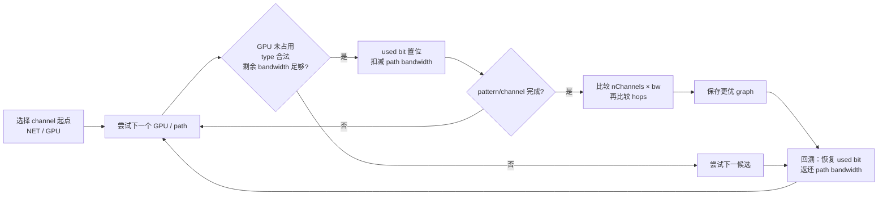

## 本章问题

上一章得到的是任意 GPU/NIC pair 的 path matrix。NCCL 还必须解决一个组合优化
问题：选择每个 channel 的 GPU 顺序、起止 NET、pattern、路径等级和目标带宽，
同时不能让多个 channel 使用的累计带宽超过同一物理 link 容量。

本章回答：

1. Ring、Tree、Split Tree、Balanced Tree pattern 对递归终点有何不同？
2. graph search 如何在尝试 channel 时扣减 link bandwidth，又如何回溯？
3. 目标函数为什么先比较 `channels × bandwidth`，再比较 hops？
4. speed/type/sameChannels/crossNic 约束按什么顺序放宽？
5. search graph 的 channel 数为什么不是最终 communicator channel 数？
6. `NCCL_GRAPH_FILE` 是 hint 还是直接 replay？
7. graph 文件缺少某个 algorithm、引用错误 GPU 时分别发生什么？
8. 搜索彻底失败时 simple-order fallback 的真实字段是什么？

## 可证伪假设

```text
H1: 当前全互联 NV2 拓扑应搜索到 Ring/Tree 各 6 个基础 channel，
    postset 后固定复制为 12 个 final coll channels。

H2: replay 原始 graph 应恢复完全相同的 channel order；自定义一 channel graph
    应跳过搜索，最终执行指定的 0-2-1-3 Ring order，并复制成 2 channels。

H3: NCCL_MAX/MIN_NCHANNELS 不改变 search output 6，
    只在 postset 阶段把 final channels 改为 4/16。

H4: 极弱 topology 无法满足最低 3 GB/s search speed 时，应产生
    nChannels=1, bw=0.1, type=SYS 的 simple-order fallback。

H5: graph 引用不存在的 dev=0xff 应在 XML import 阶段失败，不能静默搜索替代。
```

## 环境与证据

```text
NCCL runtime/source: 2.22.3+cuda12.6 / v2.22.3-1 @ 178b6b7
nccl-tests: 5bcd45d
GPU: 4 x V100-SXM2-32GB, all pairs NV2
search cases: native, exact replay, custom replay, partial replay,
              weak-topology fallback, MAX=4, MIN=16
performance cases: 6
sizes: 4 KiB, 512 KiB, 64 MiB
samples: 2 replicates x 10 cycles
performance rows: 360
```

正式运行：`ch19_graph_search/20260711T044500Z`。

- [实验汇总](/assets/files/nccl-learning/logs/ch19_graph_search/20260711T044500Z/summary.md)
- [运行清单](/assets/files/nccl-learning/logs/ch19_graph_search/20260711T044500Z/manifest.txt)
- [搜索结果](/assets/files/nccl-learning/logs/ch19_graph_search/20260711T044500Z/search_summary.csv)
- [最终 Ring 顺序](/assets/files/nccl-learning/logs/ch19_graph_search/20260711T044500Z/final_ring_orders.csv)
- [resolved graph](/assets/files/nccl-learning/logs/ch19_graph_search/20260711T044500Z/resolved_graphs.csv)
- [graph fixtures](/assets/files/nccl-learning/logs/ch19_graph_search/20260711T044500Z/artifacts/graph_fixtures/custom_one.xml)
- [360 条性能记录](/assets/files/nccl-learning/logs/ch19_graph_search/20260711T044500Z/raw_measurements.csv)
- [性能统计](/assets/files/nccl-learning/logs/ch19_graph_search/20260711T044500Z/performance_summary.csv)
- [故障矩阵](/assets/files/nccl-learning/logs/ch19_graph_search/20260711T044500Z/failure_matrix.csv)
- [完整实验脚本](/assets/files/nccl-learning/scripts/43_ch19_graph_search_replay.py)

本机只有一个 socket NET plugin device `eth0`，没有多 HCA。因此 crossNic 的
源码与构造可以解释，无法给出 multi-rail 实测。

## 三层 Channel 必须分开

```text
search graph channel
  -> 本地 topology 上一条 pattern/order，受 link bandwidth 约束

preset/postset communicator channel
  -> 各 node/rank 局部 fragment 拼接，并复制/裁剪

operation active channel
  -> tuner/planner 按某次消息大小再缩减
```

本章 native 示例：

```text
search Ring graph: 6
search Tree graph: 6
postset final coll channels: 12
4 KiB operation active grid: 可能小于 12（第 15 章已验证）
```

把 INFO 中任意一个 channel 数称作“实际使用 channel”都会丢掉所属阶段。

## Pattern 的结构语义

仓库：`NVIDIA/nccl`  
版本：`v2.22.3-1`，提交 `178b6b7`  
文件：`src/graph/search.cc:690-717`

原始源码注释：

```cpp
/*
 *     Intra-node
 * Ring            : GPU a -> GPU b -> .. -> GPU x -> GPU a
 * (=Split Tree Loop)
 * Tree            : GPU a -> GPU b -> .. -> GPU x
 * (=Split Tree)
 *
 *     Inter-node
 * Ring            : NET n -> GPU a -> ... -> GPU x
 *                   -> NET n (or m if crossNic)
 * Tree            : NET n -> GPU a -> ... -> GPU x
 *                    `--> NET n (or m if crossNic)
 * Split Tree      : NET n -> GPU a -> ... -> GPU x
 *                                      `--> NET n/m
 * Split Tree Loop : NET n -> GPU a -> ... -> GPU x -> GPU a
 *                                      `--> NET n/m
 */
```

对应终点参数：

```cpp
if (hasNet) {
  if (pattern == RING) backToNet = ngpus-1;
  else if (pattern == SPLIT_TREE) backToNet = 1;
  else backToNet = 0;
  backToFirstRank = -1;
} else {
  backToNet = -1;
  if (pattern == RING) backToFirstRank = ngpus-1;
  else backToFirstRank = -1;
}
```

单节点 Ring 必须在最后一个 GPU 后闭合回 first GPU；Tree 是开放链。这里的
Tree graph order 不是最终双树的完整 parent/children，preset/postset 会从局部顺序
提取 tree endpoints，再由 `connectTrees` 连接节点间结构。

## Graph 保存了什么

概念结构：

```text
id / pattern
minChannels / maxChannels / nChannels
bwIntra / bwInter / latencyInter
typeIntra / typeInter
crossNic / sameChannels
nHops
intra[channel][localGpuOrder]
inter[channel][sendNet, recvNet]
```

本机 native Ring graph XML：

```xml
<graph id="0" pattern="4" crossnic="0"
       nchannels="6" speedintra="20" speedinter="20"
       typeintra="NVL" typeinter="PIX" samechannels="0">
  <channel><gpu dev="0"/><gpu dev="0x1"/>
           <gpu dev="0x2"/><gpu dev="0x3"/></channel>
  <channel><gpu dev="0"/><gpu dev="0x1"/>
           <gpu dev="0x3"/><gpu dev="0x2"/></channel>
  <!-- 共 6 个 permutation -->
</graph>
```

`dev` 以十六进制解析，再映射到 topology system 中的 GPU 和 communicator rank。
graph 文件不是直接存 rank 字符串，因为跨 node/system ID 需要设备身份映射。

## Search 不是只枚举排列

一个候选 channel 必须同时满足：

```text
每个 GPU 在该 channel 中只使用一次
每段 path.type <= graph type constraint
每条 path 的剩余 link bandwidth >= graph target bandwidth
pattern 的闭环/回 NET 条件
sameChannels/crossNic 约束
min/max channel 数
search timeout
```

如果只枚举四 GPU 的 24 个 permutation，不扣共享 link capacity，会错误地认为
所有 permutation 都能作为无限并行 channel。

## Link Bandwidth 如何被“占用”

文件：`src/graph/search.cc:76-159`  
符号：`followPath`、`ncclTopoFollowPath`

原始源码：

```cpp
#define SUB_ROUND(a, b) \
  (a = roundf((a-b)*1000)/1000)

static ncclResult_t followPath(
    ncclTopoLinkList* path, ncclTopoNode* start,
    int maxSteps, float bw, int* steps) {
  for (int step=0; step<maxSteps; step++) {
    ncclTopoLink* link = path->list[step];
    float fwBw = link->type == LINK_PCI ? pciBw : bw;
    if (link->bw < fwBw ||
        (revBw && revLink->bw < revBw)) {
      *steps = step;
      return ncclSuccess;
    }
    SUB_ROUND(link->bw, fwBw);
    if (revBw) SUB_ROUND(revLink->bw, revBw);
  }
}
```

调用层：

```cpp
float bw = intra ? graph->bwIntra : graph->bwInter;
int type = intra ? graph->typeIntra : graph->typeInter;

if (mult == 1 && path->type > type) return no_candidate;
if (mult == 1 && isTree && revPath->type > type)
  return no_candidate;

bw *= mult;
followPath(path, node1, path->count, bw, &step);
if (step < path->count) goto rewind;

graph->nHops += mult*path->count;
destination = node2;
```

注释版：

```cpp
// 选择一段 path 时，从每条 edge 剩余容量扣除 target bw。
reserve(path, +bw);

// 某 edge 不够时，只恢复已经扣过的 prefix。
if (failure_at_step_k) reserve(path[0:k], -bw);

// 递归返回时完整恢复，使其他 permutation 看到正确剩余容量。
backtrack(path, -bw);
```

`SUB_ROUND` 把三位小数后的误差消掉，否则大量递归加减可能让本应为 20 的 link
变成 19.999998，错误拒绝候选。

Tree 同时检查 reverse path type，因为 Tree traffic 有 up/down 双向语义；Ring
顺序则按每段方向构造。

Intel CPU root complex 的 GPU P2P 还会使用 `INTEL_P2P_OVERHEAD(bw)=bw*6/5`，
反映 64B PCI TLP overhead。graph bw 不等于每条物理 edge 机械扣同一数字。

## 递归与 Backtracking

候选 GPU 尝试：

```cpp
const uint64_t flag = 1ULL << graph->nChannels;
ncclTopoFollowPath(..., mult=1, &gpu);
if (gpu) {
  gpu->used ^= flag;
  ncclTopoSearchRecGpu(...);
  gpu->used ^= flag;
  ncclTopoFollowPath(..., mult=-1, &gpu);
}
```

每个 channel 使用 `used` bit 的一个位置；递归进入时置位，退出时异或恢复。
路径容量也以 `mult=-1` 恢复。因此 search state 同时包含：

```text
当前 channel GPU permutation
每个 GPU 的 channel-used bitmap
所有 topology edge 的剩余 bandwidth
累计 hop
已找到 channel 数
剩余 search budget
```

GPU 尝试顺序会按 intra hops/bw、NET path 和 PCI bw 评分排序；这是加速找到好解的
heuristic，不改变最终合法性。在 timeout 前先找到高质量解，比盲目字典序更重要。

<div class="diagram-scroll" markdown="1">



</div>

图中的“扣减”和“恢复”是同一递归状态的成对操作。漏掉任何一边都会让后续候选看到错误的 link capacity；这也是 Graph Search 不能简化成 GPU permutation 枚举的原因。

## 搜索目标函数

文件：`src/graph/search.cc:416-434`  
符号：`ncclTopoCompareGraphs`

```cpp
if (graph->nChannels < graph->minChannels) return;

if (graph->nChannels * graph->bwIntra >
    refGraph->nChannels * refGraph->bwIntra) {
  copy = 1;
  return;
}
if (candidate_total_bw < reference_total_bw) return;

if (same_pattern && same_crossNic &&
    graph->nHops < refGraph->nHops) copy = 1;
```

主要目标是：

$$
score_{primary}=nChannels\times bwIntra
$$

总带宽相等时，才以更少 hops 作为 tie-breaker。并非“channel 越多越好”：

```text
6 channels × 20 GB/s = 120
12 channels × 10 GB/s = 120
```

二者 primary score 相同，hops/pattern/crossNic 等才可能区分。NVLS 有不同比较逻辑，
优先更多 head/channel 并比较 inter aggregate bandwidth。

## Speed 不是任意 Float

V100/非 SM90 intra speed table：

```cpp
float speedArrayIntra[] = {
  40, 30, 20, 18, 15, 12, 10, 9, 7, 6, 5, 4, 3
};
```

inter table 还包含：

```text
48, 30, 28, 24, ... 3, 2.4, 1.2, 0.24, 0.12
```

SM90 使用另一组 60/50/... speed。search 从 `system->maxBw/totalBw` 能承受的最高
离散档开始，不会对 40→3 中间所有 float 穷举。

```cpp
while (speed > maxBw ||
       speed * minChannels > totalBw)
  speedIndex++;
tmpGraph.bwIntra = speedArray[speedIndex];
```

上一章 native NVLink path bw=40，但最终 graph speed=20，原因不是 parser 丢了一半；
search 在多 channel aggregate capacity 和闭环 edge reservation 下选择了 6×20。

## 约束放宽状态机

`ncclTopoCompute` 第一轮大致按以下顺序：

```text
1. sameChannels=1，较短 timeout 尝试复用相同 channel
2. sameChannels=0，允许不同 order
3. 特定 SM90 balanced tree 可退 simpler tree
4. typeIntra: NVL -> NVB -> PIX -> ... -> SYS
5. typeInter: PIX -> PXB -> PXN -> ... -> SYS
6. crossNic=auto 时尝试 crossNic
7. 沿 speed array 降低 target bandwidth
8. 仍无解且有旧解时停止，完全无解则 fallback
```

找到解后进入 pass 2，从当前解尝试提升 bandwidth。源码并非“先找最快 ring，失败
一次就用 PCI order”，而是有 search budget 的渐进约束求解器。

single-node `ncclTopoSearchRec` 首先尝试 PCI order；已有 channel 后还会 replay 前一
channel；`sameChannels=0` 或仍无 channel 时再遍历所有 GPU start。

## sameChannels 的严格含义

`sameChannels=1` 表示 search 优先让后续 channel replay 前一 channel 的 GPU order，
便于快速获得同构 channels；不是“Ring 与 Tree 必须相同”，也不是最终所有 channel
ID 指向同一 CUDA block。

native 全互联结果 `sameChannels=0`，六个 Ring order 覆盖六种以 rank 0 开头的
permutation。弱 fallback 设置 `sameChannels=1`，因为只生成一个 simple order。

## crossNic 的严格含义

有多个 NET device 且 pattern 支持时，`NCCL_CROSS_NIC` 决定一个 channel 的 send
和 receive endpoint 是否允许来自不同 NIC/ASIC/port：

```cpp
if (graph->crossNic != 1 &&
    (net->asic != startNet->asic ||
     net->port != startNet->port)) continue;
```

postset 在 crossNic 且偶数 channels 时，还会对奇数 node 成对交换 ring，避免
rail crossing：

```cpp
for (int c=0; c<nChannels; c+=2)
  exchange(channel[c], channel[c^1]);
```

本机只有 eth0 一个 NET，所有 graph `crossNic=0`。不能用本章数据推断双 HCA
multi-rail 的最优设置。

## Search Graph 为什么会被复制

本地 preset：

```cpp
for (int c=0; c<nChannels; c++) {
  ringIntra = ringGraph->intra + c*localRanks;
  treeIntra = treeGraph->intra + c*localRanks;

  if (ringIntra[i] == rank) {
    topoRanks->ringRecv[c] = ringIntra[0];
    topoRanks->ringSend[c] = ringIntra[localRanks-1];
    topoRanks->ringPrev[c] = i == 0 ? -1 : ringIntra[i-1];
    topoRanks->ringNext[c] = i == last ? -1 : ringIntra[i+1];
  }
  // Tree 同理提取 parent/child endpoint。
}

memcpy(comm->channels+nChannels,
       comm->channels,
       nChannels*sizeof(ncclChannel));
```

preset 将本地 graph order 转为每 rank fragment。各 rank 的 `topoRanks` 经 AllGather
后，postset 连接节点间端点，写入完整 prev/next 和 tree up/down。

postset 固定复制：

```cpp
memcpy(ringPrev+nChannels*nranks, ringPrev, ...);
memcpy(ringNext+nChannels*nranks, ringNext, ...);

for (int c=0; c<nChannels; c++) {
  channel1 = channel0 + nChannels;
  channel1->ring.prev = channel0->ring.prev;
  channel1->ring.next = channel0->ring.next;
}

nChannels = comm->nChannels =
  min(MAXCHANNELS, nChannels*2);
```

所以 native 6→12、自定义 1→2、fallback 1→2 都是源码必然结果，不是 search
重复运行了一次。

## MIN/MAX_NCHANNELS 位于 Postset

复制后才执行：

```cpp
nChannels = min(ncclMaxNchannels(), nChannels);
nChannels = copyChannels(
    comm, nChannels,
    max(ncclMinNchannels(), comm->config.minCTAs),
    ringPrev, ringNext);
```

`MAX=4` 取前四个已有 final channels；`MIN=16` 将已有 channel pattern 复制到 16。
它们不会让 recursive search 以 4/16 为目标重新求解，也不会创造新的独立物理路径。

这解释了实验：

| Config | Ring search | Tree search | Final |
|---|---:|---:|---:|
| native | 6 | 6 | 12 |
| `NCCL_MAX_NCHANNELS=4` | 6 | 6 | 4 |
| `NCCL_MIN_NCHANNELS=16` | 6 | 6 | 16 |

## Graph XML Replay 介入点

文件：`src/graph/search.cc:937-948`

```cpp
const char* str = ncclGetEnv("NCCL_GRAPH_FILE");
if (str) {
  ncclTopoGetXmlGraphFromFile(str, xml);
  int nChannels;
  ncclTopoGetGraphFromXml(
      xml->nodes, system, graph, &nChannels);
  INFO(..., "Search %d : %d channels loaded ...", ...);
  if (graph->nChannels > 0) return ncclSuccess;
}
```

只要当前 graph ID 导入后 `graph->nChannels>0`，函数立即返回，跳过 recursive search。
XML 中的 pattern、bw、type、sameChannels 和 order 被直接写入 graph。

loader 会将每个 `<gpu dev>` 映射到当前 system rank：

```cpp
for (each topology GPU) {
  if (systemId+gpu.dev == xml.dev)
    rank = topologyGpu.rank;
}
if (rank == -1) {
  WARN("XML Import Channel : dev %ld not found.", dev);
  return ncclSystemError;
}
intra[g++] = rank;
```

它验证设备存在，但不会像 search 那样重新扣 edge bandwidth 来证明 metadata 与当前
topology 一致。错误或过时 graph 可能合法加载却性能差；graph replay 是强 override，
不是温和 hint。

## 实验一：Exact Replay

native search 六个 Ring order：

```text
0-1-2-3
0-1-3-2
0-2-3-1
0-2-1-3
0-3-1-2
0-3-2-1
```

postset channels 6-11 逐项复制 0-5。将 dump 文件设置为 `NCCL_GRAPH_FILE`：

```text
Search 0 : 6 channels loaded from XML graph
Search 1 : 6 channels loaded from XML graph
Ring base=6, Tree base=6, final=12
12/12 final Ring order 与 native 一致
```

64 MiB：native 859.840 us，exact replay 850.740 us，差 -1.06%。两者 graph、
order、channels 完全一致，这个差值只能视作 run-to-run 漂移，不能声称 replay
优化 1.06%。

## 实验二：Custom One-channel Replay

自定义 graph：

```xml
<graph id="0" pattern="4" nchannels="1"
       speedintra="20" typeintra="NVL" ...>
  <channel>
    <gpu dev="0"/><gpu dev="0x2"/>
    <gpu dev="0x1"/><gpu dev="0x3"/>
  </channel>
</graph>
```

结果：

```text
Ring base: 1
Tree base: 1
final coll channels: 2
Channel 00/02: 0 2 1 3
Channel 01/02: 0 2 1 3
correctness: PASS
```

H2 通过。graph replay 精确控制 order，postset 仍执行复制。

性能：

| Size | Native | Custom one | Delta |
|---:|---:|---:|---:|
| 4 KiB | 19.670 us | 20.805 us | +5.77%* |
| 512 KiB | 28.875 us | 64.945 us | +124.92% |
| 64 MiB | 859.840 us | 2554.540 us | +197.09% |

`*` custom 4 KiB CV 35.78%，不稳定。中/大消息只有 2 final channels，无法并行
利用全互联 NVLink，性能显著下降。

## 实验三：Partial Replay 与逐 Algorithm Fallback

graph 文件只保留 `id=0` Ring，自定义 1 channel，不含 Tree `id=1`。

结果：

```text
Ring: XML 1 channel, order 0-2-1-3, bw20, sameChannels0
Tree: recursive search 1 channel, bw40, sameChannels1
final: min(Ring, Tree)=1, postset -> 2
```

Tree search 的 min/max channels 由已加载 Ring 的 1 channel 约束，所以只搜索一个
Tree channel；它不是恢复 native Tree6。graph 文件可按 algorithm 局部 override，
但前一 graph 的结果会影响后一 graph 的 search constraints。

### “loaded from XML”日志陷阱

2.22.3 源码：

```cpp
int nChannels;
ncclTopoGetGraphFromXml(..., graph, &nChannels);
INFO(..., nChannels);
if (graph->nChannels > 0) return;
```

当 XML 没有匹配当前 graph ID 时，`nChannels` 没有初始化，导入函数也不会赋值。
本机 partial replay 日志仍出现：

```text
Search 1 : 1 channels loaded from XML graph
```

但 `graph->nChannels` 实际为 0，随后执行 search，最终 Tree `bw40/sameChannels1`
证明不是从 XML 加载。排障时不要单独相信这行 count；同时检查 XML ID、最终
Pattern fields 和 resolved dump。这是 2.22.3 的可观测性缺陷。

## 实验四：Invalid Device 必须失败

将 Ring 第一个 device 改为 `0xff`：

```text
XML Import Channel : dev 255 not found.
nccl-tests exit status: 3
NCCL result: unhandled system error
```

没有静默 fallback。因为 graph ID 匹配后 channel import 已开始，但 device mapping
违反 contract，loader 返回 error。只有“没有找到有效 graph、graph->nChannels==0”
才进入 search；“graph 存在但坏了”属于配置错误。

## 实验五：Simple-order Fallback

weak topology fixture：

```text
NVLink count=0
GPU endpoint PCIe Gen1 x1
path model bw=0.25 GB/s
```

V100 intra speed table 最低为 3 GB/s。所有 speed/type relaxation 后仍无法 reserve
一条满足 target bw 的完整 pattern，触发源码：

```cpp
if (graph->nChannels == 0 && graph->collNet == 0 &&
    graph->pattern != NCCL_TOPO_PATTERN_NVLS) {
  WARN("Could not find a path ..., falling back to simple order");
  for (int i=0; i<ngpus; i++)
    graph->intra[i] = system->nodes[GPU].nodes[i].gpu.rank;
  graph->bwIntra = graph->bwInter = 0.1;
  graph->typeIntra = graph->typeInter = PATH_SYS;
  graph->nChannels = 1;
}
```

实测字段完全一致：

```text
Ring/Tree base channels=1
bw=0.1/0.1
type=SYS/SYS
sameChannels=1
order=0-1-2-3
final channels=2
correctness PASS
```

fallback 的 `SYS` 和 `0.1` 是保守哨兵，不代表当前物理路径真的跨 NUMA、只有
0.1 GB/s。实际硬件仍为全互联 NV2；fixture 只改变 planner view。

64 MiB 2852.990 us、35.28 GB/s，比 native 慢 231.80%，主要来自 2 channels
和保守 tuning view。不能称为真实 Gen1 x1 性能。

## 实验六：Postset MAX/MIN

| Config | Search | Final | 512 KiB | 64 MiB |
|---|---:|---:|---:|---:|
| native | 6 | 12 | 28.875 us | 859.840 us |
| MAX=4 | 6 | 4 | 47.040 us | 1329.480 us |
| MIN=16 | 6 | 16 | 22.670 us | 870.535 us |

MAX=4 的大消息慢 54.62%，busbw 从 117.07 降到 75.72 GB/s。MIN=16 在
64 MiB 慢 1.24%，说明复制到 16 没有创造新 link capacity；512 KiB 看似快
21.49%，但 native/MIN 两组 CV 都约 8.28%，不能作为稳定推荐。

这也再次证明：

```text
search channels describe independent topology solution capacity;
postset duplicated channels describe compute/communication parallel work lanes.
```

复制能改变 kernel parallelism，不代表底层多出独立 NVLink。

## 七组结构结果

| Config | Ring base | Tree base | Final | Ring bw/type | First order | Fallback |
|---|---:|---:|---:|---|---|---:|
| native search | 6 | 6 | 12 | 20/NVL | 0-1-2-3 | 0 |
| exact replay | 6 | 6 | 12 | 20/NVL | 0-1-2-3 | 0 |
| custom replay | 1 | 1 | 2 | 20/NVL | 0-2-1-3 | 0 |
| Ring-only replay | 1 | 1* | 2 | 20/NVL | 0-2-1-3 | 0 |
| weak fallback | 1 | 1 | 2 | 0.1/SYS | 0-1-2-3 | 1 |
| postset MAX4 | 6 | 6 | 4 | 20/NVL | 0-1-2-3 | 0 |
| postset MIN16 | 6 | 6 | 16 | 20/NVL | 0-1-2-3 | 0 |

`*` Tree 是受 Ring min/max=1 约束后的重新搜索，不是 XML replay。

H1-H5 全部通过。

## 生产 Graph Replay 的工程要求

graph override 至少绑定以下 fingerprint：

```text
NCCL exact version/commit
GPU model and compute capability
rank count and ranks per node
GPU BDF/dev mapping
topology XML hash
NIC/NET plugin devices, ports, GUIDs
crossNic/PXN/GDR policy
graph schema version
```

部署前检查：

```text
所有 XML graph ID 与当前算法匹配
nchannels == 实际 channel child 数
每个 channel 恰好包含预期 GPU/NET 数
dev 能映射到当前 topology
order 不重复/不漏 rank
speed/type 不超过当前 path capability
resolved graph 与输入一致
collective correctness
真实 workload 性能和 tail
```

2.22.3 loader 不重新执行完整 link reservation，不能把“成功加载”当成 graph
可行性证明。错误 metadata 还会进入第 16 章 tuning model，导致错误 algorithm/protocol
selection。

## Graph Search 排障树

### Pattern channels 少于预期

1. 对照 path matrix 的 type/bw。
2. 计算 `nChannels × graph bw`，不要只看 channel 数。
3. 检查共享 edge 是否被多个 channel reserve。
4. 检查 min/max channel、pattern、sameChannels 和 timeout。
5. 检查是否载入 `NCCL_GRAPH_FILE`。

### Search output 正常，final channels 异常

检查：

```text
postset fixed doubling
NCCL_MIN/MAX_NCHANNELS
ncclConfig minCTAs/maxCTAs
split shared parent channel cap
CollNet/NVLS/unpack special duplication
```

不要修改 search speed，问题位于后处理。

### Final channels 正常，某次 kernel grid 少

回到第 15-16 章，检查 message-size dynamic channel tuning 和 tuner plugin。postset
final 是上限，不是每次 operation 必用值。

### 出现 simple-order fallback

这不是普通性能 warning。保存：

```text
topology XML/path matrix
pattern/type/speed relaxation结果
NCCL version/env
fallback graph 0.1/SYS/order
transport correctness
```

fallback 保证尽量可运行，不保证性能。生产节点出现时应视为 topology/search
baseline 偏离，而不是通过增加 MIN_NCHANNELS 掩盖。

## 常见错误

1. 把 graph search 当 GPU permutation 穷举，不考虑共享 link capacity。
2. 把 `nChannels` 作为唯一目标，忽略 `channels × bw`。
3. 认为 hops 优先于 aggregate bandwidth。
4. 忽略 Tree 对 reverse path type 的检查。
5. 把 path bw 和 graph target bw 当同一个值。
6. 把 search 6、postset 12、kernel grid 混为一个 channel 数。
7. 认为 MIN/MAX_NCHANNELS 会让 search 重新求解。
8. 认为 duplicated channels 对应新增物理 link。
9. 把 `NCCL_GRAPH_FILE` 当 hint；有效 graph 会直接 return。
10. 认为 graph loader 会验证所有 path bandwidth reservation。
11. graph 缺少 ID 时只看 “loaded from XML” 日志，不看最终字段。
12. graph 引用坏 device 后期待静默 fallback。
13. 把 fallback `SYS/0.1` 当真实硬件测量。
14. 单 NIC 环境推断 crossNic 策略。
15. 在高 CV 中包点宣传 MIN=16 的 21% 收益。
16. exact replay 与 search 同 geometry 的 1% 差异归因给 replay。

## 版本与硬件边界

已验证：

```text
NCCL 2.22.3 single-node Ring/Tree search
NV2 all-to-all native permutations
graph XML dump/load exact replay
custom and partial graph replay
invalid device import failure
simple-order fallback
postset doubling and MIN/MAX cap/copy
```

未验证：

```text
multi-node NET->GPU->NET search
crossNic and rail alternation
asymmetric node topology postset
CollNet Direct/Chain graph
NVSwitch/NVLS graph
SM90 speed arrays and fourfold channel rules
search timeout on large rank/node count
MNNVL graph fusion
```

## 本章结论

1. graph search 在 path matrix 上构造 pattern，并在递归中真实扣减/恢复每条 link
   的剩余 bandwidth，不是独立挑选若干 GPU order。
2. 候选优先比较 `nChannels×bwIntra`，aggregate bandwidth 相同时才以更少 hops
   tie-break。
3. search 使用离散 hardware-specific speed table，并按 sameChannels、path type、
   crossNic、speed 的状态机逐步放宽约束。
4. native 全互联 NV2 搜索 Ring/Tree 各 6×20 GB/s，六种 permutation 均被保存。
5. preset 将局部 order 变为 endpoint fragment；postset 连接完整 Ring/Tree 并固定
   把 6 个 search channels 复制为 12 个 final channels。
6. MIN/MAX_NCHANNELS 在 postset 后裁剪或复制，实验中 search 始终为6，final
   分别为4/16。
7. graph replay 是强 override：exact replay 恢复 12/12 order；custom graph
   精确执行 0-2-1-3，1→2 channels，64 MiB 慢 197.09%。
8. partial replay 按 graph ID 工作；缺失 Tree 后会重新搜索，但 2.22.3 的 loaded
   count 日志存在未初始化值陷阱。
9. invalid dev=255 在 import 阶段明确失败，不会 fallback。
10. search 完全无解时生成 1 channel、0.1 GB/s、SYS、simple order；weak fixture
    精确命中并最终复制为2 channels。
11. graph search output、communicator final channels 和 operation active grid 是三层
    不同状态，调优和排障必须逐层取证。

## 验收题

1. Ring 与 Tree 在单节点 search 终点上有什么区别？
2. 为什么 Tree 要检查 reverse path type？
3. `followPath` 如何保证递归失败后 link bandwidth 不泄漏？
4. `SUB_ROUND` 解决什么问题？
5. 6×20 和 12×10 在 primary score 上谁更好？下一 tie-breaker 是什么？
6. path edge 40 为什么可得到 graph speed20？
7. sameChannels=1 的严格含义是什么？
8. crossNic=0 在多 NIC 时限制哪些 endpoint？
9. 写出 search constraint relaxation 的主要顺序。
10. native 六个 Ring order 为什么 final 日志有12个？
11. preset 和 postset 分别处理 local/global 哪类信息？
12. MAX=4 为什么不改变 graph dump 中的6 channels？
13. MIN=16 为什么不代表16条独立 NVLink route？
14. graph replay 在什么条件下直接跳过 search？
15. partial replay 中 Tree 为什么只搜索1 channel？
16. 为什么 “Search 1: 1 channels loaded” 不能证明 Tree 来自 XML？
17. invalid graph 与 no matching graph 的错误语义有何区别？
18. fallback 的 0.1/SYS 可以和硬件带宽做何种推断？
19. 设计一个双 HCA、双节点 crossNic search 实验。
20. 如何证明性能回归发生在 path、search、postset 还是 operation planner？

能够从 path reservation 推导 search score，再追踪 preset/postset 和 operation
planner 的三层 channel，才算真正理解 NCCL graph construction。
