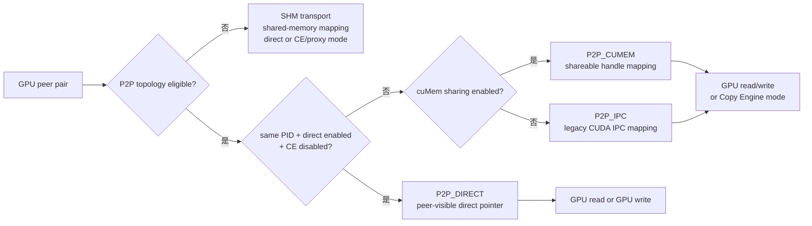

## 本章问题

第 20 章证明 transport 选择顺序，但“走 P2P”仍可能是多种不同机制：

```text
same PID direct pointer
cuMem shareable mapping
legacy CUDA IPC mapping
P2P write / P2P read
P2P copy-engine proxy
intermediate GPU indirect
```

SHM 也不只有一种路径：buffer 可放 send/recv 一侧，Simple protocol 可由 GPU 直接
访问 host-mapped memory，也可由 CPU proxy 驱动 CUDA copy engine，在发送端、
接收端或两端 staging。

本章回答：

1. direct pointer、cuMem 和 legacy IPC 的本质差异是什么？
2. 同进程为何仍可能使用 shareable handle？
3. P2P read/write 改变哪个 buffer 的归属和 flags？
4. V100 上为什么默认 write，强制 read 是否更快？
5. `P2P_DIRECT_DISABLE` 是禁用 P2P，还是只禁 direct mapping？
6. `P2P_USE_CUDA_MEMCPY` 为何仍打印 P2P，却需要 proxy？
7. SHM locality 与 CE memcpy mode 是两个什么维度？
8. CE 放 send、recv 或两端时，head/tail 和数据流如何变化？
9. 6 个 NV2 GPU pair 是否存在隐藏的不对称？
10. 资源销毁后 `/dev/shm/nccl-*` 是否残留？

## 可证伪假设

```text
H1: 同 PID 默认走 direct pointer；禁 direct 后 cuMem 开启应走 CUMEM，
    再禁 cuMem 应走 legacy IPC，但三者仍属于 P2P transport。

H2: V100 不满足 Ampere 默认-read 条件，baseline 应无 /read；
    强制 read 后日志必须变化，且性能不应被预设为更快。

H3: P2P_LEVEL=NVL 应允许当前 NV2 pair，LOC 应拒绝跨 GPU P2P并 fallback SHM。

H4: SHM_MEMCPY_MODE bit0/bit1 应分别控制 send/recv CE，日志精确得到
    CE/direct、direct/CE、CE/CE。

H5: SHM_LOCALITY=1/2 只移动 protocol buffer ownership；若同一 NUMA、相同
    host-memory path，性能可能接近。

H6: 全部6个 NV2 pair 在同一 mode 下应接近；若差异大于噪声，需检查物理链路。
```

## 环境与证据

```text
GPU: 4 x Tesla V100-SXM2-32GB
topology: 6 unordered pairs 均 NV2
NCCL: 2.22.3, source 178b6b7
path cases: 12/12 PASS
4-GPU performance: 600 rows
2-GPU pair matrix: 120 rows
correctness: all PASS
stale /dev/shm/nccl-* after run: 0
```

正式运行：`ch21_p2p_ipc_shm/20260711T140000Z`。

- [实验汇总](/assets/files/nccl-learning/logs/ch21_p2p_ipc_shm/20260711T140000Z/summary.md)
- [运行清单](/assets/files/nccl-learning/logs/ch21_p2p_ipc_shm/20260711T140000Z/manifest.txt)
- [12 条路径矩阵](/assets/files/nccl-learning/logs/ch21_p2p_ipc_shm/20260711T140000Z/path_summary.csv)
- [600 条四卡记录](/assets/files/nccl-learning/logs/ch21_p2p_ipc_shm/20260711T140000Z/raw_measurements.csv)
- [四卡统计](/assets/files/nccl-learning/logs/ch21_p2p_ipc_shm/20260711T140000Z/performance_summary.csv)
- [120 条 pair 记录](/assets/files/nccl-learning/logs/ch21_p2p_ipc_shm/20260711T140000Z/pair_measurements.csv)
- [pair 统计](/assets/files/nccl-learning/logs/ch21_p2p_ipc_shm/20260711T140000Z/pair_summary.csv)
- [完整脚本](/assets/files/nccl-learning/scripts/45_ch21_p2p_ipc_shm_modes.py)

## 三个概念不要混淆

```text
transport eligibility
  P2P canConnect 能否使用 GPU peer path

mapping mechanism
  direct pointer / CUMEM / legacy IPC 如何让本 GPU获得对端 allocation 地址

data movement direction/engine
  GPU write、GPU read，或 CPU proxy 提交 cudaMemcpyAsync
```

`P2P_DIRECT_DISABLE=1` 只改变 mapping mechanism，不等于
`NCCL_P2P_DISABLE=1`。前者仍会打印 `via P2P/CUMEM` 或 `P2P/IPC`；后者在 topology
eligibility 层拒绝 P2P，并让 transport fallback 到 SHM。

<div class="diagram-scroll" markdown="1">



</div>

上半部分决定 transport eligibility，下半部分才决定 allocation 如何映射和由谁搬数据。禁用 direct pointer 仍可留在 P2P transport；只有 P2P eligibility 被拒绝才进入 SHM fallback。

## P2P 分支状态机

文件：`src/transport/p2p.cc:285-389`。

```cpp
NCCL_PARAM(P2pReadEnable, "P2P_READ_ENABLE", -2);
NCCL_PARAM(P2pDirectDisable, "P2P_DIRECT_DISABLE", 0);

#define P2P_SAME_PID(a, b) \
  ((a->hostHash == b->hostHash) && (a->pidHash == b->pidHash))

if (intermediateRank == -1) {
  if (P2P_SAME_PID(myInfo, peerInfo) &&
      ncclParamP2pDirectDisable() == 0 && useMemcpy == 0) {
    resources->type = P2P_DIRECT;
    send->conn.flags |= info->read
      ? NCCL_DIRECT_READ : NCCL_DIRECT_WRITE;
    INFO(..., "via P2P/direct pointer%s", useReadStr);
  } else if (ncclCuMemEnable()) {
    resources->type = P2P_CUMEM;
    INFO(..., "via P2P/CUMEM%s%s",
         useReadStr, useMemcpy ? "/CE" : "");
  } else {
    resources->type = P2P_IPC;
    INFO(..., "via P2P/IPC%s%s",
         useReadStr, useMemcpy ? "/CE" : "");
  }
} else {
  resources->type = P2P_INTERMEDIATE;
  INFO(..., "via P2P/indirect/%d", intermediateRank);
}
```

决策表：

| 条件 | resource type | 日志 |
|---|---|---|
| same PID、direct enabled、CE off | `P2P_DIRECT` | direct pointer |
| direct 不成立、cuMem enabled | `P2P_CUMEM` | CUMEM |
| direct 不成立、cuMem disabled | `P2P_IPC` | IPC |
| topology 给 intermediate rank | `P2P_INTERMEDIATE` | indirect/rank |

“IPC”常被泛化为跨进程。准确地说，cuMem shareable handle 也是跨 address-space
sharing 机制；日志中的 `IPC` 特指 legacy CUDA IPC API。实验为了在同一 nccl-tests
进程中强制走 handle 分支，使用 `P2P_DIRECT_DISABLE`，这不模拟多进程控制面，
但能真实执行两类 mapping/data path。

## direct pointer 到底 direct 在哪里

`p2pMap` 的 same-PID 分支：

```cpp
if (P2P_SAME_PID(myInfo, peerInfo)) {
  if (peerInfo->cudaDev != myInfo->cudaDev) {
    cudaDeviceEnablePeerAccess(peerInfo->cudaDev, 0);
    if (ncclCuMemEnable()) {
      CUmemAccessDesc access = {};
      access.location.id = myInfo->cudaDev;
      access.flags = CU_MEM_ACCESS_FLAGS_PROT_READWRITE;
      cuMemSetAccess((CUdeviceptr)p2pBuff->directPtr,
                     p2pBuff->size, &access, 1);
    }
  }
  *devMem = p2pBuff->directPtr;
  *ipcPtr = NULL;
}
```

同一进程共享一个 CUDA virtual address，NCCL 可直接把 allocation pointer 放进
connector；但仍要 enable peer access，并在 VMM/cuMem allocation 上给另一个 GPU
设置访问权限。“direct pointer”不等于绕过 NVLink/PCIe，也不等于没有同步协议；
它只说明无需在另一个进程导入 handle 来取得地址。

## cuMem 与 Legacy CUDA IPC

不同 PID 或强制禁 direct 时：

```cpp
if (ncclCuMemEnable()) {
  ncclP2pImportShareableBuffer(..., &ipcDesc, devMem);
  // cuMemImportFromShareableHandle
  // cuMemAddressReserve + cuMemMap + cuMemSetAccess
} else {
  cudaIpcOpenMemHandle(devMemPtr, ipcDesc->devIpc,
                       cudaIpcMemLazyEnablePeerAccess);
}
*ipcPtr = *devMem;
```

两者都把远端 allocation 映射到本进程 GPU VA，但 lifecycle 不同：

```text
cuMem:
  export OS/shareable handle -> import generic allocation
  reserve VA -> map -> set per-device access -> unmap/release

legacy IPC:
  cudaIpcGetMemHandle -> cudaIpcOpenMemHandle
  cudaIpcCloseMemHandle
```

cuMem 的优势主要是可控 VMM、权限和现代 allocation/export 能力，不意味着每次
kernel 的链路带宽必然高于 legacy IPC。

## P2P Read 与 Write

`p2pGetInfo` 先从 topology 取默认，再允许环境覆盖：

```cpp
ncclTopoCheckP2p(topo, info1->busId, info2->busId,
                 &p2p, read, intermediateRank);

int readEnable = ncclParamP2pReadEnable();
if (readEnable != -2) *read = readEnable;
```

源码注释明确：仅当 GPU 是 Ampere 且经 NVLink 连接时默认启用 P2P read。本机是
Volta V100，因此 baseline 是 write，强制 `NCCL_P2P_READ_ENABLE=1` 才出现
`/read`。

read 不只是 load/store 指令方向变化。Simple buffer ownership 也反转：

```cpp
// Read: sender 的 SIMPLE buffer 在本地 ncclSendMem 后面。
if (info->read && p == NCCL_PROTO_SIMPLE)
  send->conn.buffs[p] = (char*)(resources->sendDevMem + 1);

// receiver connector 指向 remote ncclSendMem，主动读取。
if (info->read && p == NCCL_PROTO_SIMPLE)
  recv->conn.buffs[p] = (char*)(remDevMem + 1);
```

flags 则区分 `NCCL_DIRECT_READ/WRITE` 与 `NCCL_IPC_READ/WRITE`，device primitive
据此决定 direct operation。平台代际、NVLink read/write 特性和 collective pattern
决定哪一方向更优，不能把 read 当通用优化开关。

## Copy Engine 与 SHM 数据流

`P2P_USE_CUDA_MEMCPY=1` 会强制 write、跳过 direct pointer，并建立 proxy 的
device FIFO、CUDA stream 与 event。proxy 按 slice 执行 D2D `cudaMemcpyAsync`，
event 完成后再推进 tail，所以仍是 P2P transport，却打印 `P2P/CUMEM/CE`。它比
kernel remote load/store 多了 proxy polling、FIFO 和 stream/event handoff。

SHM 有两个独立维度：

```cpp
// locality 决定 protocol buffer 位于哪一侧创建的 segment。
char* buff = shmLocality == SHM_SEND_SIDE
  ? (char*)(resources->devHostMem+1)
  : (char*)(resources->devRemHostMem+1);

// mode bit0=send CE, bit1=recv CE。
useMemcpySend = SHM_USE_CUDA_MEMCPY && (SHM_MEMCPY_MODE & 1);
useMemcpyRecv = SHM_USE_CUDA_MEMCPY && (SHM_MEMCPY_MODE & 2);
```

三种 CE 数据流：

```text
mode1: sender GPU FIFO -> D2H CE -> SHM -> receiver kernel
mode2: sender kernel -> SHM -> H2D CE -> receiver GPU FIFO
mode3: GPU FIFO -> D2H CE -> SHM -> H2D CE -> GPU FIFO
```

`SHM_LOCALITY` 不是 NUMA binding；pages 的实际 NUMA placement 还受 CPU affinity、
first touch 和 memory policy 影响。

## 实验矩阵

| config | 控制变量 | observed |
|---|---|---|
| direct_write | default | P2P/direct pointer |
| direct_read | READ=1 | P2P/direct pointer/read |
| cumem | DIRECT_DISABLE=1 | P2P/CUMEM |
| legacy_ipc | 再 CUMEM=0 | P2P/IPC |
| p2p_ce | USE_CUDA_MEMCPY=1 | P2P/CUMEM/CE |
| level_nvl | LEVEL=NVL | P2P/direct pointer |
| level_loc | LEVEL=LOC | SHM/direct/direct |
| shm_recv/send_local | P2P off，locality2/1 | SHM/direct/direct |
| shm_ce_send | mode1 | SHM/CE/direct |
| shm_ce_recv | mode2 | SHM/direct/CE |
| shm_ce_both | mode3 | SHM/CE/CE |

解析器要求 unique variant set 精确等于 expected。12/12 路径通过。性能为10配置、
两轮镜像顺序、10 cycles、3 sizes，共600行；另对6个 NV2 pair 测4种 P2P mode，
共120行。全部 correctness PASS，结束后 `/dev/shm/nccl-*` 残留为0。

## 四卡结果

| mode | 64 MiB us | P95 us | busbw GB/s | vs direct |
|---|---:|---:|---:|---:|
| direct write | 861.455 | 867.276 | 116.85 | 0.00% |
| direct read | 969.160 | 991.903 | 103.87 | +12.50% |
| cuMem | 903.965 | 906.174 | 111.35 | +4.93% |
| legacy IPC | 902.745 | 904.315 | 111.50 | +4.79% |
| P2P CE | 1644.435 | 1746.885 | 61.22 | +90.89% |
| SHM recv-local | 39269.700 | 39281.715 | 2.56 | +4458.53% |
| SHM send-local | 39285.050 | 39320.475 | 2.56 | +4460.31% |
| SHM CE send | 41759.050 | 41822.495 | 2.41 | +4747.50% |
| SHM CE recv | 44718.600 | 44811.165 | 2.25 | +5091.05% |
| SHM CE both | 43854.800 | 43960.455 | 2.30 | +4990.78% |

### 推导

cuMem 与 legacy IPC 仅差约0.14%，说明 handle/import 机制不同但稳定数据面接近；
实验计时不含 communicator init，不能据此说初始化成本也相同。两者相对 direct
约慢4.8%，而 import 只发生在建连阶段，稳定差异需从 mapping 属性和 connector
flags 继续 profile。

V100 强制 read 在64 MiB 慢12.50%，验证 read 不是通用优化；源码仅对
Ampere+NVLink 默认 read 有明确硬件条件。512 KiB read 看似快10%，但 baseline CV
为5.01%，不能用单一 noisy 点推翻大消息稳定结论。

P2P CE 仍比 SHM 快很多，却比 direct 慢90.89%，证明只说“P2P transport”不足以
预测性能，还要看 movement engine。

SHM locality1/2 只差0.039%，符合本机单 NUMA 路径；不能外推双 socket。send、
recv、both CE 相比 direct SHM 分别慢约6.34%、13.88%、11.68%。both 没有线性叠加，
说明两侧 copy 与 slice pipeline 有重叠，但最慢 proxy/host-memory stage 决定吞吐。

## Pair Matrix

| mode | 6-pair busbw 范围 GB/s |
|---|---:|
| direct write | 43.68-43.93 |
| direct read | 33.73-33.77 |
| cuMem | 37.01-37.05 |
| legacy IPC | 36.97-37.11 |

同 mode 的 pair spread 很小，排除了某一对 GPU 链路异常解释，也再次验证 cuMem 与
IPC 接近。二卡与四卡 busbw 因归一化和并发 edge 不同，不可直接横比。

## 排障与参数语义

1. `P2P_DISABLE` 改 eligibility；`P2P_DIRECT_DISABLE` 只改 mapping。
2. `P2P_LEVEL` 比较 topology path；NVL 允许本机 pair，LOC 只允许 self。
3. `CUMEM_ENABLE=0` 在 direct 已禁时才把 CUMEM 切到 legacy IPC。
4. `P2P_READ_ENABLE` 改方向和 Simple buffer ownership，不是只改日志。
5. `P2P_USE_CUDA_MEMCPY` 改 movement engine，并引入 proxy。
6. `SHM_LOCALITY` 改 segment owner，不负责 NUMA pinning。
7. `SHM_MEMCPY_MODE` 只有与 `SHM_USE_CUDA_MEMCPY=1` 同时设置才生效。
8. CE 只用于 Simple；源码对其他 protocol 直接推进 step。
9. 跨进程验证还应记录 PID、handle export/import 和初始化耗时。
10. 任务退出后检查 `/dev/shm`、CUDA IPC mapping 与 proxy teardown。

## 版本与边界

已验证 V100/NCCL 2.22.3 同进程 direct、强制 cuMem/IPC、read/write、P2P CE、SHM
locality/三种 CE 和全部 NV2 pair。未验证真实多进程 handle 交换、NVB indirect、
PCIe-only pair、双 NUMA、Ampere 默认 read、MNNVL 和 MIG。

## 本章结论

1. P2P eligibility、mapping mechanism 与 movement engine 是三层独立概念。
2. direct pointer 仍需 peer access；它只是避免跨 address-space handle import。
3. cuMem 与 legacy IPC 都映射远端 allocation，生命周期不同，稳定带宽在本机接近。
4. V100 默认 write；强制 read 大消息慢12.50%，不能照搬其他代际策略。
5. P2P CE 通过 CPU proxy 提交 D2D copy，仍是 P2P但不再是 kernel direct。
6. SHM mode bits 精确控制 send/recv CE，locality 控制 buffer segment owner。
7. 六个 pair 的一致性证明模式差异不是个别 NVLink 故障。
8. 720条记录全部正确且无 SHM 文件残留，性能与资源生命周期同时通过。

## 验收题

1. `P2P_DISABLE` 与 `P2P_DIRECT_DISABLE` 分别改变哪一层？
2. same PID direct pointer 为什么仍需 peer access？
3. cuMem import 包含哪些 VMM 步骤？与 legacy IPC 如何释放？
4. read mode 为什么改变 Simple buffer ownership？
5. V100 与 Ampere 的默认 read 条件有何不同？
6. P2P/CE 的数据由谁提交，如何用 event 推进 tail？
7. SHM locality 为何不是 NUMA binding？
8. mode1/2/3 分别执行 D2H、H2D 的哪一侧？
9. 为什么 both CE 不必等于两侧 slowdown 之和？
10. 如何用 pair matrix 区分 mode 回归与物理 link 回归？
11. 为什么本实验不能比较 cuMem/IPC 初始化成本？
12. 设计真实双进程 CUDA IPC 实验，需要增加哪些证据？
