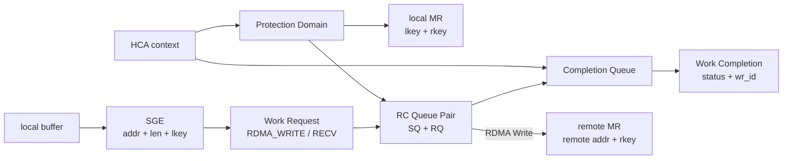

## 本章问题

第24章解释了 NET proxy；本章进入 `ncclNet` backend：

```text
Socket: send/recv -> TCP/IP -> kernel network stack
IB/RoCE: post_send/post_recv -> QP -> CQ -> HCA DMA
```

要回答：

1. bootstrap Socket 和 data transport Socket/IB 有何区别？
2. sysfs 出现 HCA 名字，为什么仍不能证明 verbs 可用？
3. IB 与 RoCE 在 NCCL 中共用什么，又在哪些 address/QoS 字段分叉？
4. PD、MR、CQ、QP、SGE、WR、WC 分别是什么？
5. RC QP 为什么必须经过 INIT、RTR、RTS？
6. receiver 如何先发布 addr/rkey/size，sender 才执行 RDMA Write？
7. `RDMA_WRITE_WITH_IMM` 如何通知 receiver completion？
8. MTU、GID index、SL、TC、timeout、retry 各控制哪一层？
9. adaptive routing 和 multi-QP 如何改变 WR 布局？
10. 如何区分 NCCL、verbs、NIC、交换机和容器设备问题？

## 可证伪假设

```text
H1: /sys/class/infiniband 名称存在，不足以证明 ibv_get_device_list 可用；
    还必须有字符设备权限、userspace provider和可打开context。
H2: 当前环境 auto、IB_DISABLE、NET=Socket、错误HCA过滤都应最终走
    NET/Socket；回退成功不能证明IB工作过。
H3: eth0与lo应能完成Socket数据面；不存在的IFNAME应在bootstrap阶段
    明确失败，而不是静默选择其他接口。
H4: QP属性必须按INIT/RTR/RTS分阶段设置，timeout/retry只在RTS阶段。
H5: AR threshold判断是严格大于8192；8192和8193应进入不同WR布局。
H6: multi-QP chunk必须128B对齐且覆盖全部payload。
```

## 环境与正式证据

```text
NCCL: 2.22.3 / source 178b6b7
GPU: 4 x V100-SXM2-32GB
sysfs IB entry: mlx4_0
/dev/infiniband: absent
ibv_devinfo: No IB devices found, rc=255
usable HCA in container: NO
Socket fallback performance: 120 rows, correctness PASS
backend path: 8/8 PASS
interface cases: 3/3 PASS
source model: 29/29 PASS
IB/RoCE performance: HARDWARE_BLOCKED
```

正式运行：`ch25_socket_ib_roce/20260711T180000Z`。

- [实验汇总](/assets/files/nccl-learning/logs/ch25_socket_ib_roce/20260711T180000Z/summary.md)
- [运行清单](/assets/files/nccl-learning/logs/ch25_socket_ib_roce/20260711T180000Z/manifest.txt)
- [硬件可用性清单](/assets/files/nccl-learning/logs/ch25_socket_ib_roce/20260711T180000Z/hardware_inventory.csv)
- [backend 路径证据](/assets/files/nccl-learning/logs/ch25_socket_ib_roce/20260711T180000Z/backend_paths.csv)
- [120 条性能记录](/assets/files/nccl-learning/logs/ch25_socket_ib_roce/20260711T180000Z/raw_measurements.csv)
- [性能统计](/assets/files/nccl-learning/logs/ch25_socket_ib_roce/20260711T180000Z/performance_summary.csv)
- [Socket interface 故障矩阵](/assets/files/nccl-learning/logs/ch25_socket_ib_roce/20260711T180000Z/interface_cases.csv)
- [IB 源码模型](/assets/files/nccl-learning/logs/ch25_socket_ib_roce/20260711T180000Z/ib_source_model.csv)
- [实验驱动](/assets/files/nccl-learning/scripts/49_ch25_socket_ib_roce.py)
- [源码模型脚本](/assets/files/nccl-learning/probes/ch25_ib_semantics_model.py)

本章不会给出虚构的 IB/RoCE GB/s。Socket、fallback和源码状态机已验证；需要HCA、
两节点和交换机的性能/故障实验明确标记硬件阻塞。

## Bootstrap Socket 不等于 Data Socket

即使 data backend 是 IB，`ncclIbListen/ncclIbConnect` 仍先创建 Socket：

```cpp
ncclIbListen(...) {
  ncclSocketInit(&comm->sock, &ncclIbIfAddr, magic,
                 ncclSocketTypeNetIb, NULL, 1);
  ncclSocketListen(&comm->sock);
}

ncclIbConnect(...) {
  ncclSocketConnect(&comm->base.sock);
  // 通过socket交换QP/GID/LID/MTU/rkey/fifo地址metadata
}
```

这条 TCP/OOB 通道交换连接 metadata；bulk payload 随后才走 RDMA Write。因此日志中
出现 bootstrap interface 不能证明 data transport 是 Socket，反之 IB data path也离不开
可达的 OOB IP 网络。

必须分别证明：

```text
Bootstrap : Using eth0:...
NET/IB : Using mlx...; OOB eth0:...
connector ... via NET/IB/0
```

## HCA 可用性的五层门槛

```text
1. PCI设备存在：lspci / sysfs
2. kernel driver绑定：mlx4_core/mlx5_core + ib_core
3. RDMA字符设备暴露：/dev/infiniband/uverbs*, rdma_cm等
4. userspace provider匹配：libibverbs + mlx4/mlx5 provider
5. 容器权限/cgroup允许open，ibv_open_device成功
```

当前环境 `mlx4_0` sysfs target真实存在，但容器没有 `/dev/infiniband`，
`ibv_devinfo` 无法得到设备。准确结论是“宿主/虚拟环境暴露了sysfs视图，但verbs
字符设备没有进入容器”，不是“机器绝对没有HCA”，也不是“RDMA已经可用”。

NCCL discovery核心路径：

```cpp
wrap_ibv_symbols();
wrap_ibv_get_device_list(&devices, &nIbDevs);
for (device) {
  wrap_ibv_open_device(&context, device);
  wrap_ibv_query_device(context, &devAttr);
  for (port) wrap_ibv_query_port(context, port, &portAttr);
}
```

只有 active port 被加入 `ncclIbDevs`；之后记录 link layer、active speed/width、PCI path、
GUID和adaptive-routing能力。任何前置层失败，最终都可能只看到 `NET/IB : No device found`。

## IB 与 RoCE：共同 Verbs，不同 Fabric 语义

两者都使用 libibverbs、PD/MR/CQ/RC QP和RDMA Write，但 address/QoS不同。

### InfiniBand link layer

- fabric原生LID/SL；跨subnet可用global route/FLID；
- lossless、credit和adaptive routing由IB fabric提供；
- `NCCL_IB_SL` 进入 address handle 的 service level。

### Ethernet/RoCE link layer

- 使用GID，RoCEv2数据包可在UDP/IP网络路由；
- `NCCL_IB_GID_INDEX` 选择local GID；
- `NCCL_IB_TC` 写GRH traffic class，通常映射DSCP/ECN；
- lossless/拥塞控制依赖交换机、NIC、PFC/ECN/DCQCN配置。

NCCL不会替你配置交换机PFC、ECN threshold或NIC congestion-control profile。
设置一个TC值只是在packet header选择QoS class，不等于整条fabric已正确配置。

## Verbs 对象关系

```text
context: 打开的HCA device
PD: protection domain，隔离QP与MR权限
MR: 注册内存，产生lkey/rkey
CQ: completion queue
QP: send queue + receive queue，RC提供可靠连接
SGE: local addr/length/lkey
WR: work request，描述RDMA_WRITE/RECV等
WC: work completion，包含status/wr_id
```

<div class="diagram-scroll" markdown="1">



</div>

这张图描述 Verbs 对象与权限关系，不表示所有操作都会产生独立 CQE。NCCL 可以利用 selective signaling；但 QP state、MR key、remote metadata 和最终 completion 仍必须一致。

NCCL每个IB device复用PD引用计数，每个comm device创建CQ：

```cpp
if (0 == ibDev->pdRefs++) ibv_alloc_pd(&ibDev->pd, context);
ibv_create_cq(&base->cq, context,
              2*MAX_REQUESTS*IB_QPS_PER_CONNECTION, ...);
```

CQ容量随QPs per connection扩张。盲目增加QP不仅改变并行，还增加QP/CQ/WR资源；
需要检查HCA `max_qp/max_cq/max_cqe`，不是无限调大。

## RC QP 三阶段

### INIT：本地权限

```cpp
qpInitAttr.qp_type = IBV_QPT_RC;
qpInitAttr.cap.max_send_wr = 2*MAX_REQUESTS;
qpInitAttr.cap.max_recv_wr = MAX_REQUESTS;
ibv_create_qp(pd, &qpInitAttr);

qpAttr.qp_state = IBV_QPS_INIT;
qpAttr.pkey_index = NCCL_IB_PKEY;
qpAttr.port_num = ib_port;
qpAttr.qp_access_flags = access_flags;
ibv_modify_qp(... INIT | PKEY | PORT | ACCESS_FLAGS);
```

此时只有本地QP与权限，尚不知道peer QPN/address。

### RTR：可以接收

```cpp
qpAttr.qp_state = IBV_QPS_RTR;
qpAttr.path_mtu = remote.active_mtu;
qpAttr.dest_qp_num = remote.qpn;
qpAttr.rq_psn = 0;
qpAttr.max_dest_rd_atomic = 1;
qpAttr.min_rnr_timer = 12;
qpAttr.ah_attr.sl = NCCL_IB_SL;
```

RoCE还设置DGID、SGID index、hop limit和traffic class；IB通常使用DLID/SL。
两端MTU、GID/VLAN/address reachability不匹配，常在RTR或首个流量时暴露。

### RTS：可以发送

```cpp
qpAttr.qp_state = IBV_QPS_RTS;
qpAttr.timeout = NCCL_IB_TIMEOUT;       // default 18
qpAttr.retry_cnt = NCCL_IB_RETRY_CNT;   // default 7
qpAttr.rnr_retry = 7;
qpAttr.sq_psn = 0;
qpAttr.max_rd_atomic = 1;
```

`timeout` 是编码值，不是毫秒。local ACK timeout近似：

$$T = 4.096\ \mu s \times 2^{timeout}$$

| timeout | 单次local ACK timeout |
|---:|---:|
| 12 | 16.777 ms |
| 18 | 1.074 s |
| 22 | 17.180 s |

retry会让错误暴露时间进一步增加。增大timeout可容忍大fabric尾延迟，但也会把真实断链
变成长时间hang；它不是普通性能旋钮，应结合fabric diameter、拥塞和故障恢复目标设置。

## Connection Metadata 交换

每端通过OOB Socket交换：

```cpp
struct ncclIbConnectionMetadata {
  qpInfo[nqps];          // QPN + device index + ECE
  devs[ndevs];           // MTU/LID/GID/link layer/rkey
  uint64_t fifoAddr;     // receiver-control FIFO remote VA
  char devName[];
};
```

QP按merged devices轮转创建，`nqps = QPS_PER_CONNECTION * ndevs`。收到remote metadata
后，本地QP才能进入RTR/RTS。连接控制Socket成功但QP metadata不对，仍然不是可用RDMA。

## Receiver 先发布 CTS FIFO

NCCL IB bulk不是sender盲写。`ncclIbIrecv`先注册receive request并向sender远端FIFO写入：

```cpp
localElem[i].addr = (uint64_t)data[i];
localElem[i].rkeys[j] = mhandle->mrs[j]->rkey;
localElem[i].size = sizes[i];
localElem[i].tag = tags[i];
localElem[i].idx = fifoTail+1;

wr.opcode = IBV_WR_RDMA_WRITE; // 写入sender可见CTS FIFO
ibv_post_send(ctsQp, &wr, &bad_wr);
```

这相当于 Clear-To-Send：receiver把目标VA、rkey、size、tag和generation发布给sender。
sender `ncclIbIsend` 检查：

```cpp
if (slots[0].idx != fifoHead+1) return request=NULL;
if (slot.tag != tag) continue;
if (slot.size < 0 || slot.addr == 0 || slot.rkeys[0] == 0) error;
```

因此send request返回NULL可能只是receiver尚未post，不是立即错误。tag/order错、receiver
不推进或CTS FIFO不可达，最终都会表现为NET proxy等待。

## Bulk RDMA Write 与 Immediate Completion

数据WR使用receiver给出的remote addr/rkey：

```cpp
sge.addr = local_data;
sge.lkey = local_mr->lkey;
wr.opcode = IBV_WR_RDMA_WRITE;
wr.wr.rdma.remote_addr = remote_addr;
wr.wr.rdma.rkey = remote_rkey;
```

最后一个WR改为 `IBV_WR_RDMA_WRITE_WITH_IMM` 并signaled。immediate data携带size，
receiver预先post的零SGE receive WR产生CQ event。这样payload通过one-sided DMA写入，
completion通过receive CQ关联，不需要CPU逐字节recv。

多receive时，额外RDMA Write写remote sizes FIFO；最后0-byte Write-with-Imm触发completion。

## CQ Completion 与错误第一现场

`ncclIbTest`轮询每个涉及device的CQ：

```cpp
ibv_poll_cq(cq, 4, wcs, &wrDone);
for (wc in wcs) {
  if (wc.status != IBV_WC_SUCCESS) {
    WARN("... completion with error %d, opcode %d, len %d ...",
         wc.status, wc.opcode, wc.byte_len);
    return ncclRemoteError;
  }
  request->events[devIndex]--;
}
```

排障必须保存首个WC status/vendor error/QPN/port counter。QP进入error后产生的teardown、
watchdog和其他rank连接关闭是后续连锁，不应覆盖第一条CQ错误。

常见层次：

```text
RNR/receiver not ready -> receive posting/order/resource
retry exceeded         -> path/drop/PFC/peer/QP
local protection       -> MR/lkey/address/lifetime
remote access          -> rkey/remote VA/permission
flush error            -> GDR visibility/device path
```

## Adaptive Routing 的双 WR

源码条件：

```cpp
if (nreqs > 1 || (comm->ar && size > NCCL_IB_AR_THRESHOLD)) {
  // bulk RDMA_WRITE，可被fabric分散路径
  // 再发0-byte RDMA_WRITE_WITH_IMM产生有序completion
}
```

默认threshold 8192，比较是严格 `>`：8192不拆，8193拆。源码模型精确验证这个边界。
拆成两个WR不是payload翻倍；第二个可以0 byte，只负责在bulk write之后产生remote event。

IB默认认为支持AR；RoCE默认关闭，除非显式/设备能力路径启用。是否真正多路径还取决于
交换机routing，不是NCCL分成两个WR就自动成立。

## Multi-QP 分片

```cpp
int nqps = SPLIT_DATA_ON_QPS ? base.nqps : base.ndevs;
int chunk = ROUNDUP(DIVUP(size, nqps), 128);
for (qp in nqps) {
  length = min(size-offset, chunk);
  post_send(qp, remote_addr+offset, local_addr+offset, length);
  offset += chunk;
}
```

128B对齐保护LL/LL128 line布局。模型对4 KiB、1 MiB、64 MiB与1/2/4 QP共18项
验证：chunk均128B对齐、各QP有效length之和精确等于payload。

默认 `IB_QPS_PER_CONNECTION=1`、`IB_SPLIT_DATA_ON_QPS=0`。增加QP但不打开split时，
可能用于轮转request而非把单消息切到所有QP；必须同时理解两个参数。

## MTU、GID、SL、TC 工程边界

### MTU

NCCL使用active MTU放入RTR。端点、VLAN和交换路径MTU必须匹配。RoCE jumbo frame配置
错误可表现为小消息通过、大消息掉包/retry；同时查 `ip link`、NIC port和交换机端口。

### GID index

一个RoCE port可能有IPv4/IPv6、VLAN、RoCEv1/v2多个GID。NCCL可按address family/range/
RoCE version筛选。选错GID常见表现是QP建立metadata存在但数据不可达。

### SL/TC

IB SL选择service level；RoCE TC可携带DSCP/ECN。它们必须与交换机priority、PFC priority、
ECN/DCQCN策略成套。只改 `NCCL_IB_TC` 可能把流量送进无PFC或错误queue。

### Retry/timeout

timeout过小会在拥塞尾延迟下误报；过大让故障发现慢。retry=7不是“重试7个packet”的
简单含义，而是RC transport retry策略的一部分。修改前先采CQ和port counters。

## 本机 Backend Fallback 实验

四个配置正序/逆序各一轮：

```text
auto
NCCL_IB_DISABLE=1
NCCL_NET=Socket
NCCL_IB_HCA=definitely_missing
```

8/8均出现 `Using network Socket` 与 connector `via NET/Socket`，120条记录全部正确。
64 MiB结果：

| config | median time | busbw |
|---|---:|---:|
| auto | 47.106 ms | 2.135 GB/s |
| IB disabled | 46.958 ms | 2.145 GB/s |
| Socket forced | 47.273 ms | 2.13 GB/s |
| missing HCA filter | 47.258 ms | 2.13 GB/s |

差异不足1%，符合四者最终同一Socket backend。这个负对照证明环境变量没有偷偷改变
data path；不能把auto成功解读为“IB优雅运行”。plugin初始化也可能打印IB探测信息，
最终connector path才是准绳。

## Socket Interface 故障矩阵

| IFNAME | 预期 | 实际 |
|---|---|---|
| eth0 | 成功 | NET/Socket + correct=1 |
| lo | 成功 | NET/Socket + correct=1 |
| definitely_missing | 失败 | rc=3 |

错误签名：

```text
Bootstrap : no socket interface found
```

失败发生在communicator bootstrap，尚未到collective data completion。生产上应先检查
interface名字/namespace/address，再查QP/CQ；否则会把初始化网络错误误报为RDMA数据面。

## 真正 HCA 环境的验收矩阵

取得两节点HCA后必须补跑：

| 维度 | 取值 |
|---|---|
| backend | Socket / IB |
| link | IB / RoCEv2 |
| message | 4K, 64K, 1M, 64M, 1G |
| ranks/node | 1, 2, 4, 8 |
| GID | auto与目标VLAN index |
| MTU | 1024/2048/4096或1500/9000端到端 |
| QP | 1/2/4 + split off/on |
| AR | off/on + threshold |
| timeout | default与经批准的fabric值 |
| fault | down port、drop、PFC pause、ECN拥塞 |

每个case至少记录：correctness、median/P95/CV、`ib_write_bw`基线、NCCL connector、
GID/MTU/QPN、CQ error、`port_xmit/rcv_data`、discard/retry、PFC pause和ECN/CNP counters。

`ib_write_bw`通过而NCCL慢，优先查NCCL topology/channel/MR/GDR；两者都慢，优先查
verbs/NIC/fabric；Socket正常而IB失败，缩小到RDMA栈；两者都失败，先查OOB与应用顺序。

## 分层排障树

```text
ibv_devinfo无设备
  -> /dev映射、driver/provider、容器权限

NCCL只选Socket
  -> NET/IB discovery、HCA filter、active port、plugin ABI

连接阶段失败
  -> OOB IP、GID/LID、MTU、QP INIT/RTR/RTS metadata

首个大消息失败
  -> MR/rkey/addr、MTU、PFC/ECN、remote receive CTS

运行一段时间后retry/CQ error
  -> congestion/drop/cable/port、QP resource、peer crash

正确但慢
  -> Socket/IB对照、ib_write_bw、GDR、NUMA、QP/rail、counters
```

## 常见错误

1. 看到sysfs设备名就宣布RDMA可用。
2. 看到bootstrap TCP就宣布data path是Socket。
3. 看到 `NET/IB` 探测日志就宣布connector走IB。
4. 把IB与RoCE当成完全相同的lossless网络。
5. 只配NCCL TC，不配交换机PFC/ECN/DCQCN。
6. 把timeout编码值18当18毫秒。
7. 通过增大timeout掩盖真实丢包。
8. 不保存第一条WC error，只看watchdog尾部。
9. 忘记receiver先发布CTS，误判sender request=NULL。
10. 把Write-with-Imm的immediate当payload。
11. 增加QP但未理解split开关。
12. MTU只查主机，不查VLAN/交换机全路径。
13. GID index照搬另一台机器。
14. 用本机Socket GB/s替代多机IB数据。
15. 用源码模型冒充verbs硬件验证。

## 版本与边界

已验证2.22.3的Socket fallback、interface选择/失败、IB discovery边界，以及QP状态、timeout、
AR threshold和multi-QP几何的源码模型。未执行任何verbs QP/MR/CQ、IB/RoCE payload、
PFC/ECN、NIC counter或多机性能，因此这些结论保持 `HARDWARE_BLOCKED`。

## 本章结论

1. IB data backend仍用Socket交换QP/GID/rkey metadata；bootstrap与bulk path必须分辨。
2. sysfs `mlx4_0` 存在但 `/dev/infiniband` 缺失，当前容器verbs不可用。
3. IB与RoCE共用verbs对象，分别以LID/SL和GID/TC连接fabric语义。
4. RC QP按INIT本地权限、RTR remote route、RTS timeout/retry三阶段建立。
5. receiver先RDMA写CTS FIFO发布addr/rkey/size/tag，sender才写payload。
6. bulk使用RDMA Write，Write-with-Imm提供有序remote completion。
7. CQ status是数据面第一现场，后续watchdog/teardown不能替代它。
8. timeout18约1.074秒单次local ACK timeout，不是18毫秒。
9. AR在size严格大于8192时拆bulk与completion WR。
10. multi-QP按128B对齐分片，QP数量与split开关必须联合理解。
11. 四种fallback的120条结果全部走Socket，64 MiB约2.13-2.145 GB/s。
12. eth0/lo通过，错误IFNAME以`no socket interface found`在bootstrap失败。
13. 当前只能完成Socket与源码验收；IB/RoCE专家结论需要两节点HCA/fabric矩阵。

## 验收题

1. bootstrap Socket和data Socket如何从日志区分？
2. HCA从PCI到NCCL可用需通过哪五层？
3. IB与RoCE的address handle字段有何差异？
4. PD、MR、lkey、rkey分别约束什么？
5. CQ为什么不等于receive queue？
6. INIT/RTR/RTS各设置哪些属性？
7. timeout18换算成多少秒？retry为何放大故障发现时间？
8. receiver CTS FIFO包含哪些字段？
9. sender何时返回NULL request而不是error？
10. RDMA Write-with-Imm中的payload和notification分别在哪里？
11. 为什么unsignaled WR仍需周期性signaled completion？
12. AR为何使用bulk Write加0-byte Write-with-Imm？
13. 8192与8193 bytes的AR分支为何不同？
14. 64MiB/4QP的chunk如何按128B对齐？
15. QPS_PER_CONNECTION与SPLIT_DATA_ON_QPS区别是什么？
16. GID index错误会在哪些阶段表现？
17. TC值正确为何仍不能证明PFC/ECN正确？
18. 如何从第一条WC status区分MR、receiver和fabric错误？
19. `ib_write_bw`与NCCL结果如何做四象限归因？
20. 当前环境为什么不能发布IB/RoCE性能结论？
