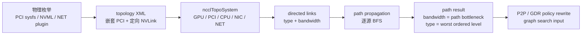

## 本章问题

`nvidia-smi topo -m` 显示 `NV2`，还不足以解释 NCCL 如何做决策。NCCL 需要把
GPU、PCI bridge、NUMA CPU、NIC、NET device 和 NVSwitch 转换成带权图，再预计算
GPU↔GPU、GPU↔NIC 路径。后续 P2P、SHM、NET、graph search 和 tuner 都读取这张图。

本章回答：

1. NCCL topology XML 中 `cpu/pci/gpu/nic/net/nvlink` 分别变成什么节点和边？
2. PCIe `8.0 GT/s × x16` 为什么在 NCCL 图中是 12 GB/s？
3. V100 的 `<nvlink count="2">` 为什么生成 40 GB/s link？
4. `LOC/NVL/NVB/PIX/PXB/PXN/PHB/SYS/NET/DIS` 是怎样排序和传播的？
5. 路径算法优先 hop、bandwidth 还是 path type？
6. 稀疏 NVLink 中，缺少直连的 GPU 为什么会成为 `NVB`？
7. 修改 `NCCL_TOPO_FILE` 能模拟 planner，是否也能改变物理数据路径？

## 可证伪假设

```text
H1: 本机 XML 中每对 GPU 的 count=2 NVLink 应被解析为
    1 hop / 40 GB/s / PATH_NVL。

H2: 只保留 0-1-2-3-0 双向 NV2 ring 后，相邻 GPU 仍为 NVL，
    对角 GPU 应成为 2 hops / 40 GB/s / PATH_NVB。

H3: 把所有 NVLink count 置 0 后，GPU pair 应经共同 PCI switch，
    成为 2 hops / 12 GB/s / PATH_PIX；把 endpoint width 改为 x4 后
    path bandwidth 应降至 3 GB/s。

H4: XML fixture 只影响 NCCL 的 topology/planner view，不改变硬件。
    因此 PCIe x16/x4 fixture 即使 graph speed 不同，实际性能不应被解释为
    真实 PCIe x16/x4 测量。
```

## 环境与证据

```text
NCCL runtime/source: 2.22.3+cuda12.6 / v2.22.3-1 @ 178b6b7
nccl-tests: 5bcd45d
GPU: 4 x Tesla V100-SXM2-32GB
physical GPU topology: every pair NV2
PCIe endpoint: 8.0 GT/s, x16
fixtures: native NV2, all-pair NV1, sparse NV2 ring,
          PCIe x16 view, PCIe x4 view
performance: 5 fixtures x 2 replicates x 3 sizes x 10 cycles
measurement rows: 300
```

正式运行：`ch18_topology_paths/20260711T031500Z`。

- [实验汇总](/assets/files/nccl-learning/logs/ch18_topology_paths/20260711T031500Z/summary.md)
- [运行清单](/assets/files/nccl-learning/logs/ch18_topology_paths/20260711T031500Z/manifest.txt)
- [原生探测 XML](/assets/files/nccl-learning/logs/ch18_topology_paths/20260711T031500Z/artifacts/native_detected.xml)
- [五个 XML fixture](/assets/files/nccl-learning/logs/ch18_topology_paths/20260711T031500Z/artifacts/fixtures/native_nv2.xml)
- [XML inventory](/assets/files/nccl-learning/logs/ch18_topology_paths/20260711T031500Z/xml_inventory.csv)
- [80 条 GPU path](/assets/files/nccl-learning/logs/ch18_topology_paths/20260711T031500Z/gpu_path_matrix.csv)
- [graph 汇总](/assets/files/nccl-learning/logs/ch18_topology_paths/20260711T031500Z/graph_summary.csv)
- [300 条性能记录](/assets/files/nccl-learning/logs/ch18_topology_paths/20260711T031500Z/raw_measurements.csv)
- [性能统计](/assets/files/nccl-learning/logs/ch18_topology_paths/20260711T031500Z/performance_summary.csv)
- [完整实验脚本](/assets/files/nccl-learning/scripts/42_ch18_topology_xml_paths.py)

## 从物理视图到 NCCL XML

`nvidia-smi topo -m`：

```text
      GPU0 GPU1 GPU2 GPU3 CPU Affinity NUMA
GPU0   X   NV2  NV2  NV2  0,2,4,6,8,10  0
GPU1  NV2   X   NV2  NV2  0,2,4,6,8,10  0
GPU2  NV2  NV2   X   NV2  0,2,4,6,8,10  0
GPU3  NV2  NV2  NV2   X   0,2,4,6,8,10  0
```

NCCL 导出的骨架：

```xml
<system version="1">
  <cpu numaid="0" arch="x86_64" vendor="GenuineIntel">
    <pci busid="0000:18:00.0" class="0x060400"
         link_speed="8.0 GT/s PCIe" link_width="16">
      <pci busid="0000:1a:00.0" class="0x030200"
           link_speed="8.0 GT/s PCIe" link_width="16">
        <gpu dev="0" sm="70" rank="0" gdr="1">
          <nvlink target="0000:1c:00.0" count="2"
                  tclass="0x030200"/>
          <nvlink target="0000:1d:00.0" count="2"
                  tclass="0x030200"/>
          <nvlink target="0000:1e:00.0" count="2"
                  tclass="0x030200"/>
        </gpu>
      </pci>
      <!-- GPU1/GPU2/GPU3 同属这个 PCI bridge -->
    </pci>
    <nic>
      <net name="eth0" speed="10000" gdr="0"/>
    </nic>
  </cpu>
</system>
```

XML 和 `topo -m` 的信息层级不同：

| 信息 | `topo -m` | NCCL XML |
|---|---|---|
| GPU pair 关系 | `NV2` | 定向 target + count |
| PCI hierarchy | PIX/PXB/PHB 结果标签 | 嵌套 PCI 节点及 bus ID |
| link capacity input | 不展示 | speed + width |
| rank/device | GPU 行 | gpu dev/rank |
| NUMA/CPU | affinity/NUMA | CPU node + affinity + arch/vendor/model |
| NIC/plugin device | 可能显示 HCA | nic/net、speed、port、gdr、maxconn |

本机 inventory：1 CPU、5 PCI、4 GPU、1 NIC、1 NET、12 条定向 NVLink record。
12 条 record 的 `count` 总和为 24，对应 6 个无向 GPU pair × 每方向两条 link。

<div class="diagram-scroll diagram-scroll--xwide" markdown="1">



</div>

XML 是可重放的拓扑输入，不是最终 path 表。路径还要经过瓶颈带宽、等级传播与 policy 改写；因此改变 XML fixture 后必须同时检查 path matrix 和 graph 结果。

## 内部节点、边与路径结构

仓库：`NVIDIA/nccl`  
版本：`v2.22.3-1`，提交 `178b6b7`  
文件：`src/graph/topo.h:33-99`

原始源码：

```cpp
#define NCCL_TOPO_NODE_TYPES 7
#define GPU 0
#define PCI 1
#define NVS 2
#define CPU 3 // Actually NUMA domains
#define NIC 4
#define NET 5

#define LINK_LOC 0
#define LINK_NVL 1
#define LINK_PCI 3
#define LINK_SYS 7
#define LINK_NET 8

struct ncclTopoLink {
  int type;
  float bw;
  struct ncclTopoNode* remNode;
};

struct ncclTopoLinkList {
  struct ncclTopoLink* list[NCCL_TOPO_MAX_HOPS];
  int count;
  float bw;
  int type;
};
```

注释版：

```cpp
// node 是资源或拓扑中间点。
GPU, PCI, NVS, CPU_NUMA, NIC, NET

// link 是 XML 直接建立的边：类型、容量、远端节点。
link = {NVL/PCI/SYS/NET, edge_bandwidth, neighbor};

// path 是预计算结果：有序 edge 列表、hop 数、瓶颈带宽、最差路径等级。
path.count = number_of_edges;
path.bw = min(edge.bw for edge in path);
path.type = max(severity_of_each_step);
```

`NIC` 与 `NET` 不是重复：NIC 表示拓扑中的物理/聚合 NIC 节点，NET 表示 network
plugin 暴露的通信 device/port。多 rail、不同 port、CollNet plugin 时这种分层很重要。

## Path Type 是有序等级

源码枚举：

```cpp
#define PATH_LOC 0 // myself
#define PATH_NVL 1 // direct NVLink
#define PATH_NVB 2 // NVLink through one intermediate GPU
#define PATH_PIX 3 // at most one PCIe bridge
#define PATH_PXB 4 // multiple PCIe bridges, no host bridge
#define PATH_PXN 5 // GPU->intermediate GPU->NIC
#define PATH_PHB 6 // PCI host bridge / CPU
#define PATH_SYS 7 // inter-NUMA SMP link
#define PATH_NET 8 // network
#define PATH_DIS 9 // disconnected
```

数字越大通常表示距离/约束越差，但它不是线性 latency，也不能把 `PATH_PHB=6`
理解为六跳。hop 数单独存于 `path.count`。

例如：

```text
1/40/NVL = 1 edge, bottleneck 40 GB/s, direct NVLink class
2/40/NVB = 2 edges, bottleneck 40 GB/s, one relay GPU
2/12/PIX = 2 edges, bottleneck 12 GB/s, at most one PCI bridge
```

路径等级还被 transport policy 使用：P2P level、GDR level、PXN eligibility 都会
比较 `path.type <= threshold`。它不只是给日志看的字符串。

## XML 如何进入系统图

文件：`src/graph/topo.cc:722-846`  
符号：`ncclTopoGetSystem`

关键源码摘录（省略 intra-node AllGather 的参数与 XML merge 收尾）：

```cpp
const char* xmlTopoFile = ncclGetEnv("NCCL_TOPO_FILE");
if (xmlTopoFile) {
  ncclTopoGetXmlFromFile(xmlTopoFile, xml, 1);
} else {
  ncclTopoGetXmlFromFile(
      "/var/run/nvidia-topologyd/virtualTopology.xml", xml, 0);
}

// Detect only the GPU managed by this process.
int64ToBusId(comm->peerInfo[comm->rank].busId, busId);
ncclTopoFillGpu(xml, busId, &node);
xmlSetAttrInt(node, "keep", 1);
xmlSetAttrInt(node, "rank", comm->rank);

// Detect NET plugin devices and properties.
ncclTopoFillNet(xml, props.pciPath, props.name, &netNode);
xmlSetAttrInt(netNode, "keep", 1);

ncclTopoTrimXml(xml);
bootstrapIntraNodeAllGather(..., rankXml, ...);
for (int i=0; i<nLocalRanks; i++)
  ncclTopoFuseXml(xml, peerXml);

ncclTopoGetSystemFromXml(xml, system, hostHash);
```

关键不是“rank 0 扫描整台机器”：每个 rank 探测自己管理的 GPU，并给相关 branch
打 `keep=1`；节点内用 bootstrap AllGather 交换 XML，再 fuse 成一致视图。这能处理
容器设备可见性、不同 process GPU ownership 和 plugin device。

`NCCL_TOPO_FILE` 也不是完全静态、禁止补全的文件。NCCL 会针对当前 rank 调
`ncclTopoFillGpu`，缺失的 GPU 属性或 NVLink 可能由 NVML 补齐。实验要模拟“无
NVLink”不能简单删除所有 `<nvlink>`，否则 loader 会重新探测真实硬件。

## NVLink Detection 的补全语义

文件：`src/graph/xml.cc:749-805`

```cpp
struct ncclXmlNode* nvlNode = NULL;
xmlGetSub(gpuNode, "nvlink", &nvlNode);
if (nvlNode == NULL) {
  for (int l=0; l<maxNvLinks; ++l) {
    if (!P2P_SUPPORTED || !NVLINK_ACTIVE) continue;
    get_remote_pci_bus_id(lowerId);
    xmlGetSubKv(gpuNode, "nvlink", &nvlNode,
                "target", lowerId);
    if (nvlNode == NULL) {
      xmlAddNode(xml, gpuNode, "nvlink", &nvlNode);
      xmlSetAttr(nvlNode, "target", lowerId);
      xmlSetAttrInt(nvlNode, "count", 1);
    } else {
      xmlSetAttrInt(nvlNode, "count", count+1);
    }
  }
}
```

只要 GPU 下完全没有 nvlink child，NVML detection 就运行。正式 fixture 因此保留
原有 target record，把 `count` 设为 0。这是阻止补全的受控测试技巧，不是生产
XML 推荐配置；零带宽 NVL edge 仍会出现在 topology print，但 path search 会选择
有正带宽的 PCI route。

## PCIe 带宽如何计算

文件：`src/graph/topo.cc:455-465`

```cpp
int width, speed;
xmlGetAttrInt(xmlPci, "link_width", &width);
xmlGetAttrStr(xmlPci, "link_speed", &str);
if (width == 0) width = 16;
kvConvertToInt(str, &speed, kvDictPciGen);

ncclTopoConnectNodes(node, parent, LINK_PCI,
                     width*speed/80.0);
ncclTopoConnectNodes(parent, node, LINK_PCI,
                     width*speed/80.0);
```

`kvDictPciGen` 把 GT/s 字符串转为每 lane、100 Mb/s 单位的有效 rate，最后
`width*speed/80` 转成 GB/s。对本机 PCIe Gen3：

```text
8.0 GT/s PCIe -> speed table 60 (100 Mb/s per lane)
x16: 16 * 60 / 80 = 12 GB/s
x4:   4 * 60 / 80 =  3 GB/s
```

这里使用模型有效带宽，不是理论 raw `8 GT/s × 128/130 encoding` 的逐位换算。
它服务 graph/path decision，因此保守常量可能与 microbenchmark 峰值不同。

## NVLink 带宽如何计算

文件：`src/graph/topo.cc:532-573`

```cpp
if (strcmp(node->name, "nvlink") == 0) {
  xmlGetAttrInt(node, "count", &count);
  xmlGetAttrStr(node, "tclass", &targetClass);

  if (targetType == GPU) {
    xmlGetAttrStr(node, "target", &target);
    ncclTopoGetNode(system, &remote, GPU, targetBusId);
  }

  if (remote) {
    float nvlBw = ncclTopoNVLinkBw(gpu->gpu.cudaCompCap);
    ncclTopoConnectNodes(
        gpu, remote, LINK_NVL, count*nvlBw);
  }
}
```

V100 `sm=70` 的 per-link model bandwidth 为 20 GB/s。因此：

```text
count=2 -> edge bw 40 GB/s
count=1 -> edge bw 20 GB/s
count=0 -> edge bw  0 GB/s
```

XML record 是定向的。GPU0→GPU1 和 GPU1→GPU0 各有一条；不能看到 12 条 record
就除以 GPU 数后误判每卡只有三条单 link。

## 路径算法：BFS、瓶颈和等级传播

文件：`src/graph/paths.cc:36-112`  
符号：`ncclTopoSetPaths`

原始核心：

```cpp
basePath->count = 0;
basePath->bw = LOC_BW;
basePath->type = PATH_LOC;

while (nodeList.count) {
  for (each node in current_BFS_frontier) {
    for (each link from node) {
      remNode = link->remNode;
      float bw = std::min(path->bw, link->bw);

      // allow routing through a GPU only as 1 hop
      if (node != baseNode && node->type == GPU &&
          (NVB_DISABLED || link->type != LINK_NVL ||
           remNode->type != GPU || path->count > 1)) continue;

      if ((remPath->bw == 0 || remPath->count > path->count) &&
          remPath->bw < bw) {
        remPath->count = path->count + 1;
        remPath->bw = bw;

        int type = link->type == LINK_NET ? LINK_LOC : link->type;
        if (node->type == PCI && remNode->type == PCI)
          type = PATH_PXB;
        if (link->type == LINK_PCI &&
            (node->type == CPU || remNode->type == CPU))
          type = PATH_PHB;
        if (node->type == GPU && path->type == PATH_NVL &&
            type == PATH_NVL && remPath->count > 1)
          type = PATH_NVB;

        remPath->type = std::max(path->type, type);
      }
    }
  }
}
```

三条公式：

$$
BW(newPath)=\min(BW(prefix), BW(edge))
$$

$$
type(newPath)=\max(type(prefix), type(edge/derived))
$$

$$
hops(newPath)=hops(prefix)+1
$$

它不是简单“hop 最少”或普通 Dijkstra latency shortest path。更新要求新 path 的
bottleneck 更高，并带有 frontier/hop 条件；目标是为 NCCL 保存高带宽、受限 hop
的可用 route。path type 是沿途最差等级，不参与同一更新条件的数值 cost 加法。

### 为什么两跳 NVLink 叫 NVB

当 prefix 已为 NVL、当前 edge 仍为 NVL、累计 count>1，type 提升为 NVB。并且
源码只允许经过一个中间 GPU，下一次从非 base GPU 扩展时若 `path->count>1` 会跳过。

稀疏 ring 中 GPU0→GPU2：

```text
GPU0 --NVL40--> GPU1 --NVL40--> GPU2
hops = 2
bw = min(40, 40) = 40 GB/s
type = NVB
```

不是 80 GB/s。串联链路的 path capacity 取瓶颈，不相加。

## Paths 还会被 Policy 改写

`ncclTopoComputePaths` 先对 CPU、GPU、NET、NVS 分别运行上述 path computation，
然后应用可达性 policy：

```cpp
for (each GPU pair) {
  ncclTopoCheckP2p(..., &p2p);
  if (p2p == 0) addInterStep(CPU, ...); // traffic via CPU

  P2P_transport.canConnect(..., &p2p);
  if (p2p == 0) {
    SHM_transport.canConnect(..., &shm);
    if (shm == 0) path.type = PATH_NET;
  }
}

for (each GPU-NET pair) {
  if (better rail-local GPU exists) addInterStep(GPU, ...); // PXN
  ncclTopoCheckGdr(..., &gdr);
  if (gdr == 0) addInterStep(CPU, ...);
}
```

因此最终 path 不是 XML 几何的机械展开。`NCCL_P2P_LEVEL`、P2P/SHM capability、
GDR policy、PXN 和 transport availability 都可能插入 CPU/GPU intermediate step
或把 path 标为 NET。第 20-21、25-27 章会验证这些分支。

## 实验 Fixture 的控制变量

脚本使用 Python `ElementTree`，不做文本替换：

```python
native_nv2:
    保持 NCCL 自动导出的 XML

all_to_all_nv1:
    所有 nvlink.count: 2 -> 1

sparse_nv2_ring:
    只保留 0-1, 1-2, 2-3, 3-0 的双向 count=2 record

pcie_x16:
    所有 nvlink.count = 0，GPU endpoint width 保持 16

pcie_x4:
    所有 nvlink.count = 0，GPU endpoint width 16 -> 4
```

每个 fixture 都执行：

```text
1. NCCL_TOPO_FILE 加载
2. NCCL_TOPO_DUMP_FILE 保存补全后的 resolved XML
3. NCCL_GRAPH_DUMP_FILE 保存 graph output
4. INFO GRAPH 解析 4×4 GPU path matrix
5. 4 KiB correctness smoke
6. 4 KiB / 512 KiB / 64 MiB，各 20 个独立 cycle 样本
7. out-of-place 和 in-place #wrong 自动断言
```

正式性能运行前后使用反向 fixture 顺序，降低热机/时间漂移与 fixture 相关性。

## 实验一：Native NV2

路径日志：

```text
GPU/1A000 :
  GPU/0-1a000 (0/5000.0/LOC)
  GPU/0-1c000 (1/40.0/NVL)
  GPU/0-1d000 (1/40.0/NVL)
  GPU/0-1e000 (1/40.0/NVL)
```

四个 source 共 16 entry：4 个 LOC + 12 个 NVL。H1 通过。`LOC_BW=5000`
是本地访问哨兵值，不是 V100 HBM 实测带宽。

graph output：

```text
Ring: pattern=4, channels=6, speedIntra=20, typeIntra=NVL
Tree: pattern=1, channels=6, speedIntra=20, typeIntra=NVL
final communicator: 12 coll channels
```

这里 path edge 是 40 GB/s，而 graph speed 是 20 GB/s。graph search 会在离散 speed
table、pattern/channel 约束下选择 per-channel speed；不能把 path bw 原样当 graph
speed。具体递归搜索在第 19 章展开。

## 实验二：All-to-all NV1

XML 变化：12 条 directed record 保持，但 directed count sum 从 24 降为 12。

```text
GPU pair path: 1 hop / 20 GB/s / NVL
Ring graph: 6 channels / 10 GB/s / NVL
Tree graph: 6 channels / 10 GB/s / NVL
final coll channels: 12
```

NVLink edge 和 graph speed 都减半，但 channel 数不变。64 MiB 实测反而比 native
快 1.46%，属于物理硬件未变化、相同 active geometry 下的实验波动/模型选择效应，
绝不能写成“NV1 比 NV2 快”。512 KiB 快 11.35%，提示 fixture 还可能改变 tuner
table/algorithm protocol crossover；要归因需结合第 16 章 TUNING 日志。

## 实验三：Sparse NV2 Ring 与 NVB

保留 8 条 directed record，directed count sum 16。path matrix：

| Source | Target | Hops | BW | Type |
|---|---|---:|---:|---|
| GPU0 | GPU1 | 1 | 40 | NVL |
| GPU0 | GPU3 | 1 | 40 | NVL |
| GPU0 | GPU2 | 2 | 40 | NVB |
| GPU1 | GPU3 | 2 | 40 | NVB |

四个对角方向 pair 都按预期成为 NVB，H2 通过。graph：

```text
Ring channels: 6 -> 4
Tree channels: 6 -> 4
Ring orders:
  0-1-2-3
  0-3-2-1
  0-1-2-3
  0-3-2-1
final coll channels: 12 -> 8
```

graph 选择只使用直连 ring edge，没有把 NVB 对角 route 当作额外独立物理链路，
可用 edge diversity 降低，所以基础 channels 从 6 降到 4。

性能：

| Size | Native median | Sparse median | Delta |
|---:|---:|---:|---:|
| 4 KiB | 18.925 us | 18.870 us | -0.29% |
| 512 KiB | 28.725 us | 30.210 us | +5.17% |
| 64 MiB | 862.815 us | 1205.090 us | +39.67% |

小消息由固定 latency 主导，channel 减少影响很小；大消息需要并行 channel，
12→8 active coll channels 使 busbw 从 116.66 降到 83.54 GB/s。这个结果验证
“topology view → graph/channel → planner performance”的链条，但不是在物理上
拔掉 NVLink 的实测：硬件仍然全互联 NV2。

## 实验四：PCIe x16 View

所有 NVLink count=0 后：

```text
GPU0 -> endpoint PCI -> common switch -> endpoint PCI -> GPU1
printed path: 2 hops / 12 GB/s / PIX
Ring graph: 1 channel / 12 GB/s / PIX / sameChannels=1
Tree graph: 1 channel / 12 GB/s / PIX / sameChannels=1
final coll channels: 2
```

为什么打印 2 hops 而概念图似乎有更多节点？内部 PCI hierarchy 中 GPU 是附着在
表示 endpoint 的 PCI node 上，path print/link construction 的 GPU↔PCI relationship
按生成图计数；应该信任实际 `ncclTopoLinkList.count`，不要按 XML indentation
手工数标签。

64 MiB：

```text
median: 2854.955 us
busbw: 35.26 GB/s
vs native: +230.89%
```

尽管 graph view 是 PIX，transport 日志仍为 `P2P/direct pointer`。CUDA driver
掌握真实 NVLink，XML 不会禁用物理链路；主要变化是 NCCL 只规划 2 coll channels。

## 实验五：PCIe x4 View 与关键反证

把四个 GPU endpoint `link_width` 改为 4：

```text
path: 2 hops / 3 GB/s / PIX
graph: 1 channel / 3 GB/s / PIX
```

H3 完整通过。但实际性能：

| Fixture | Graph speed | 64 MiB median | busbw |
|---|---:|---:|---:|
| PCIe x16 view | 12 GB/s | 2854.955 us | 35.26 GB/s |
| PCIe x4 view | 3 GB/s | 2852.815 us | 35.28 GB/s |

两者只差 0.07%，而 measured busbw 甚至远高于 x4 fixture 的 3 GB/s graph speed。
这是非常重要的反证：

```text
NCCL_TOPO_FILE changes NCCL's model and planner.
It does not rewire PCIe, disable physical NVLink, or cap hardware bandwidth.
```

两组都得到相同 2 coll channels，physical data path 仍可由 CUDA P2P 使用真实硬件，
所以性能接近。H4 通过。XML fixture 适合验证 path/graph decision，不适合声称模拟
真实链路吞吐。真正的物理隔离要使用无对应链路的硬件、fabric control、driver
capability 或 transport disable，并用 counters 验证。

## 五组结果总表

| Fixture | GPU pair path | Ring ch | Graph speed | 64 MiB median | busbw | vs native |
|---|---|---:|---:|---:|---:|---:|
| native NV2 | NVL/40 | 6 | 20 | 862.815 us | 116.66 | 0% |
| all-pair NV1 | NVL/20 | 6 | 10 | 850.185 us | 118.40 | -1.46% |
| sparse NV2 ring | NVL/NVB 40 | 4 | 20 | 1205.090 us | 83.54 | +39.67% |
| PCIe x16 view | PIX/12 | 1 | 12 | 2854.955 us | 35.26 | +230.89% |
| PCIe x4 view | PIX/3 | 1 | 3 | 2852.815 us | 35.28 | +230.64% |

稳定性边界：native 4 KiB CV 18.93%、PCIe x16 4 KiB CV 16.13%、native
512 KiB CV 8.18%，这些点不可用于精确小百分比比较。64 MiB 所有 CV 为
0.04%-0.59%，大幅差异稳定。all-pair NV1 的 -1.46% 不应写成优化收益。

## 如何从 XML 手工推导 Path

以任意两个 GPU 为例：

1. 找到 source/target GPU 所属 `<pci busid>`。
2. 检查 source GPU 是否有 target busId 的正 `nvlink count`。
3. 有直连：`bw=count×perLinkBw`，type NVL，count 1。
4. 无直连：检查是否存在一个 GPU relay，source→relay 和 relay→target 都为 NVL。
5. 满足 one-intermediate rule：瓶颈取 min，type NVB，count 2。
6. 无 NV route：沿 XML PCI parent 找最近共同祖先。
7. 每条 PCI edge bandwidth 用 `width×speed/80`，path bw 取最小值。
8. 跨一个 PCI bridge为 PIX；多个 bridge 为 PXB；进入 CPU host bridge 为 PHB。
9. 跨 NUMA CPU 的 SYS link 后 type 至少 SYS。
10. 最后应用 P2P/SHM/GDR/PXN policy，几何 path 可能被插入 CPU/GPU intermediate。

手推结果必须与 `NCCL_DEBUG_SUBSYS=GRAPH` 的：

```text
GPU/source : GPU/target (hops/bw/type)
```

逐项对照。只看 `nvidia-smi topo` 标签不能验证 NCCL 实际解析了哪份 XML。

## 生产检查方法

### 拓扑基线

保存并版本化：

```bash
nvidia-smi topo -m
nvidia-smi nvlink --status
lspci -tv
cat /sys/bus/pci/devices/<BDF>/max_link_speed
cat /sys/bus/pci/devices/<BDF>/max_link_width

NCCL_TOPO_DUMP_FILE=topology.xml \
NCCL_DEBUG=INFO NCCL_DEBUG_SUBSYS=GRAPH,ENV ...
```

不要只保存 XML；同时保留 driver/NVML、NCCL version、container device visibility
和 NET plugin version。相同 XML 在不同版本可能映射到不同 speed table/policy。

### 自动验收

建议 CI/节点健康检查断言：

```text
expected GPU BDF set == XML GPU BDF set
expected NVLink directed count and link count
PCI speed/width not downgraded
GPU path type/bw matrix matches hardware class
NIC/NET device and NUMA attachment expected
no PATH_DIS or unexpected PATH_NET among local GPUs
graph channel count above node-class baseline
```

### 回归定位

```text
XML 已变化
  -> 查硬件训练状态、BIOS、PCI width/speed、容器/sysfs/NVML visibility

XML 未变化，path matrix 变化
  -> 查 NCCL version、path policy、P2P/GDR/PXN env 和 transport capability

path 未变化，graph 变化
  -> 查 search constraints、speed table、channel cap、graph override

graph 未变化，transport 变化
  -> 查 P2P/SHM/NET canConnect/setup、CUDA IPC、plugin

路径与 planner 都未变化，性能变化
  -> 查物理 counters、clock、NUMA affinity、contention、message/protocol
```

## 常见错误

1. 把 `NV2` 当作 2 GB/s，而不是两条 bonded NVLink。
2. 把 XML directed record 数当无向 link 数。
3. 把 PCIe raw GT/s 直接当 GB/s，不看 NCCL speed table。
4. 把 path bw 沿 edge 相加；正确的是瓶颈 min。
5. 把 path type 数值当 hop 数。
6. 把 NVB 误解为 NVSwitch；这里表示经一个 GPU relay 的 NVLink path。
7. 认为 BFS 只选择最少 hop，不看 bandwidth 更新条件。
8. 删除 fixture 的 nvlink node后，以为 NVLink 被禁用；NVML 会补全。
9. 把 zero-count fixture 当生产配置推荐。
10. 把 `NCCL_TOPO_FILE` 当硬件模拟器或带宽限速器。
11. 用 PCIe x4 fixture 的性能声称真实 x4 吞吐。
12. 把 path edge 40 GB/s、graph speed 20 GB/s 当成矛盾。
13. 看到 PIX 就认为一定走 SHM；transport selection 是下一层。
14. 忽略 topology XML 会在节点内跨 rank fuse。
15. 只比较 rank 0 的 XML，不检查各 rank visibility 是否一致。
16. 在小消息高 CV 点解释 1% 差异。

## 版本与硬件边界

已验证：

```text
NCCL 2.22.3 XML load/detect/fuse
V100 per-link NVLink model and all-pair NV2
single PCI switch PIX path
NVL/NVB/PIX path construction
NV1/sparse/PCI width fixture effects
fixture -> graph channels -> planner performance
```

未验证：

```text
multiple PCI switches (PXB)
dual NUMA/socket PHB/SYS
NVSwitch NVS nodes
physical PCIe x4 downgrade
IB/RoCE HCA/NIC/NET and GDR path
PXN relay and multi-rail locality
MNNVL multi-node XML fusion
virtualTopology.xml from topologyd
```

没有 HCA，所以 XML 中 `eth0 gdr=0` 不能用来推断 IB/RoCE。没有 NVSwitch，所以
NVS/NVLS 只做源码说明，不给性能结论。

## 本章结论

1. NCCL 将 XML 转成 node/link graph，再为 CPU/GPU/NET/NVS source 预计算 path；
   path 同时保存 edge list、hop count、bottleneck bandwidth 和 ordered type。
2. 本机 XML 与 `nvidia-smi topo`、sysfs 一致：四 GPU 同一 PCI switch、每对 NV2、
   endpoint Gen3 x16。
3. V100 `count=2` 解析为 40 GB/s NVL edge；`count=1` 为 20 GB/s。
4. PCI Gen3 x16/x4 在模型中分别为 12/3 GB/s，由 `width×speed/80` 得到。
5. path bandwidth 是沿途 minimum，path type 是沿途 worst/max；type 与 hop 独立。
6. 稀疏 NV2 ring 的相邻 pair 为 `1/40/NVL`，对角 pair 为 `2/40/NVB`，源码规则
   和 16-entry matrix 完全一致。
7. 稀疏 ring 使基础 graph channels 6→4、final coll channels 12→8，64 MiB
   慢 39.67%，验证 topology diversity 会进入 planner。
8. zero-count NVLink 后 GPU pair 为 `2/12/PIX`，基础 graph 只剩 1 channel；
   PCIe x4 fixture 又把 graph speed 降至 3 GB/s。
9. PCIe x16/x4 fixture 实际 64 MiB 性能相同，证明 XML 改的是 NCCL view，
   不是物理 wiring 或 bandwidth cap。
10. 最终 path 还会被 P2P/SHM/GDR/PXN policy 改写，XML 几何只是 transport 和
    graph decision 的输入之一。

## 验收题

1. 为什么本机有 12 条 nvlink record，却只有 6 个 GPU pair？
2. 用源码公式计算 Gen3 x16 和 x4 的 PCI model bandwidth。
3. 为什么 V100 NV2 path 是 40 GB/s，而 graph speed 是 20 GB/s？
4. `path.count/path.bw/path.type` 分别表示什么？
5. 按顺序解释 LOC、NVL、NVB、PIX、PXB、PXN、PHB、SYS、NET、DIS。
6. GPU0→GPU1→GPU2 两段 NVL40 的 bw/type/count 是什么？
7. 为什么 GPU relay 不能无限继续三跳、四跳？
8. BFS 的 path update 为什么不等同于 latency shortest path？
9. 为什么删除全部 `<nvlink>` 反而可能重新出现物理 NVLink？
10. zero-count fixture 的作用和风险是什么？
11. topology XML 为什么需要节点内 bootstrap fusion？
12. path 何时会被插入 CPU intermediate step？
13. PXN 在节点图中比普通 GPU→NIC path多了什么？
14. sparse fixture 为什么 channel 下降而 graph speed 不下降？
15. 为什么 PCIe x16/x4 fixture 的实际性能相同是一个有价值的反证？
16. 如何证明一次性能下降来自 graph channel，而不是物理 link 被限速？
17. 设计一个双 NUMA 节点实验验证 PIX/PXB/PHB/SYS。
18. 取得双 HCA 后，如何验证 GPU-NIC path、GDR 和 PXN？

能够从 XML edge 手算 path，再用 NCCL path matrix 和 graph output验证，而不把
fixture 当成真实硬件，才算真正掌握 NCCL topology model。
