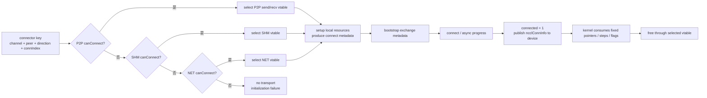

## 本章问题

第 18、19 章解决了 topology path 和逻辑 Ring/Tree，但 graph 中的一条
`rank A -> rank B` 边还不是可执行的数据通路。NCCL 必须为每个 channel、peer、
方向和连接槽选择 transport，创建本地资源，交换连接描述，导入对端资源，最后把
device kernel 所需的指针和 flags 写入 GPU 可见的 connector。

本章回答：

1. P2P、SHM、NET 的选择究竟是评分，还是有序的 first-match？
2. transport 是 communicator 级、channel 级，还是 connector 级属性？
3. `canConnect`、`setup`、`connect`、`free` 分别承担什么职责？
4. bootstrap socket 与 data transport 是什么关系？
5. send connector 和 recv connector 为什么必须分开？
6. `connIndex=0/1` 分别服务什么流量？
7. 禁用 P2P、SHM 后为何能在单节点走 `NET/Socket`？
8. CollNet 为什么不是普通 fallback 的第四级？
9. “No transport found” 后测试程序崩溃时，第一根因如何判断？

## 可证伪假设

```text
H1: 默认和仅禁用 SHM 都应走 P2P；后者是负对照。

H2: 禁用 P2P 后应走 SHM；再禁用 SHM 后应走 NET/Socket。

H3: AllReduce 连接日志应使用 connIndex=0，Send/Recv 应使用 connIndex=1。

H4: 同时禁用 P2P、SHM 和 intra-node NET 后，selectTransport 应遍历完
    transport 数组并返回 ncclSystemError，日志出现 No transport found。

H5: fallback 会显著改变端到端性能，但其中可能同时包含 graph、channel、
    proxy 和 copy path 变化，不能把全部差值解释成介质带宽。
```

## 环境与公开证据

```text
GPU: 4 x Tesla V100-SXM2-32GB
GPU topology: all pairs NV2
NCCL runtime/source: 2.22.3+cuda12.6 / 178b6b7
NET plugin: internal Socket, device 0
RDMA HCA: 0
path cases: 4 configs x AllReduce/SendRecv = 8
performance: 4 configs x 2 replicates x 10 cycles x 3 sizes
performance rows: 240, correctness all PASS
```

正式运行：`ch20_transport_selection/20260711T061500Z`。

- [实验汇总](/assets/files/nccl-learning/logs/ch20_transport_selection/20260711T061500Z/summary.md)
- [运行清单](/assets/files/nccl-learning/logs/ch20_transport_selection/20260711T061500Z/manifest.txt)
- [路径矩阵](/assets/files/nccl-learning/logs/ch20_transport_selection/20260711T061500Z/path_summary.csv)
- [240 条性能记录](/assets/files/nccl-learning/logs/ch20_transport_selection/20260711T061500Z/raw_measurements.csv)
- [性能统计](/assets/files/nccl-learning/logs/ch20_transport_selection/20260711T061500Z/performance_summary.csv)
- [失败矩阵](/assets/files/nccl-learning/logs/ch20_transport_selection/20260711T061500Z/failure_matrix.csv)
- [完整实验脚本](/assets/files/nccl-learning/scripts/44_ch20_transport_selection.py)

本章不把 Socket 结果外推到 IB/RoCE，也不把单节点 NET fallback 称为 RDMA。

## 正确的对象模型

先纠正一个常见表述：

```text
错误：这个 communicator 使用 P2P transport。

准确：这个 communicator 的 channel c、peer p、send/recv 方向、connIndex i
      对应的 ncclConnector 选择了某个 transportComm vtable。
```

NCCL 2.22.3 的核心对象关系是：

```text
comm
  channels[channelId]
    peers[peer]
      send[NCCL_MAX_CONNS]
      recv[NCCL_MAX_CONNS]
        ncclConnector
          connected
          transportComm      -> transport 的 send/recv vtable
          transportResources -> transport 私有 host 资源
          proxyConn          -> 可选 CPU proxy 连接
          conn               -> GPU kernel 消费的 ncclConnInfo
```

文件：`src/include/device.h:138-146, 203-208`。

```cpp
struct ncclConnector {
  int connected;
  struct ncclProxyConnector proxyConn;
  struct ncclTransportComm* transportComm;
  void* transportResources;
  struct ncclConnInfo conn;
};

#define NCCL_MAX_CONNS 2
struct ncclChannelPeer {
  struct ncclConnector send[NCCL_MAX_CONNS];
  struct ncclConnector recv[NCCL_MAX_CONNS];
  int refCount;
};
```

- `transportComm` 是行为，通过函数指针实现多态。
- `transportResources` 是 host 侧私有对象，P2P、SHM、NET 的具体类型不同。
- `conn` 是稳定的 device-facing 数据，如 protocol buffers、head/tail、step 和 flags。
- `connected` 防止同一 connector 重复建立。
- `proxyConn` 并非所有路径都活跃；NET 必须依赖 proxy，某些 SHM 模式也会用。

transport 不是 kernel 每次动态选择的字符串。host 初始化 connector 后，会把
`ncclConnInfo` 拷贝到 device peer 表，kernel 按既定指针和 flags 通信。

<div class="diagram-scroll diagram-scroll--wide" markdown="1">



</div>

选择单位是单个 connector，不是整个 communicator。有序 first-match 决定 vtable；`setup`、metadata exchange、`connect` 与 device publish 又是不同生命周期阶段，日志必须落到对应阶段解释。

## Transport Vtable

文件：`src/include/transport.h:97-114`。

```cpp
struct ncclTransportComm {
  ncclResult_t (*setup)(..., struct ncclConnect*,
                        struct ncclConnector*, int channelId, int connIndex);
  ncclResult_t (*connect)(..., struct ncclConnect*, int nranks,
                          int rank, struct ncclConnector*);
  ncclResult_t (*free)(struct ncclConnector*);
  ncclResult_t (*proxySharedInit)(...);
  ncclResult_t (*proxySetup)(...);
  ncclResult_t (*proxyConnect)(...);
  ncclResult_t (*proxyFree)(...);
  ncclResult_t (*proxyProgress)(...);
  ncclResult_t (*proxyRegister)(...);
  ncclResult_t (*proxyDeregister)(...);
};

struct ncclTransport {
  const char name[8];
  ncclResult_t (*canConnect)(int*, ..., struct ncclPeerInfo*,
                             struct ncclPeerInfo*);
  struct ncclTransportComm send;
  struct ncclTransportComm recv;
};
```

send/recv 分开不是代码重复。例如 NET sender 与 receiver 的 listen/connect 角色、
GDR flush、head/tail ownership 和释放行为都不对称。

## 选择算法：有序 First-Match

文件：`src/transport.cc:14-40`。

```cpp
struct ncclTransport* ncclTransports[NTRANSPORTS] = {
  &p2pTransport,
  &shmTransport,
  &netTransport,
  &collNetTransport
};

template <int type>
static ncclResult_t selectTransport(..., int channelId, int peer,
                                    int connIndex, int* transportType) {
  ncclConnector* connector = (type == 1)
    ? comm->channels[channelId].peers[peer]->send + connIndex
    : comm->channels[channelId].peers[peer]->recv + connIndex;

  for (int t = 0; t < NTRANSPORTS; t++) {
    ncclTransport* transport = ncclTransports[t];
    ncclTransportComm* transportComm = type == 1
      ? &transport->send : &transport->recv;
    int ret = 0;
    NCCLCHECK(transport->canConnect(&ret, comm->topo, graph,
                                    myInfo, peerInfo));
    if (ret) {
      connector->transportComm = transportComm;
      NCCLCHECK(transportComm->setup(comm, graph, myInfo, peerInfo,
                                    connect, connector,
                                    channelId, connIndex));
      if (transportType) *transportType = t;
      return ncclSuccess; // 第一个可用项立即返回
    }
  }
  WARN("No transport found ...");
  return ncclSystemError;
}
```

结论是：

```text
P2P=true                 -> P2P
P2P=false, SHM=true      -> SHM
P2P=false, SHM=false,
NET=true                 -> NET
全部 false               -> ncclSystemError
```

这不是为三个 transport 统一算 cost 后取最小值。topology cost 通过各自
`canConnect` 进入资格判定，例如 NCCL 可判断 intra-node NET 比当前 GPU path 更快，
让 P2P/SHM 返回 false。选择粒度是 connector，因此同一 job 可以同时存在节点内
P2P、隔离 pair 的 NET 和跨节点 NET，不能用一条 rank0 日志概括全局。

## 三类 canConnect 的真实门槛

### P2P

文件：`src/transport/p2p.cc:107-164`，`src/graph/paths.cc:277-293`。

```cpp
// 不同主机，或两个进程看到的 /dev/shm device 不同，普通 P2P 不成立。
if (info1->hostHash != info2->hostHash ||
    info1->shmDev != info2->shmDev) {
  *ret = 0;
  return ncclSuccess;
}

NCCLCHECK(ncclTopoCheckP2p(topo, info1->busId, info2->busId,
                           ret, NULL, &intermediateRank));
if (*ret == 0) return ncclSuccess;

int useNet = 0;
NCCLCHECK(ncclTopoCheckNet(topo, info1->busId, info2->busId, &useNet));
if (useNet) {
  *ret = 0;
  return ncclSuccess;
}

cudaDeviceCanAccessPeer(&p2p, cudaDev1, cudaDev2);
```

`NCCL_P2P_DISABLE=1` 不是在 `p2pCanConnect` 顶部简单 if。它由
`ncclGetLevel(..., "NCCL_P2P_DISABLE", "NCCL_P2P_LEVEL")` 转成 topology
P2P level，再由 `ncclTopoCheckP2p` 判定。这解释了为何禁 P2P 还会影响 graph
search 和 channel 数，而不只是替换 connector 实现。

P2P 成立也不等于必然是 `direct pointer`。同进程 direct pointer、CUDA IPC、
P2P read/write、cuMem handle 和 intermediate GPU 是下一章的细分问题。

### SHM

文件：`src/transport/shm.cc:50-72`。

```cpp
static ncclResult_t shmCanConnect(int* ret, ..., ncclPeerInfo* info1,
                                  ncclPeerInfo* info2) {
  *ret = 0;
  if (ncclParamShmDisable() == 1) return ncclSuccess;

  int useNet = 0;
  NCCLCHECK(ncclTopoCheckNet(topo, info1->busId, info2->busId, &useNet));
  if (useNet) return ncclSuccess;

  if (info1->hostHash != info2->hostHash) return ncclSuccess;
  if (info1->shmDev != info2->shmDev) return ncclSuccess;
  *ret = 1;
  return ncclSuccess;
}
```

SHM 要求未禁用、相同 hostHash、相同 shmDev，且 topology 没要求优先走 NET。
Kubernetes 中两个 container 即使在同一物理节点，如果 IPC namespace 或
`/dev/shm` 隔离，SHM 仍会拒绝连接。

### NET

文件：`src/transport/net.cc:145-152`。

```cpp
static ncclResult_t canConnect(int* ret, ..., ncclPeerInfo* info1,
                               ncclPeerInfo* info2) {
  *ret = 1; // 跨 host 默认允许 NET
  if (info1->hostHash == info2->hostHash) {
    NCCLCHECK(ncclTopoCheckNet(topo, info1->busId, info2->busId, ret));
  }
  return ncclSuccess;
}
```

跨节点 NET 是常规路径；同节点 NET 受 topology 与 `NCCL_NET_DISABLE_INTRA` 控制。
本机没有 HCA，`NET/Socket/0` 表示 Socket plugin 的 device0，不是 RDMA，更不是
GPUDirect RDMA。

## CollNet 不是普通第四级 Fallback

`src/transport/coll_net.cc:138-142` 明确写着：

```cpp
static ncclResult_t canConnect(int* ret, ...) {
  // This transport cannot be used for p2p
  *ret = 0;
  return ncclSuccess;
}
```

CollNet connector 由 `ncclTransportCollNetSetup` 针对 synthetic root/master 和
collective offload 单独建立。数组排第四不意味着 P2P、SHM、NET 都失败后会自动
命中 CollNet；其普通 `canConnect` 永远返回 false。

## setup 与 connect 为什么分两段

`setup` 不代表两端已经互通。完整状态机是：

```text
canConnect
  -> setup(local side)
       创建本地资源
       填充 opaque ncclConnect 描述
  -> bootstrap exchange(ncclConnect)
  -> connect(remote description)
       打开或导入对端资源
       填充 connector->conn
  -> copy ncclConnInfo to device peer table
  -> rank synchronization
  -> clear masks and temporary descriptions
```

### setup：生产可交换描述

SHM send setup 的核心代码，`src/transport/shm.cc:77-99`：

```cpp
static ncclResult_t shmSendSetup(..., ncclConnect* connectInfo,
                                 ncclConnector* send, ...) {
  shmSendResources* resources;
  ncclCalloc(&resources, 1);
  send->transportResources = resources;

  shmConnectInfo* info = (shmConnectInfo*)connectInfo;
  ncclShmOpen(shmPath, shmSize,
              (void**)&resources->hostMem,
              (void**)&resources->devHostMem,
              1, &resources->hostHandle);
  memcpy(info->shmName,
         shmPath + sizeof("/dev/shm/nccl-") - 1,
         sizeof(info->shmName));
}
```

本地创建 SHM，把供对端打开的 name/size 写进固定大小的 `ncclConnect`。P2P 的
描述可能包含 CUDA IPC/cuMem handle；NET receiver setup 从 proxy/plugin 取得
`ncclNetHandle_t`。bootstrap 只交换这些控制描述，不承载 tensor 数据。

### connect：消费对端描述

`src/transport/shm.cc:136-174`：

```cpp
sprintf(shmPath, "/dev/shm/nccl-%s", info->shmName);
ncclShmOpen(shmPath, resources->remShmSize,
            (void**)&resources->remHostMem,
            (void**)&resources->devRemHostMem,
            -1, &resources->remHandle); // attach 对端 segment

for (int p = 0; p < NCCL_NUM_PROTOCOLS; p++) {
  send->conn.buffs[p] = buff;          // device kernel 使用的 buffer
  buff += comm->buffSizes[p];
}
send->conn.tail = &resources->devRemHostMem->tail;
send->conn.head = &resources->devHostMem->head;
send->conn.stepSize =
  comm->buffSizes[NCCL_PROTO_SIMPLE] / NCCL_STEPS;
```

connect 才把远端 handle 解析成当前进程/GPU 可访问的 pointers，并建立 protocol
buffer、head/tail 与 step。`ncclConnInfo` 是 transport-independent device
primitive 与 transport-specific resource 之间的边界。

## Connect Mask、Peer Round 与 Bootstrap

文件：`src/transport.cc:43-57`。

```cpp
ncclResult_t ncclTransportP2pConnect(..., int connIndex) {
  uint64_t mask = 1UL << channel->id;
  for (int i = 0; i < nrecv; i++) {
    int peer = peerRecv[i];
    if (valid && !channel->peers[peer]->recv[connIndex].connected)
      comm->connectRecv[peer] |= mask;
  }
  for (int i = 0; i < nsend; i++) {
    int peer = peerSend[i];
    if (valid && !channel->peers[peer]->send[connIndex].connected)
      comm->connectSend[peer] |= mask;
  }
}
```

这个名字容易误导：`ncclTransportP2pConnect` 不是 P2P transport 的 connect，
而是为 rank-to-rank connector 标记待连接的 channel bit。之后
`ncclTransportP2pSetup` 才可能选择 P2P、SHM 或 NET。

setup 按 rank distance round 遍历：

```cpp
for (int i = 1; i < comm->nRanks; i++) {
  int recvPeer = (rank - i + nranks) % nranks;
  int sendPeer = (rank + i) % nranks;
  uint64_t recvMask = comm->connectRecv[recvPeer];
  uint64_t sendMask = comm->connectSend[sendPeer];

  // 每个置位 channel 分别 selectTransport + setup，
  // 再 bootstrapSend/Recv 交换 ncclConnect 数组。
}
```

`NCCL_CONNECT_ROUND_MAX_PEERS` 限制一批持有多少 peer 的临时 connect data，避免
大 communicator 初始化时按全部 peer 峰值分配。bootstrap tag 编码 rank distance、
graph ID 和同步阶段，避免不同连接批次串线。

## connect 可以异步推进

交换 `ncclConnect` 后，NCCL 不假定一次 connect 就完成：

```cpp
while (!allChannelsConnected) {
  allChannelsConnected = true;
  NCCLCHECKGOTO(conn->transportComm->connect(
      comm, remoteConnectInfo, 1, rank, conn), ret, fail);

  if (ret == ncclSuccess) {
    conn->connected = 1;
    cudaMemcpyAsync(&devPeer->send[connIndex],
                    &conn->conn, sizeof(ncclConnInfo),
                    cudaMemcpyHostToDevice, hostStream);
  } else if (ret == ncclInProgress) {
    allChannelsConnected = false;
  }
}
```

这允许 plugin/proxy connection 多次推进。只有 success 后 host connector 才标记
connected，并把 `conn` 拷到 GPU peer table。

之后还有一次 peer bootstrap 同步。源码注释解释了必要性：快 rank 若立即销毁
communicator，慢 rank 可能仍在 import SHM/CUDA buffer，缺同步会形成初始化/销毁
race。同步后才清零 `connectSend/connectRecv` 并释放临时描述。

## connIndex=0 与 connIndex=1

`NCCL_MAX_CONNS=2` 并非两个冗余副本。collective Ring/Tree 在
`src/transport/generic.cc` 显式传 0：

```cpp
// Ring prev/next
ncclTransportP2pConnect(comm, c, 1, &ring.prev,
                        1, &ring.next, 0);

// Tree parent/children
ncclTransportP2pConnect(comm, c, ..., tree.down,
                        1, &tree.up, 0);
```

用户 `ncclSend/ncclRecv` 在 `src/enqueue.cc:1960-1980` 使用 1：

```cpp
if (isSendNotRecv) {
  if (channel.peers[peer]->send[1].connected == 0) {
    comm->connectSend[peer] |= 1UL << channelId;
    ncclGroupCommPreconnect(comm);
  }
} else {
  if (channel.peers[peer]->recv[1].connected == 0) {
    comm->connectRecv[peer] |= 1UL << channelId;
    ncclGroupCommPreconnect(comm);
  }
}
```

本版本可概括为：

```text
connIndex 0: Ring/Tree 等 collective graph edge
connIndex 1: 用户 P2P Send/Recv；部分 CollNet 内部方向也复用第二槽
```

槽位隔离使同一 channel/peer 的 collective 与 P2P schedule 可以拥有不同 resource、
step 和连接时机，不会互相覆盖。

## free：按实际 Vtable 释放

comm teardown 检查 connector 的实际 vtable：

```cpp
for (int b = 0; b < NCCL_MAX_CONNS; b++) {
  ncclConnector* send = peer->send + b;
  if (send->transportResources && send->transportComm)
    send->transportComm->free(send);
  send->transportResources = NULL; // 防 shared peer double free
}
```

不同 transport 的 ownership 不同：

```text
P2P free: 关闭 CUDA IPC mapping，或释放 cuMem shareable mapping
SHM free: 关闭本地与远端 shm handle，再释放 resource struct
NET free: 释放 connect map、host SHM attach、device IPC/cuMem mapping
          proxy/plugin 资源走 proxyFree
```

`refCount` 和清空 `transportResources` 都用于防 double-free。分析初始化失败后的
崩溃时，应检查“setup 已分配但 connect 未完成”的半初始化 connector，而不是只看
正常 teardown。

## 实验设计

### 变量矩阵

| 配置 | P2P | SHM | intra NET | 预期 |
|---|---:|---:|---:|---|
| `baseline` | on | on | on | P2P |
| `shm_disabled` | on | off | on | P2P，负对照 |
| `p2p_disabled` | off | on | on | SHM |
| `p2p_shm_disabled` | off | off | on | NET/Socket |
| failure | off | off | off | No transport |

每次先清除全部 `NCCL_*` 和 `TORCH_NCCL_*`，避免 case 间环境泄漏：

```python
def config_env(config, debug="WARN"):
    env = clean_env()
    if config in ("p2p_disabled", "p2p_shm_disabled"):
        env["NCCL_P2P_DISABLE"] = "1"
    if config in ("shm_disabled", "p2p_shm_disabled"):
        env["NCCL_SHM_DISABLE"] = "1"
    env["NCCL_DEBUG"] = debug
    return env
```

### 两类路径探针

每种配置分别运行 4 KiB `all_reduce_perf` 和 `sendrecv_perf`。解析器提取
channel、可见 connIndex、transport 和 variant：

```python
CONNECTION_RE = re.compile(
    r"Channel\s+(\d+)(?:/(\d+))?\s+.*?\bvia\s+"
    r"(P2P|SHM|NET)/([^\s]+)"
)

transports = sorted({item[2] for item in connections})
indexes = sorted({int(item[1]) for item in connections
                  if item[1] is not None})
```

验收不是“至少找到一条期望字符串”，而是：

```text
observed transport set 必须精确等于 expected singleton
所有 workload correctness PASS
P2P/NET 日志必须出现预期 connIndex
SHM 的 INFO 格式不打印 /index，用源码 call site 证明槽位
```

### 性能方法

```text
sizes: 4 KiB, 512 KiB, 64 MiB
per config: 2 mirror-order replicates x 10 cycles
inner iterations: 20
records: 4 x 2 x 10 x 3 = 240
reported: median, P95, cycle CV, median busbw
```

第一轮 `baseline -> NET`，第二轮反向，降低固定运行顺序偏差。性能命令使用
`NCCL_DEBUG=WARN`，避免 INFO 日志扰动计时。

## 路径实验结果

| 配置 | workload | 连接日志数 | transport | index | variant |
|---|---|---:|---|---:|---|
| baseline | AllReduce | 48 | P2P | 0 | direct |
| baseline | SendRecv | 16 | P2P | 1 | direct |
| SHM disabled | AllReduce | 48 | P2P | 0 | direct |
| SHM disabled | SendRecv | 16 | P2P | 1 | direct |
| P2P disabled | AllReduce | 12 | SHM | 日志未打印 | direct/direct |
| P2P disabled | SendRecv | 8 | SHM | 日志未打印 | direct/direct |
| P2P+SHM disabled | AllReduce | 16 | NET | 0 | Socket/0 |
| P2P+SHM disabled | SendRecv | 16 | NET | 1 | Socket/0/Shared |

8/8 path 与 correctness 全部通过。

### P2P 日志

```text
Channel 00/0 : 0[0] -> 1[1] via P2P/direct pointer
Channel 01/1 : 0[0] -> 1[1] via P2P/direct pointer
```

斜杠前后不是 “channel 0 of 0”。P2P setup 的格式是 `Channel %02d/%d`，第二个
字段就是 connIndex。AllReduce 为 `/0`，SendRecv 为 `/1`。

### SHM 日志与格式陷阱

```text
Channel 00 : 0[0] -> 1[1] via SHM/direct/direct
```

SHM setup 收到 `connIndex`，但 INFO format 只有 `Channel %02d`，没有第二个
`%d`。所以“日志没 index”只是 observability gap。CSV 将字段留空，不伪造 0/1；
槽位结论来自 `generic.cc` 与 `enqueue.cc` 的调用实参。

`direct/direct` 分别对应 send 和 recv 侧未启用 copy engine。它不表示 GPU peer
direct pointer，数据仍经过 SHM host-mapped buffer。

### NET/Socket 日志

```text
Channel 00/0 : 3[3] -> 0[0] [receive] via NET/Socket/0
Channel 00/0 : 0[0] -> 1[1] [send]    via NET/Socket/0
Channel 01/1 : ... via NET/Socket/0/Shared
```

`Socket` 是 `comm->ncclNet->name`，`0` 是 net device。SendRecv 不带 collective
graph，shared NET buffers 默认启用，因此多出 `/Shared`；本次 AllReduce 传入
graph，shared 为0。这是 setup 语义变化，不是另一个 plugin。

## 性能结果

| 配置 | size | median us | P95 us | CV | busbw GB/s | 相对 baseline |
|---|---:|---:|---:|---:|---:|---:|
| P2P baseline | 4 KiB | 20.425 | 23.555 | 21.84% | 0.30 | 0.00% |
| P2P, SHM off | 4 KiB | 19.580 | 20.567 | 3.08% | 0.31 | -4.14% |
| SHM | 4 KiB | 28.445 | 29.372 | 1.47% | 0.22 | +39.27% |
| NET/Socket | 4 KiB | 259.730 | 271.993 | 3.12% | 0.02 | +1171.63% |
| P2P baseline | 512 KiB | 28.840 | 30.082 | 10.57% | 27.27 | 0.00% |
| P2P, SHM off | 512 KiB | 25.430 | 28.992 | 5.86% | 30.92 | -11.82% |
| SHM | 512 KiB | 396.905 | 397.677 | 0.15% | 1.98 | +1276.23% |
| NET/Socket | 512 KiB | 696.875 | 750.537 | 5.27% | 1.13 | +2316.35% |
| P2P baseline | 64 MiB | 857.465 | 866.473 | 0.89% | 117.41 | 0.00% |
| P2P, SHM off | 64 MiB | 851.030 | 862.449 | 0.63% | 118.28 | -0.75% |
| SHM | 64 MiB | 39278.850 | 39304.175 | 0.05% | 2.56 | +4480.81% |
| NET/Socket | 64 MiB | 47161.000 | 47418.890 | 0.52% | 2.14 | +5400.05% |

### 负对照

仅禁用 SHM 时 observed set 仍严格为 P2P，64 MiB 与 baseline 差 `-0.75%`。
这证明 `NCCL_SHM_DISABLE=1` 没有让 active P2P path 变慢。4 KiB/512 KiB 的负值
落在小消息高 CV 和运行噪声内，不能宣传为禁 SHM 带来的优化。

### SHM 结果的正确边界

64 MiB 从117.41降到2.56 GB/s，端到端时间增加44.8倍。当前 V100 全 NV2 机器上，
SHM host-mapped direct 无法接近 GPU NVLink P2P。

但连接日志数也从48变成12，`NCCL_P2P_DISABLE` 又进入 topology path 判定。因此
差值同时包含：

```text
GPU path eligibility 变化
graph/channel geometry 变化
transport 从 device P2P 变成 host SHM
可能的 protocol/tuning 变化
```

所以这是受控配置的端到端后果，不是 SHM 介质裸带宽。若要隔离 implementation，
还需固定 graph/channel/protocol 并确认 topology override 不改变 planner；下一章
继续分解。

### Socket 结果不能外推 RDMA

64 MiB NET/Socket 为2.14 GB/s，比 SHM 低约16.6%；4 KiB 延迟从28.445增至
259.730 us。Socket 增加 CPU proxy、socket stack 和 shared NET buffer 状态机。

这不说明 IB/RoCE 也慢。IB plugin、GDRDMA、NIC affinity 和 multi-rail 均不存在
于本机路径；这里只验证 NET transport 的选择与 Socket backend。

## 无 Transport 反例

```bash
NCCL_P2P_DISABLE=1 \
NCCL_SHM_DISABLE=1 \
NCCL_NET_DISABLE_INTRA=1 \
NCCL_DEBUG=INFO \
NCCL_DEBUG_SUBSYS=ENV,INIT,P2P,SHM,NET \
all_reduce_perf -b 4K -e 4K -g 4 ...
```

四个 rank 各出现一条首因：

```text
transport.cc:39 NCCL WARN No transport found for rank 3[...] -> rank 2[...]
transport.cc:39 NCCL WARN No transport found for rank 1[...] -> rank 0[...]
transport.cc:39 NCCL WARN No transport found for rank 2[...] -> rank 1[...]
transport.cc:39 NCCL WARN No transport found for rank 0[...] -> rank 3[...]
```

脚本验收非零退出且 signature count=4。Python `returncode=-11` 表示进程由 signal11
终止。必须分层：

```text
NCCL 首因：selectTransport 无匹配，返回 ncclSystemError
测试程序末态：后续错误/清理路径触发 SIGSEGV
```

不能因为最后一行是 segfault 就把根因写成随机 CUDA illegal access，也不能忽略
SIGSEGV：调用方本应在 NCCL error 后正常收敛，后续崩溃是独立 error-path 问题。

## 日志语义边界

### `via P2P/direct pointer`

证明该 connector 选择 P2P 且使用 direct pointer mode。不能单凭这行证明经过哪条
具体 NVLink；还需结合 topology path 与 channel edge。

### `via SHM/direct/direct`

证明 connector 使用 SHM，send/recv 两侧没启用 CE copy。不能解读成 CUDA P2P
direct，也不能从缺少 `/0` 推导没有 connIndex。

### `via NET/Socket/0/Shared`

证明 NET transport、Socket plugin、device0、shared buffers。不能证明 RDMA、GDR
或 zero-copy；若是 GDR，NET setup 会显式附加 `/GDRDMA`。

至少聚合 all ranks、all channels、send/recv、connIndex 以及 unique backend/flags。
本实验要求 observed set 严格等于期望，避免“找到一条 P2P”却漏掉其他 peer 的 NET。

## 工程排障树

### 预期 P2P，实际 SHM

1. 检查 `NCCL_P2P_DISABLE`、`NCCL_P2P_LEVEL` 与 config file。
2. 比较两 rank 的 `hostHash` 和 `shmDev`。
3. 检查 topology path type 是否超过 P2P level。
4. 检查 NVML P2P read/write status。
5. 检查 `cudaDeviceCanAccessPeer` 和 visible-device 映射。
6. 检查 intermediate GPU/NVB 与当前 copy mode。
7. 检查 `ncclTopoCheckNet` 是否认为 NET 更快。

### 预期 SHM，实际 NET

1. 检查 `NCCL_SHM_DISABLE`。
2. 检查 container IPC namespace、`/dev/shm` mount 和 `shmDev`。
3. 确认是否跨 host。
4. 检查 intra-node NET topology 判定。
5. 区分 `canConnect=false` 与 SHM setup 的空间、权限、fd/handle 错误。

### 初始化卡在 connect

保存：

```text
NCCL_DEBUG=INFO
NCCL_DEBUG_SUBSYS=INIT,P2P,SHM,NET,BOOTSTRAP
NCCL_REPORT_CONNECT_PROGRESS=1
NCCL_CONNECT_ROUND_MAX_PEERS
rank/peer/channel/connIndex
```

判断阶段：

```text
无 setup 日志             -> canConnect/graph/mask 之前
有 setup、peer exchange 卡 -> bootstrap/control plane
connect 反复 inProgress   -> plugin/proxy/data endpoint
部分 rank 先 Destroy      -> teardown race 或 rank divergence
```

盲目加 timeout 只延迟失败。先定位 lifecycle 阶段，再选择 network timeout 或
communicator timeout。

## 常见错误

1. 把 transport 当 communicator 的单一全局属性。
2. 认为 NCCL 给 P2P/SHM/NET 统一打分。
3. 认为 P2P 失败必然走 SHM，忽略 hostHash/shmDev/useNet。
4. 把 `ncclTransportP2pConnect` 误解为只建立 CUDA P2P。
5. 把 bootstrap socket 当 tensor data transport。
6. 把 setup 完成当 connector 已 connected。
7. 忽略 connect 的 `ncclInProgress`。
8. 忽略 host `ncclConnInfo` 到 device peer table 的拷贝。
9. 把 SHM `direct/direct` 当 GPU direct pointer。
10. 从 SHM 日志没 `/index` 推断 connIndex 不存在。
11. 把 NET/Socket 称为 RDMA 或 GDRDMA。
12. 认为 CollNet 是普通 fallback 第四级。
13. 只 grep rank0 第一条 `via` 就概括整个 job。
14. 禁 P2P 后把全部性能差归因于 transport，忽略 graph/channel 联动。
15. 在高 CV 小消息上解释几个百分点差异。
16. 只看最终 SIGSEGV，漏掉更早的 `No transport found`。
17. teardown 不按实际 vtable/ownership 释放资源。

## 版本与硬件边界

已验证：

```text
NCCL 2.22.3 first-match 与 transport 数组顺序
4xV100 P2P direct pointer
P2P disabled -> SHM direct/direct
P2P+SHM disabled -> NET/Socket
AllReduce connIndex0 与 SendRecv connIndex1
NET SendRecv shared buffers
无 transport 的 ncclSystemError 首因
240 条端到端性能记录
```

未验证：

```text
跨节点 NET connector
IB/RoCE plugin setup/connect
GDRDMA 与 DMA-BUF registration
PXN、multi-rail、crossNic
MNNVL P2P
真实双容器 shmDev 隔离
CollNet/SHARP connector
真实 plugin 的 ncclInProgress 延迟
大 rank 下 CONNECT_ROUND_MAX_PEERS 曲线
```

## 本章结论

1. transport 选择发生在 `(channel, peer, direction, connIndex)` connector 粒度。
2. 普通 rank-to-rank 选择按 P2P、SHM、NET first-match，不是统一 cost ranking。
3. `canConnect` 判资格，`setup` 创建本地资源和 opaque 描述，bootstrap 交换描述，
   `connect` 导入对端资源并生成 `ncclConnInfo`，`free` 回收实际 ownership。
4. bootstrap 是控制面，tensor 数据走选中的 P2P/SHM/NET。
5. send/recv 使用独立 vtable，因为 endpoint、head/tail、proxy 和释放行为不对称。
6. collective Ring/Tree 使用 connIndex0，Send/Recv 使用 connIndex1；P2P/NET 日志
   精确观察到 `/0` 和 `/1`。
7. SHM INFO 漏打 connIndex 是可观测性限制，不是对象模型例外。
8. baseline 与 SHM-off 都走 P2P，64 MiB 为857.465/851.030 us。
9. 禁 P2P 后走 SHM，为39.279 ms；再禁 SHM 后走 NET/Socket，为47.161 ms。
10. 这些数字是 topology、graph、channel、transport、proxy 的组合效果，不是
    SHM/Socket 裸链路带宽。
11. CollNet 普通 `canConnect` 固定 false，通过专用 collective setup 建立。
12. 无 transport 时首因是 `selectTransport -> ncclSystemError`；后续 SIGSEGV 是
    独立 error-path 问题。

## 验收题

1. 为什么不能说“这个 communicator 使用 P2P”？给出最小精确键。
2. `transportComm`、`transportResources`、`conn` 分别保存什么？
3. 为什么 send/recv 需要两个 vtable？
4. 写出普通 rank-to-rank transport 的实际选择顺序。
5. topology cost 如何在 first-match 模型中影响选择？
6. P2P canConnect 的 hostHash、shmDev、path level、CUDA peer access 各解决什么？
7. SHM 为什么要求相同 shmDev？容器部署中如何满足？
8. 同 host NET 为什么不是无条件 true？
9. bootstrap 交换什么？为什么不承载 tensor payload？
10. setup 与 connect 的 resource ownership 有何区别？
11. `ncclConnect` 与 `ncclConnInfo` 的使用方分别是谁？
12. connect 返回 `ncclInProgress` 时外层如何处理？
13. success 后为什么还要 cudaMemcpy `ncclConnInfo`？
14. setup/connect 后为何需要 peer barrier？
15. `connectSend[peer]` 的每一 bit 表示什么？
16. AllReduce 和 SendRecv 分别为何使用 connIndex0/1？
17. 为什么 SHM 日志不能直接验证 connIndex？应补什么源码证据？
18. `SHM/direct/direct` 与 `P2P/direct pointer` 的 direct 是否同义？
19. `NET/Socket/0/Shared` 四段分别表示什么？
20. CollNet 为什么不参与普通 fourth fallback？
21. 禁 P2P 后哪些非 transport 变量也可能变化？
22. 如何设计固定 graph/channel/protocol 的 transport 隔离实验？
23. `No transport found` 后 SIGSEGV 时，如何记录 first cause 与 final state？
24. 设计跨两节点 IB 的 lifecycle 实验，列出 setup/connect/proxy 各阶段证据。

能从 graph edge 追踪到 connector key、vtable、bootstrap handle、device
`ncclConnInfo` 和 teardown ownership，才算掌握 NCCL transport 层。
