## Capstone 目标

前35章分别解释了API、算法、transport、框架和生产工程。本章只追一件事：一个64 MiB DDP
gradient bucket如何从autograd走到NVLink，并在运行前做出可证伪预测。

端到端链条：

```text
Autograd AccumulateGrad
-> DDP Reducer mark_variable_ready
-> bucket ready / comm hook
-> ProcessGroupNCCL::allreduce
-> NCCL ncclAllReduce
-> enqueueCheck / tuning / task / plan
-> ncclDevKernel / RunWorkColl
-> Ring reduce-scatter + all-gather
-> Primitives send/recv
-> P2P CUDA IPC
-> NVLink
-> CUDA end event / Work retire
-> optimizer step
```

验收不是“源码中存在这些函数”，而是把shape、bucket、algorithm、protocol、channel、transport、
kernel和训练数值逐项与实测对应，再诊断一个未知回归。

## 版本与实验

```text
GPU: 4 x Tesla V100-SXM2-32GB, all pairs NV2
PyTorch: 2.5.0a0+872d972e41.nv24.08
NCCL: 2.22.3
model: one 64 MiB FP32 Parameter
DDP bucket cap: 64 MiB
baseline and injected MAX_NCHANNELS=1
```

正式运行：`ch36_capstone/20260712T003000Z`。

- [Capstone汇总](/assets/files/nccl-learning/logs/ch36_capstone/20260712T003000Z/summary.md)
- [运行清单](/assets/files/nccl-learning/logs/ch36_capstone/20260712T003000Z/manifest.txt)
- [预测与实测验收](/assets/files/nccl-learning/logs/ch36_capstone/20260712T003000Z/prediction_acceptance.csv)
- [端到端证据](/assets/files/nccl-learning/logs/ch36_capstone/20260712T003000Z/end_to_end_proof.csv)
- [48条训练迭代](/assets/files/nccl-learning/logs/ch36_capstone/20260712T003000Z/iteration_measurements.csv)
- [4张卡kernel摘要](/assets/files/nccl-learning/logs/ch36_capstone/20260712T003000Z/nsys_kernel_summary.csv)
- [35阶段调用图模型](/assets/files/nccl-learning/logs/ch36_capstone/20260712T003000Z/callgraph_model.csv)
- [Capstone driver](/assets/files/nccl-learning/scripts/60_ch36_capstone.py)

原始NCCL日志、Nsight report和SQLite保持私有。

## 运行前预测

根据模型和本课程已有证据，先写acceptance：

| 检查 | 预测 |
|---|---|
| logical parameter | 64 MiB |
| rebuilt DDP buckets | 每rank 1个 |
| bucket payload | 67,108,864 bytes |
| collective | AllReduce SUM/FP32 |
| algorithm | Ring (`Algo 1`) |
| protocol | Simple (`proto 2`) |
| baseline channels | 12 |
| transport | P2P direct/CUDA IPC |
| Nsight | 4张卡各1个AR kernel，gridX=12 |
| training | 四rank parameter一致 |

这些预测来自shape和固定版本机制，不是运行后照抄日志。

下面是本章要逐段闭环的完整数据路径。箭头表达当前固定版本中 64 MiB DDP bucket 的控制与数据
依赖，不表示每一层都对应一个独立 GPU kernel：

```mermaid
flowchart LR
  A["Autograd<br/>AccumulateGrad"] --> B["DDP Reducer<br/>bucket pending = 0"]
  B --> C["Comm Hook<br/>Future"]
  C --> D["ProcessGroupNCCL<br/>comm cache"]
  D --> E["CUDA Events<br/>app stream -> NCCL stream"]
  E --> F["ncclAllReduce<br/>64 MiB FP32 SUM"]
  F --> G["ncclInfo / Task<br/>enqueueCheck"]
  G --> H["Tuning<br/>Ring + Simple"]
  H --> I["Plan / Work / Channel<br/>12 channels"]
  I --> J["ncclDevKernel<br/>gridX = 12"]
  J --> K["Ring Primitives<br/>reduce-scatter + all-gather"]
  K --> L["P2P connector<br/>CUDA IPC direct"]
  L --> M["NVLink<br/>GPU peer traffic"]
  M --> N["ncclEndEvent<br/>Work / Future retire"]
  N --> O["Reducer gradient<br/>optimizer step"]
```

<div class="diagram-scroll diagram-scroll--xxwide" markdown="1">



</div>

这条具体路径排除了本机不存在的 NET/GDR/SHARP，也不把 tuner 估算时间当成 kernel 实测时间。
后续每一段都必须至少由源码、运行日志、Nsight 或数值正确性中的一种独立证据支撑。

## 第 1 段：Autograd 到 Reducer

模型forward把一个Parameter参与标量loss。backward产生完整FP32 gradient。DDP构造时为参数注册
autograd hook；gradient ready后Reducer标记variable并减少bucket pending count。

本实验注册公开comm hook，记录真正的bucket ready边界：

```python
def comm_hook(state, bucket):
    state.rows.append({
        "bucket_index": bucket.index(),
        "is_last": int(bucket.is_last()),
        "bucket_bytes": (
            bucket.buffer().numel()
            * bucket.buffer().element_size()
        ),
        "ready_host_us": elapsed,
    })
    return allreduce_hook(state.group, bucket)
```

实测每rank每iteration恰好1条bucket记录：

```text
bucket_index=0
is_last=1
bucket_bytes=67108864
parameter_count=1
```

因此后续64 MiB NCCL消息不是猜测，而是由Reducer flat bucket直接决定。

## 第 2 段：Comm Hook 到 ProcessGroupNCCL

默认`allreduce_hook`把bucket交给Process Group，并返回Future。ProcessGroupNCCL为device/group key
获取或创建communicator，在内部NCCL stream上enqueue。

关键源码顺序：

```cpp
// 用户stream上的input先建立到NCCL stream的依赖
syncStream(device, ncclEvents_[key], ncclStream);

auto work = initWork(device, rank_, opType, ...);

// 在NCCL stream上调用实际collective
fn(inputs[i], outputs[i], comm, ncclStream);

// 记录GPU完成边界并交给watchdog
work->ncclEndEvent_->record(ncclStream);
workEnqueue(work);
```

这解释了为什么Python API返回、Future ready、CUDA end event和optimizer可见是不同时间边界。第29
章已经用独立实验验证；Capstone把这个边界放回DDP调用链。

## 第 3 段：NCCL API 到 Tuning

ProcessGroupNCCL最终调用`ncclAllReduce(send,recv,count,datatype,op,comm,stream)`。NCCL先把用户
请求变成`ncclInfo`，`enqueueCheck`验证参数、选择algorithm/protocol并追加task。

本次TUNING日志：

```text
67108864 Bytes -> Algo 1 proto 2 time 867.660767
```

实测与预测一致：Ring+Simple。这里867.66 us是tuner cost model，不是GPU kernel duration。

为什么预测Ring：本机4卡全互联NVLink，大消息带宽区Ring有完整链路并行。为什么预测Simple：
64 MiB远离小消息低延迟区，Simple的有效payload和带宽更合适。

## 第 4 段：Channel、Task 与 Plan

INIT日志给出baseline：

```text
12 coll channels
48 P2P connector evidence lines
```

一个logical collective并不等于一个channel。NCCL task保存count、datatype、redop和chunk参数，
planner把channel范围与work batch写入device-visible plan。Channel决定并行block数量。

Nsight baseline四张卡均观测：

```text
gridX = 12
blockX = 544
one ncclDevKernel_AllReduce per rank
```

这把日志中的12 coll channels与实际CUDA gridX联系起来。不能把这个等式推广到所有消息：小消息
可能只激活部分channel，grouped op和persistent kernel也会改变映射。

## 第 5 段：Device Kernel 到 Ring Steps

kernel进入`RunWorkBatch`，按funcId选择`RunWorkColl`。Ring AllReduce逻辑分两段：

```text
reduce-scatter: 每rank最终拥有一个归约后的chunk
all-gather:     归约chunk沿ring传播，所有rank恢复完整结果
```

$N=4$时，每rank每channel各有$N-1=3$个reduce-scatter step和3个all-gather step。算法总bus
factor是：

$$
\frac{2(N-1)}{N}=1.5.
$$

64 MiB application payload对应约96 MiB aggregate bus-byte口径；这不是单条NVLink方向的精确
counter值，而是nccl-tests busbw换算因子。

Primitives通过step/credit协议执行`send`、`recvReduceSend`、`recvCopySend`和`recv`，防止producer
覆盖consumer尚未读取的slot。Simple协议传原始FP32 payload；LL/LL128有不同line format与flag。

## 第 6 段：Transport 到 NVLink

INIT/P2P日志证明connector使用P2P direct路径。本机CUDA P2P矩阵12/12方向可访问，单方向256 MiB
约48.3 GB/s，拓扑全部NV2。

同进程四GPU的P2P direct可以使用CUDA IPC/CUMEM映射peer buffer。它与GPUDirect RDMA不同：

```text
本章: GPU <-> GPU over NVLink, P2P transport
GDR:  GPU <-> HCA DMA for inter-node NET transport
```

不能因为都含“direct”就混为一谈。

## 第 7 段：完成、梯度与 Optimizer

NCCL kernel完成后，ProcessGroupNCCL end event标记Work GPU完成。DDP comm Future完成并把归约bucket
交回Reducer，optimizer读取gradient并执行SGD。

实验在训练后从四rank收集parameter首/尾/mean sample：

```text
replicas_equal = true on 4/4 ranks
```

这完成了从数学语义到物理执行再回到模型状态的闭环。只有kernel存在而参数副本不一致，仍不能
算正确。

## 八项预测验收

| check | expected | observed | pass |
|---|---:|---:|---:|
| payload | 67108864 | 67108864 | PASS |
| buckets/rank/iteration | 1 | 1 | PASS |
| algorithm | 1 | 1 | PASS |
| protocol | 2 | 2 | PASS |
| channels | 12 | 12 | PASS |
| P2P present | 1 | 1 | PASS |
| injected channels | 1 | 1 | PASS |
| regression detected | 1 | 1 | PASS |

## Kernel 名称再次不能证明 Protocol

Nsight symbol仍显示：

```text
ncclDevKernel_AllReduce_Sum_f32_RING_LL(...)
```

而同次TUNING明确是`proto 2`。因此Capstone的协议结论来自TUNING/plan证据，不来自symbol后缀。
第34章已经用三种size独立证明该反例。

## 未知回归注入

只注入：

```bash
NCCL_MIN_NCHANNELS=1
NCCL_MAX_NCHANNELS=1
```

没有告诉诊断器“预期会慢多少”。结果：

| variant | bucket | algo/proto | channels | median step |
|---|---:|---|---:|---:|
| baseline | 64 MiB | 1/2 | 12 | 2.330 ms |
| channel1 | 64 MiB | 1/2 | 1 | 8.060 ms |

step回归：

$$
\frac{8.060}{2.330}-1=245.93\%.
$$

## 回归根因推理

按层排除：

1. correctness仍PASS，排除错误结果。
2. bucket仍64 MiB/1个，排除DDP bucket变化。
3. algo/proto仍1/2，排除算法协议切换。
4. P2P仍存在，排除SHM/NET fallback。
5. coll channels从12变1，且配置manifest出现MAX/MIN_NCHANNELS=1。
6. kernel并行度随channel限制下降，step显著变慢。

根因不是“Ring慢”“NVLink坏”或“DDP没有overlap”，而是channel并行度被配置限制。

修复：移除意外channel override，恢复自动tuning；重新运行相同canary并要求path fingerprint和性能
回到baseline区间。不能只把timeout调大或增大bucket，这些不解决根因。

## 证据强度分级

| 结论 | 证据 |
|---|---|
| bucket为64 MiB | DDP comm hook + shape公式 |
| 只有1个bucket | 每rankbucket timeline |
| Ring/Simple | NCCL TUNING固定版本日志 |
| 12 channels | INIT日志 + Nsight gridX |
| P2P direct | INIT/P2P connector日志 |
| kernel执行 | 4设备Nsight trace |
| 参数正确 | 四rank replica equality |
| channel回归 | 唯一配置diff + path diff + effect |

任何一行单独拿出都比完整证据链弱。

## 35阶段调用图

公开`callgraph_model.csv`把25个实现阶段和10个acceptance阶段编号。它的用途是导航固定源码和
审计遗漏，不是声称每层都有独立kernel。

所有权边界：

```text
PyTorch:
  autograd / Reducer / comm hook / ProcessGroup / Work / optimizer

NCCL host:
  API / enqueue / tuning / task / plan / launch / transport setup

NCCL device:
  RunWork / algorithm / protocol / primitives

CUDA + hardware:
  stream / kernel / IPC mapping / NVLink transfer
```

遇到问题先定位所有权，再选源码与工具，避免从Python traceback直接跳到“网络坏了”。

## 常见错误

1. 运行后才写预测。
2. 只读源码不做shape和运行证据关联。
3. 把parameter size、bucket size和bus bytes混为一谈。
4. 把comm hook ready当GPU完成。
5. 把Future ready当所有stream同步。
6. 用tuner model time代替kernel time。
7. 从kernel symbol推断runtime protocol。
8. 把gridX永远等同configured channels。
9. 看到P2P direct就说是GPUDirect RDMA。
10. 只证明kernel执行，不验证参数副本。
11. 性能回归时一次改变多个变量。
12. 不对比bucket/path/selection就直接怪NCCL。
13. 把channel配置根因误报为NVLink故障。
14. 修复后不复跑同一acceptance。

## Capstone 结论

1. 64 MiB Parameter精确生成一个67,108,864-byte DDP bucket。
2. comm hook、ProcessGroupNCCL和NCCL COLL的shape证据一致。
3. TUNING预测与实测均为Ring/Simple，即Algo1/proto2。
4. baseline为12 coll channels，Nsight四rank gridX均为12。
5. connector使用P2P direct，物理路径是本机NVLink而非RDMA。
6. 每rank一个AllReduce kernel，训练后四rank参数一致。
7. 八项运行前预测全部通过。
8. 注入1 channel后bucket、algo/proto和transport不变，step回归245.93%。
9. 唯一结构差异是12->1 channel，根因定位到环境配置。
10. 35阶段调用图、4/4 kernel与replica equality全部通过。
11. 这条证据链贯通应用语义、框架、NCCL host/device、transport与硬件。

## 最终验收题

1. 64 MiB FP32参数有多少元素？
2. DDP何时认为bucket ready？
3. comm hook记录的ready与GPU完成有何差别？
4. ProcessGroupNCCL为何需要stream dependency？
5. Work end event和watchdog分别负责什么？
6. NCCL tuning在task/plan之前还是之后？
7. Algo1/proto2如何绑定固定源码解释？
8. 12 channels如何同时被INIT和Nsight证明？
9. 四rank Ring每rank有多少RS/AG step？
10. bus factor 1.5如何推导？
11. P2P direct与GDR的差别是什么？
12. 为什么kernel名不能证明Simple？
13. 参数replica equality补足了哪类证据？
14. channel1回归如何逐层排除其他根因？
15. 正确修复与错误缓解分别是什么？
16. 你能否为一个新的bucket shape先写预测再运行验收？
