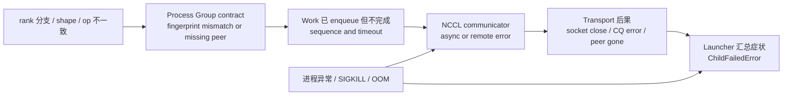

## 本章问题

分布式故障日志经常有几十到几百行，但最后一行通常只是：

```text
ChildFailedError
```

它只说明launcher发现子进程失败，不回答根因。本章要建立一条可执行的因果链：

```text
应用注入点
-> collective contract / rank liveness
-> WorkNCCL timeout or NCCL async error
-> communicator abort
-> process teardown
-> torchrun aggregate failure
```

需要回答：

1. op、shape、order mismatch分别在哪一层发现？
2. `TORCH_DISTRIBUTED_DEBUG=DETAIL`究竟做了什么？
3. 关闭DETAIL后，mismatch是否一定立即hang？
4. 为什么某个rank的collective返回仍不能证明全局正确？
5. healthy warmup对根因归属提供什么证据？
6. Work watchdog的timeout从哪个时间点计算？
7. `last enqueued/last completed`怎样定位第一个未完成序号？
8. Process Group timeout是否覆盖首次lazy communicator init？
9. rank无traceback退出与应用异常退出的第一现场有何不同？
10. 为什么torchrun可能抢先终止幸存rank，掩盖NCCL remote error？
11. `ncclRemoteError`为何不能直接等同网络故障？
12. `TORCH_NCCL_ASYNC_ERROR_HANDLING`四种mode如何决定cleanup/teardown？
13. `ncclCommDestroy`与`ncclCommAbort`的语义差异是什么？
14. 生产系统应该按什么证据优先级归因？

## 版本与实验边界

```text
GPU: 4 x Tesla V100-SXM2-32GB, all pairs NV2
实验进程: 2 ranks / 2 GPUs
PyTorch: 2.5.0a0+872d972e41.nv24.08
NCCL: 2.22.3
Process Group timeout: 4 seconds
TORCH_NCCL_BLOCKING_WAIT: 1
TORCH_NCCL_ASYNC_ERROR_HANDLING: 1
```

正式运行：`ch33_fault_root_cause/20260711T223000Z`。

- [实验汇总](/assets/files/nccl-learning/logs/ch33_fault_root_cause/20260711T223000Z/summary.md)
- [运行清单](/assets/files/nccl-learning/logs/ch33_fault_root_cause/20260711T223000Z/manifest.txt)
- [9案例根因汇总](/assets/files/nccl-learning/logs/ch33_fault_root_cause/20260711T223000Z/case_summary.csv)
- [80条脱敏因果事件](/assets/files/nccl-learning/logs/ch33_fault_root_cause/20260711T223000Z/failure_event_timeline.csv)
- [37条源码状态模型](/assets/files/nccl-learning/logs/ch33_fault_root_cause/20260711T223000Z/fault_source_model.csv)
- [故障worker](/assets/files/nccl-learning/probes/ch33_fault_worker.py)
- [根因分类driver](/assets/files/nccl-learning/scripts/57_ch33_fault_root_cause.py)

原始失败日志可能包含hostname、PID、临时路径与完整traceback，只保留在本机`raw/`，不发布。
公开event timeline只保留case、ordinal、event class、rank和截断证据。

本机只有单节点且没有容器可用HCA，所以真实网线中断、switch drop、IB port flap没有执行。
不能把本章`rank_exit`冒充网络中断实验。

## 先定义故障层级

同一条错误文本可能在不同层出现。归因前先按所有权分层：

| 层 | 典型故障 | 直接证据 |
|---|---|---|
| 应用 | rank分支、shape、异常 | 业务日志、collective参数、traceback |
| Process Group contract | sequence/op/dtype/shape不一致 | CollectiveFingerPrint |
| ProcessGroupNCCL Work | 已enqueue但未完成 | SeqNum、OpType、timeout、last completed |
| NCCL communicator | asyncResult、remote/system error | NCCL WARN/INFO、async error |
| Transport/网络 | socket close、CQ error、link down | NET日志、NIC/switch counters、peer日志 |
| Launcher | child退出、fail-fast终止其他rank | exitcode、signal、ChildFailedError |

`ChildFailedError`位于最后一层。把它当根因，相当于把“服务挂了”当故障分析结论。

一条日志链通常从左向右扩散：最左侧是可操作根因，越靠右越可能只是下游观察到的结果。

<div class="diagram-scroll diagram-scroll--wide" markdown="1">



</div>

排障方向与传播方向相反：从 launcher 汇总定位失败 rank，再对齐 peer、Work sequence 和第一条
应用 marker，直到找到最早的独立原因。真实链路故障可能直接从 Transport 层开始，不能被本章的
单节点 rank-exit 实验替代。

## 实验怎样保留第一现场

每个worker在故障前打印机器可解析的单调时钟marker：

```python
def mark(rank, case, event, **fields):
    extra = " ".join(f"{k}={v}" for k, v in fields.items())
    print(
        f"CH33_EVENT rank={rank} case={case} event={event} "
        f"mono_ns={time.monotonic_ns()} {extra}",
        flush=True,
    )
```

例如skip案例：

```text
rank1 event=fault_injected_skip seq=1
rank0 event=collective_enter seq=1 op=allreduce count=1
rank0 watchdog timeout
torchrun ChildFailedError
```

分类器按原始输出offset排序所有marker、fingerprint、watchdog、remote error、应用异常和launcher
事件。这里的顺序是单机合并stdout的证据顺序；跨节点生产系统还需要统一时钟和每rank独立日志。

## 为什么先做 Healthy Warmup

除`lazy_skip`外，所有故障都先完成一轮正确AllReduce并逐元素检查：

```python
x = torch.tensor([float(rank + 1)], device=device)
dist.all_reduce(x)
torch.cuda.synchronize(device)
assert x.item() == 3.0
mark(rank, case, "healthy_collective_complete", seq=0)
```

这建立了一个因果边界：

```text
默认Process Group已创建
NCCL communicator已lazy初始化
两个rank的GPU与P2P transport刚刚成功通信
```

因此随后skip的首因应优先归入应用collective分歧，而不是“初始化本来就失败”或“GPU从未
连通”。但一次warmup不能证明网络此后永不故障，只能排除故障注入前的持续失败。

`lazy_skip`故意不warmup，用来对照Work创建前的初始化阻塞。

## DETAIL 的 CollectiveFingerPrint

### 它不是 NCCL 自己比较参数

PyTorch `ProcessGroupWrapper::runCollectiveChecks()`固定源码：

```cpp
void ProcessGroupWrapper::runCollectiveChecks(
    OpType op_type,
    const std::vector<at::Tensor>& tensors) {
  auto seq = getSequenceNumberForGroup();
  auto finger_print = CollectiveFingerPrint(op_type, tensors, seq);

  // 先通过辅助 Gloo backend 确认所有 rank 都到达
  glooBackend_->monitoredBarrier(options, /* waitAllRanks */ true);

  // 再交换并验证序号、op、dtype、device type 和 shape
  finger_print.verify(glooBackend_);
}
```

fingerprint序列化字段包括：

```text
OpType
SequenceNumber
number of tensors
tensor dtypes
tensor device types
tensor shapes
```

所以`TORCH_DISTRIBUTED_DEBUG=DETAIL`的价值来自额外ProcessGroup wrapper和辅助Gloo通信，
不是NCCL kernel自动知道另一个rank传了什么Python API。

### Op Mismatch

注入：

```python
if rank == 0:
    dist.broadcast(x, src=0)
else:
    dist.all_reduce(x)
```

实际fingerprint：

```text
Rank 0: SequenceNumber=1, OpType=BROADCAST, TensorShape=[1]
Rank 1: SequenceNumber=1, OpType=ALLREDUCE, TensorShape=[1]
```

两rank都在进入错误NCCL数据面前得到可解释异常。

### Shape Mismatch

注入同一AllReduce但rank0 count=4、rank1 count=8。实际异常精确报告：

```text
Tensor shapes: 8 vs 4
```

这比等待NCCL timeout后猜shape问题有效得多。

### Order Mismatch

```text
rank0: broadcast -> allreduce
rank1: allreduce -> broadcast
```

第一序号就出现BROADCAST/ALLREDUCE fingerprint差异。若每rank最终调用集合相同但顺序不同，
仍然是collective contract violation。

## 关闭 DETAIL 的危险反例

对同一个op mismatch关闭fingerprint后，实际时间线是：

```text
rank0 enters broadcast
rank0 broadcast returns value=1.0
rank1 enters allreduce
rank1 WorkNCCL timeout after 4000 ms
launcher reports ChildFailedError
```

rank0的broadcast局部返回不是全局成功。不同collective的底层send/recv步骤可能让某一端满足
局部完成条件，而另一端永远等不到其协议所需数据。

因此以下断言是错误的：

```text
dist.broadcast() returned on rank0
=> all ranks completed the same collective
=> output is globally valid
```

正确性必须来自collective契约一致、所有participant完成，以及输出reference，不来自单rank
API返回。

## WorkNCCL Timeout 的源码语义

`WorkNCCL::checkTimeout()`从Work创建时的`workStartTime_`计算：

```cpp
bool WorkNCCL::checkTimeout(optional<milliseconds> timeout) {
  auto timeElapsed = duration_cast<milliseconds>(
      steady_clock::now() - workStartTime_);
  auto workTimeout = timeout ? *timeout : opTimeout_;

  if (timeElapsed < workTimeout)
    return false;

  std::string exceptionMsg = c10::str(
      "Watchdog caught collective operation timeout: ",
      *this,
      " ran for ", timeElapsed.count(),
      " milliseconds before timing out.");
  setException(make_exception_ptr(DistBackendError(exceptionMsg)));
  return true;
}
```

这解释了“4秒”的精确定义：不是job启动后的wall time，也不是最后一条应用日志到当前时间，
而是这个Work对象存活但未完成的时间。

## Blocking Wait 与 Watchdog

本章设置`TORCH_NCCL_BLOCKING_WAIT=1`。`WorkNCCL::wait()`循环检查完成状态和timeout：

```cpp
while (!isCompleted()) {
  bool timedOut = checkTimeout(...);
  if (timedOut) {
    LOG(ERROR) << "timed out in blocking wait";
    break;
  }
  sleep_for(kSynchronizeBusyWaitMillis);
}

if (exception()) {
  abort();
  handleException(TearDown);
}
```

发生timeout后先abort communicator，再从调用线程抛异常，避免GPU持续100%占用等待不可能
完成的通信。

### Steady Skip 的实际状态

rank1在健康warmup后跳过第二轮，rank0进入AllReduce。日志：

```text
WorkNCCL(SeqNum=2, OpType=ALLREDUCE, Timeout(ms)=4000)
last enqueued NCCL work: 2
last completed NCCL work: 1
```

应用marker把warmup称为seq0、故障称为seq1；ProcessGroupNCCL内部日志使用自己的Work序号
1和2。生产分析不能混用应用计数与框架SeqNum，应以同一日志域内的序号比较。

关键不变量是：

```text
last completed < failed work <= last enqueued
1              < 2           = 2
```

这说明Work 1已完成，Work 2是第一个未完成操作。

## Lazy Init 不一定受 Work Timeout 覆盖

`dist.init_process_group("nccl")`返回不代表NCCL communicator已创建。ProcessGroupNCCL通常
在首次tensor collective时lazy创建communicator。

`lazy_skip`中：

```text
both ranks: process group initialized
rank1: skips first collective
rank0: enters first AllReduce
rank0: prints NCCL version, then blocks
4-second Process Group timeout: no WorkNCCL timeout emitted
16-second external supervisor: terminates whole process group
```

原因边界是：阻塞发生在可被watchdog跟踪的Work成功创建/enqueue之前。`opTimeout_`属于
Work语义，不能自动保证所有bootstrap、store、lazy communicator初始化阶段都在同一deadline
内结束。

工程上需要分层deadline：

```text
launcher/job deadline
store/rendezvous deadline
communicator initialization deadline
per-collective Work deadline
heartbeat/monitor deadline
```

本章外部driver用独立process group启动torchrun，超时后向整个PGID发SIGTERM，必要时再发
SIGKILL，避免只杀launcher留下孤儿worker。

## Raw Mismatch 与 Skip 的对照

| 案例 | communicator之前健康 | DETAIL | 第一直接现象 | 后续 |
|---|---:|---:|---|---|
| op_detail | 是 | 是 | fingerprint拒绝 | ChildFailed |
| shape_detail | 是 | 是 | fingerprint拒绝 | ChildFailed |
| order_detail | 是 | 是 | fingerprint拒绝 | ChildFailed |
| op_raw | 是 | 否 | rank0局部返回 | rank1 watchdog |
| steady_skip | 是 | 否 | rank1显式skip | rank0 watchdog |
| lazy_skip | 否 | 否 | 首次collective init阻塞 | 外部16秒deadline |

这张表把“调用分歧”“Work hang”“初始化hang”拆开。它们最后都可能表现为job失败，但修复所有权
完全不同。

## Rank Crash：Exitcode 比 NCCL 后果更早

`rank_exit`在健康warmup后让rank1无traceback退出：

```python
mark(rank=1, event="fault_injected_process_exit", exitcode=42)
os._exit(42)
```

rank0同时进入下一轮AllReduce。实际结果：

```text
rank1 injection marker exitcode=42
torchrun detects rank1 exit
torchrun sends SIGTERM to rank0
ChildFailedError identifies failed local rank and exitcode
```

本次没有等到rank0输出`ncclRemoteError`或watchdog，因为torchrun的fail-fast先终止了幸存rank。
这不是“rank exit不会产生NCCL peer error”，而是launcher行为缩短了观察窗口。

生产系统若需要保留幸存rank的NCCL现场，可考虑：

```text
每rank独立持久化日志
launcher退出策略与grace period
NCCL/PyTorch flight recorder
core dump和signal元数据
peer side NIC/socket evidence
```

但不能为了多收日志而允许损坏数据继续训练。

## 应用异常：Traceback 才是第一因

`peer_exception`让rank1明确抛出：

```python
mark(rank=1, event="fault_injected_application_exception")
raise RuntimeError(
    "CH33 injected application failure before collective"
)
```

rank0随后进入AllReduce，但torchrun同样很快终止它。根因链是：

```text
rank1 application exception marker
rank1 RuntimeError traceback
rank0 collective entered
launcher fail-fast
ChildFailedError
```

不能因为rank0最后卡在NCCL，就把根因归为NCCL hang。它是rank1应用异常的下游受害者。

## Error Handling Mode

PyTorch固定源码定义：

```cpp
enum ErrorHandlingMode {
  NoHandling = 0,
  TearDown = 1,
  CleanUpOnly = 2,
  SkipCleanUp = 3
};

#define SHOULD_CLEAN_UP(a) \
  (a != NoHandling && a != SkipCleanUp)
#define SHOULD_TEAR_DOWN(a) \
  (a != NoHandling && a != CleanUpOnly)
```

| mode | communicator cleanup | process teardown | 含义 |
|---:|---:|---:|---|
| 0 | 否 | 否 | 不自动处理 |
| 1 | 是 | 是 | abort后终止进程 |
| 2 | 是 | 否 | 只清理communicator |
| 3 | 否 | 是 | 跳过可能hang的cleanup，直接终止 |

本章运行mode 1。mode 3是最后手段：若`ncclCommAbort`本身可能hang，跳过cleanup以确保进程
退出，但资源回收更不完整。

watchdog检测到异常后，源码顺序是：

```cpp
if (SHOULD_CLEAN_UP(asyncErrorHandling_)) {
  work.abort();
  abort();  // 当前 rank 上该 PG 的 communicator
}

if (timedOut) {
  LOG(ERROR) << "Timeout at NCCL work ... last enqueued ... last completed";
}

work.handleException(asyncErrorHandling_);
```

`handleException()`强调异步CUDA的风险：失败后的后续GPU算子可能消费损坏或不完整数据，因此
需要按mode teardown。

## NCCL Abort 与 Destroy

### 正常 Destroy

`ncclCommDestroy()`设置`destroyFlag`，先确保init ready，再异步reclaim：

```cpp
comm->destroyFlag = 1;
NCCLCHECK(ncclCommEnsureReady(comm));
job->comm = comm;
NCCLCHECK(ncclAsyncLaunch(
    &job->base, commReclaim, NULL, free, comm));
```

正常destroy假设通信生命周期按协议结束。

### 异常 Abort

`ncclCommAbort()`先通知host和device侧正在执行的工作退出：

```cpp
if (comm->childAbortFlag != nullptr) {
  atomic_store(comm->childAbortFlag, 1);
  atomic_store(comm->childAbortFlagDev, 1);
}
atomic_store(comm->abortFlag, 1);
atomic_store(comm->abortFlagDev, 1);
comm->destroyFlag = 1;

// 忽略init error，继续异步资源回收
ncclCommEnsureReady(comm);
ncclAsyncLaunch(&job->base, commReclaim, NULL, free, comm);
```

abort flag同时有host和device可见版本，因为可能有CPU proxy、初始化线程和GPU kernel都在等待。
Abort不是“优雅地完成剩余collective”，而是让等待路径尽快退出后回收资源。

## `ncclRemoteError` 为什么有歧义

NCCL 2.22.3的错误字符串直接写成：

```cpp
case ncclRemoteError:
  return "remote process exited or there was a network error";
```

同一个result code至少覆盖：

```text
peer进程崩溃
peer被launcher杀死
socket连接断开
IB completion error
真实链路或交换机故障
```

所以看到`remote process exited or there was a network error`只能证明本rank观察到remote/transport
失败，不能单凭这句决定找网络团队。

要判定真实网络根因，需要组合：

```text
对端是否先有应用异常、OOM、SIGKILL
所有受影响flow是否集中同一NIC/port/switch
NET subsystem和verbs completion状态
NIC error/discard/retry counters
switch port counters和link event
同一节点其他job是否同时异常
```

本章没有HCA，网络中断保持`BLOCKED_SINGLE_NODE`，只给出源码语义和复现实验方案。

## 九案例实际结果

下面duration包含torchrun启动、Python import、故障等待和teardown，不能当collective性能：

| case | 第一根因分类 | return code | external timeout | wall time |
|---|---|---:|---:|---:|
| control | success | 0 | 0 | 4.952 s |
| op_detail | fingerprint | 1 | 0 | 4.998 s |
| shape_detail | fingerprint | 1 | 0 | 4.886 s |
| order_detail | fingerprint | 1 | 0 | 4.907 s |
| op_raw | raw mismatch/partial return | 1 | 0 | 9.226 s |
| steady_skip | injected skip | 1 | 0 | 8.991 s |
| lazy_skip | lazy-init external deadline | 124 | 1 | 16.459 s |
| rank_exit | injected exitcode 42 | 1 | 0 | 4.293 s |
| peer_exception | injected RuntimeError | 1 | 0 | 4.815 s |

全部9个案例满足预期根因，不是“都出现了非零退出”就算通过。

## 为什么 Watchdog 日志会重复

同一个timeout可能由watchdog线程记录一次，再作为`DistBackendError`从调用线程输出一次。event
timeline保留两条watchdog evidence，因为它们属于不同日志位置，但根因分类只计一次故障。

类似地，`ChildFailedError(`可能同时出现在raise栈和最终异常类型中。日志去重不能只按字符串，
应保留时间、线程、rank、source location和异常传播关系。

## 根因证据优先级

本章分类器使用以下优先级：

```text
0. 明确故障注入/业务异常/exit signal
1. CollectiveFingerPrint contract mismatch
2. 第一个WorkNCCL watchdog timeout及其SeqNum
3. NCCL remote/system error和transport evidence
4. launcher ChildFailed summary
```

这不是说上层日志永远更可信，而是因果通常从上游流向下游。若没有应用证据，transport error
可能就是第一现场；若rank1先OOM，rank0的remote error只是后果。

## 生产排障决策树

### 1. 是否有明确失败 Rank

先从launcher提取：

```text
global/local rank
hostname
PID
exitcode or signal
first failure timestamp
是否有Python/CUDA traceback
```

### 2. 失败 Rank 是否先于 NCCL 报错

```text
有应用 traceback/OOM/SIGKILL -> 先查该rank应用与资源
无应用错误，collective fingerprint -> 查调用契约
无fingerprint，Work timeout -> 比较所有rank SeqNum/op/count
NCCL remote/system error -> 同时查peer和transport
```

### 3. 比较 Last Completed

```text
所有rank同一个SeqNum timeout:
  可能是collective数据面、GPU stall或网络

部分rank SeqNum领先:
  优先怀疑调用分支、跳过、顺序不一致

没有Work/SeqNum，卡首次调用:
  优先查rendezvous/bootstrap/lazy communicator init
```

### 4. 判断是不是 Teardown 噪声

首个异常之后的connection closed、abort、destroy warning、SIGTERM和ChildFailed通常是级联。
除非它们时间更早，否则不能反向覆盖第一因。

## 多节点网络故障补实验

具备两节点HCA后，应执行而不是模拟：

| 注入 | 预期第一现场 | 必采证据 |
|---|---|---|
| disable HCA port | verbs/CQ或link error | 两端NCCL NET、`ibstat`、port counters |
| drop指定flow | retry/timeout | QP、retry counters、switch ACL hit |
| kill remote rank | peer process exit | peer exitcode先于local remote error |
| stop remote proxy | transport progress停滞 | proxy thread、CQ、Work SeqNum |
| MTU/GID错误 | connect或数据面失败 | GID/MTU/config、first packet/CQ error |

每例都要有无注入控制组，并区分初始化失败与健康通信后的运行时中断。

## 常见错误

1. 只截取最后一行`ChildFailedError`。
2. 把最吵的rank当根因rank。
3. 不记录每rank collective sequence、op、shape和group。
4. 认为DETAIL是NCCL内核自行比较参数。
5. 生产长期打开DETAIL却不评估辅助Gloo开销。
6. 认为一个rank API返回就代表全局collective成功。
7. 把应用序号和WorkNCCL SeqNum直接混为一谈。
8. 只看`last enqueued`，不看`last completed`。
9. 把job wall time当Work timeout。
10. 认为PG timeout覆盖所有lazy init和bootstrap阶段。
11. 外部timeout只杀torchrun父进程，留下worker孤儿。
12. rank退出后只查幸存rank的NCCL错误。
13. 应用异常导致peer hang，却归因NCCL不稳定。
14. 把`ncclRemoteError`直接翻译成网络故障。
15. 没有NIC/switch证据就声称丢包。
16. timeout后继续训练并消费可能损坏的数据。
17. 把abort当成正常destroy。
18. 忽略host/device两类abort flag。
19. 只profile rank0，不保存首个失败rank日志。
20. 发布带hostname、PID和环境的原始失败日志。

## 本章结论

1. 根因链应按应用、contract、Work、NCCL、transport、launcher分层。
2. DETAIL通过ProcessGroupWrapper、Gloo monitored barrier和fingerprint提前拒绝分歧。
3. op、shape、order三种DETAIL mismatch都精确报告了序号和差异字段。
4. 关闭DETAIL后，op mismatch出现rank0局部返回、rank1四秒后timeout的反例。
5. healthy warmup证明故障注入前communicator和数据面刚刚可用。
6. steady skip日志显示失败Work 2，last completed为1，定位第一个未完成操作。
7. Work timeout从`workStartTime_`计算，不是整个job wall time。
8. 首次lazy init在16秒前没有触发4秒Work timeout，必须有外层deadline。
9. `os._exit(42)`被launcher先捕获并fail-fast，幸存rank未必来得及输出remote error。
10. 应用RuntimeError的traceback先于peer collective和ChildFailed，是第一因。
11. mode 1会cleanup communicator并teardown进程，防止继续使用损坏数据。
12. Abort设置host/device abort flag后回收，语义不同于正常Destroy。
13. `ncclRemoteError`同时表示peer退出或网络错误，必须用对端和网络证据消歧。
14. 9/9故障案例、80条因果事件、37/37源码不变量全部通过。
15. 真实网络中断因单节点无HCA保持阻塞，不提供虚构结论。

## 验收题

1. 为什么`ChildFailedError`通常不是根因？
2. 六层故障所有权分别是什么？
3. healthy warmup能排除什么，不能排除什么？
4. DETAIL fingerprint包含哪些字段？
5. fingerprint为什么使用辅助Gloo backend？
6. op mismatch和order mismatch的差别是什么？
7. shape mismatch如何在NCCL数据面前被发现？
8. raw op mismatch为何可能有rank局部返回？
9. 这为何不能证明输出正确？
10. `workStartTime_`与job start有什么区别？
11. blocking wait timeout后为何先abort？
12. `last enqueued=2,last completed=1`说明什么？
13. 应用seq1和Work SeqNum2为何不矛盾？
14. 首次lazy collective为什么可能没有Work watchdog日志？
15. 外部监督器为什么应杀整个进程组？
16. rank无traceback退出应保留哪些元数据？
17. torchrun fail-fast如何改变幸存rank日志？
18. 应用异常与peer NCCL hang如何建立先后关系？
19. ErrorHandlingMode 0/1/2/3分别cleanup/teardown什么？
20. mode 3为什么只是最后手段？
21. `ncclCommAbort`设置哪几类flag？
22. Abort和Destroy对init error的处理有何不同？
23. `ncclRemoteError`为什么不能直接归因网络？
24. 判定真实网络故障至少需要哪些对端/NIC/switch证据？
25. 哪些实验已实际运行，哪个硬件场景仍阻塞？
