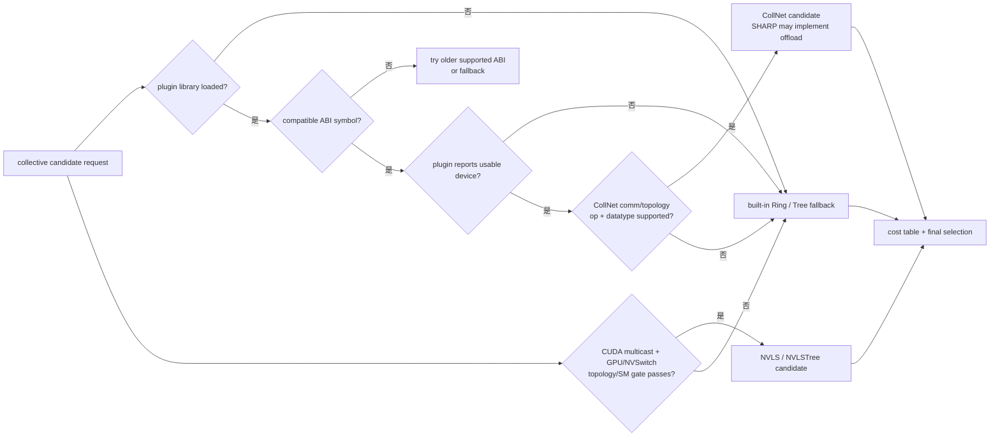

## 本章问题

看到下面任意一条日志，都不能直接得出“集合通信已经卸载”的结论：

```text
Plugin Path : .../libnccl-net.so
P2P plugin IBext_v8
NCCL_COLLNET_ENABLE=1
NVLS multicast support is available
NCCL_ALGO=NVLS
```

因为从共享库出现到数据真正经过offload路径，中间至少有五层门控：

```text
library discovery
  -> ABI symbol acceptance
  -> backend device/capability discovery
  -> communicator graph/connect setup
  -> per-operation algorithm eligibility and selection
  -> plugin/device execution and completion
```

本章回答：

1. net plugin、CollNet plugin和tuner plugin分别负责什么？
2. CollNet与网络SHARP是什么关系？
3. NVLS为何也叫NVLink SHARP，却不是网络SHARP？
4. NCCL如何加载插件、协商ABI并兼容旧版本？
5. 一个插件有正确符号但返回零device时会发生什么？
6. `NCCL_COLLNET_ENABLE=1`之后还要通过哪些门控？
7. reduction op与datatype为何会再次关闭CollNet候选？
8. `NCCL_NVLS_ENABLE=2`与强制值1有什么本质区别？
9. 为什么V100上强制NVLS会打印“available”，最后却仍执行Ring？
10. NVLS、NVLSTree与多节点CollNet如何组合？
11. 强制一个不可用算法时NCCL为何可能成功回退，而不是报错？
12. 如何证明“加载成功”和“实际offload”之间的差异？

## 三种能力先分开

### Net plugin：点到点网络数据面 ABI

`ncclNet_v8_t`提供listen/connect/accept、MR注册、isend/irecv/iflush/test等接口。
NCCL的NET proxy通过它搬运跨节点数据。internal Socket、internal IB以及外部
`libnccl-net.so`都可以成为这一层的实现。

Net plugin能发收数据，不代表它能执行collective reduction。

### CollNet plugin：集合网络能力 ABI

`ncclCollNet_v8_t`除连接与注册接口外，直接暴露异步collective：

```cpp
// include/nccl_net.h，省略无关字段
typedef struct {
  ncclResult_t (*reduceSupport)(ncclDataType_t type,
                                ncclRedOp_t op, int* supported);

  ncclResult_t (*iallreduce)(void* collComm,
      void* sendData, void* recvData, int count,
      ncclDataType_t type, ncclRedOp_t op,
      void* sendMr, void* recvMr, void** request);

  ncclResult_t (*iallgather)(void* collComm, void* sendData,
      int nRecvParts, ncclNetSGE_v8_t* recvParts,
      size_t bytesPerRank, size_t windowOffset, size_t windowBytes,
      void* sendMr, void** request);

  ncclResult_t (*ireducescatter)(void* collComm,
      int nSendParts, ncclNetSGE_v8_t* sendParts, void* recvData,
      size_t bytesPerRank, size_t windowOffset, size_t windowBytes,
      ncclDataType_t type, ncclRedOp_t op,
      void* recvMr, void** request);

  ncclResult_t (*test)(void* request, int* done, int* size);
} ncclCollNet_v8_t;
```

这段是 NCCL 与插件之间的 **函数指针接口声明**，不是 SHARP 或其他 vendor plugin 的
`iallreduce` 函数体。NCCL 仓库能证明 ABI、能力门控和调用位置；真正的网络内归约实现属于
被加载的插件及交换网络。本文后面的 proxy 段会继续展示 NCCL 如何实际调用该函数指针。

CollNet是NCCL对“collective network”的抽象接口。SHARP是可实现这种接口的网络
offload技术之一：交换网络执行聚合/reduction，端点不再承担传统Ring中的全部归约流量。
因此不能把“CollNet”等同为某个特定厂商产品，也不能把普通IB transport等同为SHARP。

### Tuner plugin：改写候选代价，不搬数据

tuner读取collective类型、消息大小、pipeline数量和已有cost table，再调整
algorithm/protocol/channel选择。它不实现网络send/recv，也不执行reduction。

```cpp
// NCCL 2.22.3 tuner v3调用顺序
updateCollCostTable(...);        // NCCL先建立可用候选与默认代价
comm->tuner->getCollInfo(...);   // tuner只能修改合法候选的代价/channel
topoGetAlgoInfo(...);            // NCCL最后选择algorithm/protocol
```

第16章已经实测过tuner plugin；本章关注net/CollNet插件以及它们给算法集合增加的能力。

## SHARP 与 NVLS 的准确关系

二者都能减少端点参与的归约工作，但物理位置不同：

| 能力 | 执行位置 | 主要范围 | NCCL入口 |
|---|---|---|---|
| 网络SHARP | 支持offload的网络交换fabric | 跨节点 | CollNet plugin |
| NVLink SHARP/NVLS | 支持multicast/reduction的NVSwitch路径 | 主要是节点内，NVLSTree可组合节点间 | CUDA multicast + NVLS graph |
| Ring/Tree | GPU kernel、NET/P2P transport | 节点内和跨节点 | NCCL内建算法 |

NVLS不是“NVLink带宽更快”的别名，也不是普通V100 NVLink P2P。它依赖CUDA multicast
对象、GPU multicast capability、NVSwitch拓扑以及SM90 graph条件。

多节点纯NVLS还需要CollNet支持；NVLSTree则把节点内NVLS与节点间树连接组合起来。

<div class="diagram-scroll" markdown="1">



</div>

“库能加载”“ABI 能协商”“设备可用”“候选被启用”“最终被选择”是五个不同结论。V100 上强制变量仍可能在能力门控后安全回到 Ring/Tree，不能把一条 available 日志当作 offload 证据。

## 插件装载：库、ABI、设备是三件事

### 库名解析

`src/net.cc`先尝试环境变量原值，再尝试带前后缀的名称：

```cpp
const char* name = getenv("NCCL_NET_PLUGIN");
if (name && strlen(name)) {
  pluginLib = tryOpenLib(name, ...);                 // 精确路径或名称
  if (pluginLib) return pluginLib;

  snprintf(buf, PATH_MAX, "libnccl-net-%s.so", name);
  pluginLib = tryOpenLib(buf, ...);                  // 简写扩展
} else {
  pluginLib = tryOpenLib("libnccl-net.so", ...);    // 默认插件
}
```

因此`NCCL_NET_PLUGIN=/abs/foo.so`并不是只记录一个标签，它会真实地交给`dlopen`。
库不存在时NCCL记录候选名并使用internal network plugin。

### ABI按新到旧探测

NCCL 2.22.3按v8、v7、v6、v5探测Net ABI：

```cpp
ncclNets[0] = dlsym(lib, "ncclNetPlugin_v8");
if (ncclNets[0] == nullptr) {
  ncclNet_v7 = dlsym(lib, "ncclNetPlugin_v7");
  if (ncclNet_v7 == nullptr) {
    ncclNet_v6 = dlsym(lib, "ncclNetPlugin_v6");
    if (ncclNet_v6 == nullptr) {
      ncclNet_v5 = dlsym(lib, "ncclNetPlugin_v5");
      if (ncclNet_v5 == nullptr) goto fail; // v4及以下拒绝
      ncclNets[0] = &ncclNet_v5_as_v8;      // adapter统一成v8调用面
    }
  }
}
```

随后独立探测`ncclCollNetPlugin_v8`到v5。没有CollNet符号不会否定一个合法的Net
plugin；它只表示该库不能向communicator提供collective network接口。

本机HPC-X SHARP库的动态符号结果：

| family | v5 | v6 | v7 | v8 |
|---|---:|---:|---:|---:|
| `ncclNetPlugin` | 1 | 1 | 1 | 1 |
| `ncclCollNetPlugin` | 1 | 1 | 1 | 1 |

8/8符号存在只能证明ABI入口可发现。

### `init`成功且device数量大于零才启用

```cpp
static ncclResult_t netGetState(int i, ncclNetState* state) {
  int ndev;
  if (ncclNets[i]->init(ncclDebugLog) != ncclSuccess)
    ncclNetStates[i] = ncclNetStateDisabled;
  else if (ncclNets[i]->devices(&ndev) != ncclSuccess || ndev <= 0)
    ncclNetStates[i] = ncclNetStateDisabled;
  else
    ncclNetStates[i] = ncclNetStateEnabled;
}
```

CollNet有完全对应的`collNetGetState`。本机库能被加载并接受v8，但容器没有可用verbs
device，所以日志是：

```text
P2P plugin IBext_v8
NET/IB : No device found
Using network Socket
```

这正是“库成功、ABI成功、device门控失败、internal Socket接管”。

## CollNet communicator 的完整门控

把最终支持写成逻辑式：

$$
C_{final}=C_{abi}\land C_{device}\land C_{env}\land C_{graph}
\land C_{nodes}\land C_{arity}\land C_{op,type}
$$

### 1. 必须显式设置值1

```cpp
if (collNetSupport(comm)) {               // comm->ncclCollNet != nullptr
  const char* env = ncclGetEnv("NCCL_COLLNET_ENABLE");
  if (env != nullptr && strcmp(env, "1") == 0)
    comm->collNetSupport = 1;
}
```

在这个版本中，插件存在但不设置`NCCL_COLLNET_ENABLE=1`，不会自动把communicator
能力打开。值`0`和未设置都不是1。

### 2. Graph必须产生非零channel

初始化分别搜索CollNetChain和CollNetDirect graph。所有rank交换graph信息后：

```cpp
if (graphs[NCCL_ALGO_COLLNET_CHAIN]->nChannels == 0)
  comm->collNetSupport = 0;
```

这意味着local plugin capability不是最终全局能力。某个节点无法形成图，整个
communicator都必须放弃该候选。

### 3. 节点数和单节点rank数

```cpp
NCCL_PARAM(CollNetNodeThreshold, "COLLNET_NODE_THRESHOLD", 2);

if (comm->nNodes < ncclParamCollNetNodeThreshold())
  comm->collNetSupport = 0;

for (int n = 0; n < comm->nNodes; n++) {
  if (comm->nodeRanks[n].localRanks > NCCL_MAX_DIRECT_ARITY + 1)
    comm->collNetSupport = 0;
}
```

默认至少两节点。`COLLNET_NODE_THRESHOLD`是是否启用的规模阈值，不是性能保证。
Direct结构还受最大arity约束；NCCL 2.22.3当前上限对应每节点最多8个local ranks。

### 4. 每个reduction op和datatype重新询问插件

setup阶段的head rank调用plugin的`reduceSupport(type, op)`，再通过bootstrap all-gather
构建支持矩阵：

```cpp
for (int r = 0; r < comm->nRanks; r++)
  accum |= matrix[r][op][ty];

// 只有出现support bit且没有任何not-support bit才成立
comm->collNetSupportMatrix[op][ty] = (accum == (1 << 1));
```

enqueue时Reduction类collective再次与该矩阵相与：

```cpp
*collNetSupport = comm->collNetSupport;
switch (info->func) {
case ncclFuncAllReduce:
case ncclFuncReduce:
case ncclFuncReduceScatter:
  *collNetSupport &= comm->collNetSupportMatrix[netOp][info->datatype];
}
```

所以“这个communicator启用了CollNet”不等于每种`redop x datatype`都能offload。

## CollNetDirect 与 CollNetChain

两者都调用同一个CollNet plugin collective接口，差异在节点内GPU如何汇聚到network
head以及如何分发结果。

- CollNetChain使用链/树式节点内路径，graph channel数跟Ring graph对齐。
- CollNetDirect建立多个up/down peer，允许多个local rank围绕head直接聚合，受arity限制。
- proxy把GPU buffer或shared staging region交给plugin，plugin返回异步request。
- 返回`request == nullptr`表示当前调用不能执行或会阻塞，proxy稍后继续progress。

AllReduce的真实调用不是一个抽象注释，而是：

```cpp
proxyState->ncclCollNet->iallreduce(
    resources->collNetComm,
    region + sendBeg, region + recvBeg,
    count, args->dtype, args->redOp,
    sendMhandle, recvMhandle,
    sub->requests + buffSlot);
```

AllGather和ReduceScatter分别进入`iallgather`和`ireducescatter`，并携带window offset、
bytes per rank和scatter/gather entry。完成仍由plugin的`test(request, ...)`驱动，符合
第24章讲过的CPU proxy异步progress模型。

## NVLS 的两级门控

### Capability阶段

```cpp
NCCL_PARAM(NvlsEnable,    "NVLS_ENABLE",    2);       // 2=自动
NCCL_PARAM(NvlsChannels,  "NVLS_NCHANNELS", 16);
NCCL_PARAM(NvlsChunkSize, "NVLS_CHUNKSIZE", 128*1024);

comm->nvlsSupport = 0;
if (!nvlsEnable || gpuCount <= 2) return ncclSuccess;

if (nvlsEnable == 2) {
  if (cuMulticastCreate != nullptr)
    cuDeviceGetAttribute(&comm->nvlsSupport,
        CU_DEVICE_ATTRIBUTE_MULTICAST_SUPPORTED, dev);
} else {
  comm->nvlsSupport = 1; // 强制模式跳过attribute判断
}
```

自动值2要求CUDA driver导出multicast API并且GPU attribute为1。强制值1只是先把
`nvlsSupport`置1，便于调试；它不会创造不存在的NVSwitch或SM90能力。

本机直接查询四张GPU：

| GPU | multicast attribute | compute capability |
|---:|---:|---:|
| 0 | 0 | 70 |
| 1 | 0 | 70 |
| 2 | 0 | 70 |
| 3 | 0 | 70 |

因此自动模式在第一层结束。

### Graph阶段

即使强制值1绕过attribute，graph search仍有硬条件：

```cpp
ncclTopoGetCompCap(system, &ccMin, nullptr);
if (graph->pattern == NCCL_TOPO_PATTERN_NVLS &&
    (system->nodes[NVS].count == 0 || ccMin < 90))
  return ncclSuccess; // 保持nChannels=0
```

全局graph汇总后还有最终清零：

```cpp
if (graphs[NCCL_ALGO_NVLS]->nChannels == 0)
  comm->nvlsSupport = comm->nvlsChannels = 0;
```

这解释了一个反直觉日志：V100上设置`NCCL_NVLS_ENABLE=1`会先打印multicast support
available，因为强制分支确实把字段置1；但没有NVS且`ccMin=70`，graph channel仍为0，
最终NVLS候选被清除。

## 算法候选与安全回退

enqueue建立cost table时先剪枝：

```cpp
if (algo is CollNetDirect/Chain && collNetSupport != 1) continue;
if (algo is NVLS/NVLSTree && nvlsSupport != 1 && func != AllGather) continue;
if (algo is NVLS && collNetSupport != 1 && nNodes > 1) continue;
```

`ncclTopoGetAlgoTime`还会区分正常候选和backup候选。若环境变量请求的算法没有形成正常
候选，NCCL可以选择可执行的backup algorithm，而不是把一个不可能执行的kernel发出去。

本机对1 MiB AllReduce分别设置：

```text
NCCL_ALGO=CollNetDirect
NCCL_ALGO=CollNetChain
NCCL_ALGO=NVLS
NCCL_ALGO=NVLSTree
```

同时打开`NCCL_COLLNET_ENABLE=1`、强制`NCCL_NVLS_ENABLE=1`。四次进程均返回成功，
但TUNING日志都显示：

```text
1048576 Bytes -> Algo 1 proto 1
```

在NCCL 2.22.3枚举中`Algo 1`是Ring。结构化结果：

| requested | observed | fallback | wrong |
|---|---|---:|---:|
| CollNetDirect | Ring | 1 | 0 |
| CollNetChain | Ring | 1 | 0 |
| NVLS | Ring | 1 | 0 |
| NVLSTree | Ring | 1 | 0 |

所以“设置了`NCCL_ALGO`且程序成功”仍不能证明所请求算法被执行，必须读取实际选择日志
或trace/kernel/counter证据。

## 实验设计

正式运行：`ch28_offload_plugins/20260711T173000Z`。

- [实验汇总](/assets/files/nccl-learning/logs/ch28_offload_plugins/20260711T173000Z/summary.md)
- [运行清单](/assets/files/nccl-learning/logs/ch28_offload_plugins/20260711T173000Z/manifest.txt)
- [NVLS capability](/assets/files/nccl-learning/logs/ch28_offload_plugins/20260711T173000Z/nvls_capability.csv)
- [插件ABI符号](/assets/files/nccl-learning/logs/ch28_offload_plugins/20260711T173000Z/plugin_symbols.csv)
- [插件runtime状态](/assets/files/nccl-learning/logs/ch28_offload_plugins/20260711T173000Z/plugin_runtime.csv)
- [140条负对照记录](/assets/files/nccl-learning/logs/ch28_offload_plugins/20260711T173000Z/negative_control_measurements.csv)
- [14组实际路径](/assets/files/nccl-learning/logs/ch28_offload_plugins/20260711T173000Z/negative_control_paths.csv)
- [负对照统计](/assets/files/nccl-learning/logs/ch28_offload_plugins/20260711T173000Z/negative_control_summary.csv)
- [强制算法回退](/assets/files/nccl-learning/logs/ch28_offload_plugins/20260711T173000Z/forced_algorithm_fallback.csv)
- [28项源码门控模型](/assets/files/nccl-learning/logs/ch28_offload_plugins/20260711T173000Z/offload_source_model.csv)
- [实验驱动](/assets/files/nccl-learning/scripts/52_ch28_offload_plugins.py)
- [门控模型](/assets/files/nccl-learning/probes/ch28_offload_model.py)
- [NVLS capability probe](/assets/files/nccl-learning/probes/ch28_nvls_capability.cc)
- [坏ABI插件](/assets/files/nccl-learning/probes/ch28_bad_net_plugin.c)

### 插件三态实验

构造三种状态：

| case | library opened | Net v8 accepted | usable devices | Socket fallback |
|---|---:|---:|---:|---:|
| SHARP默认库 | 1 | 1 | 0 | 1 |
| 可加载但无NCCL符号的`.so` | 1 | 0 | 0 | 1 |
| 不存在的`.so` | 0 | 0 | 0 | 1 |

坏插件只有一个无关导出函数：

```c
// dlopen可以成功，但没有任何ncclNetPlugin_vN符号
int ch28_bad_plugin_marker(void) { return 28; }
```

这将library failure、ABI failure和device failure拆成三个可观测状态，而不是笼统地说
“plugin没生效”。三种情况下1 MiB原生AllReduce都`correct=1`。

### 参数负对照

强制禁用P2P和SHM，使4张GPU只能通过NET/Socket；比较：

```text
baseline
NCCL_COLLNET_ENABLE=0 / 1
NCCL_NVLS_ENABLE=0 / 2
bad plugin / missing plugin
```

每组4 KiB与64 MiB，各5 cycles，正序和反序各一次，共140条记录。所有14次进程都
必须命中`via NET/Socket/0`，且不得出现CollNet connector或`Connected NVLS`。

## 实验结果

| config | 4 KiB median us | 64 MiB median us | 64 MiB busbw GB/s |
|---|---:|---:|---:|
| baseline | 459.34 | 46723.95 | 2.155 |
| CollNet off | 451.53 | 47186.90 | 2.130 |
| CollNet on | 453.48 | 46808.05 | 2.150 |
| NVLS off | 404.15 | 46848.05 | 2.150 |
| NVLS auto | 409.54 | 46936.30 | 2.145 |
| bad plugin | 377.40 | 47217.30 | 2.130 |
| missing plugin | 424.11 | 46991.50 | 2.140 |

64 MiB各组只有约1%的范围，且路径完全相同。4 KiB的波动更大，但没有任何offload
connector，不能归因给CollNet或NVLS。这个实验验证的是：

1. 不满足能力门控时，参数变化不改变实际路径。
2. 插件错误能安全回退，collective结果仍正确。
3. 仅比较耗时、不审计路径，会把Socket噪声误写成offload收益。

源码模型28/28通过，覆盖Net/CollNet ABI、CollNet最终门控、NVLS support/channel两阶段
以及algorithm eligibility组合。模型是固定版本源码的可执行规格，不替代真实硬件性能。

## 在支持硬件上如何补全性能实验

### CollNet/SHARP

至少两台GPU节点、可用HCA、SHARP fabric和plugin：

1. 固定rank/node、GPU/NIC affinity、消息大小、protocol和channels。
2. 比较Ring、Tree、CollNetDirect、CollNetChain。
3. sweep节点数2/4/8/16与4 KiB到1 GiB消息。
4. 保存实际algorithm、CollNet connector、plugin collective counters。
5. 同时保存HCA port、switch aggregation和GPU kernel时间。
6. 测试不支持的datatype/redop，确认support matrix回退。
7. 故障注入一个节点关闭plugin，验证全communicator一致禁用。

关注的不只是峰值GB/s，还包括offload后GPU SM占用、网络注入字节、节点扩展曲线和尾延迟。

### NVLS/NVLSTree

需要SM90 GPU和支持multicast/reduction的NVSwitch环境：

1. 记录multicast attribute、NVS topology node和实际NVLS channels。
2. 比较Ring/Tree/NVLS/NVLSTree以及auto/forced/disabled。
3. sweep `NVLS_NCHANNELS`和`NVLS_CHUNKSIZE`，同时记录CUDA kernel grid。
4. 分AllReduce、AllGather、ReduceScatter和datatype/redop。
5. 单节点验证NVLS，多节点再验证NVLSTree和CollNet依赖。
6. 对照registered与非registered buffer、CUDA Graph capture。
7. 用NVLink/NVSwitch counters证明multicast流量，而不只看NCCL日志。

## 诊断决策树

```text
没有看到plugin日志
  -> 检查NCCL_NET_PLUGIN、LD path、dlopen依赖

库加载但报找不到>=v5 symbol
  -> ABI不兼容或错误共享库

ABI接受但No device found
  -> /dev/infiniband、driver、UCX/verbs、HCA可见性、link state

Net可用但CollNet未启用
  -> CollNet symbol/init/devices、COLLNET_ENABLE=1、node threshold

CollNet communicator启用但某算子回退
  -> graph channel、redop/datatype support matrix、cost table

NVLS先显示available后消失
  -> 是否强制enable；检查multicast attr、NVS node、cc>=90、graph channels

请求offload算法但程序成功执行Ring
  -> 读取TUNING实际Algo，不要把环境变量当执行证据
```

## 生产证据标准

声称“CollNet/SHARP已生效”至少需要：

1. plugin path和ABI版本；
2. 非零Net/CollNet device；
3. communicator CollNet graph非零；
4. 对应op/datatype support为真；
5. TUNING/trace显示实际CollNet算法；
6. connector/plugin counter证明collective数据面；
7. 与Ring/Tree的受控性能和资源占用对照。

声称“NVLS已生效”至少需要：

1. CUDA multicast API与device attribute；
2. NVS topology和SM90；
3. 非零NVLS graph/channel；
4. 实际选择NVLS/NVLSTree；
5. NVSwitch/NVLink counter或对应kernel证据；
6. correctness与Ring/Tree基线。

少任一层，都应描述为“发现”“具备候选能力”或“配置已请求”，不能直接写“已卸载”。

## 常见错误

1. 看到`libnccl-net.so`就声称SHARP生效。
2. 把Net plugin与CollNet plugin当同一个ABI对象。
3. 把tuner plugin当成网络数据面。
4. 有v8 symbol就忽略`devices()==0`。
5. 认为CollNet默认自动开启。
6. 忽略node threshold和每节点arity。
7. 忽略redop/datatype support matrix。
8. 把普通IB/RoCE流量称为network offload。
9. 把普通NVLink P2P称为NVLS。
10. 把NVLink SHARP与网络SHARP当成同一个交换设备。
11. 强制`NVLS_ENABLE=1`后只看早期available日志。
12. 忽略NVLS graph对NVS和cc90的要求。
13. 设置`NCCL_ALGO`后不检查实际Algo。
14. 把backup Ring成功当作强制算法成功。
15. 单机V100上用耗时噪声声称SHARP/NVLS收益。
16. 只测吞吐，不检查GPU占用和fabric counters。

## 版本与边界

已验证NCCL 2.22.3、源码commit
`178b6b759074597777ce13438efb0e0ba625e429`：

```text
SHARP Net/CollNet ABI symbols: 8/8 PASS
plugin accept/reject/missing runtime: 3/3 PASS
negative-control measurements: 140, correctness PASS
actual Socket paths: 14/14
forced unavailable algorithms: 4/4 fallback to Ring
NVLS multicast attribute: 0/4
source gate model: 28/28 PASS
```

当前环境没有verbs device、SHARP fabric、SM90或NVSwitch，因此CollNet/SHARP和NVLS的
端到端性能均为`HARDWARE_BLOCKED`。本章验证了源码门控、ABI行为、运行时拒绝与安全回退，
没有伪造offload带宽。

## 本章结论

1. Net plugin搬运点到点网络数据，CollNet plugin执行collective接口，tuner只影响选择。
2. 网络SHARP通常通过CollNet接入；NVLink SHARP/NVLS运行在支持multicast的NVSwitch域。
3. plugin需依次通过library、ABI、init和非零device门控。
4. Net与CollNet ABI独立探测，v8向下兼容到v5，v4及以下拒绝。
5. CollNet还需显式enable、非零graph、节点阈值、arity和op/type支持矩阵。
6. NVLS自动模式查询multicast attribute；强制模式不能绕过NVS/SM90 graph硬条件。
7. 多节点纯NVLS依赖CollNet，NVLSTree组合节点内NVLS和节点间路径。
8. 环境变量表达请求，不表达实际执行；不可用算法可能走backup Ring。
9. 本机三种plugin失败层级均正确回退Socket，140条记录全部正确。
10. 14/14路径无CollNet/NVLS，性能差异只能解释为Socket噪声。
11. 28项源码模型通过，但真实offload性能仍需对应fabric和NVSwitch硬件。
12. 专家判断必须把日志、graph、实际Algo、connector和硬件counter串成证据链。

## 验收题

1. Net、CollNet和tuner plugin分别改变哪一层？
2. CollNet与SHARP为何不是严格同义词？
3. 网络SHARP与NVLink SHARP物理位置有何不同？
4. `NCCL_NET_PLUGIN=foo`会尝试哪两个库名？
5. NCCL 2.22.3按什么顺序探测Net ABI？
6. 为什么缺CollNet symbol不一定拒绝Net plugin？
7. `devices()==0`为何足以禁用一个ABI正确的plugin？
8. CollNet为何要求环境变量严格等于1？
9. graph all-gather后哪个条件会清空CollNet support？
10. node threshold与arity分别限制什么？
11. `reduceSupport`如何形成全局op/type矩阵？
12. 哪三种collective在enqueue时检查该矩阵？
13. CollNetDirect与Chain的节点内结构差别是什么？
14. plugin异步request由谁轮询完成？
15. NVLS enable值0、1、2分别意味着什么？
16. V100强制值1为何会出现早期available日志？
17. 为什么其最终NVLS channel仍为0？
18. 多节点NVLS为何还检查CollNet support？
19. 强制四种算法后看到Algo 1说明什么？
20. 要证明SHARP实际offload，至少还需哪四类证据？
21. 要证明NVLS实际执行，哪些硬件与graph证据不可缺？
22. 本章140条参数实验为何只能作为负对照？
