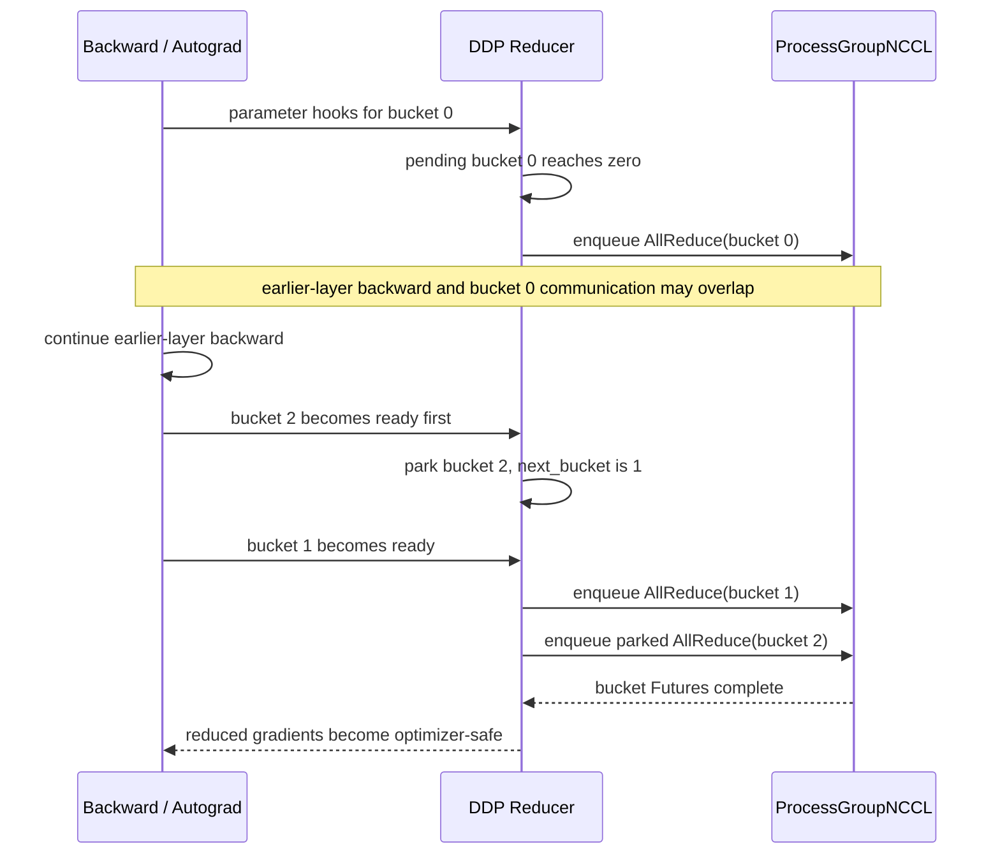

## 本章问题

“DDP在backward里做AllReduce”只描述了结果，没有解释调度机制。真正需要掌握的是：

1. Reducer如何知道某个parameter gradient已经ready？
2. parameter index、bucket index和intra-bucket index分别是什么？
3. `bucket_cap_mb`为何不是每个bucket的严格上限？
4. 第一轮为什么常只有一个大bucket，之后才按cap拆分？
5. bucket为何必须按固定序号发起，即使后面的bucket先ready？
6. 默认AllReduce如何通过Future返回Reducer？
7. `gradient_as_bucket_view`节省什么内存，又限制什么操作？
8. 多bucket在什么条件下能和剩余backward compute重叠？
9. 有重叠为何不一定明显缩短step？
10. `find_unused_parameters`与`static_graph`如何改变图遍历和rebuild？
11. backward host返回、通信完成和optimizer安全执行是什么关系？
12. 如何区分通信慢、bucket调度差、计算尾部和同步等待？

## 固定实验边界

```text
PyTorch: 2.5.0a0+872d972e41.nv24.08
CUDA: 12.6
NCCL: 2.22.3
GPU: 4 x Tesla V100-SXM2-32GB
total used parameter payload: 48 MiB per rank
```

正式运行：`ch30_ddp_reducer_overlap/20260711T190000Z`。

- [实验汇总](/assets/files/nccl-learning/logs/ch30_ddp_reducer_overlap/20260711T190000Z/summary.md)
- [运行清单](/assets/files/nccl-learning/logs/ch30_ddp_reducer_overlap/20260711T190000Z/manifest.txt)
- [320条迭代记录](/assets/files/nccl-learning/logs/ch30_ddp_reducer_overlap/20260711T190000Z/iteration_measurements.csv)
- [1960条bucket ready记录](/assets/files/nccl-learning/logs/ch30_ddp_reducer_overlap/20260711T190000Z/bucket_ready_timeline.csv)
- [DDP logging data](/assets/files/nccl-learning/logs/ch30_ddp_reducer_overlap/20260711T190000Z/ddp_logging_data.csv)
- [性能汇总](/assets/files/nccl-learning/logs/ch30_ddp_reducer_overlap/20260711T190000Z/performance_summary.csv)
- [Nsight overlap汇总](/assets/files/nccl-learning/logs/ch30_ddp_reducer_overlap/20260711T190000Z/nsys_overlap_summary.csv)
- [unused预期失败](/assets/files/nccl-learning/logs/ch30_ddp_reducer_overlap/20260711T190000Z/expected_failure.csv)
- [30项源码模型](/assets/files/nccl-learning/logs/ch30_ddp_reducer_overlap/20260711T190000Z/reducer_source_model.csv)
- [实验驱动](/assets/files/nccl-learning/scripts/54_ch30_ddp_reducer_overlap.py)
- [DDP worker](/assets/files/nccl-learning/probes/ch30_ddp_reducer_worker.py)
- [源码模型](/assets/files/nccl-learning/probes/ch30_reducer_source_model.py)

Nsight report和SQLite仅保留本机private目录。

## DDP Reducer 位于哪一层

DDP不是一种新的collective算法。它是训练框架层的梯度调度器：

```text
autograd computes parameter gradients
  -> Reducer autograd hooks
  -> flatten/copy or bucket views
  -> bucket readiness state machine
  -> ProcessGroupNCCL AllReduce
  -> Future completion
  -> unflatten/copy averaged gradients
  -> optimizer consumes gradients
```

NCCL不知道parameter、layer、optimizer或autograd graph。它只看到不同时间提交的多个
buffer AllReduce。

下面的时序图同时画出两个经常被混在一起的条件：bucket 必须 ready 才能提交；已经 ready 的
bucket 仍必须服从 Reducer 的固定序号。通信能否隐藏，则取决于提交之后是否还有足够长的
backward 计算。

<div class="diagram-scroll" markdown="1">



</div>

这是一张调度状态图，不假设所有模型都会出现“bucket 2 先于 bucket 1 ready”。它表达的恒定约束
是：ready 顺序可以由 autograd 图决定，而 collective enqueue 顺序必须在所有 rank 上一致。

## Parameter Hook 如何安装

Reducer构造时为每个leaf parameter取得`AccumulateGrad`，并安装post hook：

```cpp
for (variable_index = 0; variable_index < params_.size(); variable_index++) {
  auto& variable = params_[variable_index];
  auto grad_accumulator = impl::grad_accumulator(variable);

  hooks_.emplace_back(
    grad_accumulator->add_post_hook(
      LambdaPostHook([this, variable_index](outputs, unused) {
        this->autograd_hook(variable_index);
        return outputs;
      })));

  if (find_unused_parameters_)
    gradAccToVariableMap_[grad_accumulator.get()] = variable_index;
}
```

关键点：

- hook发生在该parameter gradient累积之后；
- `variable_index`是Reducer构造时的稳定参数索引；
- find-unused模式额外保留`AccumulateGrad* -> index`映射，供图遍历判断；
- hook调用顺序由真实backward graph决定，不保证等于parameter定义顺序。

本实验的12个独立parameter实际ready order是：

```text
11, 10, 9, 8, 7, 6, 5, 4, 3, 2, 1, 0
```

## Autograd Hook 状态机

核心逻辑可压缩为：

```cpp
void Reducer::autograd_hook(size_t index) {
  grad_ready_order_indices_.push_back(index);

  if (!has_marked_unused_parameters_) {
    for (auto unused : unused_parameters_)
      mark_variable_ready(unused);
  }

  if (should_rebuild_buckets())
    push_rebuilt_params(index); // 按真实ready顺序收集

  mark_variable_ready(index);
}
```

static graph首轮更特殊：它先统计每个hook触发次数和unused集合，后续轮次要求触发模式不变。
动态图find-unused则每轮重新遍历。

## Variable 到 Bucket

每个parameter有一个locator：

```text
variable_index
  -> bucket_index
  -> intra_bucket_index
  -> offset / length / shape in flat bucket
```

`mark_variable_ready`先把dense grad写入对应bucket view，然后递减`bucket.pending`：

```cpp
auto loc = variable_locators_[variable_index];
auto& bucket = buckets_[loc.bucket_index];

mark_variable_ready_dense(variable_index);

if (--bucket.pending == 0)
  mark_bucket_ready(loc.bucket_index);
```

一个parameter ready不等于bucket ready。只有bucket中全部parameter都ready，pending才到0。

## Bucket 必须按序发起

即使bucket 3先ready，Reducer也不能越过bucket 0：

```cpp
void Reducer::mark_bucket_ready(size_t bucket_index) {
  if (bucket_index > next_bucket_)
    return;

  for (; next_bucket_ < buckets_.size() &&
         buckets_[next_bucket_].pending == 0;
       next_bucket_++) {
    all_reduce_bucket(buckets_[next_bucket_]);
  }
}
```

这个约束保证所有rank按相同bucket sequence提交collective。否则不同rank的autograd ready
顺序略有差异，就可能在同一个NCCL communicator上发出不同collective顺序并hang。

代价是head-of-line blocking：早期bucket包含一个很晚才ready的parameter时，后面已经ready
的bucket也不能先发。rebuild正是为了让bucket顺序贴近实际ready order。

## 第一次迭代为何不同

DDP构造阶段还不知道真实backward顺序。当前实现中，`static_graph=True`或
`find_unused_parameters=False`时，初始bucket limit可以先使用`sys.maxsize`，第一轮避免
过早发出AllReduce并学习ready order。

源码注释明确说明：

```text
first iteration: no real backward ready order yet
autograd hooks: append rebuilt_param_indices_ in actual ready order
next forward: reducer._rebuild_buckets()
```

Python wrapper在forward计算增加显存峰值前调用：

```python
if torch.is_grad_enabled() and self.reducer._rebuild_buckets():
    self._has_rebuilt_buckets = True
```

rebuild先确认上一轮已完整reduction，再按ready顺序重新packing，并由rank 0同步bucket indices：

```cpp
if (!should_rebuild_buckets() || rebuilt_params_.empty())
  return false;

auto [indices, limits] = compute_bucket_assignment_by_size(
    rebuilt_params_, {first_bucket_cap_, bucket_cap_},
    expect_sparse_gradients_, rebuilt_param_indices_);

sync_bucket_indices(indices);
initialize_buckets(indices);
has_rebuilt_bucket_ = true;
```

本实验48 MiB模型初始`bucket_sizes=50331648`，rebuild后才变成1、3或12个bucket。

## `bucket_cap_mb` 不是张量切分器

packing源码对每个完整tensor累加字节：

```cpp
bucket.indices.push_back(tensor_index);
bucket.size += tensor.numel() * tensor.element_size();

if (bucket.size >= bucket_size_limit) {
  result.emplace_back(bucket.indices, bucket.size_limit);
  bucket = BucketAccumulator();
}
```

它不会把一个parameter tensor切成两半。若单parameter为8 MiB、cap为4 MiB，该bucket仍可
达到8 MiB。cap更准确的含义是“加入完整tensor后达到/超过阈值便封桶”。

### 参数粒度实验

总used parameter都固定48 MiB：

| config | parameter layout | cap | active buckets | parameters/bucket |
|---|---|---:|---:|---:|
| fine1_cap4 | 48 x 1 MiB | 4 MiB | 12 x 4 MiB | 4 |
| coarse4_cap4 | 12 x 4 MiB | 4 MiB | 12 x 4 MiB | 1 |
| coarse4_cap16 | 12 x 4 MiB | 16 MiB | 3 x 16 MiB | 4 |
| coarse4_cap64 | 12 x 4 MiB | 64 MiB | 1 x 48 MiB | 12 |

前两组bucket字节相同，但fine组需要更多autograd node、grad copy/view和parameter级处理，
step分别为8.890 ms与5.601 ms。bucket布局相同不代表框架开销相同。

## 从 Bucket 到 AllReduce Future

当bucket按序ready，Reducer构造`GradBucket`并调用hook：

```cpp
GradBucket grad_bucket(
    next_bucket_, buckets_.size(), bucket.gradients,
    offsets, lengths, sizes, variables, sparse_indices);

bucket.future_work = run_comm_hook(grad_bucket);
```

未注册用户hook时进入C++默认AllReduce hook。实验为了记录bucket index、大小和host调度顺序，
注册了等价的Python default hook：

```python
def hook(state, bucket):
    state.rows.append({
        "index": bucket.index(),
        "bytes": bucket.buffer().numel() * bucket.buffer().element_size(),
        "is_last": bucket.is_last(),
    })
    return allreduce_hook(state.group, bucket)
```

默认Python hook先除world size，再异步AllReduce：

```python
tensor.div_(group.size())
return (
    dist.all_reduce(tensor, group=group, async_op=True)
        .get_future()
        .then(lambda fut: fut.value()[0])
)
```

自定义hook必须返回`Future[Tensor]`，且负责正确的平均、压缩误差或其他算法语义。忘记除
world size是常见的silent training bug。

## Finalize Backward 与梯度可见性

所有bucket均发出后，Reducer给autograd engine注册final callback。它逐bucket等待Future，
再恢复bucket views/parameter grads：

```cpp
for (auto& bucket : buckets_) {
  bucket.future_work->wait();
  auto result = parseHookResult(bucket.future_work->value());
  populate_bucket_views_out(bucket, result);
  finalize_bucket_dense(bucket);
}
```

这里的Future是CUDA-aware的。与第29章相同，host wait可以通过stream dependency保证后续
current stream操作正确排序，而不必对整个device做host同步。

因此：

```text
loss.backward() host return
  != every NCCL kernel host-synchronized
  but optimizer on same current CUDA stream
  is ordered after finalized bucket dependencies
```

若optimizer在另一条stream运行，必须显式等待正确event/stream；不能只因为backward Python
函数返回就假设跨stream安全。

## `gradient_as_bucket_view`

本实验开启该选项。rebuild稳定后，parameter `.grad`可以直接成为flat bucket的view，避免：

```text
one standalone grad tensor
+ one communication bucket copy
```

节省的峰值接近总gradient payload，并减少copy。但它有工程约束：

- grad stride/layout必须满足bucket view contract；
- 不能对grad调用会破坏view的`detach_()`；
- 某些自定义optimizer或多重grad hook若替换grad storage会触发alias检查；
- 第一轮与rebuild前后的内存行为可能不同。

## Overlap 的必要条件

对于第$i$个bucket，理论可隐藏通信量取决于它ready后还剩多少backward compute：

$$
T_{step}\approx T_{compute}+T_{comm}-T_{overlap}+T_{framework}+T_{tail}
$$

需要同时满足：

1. bucket在backward结束前ready；
2. 它是`next_bucket_`，没有被前序bucket阻挡；
3. NCCL stream能与compute stream并发；
4. GPU/NVLink/memory资源竞争没有抵消收益；
5. 最后一个bucket的通信尾部足够短。

只有一个bucket时，它通常等所有grad ready后才启动，几乎没有backward compute可隐藏。

## 可控计算延迟实验

每个parameter branch在backward中插入10,000,000 cycles的`spin_kernel`。12个kernel形成约
78.4-78.9 ms计算span。对比同样48 MiB梯度：

| config | buckets | step GPU | backward GPU | DDP logger overlap |
|---|---:|---:|---:|---:|
| delay_cap4 | 12 | 81.122 ms | 79.613 ms | 62.946 ms |
| delay_cap64 | 1 | 81.839 ms | 80.161 ms | 0.188 ms |

12-bucket端到端只快约0.88%。原因是单机NVLink AllReduce相对78 ms计算很短，而且更多
bucket有launch/framework开销。这个结果同时说明：

- timeline可证明overlap机制成立；
- overlap存在不等于step会按overlap时长等量缩短；
- DDP logger是跨迭代/异步event统计，不能拿单个字段直接做加减法。

## Nsight 的直接证据

使用`cudaProfilerStart/Stop`只捕获rebuild后的一个测量step，排除warmup。

### 12个4 MiB bucket

每张GPU都观察到：

```text
spin kernels: 12
NCCL AllReduce kernels: 12
kernel interval overlap: > 0
```

| GPU | overlap us | compute span us |
|---:|---:|---:|
| 0 | 46505.689 | 78498.393 |
| 1 | 12269.099 | 78822.956 |
| 2 | 1228.953 | 78526.435 |
| 3 | 10479.263 | 78912.884 |

不同rank overlap量差异较大，反映collective同步、调度和竞争；不能只拿rank 0代表全局。

### 单个48 MiB bucket

每张GPU都是：

```text
spin kernels: 12
NCCL AllReduce kernels: 1
kernel interval overlap: 0
```

这是比“bucket数更多所以可能overlap”更强的执行证据。

## 无延迟时的 Bucket 开销

| config | buckets | median step GPU | P95 step GPU | backward GPU |
|---|---:|---:|---:|---:|
| coarse cap4 | 12 | 5.601 ms | 7.778 ms | 3.728 ms |
| coarse cap16 | 3 | 4.121 ms | 5.170 ms | 2.658 ms |
| coarse cap64 | 1 | 4.336 ms | 5.236 ms | 3.043 ms |

本机3个bucket最好，12个过碎，单bucket又失去部分调度灵活性。这个最优点只适用于当前
模型、GPU和单机NVLink，不能把16 MiB写成集群通用最佳值。

## Unused Parameter

### 动态查找

`find_unused_parameters=True`时，每轮从forward outputs遍历autograd graph：

```cpp
for each output.grad_fn:
  DFS/BFS all next_edges into seen

for each gradAccToVariableMap entry:
  if accumulator not in seen:
    unused_parameters_.push_back(index)
```

在第一个真实grad hook触发时，Reducer先把unused indices标ready，使其bucket pending不会
永远大于0。代价是每轮图遍历与local used map协调。

本实验dynamic unused：

```text
active buckets: 4 MiB, 16 MiB, 16 MiB, 16 MiB
has_rebuilt_buckets: 0
replicas equal: PASS
```

源码`should_rebuild_buckets()`规定dynamic find-unused不按ready order rebuild，因为不同轮
subgraph可能变化。

### Static graph

`static_graph=True`首轮学习hook触发次数和unused集合，后续不再每轮搜索，但要求模式不变。

```text
rebuilt buckets: 16 MiB, 16 MiB, 16 MiB, 4 MiB
has_rebuilt_buckets: 1
replicas equal: PASS
```

若某parameter首轮unused、下一轮突然used，static graph会报图变化错误。它是用户给出的
稳定性承诺，不是自动让任意动态图变快的开关。

### 未检测的失败

实际存在unused parameter，但`find_unused_parameters=False`且非static。下一轮forward前
`ensure_prior_reduction_finished()`发现上一轮bucket未finalize，四进程按预期失败：

```text
Expected to have finished reduction in the prior iteration
```

这不是NCCL网络hang，而是应用autograd参与集合与Reducer假设不一致。

## 三种时间不能混用

### Hook host timestamp

表示Python/C++线程何时调度到该hook。CUDA异步时，它不表示此前GPU kernel已经执行完。

### DDP logging time

由Reducer event/statistics跨迭代累计得到，适合趋势诊断；字段可能覆盖不同采样窗口，不能
假设`compute + comm - overlap == current step`精确成立。

### Nsight GPU interval

真实kernel start/end区间，是本章宣称compute/comm重叠的权威证据。

正式结论使用hook记录证明bucket顺序，使用logging data作辅助趋势，使用Nsight证明重叠。

## Optimizer 边界实验

delay cap4的正式中位数：

```text
backward host: 7.566 ms
backward GPU: 79.613 ms
optimizer host: 0.217 ms
step GPU completion: 81.122 ms
```

host很快完成CUDA排队，而GPU继续执行。optimizer在同一current stream提交，所以仍在DDP
Future建立的依赖之后，320条迭代最终四rank参数样本完全一致。

正确理解是“stream ordered”，不是“host backward已同步GPU”。为了测step时间，实验用CUDA
event并同步end event；生产训练不应每step插入device synchronize破坏overlap。

## 如何定位 DDP 性能问题

### 通信本身慢

特征：NCCL kernel长、各rank接近、bucket ready较早但通信尾部拖长。检查payload、算法、
拓扑、网络和straggler。

### Bucket 调度差

特征：很多grad早已ready，但`next_bucket_`被一个晚parameter卡住；通信集中在backward尾部。
检查ready order、bucket parameter映射、cap与rebuild。

### 计算尾部

特征：前面通信已隐藏，但最后一层/branch的backward kernel很长，GPU compute stream决定
step。减小bucket不能消除真正的compute critical path。

### 同步等待

特征：host出现`cudaDeviceSynchronize`、`.item()`、blocking wait或跨stream错误等待，
timeline出现空洞。优化stream dependency，不要盲目改NCCL参数。

### Parameter 粒度开销

相同bucket bytes下fine1比coarse4明显慢。检查autograd node数量、optimizer foreach/fused、
grad view/copy以及kernel launch数量，而不是只看AllReduce。

## 生产配置原则

1. 用真实模型ready order和timeline选择bucket cap，不照抄默认值。
2. 同时记录active/rebuilt bucket sizes和每bucket parameter count。
3. warmup后再测，第一轮layout与初始化成本不代表steady state。
4. dynamic unused只在确有动态参与集合时开启。
5. 图稳定且unused集合固定时再评估static graph。
6. comm hook必须保持Future、shape、dtype和缩放契约。
7. optimizer若换stream，显式建立DDP completion依赖。
8. overlap结论至少需要GPU timeline，不只使用host timestamp。
9. 多rank都检查，单rank高overlap不能代表collective没有straggler。
10. cap sweep同时看step、P95、kernel数、尾部和正确性。

## 常见错误

1. 把DDP称为NCCL算法。
2. 认为每个parameter ready就立即AllReduce。
3. 忽略一个bucket必须等全部member grads。
4. 允许后序bucket越过前序bucket发起。
5. 认为bucket cap会切分大parameter。
6. 用第一轮大bucket判断steady-state布局。
7. 只看bucket字节，不看parameter粒度。
8. 认为bucket越小重叠一定越好。
9. 把DDP logger overlap直接当step节省量。
10. 用hook host时间声称GPU overlap。
11. 自定义comm hook忘记除world size。
12. hook返回错误shape/dtype或非Future。
13. 把`gradient_as_bucket_view`理解成参数分片。
14. 对bucket view grad调用不兼容的`detach_`。
15. 动态unused却关闭find-unused。
16. 动态图错误地声明static graph。
17. 把unused Reducer错误归因给NCCL网络。
18. backward返回后在无依赖的另一stream更新参数。
19. 每step device synchronize后再讨论overlap。
20. 只profile rank 0并推广到全体rank。

## 版本与边界

已验证：

```text
iteration rows: 320
bucket-ready rows: 1960
correctness and replica equality: PASS
bucket layouts: 8/8 PASS
unused expected failure: 1/1 PASS
Nsight overlap cases: 8/8 PASS
source model: 30/30 PASS
```

工作负载用独立parameter branch和可控backward spin构造，适合隔离Reducer机制，但不代表
Transformer真实GEMM/attention资源竞争。本文证明调度原理和当前机器结果，不发布通用cap。

## 本章结论

1. Reducer在每个AccumulateGrad后安装带稳定variable index的post hook。
2. parameter ready后写入bucket view，全部member ready才把pending降到0。
3. bucket严格按`next_bucket_`发起，保证所有rank collective顺序一致。
4. 第一轮收集真实grad ready order，下一次forward前同步并rebuild。
5. cap按完整tensor累加，不能切分parameter，因此不是严格字节上限。
6. 相同48 MiB payload可形成1、3或12个bucket；相同bucket布局也会因参数粒度产生不同开销。
7. 每个ready bucket通过comm hook返回Future，finalize阶段消费结果并恢复grad views。
8. 12个delay bucket在四卡都与compute kernel真实重叠，单bucket四卡重叠均为0。
9. overlap成立但step只改善约0.88%，因为通信较短且小bucket有额外开销。
10. dynamic find-unused每轮图遍历且不rebuild；static首轮学习后可rebuild但要求图稳定。
11. 不检测真实unused parameter会在下一轮前触发prior reduction错误。
12. backward/optimizer依赖主要是CUDA stream语义，host返回不等于GPU完成。

## 验收题

1. Reducer hook安装在哪个autograd node上？
2. variable index与bucket locator是什么关系？
3. bucket pending何时降到0？
4. 后序bucket先ready为何不能立即AllReduce？
5. 这种顺序如何防止跨rank collective mismatch？
6. rebuild收集的参数顺序来自哪里？
7. rebuild为什么发生在后续forward之前？
8. 8 MiB parameter和4 MiB cap会产生多大的bucket？
9. fine1与coarse4为何bucket相同但step不同？
10. GradBucket包含哪些关键元数据？
11. comm hook为何必须返回Future？
12. default hook为何在AllReduce前做除法？
13. finalize backward如何把Future结果交给parameter grad？
14. gradient-as-bucket-view节省了哪份内存？
15. 多bucket实现overlap的五个必要条件是什么？
16. 本章为何同时使用hook、DDP logger和Nsight？
17. 12-bucket与单bucket的Nsight差异是什么？
18. 有overlap但step收益小可能有哪些原因？
19. dynamic find-unused为何不做ready-order rebuild？
20. static graph对unused集合做了什么承诺？
21. prior reduction错误为何不是网络故障？
22. backward host时间为何远小于backward GPU时间？
23. optimizer换到另一stream时必须增加什么？
24. 如何区分通信慢、bucket调度差、计算尾部和同步等待？
