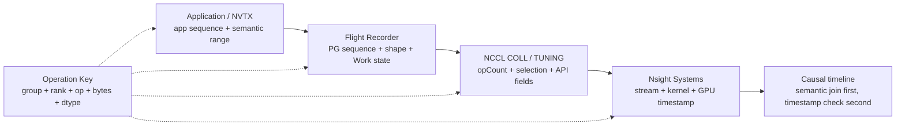

## 本章问题

一次AllReduce可以同时出现在四套观测系统里：

```text
NCCL debug: 初始化、拓扑、tuning、enqueue
NVTX:       host-side语义range
Nsight:     GPU kernel与时间线
Flight Recorder: ProcessGroup、sequence、shape、state
```

它们不是相互替代，而是回答不同问题。本章要验证：

1. `NCCL_DEBUG` level与`NCCL_DEBUG_SUBSYS` mask如何组合？
2. INIT、GRAPH、TUNING、COLL分别能证明什么？
3. 如何把application sequence、NCCL opCount、NVTX range和flight sequence对齐？
4. Flight Recorder记录的是API enqueue、GPU完成还是watchdog发现完成？
5. 为什么原始trace不应直接公开？
6. Nsight kernel名称能否单独证明algorithm/protocol？
7. profiler聚合表与逐kernel timeline有什么信息差？
8. 生产故障时应该先开哪一层证据，如何控制开销？

本章最重要的实测反例是：三种消息的Nsight kernel符号都含`RING_LL`，但同次运行NCCL
TUNING明确显示1 MiB和64 MiB选择`proto 2`。因此不能从kernel名称直接宣称运行协议。

## 版本与证据边界

```text
GPU: 2 x Tesla V100-SXM2-32GB
PyTorch: 2.5.0a0+872d972e41.nv24.08
NCCL: 2.22.3
Nsight Systems CLI: 2024.4.2
sizes: 4 KiB / 1 MiB / 64 MiB FP32 AllReduce
flight trace buffer: 128 records
```

正式运行：`ch34_observability/20260711T235500Z`。

- [实验汇总](/assets/files/nccl-learning/logs/ch34_observability/20260711T235500Z/summary.md)
- [运行清单](/assets/files/nccl-learning/logs/ch34_observability/20260711T235500Z/manifest.txt)
- [18条操作计时](/assets/files/nccl-learning/logs/ch34_observability/20260711T235500Z/measurement_summary.csv)
- [32条脱敏NCCL证据](/assets/files/nccl-learning/logs/ch34_observability/20260711T235500Z/nccl_debug_evidence.csv)
- [12条Flight Recorder摘要](/assets/files/nccl-learning/logs/ch34_observability/20260711T235500Z/flight_recorder_summary.csv)
- [6条Nsight kernel摘要](/assets/files/nccl-learning/logs/ch34_observability/20260711T235500Z/nsys_kernel_summary.csv)
- [6条NVTX投影range](/assets/files/nccl-learning/logs/ch34_observability/20260711T235500Z/nvtx_range_summary.csv)
- [32条可执行观测模型](/assets/files/nccl-learning/logs/ch34_observability/20260711T235500Z/observability_source_model.csv)
- [观测worker](/assets/files/nccl-learning/probes/ch34_observability_worker.py)
- [实验driver](/assets/files/nccl-learning/scripts/58_ch34_observability.py)

原始NCCL日志含hostname、PID、pointer、stream和comm地址；flight pickle可含stack；Nsight报告含
进程与时间线元数据。它们保留在本机`raw/`、`private/`，公开文件只保留截断、脱敏摘要。

## 用同一个 Operation Key 对齐证据

worker先为三种size各warmup一次，再测量一次。测量操作使用稳定NVTX名称：

```python
for seq, (nbytes, tensor) in enumerate(zip(SIZES, tensors)):
    name = f"ch34_seq{seq}_bytes{nbytes}_allreduce"
    torch.cuda.nvtx.range_push(name)

    start.record()
    dist.all_reduce(tensor)
    end.record()
    end.synchronize()

    torch.cuda.nvtx.range_pop()
```

于是主键至少包含：

```text
Process Group
rank
application sequence
operation
input shape / bytes / dtype
```

只按timestamp join不够可靠：不同日志使用wall clock、monotonic、CUDA timestamp或相对trace
时间。先用sequence+shape做语义join，再用时间验证顺序。

四类证据各自有独立序号和时钟。Operation Key 的作用不是强行令这些编号相等，而是提供一个
稳定的语义连接点：

<div class="diagram-scroll diagram-scroll--wide" markdown="1">



</div>

虚线表示关联字段，不表示时间先后。尤其不要直接断言 application sequence、ProcessGroup
sequence 与 NCCL `opCount` 数值相同；warmup、内部 collective 和不同 communicator 都会让它们
产生偏移。

## NCCL Debug Level 与 Subsystem

源码`debug.h`中TRACE宏只在相应build启用时展开：

```cpp
#define TRACE(FLAGS, ...) \
  ncclDebugLog(NCCL_LOG_TRACE, FLAGS, __func__, __LINE__, __VA_ARGS__)
```

level决定最低详细程度：

| level | 主要用途 |
|---|---|
| VERSION | 版本 |
| WARN | 异常和fallback警告 |
| INFO | 初始化、选择、collective摘要 |
| TRACE | 高频细节，开销和日志量最大 |

subsystem决定主题。NCCL 2.22.3解析的常用mask包括：

```text
INIT / COLL / P2P / SHM / NET / GRAPH / TUNING / ENV
```

level与subsystem是两个轴：`NCCL_DEBUG=INFO`不会因为指定`COLL`自动变TRACE；指定TRACE但mask
不含NET，也不应期待完整NET progress。

## INIT 与 GRAPH 证明什么

本章`NCCL_DEBUG=INFO NCCL_DEBUG_SUBSYS=INIT,GRAPH`提取到两rank各4条Ring连接：

```text
rank0: Ring 00..03 : 1 -> 0 -> 1
rank1: Ring 00..03 : 0 -> 1 -> 0
```

这能证明communicator初始化后构造了4条ring channel及其prev/next。它不能证明每个operation
实际都使用全部4条channel，也不能证明运行时protocol。

INIT/GRAPH适合回答：

```text
rank/device/bus ID映射
channel graph
transport connector
topology fallback
communicator init完成与否
```

## TUNING 是选择证据

本章`NCCL_DEBUG=INFO NCCL_DEBUG_SUBSYS=TUNING`实际输出：

| bytes | Algo | proto | model time us |
|---:|---:|---:|---:|
| 4,096 | 1 | 0 | 8.0048 |
| 1,048,576 | 1 | 2 | 41.4144 |
| 67,108,864 | 1 | 2 | 1692.9215 |

在固定版本枚举中，本次`Algo 1`对应Ring，`proto 0`对应LL，`proto 2`对应Simple。解释枚举必须
绑定源码版本，不能把日志数字脱离版本永久编码。

这类行证明的是tuner选择结果与其估算时间，不是GPU实测duration。表中的8.0048 us不能拿来
替代CUDA event或Nsight kernel time。

## COLL 证明 API 参数与 OpCount

当前NCCL构建在COLL路径输出：

```text
AllReduce: opCount 3 count 1024 datatype 7 op 0 nranks=2
AllReduce: opCount 4 count 262144 datatype 7 op 0 nranks=2
AllReduce: opCount 5 count 16777216 datatype 7 op 0 nranks=2
```

原始行还有send/recv buffer、comm和stream pointer，公开摘要已替换为`<ptr>`。

FP32每元素4字节，所以count与size一致：

```text
1024       * 4 = 4 KiB
262144     * 4 = 1 MiB
16777216   * 4 = 64 MiB
```

opCount 0..2属于warmup，3..5属于测量。它是NCCL communicator域内的序号，不等于PyTorch
Flight Recorder的collective sequence，也不等于应用的0..2标签。

## Flight Recorder 如何导出

设置：

```bash
TORCH_NCCL_TRACE_BUFFER_SIZE=128
```

实验完成后直接调用本机PyTorch绑定：

```python
trace = torch._C._distributed_c10d._dump_nccl_trace(
    True,   # includeCollectives
    False,  # includeStackTraces
    False,  # onlyActive
)
decoded = pickle.loads(trace)
```

这是实验环境可用的内部API，不应作为稳定应用接口。生产也可配置
`TORCH_NCCL_DEBUG_INFO_PIPE_FILE`，向每rank FIFO写入数据，由heartbeat monitor异步触发dump。

对应源码：

```cpp
if (dumpPipe.has_value() && dumpPipe->shouldDump()) {
  std::future<bool> fut = std::async(
      std::launch::async,
      [this]() { return this->dumpDebuggingInfo(); });
}
```

dump会调用`NCCLTraceBuffer::dump()`，再由`DebugInfoWriter`以binary写入rank文件。重复dump会
覆盖默认目标，调用方需要先保存旧文件。

## Flight Recorder 记录了什么

本章两个rank各6条AllReduce记录：3次warmup+3次测量。关键字段：

```text
record_id
process_group = ('0', 'default_pg')
collective_seq_id = 1..6
profiling_name = nccl:all_reduce
input_sizes / output_sizes
input_dtypes / output_dtypes
state = completed
time_created_ns
time_discovered_completed_ns
timeout_ms
```

例如64 MiB对应shape不是字节，而是元素数：

```text
input_sizes = [[16777216]]
dtype = Float
bytes = 16777216 * 4
```

公开CSV中的`duration_ms`用`time_discovered_completed - time_created`计算。它包括watchdog发现
完成的轮询延迟，不等于GPU kernel duration。首条warmup约34 ms，而实际4 KiB kernel只有几十
微秒，正好证明两者不能混用。

Flight Recorder最适合回答：

```text
哪个PG、哪个sequence、什么shape进入了ProcessGroupNCCL
Work处于scheduled/started/completed哪种状态
last completed与active work如何关联
超时前最近一段collective历史是什么
```

## NVTX 与 Nsight 投影

Nsight的`nvtx_gpu_proj_trace`把host NVTX range投影到其中GPU operation的start/duration。本章得到
每rank三条range，恰好覆盖每个AllReduce kernel：

| range | GPU ops/rank | payload |
|---|---:|---:|
| ch34_seq0_bytes4096_allreduce | 1 | 4 KiB |
| ch34_seq1_bytes1048576_allreduce | 1 | 1 MiB |
| ch34_seq2_bytes67108864_allreduce | 1 | 64 MiB |

NVTX提供业务语义和层级，CUDA trace提供实际device执行。没有NVTX时，一串同名NCCL kernel很难
映射回layer/bucket/microbatch；只有NVTX而无GPU trace，又不能证明kernel何时执行。

## Kernel 名称误导的实测反例

三种size、两个device，共6个kernel。名字完全相同：

```text
ncclDevKernel_AllReduce_Sum_f32_RING_LL(
  ncclDevKernelArgsStorage<(unsigned long)4096>
)
```

但同一组NCCL TUNING证据是：

```text
4 KiB:  Algo 1 proto 0
1 MiB:  Algo 1 proto 2
64 MiB: Algo 1 proto 2
```

如果只看符号字符串，会把三者全部报告成LL，直接与runtime tuning冲突。该kernel是运行时work
dispatch的编译载体，其symbol suffix不能在本版本替代plan中的protocol字段。

这条反例也说明：

```text
kernel name不能证明实际channel count
kernel name不能证明P2P/SHM/NET transport
kernel name不能证明tuner候选比较
demangle格式可能随build/version变化
```

可靠报告应写：

```text
TUNING log证明选择Algo 1/proto 2；
COLL log证明opCount/count/dtype；
Nsight证明该时间窗执行了一个AllReduce device kernel；
INIT/GRAPH证明communicator graph；
而不是“kernel名字里有LL，所以使用LL”。
```

## 实测时间与统计边界

三种debug配置各运行一次、每次两rank，共18条测量：

| bytes | median CUDA event |
|---:|---:|
| 4 KiB | 168.6 us |
| 1 MiB | 226.0 us |
| 64 MiB | 1967.9 us |

精确值以公开`summary.md`为准；这些样本混合INFO/TRACE日志开销且每配置只有一次，不是性能基线。
本章验收对象是证据内容和关联，不用它比较debug level slowdown。

Nsight捕获的64 MiB kernel约1.87-1.88 ms，与CUDA event量级一致；flight completion discovery约
2 ms以上，语义仍不同。

## 四类证据的能力矩阵

| 问题 | NCCL debug | NVTX | Nsight GPU | Flight Recorder |
|---|---:|---:|---:|---:|
| 业务layer/bucket | 弱 | 强 | 需关联 | profiling name有限 |
| PG与sequence | opCount域 | 可编码 | 无 | 强 |
| shape/dtype | COLL | 可编码 | kernel常含dtype | 强 |
| algo/proto选择 | TUNING强 | 无 | symbol不可靠 | 无 |
| channel graph | INIT/GRAPH | 无 | grid只见执行规模 | 无 |
| kernel duration | 无，model time非实测 | 投影 | 强 | discovery time非kernel |
| Work状态/超时历史 | 无 | 无 | active kernel有限 | 强 |
| transport | INIT/NET/P2P/SHM | 无 | 通常不足 | 无 |

没有任何单一工具能完整证明端到端路径。

## 生产观测分级

### 常驻低开销

```text
版本、拓扑fingerprint、配置hash
每PG rank映射
step/bucket P50/P95/P99
错误与timeout计数
有限Flight Recorder ring buffer
```

### 异常时提升

```text
NCCL_DEBUG=INFO
按症状选择INIT/GRAPH/TUNING/NET/COLL
触发flight dump
保存首错rank与相邻rank日志
```

### 短时重现

```text
NCCL_DEBUG=TRACE指定subsystem
Nsight CUDA+NVTX窗口
必要的OSRT/proxy线程
NIC和switch counters
```

不要全量长期TRACE：日志量、格式化开销、敏感信息和磁盘风险都显著。

## Debug Subsystem 选择

| 症状 | 首选subsystem |
|---|---|
| init hang | INIT,BOOTSTRAP,ENV |
| 拓扑/通道异常 | GRAPH,INIT |
| algo/proto回归 | TUNING,ENV |
| op参数/顺序 | COLL + framework sequence |
| P2P/SHM fallback | P2P,SHM,INIT |
| 跨节点连接/进度 | NET,PROXY,INIT |
| plugin/offload | TUNING,GRAPH,NET |

先缩小问题再加subsystem，比无条件`NCCL_DEBUG=TRACE NCCL_DEBUG_SUBSYS=ALL`更容易提取因果。

## 数据治理

原始证据可能包含：

```text
hostname / PID / rank
filesystem path
IP / interface / PCI bus ID
buffer、comm、stream pointer
环境变量与plugin路径
Python/C++ stack
模型shape与业务NVTX名
```

本章发布策略：

```text
raw NCCL log: private
flight pickle: private
nsys-rep/sqlite: private
COLL pointer: <ptr>
公开CSV: 只保留必要字段和截断证据
```

“开源训练脚本”不等于“原始生产trace可公开”。

## 常见错误

1. 只开`NCCL_DEBUG=INFO`却不记录subsystem。
2. 把TUNING model time当GPU实测time。
3. 把NCCL opCount等同PyTorch collective sequence。
4. 只按timestamp join跨工具证据。
5. 用Flight completion discovery time当kernel duration。
6. 只保存active Work，丢失超时前历史。
7. trace buffer太小导致关键记录被ring覆盖。
8. 重复dump前不保存旧文件。
9. 只看Nsight kernel sum，不看逐kernel timeline。
10. 没有NVTX就猜kernel属于哪个layer。
11. 把kernel symbol中的`RING_LL`当runtime protocol事实。
12. 用kernel grid直接声称NCCL channel count。
13. 从NCCL kernel名推断P2P/SHM/NET transport。
14. 不绑定NCCL版本解释Algo/proto数字。
15. 长期全量TRACE导致性能与磁盘问题。
16. 直接公开pointer、hostname、stack和Nsight SQLite。

## 本章结论

1. NCCL level控制详细度，subsystem mask控制主题，两者是正交配置。
2. INIT/GRAPH实测构造4条两rank Ring channel，但不证明每op使用情况。
3. TUNING实测4 KiB选择proto0，1/64 MiB选择proto2。
4. COLL opCount 0..2是warmup，3..5是测量，count与FP32字节精确对应。
5. Flight Recorder每rank记录6条AR，包含PG、sequence、shape、state和发现时间。
6. Flight discovery duration不是GPU kernel duration。
7. NVTX 6条range与Nsight 6个kernel按rank/shape一一对应。
8. 三种size kernel名全部含`RING_LL`，与大消息TUNING proto2冲突。
9. 因此protocol必须以runtime tuning/plan证据为准，kernel名字只能作为执行线索。
10. 18条测量、32条debug证据、12条flight、6+6条Nsight/NVTX、32条源码模型全部通过。
11. 原始debug、pickle和profile保持私有，公开摘要已脱敏。

## 验收题

1. level与subsystem分别控制什么？
2. INIT、GRAPH、TUNING、COLL各回答什么问题？
3. 为什么先用sequence+shape join，再用timestamp验证？
4. NCCL opCount与PyTorch collective sequence为何不同？
5. tuner model time为何不是kernel duration？
6. 4 KiB/1 MiB/64 MiB分别选择了什么proto数字？
7. COLL count如何换算成字节？
8. Flight Recorder的ring buffer意味着什么？
9. `onlyActive`与完整历史dump适用场景有何差别？
10. pipe触发dump为何在heartbeat monitor中处理？
11. 默认writer重复dump有什么覆盖风险？
12. Flight state和time字段能证明什么？
13. discovery duration为什么明显大于小消息kernel时间？
14. NVTX projected range是什么？
15. 本章kernel名字与TUNING发生了什么冲突？
16. 为什么kernel symbol不能证明protocol/channel/transport？
17. 生产常驻、异常提升、短时重现应分别开什么？
18. init hang与性能回归应选择哪些subsystem？
19. 原始trace包含哪些敏感字段？
20. 本章哪些文件公开，哪些保持私有？
