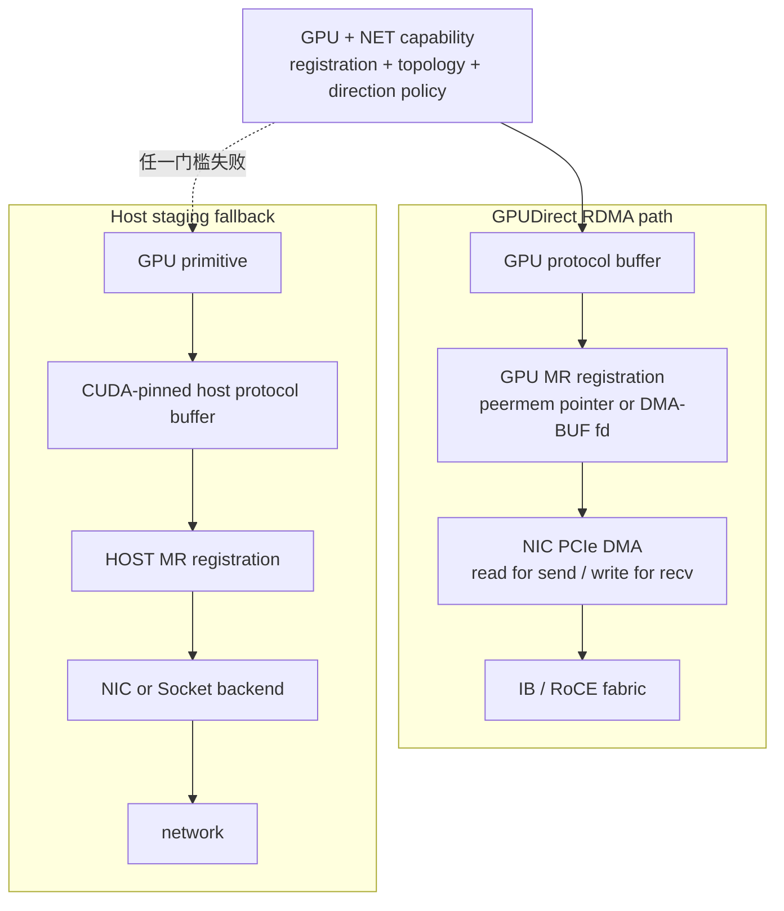

## 本章问题

第25章的RDMA Write仍假设HCA已经得到GPU buffer的remote/local key。本章补上这段：

```text
CUDA allocation
  -> GPU/NIC capability gate
  -> topology distance gate
  -> peermem or DMA-BUF memory registration
  -> lkey/rkey
  -> NIC DMA GPU memory
  -> receive visibility flush
```

本章回答：

1. GPU支持GPUDirect RDMA为什么仍不等于端到端GDR可用？
2. `nvidia-peermem` 与 DMA-BUF 两条注册路径有何差别？
3. GDRCopy与GPUDirect RDMA是否是同一技术？
4. `NCCL_NET_GDR_LEVEL/READ` 在哪些capability之后才生效？
5. send GDR read与recv GDR write为何有不同默认策略？
6. host bounce时protocol buffer位于哪里，数据如何移动？
7. `ncclCommRegister` cache与IB backend MR cache为何是两层？
8. page alignment、containment hit、refcount和deregister如何工作？
9. DMA-BUF fd如何进入 `ibv_reg_dmabuf_mr`？
10. receive完成后为何可能还需flush？
11. ACS/IOMMU/BAR1各自能破坏或限制什么？
12. 如何用能力、拓扑、日志、注册和性能共同证明GDRDMA？

## 可证伪假设

```text
H1: 四张V100可报告cuda GPUDirect RDMA attr=1，但只要HCA/peermem/
    DMA-BUF链不完整，connector仍不得出现/GDRDMA。
H2: NET_GDR_LEVEL=SYS、NET_GDR_READ=1或DMABUF_ENABLE=1都不能越过
    backend ptrSupport与GPU DMA-BUF capability gate。
H3: Socket backend上的ncclCommRegister可以返回cache handle，但实际network
    registration设备数必须为0；API success不能证明MR已创建。
H4: exact与contained registration必须复用handle/refcount；disjoint必须新建；
    stale deregister必须返回invalid usage。
H5: LOCAL_REGISTER=0时register成功但handle保持NULL。
H6: MR范围按page向下/向上取整，peermem与DMA-BUF选择由fd分支决定。
```

## 环境与正式证据

```text
GPU: 4 x V100-SXM2-32GB, CUDA GDR attr 4/4 = 1
CUDA DMA-BUF attr: 0/4
NIC sysfs/module: mlx4_0 + mlx4_ib present
/dev/infiniband: absent
nvidia-peermem / memory_peers: absent
libgdrapi: present; /dev/gdrdrv: absent
NCCL: 2.22.3 / source 178b6b7
negative-control performance: 140 rows, correctness PASS
registration timing: 60 rows
connector path: 14/14 no GDRDMA, Socket PASS
source model: 30/30 PASS
end-to-end GDRDMA: HARDWARE_BLOCKED
```

正式运行：`ch26_gdr_registration/20260711T163000Z`。

- [实验汇总](/assets/files/nccl-learning/logs/ch26_gdr_registration/20260711T163000Z/summary.md)
- [运行清单](/assets/files/nccl-learning/logs/ch26_gdr_registration/20260711T163000Z/manifest.txt)
- [分层能力清单](/assets/files/nccl-learning/logs/ch26_gdr_registration/20260711T163000Z/capability_inventory.csv)
- [60 条注册计时](/assets/files/nccl-learning/logs/ch26_gdr_registration/20260711T163000Z/registration_timings.csv)
- [注册统计](/assets/files/nccl-learning/logs/ch26_gdr_registration/20260711T163000Z/registration_summary.csv)
- [140 条负对照性能记录](/assets/files/nccl-learning/logs/ch26_gdr_registration/20260711T163000Z/negative_control_measurements.csv)
- [负对照路径](/assets/files/nccl-learning/logs/ch26_gdr_registration/20260711T163000Z/negative_control_paths.csv)
- [负对照统计](/assets/files/nccl-learning/logs/ch26_gdr_registration/20260711T163000Z/negative_control_summary.csv)
- [GDR/MR源码模型](/assets/files/nccl-learning/logs/ch26_gdr_registration/20260711T163000Z/gdr_mr_source_model.csv)
- [实验驱动](/assets/files/nccl-learning/scripts/50_ch26_gdr_registration.py)
- [原生注册probe](/assets/files/nccl-learning/probes/ch26_gdr_registration.cc)
- [源码模型](/assets/files/nccl-learning/probes/ch26_gdr_mr_model.py)

本机没有可打开的verbs device，因此不发布GDR带宽；但GPU capability、NCCL API、
fallback与源码状态机均由真实实验验证。

## 先区分三个名称

### GPUDirect RDMA

NIC以PCIe peer DMA直接读写GPU memory，verbs MR对应GPU VA，payload无需经过host staging。
这是本章的GDRDMA。

### DMA-BUF registration

CUDA导出GPU allocation的DMA-BUF fd，verbs provider通过 `ibv_reg_dmabuf_mr` 注册。
它是建立GDR MR的一种机制，不是另一种数据路径。

### GDRCopy

`libgdrapi`/`gdrdrv`把少量GPU memory映射给CPU，用于快速写head/tail/FIFO或执行PCIe
read flush。它优化控制字访问，不是NIC bulk RDMA。机器有 `libgdrapi.so` 但没有
`/dev/gdrdrv`，所以“库存在”也不表示GDRCopy可用。

## 端到端 GDR 的能力与选择链

NCCL最终使用GDR至少需要：

```text
GPU gdrSupport
AND net backend gdrSupport
AND registration mechanism (peermem CUDA pointer OR DMA-BUF)
AND topology distance <= configured level
AND send-read policy permits (send direction only)
AND connector/setup/registration succeeds
```

任何一项为0，设置更宽的distance level都不能强行打开。

<div class="diagram-scroll" markdown="1">



</div>

DMA-BUF 与 peermem 是建立 GPU MR 的两种注册机制，不是两条不同 bulk path；GDRCopy 主要优化控制字。当前机器只能验证门控与 fallback，图中的 GDR data path 仍需真实 HCA 环境补实验。

### GPU capability

新CUDA路径直接查询：

```cpp
cudaDeviceGetAttribute(&attr,
  cudaDevAttrGPUDirectRDMASupported, cudaDev);
```

四张V100均返回1。这只证明GPU/driver宣称可参与GDR，不证明当前HCA、kernel module、
container device和PCIe path可用。

### Network capability

topology XML中的NET节点按plugin properties计算：

```cpp
bool gdrSupport =
  (props.ptrSupport & NCCL_PTR_CUDA) ||
  (comm->dmaBufSupport && (props.ptrSupport & NCCL_PTR_DMABUF));
```

Socket仅支持HOST pointer，所以日志为：

```text
NET/Socket : GPU Direct RDMA Disabled for HCA 0 'eth0'
```

这里的“HCA”是统一NET node用语，eth0并未因此变成RDMA HCA。

### DMA-BUF capability

communicator初始化同时要求：

```cpp
NCCL_DMABUF_ENABLE != 0
net->regMrDmaBuf != NULL
CUDA driver >= 11.7
CU_DEVICE_ATTRIBUTE_DMA_BUF_SUPPORTED == 1
```

本机四张GPU该attribute均为0，所以即使设置 `NCCL_DMABUF_ENABLE=1` 也无法通过。
IB backend还会用fd=-1试调用verbs，依据 `EOPNOTSUPP/EPROTONOSUPPORT` 检测kernel/provider。

### peermem capability

2.22.3 internal IB backend检查：

```cpp
access("/sys/kernel/mm/memory_peers/nv_mem/version", F_OK)
access("/sys/kernel/mm/memory_peers/nv_mem_nc/version", F_OK)
```

两个路径均不存在，`nvidia_peermem` module也不在容器视图。注意新版driver/module
布局可能变化，生产上还应通过实际GPU pointer `ibv_reg_mr` 验证，而非永远依赖路径名。

## Topology Gate

`graph/paths.cc::ncclTopoCheckGdr` 先检查GPU/NET capability，再检查方向和距离：

```cpp
if (net->net.gdrSupport == 0) return;
if (gpu->gpu.gdrSupport == 0) return;

if (read) {
  if (NCCL_NET_GDR_READ == 0) return;
  if (auto && cc < 80 && no_nvlink_peer) return;
}

int level = PATH_PXB; // default
if (user_set) level = NCCL_NET_GDR_LEVEL;
if (distance > level) return;
*useGdr = 1;
```

默认只允许PXB或更近。send方向意味着NIC从GPU读，pre-Ampere在存在其他PCIe flows时
更谨慎；本机V100是cc70，但四卡互有NVLink，所以该特殊条件本身可能允许auto read。
它仍然过不了NET capability。

`nvidia-smi topo -m` 显示GPU到NIC为`NODE`。这是NVML展示名称，不等于NCCL内部
`PATH_PXB`枚举，不能直接用字符串比较；应以NCCL topology XML/GRAPH和enabled日志为证。

PXN时，distance不是原GPU到NIC，而是intermediate GPU到NIC。第27章会进一步展开。

## Send GDR Read 与 Recv GDR Write

send setup：

```cpp
ncclTopoCheckGdr(topo, gpuBusId, netId, /*read=*/1, &useGdr);
send->conn.flags |= useGdr ? NCCL_DIRECT_NIC : 0;
```

recv setup：

```cpp
ncclTopoCheckGdr(topo, gpuBusId, netId, /*read=*/0, &useGdr);
if (useGdr) ncclTopoNeedFlush(topo, gpuBusId, &needFlush);
```

NIC read GPU和NIC write GPU的性能/ordering不同，不能用一个开关推断双向。日志应分别
检查send/receive connector是否带 `/GDRDMA`。

## GDR 与 Host Bounce 的 Buffer Map

NET connector为每个protocol构造map bank：

```text
HOSTMEM              pinned host staging
DEVMEM               dedicated GPU protocol buffer
SHARED_HOSTMEM       channel共享host buffer
SHARED_DEVMEM        channel共享GPU buffer
GDCMEM               GDRCopy映射的sync/flush control word
```

`useGdr=1`时protocol buffer进入device memory，IB注册CUDA pointer，NIC直接DMA。
`useGdr=0`时buffer位于CUDA-pinned host memory，GPU primitive通过PCIe访问host protocol
buffer，Socket/IB注册HOST pointer。这就是host bounce/staging。

它不一定出现独立CUDA memcpy kernel：GPU primitive本身可load/store mapped host buffer，
CPU proxy和NIC再消费。判定bounce要看map bank、ptr type、registration和connector，
不能只搜timeline里的Memcpy。

## peermem 与 DMA-BUF 注册分支

connector connect阶段：

```cpp
int type = DEV_MEM ? NCCL_PTR_CUDA : NCCL_PTR_HOST;
if (type == NCCL_PTR_CUDA && resources->useDmaBuf) {
  cuMemGetHandleForAddressRange(&fd, gpuBuff, size,
                                CU_MEM_RANGE_HANDLE_TYPE_DMA_BUF_FD, 0);
  net->regMrDmaBuf(comm, gpuBuff, size, type, 0, fd, &mhandle);
  close(fd);
} else {
  net->regMr(comm, buff, size, type, &mhandle);
}
```

peermem路径的fd=-1，最终可用 `ibv_reg_mr`/`ibv_reg_mr_iova2`；DMA-BUF路径持有有效fd，
调用 `ibv_reg_dmabuf_mr`。fd在注册完成后可关闭，MR持有底层映射生命周期。

每个merged NIC subdevice都要产生一个MR，wrapper保存多个lkey/rkey。multi-rail/merged
device不能只注册第一张NIC。

## IB Backend MR Cache

`ncclIbRegMrDmaBufInternal` 先按系统page扩展范围：

```cpp
addr = (uintptr_t)data & -pageSize;
pages = (data + size - addr + pageSize-1) / pageSize;
```

模型边界：

| pointer/size | aligned base | pages |
|---|---:|---:|
| 0x1003 / 1 B | 0x1000 | 1 |
| 0x1003 / 4096 B | 0x1000 | 2 |
| 0x2000 / 8192 B | 0x2000 | 2 |
| 0x2fff / 2 B | 0x2000 | 2 |

cache按address查找。已有MR完整包含新范围时复用并 `refs++`；部分重叠不算命中，必须
新注册。capacity从0首次扩到32，之后32→64→128。

注册flags包含LOCAL_WRITE、REMOTE_WRITE、REMOTE_READ；支持时附加
`IBV_ACCESS_RELAXED_ORDERING`。RO可能提高PCIe效率，但需要平台和ordering语义支持，
不是不加验证的通用开关。

`deregMr`递减refs；归零才调用verbs dereg。mhandle不在cache中返回internal error，
防止stale key被继续使用。

## Communicator User Registration Cache

`ncclCommRegister` 是更上层的显式API：

```cpp
addr = page_floor(data);
pages = page_cover(data,size);

if (existing fully contains range) {
  existing->refs++;
  *handle = existing;
} else {
  insert sorted record;
  ncclNetRegister(comm, aligned_addr, pages*pageSize, record);
  *handle = record;
}
```

它还可服务NVLS/CollNet registration。与IB backend MR cache不同：

```text
comm regCache: 用户API范围、communicator生命周期、可关联多个NET device
IB mrCache:    每个HCA device的verbs MR、lkey/rkey、backend生命周期
```

上层record可能保存每个device的backend mhandle；二者不能当成一个cache。

## 真实 ncclCommRegister 语义实验

在8 MiB GPU allocation上：

```text
register [0,2MiB)       -> h1
register [0,2MiB)       -> h2 == h1
register [4KiB,1MiB+)   -> hsub == h1
register [4MiB,6MiB)    -> hdis != h1
```

结果：exact same、contained same、disjoint distinct和nonnull全部通过。前三次共享record，
refs=3；连续deregister三次后record删除，再用stale handle返回 `ncclInvalidUsage`。

但INFO同时写明：

```text
Register ptr ... size 2097152 on 0 net devices
```

Socket properties `regIsGlobal=0`，`ncclNetRegister`不对任何NET device调用CUDA
`regMr`。所以handle是NCCL registration cache record，不是verbs MR。

这正是本章最重要的反例：

```text
ncclCommRegister == ncclSuccess
AND handle != NULL
DOES NOT IMPLY NIC has lkey/rkey for this GPU memory
```

## LOCAL_REGISTER=0

源码入口直接返回：

```cpp
if (!ncclParamLocalRegister()) return ncclSuccess;
```

不会写handle。probe把handle初始化NULL，观察 `result=success, handle_null=1`。调用方不能在
禁用registration后无条件deregister NULL；API配置和handle生命周期必须匹配。

## Registration 计时为何大小无关

Socket backend结果：

| bytes | median register | median deregister | actual net registrations |
|---:|---:|---:|---:|
| 4 KiB | 28.597 us | 0.547 us | 0 |
| 1 MiB | 30.640 us | 0.348 us | 0 |
| 64 MiB | 30.413 us | 0.554 us | 0 |

register几乎不随size变化，正因为只创建cache metadata并打印日志，没有pin pages、导出fd
或创建verbs MR。这些数字不能用于估算真实HCA registration cost。

真实GDR环境应分别测cold register、cache hit、contained hit、deregister和不同page count；
还要记录BAR1/pinned memory与MR数量限制。

## 参数负对照

七组配置正序/逆序：

```text
baseline
NET_GDR_LEVEL=LOC / SYS
NET_GDR_READ=0 / 1
DMABUF_ENABLE=0 / 1
```

14/14均满足：

```text
GPU Direct RDMA Disabled for HCA 0 'eth0'
connector via NET/Socket
no /GDRDMA suffix
correctness PASS
```

64 MiB中位数：

| config | time | busbw |
|---|---:|---:|
| baseline | 46.848 ms | 2.15 GB/s |
| level LOC | 47.186 ms | 2.13 GB/s |
| level SYS | 46.929 ms | 2.145 GB/s |
| read 0 | 47.052 ms | 2.14 GB/s |
| read 1 | 46.897 ms | 2.145 GB/s |
| DMA-BUF 0 | 47.535 ms | 2.12 GB/s |
| DMA-BUF 1 | 46.957 ms | 2.145 GB/s |

全部最终是同一Socket host path，参数不能创造capability。小幅差异是运行噪声，不可解释
成“SYS GDR更快”或“DMA-BUF已生效”。

## Receive Visibility 与 Flush

NIC报告CQ completion后，GPU是否立刻看到写入取决于架构/coherency。NCCL对GDR recv：

```cpp
needFlush = (gpuCompCap < 90) ? 1 : NCCL_NET_FORCE_FLUSH;
```

V100属于pre-Hopper，真实GDR receive会要求flush。IB backend可在GPU buffer上执行一个
signaled RDMA Read，迫使先前writes可见；GDRCopy可通过CPU PCIe read control path。

flush request完成前不能发布GPU tail。跳过flush可能产生“CQ成功但GPU读旧数据”的
correctness错误，不只是性能变化。

## BAR1、ACS 与 IOMMU

### BAR1

本机V100显示32 GiB BAR1，但BAR1容量不是GDR可用证明。registration机制、HCA peer
access和PCIe routing仍需成立；不同driver可按页映射而非要求整个buffer常驻BAR1。

### ACS

PCIe switch/root port的ACS redirect可能把peer traffic上送root complex，破坏或降低
GPU-NIC P2P。要用 `lspci -vv` 检查相关bridge的ACSCtl，并结合实际path/counters；
不能只看GPU-NIC NUMA相同。

### IOMMU

IOMMU translation/strict模式、VFIO和虚拟化会改变peer DMA可达性。本机cmdline未显式
出现iommu参数且iommu_groups计数为0，但这只能描述当前namespace视图，不能证明宿主
ACS/IOMMU完全旁路。容器内证据不足时需在宿主核验。

## 取得HCA后的必跑矩阵

| 维度 | 取值 |
|---|---|
| path | host bounce / peermem / DMA-BUF |
| direction | NIC read GPU / NIC write GPU |
| distance | PIX/PXB/PHB/SYS，近/远NUMA |
| GDR level | LOC/PIX/PXB/PHB/SYS |
| read | auto/0/1 |
| message | 4K到1G |
| registration | cold/hit/contained/disjoint |
| buffer | NCCL internal / ncclCommRegister user buffer |
| IOMMU/ACS | approved on/off/path variants |
| flush | default/forced，仅支持平台 |

每项必须收集：connector `/GDRDMA`、topology distance、ptr type、reg API、lkey/rkey trace
（脱敏）、NIC/GPU PCIe counters、correctness、median/P95/CV。性能变快但没有路径证据，
不能判定GDR；日志有GDR但NIC bytes不增长，也不能判定payload真的走了HCA。

## 生产判定清单

```text
1. CUDA GPU attr支持GDR。
2. HCA verbs device可打开、port active。
3. backend ptrSupport含CUDA或DMA-BUF。
4. peermem实际GPU regMr成功，或GPU/provider双方DMA-BUF支持。
5. NCCL topology GPU/HCA capability均为1。
6. distance满足NET_GDR_LEVEL；PXN按intermediate GPU复算。
7. send/recv connector分别出现/GDRDMA。
8. registration trace确认CUDA pointer而非HOST staging。
9. NIC bytes与GPU PCIe流量同operation增长。
10. GDR on/off性能和CPU/memory copy差异符合预期。
```

## 常见错误

1. 把GPU GDR attr=1当端到端通过。
2. 把sysfs HCA或mlx module存在当verbs device可用。
3. 把libgdrapi存在当GDRCopy可用。
4. 把GDRCopy当bulk GPUDirect RDMA。
5. 设置GDR level=SYS后不检查backend capability。
6. 把send GDR read开关套到recv方向。
7. 用NVML `NODE`直接当NCCL `PATH_PXB`。
8. `ncclCommRegister`成功就声称产生了MR。
9. 混淆comm registration cache与HCA MR cache。
10. partial overlap错误复用已有MR。
11. 忽略page alignment导致注册范围/资源估算错误。
12. deregister handle次数与register refs不匹配。
13. CQ completion后跳过必要flush。
14. 看到大BAR1就忽略ACS/IOMMU。
15. 用Socket负对照性能宣称GDR参数收益。

## 版本与边界

已验证NCCL 2.22.3、V100 CUDA capability、DMA-BUF attribute、container module/device视图、
真实 `ncclCommRegister` cache、LOCAL_REGISTER、Socket负对照和30项源码模型。
未创建任何HCA MR/lkey/rkey，未执行NIC DMA GPU memory、真实flush、ACS/IOMMU A/B或
GDR性能，因此端到端保持 `HARDWARE_BLOCKED`。

## 本章结论

1. GDR需要GPU、NET backend、注册机制、拓扑、方向策略和connector全链通过。
2. 四张V100的GDR attr均为1，但DMA-BUF attr均为0。
3. 当前容器有mlx4 sysfs/module，却无verbs字符设备、peermem与DMA-BUF路径。
4. GDRCopy只优化CPU访问GPU控制字，不等于NIC bulk GDRDMA。
5. 默认distance阈值PXB；send read对pre-Ampere还有NVLink/显式开关条件。
6. peermem走CUDA pointer regMr，DMA-BUF走fd + regMrDmaBuf。
7. host bounce使用pinned host protocol buffer，不要求独立memcpy kernel。
8. IB MR按page覆盖范围、containment和refs缓存，capacity按32倍增。
9. comm user cache与IB backend MR cache是不同层。
10. exact/contained handle复用、disjoint独立、stale deregister失败均实测通过。
11. Socket下registration handle非空但实际NET注册数为0。
12. 七组GDR参数14/14仍为Socket且无/GDRDMA，参数不能创造能力。
13. pre-Hopper GDR recv需要visibility flush后才能通知GPU。
14. 端到端证明必须组合能力、拓扑、connector、MR、counter和性能。

## 验收题

1. GPUDirect RDMA、DMA-BUF与GDRCopy分别解决什么？
2. 列出GDR启用的六个AND gate。
3. GPU attr=1为什么不够？
4. backend ptrSupport如何组合CUDA与DMA-BUF？
5. DMABUF_ENABLE=1为何不能覆盖GPU attr=0？
6. pre-Ampere send read的auto条件是什么？
7. PXN为何要改用intermediate GPU距离？
8. host bounce buffer由谁写、谁读？
9. peermem和DMA-BUF分别调用哪个verbs API？
10. fd关闭后MR为何仍可存在？
11. 0x1003/4096B为何覆盖2页？
12. exact、contained、partial overlap分别如何命中cache？
13. comm cache与IB MR cache各保存什么？
14. `regIsGlobal=0` 对ncclNetRegister有什么影响？
15. API success+nonnull handle为什么不能证明lkey/rkey存在？
16. V100 GDR recv为何需要flush？
17. BAR1、ACS、IOMMU分别检查什么？
18. 为什么NET_GDR_LEVEL=SYS的Socket性能不是GDR实验？
19. 最少需要哪些日志和counter证明payload走GDR？
20. 当前硬件边界下哪些结论已验证，哪些仍被阻塞？
