## 本章问题

一台机器有多张NIC、多port和多GPU时，“NCCL用了IB”远远不够。还要知道：

```text
哪个GPU -> 哪个NIC device/port -> 哪条rail -> 对端哪个NIC
是否经另一个GPU作PXN relay
是否把多个port merge成一个logical net device
```

本章回答：

1. NIC、port、ASIC、merged device和rail分别是什么？
2. `NCCL_IB_HCA` 的前缀、精确、排除和port语法如何匹配？
3. `IB_MERGE_NICS` 为什么不是普通multi-rail？
4. graph中的入口/出口NET endpoint如何表达rail？
5. `CROSS_NIC=0/1/2` 分别约束什么？
6. 为什么rail-optimized网络通常希望不同节点使用相同rail？
7. P2P NET没有collective graph时如何选择本地NIC？
8. PXN为何让GPU通过NVLink连接的另一GPU访问其近端NIC？
9. `P2P_PXN_LEVEL=0/1/2` 有何区别？
10. PXN为何只用于send方向、要求GDR且受plugin ABI约束？
11. 如何识别单rail、错绑NUMA、非对称拓扑和远程proxy？
12. 当前单NIC机器能验证什么，不能验证什么？

## 可证伪假设

```text
H1: 当前只有一个NET/Socket device时，CROSS_NIC=0/1/2不得改变connector，
    所有channel仍为NET/Socket/0。
H2: PXN_DISABLE和P2P_PXN_LEVEL=0/1/2在无第二NIC/remote proxy时不得
    产生dev(proxyRank)日志。
H3: HCA过滤参数可被解析并记录，但无verbs device时匹配数必须为0，最终回退Socket。
H4: 非exact前缀mlx5_1会同时匹配mlx5_1与mlx5_10；`=`必须消除碰撞。
H5: Cross-NIC mode2必须先尝试same-rail，仅无解时再允许cross-rail。
H6: PXN level2必须同时满足relay-NIC<=PXB、relay-source<=NVL、同节点和
    relay path更优；破坏任一条件都不得选择relay。
```

## 环境与正式证据

```text
NVML NIC count: 1, mlx4_0
verbs device count: 0
active NCCL data NET devices: 1, Socket/0 eth0
GPU->NIC NVML distance: NODE for all four V100
negative-control measurements: 180, correctness PASS
single-NIC connector paths: 18/18 PASS
HCA filter runtime: 3/3 PASS
multi-NIC/PXN source model: 39/39 PASS
multi-NIC rail performance: HARDWARE_BLOCKED
```

正式运行：`ch27_multinic_pxn/20260711T170000Z`。

- [实验汇总](/assets/files/nccl-learning/logs/ch27_multinic_pxn/20260711T170000Z/summary.md)
- [运行清单](/assets/files/nccl-learning/logs/ch27_multinic_pxn/20260711T170000Z/manifest.txt)
- [硬件清单](/assets/files/nccl-learning/logs/ch27_multinic_pxn/20260711T170000Z/hardware_inventory.csv)
- [180 条负对照记录](/assets/files/nccl-learning/logs/ch27_multinic_pxn/20260711T170000Z/negative_control_measurements.csv)
- [18 组connector路径](/assets/files/nccl-learning/logs/ch27_multinic_pxn/20260711T170000Z/negative_control_paths.csv)
- [负对照统计](/assets/files/nccl-learning/logs/ch27_multinic_pxn/20260711T170000Z/negative_control_summary.csv)
- [HCA filter runtime](/assets/files/nccl-learning/logs/ch27_multinic_pxn/20260711T170000Z/hca_filter_runtime.csv)
- [Multi-NIC/PXN源码模型](/assets/files/nccl-learning/logs/ch27_multinic_pxn/20260711T170000Z/multinic_pxn_source_model.csv)
- [实验驱动](/assets/files/nccl-learning/scripts/51_ch27_multinic_pxn.py)
- [源码模型](/assets/files/nccl-learning/probes/ch27_multinic_pxn_model.py)

真实multi-rail、PXN和吞吐需要至少双HCA/port并可打开verbs；本章不把Socket单设备
结果冒充multi-NIC性能。

## 五个容易混淆的对象

### Physical NIC/HCA

一块PCIe HCA，可能有一个或多个physical ports。

### NCCL IB device

internal backend枚举的active `(device,port)`，每个具有link layer、speed、PCI path、GUID。

### Merged net device

若多个ports属于同PCI path、GUID和link layer，NCCL可将最多两个合并为一个logical
device，speed求和。一个merged device内部可用多个QP/device。

### Rail

跨节点保持同一NIC index/fabric plane的纵向路径。例如node A NIC0到node B NIC0是rail0。
rail不是NCCL对象字段，而是部署拓扑与graph endpoint组合出来的工程概念。

### Cross-NIC

一条channel从节点的NIC A进入、从NIC B离开，或跨节点端点不能保持同一ASIC/port。
它控制graph可否使用不同NET endpoint，不表示“开启后一定平均使用所有NIC”。

## HCA Filter 语法

源码先处理两个leading modifier：

```cpp
bool searchNot = env && env[0] == '^';
if (searchNot) env++;
bool searchExact = env && env[0] == '=';
if (searchExact) env++;
parseStringList(env, userIfs, MAX_IB_DEVS);
```

每项是 `prefix[:port]`，逗号分隔。匹配条件：

```cpp
nameMatch = exact ? strcmp(device, ref)==0
                  : starts_with(device, ref);
portMatch = filterPort==-1 || devicePort==-1 || filterPort==devicePort;
selected = nameMatch && portMatch;
if (leading ^) selected = !selected;
```

固定设备集 `mlx5_0:1, mlx5_0:2, mlx5_1:1, mlx5_10:1` 的模型结果：

| filter | selected | 说明 |
|---|---|---|
| empty | 4 | 不过滤 |
| `mlx5_1` | 2 | prefix同时命中mlx5_1/10 |
| `=mlx5_1` | 1 | exact消除碰撞 |
| `=mlx5_0:1` | 1 | 精确port |
| `=mlx5_0:1,mlx5_0:2` | 2 | 多项并集 |
| `^mlx5_1` | 2 | 排除两个prefix命中 |
| `^=mlx5_1` | 3 | 只排除exact device |
| `^=mlx5_0:2` | 3 | 只排除一个port |

生产中优先使用 `=`，否则 `mlx5_1` 与 `mlx5_10` 是经典误选。HCA名字/port编号应从
目标节点动态清单生成，不能照搬另一代机器。

## Runtime HCA Filter 反例

本机运行：

```text
NCCL_IB_HCA=mlx4
NCCL_IB_HCA==mlx4_0:1
NCCL_IB_HCA=^=mlx4_0:2
```

3/3均在INFO中原样记录变量，但verbs device count为0，最终connector全部
`via NET/Socket/0`。参数被接受不等于HCA被匹配，更不等于payload经过该HCA。

## Port Merging

discovery对每个active port建立 `ncclIbDev`。`IB_MERGE_NICS=1` 时只合并：

```cpp
same pciPath
AND same sys_image_guid
AND same link layer
AND merged ndevs < 2
```

成功后：

```cpp
merged.devs[ndevs++] = ibDev;
merged.name += "+" + devName;
merged.speed += portSpeed;
```

模型验证同path/GUID/IB的两个100G ports合并为logical 200G；任一path、GUID或link不同
就不合并。若系统同时出现单port与双portlogical device，源码会强制关闭merge并重新
build list，避免不同logical device拥有不一致的subdevice数量。

port merging与multi-rail不同：merge把同物理NIC/ASIC的ports包装为一个net device；
multi-rail通常是多个独立NIC/fabric plane在graph channels间分配。

## Graph 中 NET Endpoint 的表达

每个channel保存：

```text
graph.inter[2*c+0] = entry NET id
graph.inter[2*c+1] = exit NET id
graph.intra[c*ngpus ...] = 本节点GPU顺序
```

Ring可理解为：

```text
NET entry -> GPU a -> GPU b -> ... -> GPU x -> NET exit
```

Tree的上下行对称约束更强；Balanced/Split Tree可允许特定cross-NIC搜索。只有一个NET
node时entry/exit只能都是0，所有Cross-NIC模式自然退化为同一路径。

## Cross-NIC 三态

`NCCL_CROSS_NIC` 默认2：

```text
0: 不允许cross-NIC，入口与出口必须同ASIC/port，保持rail
1: 强制graph按允许cross-NIC初始化搜索
2: auto，先same-NIC；找不到足够好/可行graph时再尝试cross-NIC
```

源码初始化：

```cpp
int crossNic = netCount>1 && supportedPattern ? NCCL_CROSS_NIC : 0;
graph->crossNic = crossNic==1 ? 1 : 0;
```

auto mode2不是“一开始随机跨NIC”。搜索第一轮仍为0，只有无解/不够好时：

```cpp
if (crossNic == 2 && tmpGraph.crossNic == 0) {
  tmpGraph.crossNic = 1;
  goto search;
}
```

mode0回到NET时要求 `asic/port` 与startNet相同；用logical id判断会错误，因为同一
ASIC/port可能在拓扑中有多个等价NET节点表示。

## Rail-Optimized 为什么偏好 Cross-NIC=0

fat-tree或rail-optimized部署常将每个node的NIC0接rail0、NIC1接rail1。Ring channel若
在每个node保持相同rail，可避免跨leaf/spine、降低拥塞并保持路径对称。

但非对称节点可能缺失NIC/port、GPU-NIC亲和性相反，strict mode0可能减少channels或
找不到高带宽graph。mode2允许先保持rail，再以cross-NIC换取可行性；mode1适用于明确
知道fabric不要求rail symmetry的环境。选择必须看graph和rail counters，而非经验值。

## Channel 配对与带宽记账

graph search从可达NET列表轮转起点，并从NET bandwidth扣除每channel `bwInter`。
相同ASIC/port的所有NET节点一起扣减，防止把一个物理端口重复计带宽。

cross-NIC时奇偶channel对endpoint有配对约束，使相邻channels交换/复用前一channel的
入口出口，保持总体流量平衡。最终要检查每个channel的`inter[]`，不能只看
`crossNic=1`一行。

## Collective Graph 与 P2P NET 选择不同

有collective graph时，`ncclTopoGetNetDev`直接honor graph endpoint：

```cpp
channel = channelId % graph->nChannels;
index = graph->intra[channel*ngpus] == rank ? 0 : 1;
netId = graph->inter[channel*2 + index];
```

没有graph的P2P NET先选当前rank/channel的local NIC，再考虑remote peer在本节点镜像
rank所偏好的NIC，以及PXN。不能用collective Ring graph推断所有Send/Recv选卡。

## PXN 是什么

PXN路径：

```text
source GPU --NVLink--> relay GPU --PCIe--> relay近端NIC --network--> remote
```

适用于source GPU到目标NIC需要PHB/SYS，而同node另一GPU通过PIX/PXB接近NIC且与source
有NVLink。它用额外NVLink hop换取更好的GPU-NIC PCIe路径，并可把多个source聚合到
较少NIC/proxy connections。

它不是PXB拼写错误；NCCL path enum专门保留 `PATH_PXN`，其path list包含intermediate GPU。

```mermaid
flowchart TB
  subgraph RAIL["same-rail channel"]
    AG0["node A GPU"] --> AN0["NIC 0"]
    AN0 --> BN0["rail 0 fabric → node B NIC 0"]
    BN0 --> BG0["node B GPU"]
  end
  subgraph CROSS["cross-NIC channel"]
    AG1["node A GPU"] --> AN1["NIC 0 entry"]
    AN1 --> BN1["fabric → node B NIC 1 exit"]
    BN1 --> BG1["node B GPU"]
  end
  subgraph PXN["PXN send path"]
    SRC["source GPU"] -->|"NVLink"| RELAY["relay GPU<br/>near target NIC"]
    RELAY -->|"PCIe"| RNIC["relay-side NIC"]
    RNIC --> REMOTE["network → remote"]
  end
```

<div class="diagram-scroll diagram-scroll--xwide" markdown="1">



</div>

Same-rail、cross-NIC 和 PXN 是三个不同维度：前两者描述跨节点 NET endpoint 配对，PXN 描述源节点内部先经中继 GPU 接近 NIC。PXN 还依赖 GDR/device buffer，不能只凭 path enum 认定最终连接成功。

## PXN Path 构造条件

对每个GPU/NIC，源码寻找NIC的local GPU作为relay：

```cpp
relay->NIC path <= PATH_PXB
relay->source path <= PATH_NVL
relay/source system id相同
AND (relay bandwidth更高 OR source direct path > PATH_PXB)
```

满足后 `addInterStep` 组合NVLink与PCI path，类型强制PATH_PXN，带宽取两段最小值。

模型反例逐项破坏NVLink、relay距离、same-system和better-path条件，均不得选择relay。

## P2P_PXN_LEVEL

```text
0: 禁止P2P PXN
1: 需要时使用remote preferred NIC；source到它的path必须<=PXN
2: 尽可能聚合；找目标NIC最近GPU，若NVL+PXB条件成立就用其proxy rank
```

默认2偏向connection aggregation。level1更保守，level2可能即使source已有本地NIC也
选择relay，以匹配remote peer偏好和聚合network connections。

`NCCL_PXN_DISABLE=1`把effective level变0。net plugin v4也被强制disable，因为旧ABI的
blocking connect/accept无法安全使用remote proxy，可能产生连接死锁。

## PXN 方向与 GDR 限制

paths源码只在GPU→NIC方向插入PXN，注释明确“favor receiving locally and sending
remotely”。`net.cc` recv setup写明不支持receive remote proxy。

send connector若用了relay，日志格式：

```text
via NET/IB/dev(proxyRank)/GDRDMA
```

`sharedNetBuffersInit`还明确拒绝remote proxy使用host buffer：

```cpp
if (cuda == 0 && sameProcess == 0)
  WARN("PXN should not use host buffers for data");
```

所以可用PXN还需要GDR/device shared buffer。`ncclTopoGetPxnRanks`只保留
`ncclTopoCheckGdr(..., read=1)`通过的proxy rank。看到PATH_PXN候选不等于最终连接成功。

## 单 NIC 参数负对照

九组参数正序/逆序：

```text
baseline
CROSS_NIC=0/1/2
PXN_DISABLE=1
P2P_PXN_LEVEL=0/1/2
IB_MERGE_NICS=0
```

每组2个size、10个sample，共180条，correctness全通过。18次运行每次观测16条
`via NET/Socket/0` connector、0条remote proxy、cross-NIC/PXN observed均为0。

64 MiB：

| config | median time | busbw |
|---|---:|---:|
| baseline | 47.092 ms | 2.14 GB/s |
| cross 0 | 47.158 ms | 2.13 GB/s |
| cross 1 | 47.011 ms | 2.14 GB/s |
| cross 2 | 46.962 ms | 2.14 GB/s |
| PXN disabled | 46.986 ms | 2.14 GB/s |
| PXN level 0 | 47.202 ms | 2.13 GB/s |
| PXN level 1 | 47.510 ms | 2.12 GB/s |
| PXN level 2 | 47.393 ms | 2.12 GB/s |
| merge off | 47.483 ms | 2.12 GB/s |

范围仅约1.2%，所有路径相同。这是参数未生效的负对照，不可把最小中位数解释为
Cross-NIC或PXN收益。4 KiB从374到464 us波动更大，更不能据此排名。

## 双 NIC Source Fixture 结论

39项模型覆盖：

```text
HCA prefix/exact/exclude/port: 10
Cross-NIC mode/search/pattern: 9
PXN level/candidate/direction: 11
port merging/speed/mixed layout: 9
```

39/39通过。它验证固定2.22.3分支和边界，不声称真实NIC、switch或traffic存在。

## 真实双 NIC 必跑矩阵

| 维度 | 取值 |
|---|---|
| HCA | exact NIC0/NIC1/both、port过滤、exclude |
| merge | 0/1，single/dual-port组合 |
| Cross-NIC | 0/1/2 |
| PXN | disable、level0/1/2 |
| GDR | on/off、near/far GPU |
| topology | symmetric/asymmetric、缺rail、跨NUMA |
| workload | AR/AG/RS/P2P，4K到1G |
| scale | 2/4/8 nodes，1/4/8 ranks per node |

证据必须包含graph `inter[]`、每connector dev/proxy/GDR、每port xmit/recv bytes、PCIe/NVLink
counters、correctness、median/P95/CV。双NIC总带宽翻倍但一张port counter为0，是单rail
或计数错误；总带宽不变且两rail都有流量，可能是GPU/PCIe/algorithm瓶颈。

## 非对称拓扑排障

### 单 rail

graph channels都选择同一NET id，另一NIC counters为0。检查HCA filter、port active、
topology path/bw、channel count和rail wiring。

### 错绑 NUMA

GPU选择远端PHB/SYS NIC，CPU proxy也运行在另一NUMA。检查GPU-NIC path、proxy TID mask、
PCIe read/write和memory locality，而不只看NIC link speed。

### Cross-NIC 退化

entry/exit跨rail导致额外fabric hop或热点。比较mode0/2 graph与switch port counters，确认
mode2为何fallback，不要直接永久禁止导致graph无解。

### PXN 退化

NVLink relay流量与NIC增加但总性能下降，可能relay GPU争SM/memory/NVLink、GDR read慢或
聚合过度。比较level1/2、direct近端GPU和application计算占用。

## 生产配置原则

1. HCA过滤使用exact device/port，并审计每节点结果。
2. rail命名和接线在集群层保持对称，不能只依赖NCCL自动猜测。
3. 先用Cross-NIC=0验证same-rail基线，再用2处理非对称，1需明确理由。
4. PXN必须同时证明remote proxy、GDR和NVLink relay counters。
5. IB merge只用于符合same path/GUID/link的ports，观察logical speed与QP资源。
6. 参数变更同时保存graph/path/per-port性能，不能只保存aggregate busbw。

## 常见错误

1. 把port、NIC、merged device和rail当同一对象。
2. 用prefix `mlx5_1`误选mlx5_10。
3. HCA环境变量被打印就声称匹配成功。
4. 把IB_MERGE_NICS当跨独立NIC load balancing。
5. 认为Cross-NIC=1必然使用两张NIC。
6. 认为mode2从第一轮就允许cross-NIC。
7. 只看crossNic字段，不看每channel inter endpoints。
8. 用collective graph推断所有P2P Send/Recv NIC。
9. 把PXN理解成CPU proxy NUMA转发。
10. 忽略PXN只支持send remote proxy。
11. 没有GDR却强制PXN host buffer。
12. plugin v4仍期待PXN。
13. 单NIC环境调Cross-NIC后用噪声声称收益。
14. 只看aggregate NIC bytes，不看每port/rail。
15. 非对称节点套用同一静态HCA ordinal。

## 版本与边界

已验证NCCL 2.22.3的单NET参数负对照、HCA变量runtime、39项HCA/Cross-NIC/PXN/merge
源码模型。未执行双HCA verbs、真实rail、PXN relay、per-port counter或多节点性能，
这些保持 `HARDWARE_BLOCKED`。

## 本章结论

1. HCA filter支持prefix/exact/exclude/port；生产应优先exact避免名称碰撞。
2. merge只合并same path/GUID/link的最多两个ports并聚合speed。
3. graph每channel用inter[2c]/inter[2c+1]表达入口/出口NET endpoint。
4. Cross-NIC 0保持同ASIC/port，1强制允许，2先same后fallback。
5. rail-optimized部署通常以mode0维持对称，非对称时mode2更稳健。
6. collective graph和P2P无graph的NIC选择逻辑不同。
7. PXN是source GPU经NVLink relay GPU访问其近端NIC的GPU→NIC路径。
8. PXN level0禁用、level1按需、level2偏聚合；global disable/plugin v4可强制关闭。
9. PXN send remote proxy要求GDR shared device buffer，recv不支持remote proxy。
10. 本机9配置180条记录全部保持Socket/0，无Cross-NIC/PXN路径。
11. 39项source fixture全部通过，但不替代双NIC硬件性能。
12. 专家诊断必须对齐graph、connector、proxy、GDR和per-rail counters。

## 验收题

1. physical HCA、IB dev、merged dev和rail有何区别？
2. `mlx5_1`为何会命中mlx5_10，如何避免？
3. `^=mlx5_0:2`的精确含义是什么？
4. 三个条件中哪些决定port可以merge？
5. mixed single/dual-port为何强制关闭merge？
6. `inter[2c]`与`inter[2c+1]`分别是什么？
7. Cross-NIC mode0比较为何用ASIC/port而非仅NET id？
8. mode2的搜索顺序是什么？
9. 哪些graph pattern允许cross-NIC初始化？
10. rail-optimized网络为何偏好same rail？
11. P2P无graph时最初选择哪张NIC？
12. PXN由哪两段物理路径组成？
13. level1与level2选relay的条件有何区别？
14. plugin v4为何禁用remote proxy？
15. PXN为何要求GDR，host shared buffer为何被拒绝？
16. 哪种connector日志能证明remote proxy rank？
17. 为什么receive方向没有PXN remote proxy？
18. 单NIC参数性能差异为什么只能作为负对照？
19. 如何用per-port counters识别单rail？
20. 当前环境还缺哪些证据才能声称multi-rail/PXN已验证？
