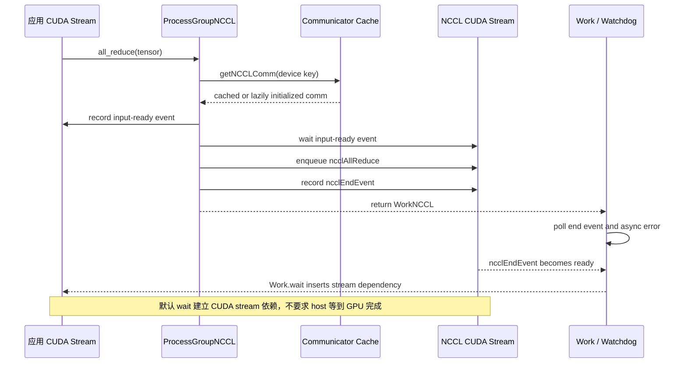

## 本章问题

训练代码调用的是：

```python
work = torch.distributed.all_reduce(tensor, async_op=True)
```

NCCL C API却需要`ncclComm_t`、CUDA stream、pointer、count、datatype和reduction op。
中间的ProcessGroupNCCL必须解决：

1. Python API如何进入`ncclAllReduce`？
2. Process Group与NCCL communicator是一对一吗？
3. communicator为何在第一次collective时才出现？
4. 相同rank集合创建两个group会不会共用communicator？
5. communicator cache的key是什么？P2P为何不同？
6. application stream和NCCL stream如何建立前后依赖？
7. tensor交给另一stream后，caching allocator如何保证生命周期？
8. `async_op=False`是否等价于`cudaDeviceSynchronize`？
9. `Work.wait()`为什么通常只花几微秒？
10. `TORCH_NCCL_BLOCKING_WAIT=1`究竟改变什么？
11. `Future.done()`、`Work.is_completed()`与GPU完成是否相同？
12. watchdog如何在主线程不等待时检查错误和timeout？

第3章已经证明CUDA异步完成边界；本章从固定PyTorch源码解释后端对象如何实现这些语义。

## 固定版本与证据边界

```text
PyTorch runtime: 2.5.0a0+872d972e41.nv24.08
CUDA runtime: 12.6
NCCL runtime: 2.22.3
GPU: 4 x Tesla V100-SXM2-32GB
ProcessGroupNCCL.cpp SHA256:
c9b1a13c309d3a085908a332157b0a5cb7a8c68c0ade6e78cd0b62da2bb854b3
```

容器中的`/opt/pytorch/pytorch`保留了完整源码快照，但其`.git`指向未挂载的submodule
metadata，所以不能伪造一个git commit。本文用runtime版本和源码文件SHA256固定边界。

正式运行：`ch29_process_group_nccl/20260711T183000Z`。

- [实验汇总](/assets/files/nccl-learning/logs/ch29_process_group_nccl/20260711T183000Z/summary.md)
- [运行清单](/assets/files/nccl-learning/logs/ch29_process_group_nccl/20260711T183000Z/manifest.txt)
- [communicator cache明细](/assets/files/nccl-learning/logs/ch29_process_group_nccl/20260711T183000Z/communicator_cache_runtime.csv)
- [communicator cache汇总](/assets/files/nccl-learning/logs/ch29_process_group_nccl/20260711T183000Z/communicator_cache_summary.csv)
- [160条Work语义记录](/assets/files/nccl-learning/logs/ch29_process_group_nccl/20260711T183000Z/work_semantics_measurements.csv)
- [Work语义统计](/assets/files/nccl-learning/logs/ch29_process_group_nccl/20260711T183000Z/work_semantics_summary.csv)
- [Nsight stream汇总](/assets/files/nccl-learning/logs/ch29_process_group_nccl/20260711T183000Z/nsys_stream_summary.csv)
- [Nsight CUDA API汇总](/assets/files/nccl-learning/logs/ch29_process_group_nccl/20260711T183000Z/nsys_cuda_api_summary.csv)
- [24项源码模型](/assets/files/nccl-learning/logs/ch29_process_group_nccl/20260711T183000Z/pgnccl_source_model.csv)
- [实验驱动](/assets/files/nccl-learning/scripts/53_ch29_process_group_nccl.py)
- [cache worker](/assets/files/nccl-learning/probes/ch29_pg_cache_worker.py)
- [Work worker](/assets/files/nccl-learning/probes/ch29_work_semantics_worker.py)
- [源码模型](/assets/files/nccl-learning/probes/ch29_pgnccl_source_model.py)

`.nsys-rep`与SQLite只保存在本机private目录，不公开。

## 从 Python 到 NCCL C API

Python wrapper的核心不是自己做通信：

```python
# torch/distributed/distributed_c10d.py，简化
opts = AllreduceOptions()
opts.reduceOp = op
opts.asyncOp = async_op
work = group.allreduce([tensor], opts)

if async_op:
    return work
else:
    work.wait()
    return None
```

进入C++后，`ProcessGroupNCCL::allreduce`把tensor交给通用`collective`模板，并构造
NCCL参数：

```cpp
return collective(
  tensor, tensor,
  [&](Tensor& input, Tensor& output,
      ncclComm_t comm, CUDAStream& stream) {
    auto dtype = getNcclDataType(input.scalar_type());
    auto redop = getNcclReduceOp(opts.reduceOp, input, dtype, comm);
    return ncclAllReduce(
      input.data_ptr(), output.data_ptr(), input.numel(),
      dtype, redop, comm, stream.stream());
  },
  OpType::ALLREDUCE,
  "nccl:all_reduce");
```

完整调用链：

```text
dist.all_reduce
  -> Python ProcessGroup API
  -> ProcessGroupNCCL::allreduce
  -> collective(input, output, lambda)
  -> getNCCLComm(device key)
  -> syncStream(application -> ncclStream)
  -> ncclAllReduce(..., ncclComm, ncclStream)
  -> record ncclEndEvent on ncclStream
  -> WorkNCCL
  -> optional Work.wait()
```

`async_op=False`只是wrapper自动调用`Work.wait()`。它不是把NCCL API换成同步版本。

把 host 调用、两个 CUDA stream 和 Work 状态放到同一条时间线上，才能看清“API 返回”和
“GPU 完成”为何不是一个边界：

<div class="diagram-scroll" markdown="1">



</div>

图中的两个 event 分别保护输入可见性和输出完成性；它们不是 CPU barrier。只有 blocking wait、
显式 stream/device synchronize 或后续读取结果，才会把 host 或消费者推进到更强的完成边界。

## 三层对象不要混淆

### Process Group

c10d中的rank域与collective顺序域。group内每个进程都有自己的ProcessGroupNCCL实例。

### NCCL communicator

具体device集合上的`ncclComm_t`。它有独立unique ID、NCCL rank/size、channels和错误状态。

### WorkNCCL

一次已提交操作的句柄，持有comm引用、end event、序号、timeout、输入输出规模和异常。

关系不是简单的一对一：

```text
one ProcessGroupNCCL
  -> cache key "0"       -> one collective ncclComm
  -> cache key "1:3"     -> one single-P2P ncclComm
  -> another device key  -> another ncclComm

one ncclComm
  -> Work seq 1
  -> Work seq 2
  -> Work seq 3 ...
```

不同ProcessGroupNCCL各自有cache，即使成员集合完全相同也不自动共享。

## Communicator Cache

### Cache字段

源码注释和字段直接说明所有权：

```cpp
uint64_t ncclCommCounter_{0};

// collective key通常是device sequence，例如"0"或"0,1"
// single P2P key通常是排序后的rank pair，例如"1:3"
std::unordered_map<std::string, std::shared_ptr<NCCLComm>>
    devNCCLCommMap_;

std::unordered_map<std::string, std::shared_ptr<NCCLComm>>
    inInitializationCommMap_;
```

当前推荐部署是一进程一GPU，所以collective key通常只是local device ordinal。
旧式一进程多GPU时device sequence的顺序也属于key，`0,1`与`1,0`并不相同。

### Lookup先于创建

```cpp
std::shared_ptr<NCCLComm> getNCCLComm(deviceKey, device, opType, ...) {
  usedDeviceIdxs_.insert(device.index());
  {
    std::lock_guard<std::mutex> lock(mutex_);
    if (devNCCLCommMap_.find(deviceKey) != devNCCLCommMap_.end())
      return devNCCLCommMap_[deviceKey]; // 后续operation直接复用
  }

  // cache miss后才产生unique ID并初始化
  ncclUniqueId ncclID;
  ...
}
```

这就是lazy init：`init_process_group`和`new_group`创建后端对象，但通常不立即创建GPU
communicator。第一次使用某个key时才进入cache miss路径。

### Unique ID如何通过Store分发

collective communicator使用递增序号作为store key：

```cpp
if (!isSingleP2POp)
  storeKey = std::to_string(ncclCommCounter_++);
else
  storeKey = p2pKey;

if (rank_ == 0)
  store_->set(storeKey, bytes(ncclID));
else
  bytes = store_->get(storeKey);
```

single P2P只涉及两个rank，不能递增整个group所有rank的collective counter，否则后续
collective会在不同rank取不同store key。因此P2P使用pair key。

### 创建stream并写入cache

```cpp
ncclComm = NCCLComm::create(numRanks, rank, ncclID, options_->config);

bool forceHigh = getCvarBool(TORCH_NCCL_HIGH_PRIORITY, false);
auto stream = at::cuda::getStreamFromPool(
    options_->is_high_priority_stream || forceHigh);

inInitializationCommMap_.emplace(deviceKey, ncclComm);
// 初始化完成后再移动到devNCCLCommMap_
```

高优先级选项改变的是NCCL CUDA stream池选择，不会使group共用comm，也不保证通信
一定更快；它只改变GPU调度优先级候选。

## Cache 实验

四个rank依次创建并使用：

```text
WORLD group
same-membership standard group
same-membership high-priority group
```

每个group连续执行3次AllReduce。运行时用C++日志统计
`ProcessGroupNCCL created ncclComm_`，结果：

| group | high priority | rank operations | comm creations | reused after first |
|---|---:|---:|---:|---:|
| world | 0 | 12 | 4 | 1 |
| standard clone | 0 | 12 | 4 | 1 |
| high-priority clone | 1 | 12 | 4 | 1 |

三组乘四个rank，共12次comm创建。36次操作全部正确，后续cycle没有新增comm。

结论不是“相同rank集合复用一个comm”，而是：

```text
cache scope = one ProcessGroupNCCL instance
cache key   = device sequence or P2P pair
reuse scope = repeated operations inside that PG and key
```

这也解释了为什么滥建process group会增加NCCL comm、stream、连接与watchdog管理成本。

## 两个方向的 Stream 依赖

ProcessGroupNCCL使用专用NCCL stream，但tensor通常由application current stream产生。
必须建立双向依赖：

```text
producer/current stream
  -- input-ready event --> NCCL stream
  -- ncclEndEvent      --> consumer/current stream
```

### Application 到 NCCL

```cpp
void syncStream(Device& device, CUDAEvent& event, CUDAStream& ncclStream) {
  event.record(getCurrentCUDAStream(device.index())); // 输入生产完成点
  event.block(ncclStream);                             // 通信流等待输入
}
```

调用`ncclAllReduce`前，`collective`先执行这个`syncStream`。如果application stream前面
有50 ms kernel，NCCL不能越过它读取尚未完成的tensor。

### NCCL 到 Consumer

提交NCCL后，在同一通信流记录end event：

```cpp
work->ncclEndEvent_->record(ncclStream);
```

`Work.wait()`的基础动作是让调用它时的current stream等待此event：

```cpp
void WorkNCCL::synchronizeStream() {
  auto current = getCurrentCUDAStream(device_.index());
  ncclEndEvent_->block(current);
}
```

这是一条GPU stream dependency，不天然阻塞CPU。

### Allocator Safety不是数据依赖

input storage跨stream使用时，caching allocator必须知道它仍被NCCL stream引用：

```cpp
CUDACachingAllocator::recordStream(
    input.storage().data_ptr(), ncclStream);
```

另一种`TORCH_NCCL_AVOID_RECORD_STREAMS`模式会让Work暂存tensor引用。两者解决的是“内存
不能过早被allocator复用”，不是“另一stream不能并发写这个tensor”。应用仍必须建立
读写顺序，allocator lifetime protection不能修复data race。

## WorkNCCL 的完成状态

### 构造时只有event包装器

```cpp
WorkNCCL::WorkNCCL(...)
  : device_(device), workStartTime_(steady_clock::now()), seq_(seq) {
  ncclEndEvent_ = std::make_shared<CUDAEvent>(cudaEventDisableTiming);
}
```

event实际CUDA对象是首次record时lazy创建。`workStartTime_`用于watchdog timeout，不是
GPU kernel start timestamp。

### `is_completed`查询GPU event

```cpp
bool WorkNCCL::isCompleted() {
  if (!ncclComm_->isAborted()) checkAndSetException();
  return exception() || finishedGPUExecutionInternal();
}

bool WorkNCCL::finishedGPUExecutionInternal() const {
  return ncclEndEvent_->query();
}
```

所以无异常时，`Work.is_completed()==true`才是end event已完成，而不是“host已成功
调用ncclAllReduce”。

## 默认 Wait 与 Blocking Wait

### 默认模式

```cpp
void WorkNCCL::synchronizeInternal(timeout) {
  synchronizeStream(); // current stream wait ncclEndEvent

  if (blockingWait_) {
    while (!isCompleted()) {
      if (checkTimeout(...)) break;
      sleep_for(kSynchronizeBusyWaitMillis);
    }
  }
}
```

`blockingWait_=false`时函数在写入stream wait后立即返回。CPU可以继续提交后续GPU工作，
后续工作在current stream上自然排到collective之后。

### `TORCH_NCCL_BLOCKING_WAIT=1`

ProcessGroup构造时读取环境变量，Work复制该字段。开启后，调用`wait()`的CPU线程轮询
end event，并检查timeout；完成或异常前不会返回。

timeout时它会abort communicator并在调用线程抛出。这种模式便于在明确调用点拿到错误，
代价是host overlap减少，而且与默认async error handling/desync debug组合时后者会被关闭。

### Barrier的特殊情况

即使非blocking wait，NCCL barrier的dummy AllReduce也会在current stream上执行
`cudaStreamSynchronize`，确保CPU barrier语义。它同步current stream，不是整个device。
因此不能把普通collective的wait实验直接套到barrier。

## CUDA-aware Future 的反直觉语义

collective提交后源码在NCCL stream guard内创建Future并立即mark completed：

```cpp
{
  CUDAMultiStreamGuard guard(ncclStream);
  work->future_ = make_intrusive<Future>(List[Tensor], devices);
  work->future_->markCompleted(outputs);
}
```

这个Future携带CUDA device/stream语义，回调和消费可以建立正确stream同步；但Python层
`future.done()`表达IValue已被mark completed，不是NCCL end event已完成。

正式实验在NCCL前放置约52 ms的`torch.cuda._sleep`：

```text
future.done() after enqueue       = 1.00
Work.is_completed() after enqueue = 0.00
future.wait() host median         = 5.54 us
Work.is_completed() after action  = 0.00
subsequent device sync median     = 52.38 ms
```

这是非常重要的反例：`Future.done()==true`不能用作GPU collective完成探针。需要判断GPU
完成时用Work event、当前stream上的后续依赖完成，或显式stream/device同步。

## 控制变量实验

四组都在current stream先运行80,000,000 cycles的GPU sleep，再提交16 MiB AllReduce。
正序、反序各一次，每次4 ranks x 5 cycles，共160条记录。

| config | samples | sleep GPU us | action host us | device sync host us | completed after action |
|---|---:|---:|---:|---:|---:|
| no wait, device sync | 40 | 52062.3 | 0.6 | 52385.1 | 0.00 |
| Future.wait, nonblocking | 40 | 52065.1 | 5.5 | 52381.3 | 0.00 |
| Work.wait, blocking | 40 | 52084.6 | 60948.8 | 56.8 | 1.00 |
| Work.wait, nonblocking | 40 | 53620.8 | 4.9 | 54283.3 | 0.00 |

四组correct fraction均为1.00。

### 可直接提取的结论

1. enqueue后`Work.is_completed`为0，说明host返回没有等待GPU。
2. 默认`Work.wait`只需约4.9 us，未等待52 ms GPU dependency。
3. 默认wait后独立free stream可先完成，fraction为1.00，等待范围只在调用时的current stream。
4. blocking wait在host等待约60.95 ms，返回时Work完成fraction为1.00。
5. blocking返回后device sync只剩56.8 us，长等待已经在host wait中支付。
6. Future.wait与默认Work.wait类似，只建立CUDA-aware消费顺序，不证明end event完成。
7. 不调用wait直接device sync也正确，但它扩大了同步范围，不适合训练热路径。

不能用四组总耗时比较NCCL性能，因为实验故意注入了GPU sleep，目标是完成语义而非带宽。

## Nsight 验证专用 Stream

profile保留每张GPU的kernel与stream ID：

| GPU | NCCL kernels | sleep kernels | NCCL stream | current stream | disjoint |
|---:|---:|---:|---:|---:|---:|
| 0 | 4 | 1 | 18 | 7 | 1 |
| 1 | 4 | 1 | 18 | 7 | 1 |
| 2 | 4 | 1 | 18 | 7 | 1 |
| 3 | 4 | 1 | 18 | 7 | 1 |

stream ID只在对应CUDA context内解释；四个进程恰好得到相同数字不代表跨GPU共用stream。
`spin_kernel`在current stream 7，`ncclDevKernel_*`在专用stream 18，4/4分离。

整个profile的CUDA runtime调用统计：

| API | calls |
|---|---:|
| `cudaEventRecord` | 112 |
| `cudaStreamWaitEvent` | 144 |
| `cudaEventQuery` | 41 |
| `cudaStreamSynchronize` | 88 |
| `cudaDeviceSynchronize` | 16 |

这些计数包含初始化、warmup、barrier与正式操作，不能解释成单次collective固定调用数；它们
用于验证event record/wait机制确实在真实执行链中出现。

## Watchdog 与主线程的分工

默认非blocking模式不能依赖用户每次调用`wait()`轮询错误，因此ProcessGroupNCCL把Work
副本放入`workMetaList_`，watchdog周期检查：

```cpp
for (auto& work : workMetaList_) {
  work.checkAndSetException(); // ncclCommGetAsyncError等
  bool timedOut = work.checkTimeout();

  if (work.exception()) {
    if (SHOULD_CLEAN_UP(asyncErrorHandling_)) {
      work.abort();
      abort(); // PG级communicator清理
    }
    if (timedOut) { /* desync/flight recorder */ }
  }
}
```

watchdog还维护last enqueued/started/completed sequence、heartbeat和超时dump协调。

### Work timeout与heartbeat timeout不同

- Work timeout：某个collective从`workStartTime_`起超过PG operation timeout。
- Watchdog heartbeat timeout：监控线程长时间没有推进，可能卡在CUDA/NCCL API或锁。
- Store timeout：unique ID或协调key获取失败，是初始化/进程存活问题。

三者日志和根因不同，不能统一称为“NCCL timeout”。第33章会做完整故障矩阵。

## Process Group 工程代价

每新增一个实际使用的group，通常增加：

1. PrefixStore命名域与unique ID交换；
2. 每rank一个或多个NCCL communicator；
3. 每device key一条NCCL stream与event；
4. transport连接、channel与proxy资源；
5. Work sequence和watchdog状态；
6. destroy/abort顺序约束。

因此模型并行组应按拓扑稳定创建并长期复用。训练step内反复`new_group`既昂贵，也容易让
不同rank创建顺序不一致。

## 生产诊断清单

### 初始化慢

对齐以下时间：

```text
new_group host coordination
first collective cache miss
store unique ID broadcast
ncclCommInitRank / split
topology and transport connect
```

不要把第一次collective慢直接归因给payload。

### wait看起来不耗时但tensor仍未就绪

确认：

1. 是否默认nonblocking wait；
2. 消费kernel是否在调用wait的同一current stream；
3. 是否错误地用`Future.done()`判断GPU完成；
4. 是否有另一个无依赖stream读取/写入tensor；
5. profiler中是否存在`cudaStreamWaitEvent`。

### group数量增长

记录group name/description、成员、device key、comm创建日志和stream数量。相同成员不代表
相同PG对象，也不代表共享cache。

### timeout

先找最早Work seq和op type，再比较各rank last enqueued/completed。区分应用collective
顺序分歧、rank退出、store失败、NCCL async error和heartbeat卡死。

## 常见错误

1. 把Process Group和NCCL communicator当同一对象。
2. 认为`init_process_group`立刻创建所有GPU comm。
3. 认为相同成员的新group自动共享comm。
4. 忽略collective与single-P2P cache key不同。
5. 把高优先级stream理解成更高网络优先级。
6. 认为`async_op=False`调用同步NCCL API。
7. 认为默认`Work.wait()`阻塞CPU直到GPU完成。
8. 认为`Future.done()`等价于`Work.is_completed()`。
9. 用Future.wait的host耗时估算collective耗时。
10. 在错误的current stream调用wait后，从另一stream立即读tensor。
11. 把`recordStream`当成数据同步。
12. 用`cudaDeviceSynchronize`掩盖缺失的stream依赖。
13. 忽略barrier的特殊host stream sync。
14. 把Work timeout和watchdog heartbeat timeout混为一谈。
15. 训练step中动态创建大量group。
16. destroy process group顺序在不同rank不一致。
17. 只看Python API时间，不看NCCL stream与event。
18. 对照源码时混用不同PyTorch版本实现。

## 版本与边界

已验证当前PyTorch/NCCL组合：

```text
communicator cache operations: 36, correctness PASS
communicator creations: 12/12 PASS
Work/Future records: 160, correctness PASS
nonblocking vs blocking host boundary: PASS
Nsight dedicated stream separation: 4/4 PASS
source model: 24/24 PASS
```

本文没有注入真实collective timeout或rank crash，避免与第33章重复；watchdog错误处理目前是
源码级验证。源码树git metadata不可用，已用文件SHA256固定，升级后必须重新审计行级逻辑。

## 本章结论

1. Python `all_reduce`最终把pointer/count/type/op/comm/stream传给`ncclAllReduce`。
2. 每个ProcessGroupNCCL按device sequence或P2P pair维护独立comm cache。
3. group创建通常是lazy的，第一次使用cache key才创建NCCL communicator。
4. 相同成员的三个PG仍创建12个rank-local comm，后续操作才在各自PG内复用。
5. ProcessGroupNCCL从stream pool取得专用NCCL stream，高优先级只影响stream选择。
6. input-ready event建立application到NCCL依赖，Work end event建立反向依赖。
7. allocator recordStream保护storage生命周期，不替代数据读写同步。
8. 默认Work.wait只阻塞current CUDA stream，正式中位数4.9 us且Work仍未完成。
9. blocking wait轮询GPU event，host中位数60.95 ms，返回时Work完成。
10. CUDA-aware Future被立即mark completed；`done()==true`不是GPU完成证据。
11. Nsight证明四卡current stream 7与NCCL stream 18分离，并存在event wait。
12. 默认错误与timeout由watchdog异步监控，barrier和blocking wait有额外同步语义。

## 验收题

1. `dist.all_reduce`到`ncclAllReduce`经过哪些主要函数？
2. 为什么`async_op=False`仍是异步CUDA执行？
3. ProcessGroup、NCCLComm和WorkNCCL各自表示什么？
4. collective cache key通常如何构造？
5. single P2P为何用rank pair而不是comm counter？
6. 为什么相同rank成员的新group不能假设共享comm？
7. `inInitializationCommMap_`与正式cache为何分开？
8. high-priority option改变了哪种资源？
9. application到NCCL stream依赖如何建立？
10. NCCL到consumer stream依赖如何建立？
11. `recordStream`解决什么问题，不解决什么问题？
12. `Work.is_completed()`查询什么？
13. 默认Work.wait为何host很快返回？
14. blocking wait循环中检查哪些状态？
15. barrier为什么额外同步current stream到host？
16. Future为何能done但Work尚未completed？
17. 本章Future.wait后为何仍需约52 ms device sync？
18. 独立free stream先完成证明了什么范围边界？
19. Nsight中stream ID 7和18如何解释？
20. Work timeout与watchdog heartbeat timeout有何不同？
21. 大量动态group会消耗哪些资源？
22. 如何证明一次训练中的第一步慢来自comm lazy init？
