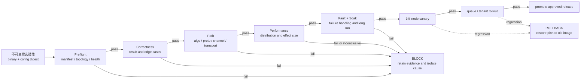

## 本章问题

“升级后慢了”不是可执行结论。生产治理必须回答：

1. 当前节点是否仍属于同一个硬件/拓扑class？
2. runtime、driver、CUDA、NCCL和配置是否与批准manifest一致？
3. correctness、path和performance哪个先发生变化？
4. 性能差值是否超过统计噪声？
5. 高CV应该判PASS、FAIL还是INCONCLUSIVE？
6. channel、transport、algorithm变化如何与性能报警关联？
7. 升级canary怎样分阶段扩大，什么条件自动回滚？
8. 固定release源码与master演进源码如何隔离？

本章运行一个实际4卡canary，并注入两类真实路径回归：限制1 channel、禁用P2P。另对错误
结果、版本、拓扑和高噪声做policy级注入，验证治理动作。

## 版本与边界

```text
GPU: 4 x Tesla V100-SXM2-32GB, all pairs NV2
CUDA Toolkit: 12.6
NCCL runtime: 2.22.3
payload: 64 MiB FP32 AllReduce
per config: 5 independent process launches
each launch: 2 warmup + 10 measured iterations
```

正式运行：`ch35_governance/20260712T001500Z`。

- [实验汇总](/assets/files/nccl-learning/logs/ch35_governance/20260712T001500Z/summary.md)
- [运行清单](/assets/files/nccl-learning/logs/ch35_governance/20260712T001500Z/manifest.txt)
- [15条canary测量](/assets/files/nccl-learning/logs/ch35_governance/20260712T001500Z/canary_measurements.csv)
- [性能统计](/assets/files/nccl-learning/logs/ch35_governance/20260712T001500Z/canary_summary.csv)
- [路径fingerprint](/assets/files/nccl-learning/logs/ch35_governance/20260712T001500Z/path_fingerprint.csv)
- [节点fingerprint](/assets/files/nccl-learning/logs/ch35_governance/20260712T001500Z/node_fingerprint.csv)
- [7条策略判定](/assets/files/nccl-learning/logs/ch35_governance/20260712T001500Z/policy_decisions.csv)
- [36条治理模型](/assets/files/nccl-learning/logs/ch35_governance/20260712T001500Z/governance_source_model.csv)
- [实验与policy driver](/assets/files/nccl-learning/scripts/59_ch35_production_governance.py)

本机只有NCCL 2.22.3 runtime，没有安装第二套候选runtime，所以不声称完成真实版本性能A/B。
版本mismatch只验证release gate；真实升级必须把候选库装入隔离镜像后重复全套canary。

## 基线不是一个带宽数字

可复用基线至少是一个结构体：

```text
identity:
  GPU model / PCI bus ID / driver
  CUDA / NCCL / framework
  binary and container digest

topology:
  NVLink matrix / NUMA / NIC distance

configuration:
  NCCL env / framework env / plugin

workload:
  operation / dtype / size / ranks / warmup / cycles

evidence:
  correctness / path / selection / performance distribution

lifecycle:
  created_at / owner / expiry / approved release
```

只有“64 MiB应为116 GB/s”无法区分换卡、禁P2P、channel变化、版本变化或统计噪声。

## 节点 Fingerprint

实验保存以下hash，而不是公开完整硬件标识：

```python
fingerprint = {
    "topology_sha256": sha256(nvidia_smi_topo_m),
    "gpu_driver_sha256": sha256(gpu_driver_bus_rows),
    "binary_sha256": sha256(all_reduce_perf),
    "nccl_runtime": "2.22.3",
    "cuda_toolkit": "12.6",
}
```

hash用于快速比较，原始拓扑仍应保存在受控artifact中以便解释diff。只存hash能发现变化，却不能
解释哪条NVLink消失。

节点进入benchmark前先做preflight：

```text
GPU数量和型号一致
ECC/Xid/retired pages无异常
PCI/NVLink/NIC拓扑属于批准class
driver/CUDA/NCCL在兼容矩阵中
CPU governor、NUMA、容器设备可见性正确
没有其他GPU或同核噪声负载
```

## Canary 的三个层次

### Correctness Gate

每次`nccl-tests`输出两个`#wrong`列，本章15次运行全部为0。correctness是硬门槛：

```text
#wrong > 0 => immediate block
```

不能因为带宽更快而容忍错误，也不应把错误结果纳入性能统计。

### Path Gate

通过INIT/P2P/SHM日志提取：

| config | P2P lines | SHM lines | coll channels |
|---|---:|---:|---:|
| baseline | 48 | 0 | 12 |
| channel1 | 4 | 0 | 1 |
| no_p2p | 0 | 12 | 2 |

路径gate可以在性能样本不足时提前解释结构变化。`no_p2p`不是随机慢：它明确从GPU P2P退到
SHM Copy Engine路径。

### Performance Gate

五次独立launch得到：

| config | median busbw | CV | 相对基线回归 |
|---|---:|---:|---:|
| baseline | 116.81 GB/s | 0.81% | 0% |
| channel1 | 19.37 GB/s | 7.99% | 83.42% |
| no_p2p | 2.56 GB/s | 0.00% | 97.81% |

限制channel和禁P2P产生的effect远大于基线噪声，判FAIL没有歧义。

## 为什么反向运行顺序

driver让奇数rep按`baseline -> channel1 -> no_p2p`，偶数rep反向。这样降低以下趋势与config
完全共线的风险：

```text
GPU温度/频率变化
allocator/cache warmup
后台负载随时间变化
持续测试导致的热稳态
```

更严格的生产A/B应随机化或平衡顺序，并把node、时间段作为blocking factor。

## 判定不能只有固定 10%

本章用10%作为明显回归演示阈值，但生产阈值应同时包含：

```text
绝对SLO下限
相对baseline effect
历史CV或置信区间
最小样本数
P95/P99尾延迟
path是否变化
多次canary一致性
```

可采用：

$$
\text{alert if } \Delta > \max(\delta_{business}, k\sigma_{history})
$$

但正态假设并不总成立。对重尾数据应使用median、bootstrap interval、Mann-Whitney或分位数
比较，并保留raw sample。

## 高 CV 不是 PASS

策略注入`CV=25%`，判定：

```text
status = INCONCLUSIVE
action = rerun and isolate noise
```

常见错误是“均值没慢10%，所以PASS”。高噪声意味着实验没有足够分辨率证明无回归，也没有
足够证据证明回归。正确动作是：

```text
检查同机干扰、CPU affinity和频率
增加独立launch而非只增加同进程iteration
重做顺序平衡
分节点/时段分层
仍高噪声则暂停推广
```

## 三类实际注入

### Channel 回归

```bash
NCCL_MIN_NCHANNELS=1
NCCL_MAX_NCHANNELS=1
```

路径从12 coll channels变为1，median只剩基线16.58%。policy输出：

```text
FAIL: block and inspect channel config
```

### Transport 回归

```bash
NCCL_P2P_DISABLE=1
```

P2P lines 48->0、SHM 0->12，median只剩2.56 GB/s。policy同时报告path+performance，避免只发
一条“慢97.81%”的无归因报警。

### Correctness 注入

policy fixture把`#wrong=1`输入决策器，必须立即block。这里不故意让生产GPU计算错误；它验证
的是release gate不能被性能结果覆盖。

## 版本治理

### 固定 Runtime 与源码

每个baseline必须绑定：

```text
container/image digest
loaded libnccl.so realpath + SHA256
NCCL runtime version
framework build/version
driver/CUDA compatibility
experiment script hash
```

博客的机制结论使用固定NCCL 2.22.3源码。阅读master只能用于列出候选变化，不能用master实现
解释2.22.3实测，除非先证明相关代码相同。

### Master Diff 的正确用途

升级前可把release tag与候选commit按所有权分类：

```text
API/ABI
tuning cost model
algorithm/protocol
transport/plugin
memory registration
error handling
environment defaults
```

diff生成测试假设，而不是生成性能结论。例如看到tuning threshold变化，应增加交叉区间size
sweep；看到NET注册变化，应增加GDR registration和fallback测试。

### A/B 必须真正加载两套 Runtime

候选镜像必须再次执行第1章的动态链接证明：

```text
readelf NEEDED
ldd/loader realpath
runtime API version
framework reported NCCL version
library SHA256
```

本章没有第二套runtime，因此manifest明确写：

```text
runtime_upgrade_ab=NOT_AVAILABLE_SOURCE_POLICY_ONLY
```

## 分阶段发布

建议release gate：

1. **Preflight**：manifest、拓扑、设备健康。
2. **Correctness**：collective/P2P、dtype、in-place、边界shape。
3. **Path**：algorithm/protocol/channel/transport/plugin fingerprint。
4. **Performance**：size/rank矩阵、分布与效应量。
5. **Fault**：mismatch、rank crash、timeout、abort。
6. **Soak**：长时间训练与资源泄漏。
7. **Rollout**：1%节点->单队列->多租户分层扩大。
8. **Rollback**：触发硬门槛后回到不可变旧镜像。

<div class="diagram-scroll diagram-scroll--wide" markdown="1">



</div>

每阶段都要有机器可执行acceptance，不依赖人工“看起来正常”。

这张图刻意把 `INCONCLUSIVE` 也挡在推广路径之外：噪声过大意味着证据不足，不是默认 PASS。
回滚后还要重新执行 preflight 与 canary，确认恢复的是完整运行栈而不只是 Python package。

## 七条 Policy 结果

| case | status | action |
|---|---|---|
| baseline | PASS | promote canary |
| channel1 | FAIL | block，检查channel配置 |
| no_p2p | FAIL | block，检查拓扑/transport |
| wrong result | FAIL | immediate block |
| version mismatch | FAIL | 单独A/B canary |
| topology mismatch | FAIL | quarantine node |
| high noise | INCONCLUSIVE | 隔离噪声并重跑 |

版本或拓扑mismatch并不自动证明软件有bug，但当前baseline已经不适用，所以不能继续沿用原阈值
判PASS。

## 回滚设计

可回滚意味着：

```text
旧镜像与配置不可变且仍可拉取
checkpoint/作业协议兼容
调度器能按node class撤出候选
baseline和artifact可追溯
配置回滚与二进制回滚分开记录
回滚后自动复跑canary确认恢复
```

只准备`pip install old-version`不是生产回滚方案，它无法保证动态库、driver、plugin和环境恢复。

## 生产报警分层

| 报警 | 严重度 | 自动动作 |
|---|---|---|
| wrong result | critical | 停止推广，隔离结果 |
| version/binary hash未知 | critical | 拒绝加入训练池 |
| topology不属于node class | high | quarantine |
| transport path变化 | high | 阻断或专项canary |
| 稳定性能回归 | high | 回滚候选 |
| 高CV | warning/inconclusive | 重跑、检查干扰 |
| 单次outlier | info/warning | 计入尾延迟，暂不单独回滚 |

## 常见错误

1. 用一个带宽数字代表完整baseline。
2. 不保存binary/config/topology hash。
3. correctness失败后仍计算性能均值。
4. 只比较性能，不比较path。
5. 把节点拓扑变化归因软件版本。
6. 单次launch就发布精确回归百分比。
7. 顺序固定导致热趋势与配置共线。
8. 高CV时判“没有显著变慢所以PASS”。
9. 阈值不含业务SLO和历史噪声。
10. 只看P50，忽略P95/P99。
11. 用master源码解释固定release runtime。
12. 未证明动态链接就声称完成版本A/B。
13. 升级所有节点后才跑canary。
14. 旧镜像不可用，回滚只能现场重装。
15. 报警没有owner、action和artifact链接。

## 本章结论

1. 基线必须同时绑定identity、topology、config、workload、evidence和lifecycle。
2. 本章15次canary全部correct，基线116.81 GB/s、CV 0.81%。
3. 限1 channel把12 channels变1，性能回归83.42%。
4. 禁P2P把48条P2P证据变为12条SHM，性能回归97.81%。
5. path+performance联合报警比裸速度报警更接近根因。
6. wrong result、未知version和topology mismatch都是release硬门槛。
7. 高CV判INCONCLUSIVE，不是PASS也不是确定FAIL。
8. 固定runtime与master源码必须隔离，diff只生成测试假设。
9. 本机无第二套runtime，真实升级A/B保持未执行边界。
10. 7/7 policy与36/36治理模型通过。

## 验收题

1. 完整baseline结构包含哪六类信息？
2. 为什么hash和原始拓扑都要保存？
3. correctness/path/performance gate的顺序是什么？
4. baseline的median和CV是多少？
5. channel1的路径和性能分别怎样变化？
6. no_p2p如何从日志证明退到SHM？
7. 为什么独立launch比同进程重复更重要？
8. 为什么要平衡运行顺序？
9. 固定10%阈值缺少哪些因素？
10. 高CV为什么判INCONCLUSIVE？
11. topology mismatch为何不能沿用旧baseline？
12. master diff的正确用途是什么？
13. 真正版本A/B需要哪些动态链接证据？
14. 本章为什么不声称完成升级性能A/B？
15. 八阶段release gate是什么？
16. 一个可执行回滚方案需要什么？
