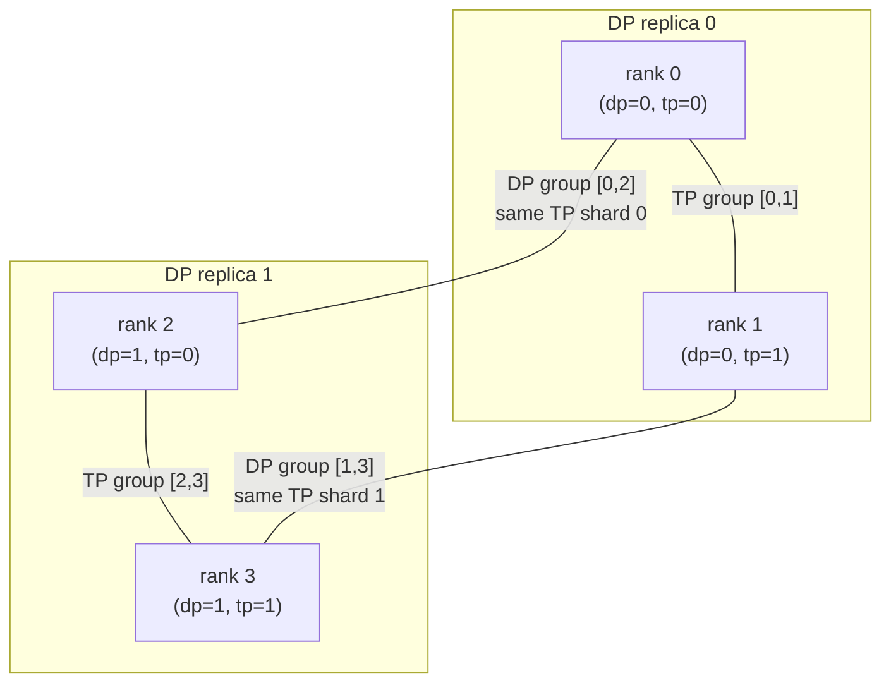

## 本章问题

只会把TP背成AllReduce、PP背成Send/Recv、MoE背成AllToAll，仍不足以诊断真实训练。
Infra工程师需要从tensor shape和rank坐标直接推出：

1. 一个rank为什么同时属于多个Process Group？
2. TP的column shard和row shard分别切哪一维？
3. Row-parallel输出何时是AllReduce，何时是ReduceScatter？
4. AllGather和ReduceScatter在反向传播中为何互为对偶？
5. TP通信payload由参数量还是activation shape决定？
6. TP之后为什么还有DP collective？它们是否在同一个group？
7. PP forward发送什么，backward又发送什么？
8. 普通`dist.send/recv`为什么不会自动连接两端的autograd graph？
9. microbatch数量改变总activation字节、P2P次数还是pipeline bubble？
10. GPipe fill-drain和1F1B的调度差异是什么？
11. MoE dispatch与combine为什么各需要一次AllToAll？
12. 不均衡router怎样变成`input_split_sizes/output_split_sizes`？
13. 为什么MoE forward有2次AllToAll，完整backward应再有2次？
14. 什么情况下dispatch backward会被autograd裁掉？
15. expert参数应该在哪个DP group同步？
16. 逻辑AllToAll为何在NCCL trace中显示为`SendRecv` kernel？
17. 如何区分已验证的通信结构与不稳定的微基准性能？

第12章只用合成tensor展示通信形态。本章用可训练MLP、两阶段pipeline和可反向传播的
expert模型替代合成操作，并把每层消息、group、payload和GPU kernel对应起来。

## 版本与诚实边界

```text
GPU: 4 x Tesla V100-SXM2-32GB, all pairs NV2
PyTorch runtime: 2.5.0a0+872d972e41.nv24.08
NCCL runtime: 2.22.3
Megatron-LM source: core_v0.8.0
Megatron-LM commit: baf94af3c667248865f23df73b9fb8e2395e6fd0
DeepSpeed source: v0.14.4
DeepSpeed commit: d254d75ef028e2e6bd3305ba0feeb6a61c986443
```

本机实际执行的是PyTorch最小训练模型。Megatron-LM和DeepSpeed是固定版本源码对照，本文
不声称运行过它们的完整训练runtime。正式运行是：
`ch32_multidim_parallel/20260711T213000Z`。

- [实验汇总](/assets/files/nccl-learning/logs/ch32_multidim_parallel/20260711T213000Z/summary.md)
- [运行清单](/assets/files/nccl-learning/logs/ch32_multidim_parallel/20260711T213000Z/manifest.txt)
- [336条训练迭代](/assets/files/nccl-learning/logs/ch32_multidim_parallel/20260711T213000Z/iteration_measurements.csv)
- [2112条通信与payload记录](/assets/files/nccl-learning/logs/ch32_multidim_parallel/20260711T213000Z/operation_payload_timeline.csv)
- [每group调用汇总](/assets/files/nccl-learning/logs/ch32_multidim_parallel/20260711T213000Z/operation_summary.csv)
- [864条PP微批时间线](/assets/files/nccl-learning/logs/ch32_multidim_parallel/20260711T213000Z/pipeline_microbatch_timeline.csv)
- [rank/group与负载状态](/assets/files/nccl-learning/logs/ch32_multidim_parallel/20260711T213000Z/rank_group_state.csv)
- [性能汇总](/assets/files/nccl-learning/logs/ch32_multidim_parallel/20260711T213000Z/performance_summary.csv)
- [Nsight kernel指纹](/assets/files/nccl-learning/logs/ch32_multidim_parallel/20260711T213000Z/nsys_collective_summary.csv)
- [39条可执行源码模型](/assets/files/nccl-learning/logs/ch32_multidim_parallel/20260711T213000Z/parallel_source_model.csv)
- [训练worker](/assets/files/nccl-learning/probes/ch32_multidim_parallel_worker.py)
- [实验driver](/assets/files/nccl-learning/scripts/56_ch32_multidim_parallel.py)

原始runtime日志保留在本机`raw/`，`.nsys-rep`和导出的GPU trace保留在`private/`，不发布。

## 先建立 Rank 坐标系

本章把4个rank解释成二维坐标：

$$
W = D_{dp}T_{tp}=2\times2,
\qquad
r = r_{tp}+T_{tp}r_{dp}.
$$

矩阵布局为：

```text
                 tp_rank=0   tp_rank=1
dp_rank=0           rank0       rank1
dp_rank=1           rank2       rank3
```

于是正交group是：

```text
TP groups: [0, 1], [2, 3]
DP groups: [0, 2], [1, 3]
```

TP group中的rank共同计算一份模型replica的不同tensor shard。DP group中的rank持有“同一个
shard坐标”的两份副本，负责同步该shard的gradient。

```text
rank0: TP shard 0, DP replica 0
rank1: TP shard 1, DP replica 0
rank2: TP shard 0, DP replica 1
rank3: TP shard 1, DP replica 1
```

这解释了为什么DP不能直接使用`[0,1]`：rank0和rank1持有的是不同weight shard，把两者的
gradient相加在数学上没有意义。

图中横向边固定 DP 坐标、改变 TP 坐标；纵向边固定 TP shard、改变 DP replica。每一个方向都
是独立 communicator 和独立 collective 顺序域。

<div class="diagram-scroll" markdown="1">



</div>

扩展到 TP、DP、PP、EP 四维时规则不变：创建某一维的 group 时固定其他坐标，只让目标维坐标
变化。真正困难的是所有 rank 必须以相同的全局顺序创建这些重叠 group。

### Group 创建顺序是全局协议

实验代码让每个rank按相同顺序创建全部group：

```python
specs = (
    ("tp0", (0, 1)),
    ("tp1", (2, 3)),
    ("dp0", (0, 2)),
    ("dp1", (1, 3)),
)
groups = {
    name: dist.new_group(list(ranks))
    for name, ranks in specs
}
```

即使rank3不属于`tp0`，也必须参与`new_group([0,1])`的全局创建协议。各rank用不同顺序
创建重叠group，可能导致初始化或collective ordering死锁。

### Megatron 如何一般化这个坐标系

Megatron-LM固定源码`parallel_state.py`直接写出了正交并行的rank公式：

```python
# tp/dp/pp 三维坐标线性化为 global rank
global_rank = (
    tp_rank
    + dp_rank * tp_size
    + pp_rank * tp_size * dp_size
)
```

`RankGenerator`再按`tp-cp-ep-dp-pp`之类的order和mask生成某个维度或多个维度的rank集合：

```python
def get_ranks(self, token, independent_ep=False):
    if independent_ep:
        parallel_size = self.ordered_size_w_ep
        order = self.order_w_ep
    else:
        parallel_size = self.ordered_size_wo_ep
        order = self.order_wo_ep
    mask = self.get_mask(order, token)
    return generate_masked_orthogonal_rank_groups(
        self.world_size, parallel_size, mask
    )
```

这里的工程重点不是记住默认order，而是：

```text
global rank = 多维坐标的线性化结果
Process Group = 固定其他坐标，只让目标坐标变化
```

当TP、PP、DP、EP、CP同时存在时，必须把hang或慢通信定位到具体维度，而不是只记录global
rank。

## Tensor Parallel 的矩阵切分

考虑两层MLP：

$$
H=\operatorname{GELU}(XW_1^T),
\qquad
Y=HW_2^T,
$$

其中：

```text
X:  [B, D]
W1: [H, D]
W2: [D, H]
Y:  [B, D]
```

实验使用$D=512,H=1024,T_{tp}=2$。

### 第一层：Column Parallel

PyTorch `F.linear(X, W)`实际计算$XW^T$。把`W1`按输出feature切分就是按weight dim 0
切分：

```python
W1_local = W1_full.chunk(tp_size, dim=0)[tp_rank]
H_local = gelu(F.linear(X, W1_local))
```

shape变成：

```text
W1_local: [H / TP, D] = [512, 512]
H_local:  [B, H / TP]
```

每个rank算出不同hidden feature，结果天然就是feature shard；两层MLP紧接row-parallel
第二层时，不需要在中间AllGather。

PyTorch `ColwiseParallel`的固定源码做的正是weight dim 0分片：

```python
def _partition_linear_fn(self, name, module, device_mesh):
    for name, param in module.named_parameters():
        dist_param = nn.Parameter(
            distribute_tensor(param, device_mesh, [Shard(0)])
        )
        module.register_parameter(name, dist_param)
```

### 第二层：Row Parallel

第二层要消费`H_local`，所以`W2`按输入feature，也就是weight dim 1切分：

```python
W2_local = W2_full.chunk(tp_size, dim=1)[tp_rank]
Y_partial = F.linear(H_local, W2_local)
```

每个rank输出shape都是`[B,D]`，但只包含hidden shard对最终输出的部分贡献：

$$
Y = \sum_{t=0}^{T_{tp}-1}Y_{partial}^{(t)}.
$$

因此要得到replicated output，需要TP AllReduce：

```python
Y = dist_nn.all_reduce(Y_partial, group=tp_group)
```

Megatron `RowParallelLinear.forward()`也按输出layout分支：

```python
output_parallel = self._forward_impl(
    input=input_parallel,
    weight=self.weight,
    ...
)

if self.explicit_expert_comm:
    output_ = output_parallel
elif self.sequence_parallel:
    output_ = reduce_scatter_to_sequence_parallel_region(output_parallel)
else:
    output_ = reduce_from_tensor_model_parallel_region(output_parallel)
```

结论不是“row parallel永远AllReduce”，而是：

```text
partial -> Replicate layout: AllReduce
partial -> sequence Shard layout: ReduceScatter
explicit expert communication: 交给外部组合逻辑
```

## TP Payload 如何从 Shape 推出

常规row-parallel的TP AllReduce input是`Y_partial[B,D]`：

$$
M_{TP}=B\times D\times s_{dtype}.
$$

FP32、$D=512$时：

| batch | TP activation payload |
|---:|---:|
| 32 | 64 KiB |
| 128 | 256 KiB |

它与本层weight总量没有直接等号关系。相同weight shape只改batch，TP消息就扩大4倍。

每rank的两个weight shard分别是：

```text
W1 shard: 512 x 512 x 4 B = 1 MiB
W2 shard: 512 x 512 x 4 B = 1 MiB
```

所以DP维度每步对两个1 MiB gradient shard各做一次AllReduce。一次训练step可预测为：

```text
TP group: forward 1 x activation AllReduce
TP group: backward 1 x activation-gradient AllReduce
DP group: 2 x 1 MiB parameter-shard gradient AllReduce
```

Nsight观测每rank恰好4个AllReduce kernel。

## Collective 的 Autograd 对偶

普通`torch.distributed`collective是通信API，不都自动定义求导语义。本实验使用
`torch.distributed.nn.functional`的autograd-aware封装。

### AllReduce 的 backward 仍是 AllReduce

PyTorch固定源码：

```python
class _AllReduce(Function):
    @staticmethod
    def forward(ctx, op, group, tensor):
        ctx.group = group
        ctx.op = op
        tensor = tensor.clone()
        dist.all_reduce(tensor, op=op, group=group)
        return tensor

    @staticmethod
    def backward(ctx, grad_output):
        return (None, None) + (
            _AllReduce.apply(ctx.op, ctx.group, grad_output),
        )
```

forward把多个partial sum合并，backward也要把replicated loss各分支对partial input的
gradient合并。

### ReduceScatter 的 backward 是 AllGather

```python
class _Reduce_Scatter(Function):
    @staticmethod
    def forward(ctx, op, group, tensor, *input_tensor_list):
        ctx.group = group
        dist.reduce_scatter(
            tensor, list(input_tensor_list), op=op, group=group
        )
        return tensor

    @staticmethod
    def backward(ctx, grad_output):
        return (None, None, None) + _AllGather.apply(
            ctx.group, grad_output
        )
```

### AllGather 的 NCCL backward 是 ReduceScatter

```python
class _AllGather(Function):
    @staticmethod
    def backward(ctx, *grad_outputs):
        if dist.get_backend(group=ctx.group) is dist.Backend.NCCL:
            rank = dist.get_rank(group=ctx.group)
            gx = torch.empty_like(grad_outputs[rank])
            gx = _Reduce_Scatter.apply(
                ReduceOp.SUM, ctx.group, gx, *grad_outputs
            )
        return (None, gx)
```

因此先看forward graph就能推断backward通信：

| forward layout transform | backward transform |
|---|---|
| AllReduce | AllReduce |
| AllGather | ReduceScatter |
| ReduceScatter | AllGather |
| AllToAll(V) | reverse AllToAll(V) |

这个表只在相应tensor确实需要gradient时成立。后面的MoE失败实验会验证这一点。

## Sequence Parallel 实验

常规row-parallel把`[B,D]` partial output AllReduce成每个rank完整复制。若下一段计算能按
token/sequence维分片，可把归约和分片合成ReduceScatter：

```python
partial = model.partial(x)                 # [B, D]
chunks = [z.contiguous() for z in partial.chunk(2, dim=0)]
shard = torch.empty_like(chunks[0])         # [B / TP, D]
shard = dist_nn.reduce_scatter(
    shard, chunks, group=tp_group
)
```

实验为了在每rank计算同一个replicated loss，又做一次AllGather：

```python
output = torch.cat(
    dist_nn.all_gather(shard, group=tp_group), dim=0
)
loss = output.square().mean()
loss.backward()
```

这不是最优生产graph，因为真正sequence-parallel层会尽可能在shard layout上继续计算，推迟
AllGather。本实验故意把RS/AG放在一个可训练闭环中，以验证求导对偶和payload。

对$B=128,D=512,TP=2$：

```text
forward RS input:  256 KiB, output shard 128 KiB
forward AG input:  128 KiB, output full  256 KiB
backward of AG:     1 x RS
backward of RS:     1 x AG
DP shard gradients: 2 x 1 MiB AR
```

Nsight每rank观测：

```text
AllReduce     = 2
AllGather     = 2
ReduceScatter = 2
```

数值参考检查把TP shard重新组合的结果与未分片完整MLP比较，最大绝对误差为
$2.98\times10^{-7}$，低于$2\times10^{-5}$验收阈值。

## Pipeline Parallel 的通信边界

本章把rank0/1和rank2/3分别作为两份DP replica的两阶段pipeline：

```text
pipeline replica 0: rank0(stage 0) -> rank1(stage 1)
pipeline replica 1: rank2(stage 0) -> rank3(stage 1)

stage-0 DP group: [0, 2]
stage-1 DP group: [1, 3]
```

注意这里与TP实验复用了同一物理rank pair，但不同配置没有同时运行TP和PP。真正3D并行会
再增加独立PP坐标，并由`dp * tp * pp`的坐标公式生成group。

### Forward 发送 Activation

Stage 0计算：

```python
h = F.gelu(F.linear(x, stage0_weight))
dist.send(h.detach(), dst=stage1_rank)
```

Stage 1接收后必须显式建立本地autograd leaf：

```python
h = torch.empty(micro_batch, hidden, device=device)
dist.recv(h, src=stage0_rank)
h.requires_grad_(True)
loss = mse_loss(F.linear(h, stage1_weight), target)
```

### Backward 发送 Activation Gradient

Stage 1在本地backward后发送`h.grad`：

```python
loss.backward()
dist.send(h.grad, dst=stage0_rank)
```

Stage 0接收并继续自己的graph：

```python
grad = torch.empty_like(saved_activation)
dist.recv(grad, src=stage1_rank)
saved_activation.backward(grad)
```

这段代码说明PP的“反向Send/Recv”不是可选优化。普通P2P把两个进程的autograd graph切断，
框架必须显式传activation gradient并在上游调用backward。

## GPipe 与 1F1B

实验采用fill-drain调度：先完成所有microbatch forward，再反向处理保存的activation，属于
GPipe形态。PyTorch固定源码对`ScheduleGPipe`的定义也是：

```python
class ScheduleGPipe(PipelineScheduleSingle):
    """Will go through all the microbatches in a fill-drain manner."""

    # 先遍历所有 forward microbatch
    for i in range(self._n_microbatches):
        output = self._stage.forward_one_chunk(i, ...)
        works = _sorted_batch_p2p(
            self._stage.get_fwd_send_ops(i), desc="fwd_send"
        )

    # 再遍历所有 backward microbatch
    for i in range(self._n_microbatches):
        self._stage.backward_one_chunk(i, loss=loss)
        works = _sorted_batch_p2p(
            self._stage.get_bwd_send_ops(i), desc="bwd_send"
        )
```

`Schedule1F1B`则分成warmup、steady 1B1F和cooldown。steady状态交替forward/backward，通常
能减少activation峰值和bubble，但调度、P2P ordering和virtual stage更复杂。

本实验没有执行1F1B，所以不会从结果推断1F1B性能。

## Microbatch 参数实验

总batch固定64，hidden为1024，FP32 activation总字节固定：

$$
64\times1024\times4=256\ \text{KiB}.
$$

| 配置 | microbatches | 单消息 | 每rank Fwd+Back P2P kernel | 总方向字节 |
|---|---:|---:|---:|---:|
| pp_mb1 | 1 | 256 KiB | 2 | 256 KiB |
| pp_mb8 | 8 | 32 KiB | 16 | 256 KiB |

Stage参数gradient还在各自DP group做一次2 MiB AllReduce。

实测critical host median：

| 配置 | median | P95 | host CV |
|---|---:|---:|---:|
| pp_mb1 | 1.140 ms | 1.416 ms | 12.62% |
| pp_mb8 | 6.969 ms | 16.632 ms | 51.60% |

在这个阻塞式、fill-drain、极小两层模型里，8个小消息把P2P次数扩大8倍，且没有足够计算去
隐藏边界，所以明显更慢。这不是“microbatch越多越差”的通用结论。真实pipeline增加
microbatch是为了填充多个stage并减少bubble，应该联合评估stage compute、通信、activation
内存与schedule。

rank0某次`pp_mb8`时间线显示：

```text
F0  170 us   F1  309 us   F2  437 us   F3  560 us
F4  689 us   F5  823 us   F6  955 us   F7 1085 us
B7 1346 us   B6 1625 us   B5 1894 us   B4 2158 us
B3 2423 us   B2 2684 us   B1 2973 us   B0 3236 us
```

它清楚展示fill以后才drain，而不是1F1B交错。

## Expert Parallel / MoE 数据流

Top-1 MoE至少包含四步：

```text
1. Router: 每个token选择expert
2. Dispatch: token按目标expert打包并AllToAll
3. Expert compute: owner rank运行本地expert
4. Combine: expert输出AllToAll回原source并恢复token顺序
```

如果上游activation需要gradient，backward还要反向经过combine和dispatch，所以完整step是：

```text
forward:  dispatch A2A -> expert -> combine A2A
backward: reverse combine A2A -> expert backward -> reverse dispatch A2A
```

### 可变 Split 就是 Router 负载

每个source rank有64个token、每token 512个FP32元素。均衡路由：

```text
input_splits  = [32, 32]
rank0 receive = [32, 32] -> 64 tokens
rank1 receive = [32, 32] -> 64 tokens
```

7:1偏斜路由：

```text
input_splits  = [56, 8]
expert rank0 receive = [56, 56] -> 112 tokens
expert rank1 receive = [8, 8]   -> 16 tokens
```

实验的dispatch代码直接把router计数传给AllToAllV语义：

```python
received = torch.empty(sum(output_splits), d_model, device=device)
received = dist_nn.all_to_all_single(
    received,
    packed,
    output_split_sizes=output_splits,
    input_split_sizes=input_splits,
    group=ep_group,
)

expert_out = F.gelu(F.linear(received, expert_weight))

returned = torch.empty_like(packed)
returned = dist_nn.all_to_all_single(
    returned,
    expert_out,
    output_split_sizes=input_splits,
    input_split_sizes=output_splits,
    group=ep_group,
)
```

dispatch时每source固定发送128 KiB。偏斜combine时，热expert发送224 KiB，冷expert只发送
32 KiB。总token数没有变化，但compute、buffer和返回流量集中到了热rank。

### AllToAll 的 backward 如何交换 Split

PyTorch固定源码保存forward的input shape，并把split方向互换：

```python
class _AlltoAllSingle(Function):
    @staticmethod
    def forward(ctx, group, output, output_splits, input_splits, input):
        ctx.group = group
        ctx.input_size = input.size()
        ctx.output_split_sizes = input_splits
        ctx.input_split_sizes = output_splits
        dist.all_to_all_single(
            output, input,
            output_split_sizes=output_splits,
            input_split_sizes=input_splits,
            group=group,
        )
        return output

    @staticmethod
    def backward(ctx, grad_output):
        tensor = torch.empty(ctx.input_size, device=grad_output.device)
        return (None, None, None, None) + (
            _AlltoAllSingle.apply(
                ctx.group, tensor,
                ctx.output_split_sizes,
                ctx.input_split_sizes,
                grad_output.contiguous(),
            ),
        )
```

这不是简单把同一split数组再用一次。forward中A发给B多少token，backward就要把对应gradient
从B发回A，因此输入输出split互换。

### DeepSpeed MoE 使用同样的求导模式

DeepSpeed固定源码`sharded_moe.py`：

```python
class _AllToAll(torch.autograd.Function):
    @staticmethod
    def forward(ctx, group, input):
        ctx.group = group
        input = input.contiguous()
        output = torch.empty_like(input)
        dist.all_to_all_single(output, input, group=group)
        return output

    @staticmethod
    def backward(ctx, *grad_output):
        return (None, _AllToAll.apply(ctx.group, *grad_output))
```

MoE layer在expert计算两侧各调用一次：

```python
dispatched_input = _AllToAll.apply(self.ep_group, dispatched_input)
expert_output = self.experts(dispatched_input)
expert_output = _AllToAll.apply(self.ep_group, expert_output)
```

真实实现还必须处理gate auxiliary loss、capacity、token drop/padding、Top-2、router jitter、
expert tensor parallel等。本章用确定性Top-1路由隔离通信和负载，不声称覆盖完整router训练。

## 一个有价值的失败：为什么最初只有3个 A2A Kernel

初版实验生成token时没有设置`requires_grad`：

```python
x = torch.randn(local_tokens, d_model, device=device)
```

Nsight观测每rank只有3个`SendRecv` kernel：

```text
dispatch forward
combine forward
combine backward
```

原因是dispatch输入没有任何需要求导的上游，PyTorch不会为第一条A2A建立有效的input-gradient
路径，reverse dispatch被合法裁掉。它不是NCCL漏发通信。

修正后让token代表可训练上游activation，并显式验收`x.grad`：

```python
x = torch.randn(
    local_tokens, d_model,
    device=device,
    requires_grad=True,
)
out = moe_forward(x)
loss = out.square().mean()
loss.backward()

assert x.grad is not None
assert torch.isfinite(x.grad).all()
```

重跑后均衡和偏斜配置都变为每rank 4个`SendRecv` kernel。这个实验验证了：从源码预测
backward collective时，必须同时检查autograd graph是否真的要求对应input gradient。

## MoE 参数与结果

| 配置 | expert0 tokens | expert1 tokens | load ratio | critical host median | CV |
|---|---:|---:|---:|---:|---:|
| balanced | 64 | 64 | 1:1 | 2.850 ms | 15.33% |
| skewed | 112 | 16 | 7:1 | 2.626 ms | 18.55% |

结构结论很强：rank state、split数组和payload都精确验证了7:1偏斜。性能结论很弱：偏斜配置
的median反而略低，而且CV高；这个512维单Linear expert太小，启动、同步和共享机器噪声盖过
负载差。本文因此不发布“7:1导致多少 slowdown”的数字。

生产中要验证MoE负载代价，至少应记录：

```text
per expert token count / capacity / dropped tokens
per rank dispatch and combine bytes
per expert GEMM duration
AllToAll critical-rank duration
router auxiliary loss
step P50/P95/P99 and CV
```

## Nsight 的通信指纹

正式trace每个配置覆盖4张GPU：

| 配置 | 每rank AllReduce | AllGather | ReduceScatter | SendRecv |
|---|---:|---:|---:|---:|
| tp_ar_b128 | 4 | 0 | 0 | 0 |
| tp_sp_b128 | 2 | 2 | 2 | 0 |
| pp_mb8 | 1 | 0 | 0 | 16 |
| ep_balanced | 1 | 0 | 0 | 4 |
| ep_skewed | 1 | 0 | 0 | 4 |

解释：

```text
TP 4 AR = forward partial + backward partial + W1 DP + W2 DP
SP 2 AG/2 RS = forward pair + autograd dual pair
PP 16 SendRecv = 8 activation + 8 activation gradient
EP 4 SendRecv = dispatch/combine及两者的backward
```

PP和EP都还有1次DP AllReduce：PP每stage只有一个weight，EP每rank只有一个expert weight。

PyTorch/NCCL的AllToAll在本trace中落为`ncclDevKernel_SendRecv`。因此只按kernel名称搜索
`AllToAll`会误判为没有MoE通信。应结合Process Group、split数组、NVTX范围和调用栈解释。

## 参数变化带来的证据

### TP：batch扩大4倍

| 配置 | activation payload | critical host median | host CV |
|---|---:|---:|---:|
| tp_ar_b32 | 64 KiB | 2.021 ms | 54.95% |
| tp_ar_b128 | 256 KiB | 2.276 ms | 80.95% |

payload公式和kernel数量按预测变化，但性能CV极高。可以确认“消息扩大4倍”，不能把这两组
median拟合成可靠带宽或线性模型。两个1 MiB DP gradient AllReduce没有随batch变化，也使
step不是单一TP payload微基准。

### TP：Replicate 改为 Sequence Shard

| 配置 | TP通信 | critical host median | CV |
|---|---|---:|---:|
| tp_ar_b128 | 2 AR | 2.276 ms | 80.95% |
| tp_sp_b128 | 2 RS + 2 AG | 3.001 ms | 48.82% |

本实验SP为了replicated loss立刻AllGather，所以API边界更多。生产sequence-parallel会把后续
算子也留在shard layout，不能用这里的差值否定SP的activation-memory和组合收益。

### PP：总字节不变，消息数扩大8倍

PP实验给出最清晰的参数因果：总方向字节都为256 KiB，但从1个256 KiB消息变成8个32 KiB
消息，Nsight从2个P2P kernel变成16个，当前fill-drain step从1.14 ms增至6.97 ms。

### EP：总token不变，目的端负载改变

均衡和偏斜的每source dispatch都是128 KiB、kernel数都是4；变化的是目的expert收到的
token数和combine返回字节。AllToAll“总量相同”不代表rank-local compute和critical path相同。

## 完整性能表与统计边界

所有配置都运行两轮、顺序相反，每轮6个iteration。每个逻辑step取4个rank的最大时间：

| config | critical GPU median | critical host median | host CV |
|---|---:|---:|---:|
| ep_balanced | 2.777 ms | 2.850 ms | 15.33% |
| ep_skewed | 2.582 ms | 2.626 ms | 18.55% |
| pp_mb1 | 1.111 ms | 1.140 ms | 12.62% |
| pp_mb8 | 5.907 ms | 6.969 ms | 51.60% |
| tp_ar_b128 | 2.140 ms | 2.276 ms | 80.95% |
| tp_ar_b32 | 1.802 ms | 2.021 ms | 54.95% |
| tp_sp_b128 | 2.828 ms | 3.001 ms | 48.82% |

除PP消息数放大的大效应外，其余精确性能差值都标记为`PERF_UNSTABLE`。结构验收不依赖这些
高CV median：group、shape、数值参考、replica equality和kernel类型仍全部通过。

## 数值与状态验收

实验不以“进程退出0”作为正确性：

1. TP/SP结果与完整未分片MLP逐元素比较；
2. EP结果按两个真实expert weight重建reference；
3. PP每个stage与完整确定性weight计算比较；
4. 每次训练后在DP group比较对应weight shard/stage/expert；
5. 所有模式检查loss有限；
6. EP额外检查上游activation gradient存在且有限；
7. source model的39条group、payload和autograd不变量全部通过。

最大数值误差：

```text
TP / sequence parallel: <= 2.98e-7
EP balanced:            <= 5.96e-7
EP skewed:               0
PP stage reference:      0
tolerance:                2e-5
```

## 从模型 Shape 预测 Trace 的方法

拿到一个新模型时，可以按以下顺序做静态推导。

### 1. 标注每个 Tensor 的 Layout

```text
Replicate
Shard(feature dim)
Shard(sequence/token dim)
Partial(sum pending)
```

### 2. 标注算子输入输出 Shape

```text
Linear weight [out, in]
activation [tokens, hidden]
expert packed [tokens_for_expert, hidden]
pipeline activation [micro_batch, hidden]
```

### 3. Layout 变化映射到通信

```text
Partial -> Replicate: AllReduce
Partial -> Shard: ReduceScatter
Shard -> Replicate: AllGather
source-token order -> expert order: AllToAll(V)
stage i -> stage i+1: Send/Recv
```

### 4. 乘 dtype 字节并区分 input/output bytes

例如AllGather的input shard是128 KiB，输出full tensor是256 KiB。文章和监控必须说明使用哪个
口径，不能都写成“通信量256 KiB”。logical input bytes也不等于NVLink/NIC物理bus bytes。

### 5. 沿 Autograd Graph 反推 backward

先确定tensor是否`requires_grad`，再应用AR↔AR、AG↔RS、A2A↔A2A对偶。没有input-gradient
需求的边会被裁剪。

### 6. 最后叠加正交 DP 同步

TP/PP/EP解决模型计算分布，DP仍要同步“同一坐标”的参数gradient。trace中同时出现不同
collective，不代表框架重复通信；先按Process Group拆开。

## 生产故障诊断

| 症状 | 首要证据 | 常见根因 |
|---|---|---|
| TP输出数值错 | shard dim、partial sum、group成员 | column/row维切反、在错误group归约 |
| TP kernel比预测多 | 每层layout转换和DP bucket | 过早AllGather、未融合gradient同步 |
| SP没有RS | output layout与下一层输入layout | 中间被转回Replicate |
| PP hang | 每stage P2P sequence和peer | send/recv顺序不一致、shape不一致 |
| PP反向无gradient | activation leaf和grad P2P | 误以为普通send/recv自动跨进程求导 |
| PP bubble大 | stage时间线、microbatch schedule | stage不均衡、fill-drain、小消息过多 |
| MoE只有3个A2A | autograd graph和input grad | 上游activation不需要gradient |
| MoE尾延迟 | per-expert tokens/GEMM/A2A | router偏斜、capacity、热点rank |
| MoE OOM | capacity buffer与max receive | padding、hot expert、drop策略不合适 |
| 只有部分rank慢 | rank坐标与group维度 | 热expert、stage imbalance、拓扑放置 |
| group初始化hang | 所有rank的new_group顺序 | 条件分支导致创建协议不同 |
| trace看不到AllToAll | SendRecv kernel和split记录 | 只按kernel字符串过滤 |

## 拓扑映射的工程原则

本机4张V100两两NVLink相连，所以二维group没有跨节点差异。扩展到多节点时，通常希望：

```text
高频、细粒度TP尽量留在NVLink/NVSwitch域
PP边界减少跨节点peer数量，但要考虑activation字节
EP AllToAll需要关注节点内外分层与bisection bandwidth
DP可跨节点，但gradient bucket要有足够消息大小
```

这不是固定规则。若expert远大于activation、pipeline stage严重不平衡，最优映射会变化。应把
实际group membership、拓扑路径和每维payload输入placement solver，而不是只按并行名称排序。

## 常见错误

1. 把global rank当作唯一坐标，不记录TP/DP/PP/EP local rank。
2. 在不同rank按不同顺序调用`new_group`。
3. 把不同TP shard放进同一个DP gradient group。
4. 认为ColumnParallel输出一定AllGather。
5. 认为RowParallel输出一定AllReduce。
6. 忘记`F.linear`的weight shape是`[out,in]`。
7. 用parameter bytes代替TP activation payload。
8. 看到2次额外AR就说TP重复通信，忽略它们属于DP group。
9. 认为普通`dist.send/recv`自动传播autograd。
10. PP只发送activation，不发送activation gradient。
11. 用每rank平均时间隐藏最慢stage。
12. 把microbatch总字节不变理解为通信开销不变。
13. 用fill-drain结果声称1F1B也同样慢。
14. 把均匀AllToAll微基准当成真实MoE。
15. 不记录router split，只看总token数。
16. 认为AllToAll backward永远存在，忽略`requires_grad`。
17. 变长AllToAll backward不交换input/output split。
18. 只搜名为AllToAll的kernel，漏掉NCCL SendRecv实现。
19. 用小expert高噪声median量化router imbalance slowdown。
20. 把logical payload称为NVLink/NIC物理字节。
21. 只profile rank0，不看热expert和critical rank。
22. Megatron/DeepSpeed只读源码却声称运行过runtime。

## 本章结论

1. 多维并行的本质是rank坐标线性化，以及固定其他坐标生成正交Process Group。
2. 本章二维映射为TP `[0,1]/[2,3]`，DP `[0,2]/[1,3]`。
3. ColumnParallel按Linear weight dim 0切分，RowParallel按dim 1切分。
4. Row-parallel partial output到Replicate用AR，到sequence shard用RS。
5. TP activation payload由`tokens * hidden * dtype`决定，不等于parameter bytes。
6. 常规TP MLP每step实测2个TP AR和2个DP shard-gradient AR。
7. AG的NCCL backward是RS，RS的backward是AG，实测各2个kernel。
8. PP forward传activation，backward传activation gradient；普通P2P不会自动跨进程求导。
9. GPipe fill-drain与1F1B是不同调度，本章只执行前者。
10. PP总字节相同时，1到8个微批使每rank P2P kernel从2增到16。
11. MoE forward需要dispatch/combine两次A2A，完整上游gradient再产生两次reverse A2A。
12. 未要求input gradient时dispatch backward被裁掉，实测kernel从4降到3。
13. 7:1路由使expert token从64/64变为112/16，combine字节变为224/32 KiB。
14. 本机AllToAll在NCCL trace中显示为SendRecv kernel。
15. 336条训练、2112条通信、864条PP时间线、39条源码模型和20条设备trace均通过。
16. 多数组性能CV较高；shape、group、数值和kernel结论有效，精确速度倍数保持不稳定边界。

## 验收题

1. `rank = tp_rank + tp_size * dp_rank`如何生成本章四个group？
2. 为什么rank0和rank1不能同步同一个parameter shard gradient？
3. 所有rank为何必须按相同顺序创建不完全属于自己的group？
4. `F.linear`中ColumnParallel为什么切weight dim 0？
5. RowParallel为什么切weight dim 1？
6. 两个row partial output如何恢复完整结果？
7. RowParallel何时使用ReduceScatter而不是AllReduce？
8. batch 128、hidden 512、FP32的TP activation payload是多少？
9. 为什么本章TP每rank看到4个AR，而不只是2个？
10. AllGather的NCCL backward为什么是ReduceScatter？
11. ReduceScatter backward输出shape如何恢复？
12. 本章sequence-parallel为何还做了forward AllGather？
13. 这与生产SP graph的差别是什么？
14. PP stage边界为什么要`detach`再建立新leaf？
15. Stage 0如何消费Stage 1发回的activation gradient？
16. GPipe fill-drain的时间线有什么特征？
17. 1F1B的warmup/steady/cooldown分别解决什么？
18. microbatch从1变8时，哪些字节不变，哪些次数变化？
19. MoE dispatch和combine分别改变什么tensor顺序？
20. 7:1路由如何变成`[56,8]`与`[56,56]`？
21. 变长A2A backward为何交换split数组？
22. 为什么初版MoE只有3个SendRecv kernel？
23. 如何证明修正后reverse dispatch真的执行？
24. expert参数gradient应该在哪些rank之间同步？
25. 为什么AllToAll在trace里可能没有AllToAll字样？
26. 本章为何不能声称7:1路由一定比均衡慢多少？
27. 从任意layer shape预测collective的六个步骤是什么？
28. 哪些结论来自实际运行，哪些只来自固定源码？
