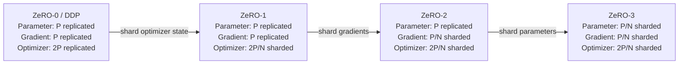

## 本章问题

ZeRO经常被概括成一张“stage越高显存越低”的表，但infra工程需要回答更具体的问题：

1. 参数、梯度、optimizer state各占多少字节？
2. ZeRO-0/1/2/3分别分片哪种状态？
3. “每rank分片”与“训练计算时临时完整”是否矛盾？
4. ZeRO-1为何仍需要梯度AllReduce和更新后参数同步？
5. ZeRO-2为何用ReduceScatter而不是保留完整梯度？
6. ZeRO-3/FULL_SHARD为何需要forward和backward AllGather？
7. FSDP `SHARD_GRAD_OP`是否严格等于DeepSpeed ZeRO-2？
8. steady allocated与peak allocated为何必须同时报告？
9. `BACKWARD_PRE/POST/None`改变通信量还是issue order？
10. `FlatParameter`、padding和original parameter view如何关联？
11. optimizer step在分片状态上如何保持全局参数一致？
12. full/sharded checkpoint为何有不同的collective和内存代价？

## 版本与诚实边界

```text
PyTorch runtime: 2.5.0a0+872d972e41.nv24.08
NCCL runtime: 2.22.3
DeepSpeed runtime: NOT INSTALLED
DeepSpeed source: v0.14.4
DeepSpeed source commit: d254d75ef028e2e6bd3305ba0feeb6a61c986443
GPU: 4 x Tesla V100-SXM2-32GB
```

本机没有安装DeepSpeed，所以本文不会声称运行过DeepSpeed ZeRO。DeepSpeed固定源码用于
定义stage和对照实现；可执行实验使用PyTorch DDP、`ZeroRedundancyOptimizer`与FSDP。

映射是：

| 实验路径 | 验证的状态语义 | 是否等同DeepSpeed runtime |
|---|---|---|
| DDP + AdamW | ZeRO-0全复制基线 | 否，机制基线 |
| DDP + ZeroRedundancyOptimizer | ZeRO-1 optimizer state分片 | 否，PyTorch实现 |
| FSDP SHARD_GRAD_OP | gradient/optimizer分片语义 | 不严格等同ZeRO-2 |
| FSDP FULL_SHARD | parameter/gradient/optimizer全分片 | 语义类似ZeRO-3，调度实现不同 |

正式运行：`ch31_zero_fsdp_states/20260711T200000Z`。

- [实验汇总](/assets/files/nccl-learning/logs/ch31_zero_fsdp_states/20260711T200000Z/summary.md)
- [运行清单](/assets/files/nccl-learning/logs/ch31_zero_fsdp_states/20260711T200000Z/manifest.txt)
- [480条迭代记录](/assets/files/nccl-learning/logs/ch31_zero_fsdp_states/20260711T200000Z/iteration_measurements.csv)
- [rank-local状态明细](/assets/files/nccl-learning/logs/ch31_zero_fsdp_states/20260711T200000Z/rank_state_measurements.csv)
- [状态因子汇总](/assets/files/nccl-learning/logs/ch31_zero_fsdp_states/20260711T200000Z/state_accounting.csv)
- [性能与显存汇总](/assets/files/nccl-learning/logs/ch31_zero_fsdp_states/20260711T200000Z/performance_summary.csv)
- [数值等价](/assets/files/nccl-learning/logs/ch31_zero_fsdp_states/20260711T200000Z/numeric_equivalence.csv)
- [Nsight collective指纹](/assets/files/nccl-learning/logs/ch31_zero_fsdp_states/20260711T200000Z/nsys_collective_summary.csv)
- [collective payload模型](/assets/files/nccl-learning/logs/ch31_zero_fsdp_states/20260711T200000Z/collective_payload_model.csv)
- [30项源码模型](/assets/files/nccl-learning/logs/ch31_zero_fsdp_states/20260711T200000Z/zero_state_model.csv)
- [实验驱动](/assets/files/nccl-learning/scripts/55_ch31_zero_fsdp_states.py)
- [训练worker](/assets/files/nccl-learning/probes/ch31_sharding_worker.py)
- [状态模型](/assets/files/nccl-learning/probes/ch31_zero_state_model.py)

六份Nsight report、SQLite和原始trace只保留在本机private目录。

## 三种 Model State

令逻辑FP32参数总字节为$P$。本实验使用AdamW，不额外维护FP32 master weight，因此主要
状态为：

```text
parameters:       P
gradients:        P
Adam exp_avg:     P
Adam exp_avg_sq:  P
```

忽略每parameter的step scalar、allocator碎片、activation和临时buffer，模型状态约为$4P$。

混合精度训练的公式不同：可能同时有FP16/BF16 model parameter、FP32 master parameter、
FP32 moments和不同精度gradient。不能把本章$4P$直接套到AMP配置。

## DeepSpeed 的 Stage 定义

固定源码`runtime/zero/config.py`直接给出：

```python
class ZeroStageEnum(int, Enum):
    disabled = 0
    optimizer_states = 1
    gradients = 2
    weights = 3

class DeepSpeedZeroConfig:
    # 0: disabled
    # 1: optimizer state partitioning
    # 2: optimizer + gradient partitioning
    # 3: optimizer + gradient + parameter partitioning
    stage: ZeroStageEnum = 0
```

Stage是累进的：2包含1，3包含1和2。offload是另一个维度，不是“stage 4”。

## Canonical ZeRO 状态公式

设data-parallel world size为$N$，只计算FP32 Adam主要状态：

| Stage | 每rank parameter | 每rank gradient | 每rank optimizer | 每rank合计 |
|---|---:|---:|---:|---:|
| 0 | $P$ | $P$ | $2P$ | $4P$ |
| 1 | $P$ | $P$ | $2P/N$ | $2P+2P/N$ |
| 2 | $P$ | $P/N$ | $2P/N$ | $P+3P/N$ |
| 3 | $P/N$ | $P/N$ | $2P/N$ | $4P/N$ |

把所有rank本地tensor求和并除以逻辑$P$，得到更容易审计的aggregate factor：

| Stage | parameter factor | gradient factor | optimizer factor |
|---|---:|---:|---:|
| 0 | $N$ | $N$ | $2N$ |
| 1 | $N$ | $N$ | $2$ |
| 2 | $N$ | $1$ | $2$ |
| 3 | $1$ | $1$ | $2$ |

这是canonical ZeRO状态定义，不是FSDP所有时刻的storage生命周期。

把表中的公式改写为每个 rank 的常驻所有权，可以直观看到每一级只新增一种分片对象：

<div class="diagram-scroll diagram-scroll--wide" markdown="1">



</div>

这里的 $P/N$ 描述稳态逻辑所有权，不等于训练过程的峰值显存。ZeRO-3/FSDP 在计算前的
all-gather、计算后的 reshard、prefetch 和临时 flat buffer 都会改变某个瞬间的物理驻留量。

## 实测状态因子

本实验逻辑参数为128 MiB，$N=4$。首次Adam step物化moments后，直接递归统计每rank
parameter、grad和optimizer tensor字节：

| config | parameter factor | gradient factor | optimizer factor | max rank P/G/O MiB |
|---|---:|---:|---:|---|
| zero0_ddp | 4.0 | 4.0 | 8.0 | 128 / 128 / 256 |
| zero1_zro | 4.0 | 4.0 | 2.0 | 128 / 128 / 64 |
| zero2_fsdp | 1.0 | 1.0 | 2.0 | 32 / 32 / 64 |
| zero3_pre | 1.0 | 1.0 | 2.0 | 32 / 32 / 64 |
| zero3_post | 1.0 | 1.0 | 2.0 | 32 / 32 / 64 |
| zero3_none | 1.0 | 1.0 | 2.0 | 32 / 32 / 64 |

Adam每parameter还有一个step scalar，所以optimizer factor比整数多约$10^{-6}$，属于已解释
元数据，不是分片泄漏。

## 为什么 FSDP SHARD_GRAD_OP 的 Parameter Factor 是 1

canonical ZeRO-2在常驻状态仍复制parameter，所以aggregate parameter factor是$N$。
PyTorch文档对`SHARD_GRAD_OP`的定义更具体：

```text
parameters are sharded outside computation
unshard before forward
do not reshard after forward
reshard after backward
```

因此本实验在optimizer边界统计时，parameter已经回到shard，aggregate factor为1。它验证了
gradient/optimizer分片的Stage-2方向，但parameter生命周期不等同DeepSpeed ZeRO-2。

这是为什么文章不能简单写：

```text
FSDP SHARD_GRAD_OP == DeepSpeed ZeRO-2
```

更准确的是“状态分片目标相近，parameter驻留与通信调度不同”。

## ZeRO-0：复制式 DDP

每rank持有完整参数、完整grad和完整Adam moments。DDP Reducer对128 MiB梯度按64 MiB
bucket发出2次AllReduce：

```text
Nsight per rank:
AllReduce = 2
AllGather = 0
ReduceScatter = 0
Broadcast = 0
```

逻辑collective input为$P$。Ring实际链路流量还要乘AllReduce bus factor
$2(N-1)/N$，不能把input bytes直接称为NIC bytes。

## ZeRO-1：Optimizer State Sharding

PyTorch `ZeroRedundancyOptimizer`把完整parameter分配给owner rank，本地optimizer只为owner
参数保存state并更新。源码类注释就是：

```text
each rank is only responsible for updating approximately 1 / world_size
parameters and broadcasts those parameters after each update
```

`step()`的关键顺序：

```python
loss = self.optim.step()  # 只更新本rank负责的parameter
self._sync_params()       # 把owner更新广播到所有rank
```

本实现若未启用bucket view，会逐parameter异步broadcast。本实验8个Linear weight，因此：

```text
AllReduce gradient buckets: 2
parameter Broadcasts: 8
```

这不是额外做无用通信。optimizer state只在owner，必须把更新后的parameter同步给其他复制
rank。DeepSpeed ZeRO-1可使用不同的grouping/all-gather实现，不能用这里8个Broadcast推断
DeepSpeed kernel数量。

## ZeRO-2 方向：Gradient Sharding

若每rank最终只保留自己owner部分grad，AllReduce完整梯度再丢弃大部分结果很浪费。
ReduceScatter把两个动作合并：

```text
reduce corresponding chunks across ranks
+ each rank receives one reduced chunk
```

FSDP源码：

```python
unsharded_grad = flat_param.grad.data
flat_param.grad = None
padded_grad, new_sharded_grad = _get_reduce_scatter_tensors(...)

dist.reduce_scatter_tensor(
    new_sharded_grad,
    padded_grad,
    group=process_group,
)

flat_param._saved_grad_shard = new_sharded_grad
```

清空原grad是为了防止下一次backward抢先写入，而异步reduction还在读取旧grad。

本实验每个Linear独立FSDP handle：

```text
forward AllGather: 8
backward AllGather: 0
ReduceScatter: 8
```

因为`SHARD_GRAD_OP`在forward unshard后保留full parameter直到backward结束，省掉pre-backward
AllGather，但提高峰值。

## ZeRO-3 方向：Parameter Sharding

FULL_SHARD在计算某个handle前才把各rank local shard拼成完整flat parameter：

```python
dist.all_gather_into_tensor(
    padded_unsharded_flat_param,
    sharded_flat_param,
    process_group,
)
```

forward结束后释放full parameter；backward计算该层gradient前再次AllGather。gradient完成后
ReduceScatter并恢复parameter shard。

8个Linear的steady step精确观察到：

```text
forward AllGather:  8
backward AllGather: 8
ReduceScatter:      8
total AllGather:   16
```

相较SHARD_GRAD_OP多8次backward AllGather，换取更低的full-parameter驻留峰值。

## Logical Payload 模型

下面是collective输入buffer的逻辑总量，不是Ring bus bytes：

| config | AllReduce input | forward AG | backward AG | RS input |
|---|---:|---:|---:|---:|
| ZeRO-0 DDP | $P$ | 0 | 0 | 0 |
| ZeRO-1 ZRO | $P$ | 0 | 0 | 0 |
| FSDP SHARD_GRAD_OP | 0 | $P$ | 0 | $P$ |
| FSDP FULL_SHARD | 0 | $P$ | $P$ | $P$ |

ZeRO-1还存在更新后parameter同步，具体payload约$P$，本实验由8次Broadcast实现。

FULL_SHARD比普通DP有更多collective输入，但显存允许更大模型/batch；性能目标是用prefetch和
compute overlap隐藏通信，而不是声称“stage越高通信越少”。

## FlatParameter 与 Padding

FSDP把一个wrapped unit的original parameters flatten成一个FlatParameter，再按world size
切shard。若numel不能整除$N$，末尾padding到：

$$
P_{physical}=N\cdot\left\lceil\frac{P_{logical}}{N}\right\rceil
$$

源码在AllGather前断言：

```python
expected_numel = sharded_flat_param.numel() * world_size
assert padded_unsharded_flat_param.numel() == expected_numel
```

`use_orig_params=True`让optimizer看到original parameter views，但view在sharded状态可能是
一维局部片段，某rank甚至是size 0。不能在普通训练代码里假设每个`p.shape`始终是完整shape。

本实验参数恰好均匀整除，状态因子没有padding偏差；不整除模型必须同时报告logical和
physical bytes。

## Steady 显存与 Peak 显存

| config | steady allocated | measured peak | peak-steady |
|---|---:|---:|---:|
| ZeRO-0 DDP | 528.25 MiB | 784.50 MiB | 256.25 MiB |
| ZeRO-1 ZRO | 336.25 MiB | 496.50 MiB | 160.25 MiB |
| FSDP SHARD_GRAD_OP | 144.25 MiB | 273.50 MiB | 129.25 MiB |
| FULL_SHARD PRE | 144.25 MiB | 200.75 MiB | 56.50 MiB |
| FULL_SHARD POST | 144.25 MiB | 188.50 MiB | 44.25 MiB |
| FULL_SHARD None | 144.25 MiB | 188.50 MiB | 44.25 MiB |

steady反映optimizer边界的sharded model states；peak还包含activation、临时unsharded
parameter、gradient buffer、prefetch和collective workspace。

只报告steady会高估可训练模型大小。尤其SHARD_GRAD_OP虽steady与FULL_SHARD相同，因forward
后不reshard，peak高出约72.75-85 MiB。

## Backward Prefetch

PyTorch定义：

- `BACKWARD_PRE`：当前层grad compute前prefetch下一handle，重叠更多，同时持有current
  parameter、next parameter和current gradient，峰值最高。
- `BACKWARD_POST`：当前grad compute后再prefetch，重叠较少，先释放current再分配next。
- `None`：不显式backward prefetch，峰值低但通常吞吐下降。

正式结果：

| FULL_SHARD mode | median step | P95 | CV | peak |
|---|---:|---:|---:|---:|
| PRE | 20.573 ms | 24.953 ms | 10.84% | 200.75 MiB |
| POST | 20.583 ms | 22.200 ms | 6.92% | 188.50 MiB |
| None | 23.123 ms | 26.973 ms | 11.51% | 188.50 MiB |

PRE/POST/None都保持16次AllGather和8次ReduceScatter。prefetch改变issue order与重叠，不
改变本章逻辑payload。PRE在此模型没有比POST更快，但增加12.25 MiB peak。

CV仍超过5%，所以这些值只作为当前环境趋势，不发布精确“快百分之多少”的稳定结论。
机制结论由状态字节和Nsight计数独立支持。

## 全模式性能结果与限制

| config | median step | CV | steady | peak |
|---|---:|---:|---:|---:|
| ZeRO-0 DDP | 8.320 ms | 1.96% | 528.25 MiB | 784.50 MiB |
| ZeRO-1 ZRO | 7.354 ms | 2.68% | 336.25 MiB | 496.50 MiB |
| FSDP SHARD_GRAD_OP | 18.738 ms | 9.71% | 144.25 MiB | 273.50 MiB |
| FULL_SHARD PRE | 20.573 ms | 10.84% | 144.25 MiB | 200.75 MiB |
| FULL_SHARD POST | 20.583 ms | 6.92% | 144.25 MiB | 188.50 MiB |
| FULL_SHARD None | 23.123 ms | 11.51% | 144.25 MiB | 188.50 MiB |

480条迭代全部correct。六模式相对ZeRO-0的完整parameter sample最大绝对误差不超过
$9.1\times10^{-13}$，远低于$10^{-4}$阈值。

不能据此宣布ZRO普遍比DDP快或FSDP普遍慢：当前是单机V100、较小MLP、每Linear wrap，
而FSDP高CV说明精确性能比值不稳定。可以可靠使用的是状态分片、显存与collective路径。

## Optimizer Step 的所有权

### Replicated Adam

每rank用相同averaged gradients更新完整参数和完整moments；无额外参数同步。

### ZRO Stage-1方向

每rank只更新owner参数及其moments，再把owner结果广播。若rank assignment不均匀，最大rank
optimizer bytes可能高于$2P/N$；本模型8个等大参数均匀分到4 ranks。

### FSDP Sharded Optimizer

每rank optimizer只看到local original-parameter shards，使用local gradient shards更新。
下一次AllGather自然组合所有rank更新后的parameter shards，无需每step复制完整parameter。

## Checkpoint 不是普通 `state_dict()`

分片训练有三种不同需求：

```text
full state dict:
  portable, rank0可保存，但需要参数/optimizer state gather和额外峰值

sharded state dict:
  每rank保存local shard，扩展性好，需要分布式checkpoint metadata

local state dict:
  与当前rank/world布局强绑定，恢复灵活性最低
```

FULL_SHARD训练时普通parameter只是shard或view。需要完整权重时用受控的
`summon_full_params`或FSDP state-dict API，并让所有要求参与collective的rank进入上下文。

本实验用`FSDP.summon_full_params(..., writeback=False)`只做数值采样；它不是生产checkpoint
实现，也不把完整参数写回local shard。

## Offload 是独立轴

ZeRO/FSDP stage描述“在哪些rank间分片”，offload描述“状态放GPU、CPU还是NVMe”。例如：

```text
ZeRO-2 + optimizer offload
ZeRO-3 + parameter and optimizer offload
FSDP + CPUOffload
```

offload降低GPU常驻显存，但增加PCIe/NVMe流量、CPU optimizer负载、pinned memory和同步边界。
本章没有执行offload，不给其性能数据。

## 初始化峰值边界

worker先在每rank构造完整128 MiB模型，再由FSDP shard。报告的measured peak在wrap和Adam
状态初始化后重置，因此是steady training peak，不包含构造瞬间全复制模型。

超大ZeRO-3模型若完整模型本身无法放入单GPU，需要meta-device、deferred init、rank0 init
或DeepSpeed `zero.Init`等sharded initialization。不能拿本章training peak证明初始化也能装下。

## 生产诊断矩阵

| 症状 | 优先证据 |
|---|---|
| steady显存没有下降 | 直接统计local P/G/O tensor，不只看allocator |
| peak仍OOM | 最大wrapped unit、prefetch、activation、temporary full param |
| ZeRO-1 state下降但step慢 | owner imbalance、parameter sync kernel数、bucket view |
| FSDP collective过多 | wrap granularity、forward/backward AG次数 |
| FULL_SHARD尾延迟 | per-rank AG/RS duration、prefetch order、straggler |
| checkpoint OOM | full-state gather和rank0 CPU/GPU峰值 |
| 参数shape异常 | 当前是否处于sharded view、summon context、use_orig_params |
| no_sync显存上涨 | gradient accumulation期间full params/grad生命周期 |

## 常见错误

1. 把ZeRO当成模型并行，实际上仍是data-parallel计算语义。
2. 只说stage数字，不说明dtype和optimizer状态组成。
3. 把FSDP SHARD_GRAD_OP严格等同DeepSpeed ZeRO-2。
4. 把steady state字节当作训练peak。
5. 忽略unsharded largest layer和prefetch buffer。
6. 认为ZeRO stage越高通信越少。
7. 把collective input bytes当成链路bus bytes。
8. 认为ZeRO-1只分片state且无需同步更新后parameter。
9. 认为ReduceScatter后每rank仍有完整gradient。
10. 忽略FlatParameter padding。
11. 对sharded original param假设完整shape。
12. 用参数数量平均owner负载，不按字节平衡。
13. 把prefetch当成减少AllGather次数。
14. 只profile rank0，不看collective straggler。
15. 用高CV数据给出精确性能倍数。
16. 普通`state_dict()`直接保存FULL_SHARD模型。
17. full state gather时只让rank0进入collective上下文。
18. 把offload称作ZeRO-4。
19. measured training peak包含不了解的初始化阶段，却声称模型一定可初始化。
20. DeepSpeed未安装却声称跑过其ZeRO runtime。

## 版本与边界

已验证：

```text
iteration rows: 480
rank state rows: 48
state accounting: 6/6 PASS
numeric equivalence: 6/6 PASS
Nsight collective paths: 24/24 PASS
source model: 30/30 PASS
DeepSpeed runtime: NOT INSTALLED
DeepSpeed fixed source: v0.14.4 / d254d75e...
```

FSDP performance CV仍为6.9%-11.5%，因此内存和通信机制结论有效，精确性能差值保持
`PERF_UNSTABLE`边界。未执行DeepSpeed runtime、CPU/NVMe offload、mixed precision、
multi-node hybrid shard或distributed checkpoint恢复。

## 本章结论

1. ZeRO按optimizer、gradient、parameter三种model state逐stage增加分片范围。
2. FP32 Adam基线每rank主要状态约$4P$，ZeRO-3降为约$4P/N$。
3. 实测aggregate factor从ZeRO-0的4/4/8依次降到FULL_SHARD的1/1/2。
4. PyTorch ZRO只保留owner optimizer state，step后通过8次Broadcast同步8个参数。
5. FSDP SHARD_GRAD_OP有8次forward AG和8次RS，且计算外parameter也shard。
6. FULL_SHARD多8次backward AG，换取更低full-parameter峰值。
7. SHARD_GRAD_OP与ZeRO-2分片目标相近，但parameter生命周期不完全相同。
8. steady显存从528.25 MiB降到144.25 MiB；peak还取决于unshard和prefetch。
9. PRE/POST/None collective数量相同，只改变issue order、重叠和peak。
10. 六模式训练结果数值等价，但FSDP性能CV高，不能给通用精确速度结论。
11. FlatParameter需要处理padding、sharded views和受控full-parameter materialization。
12. checkpoint、offload和sharded initialization是独立工程维度，不能从stage数字自动推断。

## 验收题

1. FP32 Adam的P/G/O主要字节如何计算？
2. ZeRO-0/1/2/3分别分片哪些状态？
3. aggregate factor与per-rank factor有何区别？
4. 为什么ZeRO-1 parameter和gradient仍复制？
5. PyTorch ZRO更新参数后为何需要Broadcast？
6. ReduceScatter如何同时完成归约和gradient分片？
7. FSDP SHARD_GRAD_OP为何在本实验parameter factor为1？
8. 它与canonical ZeRO-2的关键生命周期差别是什么？
9. FULL_SHARD为何每handle有两次AllGather？
10. 8个wrapped Linear在stage2/3各有多少AG和RS？
11. logical collective bytes与bus bytes为何不同？
12. FlatParameter为什么可能有padding？
13. `use_orig_params=True`为何不保证完整parameter shape常驻？
14. steady和peak分别包含什么？
15. SHARD_GRAD_OP peak为何高于FULL_SHARD？
16. BACKWARD_PRE为何可能提高peak？
17. prefetch为什么不改变collective数量？
18. 本章为什么不发布精确FSDP slowdown？
19. sharded optimizer如何保证下一轮full parameter正确？
20. full与sharded state dict的伸缩性差别是什么？
21. offload和stage为什么是两个轴？
22. training peak为何不能证明sharded initialization可行？
23. 哪些结果来自DeepSpeed源码，哪些来自实际运行？
24. 生产中如何证明optimizer state确实分片？
