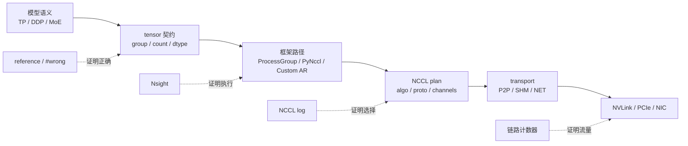
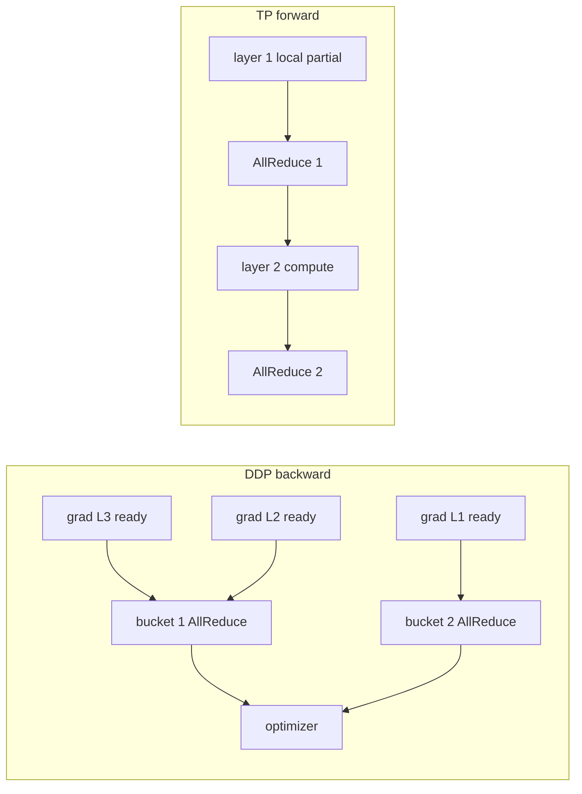

## 这篇文章解决什么问题

[54 道 NCCL 面试题详解](/posts/nccl-interview-guide/)已经覆盖了从 collective 语义到生产排障的完整知识面。这篇文章不再增加同层级名词题，而是把面试官常用来区分“看过 NCCL”和“真正做过 AI Infra”的细节继续向下追：

```text
第一层：结论是否正确
第二层：能否画出数据、stream 和连接状态
第三层：能否定位 NCCL/PyTorch 的决定性源码
第四层：能否设计可证伪实验，并说明证据边界
```

每题都包含：

- **30 秒回答**：面试时先给出的结论。
- **深入回答**：公式、数据流、源码分支和工程边界。
- **实验问题**：实验究竟要证伪什么。
- **实测结果**：来自当前机器已经完成的正式运行。
- **追问答法**：面试官继续下钻时如何回答。
- **评分点**：什么回答只能算会用，什么回答接近专家。

## 新增正式实验

本篇新增运行：`interview_details/20260717T090915Z`。

```text
GPU: 4 x Tesla V100-SXM2-32GB
拓扑: 任意 GPU pair 均为 NV2
NCCL runtime/source: 2.22.3 / v2.22.3-1 @ 178b6b7
PyTorch: 2.5.0a0+872d972e41.nv24.08
CUDA runtime: 12.6
CPU affinity: rank 0/1/2/3 -> CPU 0/2/4/6
正式 cycle: 10
```

实验附件：

- [实验汇总](/assets/files/nccl-learning/logs/interview_details/20260717T090915Z/summary.md)
- [运行清单与完整命令](/assets/files/nccl-learning/logs/interview_details/20260717T090915Z/manifest.txt)
- [统一结果表](/assets/files/nccl-learning/logs/interview_details/20260717T090915Z/summary.csv)
- [异步语义统计](/assets/files/nccl-learning/logs/interview_details/20260717T090915Z/async_summary.csv)
- [AllReduce 与 RS+AG 对照](/assets/files/nccl-learning/logs/interview_details/20260717T090915Z/decomposition_summary.csv)
- [同总字节分片实验](/assets/files/nccl-learning/logs/interview_details/20260717T090915Z/fragmentation_summary.csv)
- [Decode 重放统计](/assets/files/nccl-learning/logs/interview_details/20260717T090915Z/decode_summary.csv)
- [nccl-tests 对照](/assets/files/nccl-learning/logs/interview_details/20260717T090915Z/nccl_tests_summary.csv)
- [FP16 数值反例](/assets/files/nccl-learning/logs/interview_details/20260717T090915Z/numeric_summary.csv)
- [实验 worker](/assets/files/nccl-learning/scripts/61_interview_detail_worker.py)
- [实验驱动与统计脚本](/assets/files/nccl-learning/scripts/61_run_interview_detail_labs.py)

新增实验一共通过 **784 条 per-rank 正确性契约**；TP=2/4 的 nccl-tests 对照全部 `#wrong=0`。性能汇总使用每个 cycle 的最慢 rank，再对 10 个 cycle 计算 median、P95 和 CV。

CV 超过 5% 的结果只说明顺序关系、长尾和机制，不用于宣称精确加速比。尤其是 Python/PyTorch eager 连续发起 160 次 collective 的重放，故意保留了 host 调度噪声；它不是 NCCL kernel 的纯净 microbenchmark。

## 证据如何闭环



一个证据只能回答它所在层的问题。`nvidia-smi topo -m` 不能证明 NCCL 实际选了 P2P，NCCL GRAPH 日志不能证明 NVLink 达到了预期带宽，模型代码中的 `all_reduce()` 也不能证明该次调用进入了 `ncclAllReduce()`。

---

## 一、API、Stream 与完成语义

### 1. `ncclAllReduce()` 返回时，NCCL 到底完成了什么？

**30 秒回答**

对常规 blocking communicator，成功返回表示 host 侧参数检查、task 入队和 CUDA work 提交成功，不表示 GPU 已完成通信。结果何时可用由 CUDA stream/event 决定；CPU 需要显式同步才能观察设备完成。

**深入回答**

NCCL 2.22.3 的公开 API 本身没有执行 Ring step。

仓库：`NVIDIA/nccl`  
版本：`v2.22.3-1`  
提交：`178b6b7`  
文件：`src/collectives.cc:93-114`  
符号：`ncclAllReduce`

原始源码连续片段：

```cpp
NvtxParamsAllReduce payload{count * ncclTypeSize(datatype), op};
NVTX3_FUNC_WITH_PARAMS(AllReduce, AllReduceSchema, payload)

struct ncclInfo info = { ncclFuncAllReduce, "AllReduce",
  sendbuff, recvbuff, count, datatype, op, 0, comm, stream, /* Args */
  ALLREDUCE_CHUNKSTEPS, ALLREDUCE_SLICESTEPS };
NCCLCHECK(ncclEnqueueCheck(&info));
return ncclSuccess;
```

注释版：

```cpp
// [课程注释] API 把 pointer/count/dtype/op/comm/stream 封装为 ncclInfo。
ncclInfo info = { /* 与上方连续原文相同的字段 */ };

// [课程注释] enqueue 路径会检查参数、追加 task，并在 group 边界准备 plan/work。
// [课程注释] 成功返回不是 cudaStreamSynchronize，也不是 network completion。
ncclEnqueueCheck(&info);
return ncclSuccess;
```

需要区分四个时间点：

```text
t0 host 进入 API
t1 API 返回：work 已提交
t2 NCCL stream 上 end event 完成：GPU 通信完成
t3 consumer stream 等到 end event：结果对该 consumer 可见
```

**实验问题**

如果 API 返回等于 GPU 完成，那么 host call 时间应接近 CUDA event 覆盖的 stream dependency 时间，而且 API 返回后 event 应立即 ready。

实验关键代码：

```python
start_event.record()
host_start = time.perf_counter_ns()
work = dist.all_reduce(tensor, async_op=True)
host_return = time.perf_counter_ns()
work.wait()
end_event.record()
ready_after_wait = end_event.query()
end_event.synchronize()
```

**实测结果**

课程第 3 章在 256 MiB 上得到：

| 指标 | median |
|---|---:|
| `sync_api` host call | 74.236 us |
| CUDA stream dependency | 3584.432 us |
| 二者比例 | 48.3x |

新增实验中，4 KiB、1 MiB、64 MiB 三个尺寸在默认 nonblocking wait 后，CUDA end event 立即 ready 的比例均为 **0%**。这直接否定“函数返回或默认 wait 返回等于 GPU 完成”。

第 3 章附件：[异步实验汇总](/assets/files/nccl-learning/logs/ch03_async/20260710T071511Z/summary.md)。

**追问答法**

问：为什么 `async_op=False` 也不等于 `cudaDeviceSynchronize()`？

答：ProcessGroup 可以让当前 application stream 等待 NCCL stream 的 event，从而保证同 stream 后续消费者正确，却不必阻塞 host，也不必同步设备上的无关 stream。同步范围是 dependency，不是整个 device。

**评分点**

- 只说“NCCL 是异步的”：3 分。
- 能区分 host return、GPU completion 和 consumer visibility：7 分。
- 能写出 event 依赖并用源码与实验反证错误计时：10 分。

### 2. `Work.wait()` 为什么可能只花几微秒，却仍未完成通信？

**30 秒回答**

默认 ProcessGroupNCCL 的 `Work.wait()` 主要在当前 CUDA stream 上插入对 NCCL end event 的等待，然后返回 host；只有 `TORCH_NCCL_BLOCKING_WAIT=1` 等 blocking 配置才在 host 轮询 GPU completion。

**深入回答**

固定 PyTorch 源码快照中的关键执行路径摘录如下；省略了类型限定和完整 timeout 参数：

```cpp
void WorkNCCL::synchronizeInternal(timeout) {
  synchronizeStream(); // current stream waits for ncclEndEvent

  if (blockingWait_) {
    while (!isCompleted()) {
      if (checkTimeout(...)) break;
      sleep_for(kSynchronizeBusyWaitMillis);
    }
  }
}
```

默认分支建立 GPU happens-before：

```text
producer stream writes input
  -> NCCL stream waits producer event
      -> NCCL kernel writes output
          -> current consumer stream waits NCCL end event
```

它不要求 CPU 停在 `wait()` 里。名字中的 wait 容易让候选人把 host wait、stream wait 和 device completion 混成一件事。

**实测结果**

课程第 29 章在 NCCL 前放置约 52 ms GPU sleep：

| 配置 | action host | 随后 device sync | action 后 completed |
|---|---:|---:|---:|
| nonblocking `Work.wait()` | 4.9 us | 54.28 ms | 0% |
| `Future.wait()` | 5.5 us | 52.38 ms | 0% |
| blocking `Work.wait()` | 60.95 ms | 56.8 us | 100% |

这组结果证明默认 wait 的主要效果是排入 stream dependency；blocking wait 才把等待转移到 host 调用点。

附件：[ProcessGroupNCCL 实验汇总](/assets/files/nccl-learning/logs/ch29_process_group_nccl/20260711T183000Z/summary.md)。

**追问答法**

问：`Work.is_completed()` 呢？

答：无异常时它查询 NCCL end event，语义比 `wait()` 的 host 返回更接近 GPU completion；但查询瞬间仍只是一个状态快照，之后的其他 stream 是否可读还取决于是否建立了 stream dependency。

**评分点**

- 把 `wait()` 解释成 CPU 阻塞：0-2 分。
- 知道默认和 blocking wait 的区别：6 分。
- 能解释 current stream event、Future 和 `is_completed()` 的不同语义：10 分。

### 3. 两个 CUDA stream 使用同一个通信 buffer，为什么 `recordStream` 仍不够？

**30 秒回答**

`recordStream` 只阻止 caching allocator 过早回收或复用 storage，不建立数据读写顺序。生产者、NCCL stream 和消费者之间仍需 CUDA Event；否则可能发生通信读取未完成输入、消费者读取未完成输出或并发覆盖。

**深入回答**

需要同时解决两个正交问题：

| 问题 | 机制 | 不解决什么 |
|---|---|---|
| 数据依赖 | `cudaEventRecord` + `cudaStreamWaitEvent` | storage 生命周期 |
| allocator 生命周期 | `recordStream` 或 Work 持有 tensor | 并发读写顺序 |

ProcessGroupNCCL 的逻辑可概括为：

```cpp
event.record(applicationStream);
event.block(ncclStream);                 // NCCL 等输入

ncclAllReduce(..., ncclStream);
ncclEndEvent.record(ncclStream);
ncclEndEvent.block(consumerStream);      // consumer 等输出

CUDACachingAllocator::recordStream(
    input.storage().data_ptr(), ncclStream); // 只保护 storage 生命周期
```

一个典型错误是：在 stream A 提交 AllReduce，host 立即把 tensor 引用删除；allocator 在 stream B 分配到同一地址并写入。`recordStream` 能防止地址被过早复用，但如果应用自己仍持有 alias 并在 stream B 写，allocator 不知道这是数据竞争，仍必须由 event 排序。

**实验结果**

第 29 章 Nsight 对四种路径都证明 application stream 与 NCCL dedicated stream 分离，且数值正确性通过；第 3 章的 stream-scope 实验中，自由 stream 在 wait-dependent stream 之前完成的比例为 **100%**，说明 wait 只约束依赖链，不会冻结无关 stream。

**追问答法**

问：同一个 stream 是否还需要 event？

答：不需要额外 event 来表达同 stream 内顺序；CUDA stream 本身保证 FIFO。跨 stream 或跨框架封装边界时才需要显式桥接。

**评分点**

- 只回答“加 synchronize”：4 分。
- 能分别说明 data race 和 allocator reuse：8 分。
- 能画出 producer -> NCCL -> consumer 的双 event 链：10 分。

### 4. `ncclGroupEnd()` 成功后可以复用 input buffer 吗？

**30 秒回答**

不可以。`GroupEnd` 结束的是 host 侧分组、task 规划和 enqueue 边界，不是 CUDA stream completion。buffer 要等对应 stream/event 完成后才能被其他 stream 覆盖或由非 stream-aware allocator 释放。

**实验问题**

对一个 256 MiB AllReduce，把 host 的 `GroupStart -> API -> GroupEnd` 时间与 CUDA end event 时间分开测。如果 GroupEnd 表示完成，两者应接近且 event 应立即 ready。

**实测结果**

课程第 6 章的 10 个 cycle：

| 指标 | median | P95 | CV |
|---|---:|---:|---:|
| Group 区间 host 时间 | 14.945 us | 26.219 us | 26.88% |
| CUDA event 完成时间 | 3548.625 us | 3561.929 us | 0.25% |

四个 rank 共 40 次检查中，`GroupEnd` 返回后 end event 已 ready 的次数是 **0/40**。host/device 时间比例 237.44x 只作描述，不作为精确性能基线，因为 host CV 很高。

附件：[Group 与顺序实验](/assets/files/nccl-learning/logs/ch06_group_ordering/20260710T075642Z/summary.md)。

**追问答法**

问：Group 的性能价值是什么？

答：它允许 NCCL 一起处理多个调用，避免初始化/P2P 操作的阻塞依赖，并可能把 compatible work 聚合进更少的 plan/kernel。第 22 章中 4 个 sequential collective 在四卡产生 16 个 GPU kernel，grouped 路径只有 4 个，median total 从 289.513 降到 236.562 us；但 logical collective 契约并没有消失。

**评分点**

- 知道 GroupEnd 不等完成：5 分。
- 能解释 task/plan/enqueue 与 stream completion 两层：8 分。
- 能同时回答 buffer lifetime、kernel aggregation 和错误清理：10 分。

---

## 二、Ring、分解与固定开销

### 5. 为什么 `ncclAllReduce()` 里看不到 Ring 循环？Ring step 在哪里？

**30 秒回答**

host API 只构造 `ncclInfo` 并 enqueue。planner 根据 topology、algorithm、protocol 和 channel 生成 work；真正的 Ring ReduceScatter/AllGather step 位于模板化 device implementation，例如 `src/device/all_reduce.h::runRing`。

**深入回答**

仓库：`NVIDIA/nccl`  
版本：`v2.22.3-1`  
提交：`178b6b7`  
文件：`src/device/all_reduce.h:39-78`  
符号：`runRing`

关键执行路径摘录；省略了每一步重复的 chunk index/offset 计算，阶段标题为课程标注，不是逐字连续上游原文：

```cpp
// ReduceScatter
prims.send(offset, nelem);                 // step 0
for (int j = 2; j < nranks; ++j)
  prims.recvReduceSend(offset, nelem);     // k-2 steps
prims.directRecvReduceCopySend(
  offset, offset, nelem, /*postOp=*/true); // step k-1

// AllGather
for (int j = 1; j < nranks - 1; ++j)
  prims.directRecvCopySend(offset, nelem); // k-2 steps
prims.directRecv(offset, nelem);           // final receive
```

四 rank 时逻辑阶段是：

```text
ReduceScatter: send + 2 x reduce-forward + final reduce = 3 steps
AllGather:     2 x copy-forward + final receive          = 3 steps
total: 2(N-1) = 6 steps
```

但这不等于 timeline 上只有六次 memcpy。每个 channel 处理不同数据区间，chunk 继续分成 slice，primitive 通过 FIFO step/flag 流水，多个 channel 的 CUDA block 并行执行。

**实验结果**

第 12 章为四 rank 构造 rank-coded chunk，600 条事件全部通过；每 rank 正好记录 6 次 send 和 6 次 recv。64 MiB、Ring+Simple 从 1 channel 增至 12 channels 时，median 从 4440.330 us 降到 849.685 us，说明逻辑 step 数不变，但 channel 并行改变了每 step 的数据覆盖和链路利用率。

**追问答法**

问：`NCCL_STEPS=8` 是否表示四 rank AllReduce 有 8 步？

答：不是。`NCCL_STEPS=8` 是每条 connection protocol buffer 的循环 FIFO 槽数；四 rank Ring 的算法 step 是 `2(N-1)=6`。二者位于不同抽象层。

**评分点**

- 背出 ReduceScatter + AllGather：4 分。
- 能定位 device primitive 并区分算法 step 与 FIFO step：8 分。
- 能连接 channel/chunk/slice 和 profiler block：10 分。

### 6. `AllReduce = ReduceScatter + AllGather`，为什么显式写两个 API 仍更慢？

**30 秒回答**

等式是数学和布局等价，不是执行计划等价。一个 AllReduce 可在一个 work/kernel 中连续流水两个阶段；显式 RS 与 AG 至少有两个 collective enqueue、两个匹配边界和通常两个 kernel，还可能把 shard 写回并重新读取。

**正确性条件**

设完整输入有 $M$ 个元素，world size 为 $N$：

1. ReduceScatter 的 input layout 必须与 AllReduce 完整 tensor 对齐。
2. 每 rank 输出 $M/N$ 个归约完成的连续 shard。
3. AllGather 必须按相同 rank-major 顺序拼回。
4. reduction op、dtype 和 padding identity 必须一致。

任何一个条件错误，都不能使用：

$$
\operatorname{AllReduce}(x)
=\operatorname{AllGather}(\operatorname{ReduceScatter}(x)).
$$

**实测结果**

新增实验的 64 MiB 稳定点：

| 路径 | median | CV | 相对 AllReduce |
|---|---:|---:|---:|
| direct AllReduce | 1002.192 us | 0.54% | baseline |
| explicit RS+AG | 1096.864 us | 0.87% | +9.45% |

课程第 7 章的独立 Nsight 证据更关键：5 次 64 MiB 操作、4 张 GPU 上，direct AllReduce 有 `5 x 4 = 20` 个 NCCL kernel；显式 RS+AG 有 `5 x 2 x 4 = 40` 个。256 MiB 稳定点显式分解慢 10.5%。

附件：[Collective 分解实验](/assets/files/nccl-learning/logs/ch07_decomposition/20260710T081207Z/summary.md)。

**追问答法**

问：为什么框架仍会单独使用 ReduceScatter？

答：若下游本来消费 shard，例如 ZeRO/FSDP 梯度分片或 sequence parallel，保留 RS 结果可以省去 AG 的网络流量和 replicated memory。此时不是用两个 API 模拟 AllReduce，而是改变了程序合法布局。

**评分点**

- 只会写等价公式：3 分。
- 能说明 layout、launch 和 memory traffic：7 分。
- 能解释何时保留 shard 才真正消除 AG：10 分。

### 7. 为什么 160 个 512 KiB AllReduce 不能当作一个 80 MiB AllReduce？

**30 秒回答**

总 payload 相同只让带宽项接近；160 次操作要重复支付 160 次 launch、rank rendezvous、protocol startup 和层间依赖。一个 80 MiB 操作只支付一次固定开销并持续流水。大模型逐层 TP AllReduce 还不能跨依赖边界任意合并。

**模型推导**

把单次通信近似写为：

$$
T(m)=\alpha+\frac{c_Nm}{B},
$$

其中 $c_N$ 是 collective/world size 的流量系数。总字节 $M$ 分成 $k$ 次：

$$
T_{split}(M,k)
\approx k\alpha+\frac{c_NM}{B}.
$$

两式带宽项相同，固定项相差约 $(k-1)\alpha$。真实系统还会增加 Python/C++ dispatch、stream event 和 rank arrival skew。

**实验代码**

```python
total_bytes = 80 << 20
for count in (1, 10, 40, 160):
    tensor = torch.zeros(total_bytes // count // 2,
                         dtype=torch.float16, device=device)
    start.record()
    for _ in range(count):
        dist.all_reduce(tensor)
    end.record()
    end.synchronize()
```

所有路径的逻辑 payload 都是 80 MiB，只有调用次数和每次大小变化。

**实测结果**

| 调用数 | 每次大小 | median total | CV | 对单次的顺序证据 |
|---:|---:|---:|---:|---|
| 1 | 80 MiB | 1201.568 us | 0.67% | baseline |
| 10 | 8 MiB | 1727.120 us | 37.61% | 10/10 cycle 更慢 |
| 40 | 2 MiB | 3590.240 us | 12.15% | 10/10 cycle 更慢 |
| 160 | 512 KiB | 7446.576 us | 17.46% | 10/10 cycle 更慢 |

后三组存在明显 host 长尾，所以不能把 `1.44x/2.99x/6.20x` 当作稳定精确倍率。更强且不依赖 CV 的结论是：每个 split case 的 **最小值** 都大于单次 80 MiB 的 **最大值 1214.912 us**，10 个 cycle 没有一次顺序反转。

**追问答法**

问：能否用 CUDA Graph 把 160 次变成一次网络操作？

答：Graph 可以减少 host launch gap并稳定提交顺序，但图中仍有 160 个有数据依赖的 collective，网络 startup 和 rank 同步没有消失。只有语义/布局变化或一个真正的 fused collective 才可能改变逻辑通信次数。

**评分点**

- 只说“小消息延迟高”：4 分。
- 能写出 $k\alpha + M/B$ 并指出跨层依赖：8 分。
- 能识别 CV 边界、给出全 cycle 顺序证据并区分 Graph：10 分。

### 8. `algbw=100 GB/s`、`busbw=150 GB/s` 到底表示什么？

**30 秒回答**

`algbw` 是用户 payload 大小除以耗时；`busbw` 是 nccl-tests 按 collective 理想通信量乘换算因子得到的归一化指标。四 rank AllReduce 的系数是 $2(N-1)/N=1.5$，所以 100 变成 150 GB/s。它不是某条 NVLink 的硬件计数器值。

**源码证明**

仓库：`NVIDIA/nccl-tests`  
提交：`5bcd45d`  
文件：`src/all_reduce.cu:59-64`  
符号：`AllReduceGetBw`

原始源码：

```cpp
void AllReduceGetBw(size_t count, size_t typesize, double sec,
                    double* algBw, double* busBw, int nranks) {
  double baseBw = (double)(count * typesize) / 1.0E9 / sec;

  *algBw = baseBw;
  double factor = ((double)(2*(nranks - 1)))/((double)nranks);
  *busBw = baseBw * factor;
}
```

因此：

$$
algbw=\frac{M}{T},\qquad
busbw=algbw\times\frac{2(N-1)}{N}.
$$

**实测交叉检查**

新增 nccl-tests 的 8 KiB 点：

| ranks | algbw | busbw | 比例 |
|---:|---:|---:|---:|
| 2 | 0.495 GB/s | 0.495 GB/s | 1.0 |
| 4 | 0.250 GB/s | 0.375 GB/s | 1.5 |

课程第 8 章对 360 条不同 rank/count/in-place 记录重新计算公式，最大误差为 `algbw 0.00891 GB/s`、`busbw 0.00912 GB/s`，误差来自文本舍入。

**追问答法**

问：四卡 busbw 150 GB/s 是否表示每条 NVLink 都有 150 GB/s？

答：不是。它是按算法流量模型归一化后的 aggregate 指标。多个 channel、多个方向和多条物理链路共同承载数据。要证明某条 NVLink 的吞吐，需要链路 counter、Ring 到物理边的映射和时间窗口。

**评分点**

- 会背换算系数：4 分。
- 能从源码推导并解释不同 collective 的因子不同：8 分。
- 明确 busbw 不是物理 link counter：10 分。

### 9. 设置 12 个 channel，为什么 4 KiB AllReduce 只看到 1 个 CUDA block？

**30 秒回答**

communicator 构造出的 channel 上限不等于每个 operation 的 active channel 数。planner 会根据消息大小、算法、协议和 chunking 缩减 active channels；经典 NCCL kernel 通常一个 active channel 对应一个 CTA，因此小消息可只 launch `gridX=1`。

**三种不能混淆的数量**

```text
graph channels: communicator/topology 构造出的候选 channel
coll channels: planner 可用于 collective 的 channel 上限
active channels / gridX: 某次 work 真正启动的 channel/CTA
```

本次新增日志中，四卡 communicator 打印了 12 条 Ring：

```text
Channel 00/12 : 0 1 2 3
Channel 01/12 : 0 1 3 2
...
Channel 11/12 : ...
```

这只说明 graph 中有 12 条 channel，不证明每次小消息都激活 12 个 block。

**实测结果**

课程第 15 章的 Nsight geometry：

| message | requested channels | `gridX` | `blockX` |
|---:|---:|---:|---:|
| 4 KiB | 12 | 1 | 128 |
| 1 MiB | 1 | 1 | 544 |
| 1 MiB | 4 | 4 | 544 |
| 1 MiB | 12 | 12 | 544 |

4 KiB 的 payload 太小，拆到 12 个 CTA 会让调度、同步和空 chunk 成本超过并行收益，所以只启用一个。

**追问答法**

问：为什么 `NCCL_NTHREADS=512` 时 `blockX=544`？

答：配置的 worker threads 不总等于 kernel 的总 blockDim；实现还可能加入 warp 处理同步/控制。第 15 章同一环境中 requested 512 对应 544，而小消息 adaptation 对应 128。必须读 planner 和 launch geometry，不能只看环境变量。

**评分点**

- 知道 channel 是并行路径：3 分。
- 能区分 configured 和 active channel：7 分。
- 能用 `gridX`、chunk adaptation 和 Nsight 形成证据链：10 分。

### 10. channel 越多是否总越快？为什么参数效果不能相乘？

**30 秒回答**

不是。更多 channel 能提高大消息并行度和链路利用率，但会增加 CTA、同步、连接 buffer 和切片开销；小消息通常没有足够 payload 摊薄这些成本。channel、buffer 和 threads 共同决定 chunk/loop 几何，效果存在交互，不能把三个单变量加速比相乘。

**实测结果**

固定四卡 Ring+Simple、默认 4 MiB buffer、512 threads：

| channels | 4 KiB median | 512 KiB median | 64 MiB median | 64 MiB busbw |
|---:|---:|---:|---:|---:|
| 1 | 34.675 us | 79.030 us | 4437.350 us | 22.69 GB/s |
| 2 | 34.515 us | 64.585 us | 2538.365 us | 39.66 GB/s |
| 4 | 34.585 us | 57.610 us | 1328.300 us | 75.78 GB/s |
| 8 | 34.570 us | 52.445 us | 1145.555 us | 87.88 GB/s |
| 12 | 34.675 us | 51.625 us | 850.310 us | 118.38 GB/s |

4 KiB 几乎不变，因为 active geometry 已缩成一个 CTA；64 MiB 则能利用更多 channel。

同一实验把 64 MiB 的 buffer 从 4 MiB 降到 64 KiB，12-channel median 从 852.715 增至 2037.065 us；把 threads 从 512 降到 64，又增至 1607.250 us。联合配置的实际残差最高达到 47.54%，证明：

$$
speedup(channel,buffer,threads)
\ne speedup_c\times speedup_b\times speedup_t.
$$

附件：[Channel/Chunk/Buffer 实验](/assets/files/nccl-learning/logs/ch15_pipeline/20260710T191306Z/summary.md)。

**追问答法**

问：生产上是否应该固定 `NCCL_MAX_NCHANNELS=12`？

答：不应从单一四卡 Ring+Simple 结果推广。NCCL tuner 会结合 topology、algorithm、protocol 和 size 选择；强制参数适合诊断和回归归因，生产默认应先让自动选择工作，再用完整 workload 证明 override 的收益与边界。

**评分点**

- 说“多 channel 大消息更快”：4 分。
- 能解释 chunk/loop/CTA 代价：7 分。
- 能指出变量交互和生产 override 风险：10 分。

### 11. LL、LL128、Simple 的 crossover 是怎么来的？

**30 秒回答**

LL 用较高线格式开销换更低同步/启动延迟；LL128 有 93.75% payload efficiency，处于延迟与带宽之间；Simple 接近 100% payload efficiency，更适合大消息。最优 protocol 随 size、algorithm、alignment、GPU 和 topology 变化。

**线格式**

| protocol | line | 有效 data | 线效率 | 同步方式 |
|---|---:|---:|---:|---|
| LL | 16 B | 8 B | 50.00% | 每行 flag |
| LL128 | 128 B | 120 B | 93.75% | 128 B line flag |
| Simple | 独立 data buffer | 接近全部 payload | 100% 模型值 | connection head/tail |

低延迟协议不是“压缩了数据”，而是改变数据和同步 flag 的布局，使 receiver 能更早消费 ready line，代价是长期 wire efficiency。

**实测结果**

四卡 Ring 强制 protocol：

| size | LL | LL128 | Simple | 最优 |
|---:|---:|---:|---:|---|
| 1 KiB | 18.545 us | 26.035 us | 33.380 us | LL |
| 1 MiB | 41.675 us | 50.425 us | 60.730 us | LL |
| 16 MiB | 46.81 GB/s | 80.39 GB/s | 97.59 GB/s | Simple |
| 1 GiB | 42.61 GB/s | 98.37 GB/s | 123.48 GB/s | Simple |

LL128 还展示了 alignment 边界：1 MiB buffer 偏移 4/8/12 B 后，比对齐路径慢 8.76%-8.84%；64 MiB 慢 7.92%-8.05%，各点 CV 均低于 0.5%。

附件：[Protocol 实验](/assets/files/nccl-learning/logs/ch14_protocol/20260710T161632Z/summary.md)。

**追问答法**

问：为什么 kernel 名里 LL128/Simple 仍可能显示 `_RING_LL`？

答：生成的 kernel family 符号不一定把 runtime protocol 完整编码在名字里。第 14/34 章中 requested protocol id 分别为 0/1/2，但 Ring 的符号 family 都含 `_RING_LL`；应结合 TUNING/TRACE、launch 参数和源码 dispatch，不能只按字符串猜 protocol。

**评分点**

- 知道小消息 LL、大消息 Simple：4 分。
- 能解释 line efficiency、flag 和 alignment：8 分。
- 能指出 kernel name 的观测陷阱：10 分。

### 12. NCCL 自动选择一定是当前机器的实测最优吗？

**30 秒回答**

不一定。NCCL tuner 使用内置 topology/latency/bandwidth cost model，在候选 algorithm/protocol/channel 中选预测时间最小者；它不是每次启动都把所有候选现场 benchmark 一遍。模型通常接近最优，但特定尺寸可以有 regret。

**深入回答**

自动选择解决的是：

$$
(algo,proto,channels)^*
=\arg\min T_{model}(topology,nBytes,nRanks).
$$

它必须在启动开销、模型复杂度和泛化之间折中。若每个 communicator、每个 size 都在线跑完整 sweep，warmup 成本和生产抖动不可接受。

**实测结果**

课程第 16 章：

- 29 个 size 的 INFO cost table 被源码公式 **29/29** 重现。
- 与第 14 章强制 sweep 对比，精确命中 `26/29`。
- 以 regret < 5% 计，实用命中 `28/29`。
- 1 MiB 自动选 `Ring+LL128`，实测 `Ring+LL` 更快，regret 为 **21.00%**。
- tuner plugin 强制 `Tree+Simple, channels=2` 后，64 MiB 比 auto 慢 **3.48x**，Nsight `gridX=2` 证明 override 生效。

附件：[Tuning 实验](/assets/files/nccl-learning/logs/ch16_tuning/20260710T194200Z/summary.md)。

**追问答法**

问：发现 1 MiB regret 后是否应全局设置 `NCCL_PROTO=LL`？

答：不能。该 override 会让 16 MiB-1 GiB 丢失大量带宽。正确方法是确认线上 size histogram、调用频率和关键路径，只对有稳定收益的 communicator/workload 使用 versioned tuner policy，并保留 fallback 与回归 canary。

**评分点**

- 知道 NCCL 有自动 tuning：3 分。
- 能解释 cost model 不是 online exhaustive benchmark：7 分。
- 能用 regret、workload histogram 和 plugin 治理回答：10 分。

---

## 三、大模型推理中的 TP 通信

### 13. Row Parallel GEMM 的 AllReduce 消息大小怎么从模型 shape 推出来？

**30 秒回答**

Row Parallel GEMM 每个 TP rank 计算完整输出 shape 的局部 partial，AllReduce 的 payload 是输出激活大小，而不是权重大小。若输出为 `[tokens, hidden]`、dtype 字节数为 $s$，则每次消息：

$$
M=tokens\times hidden\times s.
$$

**计算链**

MLP 的两个不同矩阵：

$$
H^{(r)}=XW_1^{(r)}
$$

其中 $W_1$ 按输出列切分。随后 $W_2$ 按输入行切分：

$$
Y^{(r)}=H^{(r)}W_2^{(r)},\qquad
Y=\sum_{r=0}^{TP-1}Y^{(r)}.
$$

$Y^{(r)}$ 的 shape 是 `[tokens, hidden]`，所以最终 AllReduce 的 count 与该 shape 对应。不能把“权重切成 TP 份”错误推成“通信消息也除以 TP”；每 rank 的 partial output 仍是完整 output shape。

本次重放固定 `hidden=4096`、FP16：

| tokens | 元素数 | 每次消息 |
|---:|---:|---:|
| 1 | 4096 | 8 KiB |
| 8 | 32768 | 64 KiB |
| 32 | 131072 | 256 KiB |
| 128 | 524288 | 1 MiB |

若 80 层、每层 attention output 与 MLP output 各一次 Row Parallel reduction，则每 token step 最多出现约 160 个顺序相关 AllReduce。具体模型可因并行布局、fusion、SP 或 Custom AR 改变，不能把 160 当成所有模型的固定常数。

**追问答法**

问：为什么第一个 Column Parallel GEMM 后不需要立即通信？

答：它的输出 shard 正好是第二个 Row Parallel GEMM 所需的 input-row shard。只要中间 element-wise 操作对 shard 可本地执行，就能把通信推迟到 Row Parallel partial 求和处。

**评分点**

- 会说 TP 用 AllReduce：3 分。
- 能从矩阵切分推导 payload shape：7 分。
- 能解释为什么不是同一矩阵先列切再行切，以及通信为何可推迟：10 分。

### 14. 为什么 1 GiB nccl-tests 带宽不能预测在线 Decode ITL？

**30 秒回答**

1 GiB 测的是稳态带宽；Decode 是许多顺序相关的 8 KiB-1 MiB collective，主要受固定延迟、host launch、rank arrival skew 和 framework/custom path 影响。必须按真实 shape histogram 和调用序列重放。

**纯 NCCL 对照**

新增 nccl-tests 使用 FP16、每 cycle 报告最慢 rank、10 cycles、全部 `#wrong=0`：

| TP | 8 KiB | 64 KiB | 256 KiB | 1 MiB |
|---:|---:|---:|---:|---:|
| 2 | 16.530 us | 17.130 us | 23.065 us | 49.295 us |
| 4 | 32.710 us | 33.175 us | 34.050 us | 59.580 us |

除 TP=4 的 256 KiB 点 CV 为 5.69% 外，其余点 CV 为 0.06%-3.50%。小消息从 TP=2 扩到 TP=4 接近翻倍，说明增加 Ring step/同步深度会直接暴露在 latency 区间；到 1 MiB 后带宽项占比上升，差距缩小。

**PyTorch eager 160 次重放**

| TP | tokens | 每次 | 160 次 median | CV |
|---:|---:|---:|---:|---:|
| 2 | 1 | 8 KiB | 6.318 ms | 20.98% |
| 2 | 128 | 1 MiB | 8.979 ms | 11.80% |
| 4 | 1 | 8 KiB | 7.603 ms | 15.50% |
| 4 | 128 | 1 MiB | 8.469 ms | 18.28% |

所有 eager 点 CV 都超过 5%，所以不能据此宣称 TP=4 的某个精确 slowdown。它验证的是另一件事：连续 Python/ProcessGroup 提交会引入明显长尾，纯 NCCL 单次 microbenchmark 不能直接乘 160 预测框架重放。

两组结果也不能逐点相减：虽然 message bytes 和 FP16 对齐，但 nccl-tests 与 ProcessGroup 的 in-place/out-of-place、stream、warmup、聚合计时和自动选择上下文仍不同。

**追问答法**

问：如何让预测更接近 vLLM/SGLang？

答：从线上 trace 提取 `(TP group, bytes, dtype, frequency, eager/graph, backend)`；在相同 rank placement 下重放；分别测 NCCL、Custom AR 和 fallback；再把通信放回 GEMM、scheduler 和 KV transfer 并发环境，观察 ITL P50/P99 与 exposed communication，而不是只看 kernel 总时长。

**评分点**

- 说“Decode 小消息多”：4 分。
- 能从 shape 得到尺寸并区分纯 NCCL与框架重放：8 分。
- 能主动拒绝高 CV 的精确结论并设计 production replay：10 分。

### 15. 为什么 DDP 能做 bucket，TP 通常不能把多层 AllReduce 合成一个 bucket？

**30 秒回答**

DDP 的参数梯度多数在 optimizer step 前完成即可，不同梯度之间没有前向层间依赖，因而可以按 ready 顺序装 bucket 并与剩余 backward 重叠。TP 的激活 AllReduce 位于层间关键路径，下一层立刻需要结果，跨层攒 bucket 会形成依赖环。

**依赖图**



TP 中如果等待 `AR2` 才把 `AR1+AR2` 合成 bucket，`L2` 又必须等待 `AR1`，无法先产生 `AR2`。

**实测结果**

课程第 30 章构造 80 ms backward delay：

| DDP bucket 配置 | bucket 数 | logger overlap |
|---|---:|---:|
| 4 MiB cap | 12 | 62.946 ms |
| 64 MiB cap | 1 | 0.188 ms |

12 个较小 bucket 能随梯度 ready 提前发起，而单 bucket 要等大部分 backward 完成。这证明 DDP bucket 的收益来自梯度依赖结构，不是“NCCL 喜欢大消息”的简单结论；过小 bucket 也会重复支付固定开销。

附件：[DDP Reducer 实验](/assets/files/nccl-learning/logs/ch30_ddp_reducer_overlap/20260711T190000Z/summary.md)。

**追问答法**

问：TP 完全不能融合通信吗？

答：可以在不跨越数据依赖的边界内做 kernel fusion、AllReduce+residual/norm fusion、通信计算 overlap、sequence-parallel layout 转换或自定义 collective；但这些优化不等于任意把多个层的 logical reduction 拼成一个 DDP-style bucket。

**评分点**

- 只说 DDP 通梯度、TP 通激活：4 分。
- 能画出 ready-time 与层间关键路径：8 分。
- 能区分 bucket、fusion、overlap 和布局消除：10 分。

### 16. FP16 AllReduce 是否一定使用 FP32 accumulation？

**30 秒回答**

不能假设。NCCL API 传入 datatype 和 reduction op，没有独立 accumulation dtype 参数。框架可以显式把输入 upcast 到 FP32 后调用 NCCL，但若 NCCL 收到的是 FP16，调用者不能把内部归约精度当成隐式 FP32 契约。

**为什么普通测试看不出来**

输入 rank 常量 `1,2,3,4` 时，FP16 与 FP32 都精确得到 10，无法区分累加行为。必须构造对顺序和中间范围敏感的输入：

```text
lost-unit-2048:  [2048, 1, -2048, 0]，实数和为 1
lost-unit-10000: [10000, 1, -10000, 0]，实数和为 1
finite-overflow: [65504, 65504, -65504, -65504]，实数和为 0
```

实验枚举四个值到四个 rank 的 24 种排列。每种排列同时执行 FP16 和 FP32 AllReduce，再验证四个 rank 的输出副本一致，并用 Python `math.fsum` 生成 reference。

关键代码：

```python
for permutation in itertools.permutations(values):
    local_fp16.append(permutation[rank])
    local_fp32.append(permutation[rank])

reduced_fp16 = torch.tensor(local_fp16, dtype=torch.float16, device=device)
reduced_fp32 = torch.tensor(local_fp32, dtype=torch.float32, device=device)
dist.all_reduce(reduced_fp16)
dist.all_reduce(reduced_fp32)
```

**实测结果**

| 场景 | 排列数 | FP16 不等实数和 | FP16 非有限值 | FP32 不等实数和 | FP16 输出集合 |
|---|---:|---:|---:|---:|---|
| lost-unit-2048 | 24 | 8 | 0 | 0 | `{0,1}` |
| lost-unit-10000 | 24 | 16 | 0 | 0 | `{0,1}` |
| finite-overflow | 24 | 8 | 8 | 0 | `{-inf,0,+inf}` |

所有结果在四个 rank 间一致，FP32 72 个 case 全部命中 reference。FP16 的有限输入却能丢失单位值，甚至因中间结果超出 FP16 范围产生无穷。这足以反证“FP16 NCCL AllReduce 一定隐式使用 FP32 累加”。

它不能证明所有 GPU/NCCL/algorithm 的每条内部指令都相同；结论边界是当前 V100、NCCL 2.22.3、当前算法选择下的可观察 API 行为。

**追问答法**

问：如何保证训练数值稳定？

答：由框架明确选择通信 dtype/upcast、loss scaling 和 optimizer state dtype，并针对目标算法、topology 和版本做误差/溢出测试。不能用参数 storage dtype 推断 wire dtype，也不能用一次常量和测试推断 accumulation precision。

**评分点**

- 只说“浮点有误差”：3 分。
- 知道 API 没有 accumulation dtype 参数：6 分。
- 能设计排列、取消与溢出反例并解释证据边界：10 分。

### 17. vLLM/SGLang 里看到语义上的 AllReduce，如何证明它真的进入 NCCL？

**30 秒回答**

需要把模型 range、框架 dispatch、NCCL host API、NCCL kernel 和 communicator 元数据按时间对齐。只看到函数名 `all_reduce`、进程加载 `libnccl.so` 或 NCCL 初始化日志都不够；Custom AllReduce 可能在进入 `ncclAllReduce` 前截获该次操作。

**证据链**

```text
1. 在目标模型算子外放 NVTX range，记录 shape/dtype/group/backend decision
2. Nsight 采集 CUDA API、CUDA kernel、NVTX 和 CPU thread
3. NCCL TRACE/COLL 记录 comm、count、dtype、opCount（以目标版本实际支持为准）
4. 对齐同一时间窗口中的 host API 与 NCCL kernel
5. 禁用 Custom AR 做 A/B，确认分派和 kernel family 同时改变
6. 用数值 oracle 保证两条路径结果等价
```

若时间线只出现框架自定义 CUDA kernel，没有 NCCL API/设备工作，结论应是“语义上做了 AllReduce，但该次 payload 未进入 NCCL”。反过来，只看到 NCCL kernel 也要证明它属于目标算子，而不是同时运行的其他 ProcessGroup。

**实测结果**

课程第 34 章的 observability 实验完成：

- 6 个 NCCL kernel 与 6 个 NVTX range 一一对应。
- flight recorder 提取 12 条 AllReduce 记录。
- 32 条 NCCL debug 证据和 32/32 源码模型断言通过。
- 4 KiB、1 MiB、64 MiB 的 GPU median 分别为 168.6、226.0、1967.9 us。

实验还发现：TUNING 证据显示大消息 protocol id 为 Simple，但 kernel 符号仍包含 `_RING_LL`。这证明不能只靠 kernel 名字符串判断 runtime protocol。

附件：[可观测性实验](/assets/files/nccl-learning/logs/ch34_observability/20260711T235500Z/summary.md)。

当前机器未安装 vLLM/SGLang，因此本文没有虚构 Custom AR 加速数据；上面的证据方法已经在 ProcessGroupNCCL 路径实跑，Custom AR 对照需要在安装对应框架和支持拓扑后补做。

**追问答法**

问：禁用 Custom AR 后端到端变慢，能否证明 Custom AR kernel 更快？

答：只能证明整条启用路径更快。开关可能同时改变 buffer、stream、Graph capture、fusion 和同步。要归因 kernel，需固定前后依赖与 shape，分别测 kernel duration、host gap、HBM traffic 和网络字节。

**评分点**

- 只说开 NCCL_DEBUG：3 分。
- 能用 Nsight 找到 NCCL kernel：6 分。
- 能把模型 range、backend dispatch、opCount 和 A/B 组成闭环：10 分。

---

## 四、Topology、Transport 与 RDMA 证据

### 18. NCCL 如何在 P2P、SHM 和 NET 之间选择？禁用 P2P 后发生了什么？

**30 秒回答**

NCCL 对每个 connector 按 transport 列表调用 `canConnect`，选择第一个可用实现并执行 setup。NCCL 2.22.3 的顺序是 P2P、SHM、NET、CollNet。禁用 P2P 会重新走能力门控，单机 peer 可能 fallback 到 SHM；再禁 SHM 才可能走 NET/Socket。

**源码证明**

仓库：`NVIDIA/nccl`  
版本：`v2.22.3-1`  
提交：`178b6b7`  
文件：`src/transport.cc:14-40`  
符号：`ncclTransports`、`selectTransport`

关键源码摘录；`setup` 的完整参数列表按原调用折叠：

```cpp
struct ncclTransport* ncclTransports[NTRANSPORTS] = {
  &p2pTransport,
  &shmTransport,
  &netTransport,
  &collNetTransport
};

for (int t=0; t<NTRANSPORTS; t++) {
  struct ncclTransport *transport = ncclTransports[t];
  int ret = 0;
  NCCLCHECK(transport->canConnect(
    &ret, comm->topo, graph, myInfo, peerInfo));
  if (ret) {
    connector->transportComm = transportComm;
    NCCLCHECK(transportComm->setup(...));
    return ncclSuccess;
  }
}
```

这段顺序不表示 P2P 永远成功。每个 `canConnect` 还检查 topology、进程关系、CUDA peer access、环境变量和版本能力。

**实测结果**

四卡、64 MiB、240 条正确性通过记录：

| 配置 | 实际 transport | median | busbw | 相对 baseline |
|---|---|---:|---:|---:|
| baseline | P2P | 857.465 us | 117.41 GB/s | baseline |
| disable SHM | P2P | 851.030 us | 118.28 GB/s | -0.75% |
| disable P2P | SHM | 39278.850 us | 2.56 GB/s | +4480.81% |
| disable P2P+SHM | NET | 47161.000 us | 2.13 GB/s | +5400.05% |

路径日志与性能同时变化，才能把回归归因到 fallback。只看到禁 P2P 后变慢，仍应检查环境变量是否生效和实际选择了什么 transport。

附件：[Transport 实验](/assets/files/nccl-learning/logs/ch20_transport_selection/20260711T061500Z/summary.md)。

**追问答法**

问：禁用 P2P 后性能几乎不变，能证明原来没用 P2P 吗？

答：只能支持该假设，还可能是消息受其他瓶颈限制、fallback 性能接近或开关未生效。需要 transport 日志、P2P/SHM 强制矩阵、CPU/PCIe traffic 和多尺寸对照。

**评分点**

- 会说 P2P 快、SHM 慢：3 分。
- 能读出 `canConnect -> setup` 和 fallback 顺序：7 分。
- 能要求路径日志与性能 A/B 同时变化：10 分。

### 19. `nvidia-smi topo -m` 出现 NIC，为什么仍不能说 RDMA/GDR 可用？

**30 秒回答**

topology 表只证明驱动/sysfs 视角能看到 GPU 与 NIC 的物理关系。RDMA 数据面还要求容器或进程能访问 HCA verbs device、正确 GID/LID/route/MTU、内存注册和 NCCL NET plugin；GDR 还要 GPU pointer direct registration、peer-memory 或 DMA-BUF 等能力。

**当前机器的反例**

`nvidia-smi topo -m` 显示：

```text
GPU0..GPU3 <-> NIC0: NODE
NIC0: mlx4_0
```

但同一次正式环境检查：

```text
$ ibv_devinfo
No IB devices found
```

课程第 25 章因此只验证了 Socket fallback、interface 选择和 IB/RoCE 源码模型：

```text
Socket correctness/path: PASS
usable HCA: NO
IB/RoCE performance: HARDWARE_BLOCKED
```

第 26 章又得到一个更细的边界：CUDA GDR capability attribute 为 `4/4 enabled`，DMA-BUF attribute 为 `0/4`，registration cache 模型通过，但没有可用 NET connector，所以端到端 GDRDMA 仍是 `HARDWARE_BLOCKED`。

**正确证据阶梯**

```text
NIC 出现在 topology
  < verbs device 可打开
  < HCA/GID/port 能与远端连通
  < host memory RDMA 成功
  < GPU pointer 注册成功
  < NCCL connection 判定 GDR 可用
  < payload counter/trace 证明实际 direct DMA
```

前一层成功不能替代后一层。

附件：[IB/RoCE 实验](/assets/files/nccl-learning/logs/ch25_socket_ib_roce/20260711T180000Z/summary.md)、[GDR/MR 实验](/assets/files/nccl-learning/logs/ch26_gdr_registration/20260711T163000Z/summary.md)。

**追问答法**

问：日志出现 `NET/IB` 是否证明 GDR？

答：只证明加载/选择了 verbs 类 network backend。payload 仍可能 GPU -> host staging -> NIC。还要 direct registration/GDR 日志、GPU-NIC topology、CPU proxy/PCIe counter，以及关闭 GDR 的受控对照。

**评分点**

- 把 RDMA、IB、RoCE 当同义词：0-2 分。
- 能区分 topology、verbs、MR 和 GDR：7 分。
- 能给出逐层可证伪验收矩阵并拒绝伪性能数据：10 分。

---

## 五、Mismatch、Hang 与根因定位

### 20. 某个 rank 报 watchdog timeout，为什么它往往不是根因？应该按什么顺序查？

**30 秒回答**

timeout rank 只是最先超过等待阈值的观察者。真正根因可能是另一 rank 更早 OOM、CUDA fault、应用异常、进程退出、collective 顺序/shape 不一致或从未进入该 op。应找全局时间最早的异常和第一个 diverging opCount，而不是先杀最后打印 timeout 的进程。

**故障模型**

设每个 communicator 上第 $k$ 个 collective 的 fingerprint 为：

$$
F_k=(op,count,dtype,root,device,comm).
$$

所有 rank 必须对同一 $k$ 提交兼容 fingerprint。常见分叉：

```text
rank 0: op 100 AllReduce -> op 101 AllReduce
rank 1: op 100 AllReduce -> 跳过 op 101 -> op 102 AllReduce

结果：rank 0 在等待 op 101 的 peer，rank 1 认为自己进入了下一次操作。
```

网络、kernel 和 timeout 日志可能在很久以后才暴露这个更早的应用分叉。

**实测结果**

课程第 33 章运行 9 类故障，全部命中预期分类：

| case | 观察结果 | duration |
|---|---|---:|
| op/shape/order + DETAIL | fingerprint 在框架层拒绝 | 4.89-5.00 s |
| raw op mismatch | partial progress 后外层失败 | 9.23 s |
| steady rank skip | watchdog timeout | 8.99 s |
| lazy-init rank skip | 初始化外层 deadline | 16.46 s |
| rank exit | peer/进程退出链 | 4.29 s |
| application exception | peer exception 链 | 4.82 s |

80 条因果事件和 37/37 源码状态模型通过。单节点无 HCA，因此真实 network cut 明确标为未验证。

附件：[故障根因实验](/assets/files/nccl-learning/logs/ch33_fault_root_cause/20260711T223000Z/summary.md)。

**排障顺序**

1. 收集所有 rank 的统一时钟、hostname/PID/device、communicator 和 opCount。
2. 找最早的非 timeout 错误：OOM、CUDA error、Python exception、进程退出。
3. 比较分叉点前后的 collective fingerprint 与 group membership。
4. 在 Nsight 中看是 rank 晚进入，还是 NCCL kernel 本身变长。
5. kernel duration 正常但之间有毫秒空洞时，优先查 CPU 调度、前序 stream event、Graph miss、GC/锁和请求调度。
6. 只有进入 kernel 后变慢，再查 algorithm/protocol/transport、P2P/SHM、NIC 和链路 counter。
7. communicator 状态已分叉时，协调 abort 整个 worker group并重建；不要只重启 timeout rank。

**追问答法**

问：为什么 `TORCH_DISTRIBUTED_DEBUG=DETAIL` 成功定位，不代表生产一定要永久开启？

答：它能在框架层交换/比较 fingerprint，缩短 mismatch 定位，但增加控制通信和开销，也覆盖不了进程突然退出、网络 cut 或所有自定义通信路径。生产应结合 flight recorder、采样日志和按需 debug。

**评分点**

- 看到 timeout 就调大 timeout：0-2 分。
- 能区分 mismatch、late arrival、kernel slow 和 peer exit：7 分。
- 能按全局最早事件/opCount 建因果链并给出协调恢复方案：10 分。

---

## 20 题的证据索引

| 题号 | 核心能力 | 主要正式运行 |
|---:|---|---|
| 1-3 | API、Work、Stream、Event | `ch03_async`、`ch29_process_group_nccl`、新增实验 |
| 4 | Group 与完成边界 | `ch06_group_ordering`、`ch22_enqueue_plan` |
| 5 | Ring device step | `ch12_ring`、`ch15_pipeline` |
| 6 | AllReduce 与 RS+AG | `ch07_decomposition`、新增实验 |
| 7 | 同总字节多次小通信 | 新增 `interview_details/20260717T090915Z` |
| 8 | algbw/busbw | `ch08_busbw`、新增 nccl-tests |
| 9-10 | channel/CTA/chunk | `ch15_pipeline` |
| 11 | LL/LL128/Simple | `ch14_protocol` |
| 12 | 自动 tuning | `ch16_tuning` |
| 13-15 | TP shape、Decode、DDP bucket | 新增实验、`ch30_ddp_reducer_overlap` |
| 16 | FP16 reduction 数值 | 新增 numerics 反例 |
| 17 | NCCL 路径证明 | `ch34_observability` |
| 18 | transport fallback | `ch20_transport_selection` |
| 19 | IB/RoCE/GDR 证据边界 | `ch25_socket_ib_roce`、`ch26_gdr_registration` |
| 20 | mismatch/hang/root cause | `ch33_fault_root_cause` |

## 总分与能力判断

20 题满分 200 分。每题必须先判断 30 秒回答是否命中核心契约，再评估源码、实验和边界；不能因为背出了环境变量名称而补偿语义错误。

| 总分 | 能力判断 | 典型表现 |
|---:|---|---|
| 0-70 | 只会调用 API | completion、shape、group 和 transport 经常混淆 |
| 71-120 | 能做单机 benchmark | 会看日志，但证据层次和因果实验不足 |
| 121-160 | 合格 AI Infra | 能分析 TP/DDP 通信并定位常见回归与 hang |
| 161-185 | 高级 AI Infra | 能连接框架、NCCL 源码、profiler 与生产 SLO |
| 186-200 | 专家候选 | 能主动指出错误前提、设计反例并约束结论外推 |

题 1、3、6、13、18、20 是硬门槛：任何一题出现根本性错误，总分再高也不应判定为 NCCL 专家。

## 如何复现实验

完整命令已经写入 manifest。入口为：

```bash
cd /root/jekyll-theme-chirpy
python3 assets/files/nccl-learning/scripts/61_run_interview_detail_labs.py \
  --cycles 10 \
  --warmups 3
```

脚本会自动运行：

```text
world=4: async + decomposition + fragmentation + decode + numerics
world=2: decode replay
nccl-tests: TP=2/4, FP16, 8 KiB -> 1 MiB, max-rank timing
```

每次运行生成独立 UTC 目录，不覆盖原始日志。结果必须先检查：

```text
all per-rank contracts == PASS
all nccl-tests #wrong == 0
NCCL runtime/source version 对齐
rank/device/CPU affinity 对齐
CV <= 5% 才引用精确倍率
```

## 面试练习方法

第一轮只练 30 秒回答：每题必须先给结论和边界，不能从背景讲起。

第二轮在白板上完成四件事：

1. 画 producer stream、NCCL stream、consumer stream 的 event 链。
2. 推导 Ring 每 rank 流量与 $k\alpha+M/B$。
3. 从 `[tokens, hidden]` 算出 TP AllReduce bytes。
4. 画出 P2P -> SHM -> NET 的能力门控与证据层次。

第三轮模拟生产追问：面试官给一个“P99 变慢”“某 rank timeout”“禁 P2P 没变化”的现象，你必须按顺序说出下一条要收集的证据，以及该证据能排除什么、不能证明什么。

专家级回答不要求背出每个环境变量，但必须做到：

```text
不把语义等价当实现等价
不把 host return 当 GPU completion
不把配置上限当 active runtime path
不把归一化带宽当物理 counter
不把插件加载当 payload 路径
不把 timeout 观察者当根因
不对高 CV 数据给出精确结论
```

继续系统学习可回到[NCCL 专家学习路线](/posts/nccl-learning-series/)；若要先完成知识面筛查，再使用[54 道 NCCL 面试题](/posts/nccl-interview-guide/)。
